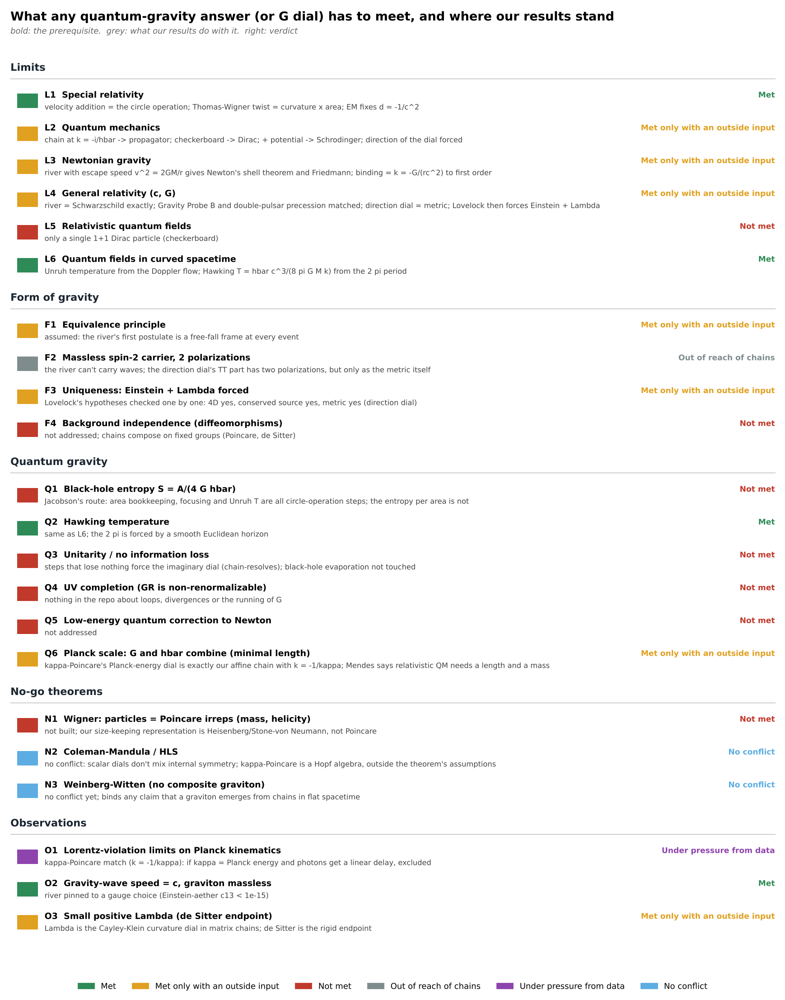
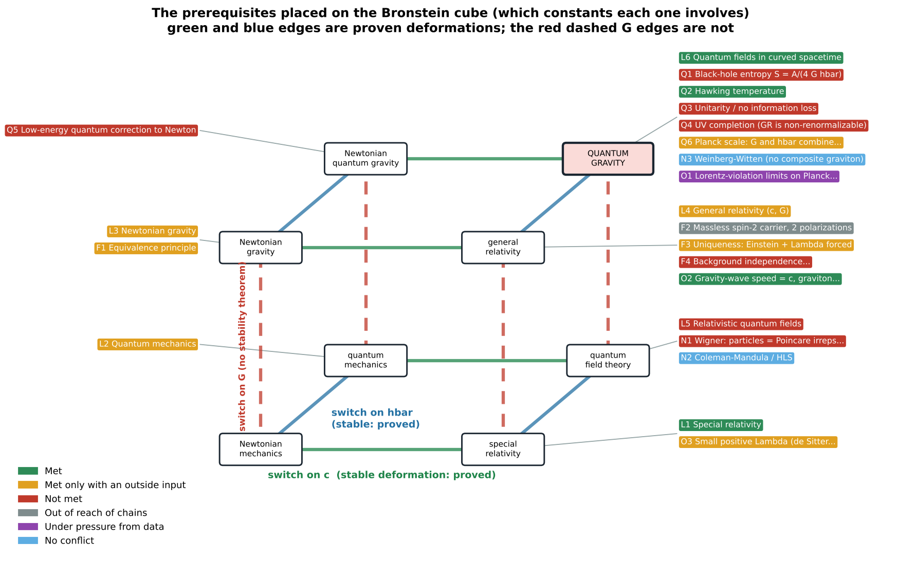
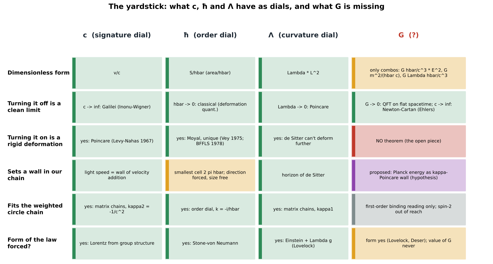
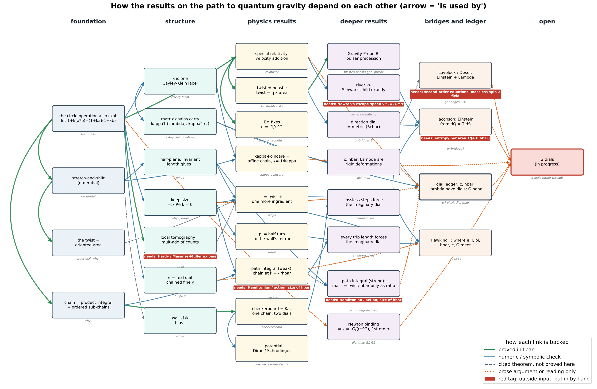
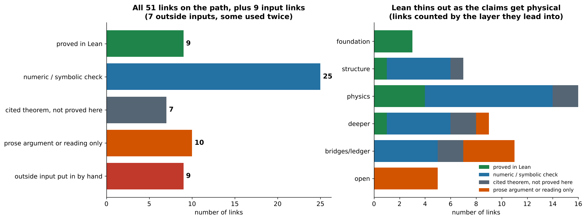
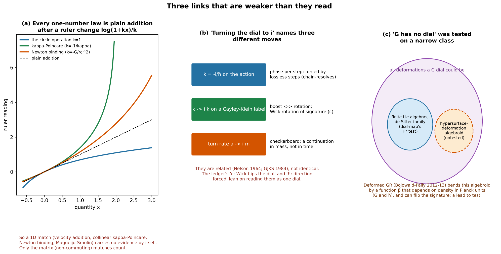
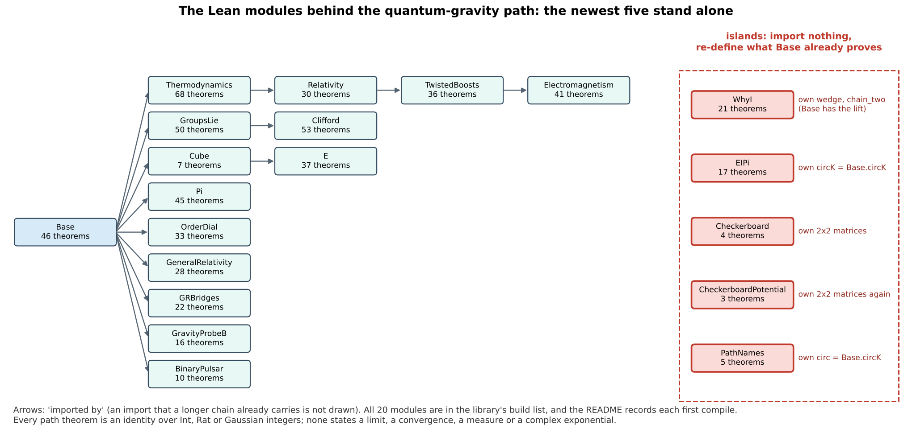
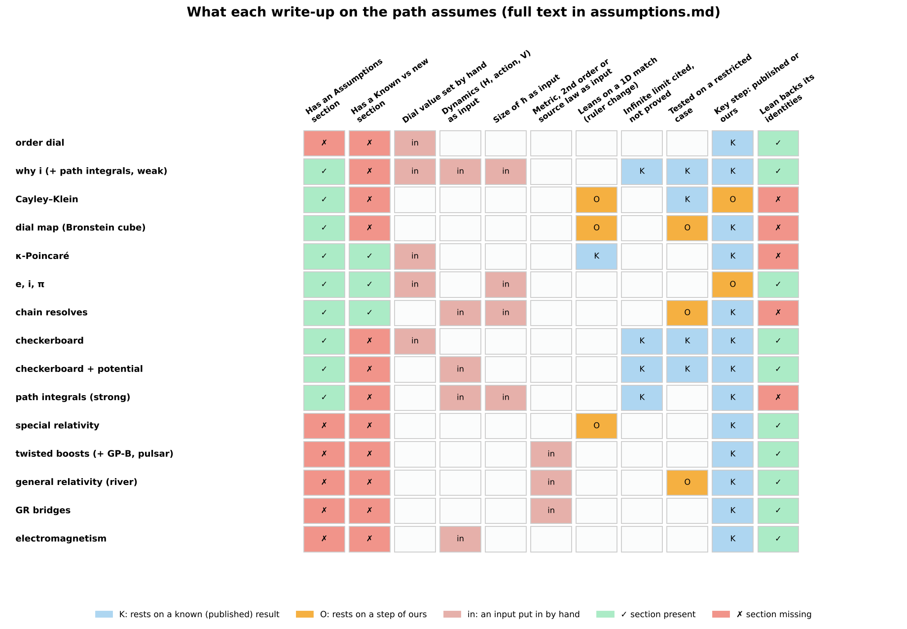

<!-- Synced from topics/dependency-map/README.md, with links pointing into that folder. Its data, scripts, graph.json and prerequisites.csv live there. -->

# Prerequisites for a G dial, and how our results depend on each other

**Verdict.** Of 22 things any quantum-gravity answer (or a dial for G) has to meet, our results meet 4 outright, meet 7 more only with an input put in by hand, and leave 7 unmet. The biggest missing prerequisite is the **black-hole area law S = A/(4Għ)**. On Jacobson's route to Einstein's equations, the circle operation (called mult-add before 1.0) supplies the area bookkeeping, the focusing and the Unruh temperature, and the entropy per area is the one piece put in from outside. A G dial that cannot produce that number has not done the job. The other unmet ones are structural: no quantum fields, no massless spin-2 carrier, nothing on the ultraviolet (Goroff–Sagnotti), no background independence.

- **Met:** special relativity (Lean-backed), the Hawking and Unruh temperatures (formula level, known physics), gravity-wave speed = c.
- **Met with an input:** quantum mechanics (needs a Hamiltonian and the size of ħ), Newton and GR (need Newton's escape speed, a metric, second-order equations), equivalence principle (assumed), Planck scale (κ = Planck energy is assumed), small Λ.
- **Not met:** area law, unitarity of black-hole evaporation, UV completion, Donoghue's low-energy correction, quantum fields, Wigner's particle classification, background independence.
- **Out of reach of chains:** a massless spin-2 field. **Under pressure from data:** reading κ as the Planck energy (Fermi and LHAASO bounds), though that depends on the basis.

The dependency graph has no cycles and no orphans. Five results are held up only by prose or cited theorems, and one of them is the **dial ledger** itself ("c, ħ, Λ have dials; G has none"): three of its five supports are readings in prose. "G has no dial" was tested only on finite Lie algebras of the de Sitter family; the hypersurface-deformation algebroid, where deformed GR (Bojowald–Paily) does bend G-dependent structure, was never tested.

Nothing here edits the write-ups or the Lean library.

## 1. The prerequisites, placed on the Bronstein cube

Each corner of the cube switches on a different set of constants (c, G, ħ). The c and ħ edges are proven rigid deformations (Lévy-Nahas 1967; Vey 1975, BFFLS 1978). The G edges have no such theorem, which is the gap a G dial would fill. Every unmet prerequisite but one sits at the quantum-gravity corner or the QFT corner.

### The full list

"Met only with an outside input" means our results reach it once something is put in by hand, named in the "rests on" column. Observational numbers were checked against the cited papers on Nov 25.

| | Prerequisite | Verdict | What our results do | What that rests on | Literature |
|---|---|---|---|---|---|
| L1 | Special relativity | **Met** | velocity addition = the circle operation; Thomas-Wigner twist = curvature x area; EM fixes d = -1/c^2 | Lean: Relativity (30), TwistedBoosts (36), Electromagnetism (41); 4x4 Lorentz checks | Einstein 1905; Levy-Leblond 1976 |
| L2 | Quantum mechanics | **Met only with an outside input** | chain at k = -i/hbar -> propagator; checkerboard -> Dirac; + potential -> Schrodinger; direction of the dial forced | numeric checks (why-i P1-P9, checkerboard 24, potential 17, chain-resolves 18); inputs: the Hamiltonian and the size of hbar | Feynman 1948; Chernoff 1968; Feynman-Hibbs 1965 |
| L3 | Newtonian gravity | **Met only with an outside input** | river with escape speed v^2 = 2GM/r gives Newton's shell theorem and Friedmann; binding = k = -G/(rc^2) to first order | sympy (general-relativity C); G and Newton's law are put in by the river postulate | Newton; Ehlers 1981 (c -> infinity limit of GR) |
| L4 | General relativity (c, G) | **Met only with an outside input** | river = Schwarzschild exactly; Gravity Probe B and double-pulsar precession matched; direction dial = metric; Lovelock then forces Einstein + Lambda | sympy, data; inputs: a metric (Schur forces it), second-order equations, the source coupling 8 pi G | Lovelock 1971; Deser 1970; Hamilton-Lisle 2008 |
| L5 | Relativistic quantum fields | **Not met** | only a single 1+1 Dirac particle (checkerboard) | no fields, particle creation, spin-statistics or renormalization anywhere in the repo | Weinberg QFT vol. 1 |
| L6 | Quantum fields in curved spacetime | **Met** | Unruh temperature from the Doppler flow; Hawking T = hbar c^3/(8 pi G M k) from the 2 pi period | numeric (gr-bridges J2, e-i-pi C19-C24); formula level, known physics | Unruh 1976; Hawking 1975; Gibbons-Hawking 1977 |
| F1 | Equivalence principle | **Met only with an outside input** | assumed: the river's first postulate is a free-fall frame at every event | an input, not derived (Weinberg derives it from a massless spin-2 S-matrix) | Weinberg 1964; MICROSCOPE eta < ~1e-15 (PRL 129, 121102, 2022) |
| F2 | Massless spin-2 carrier, 2 polarizations | **Out of reach of chains** | the river can't carry waves; the direction dial's TT part has two polarizations, but only as the metric itself | dial-map: chains of weighted circle operations can't express a two-index field on spacetime | Gupta 1954; Deser 1970; Boulware-Deser 1975 |
| F3 | Uniqueness: Einstein + Lambda forced | **Met only with an outside input** | Lovelock's hypotheses checked one by one: 4D yes, conserved source yes, metric yes (direction dial) | second order is put in by hand; G and Lambda stay free | Lovelock 1971 |
| F4 | Background independence (diffeomorphisms) | **Not met** | not addressed; chains compose on fixed groups (Poincare, de Sitter) | nearest fit: Hojman-Kuchar-Teitelboim, mentioned on the GR page but not worked | Hojman, Kuchar, Teitelboim 1976 |
| Q1 | Black-hole entropy S = A/(4 G hbar) | **Not met** | Jacobson's route: area bookkeeping, focusing and Unruh T are all circle-operation steps; the entropy per area is not | gr-bridges Part J names 1/(4 G hbar) as the one outside input | Bekenstein 1973; Hawking 1975; Jacobson 1995; Strominger-Vafa 1996 |
| Q2 | Hawking temperature | **Met** | same as L6; the 2 pi is forced by a smooth Euclidean horizon | numeric; known physics, reproduced | Hawking 1975; Gibbons-Hawking 1977 |
| Q3 | Unitarity / no information loss | **Not met** | steps that lose nothing force the imaginary dial (chain-resolves); black-hole evaporation not touched | numeric on the checkerboard and Gaussian actions only | Hawking 1976; Page 1993; Penington 2019; Almheiri et al. 2019 |
| Q4 | UV completion (GR is non-renormalizable) | **Not met** | nothing in the repo about loops, divergences or the running of G | - | 't Hooft-Veltman 1974; Goroff-Sagnotti 1986; Weinberg 1979 / Reuter 1998 (asymptotic safety) |
| Q5 | Low-energy quantum correction to Newton | **Not met** | not addressed | - | Donoghue 1994: V = -GMm/r [1 + 3G(M+m)/(rc^2) + (41/10pi) G hbar/(r^2 c^3)] |
| Q6 | Planck scale: G and hbar combine (minimal length) | **Met only with an outside input** | kappa-Poincare's Planck-energy dial is exactly our affine chain with k = -1/kappa; Mendes says relativistic QM needs a length and a mass | numeric (kappa-poincare K1-K7); kappa = Planck energy is an assumption, not derived | Bronstein 1936; Mead 1964; Lukierski et al. 1991; Mendes 1994 |
| N1 | Wigner: particles = Poincare irreps (mass, helicity) | **Not met** | not built; our size-keeping representation is Heisenberg/Stone-von Neumann, not Poincare | - | Wigner 1939 |
| N2 | Coleman-Mandula / HLS | **No conflict** | no conflict: scalar dials don't mix internal symmetry; kappa-Poincare is a Hopf algebra, outside the theorem's assumptions | known | Coleman-Mandula 1967; Haag-Lopuszanski-Sohnius 1975 |
| N3 | Weinberg-Witten (no composite graviton) | **No conflict** | no conflict yet; binds any claim that a graviton emerges from chains in flat spacetime | applies only if a G dial tries to build spin-2 as a composite | Weinberg-Witten 1980 |
| O1 | Lorentz-violation limits on Planck kinematics | **Under pressure from data** | kappa-Poincare match (k = -1/kappa): if kappa = Planck energy and photons get a linear delay, excluded | basis-dependent: some DSR readings predict no delay (relative locality) | Fermi GRB 090510: E_QG > 1.2 E_Pl (Nature 462, 331); LHAASO GRB 221009A: ~6-15 E_Pl |
| O2 | Gravity-wave speed = c, graviton massless | **Met** | river pinned to a gauge choice (Einstein-aether c13 < 1e-15) | gr-bridges L2, using GW170817 | GW170817: -3e-15 < dc/c < 7e-16 (ApJL 848, L13); m_g < ~1e-23 eV (GWTC-3) |
| O3 | Small positive Lambda (de Sitter endpoint) | **Met only with an outside input** | Lambda is the Cayley-Klein curvature dial in matrix chains; de Sitter is the rigid endpoint | numeric stability checks; the value Lambda * l_P^2 ~ 3e-122 is not addressed | Levy-Nahas 1967; Bacry-Levy-Leblond 1968; Planck 2018 |

## 2. The yardstick for a G dial

c, ħ and Λ each pass six tests. G passes the ones that are about limits and fails the one that matters: no theorem says switching G on is a rigid deformation. Like ħ in path-integral-strong, a G dial can only ever fix a dimensionless ratio: Għ/c³·E², Gm_p²/(ħc) ≈ 5.9×10⁻³⁹, or GΛħ/c³ ≈ 3×10⁻¹²².

**Checklist for the G-dial work** (the other thread's candidates, Barbero–Immirzi, MacDowell–Mansouri, Planck κ, Newton–Cartan/Carroll, Jacobson and teleparallel, can be scored against it):

1. Reproduce S = A/(4Għ), or say what fixes the entropy per area.
2. Give a stability or rigidity statement for switching G on, the way Lévy-Nahas does for c and Vey for ħ. If it lives on the hypersurface-deformation algebroid, test there, not on finite Lie algebras.
3. Reduce to Newton–Cartan as c → ∞ and to flat-space QFT as G → 0.
4. Carry two massless polarizations, or say why it doesn't need to (Weinberg–Witten binds any composite graviton).
5. Agree with Donoghue's 41/(10π) correction at long range, or explain the difference.
6. Survive the Lorentz-violation bounds if it puts a wall at the Planck energy (Fermi: E_QG > 1.2 E_Pl; LHAASO: ~6–15 E_Pl for a linear delay).
7. Fix only a dimensionless ratio; say which one.

## 3. How the results depend on each other

33 results, 51 links, and 7 outside inputs (used in 9 places, shown as red tags). Arrows point from a result to what uses it. Line style says how each link is backed.

Lean backing is strong at the foundation and thins out as the claims get physical. Of the 51 links, 9 are proved in Lean, 25 are numeric or symbolic checks, 7 rest on a cited theorem and 10 are prose readings. Every link into the open G-dial node is prose, which is right for a question still open.

### Cycles, orphans and weak links

- **Cycles:** none in the graph. One soft risk: "keep size ⇒ Re k = 0" presupposes a complex modulus, which would beg the question of where i comes from. It is not circular if stated in real 2×2 rotation form, and the write-ups should say so.
- **Orphans:** none. Every result traces back to the circle operation.
- **Held up only by prose or cited theorems** (not reachable from the circle operation through Lean or checked links):
  - the wall −1/k flips i (cited Fourier facts);
  - c, ħ, Λ are rigid deformations (the H² numbers are checked here; rigidity itself is cited);
  - Newton binding k = −G/(rc²) (a first-order reading);
  - Lovelock/Deser (cited, with second order and spin-2 put in by hand);
  - the G-dial node itself.
- **The ledger is softer than it reads.** Its supports: stability theorems (cited), ħ's direction (prose), Λ as κ₁ (checked), c as the signature dial (prose), ħ fixed only as a ratio (prose).

Three links read as stronger than they are:

- **(a) One-number matches carry no evidence.** Every one-parameter law becomes plain addition after the ruler change log(1+kx)/k. So velocity addition, collinear κ-Poincaré, Newton binding and Magueijo–Smolin matching the circle operation is automatic. Only the matrix (non-commuting) matches count.
- **(b) "Turning the dial to i" is three different moves:** k = −i/ħ on the action (forced by lossless steps), k → ik on a Cayley–Klein label (Wick rotation of signature), and a → im on the checkerboard (a continuation in mass). They are related (Nelson 1964; Gaveau–Jacobson–Kac–Schulman 1984) but not the same. The ledger's "c: Wick flips the dial" and "ħ: direction forced" lean on reading them as one.
- **(c) "G has no dial" was tested on a narrow class.** Deformed GR (Bojowald–Paily 2012–13) bends the hypersurface-deformation algebroid by a function β of density in Planck units and can flip the signature, which is a G-and-ħ-dependent deformation of exactly the kind we said doesn't exist. It is a lead for the G-dial work, with a caveat: Balek and Lecian question whether the signature change is physical.

Two smaller things:

- **Cited links:** Chernoff's theorem carries the unbounded-Hamiltonian case of the path integral, and chain-resolves tests Gaussian actions only.
- **Stale notes (fixed in the repo):** the why-i, e-i-pi and checkerboard READMEs said their Lean files were "not compiled", though the library README records a first compile for each on Nov 25. The repo copies now say compiled.

## 4. The Lean library behind the path

Fifteen modules hang off Base. The five newest (WhyI, EIPi, Checkerboard, CheckerboardPotential, PathNames) import nothing and re-define what Base already proves: their own circle operation, wedge and 2×2 matrices. Their theorems are true, but the library doesn't know they are about the same operation as Base's. Every path theorem is an identity over Int, Rat or Gaussian integers. None states a limit, a convergence, a measure or a complex exponential, so e, π and every continuum step are backed by numerics, not Lean. The shared build folder holds no compiled file for OrderDial or PathNames; the README records their first compiles, and there's no Lean here to recheck.

## 5. What each write-up assumes

The full per-write-up table is in [assumptions.md](topics/dependency-map/assumptions.md). Three things stand out:

- **9 of the 15 path write-ups have an Assumptions section.** The six without one are order-dial, relativity, twisted-boosts, general-relativity, gr-bridges and electromagnetism.
- **Inputs repeat.** The Hamiltonian, the size of ħ and the metric with its second-order law are put in by hand again and again.
- **Two key steps are ours, not published:** Cayley–Klein's reading of κ = −k²/4 as one label, and the e-i-π ledger. Every other key step rests on a published result.

## Files

- `figures/d1`–`d8`: the pictures above.
- `prerequisites.csv`: the full list with literature.
- `graph.json`: nodes, links, how each is backed, cycles and the weak set.
- `assumptions.md`: the per-write-up table.
- `data.py`, `assumptions.py`: the data. `figures.py` and `export.py` regenerate everything (`python3 -I figures.py && python3 -I export.py`; needs matplotlib and networkx).

## Assumptions of this page

- The link types are my reading of each write-up's checks, Lean theorem names and prose. A link marked "numeric" means the write-up's own check script covers it; I did not rerun those scripts.
- The Lean import graph was read from source, not built. There's no Lean toolchain here.
- The prerequisite list is a literature consensus, not a theorem. It is the bar that string theory, loop quantum gravity, asymptotic safety and causal sets are each held to. Someone could argue for dropping background independence or the area law's exact 1/4; I kept them because every major program treats them as tests.
- Status calls are coarse. "Met" for the Hawking temperature means our chain reproduces the known formula, not that it says anything new about it.

## Known vs new

- **Known:** every prerequisite and every number on it. The Bronstein cube (Bronstein 1936; Okun 1991). The rigidity results (Lévy-Nahas, Bacry–Lévy-Leblond, Vey, BFFLS). Jacobson 1995. The κ-Poincaré bicrossproduct basis (Majid–Ruegg 1994). Bojowald–Paily deformed GR.
- **New here:** the scoring of our results against the list, the dependency graph and its backing counts, and the three weak-link findings (ruler changes, the three meanings of "dial to i", the narrow scope of "G has no dial").

## Sources

- **Gravity and its form:** Lovelock, J. Math. Phys. 12, 498 (1971). Deser, Gen. Rel. Grav. 1, 9 (1970). Weinberg, Phys. Rev. 135, B1049 (1964). Weinberg & Witten, Phys. Lett. B 96, 59 (1980). Hojman, Kuchař & Teitelboim, Ann. Phys. 96, 88 (1976).
- **Black holes and entropy:** Bekenstein, PRD 7, 2333 (1973). Hawking, CMP 43, 199 (1975). Jacobson, PRL 75, 1260 (1995). Strominger & Vafa, PLB 379, 99 (1996).
- **The UV and low-energy corrections:** Goroff & Sagnotti, Nucl. Phys. B 266, 709 (1986). Donoghue, PRD 50, 3874 (1994).
- **Symmetry theorems:** Coleman & Mandula, Phys. Rev. 159, 1251 (1967). Haag, Łopuszański & Sohnius, Nucl. Phys. B 88, 257 (1975). Wigner, Ann. Math. 40, 149 (1939).
- **Rigidity and deformations:** Lévy-Nahas, J. Math. Phys. 8, 1211 (1967). Bacry & Lévy-Leblond, J. Math. Phys. 9, 1605 (1968). Bayen, Flato, Fronsdal, Lichnerowicz & Sternheimer, Ann. Phys. 111, 61 (1978).
- **κ-Poincaré:** Lukierski, Nowicki, Ruegg & Tolstoy, PLB 264, 331 (1991). Majid & Ruegg, PLB 334, 348 (1994).
- **Deformed GR:** Bojowald & Paily, PRD 86, 104018 (2012) and PRD 87, 044044 (2013).
- **Observations (web-checked Nov 25):**
  - MICROSCOPE final result: η ≈ 10⁻¹⁵, PRL 129, 121102 (2022).
  - GW170817 speed bound: −3×10⁻¹⁵ < Δc/c < 7×10⁻¹⁶, ApJL 848, L13 (2017).
  - GWTC-3 graviton mass: about 10⁻²³ eV (the preprint quotes 1.27×10⁻²³ eV; the published value is 2.42×10⁻²³ eV).
  - Fermi GRB 090510: E_QG > 1.2 E_Pl, Nature 462, 331 (2009).
  - LHAASO GRB 221009A: about 6–15 E_Pl for a linear delay.
- **Our write-ups read:** why-i and its subfolders (dial-map, cayley-klein, kappa-poincare, e-i-pi, chain-resolves, path-integral-strong, checkerboard, checkerboard-potential), order-dial, relativity, twisted-boosts, general-relativity, gr-bridges, electromagnetism, clifford, groups-lie, dial-potential, and the lean-library sources.
