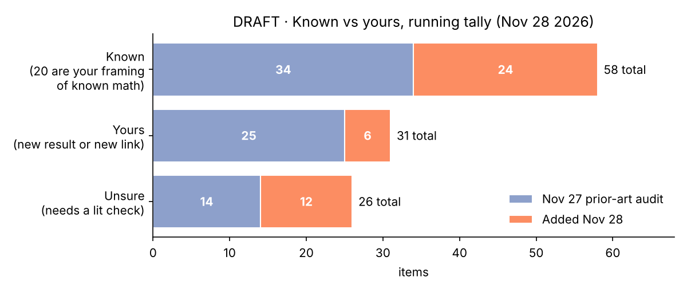

# DRAFT · Known vs yours: a running tally for Affine Composition Theory

*DRAFT, started Nov 28 2026. Brennan's ask (Nov 28): "we'll just have to keep a running tally". Built from the Nov 27
prior-art audit (`prior-art-audit/`, 73 claims, about 110 searches) plus the newer write-ups' own "known vs ours"
sections and a short search today on the hyperoperation ladder. Not a claim of priority: "Yours" means nothing was found
after searching, never that nobody has it.*

## The answer first

- **65 known, 31 yours, 31 unsure** (127 items so far).
- The core law, the two-dial law and most physics rounds are known math or physics. **20 of the known items are your own
  framing of known results**, which is real work but not a new result.
- What's yours is mostly **links between fields** and **formal (Lean) work**, plus a few results: the fused hyperoperation
  ladder with its uniqueness proof, the Lee–Yang rule on the roundness dial, and the three-slit cap on the dial.
- **One correction:** the extended law's "new dial c" from the helix round is the repo's existing d dial (the same
  two-dial family, Coleman–McGuinness 1991). The helix reading on it is still open (U1).

*Figure 1. Items per group. Blue came from the Nov 27 audit, orange was added Nov 28.*

## How to add to it

Append one row to the right table: a new id (K, Y or U plus the next number), one short line, the folder, the date.
Move a row between tables when a literature check settles it, and say in its line what settled it. Rows from the audit
keep its ids (A1, B2, M108 and so on); their sources are in `prior-art-audit/README.md`.

Rules for sorting:
- **Known:** a source states it. If the project adds a reading of known pieces, the line starts "your framing".
- **Yours:** a real search found nothing, or the audit found the pieces but not the link. Say exactly what's new.
- **Unsure:** the search was thin or not done. These are the next literature checks.

## Known (65)

| # | Item | What's known, or exactly what's yours | Where | Added |
|---|---|---|---|---|
| A1 | One law makes S3, boosts, dS | your framing; Nesterov-Sabinin 2000-04 | `prior-art-audit` | 2026-11-27 |
| A7 | 3D law = kappa-addition | Bachmann-Becigneul-Ganea 2020 | `prior-art-audit` | 2026-11-27 |
| A2a | q<0 sandwich = Einstein | Kim 2020 | `prior-art-audit` | 2026-11-27 |
| A3 | Twist = Thomas-Wigner, excess | Ungar; Nesterov-Sabinin | `prior-art-audit` | 2026-11-27 |
| A4 | Lorentzian law = de Sitter | Nesterov-Sabinin PRD 2000 | `prior-art-audit` | 2026-11-27 |
| A5 | Time as the fused shift | your framing; de Sitter 1917 (cosh restated) | `prior-art-audit` | 2026-11-27 |
| A6 | Why one time direction | Tegmark 1997; Dorling 1970 | `prior-art-audit` | 2026-11-27 |
| B1 | Twist = f=1 meron | Cork et al. 2021; Gibbons-Steif | `prior-art-audit` | 2026-11-27 |
| B2 | Tide = 3/2(qbar-q) | Sussman 2013 | `prior-art-audit` | 2026-11-27 |
| B3 | Twist -> q -> tide | Bartnik-McKinnon 1988 | `prior-art-audit` | 2026-11-27 |
| B4 | Hopf photon, charge 1/2 | Ranada 1989 | `prior-art-audit` | 2026-11-27 |
| B5a | n=3 wave swings, freezes | Abbassi et al. 2013 | `prior-art-audit` | 2026-11-27 |
| B6 | Dust ball, SdS | Markovic-Shapiro 2000 | `prior-art-audit` | 2026-11-27 |
| B7 | Lambda = 3q, sign | any GR text | `prior-art-audit` | 2026-11-27 |
| B8 | Loop identity, frame drag | circle-group commutator; Pereira et al. 2001 | `prior-art-audit` | 2026-11-27 |
| B9a | 1-6M/r split; (N-4v2)/B | your framing; standard ISCO; a rewrite | `prior-art-audit` | 2026-11-27 |
| B12 | C_A = 3 from curvature | QCD | `prior-art-audit` | 2026-11-27 |
| B14 | Ricci vs Weyl diagnosis | your framing; textbook diagnosis | `prior-art-audit` | 2026-11-27 |
| C2 | Closed slices (chosen) | your framing; chosen, not forced (rounds 27-28) | `prior-art-audit` | 2026-11-27 |
| B10 | Dimension flows as Mobius | your framing; Calcagni 2012; Adler 2011 | `prior-art-audit` | 2026-11-27 |
| P153 | Shor threshold box | Rahn-Doherty-Mabuchi 2002 | `prior-art-audit` | 2026-11-27 |
| M106 | Half power set, choice | your framing; Merimovich (one line) | `prior-art-audit` | 2026-11-27 |
| M25 | Set model of the dial | Spivak 2022 (Garner) | `prior-art-audit` | 2026-11-27 |
| S50 | No series for B_s | your framing; folklore level | `prior-art-audit` | 2026-11-27 |
| M188 | Branching residue | your framing; classical 1-b/a^2 | `prior-art-audit` | 2026-11-27 |
| M224 | Poisson GW not embeddable | Karlin-McGregor 1968 | `prior-art-audit` | 2026-11-27 |
| M153 | fma rounding fact | your framing; folklore level | `prior-art-audit` | 2026-11-27 |
| M09 | Lucas corner weights | your framing; folklore level | `prior-art-audit` | 2026-11-27 |
| M212 | Path-credit polytope | your framing; folklore level | `prior-art-audit` | 2026-11-27 |
| S44 | Plane law = Todd genus | Buchstaber-Panov (Todd genus) | `prior-art-audit` | 2026-11-27 |
| WS | Wall-shapes depth law | your framing; folklore level | `prior-art-audit` | 2026-11-27 |
| NF8 | Bell numbers at height s | OEIS A008826; Comtet 1974 | `prior-art-audit` | 2026-11-27 |
| A76 | Discounting family | Cajueiro 2006 | `prior-art-audit` | 2026-11-27 |
| P180 | Dyadic model at 1/3 | Cheskidov 2008 | `prior-art-audit` | 2026-11-27 |
| K1 | Core law a+b+kab | Perlis 1942, Jacobson 1945; Mathlib PreQuasiregular. The dial k is your framing | `mathlib-map` | 2026-11-28 |
| K2 | Every k != 0 gives the same monoid | one-line rescaling | `mathlib-map` | 2026-11-28 |
| K3 | Two-dial law (a+b+kab)/(1-d ab) | Coleman-McGuinness 1991 rational formal group laws; Todd genus | `why-i/cayley-klein` | 2026-11-28 |
| K4 | Extended law with c (helix round) | same family as K3: c is the repo's existing d dial, not a new dial | `bridges-study/helix-from-law` | 2026-11-28 |
| K5 | Every (k,d) law is the tangent law, kappa = -Delta/4 | your framing; C-M classify by k^2-4d | `why-i/cayley-klein` | 2026-11-28 |
| K6 | Kerr helix in imaginary time | Gibbons-Hawking 1977 | `bridges-study/c2-one-body` | 2026-11-28 |
| K7 | Kerr T and S = A/4 | Bekenstein 1973, Hawking 1975 | `bridges-study` | 2026-11-28 |
| K8 | Page curve | Page 1993 | `bridges-study` | 2026-11-28 |
| K9 | Renyi of a black hole (closed: area exponent = p dial) | Renyi 1961 | `bridges-study` | 2026-11-28 |
| K10 | Local tomography = law at k = +1 | your framing (a restatement); Masanes-Muller 2011, Hardy 2001 | `spin-i-tie/mm-map` | 2026-11-28 |
| K11 | Smooth turns need complex steps; k = -2 pin | your framing; Hardy 2001, Rabi formula | `spin-i-tie/smooth-turns` | 2026-11-28 |
| K12 | Anticommuting flips give 3D spin, third axis needs i | your framing; Pauli 1927 | `spin-i-tie/spin-3d` | 2026-11-28 |
| K13 | Max uncertainty iff anticommuting | your framing; Maassen-Uffink 1988, Wootters-Fields 1989 | `spin-i-tie/uncertainty-sign` | 2026-11-28 |
| K14 | Coin rule forces k = 0, then Shannon | your framing and Lean packaging; Faddeev 1956 | `spin-i-tie/lean-proof` | 2026-11-28 |
| K15 | Info causality needs more than the coin rule | page's own verdict: nothing new | `spin-i-tie/ic-from-coin` | 2026-11-28 |
| K16 | Only the exact disk passes the polygon test | Barnum et al. 2009 | `spin-i-tie/polygon-entropy` | 2026-11-28 |
| K17 | Fixed cell volume: vacuum energy doesn't gravitate | your framing (as why-i's A4); Unruh 1989, Henneaux-Teitelboim 1989 | `why-i/unimodular` | 2026-11-28 |
| K18 | Unimodular leak fit (BIC prefers plain) | models Josset-Perez-Sudarsky 2017; the fit is our computation | `why-i/unimodular-fit` | 2026-11-28 |
| K19 | Torsion is derived, not a dial | Cartan-Schouten 1926 | `forces rounds` | 2026-11-28 |
| K20 | Chain dial k equals q = 1 + k (q-integers) | q-analogs; Knauf's chain | `riemann` | 2026-11-28 |
| K21 | Field energy as its own source | Kraichnan 1955, Deser 1970 | `gravity-from-theory/spinning-river` | 2026-11-28 |
| K22 | Hyperoperation sequence | Goodstein 1947; Ackermann 1928; Knuth 1976 | `hyperoperation-ladder` | 2026-11-28 |
| K23 | Commutative ladder of operations | Bennett 1915; Jaramillo 2020 (arXiv 2012.04093) | `hyperoperation-ladder` | 2026-11-28 |
| K24 | Rung n+1 fails to distribute over rung n | as a fact (Venkatesh, AMS column 2022) | `hyperoperation-ladder` | 2026-11-28 |
| K25 | One shared time axis with a tick rate per place (lapse); a passing wave needs the rate to change in time or space to stretch, by choice of slicing | ADM 1959; synchronous gauge (Landau-Lifshitz); Geroch 1970 time function | `time-study` | 2026-11-28 |
| K26 | Detector-frame tick rate N^2 = 1 - 1/2 hdd_ij x^i x^j gives the wave's tidal pull; good to (wL)^2/6 | Manasse-Misner 1963 (Fermi coordinates); LIGO/LISA arm response | `time-study` | 2026-11-28 |
| K27 | A rate alone can't tilt time; a wave's twist is its winding pattern times i; perpendicular tilts leave a turn | linearised GR; Newman-Penrose 1962; Thomas 1926, Wigner 1939 | `time-study/tilt` | 2026-11-28 |
| K28 | Velocity addition as the law in disguise, c as a fixed point; light cones in neighbour chains | Einstein 1905; Coleman-McGuinness 1991; Lieb-Robinson 1972 | `time-study/tilt` | 2026-11-28 |
| K29 | Bianchi identity gives dB/dt = curl E for any metric; plane wave B = n x E | Bianchi 1902; Maartens-Bassett 1998; MTW 1973 | `time-study/twist` | 2026-11-28 |
| K30 | Wave moving at c has 6 curvature pieces (spin 2 + null matter); vacuum = balanced for every observer | Pirani 1957; Baez-Bunn 2005 | `time-study/shape` | 2026-11-28 |
| K31 | Composed short steps give e^{-iEt}; Cayley steps exactly unitary; GW phase shift on quantum clocks | Feynman 1948; Crank-Nicolson 1947; Dimopoulos et al. 2008 | `time-study/quantum` | 2026-11-28 |

## Yours (31)

| # | Item | What's known, or exactly what's yours | Where | Added |
|---|---|---|---|---|
| A2b | q>0 sandwich on S3 | link: q>0 sandwich on S3 not found stated | `prior-art-audit` | 2026-11-27 |
| A8 | Regge slabs on law corners | link: sizing 600-cell Regge universes by the law | `prior-art-audit` | 2026-11-27 |
| B9b | Sommerfeld = Thomas turn | link: equality not found (implied by Biedenharn 1983) | `prior-art-audit` | 2026-11-27 |
| B11 | AdS3 Poisson clock | link: probability reading not found | `prior-art-audit` | 2026-11-27 |
| S85 | Channels on one line | link: the one-line picture | `prior-art-audit` | 2026-11-27 |
| L1 | Corner sum: k >= sqrt6-3 | link: the number sqrt6-3 not found printed | `prior-art-audit` | 2026-11-27 |
| M108 | No f(f(n)) = 2^n on N | nothing found after a real search | `prior-art-audit` | 2026-11-27 |
| M189 | (log n)/n^2 constant | link: the constant not found (Zolotarev 1957 unread) | `prior-art-audit` | 2026-11-27 |
| M67 | TL tangles and parabola | nothing found after a real search | `prior-art-audit` | 2026-11-27 |
| NT | Explicit shared-centre dims | link: explicit families and plane version (line formula Barany-Verma 2025) | `prior-art-audit` | 2026-11-27 |
| A03 | Size consistency k=1 | link: cross-link | `prior-art-audit` | 2026-11-27 |
| A10 | Madelung exceptions | link: cross-link | `prior-art-audit` | 2026-11-27 |
| G1 | One law: kinetics, synapse, AMH | link: cross-link | `prior-art-audit` | 2026-11-27 |
| A124 | AMH/Hamacher line | link: cross-link | `prior-art-audit` | 2026-11-27 |
| G2 | Map functions as copulas | link: copula link (line is Felsenstein 1979) | `prior-art-audit` | 2026-11-27 |
| G3 | Haldane = piling-up | link: cross-link | `prior-art-audit` | 2026-11-27 |
| G4 | Huckel = TL/Beraha | link: cross-link | `prior-art-audit` | 2026-11-27 |
| G5 | Lee-Yang binding test | link: Lee-Yang radius test (zeros: Briggs 1985) | `prior-art-audit` | 2026-11-27 |
| A63 | Two-synapse lens law | link: cross-link | `prior-art-audit` | 2026-11-27 |
| A67 | Global epistasis on dial | link: cross-link | `prior-art-audit` | 2026-11-27 |
| A71 | Predator interference dial | link: cross-link | `prior-art-audit` | 2026-11-27 |
| A83 | Claim-count line | link: cross-link | `prior-art-audit` | 2026-11-27 |
| N11 | Shapley = actuarial UDD | link: the identity (Owen 1972; actuarial UDD) | `prior-art-audit` | 2026-11-27 |
| P137 | Diamond-lattice Potts | link: cross-link | `prior-art-audit` | 2026-11-27 |
| P26 | Three-body run-price law | link: per-run prices (Suvakov-Dmitrasinovic 2015) | `prior-art-audit` | 2026-11-27 |
| Y1 | Fused whole rung n = Goodstein's H_n through x -> x+1, unique | the tie plus its uniqueness theorem; the shift itself is one line. Backs the name 'Fused Hyperoperation Algebra' for whole rungs | `hyperoperation-ladder` | 2026-11-28 |
| Y2 | Two ladders meet at exactly one step, a+b+ab | not found in a search today (thin) | `hyperoperation-ladder` | 2026-11-28 |
| Y3 | Law board for every rung, 80 Lean theorems, mod-7 proof on giant rungs | formal work; the mod-7 trick is standard, its use here is new | `hyperoperation-ladder` | 2026-11-28 |
| Y4 | Lean library, 3,954 theorems | formal work | `lean-library` | 2026-11-28 |
| Y5 | Lee-Yang holds iff a <= p on the roundness dial; p = 3 and near zone to p = 8 proved | page's search: not found in print; Kuttner/Golubov neighbour; a specialist should read | `shape-dial-survey` | 2026-11-28 |
| Y6 | Three-slit cap on the dial, |k| < 0.07 | our bound from Kauten 2017 data | `spin-i-tie/three-slit-cap` | 2026-11-28 |

## Unsure (31)

| # | Item | What's known, or exactly what's yours | Where | Added |
|---|---|---|---|---|
| B5b | Couplings (3, -6) | nothing found, but the search was thin | `prior-art-audit` | 2026-11-27 |
| S145 | CHSH on lp = 2 J(lp) | nothing found, but the search was thin | `prior-art-audit` | 2026-11-27 |
| M230 | Soft min cut obeys MMI | nothing found, but the search was thin | `prior-art-audit` | 2026-11-27 |
| M166 | No functor sqrt of P | nothing found, but the search was thin | `prior-art-audit` | 2026-11-27 |
| M49 | Horn coefficient a1 | nothing found, but the search was thin | `prior-art-audit` | 2026-11-27 |
| M264 | Kiss constants climb | folklore level | `prior-art-audit` | 2026-11-27 |
| M278 | Rung sheet area gauge | nothing found, but the search was thin | `prior-art-audit` | 2026-11-27 |
| M261 | e at height s | nothing found, but the search was thin | `prior-art-audit` | 2026-11-27 |
| M62 | 3-body vs 4-body minors | nothing found, but the search was thin | `prior-art-audit` | 2026-11-27 |
| S48 | k2-4d = s at height s | nothing found, but the search was thin | `prior-art-audit` | 2026-11-27 |
| A29 | Order-n law on the plane | cross-link, thin search | `prior-art-audit` | 2026-11-27 |
| P173 | Helical toy blow-up | nothing found, but the search was thin | `prior-art-audit` | 2026-11-27 |
| P174 | Homochiral NS question | thin search | `prior-art-audit` | 2026-11-27 |
| P24 | Figure-eight on Fock arc | nothing found, but the search was thin | `prior-art-audit` | 2026-11-27 |
| U1 | Helix = rim speed composed with itself at d = +-1 | reading not lit-checked | `bridges-study/helix-from-law` | 2026-11-28 |
| U2 | Unrelated coin scales leftover by 1 + kS (mixing forces k = 0) | page: may be written somewhere | `spin-i-tie/linear-mixing` | 2026-11-28 |
| U3 | Law at k != 0 interferes at every Sorkin order | page: as far as found | `spin-i-tie/interference-law` | 2026-11-28 |
| U4 | Reflection positivity on the real dial; RP gives the energy-zero step | page: link not found, short step | `why-i/reflection-positivity` | 2026-11-28 |
| U5 | Only the backwards-reading sum has no preferred hand; eta(0) closed form | no lit check recorded | `forces round 32` | 2026-11-28 |
| U6 | Extra flex on the Freudenthal gluing; graviton cone = lattice wave | page: not found by us | `forces round 34` | 2026-11-28 |
| U7 | SO(10) route: law on the 10-sphere, one hand = one generation | group textbook (Georgi 1975); the route not lit-checked | `physics-bridges` | 2026-11-28 |
| U8 | Light-speed lag cancels pi^2; 41/16 must come from field energy | short search only | `gravity-from-theory/spinning-river` | 2026-11-28 |
| U9 | k dial on Knauf's chain gives sum phi(m)[m]_q^-beta | quick search only | `riemann/k-dial-cusp` | 2026-11-28 |
| U10 | Correction to Gupta's 2PN Lagrangian | check Eq. (7.1) before it counts | `hypersphere/orbits` | 2026-11-28 |
| U11 | 6 three-body loop types not in Li-Liao's list | newer catalogs not checked | `three-body` | 2026-11-28 |
| U12 | Decaying flow on a Klein bottle ends as one vortex | numerical, no lit check | `klein-flow` | 2026-11-28 |
| U13 | Wave read as the helix's winding rate swinging in a four-leaf pattern, law per place with the fastest clock as reference | our reading of K26, not lit-checked | `time-study` | 2026-11-28 |
| U14 | Time as a rung-1 composition chain; arrow and light speed are the same absorbing point -1/k (limit vs landing) | Brennan's hunch, tested; not lit-checked | `time-study/tilt` | 2026-11-28 |
| U15 | Wave's twist = i x rate pattern from the chain's consistency plus its speed limit, no field equations | route not lit-checked | `time-study/twist` | 2026-11-28 |
| U16 | 'Balanced' as the rest state of the neighbour chain; speed limit does the main cut to the four-leaf | reading, not lit-checked | `time-study/shape` | 2026-11-28 |
| U17 | One rung-1 chain carries both the wave's twist and quantum phase through the same i | reading, not lit-checked | `time-study/quantum` | 2026-11-28 |

## Not yet sorted

The 145 write-ups were not read one by one. Rows come from the audit and from pages that have their own "known vs
ours" section. Pages without one (for example the chemistry, biology and NS planes pages) are not in the tally yet.

## Sources for today's search

- Hyperoperation background: https://en.wikipedia.org/wiki/Hyperoperation ; Mathlib `Mathlib.Data.Nat.Hyperoperation`.
- Distributivity of hyperoperations: Venkatesh, AMS Feature Column, https://mathvoices.ams.org/featurecolumn/?p=1510
- Bennett's commutative ladder: Jaramillo, https://www.arxiv.org/pdf/2012.04093
