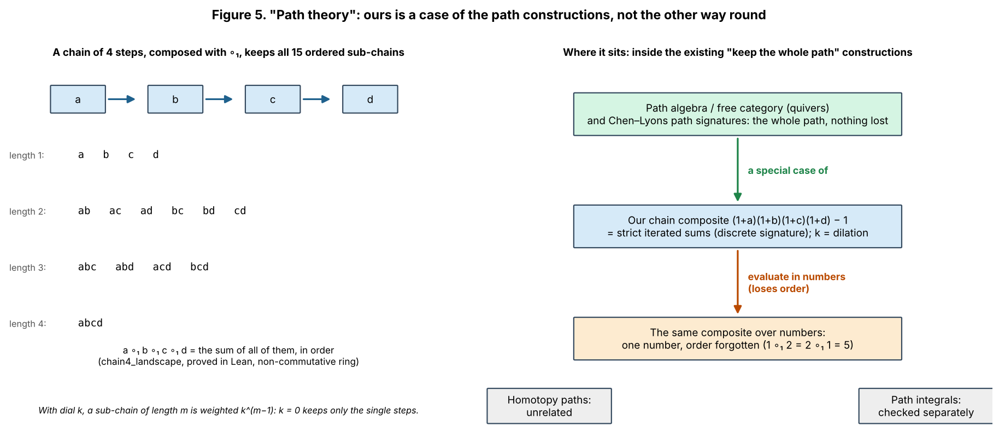

# Naming collisions

Some names and symbols in Fused Hyperoperation Algebra mean something else in standard mathematics, in physics, in
computing, or in Lean's mathlib library. This page lists every one we know of, so that a reader who meets one of ours
(or one of theirs) can tell which meaning is in play.

Version 0.1.0 is already released, and it uses all of the names below. Nothing here renames anything. Renames
proposed for 1.0 are in [the names review](topics/names-review/README.md). Once 1.0 is out, this page records which meaning each version
uses.

Last checked: 2026-11-25, against the repo at commit efa8013 and a fresh copy of mathlib4.

## What changed for 1.0 (decided Nov 25, 2026)

Brennan chose to follow the literature. Pages and the Lean library now use the names on the right. Version 0.1.0 and
its release notes keep the old names, so both columns stay here.

| Old (v0.1.0) | 1.0 | Why |
|---|---|---|
| mult-add, written ⊞, ✳ or ⊕ | the circle operation, ∘₁ on the page, ◯ in Lean (`circ`) | ring theory's name for a + b + ab (Perlis 1942, Jacobson 1945; mathlib `PreQuasiregular`) |
| weighted mult-add a ⊞ₖ b | the circle operation with dial k, ∘ₖ on the page, ◯[k] in Lean (`circK`) | k = 1 and k = −1 are the two ring-theory sign conventions; k = 0 is addition |
| ⊞ for the shifted add a + b + 1 | `sadd`, by name | one glyph, one meaning |
| ⊛ for rung 3 | `fexp`, by name | one glyph, one meaning |
| ⊛ for the operator circle operation | ◯ₒ in Lean (`opCirc`) | one glyph, one meaning |
| ⊕ for the two-dial law | ∘ₖ,d on the landscape pages; ⊕ kept only for relativistic velocity addition, which is physics' own symbol | ⊕ is a direct sum in mathematics and `Sum` in Lean |
| q, the plane's second dial | d | Coleman and McGuinness 1991 |
| q = k + 1 | retired; Tsallis's index is written q_T = 1 − k | it clashed with the other q and with Tsallis |
| d in the zoom dial | s for the exponent (Σ rᵢ^s = 1), D for the dimension | Falconer and Hutchinson; Lapidus and van Frankenhuijsen; frees d for the plane |
| Lean `multAdd`, `wAdd`, `multAddInv`, `foldMA`, namespace `MultAdd`, module `MultAddRing` | `circ`, `circK`, `circInv`, `foldCirc`, namespace `CircleOp`, module `CircleRing` | the old names still work for one minor release as deprecated aliases (`Deprecated.lean`) |

The rows below describe the v0.1.0 names.

## Symbols

| Symbol | What it means here | What it means elsewhere | Where it appears here | Since |
|---|---|---|---|---|
| ⊞ | Mult-add, a ⊞ b = a + b + ab. It is the scoped Lean notation in `Base.lean` and appears about 1,630 times in the repo. **It has two other meanings inside this project too:** the rung-1 shifted add a + b + 1 in one `Rungs.lean` comment, and the product `MARing.madd` in `MultAddRing.lean`. | Mathlib: the biproduct X ⊞ Y of two objects in a category. Mathlib chose ⊞ because ⊕ was already taken. | `Base.lean`, most write-ups, `Rungs.lean`, `MultAddRing.lean` | v0.1.0 |
| ⊕ | Mult-add, in the README header and in `Rungs.lean`. Also the whole two-dial law (a + b + k·ab)/(1 − q·ab) on the landscape pages. | Lean core: the sum of two types, α ⊕ β. In mathematics generally: direct sum. In computing: exclusive or. | README, `Rungs.lean`, landscape and proof-engine pages | v0.1.0 |
| ⊛ | Two meanings here: the rung-3 operation in `Rungs.lean` comments, and mult-add itself (`opMA`) in `FunctionalAnalysis.lean`. | Mathlib: Day convolution of functors, and applying a stream of functions. In analysis and signal processing: convolution. | `Rungs.lean`, `FunctionalAnalysis.lean`, about 300 uses | v0.1.0 |
| ✳ | Mult-add. It is declared locally in about 80 Lean files and used in most write-ups (about 1,970 uses). | No use found in mathlib, but mathlib's character linter does not allow it, and Lean's editor has no shortcut for it. | Most of the repo | v0.1.0 |

## Letters

| Letter | What it means here | What it means elsewhere | Where it appears here | Since |
|---|---|---|---|---|
| q, as q = k + 1 | A second name for the dial k, shifted by 1. | Tsallis statistics uses q for the same family with **q_Tsallis = 1 − k**, so our q is 2 − q_Tsallis. Our q = 2 is their q = 0, for example. Also, q in q-analogs (q-binomials, quantum groups) is a base, an unrelated quantity. | Dial survey, information theory pages | v0.1.0 |
| q, the plane's second dial | The d-like dial in the law (a + b + k·ab)/(1 − q·ab). In relativity q = −1/c², as the v0.1.0 notes say. | Coleman and McGuinness (1991) call this dial d, with the same sign. **Inside the project it clashes with the other q** (the line above). | Landscape, relativity and electromagnetism pages, v0.1.0 release notes | v0.1.0 |
| k | The dial in a + b + k·ab, defined on whatever quantity is being composed. Pages that compose **weights** have k = +1 for "at most once". Pages that compose **probabilities** (or use the factor (1 − kz)^(−1/k)) have k = −1 for "at most once". Both are correct, because weights composing by k means probabilities compose by −k (proved in `Conventions.lean`). | Shirai and Takahashi's α for determinantal processes matches our probability side (α = −1 is determinantal, which is fermions). Tsallis's q matches 1 − k. In physics k often means Boltzmann's constant, and in algebra it often means a field. Ours means neither. | Every page with a dial | v0.1.0 |
| d (proposed for 1.0, not adopted) | The proposed new name for the plane's second dial, matching Coleman and McGuinness. | **It would clash with d for dimension in the zoom dial** (Moran's equation x(d) = 1). The zoom dial was added after v0.1.0. This has to be settled before d is adopted. | Proposed only; zoom dial uses d for dimension | not released |
| d in `topics/entropy-topology/` (two meanings on one page) | The curvature dial d in (x + a + kax)/(1 − dax). | The **Jensen degree** d in Griffin–Ono–Rolen–Zagier's J^{d,n} (kept for the literature). That page writes "Jensen degree d" or J^{d,n} whenever the second meaning is meant. | `topics/entropy-topology/` §8, `jensen.py` | Nov 27, 2026 |
| s (three meanings) | **Height s** of a rung law (the dial s in the dial audit and fractional rungs). **Trial exponent s** in Σ rᵢˢ = 1 (the zoom dial, D at the root). **Riemann's s** in ζ(s) in the number-theory pages. | Moran and Falconer use s for the trial exponent; Riemann uses s. The derived-dial catalogue writes the prime-dial exponent as σ (t_p = p^−σ) to keep it apart from height s. | `topics/dial-audit/`, `topics/ratio-dial-survey/`, Riemann rounds | Nov 26, 2026 |
| q, the Tate parameter | In `lean-library-mathlib/MathlibCandidates/TateCurve.lean`: the variable of the power series ring `R⟦q⟧` (written `X` in Lean, as Mathlib does), the nome q = e^(2πiτ) of modular forms. | Standard in number theory (Tate, Silverman). **Inside the project it clashes with both q's above**, and with q in q-analogs. | `MathlibCandidates/` | Nov 27, 2026 |
| E₄, E₆ | `TateCurve.E₄ R`, `TateCurve.E₆ R`: the Eisenstein series 1 + 240s₃ and 1 − 504s₅ as formal power series. | Mathlib: `ModularForm.E₄`, `ModularForm.E₆` are the same series as modular forms (functions on the upper half plane; `TateCurve.qExpansion_E₄` links them), and `E₆` is also a Coxeter–Dynkin type (`CoxeterMatrix.E₆`). The `TateCurve` namespace keeps the Lean names apart. | `MathlibCandidates/` | Nov 27, 2026 |
| α(n), α_k | The inverse Ackermann function and its hierarchy (each α_k undoes one rung of the ladder), on the union-find page. | Shirai and Takahashi's α for α-determinantal processes (see the k row); Lean's type variable α; fine-structure constant in physics. | `topics/union-find/` | Nov 27, 2026 |
| a, as a = k^(−1/2) | The Lee–Yang edge coupling, on the union-find page. | Elsewhere in this repo a is the first argument of the fused operation fused_n(a, b) (the same page uses both: Ackermann is fused_n at a = 1). In Lee–Yang papers the coupling is usually written t or e^(−2βJ). | `topics/union-find/` | Nov 27, 2026 |

## Words

| Word | What it means here | What it means elsewhere | Since |
|---|---|---|---|
| mult-add | a + b + ab. The standard algebra names are the circle operation or quasi-regular product (Perlis 1942, Jacobson 1945). Mathlib has it as `PreQuasiregular`, written y + x + xy. | In computing, "multiply-add" and "multiply-accumulate" mean a·b + c, a different operation. | v0.1.0 |
| Fused (in the project name and in "fused exponent", "fused tetration") | An ordinary operation conjugated by x ↦ 1 + x. For example, fused exponent = (a + 1)^(b + 1) − 1. | In computing, "fused multiply-add" (FMA) is the rounding-once a·b + c instruction. In physics, "fusion" means fusion rules and fusion categories. | v0.1.0 |
| wall | The point a = −1/k where 1 + k·a = 0, so there is no way back (inverse). | "Walls" and "wall-crossing" in geometry and string theory (stability conditions) are unrelated. | v0.1.0 |
| rung (two meanings inside the project) | **Whole rung n**: Goodstein's hyperoperation H_n read through x ↦ 1 + x (rung 1 = a + b + 1, rung 2 = a + b + ab, rung 3 = fused exponent). **"Fractional rung" / "rung height" s** in `topics/fractional-rungs/` and its subpages: the commutative operation B_s = E^s(E^−s a + E^−s b), E = eˣ − 1, where height 0 is + and height 1 is a + b + ab. The two ladders share only a + b + ab (whole rung 2 = height 1); height 2 is not rung 3 and height 0 is not rung 1 (`topics/hyperoperation-ladder/`). Use **rung** for whole rungs and **height** for B_s. Found Nov 26, 2026. | Goodstein (1947) numbers the hyperoperation sequence with addition at 1, multiplication at 2, so our whole rung n matches his index. Bennett (1915) and later "commutative hyperoperations" index a commutative ladder like our heights. | not released |
| twist | Weight is twist: a ✳ₖ b rescales to mult-add (`wAdd_scale`). Twisted boosts: twist = q × area. | Drinfeld twists, twisted group algebras and cocycle twists in algebra. The twisted-boosts use may be close to a cocycle twist; this is not checked. | v0.1.0 |
| degree (three meanings in `topics/entropy-topology/`) | **Circle degree**: how many times a self-map of RP¹ wraps round (Brouwer degree; can be negative). **Algebraic degree**: the degree of a polynomial or rational map. **Jensen degree** d (see Letters). | Standard; the page always says which. Graph degree and field-extension degree elsewhere are unrelated. | Nov 27, 2026 |
| trace (trace monoid) | In `topics/chaos-composition/`: a word of branch maps up to swapping letters that commute (maps that share a centre); the Cartier–Foata trace monoid. | Linear algebra: the trace of a matrix (sum of the diagonal), which the repo also uses (e.g. tr² − 4det). Computer science: Mazurkiewicz traces, the same as ours. | Nov 27, 2026 |

## Not collisions, but private names for known things

Words such as rung (hyperoperation level), dial (parameter) and way back (inverse) name standard ideas in our own
words. They are mapped to the standard names and first sources in the credit glossary (NAMES.md), not here.

## How to use this page

- A write-up that uses one of the names above should link here the first time it uses it.
- If 1.0 adopts a rename, this page keeps both rows, marked with the version each one applies to, so 0.1.0 readers can
  still follow.
- Add a row whenever a new collision is found. Note the date and where it was found.

## Proposed framework name: "path theory" (checked 2026-11-25, not adopted)

Brennan asked whether "path theory" could name the whole framework, since its big idea is that a chain of compositions
keeps its whole landscape, not just each step's result. He said the name is fine if the existing "path" fields turn out
to be special cases of ours, and that this needs checking. Path integrals are being checked separately. The other three
are below.

**Verdict: none of them is a special case of ours. Two of them contain ours as a special case, and the third is
unrelated.** Our idea is a case of theirs, not the other way round.

| Field | What "path" means there | How it relates to ours |
|---|---|---|
| Path algebras and free categories (quiver representation theory; Gabriel 1972; Mac Lane's free category on a graph) | Formal sums of paths in a directed graph, multiplied by joining them end to end. Every path is kept as its own basis element, so nothing is lost. | **Ours is inside theirs.** Over a non-commutative ring, the circle composite of a chain is (1 + a)(1 + b)(1 + c)(1 + d) − 1, which equals the sum of every ordered sub-chain, each once (`chain4_landscape`, Lean). That is one particular element of the path algebra of a one-vertex quiver (the free algebra on the steps). The path algebra holds every path; ours picks out one combination. |
| Path signatures and rough paths (Chen 1957; Lyons 1998; Hambly and Lyons 2010) | The signature of a path is the sequence of all its iterated integrals, and Chen's identity says that joining paths multiplies signatures. A path is determined by its signature up to "tree-like" detours (Hambly–Lyons). | **Ours is a case of theirs.** In the tensor algebra, the circle composite of a chain is the strict iterated sums of the steps, the discrete form of the signature (the iterated-sums signature of Diehl, Ebrahimi-Fard and Tapia, on words of single letters). As the steps shrink along a smooth path, these sums tend to Chen's iterated integrals. Our dial k weights a sub-chain of length m by k^(m−1) (`chain3_dial`, Lean), which is the graded dilation that rough-path theory already uses, divided by k. |
| Homotopy paths and the path groupoid (topology) | Paths in a space, joined end to end and counted only up to continuous deformation. | **Unrelated.** Homotopy deliberately forgets almost everything about a path except its class, which is the opposite of keeping the whole landscape. Our circle-operation group has a path groupoid like any space does, but nothing in the framework adds to or comes from it. |

**One honest caution about "nothing lost".** The landscape is kept only when the circle operation is computed in a
non-commutative setting, such as the free algebra, matrices or operators. Over ordinary numbers the composite is a single
number, and different chains give the same answer: 1 ∘₁ 2 = 2 ∘₁ 1 = 5 (`scalar_shadow`, Lean). Swapping two steps
changes the composite by exactly k times their commutator (`circ_swap`, Lean), so order survives only where steps
don't commute. The lossless version of the idea is the free one, which is exactly where path algebras and signatures
already live.

**Collision cost of the name, whatever the verdict.** "Rough path theory" is already the name of a field, so
"path theory" reads as that field or its parent. "Path" also already names path algebras, path categories, path
groupoids and path spaces, path integrals, and GLMY path homology of directed graphs (Grigor'yan, Lin, Muranov and Yau).
Searches for the name would mostly find those. Taking it would also suggest that those fields sit under this one, and
the check above shows they don't.

**Alternatives that follow the literature:**
1. **Keep naming the framework by its operation:** "the weighted circle operation" (ring theory; Coleman and
   McGuinness for the two-dial family). This is accurate, and it matches the 1.0 rename plan.
2. **For the whole-chain idea, use the signature's language:** describe it as "the signature of a chain under the
   circle operation", citing Chen, Lyons and Diehl–Ebrahimi-Fard–Tapia. This places the idea where the literature
   already has the tools: uniqueness, the shuffle algebra, and machine-learning uses.
3. **For "nothing lost" as a principle, the standard mathematical word is "free":** free monoid, free category, free
   algebra. In database theory, the same idea of keeping a record of how a result was composed is "provenance"
   (Green, Karvounarakis and Tannen, "Provenance semirings", PODS 2007).

Lean for this section: `lean/PathNames.lean` (core Lean 4.37, no `sorry`, standard axioms): `circ_one_assoc`,
`chain4_landscape`, `chain3_dial`, `circ_swap`, `scalar_shadow`.
