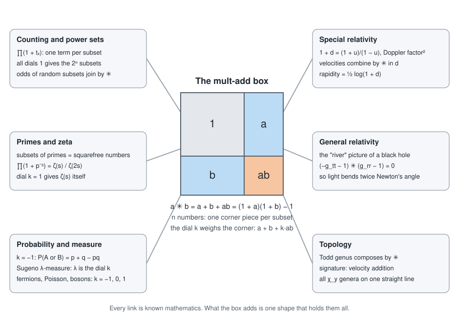

# Fused Hyperoperation Algebra

Brennan Pope's math theory, with the proofs, checks, figures and write-ups gathered in one place. (It was called Fused Mult-Add Algebra until Nov 25, 2026.)

## The idea in plain words

Ordinary arithmetic throws information away. 0 × 4 = 0 forgets the 4, and 4 / 0 is simply "undefined". This project looks for operations that keep that information, and for one simple geometric picture that ties a lot of existing math together.

**Mult-add.** The core operation is

    a ⊕ b = a + b + ab = (1 + a)(1 + b) − 1

Draw a unit square, stretch it by a one way and by b the other. The new area minus the old one is a + b + ab: the two edge strips (the additions, linear) plus the corner patch (the multiplication, area). Nothing is lost. Do it with three numbers and you get a cube whose pieces come in layers of 1, 3, 3, 1, which is a row of Pascal's triangle. That "mult-add cube" is the main foothold.

**Rungs, fused.** The shift x ↦ 1 + x turns mult-add into ordinary multiplication and back. Conjugating any rung of the hyperoperation ladder (adding, multiplying, powers, and so on) by that shift gives its fused version, so every rung gets a mult-add twin, with inverses that map back to the standard ring.

**Numbers as structures.** In this view a number carries dimensions: additions are linear pieces, multiplications are areas, higher orders are higher-dimensional corners. Curves come in through i, which turns the picture into a helix.

**The big goal.** An "upgrade" of the standard ring where calculus falls out, and a common language in which different departments of math and physics can be seen through the same lens. The aim is not to solve famous open problems, but to see how each one looks from this angle.

**The rule.** An outcome only counts when it is geometric, with a geometric underpinning we are sure of before calling it good. Pictures are how the proofs are understood.

**Honesty note.** Each piece found so far matches known mathematics (formal group laws, jet and dual numbers, Clifford algebra, K-theory, the Hirota form of KdV solitons, and more). The possibly new part is the single geometric picture that unifies them. The write-ups say which is which.

## Where it unifies

It's easy to get stuck in one corner of mathematics and miss the forest for the trees. The point of the mult-add box is that one shape shows up in areas that are usually kept apart. Stretch a unit square by a one way and b the other: the new area is (1 + a)(1 + b), and the part beyond the old square is a + b + ab. With n numbers the box has one corner piece for every subset of them, and a dial k can weigh the corner: a + b + k·ab.

| Area | What the box says there | Already known as | Folder |
|---|---|---|---|
| Counting and power sets | Multiplying out ∏(1 + tₓ) gives one term per subset; all dials at 1 give the 2ⁿ subsets, and two random subsets joined have odds t ✳ s. | The multilinear expansion; p-biased product measures | [`fractional-powerset-dials`](topics/fractional-powerset-dials/) |
| Primes and zeta functions | Put dial p⁻ˢ on each prime: subsets of primes are the squarefree numbers, so ∏(1 + p⁻ˢ) = ζ(s)/ζ(2s). Turning the dial k gives ∏(1 − k·p⁻ˢ)^(−1/k), which is ζ(s) itself at k = 1. | Euler products; the fermionic and bosonic primon gases (Julia 1990, Spector 1990) | [`dial-survey`](topics/dial-survey/) |
| Probability and measure | k = −1 is "A or B" for independent events, p + q − pq. Sugeno's λ-measure is the dial with k = λ, and α-determinantal point processes are the dial with k = α (fermions −1, Poisson 0, bosons 1). | Sugeno 1974; Shirai and Takahashi 2003 | [`measure-probability`](topics/measure-probability/), [`dial-point-processes`](topics/dial-point-processes/) |
| Special relativity | Velocity addition is mult-add in d = 2u/(1 − u). Then 1 + d is the Doppler factor squared, and the rapidity ½·log(1 + d) simply adds. | Rapidities add; Doppler factors multiply | [`relativity`](topics/relativity/) |
| General relativity | In the "river" picture of a black hole, one boost stretches clocks and radial rulers by mult-add inverses: (−g_tt − 1) ✳ (g_rr − 1) = 0. That's why time and space bend equally and light bends twice Newton's angle. | Painlevé 1921, Gullstrand 1922; Hamilton and Lisle's river model, 2008 | [`general-relativity`](topics/general-relativity/) |
| Composition laws | Every law (a + b + k·ab)/(1 − q·ab) is a point on one plane, and k itself is a choice of units (only its sign survives rescaling). Tsallis' q-algebra is the dial with k = 1 − q. | One-parameter Möbius groups (Lie, Klein); Tsallis 1988 | [`landscape`](topics/landscape/), [`dial-survey`](topics/dial-survey/) |
| Topology | The Todd genus composes by mult-add, the signature by velocity addition, and all of Hirzebruch's χ_y genera lie on one straight line of the plane. | Hirzebruch's genera | [`landscape`](topics/landscape/) |

Every link in this table is known mathematics. What the box adds is one shape that holds them all, so a fact in one row suggests where to look in another. No new theorem is claimed here.

## What's here that could help mathematicians

These are the pieces most worth a working mathematician's time. The bar is strict: an item is here only if it gives something usable (a formal check, a sharp open question, a measurable number, a negative result that saves effort, or a lookup tool). Pure re-derivations of known math are left out; INDEX.md has those.

Each entry says how solid it is (**proved in Lean**, **exact computation**, **numerical**, **open**) and how new it is. "Not found in the literature" means the write-up's own search, plus a spot check on Nov 25, 2026, found nothing; it is not a guarantee. Where the result is known, the entry says so and names the source.

### Questions worth a mathematician's attention

1. **A fractional power set needs the absence of choice.** With choice there is no "dial" of power sets: the iterated halves P^(1/2), P^(1/4), P^(1/8), … would have to shrink forever, and well-ordered sizes can't. Any monotone half power set must land strictly between κ and 2^κ; where 2^κ = κ⁺⁺ everywhere (consistent, Merimovich 2007) the plain successor is one, and odd gaps have none. Without choice the obstruction disappears (Karagila 2014: decreasing chains of sizes are consistent even with DC_κ), and we found no result building the dial or ruling it out. *Why care:* a crisp ZF question with a concrete line of attack: a permutation model from a group whose orbit counts grow like e^(c√n). *Status:* with choice, proved (Lean, on a well-ordered scale; 11 theorems); without choice, open. *New?* The no-dial argument and the strictly-between bound are short and elementary, but not found stated anywhere. [`topics/fractional-powerset/`](topics/fractional-powerset/)

2. **One family of prime products from fermions to bosons.** Z_k(s) = ∏_p (1 − k·p^(−s))^(−1/k) gives the fermionic primon gas ζ(s)/ζ(2s) at k = −1, the bosonic ζ(s) at k = 1, and at k = −1/m a weighted "at most m copies of each prime". It factors as ∏_N ζ(Ns)^(M(k,N)/k) with M the necklace polynomial, and the density constants are C_k = ∏_p (1 − 1/p)(1 − k/p)^(−1/k): 6/π² at k = −1, e^(M−γ) ≈ 0.7293 at k = 0 (M = Meissel–Mertens), 1 at k = 1. Above k = 2 the critical point moves from s = 1 to s = log₂ k. *Open step:* the line Re s = 0 should be a natural boundary for every k ≠ ±1. Before treating that as open, check the Estermann (1928) and Dahlquist (1952) theorems on natural boundaries of Euler products, which likely settle much or all of it. *Status:* exact computation (40 checks), 18 theorems in Lean; the wall is conjectured. *New?* Each special case is known (Julia, Spector, Metropolis–Rota); the one-parameter family and the C_k curve were not found written as one object. [`topics/dial-survey/`](topics/dial-survey/)

3. **Is there a category of signed objects whose product is a + b − ab?** Mult-add itself has an honest set model: in the category of partial functions, A ✳ B is the categorical product, with (1 + a)(1 + b) − 1 elements. Negative dial values (k = −1 is "OR", k = −2 is "XOR") have only Euler-characteristic models. Whether some category of signed or virtual objects has the k = −1 operation as its categorical product is open as far as we know. *Status:* open. [`topics/category-theory/`](topics/category-theory/)

### Tools you can use now

4. **A machine-checked library of the a + b + k·ab family.** 2,801 theorems in 111 modules, all compiling in core Lean 4 (no mathlib), none using `sorry`, each using only Lean's three standard axioms. It formalizes, among others: Sugeno λ-measures, Tsallis q-algebra, the void and variance laws of α-determinantal point processes, the diamond hierarchical lattice map, Lee–Yang ring zeros, and the bookkeeping of the Fermat proof. A port to mathlib is under way on its own branch, and a side-by-side reading of all 1,750 ported theorems found 4 real changes, all small helper lemmas (a build will confirm). *Status:* proved in Lean. *New?* The formal checks are new; most of the statements are known mathematics. [`lean-library/`](lean-library/README.md), [`topics/mathlib-port-check/`](topics/mathlib-port-check/README.md)

5. **A map of one-parameter composition laws.** Every law (a + b + k·ab) / (1 − q·ab) is a point (k, q) on one plane, and the parabola k² = 4q splits it into three regions: two real walls (saturation, like velocity addition), one double wall (addition in disguise), no real wall (turning, like tan addition). The shape number s = k²/(k² − 4q) says which fractional rung a law looks like. More than 44 laws from the other topics are placed; four empty spots turn out to hold known laws (logistic growth and Kalman variance, the Riccati log-slope of a wave, and Hirzebruch's χ_y genus among them) and one spot is provably empty. *Why care:* read off a law's walls and the coordinate that turns it into plain addition at a glance. *Status:* 65 exact and numeric checks, 27 theorems in Lean. *New?* The classification itself is classical (one-parameter Möbius groups, Lie and Klein's three kinds of motion); the single map and the shape number were not found elsewhere. [`topics/landscape/`](topics/landscape/)

6. **A template for formalizing a proof's architecture.** Fermat's Last Theorem laid out as a map of where each would-be counterexample dies, with the deep inputs (Wiles, Ribet, Mazur, the genus step) as named hypotheses: 24 Lean theorems show FLT follows from exactly those. *Why care:* a pattern for formalizing famous results top-down before the hard parts exist in a library. *Status:* proved in Lean, conditional on the named inputs. *New?* The method, not the mathematics. [`topics/fermat-counterexample-map/`](topics/fermat-counterexample-map/)

7. **Closed forms for the diamond hierarchical lattice.** Writing the fixed points of the Potts diamond map as t = 1/y with Q = (y − 1)²(y + 1) gives the slope at every fixed point as (2y/(y + 1))², so the exponent is ν = ln 2 / (2 ln(2/(1 + t*))), with exact values at Q = 1 (golden ratio), Q = 2 (tribonacci), 32/27, 3, 16, 45. *Status:* exact computation (70 checks), 48 theorems in Lean. *New?* The fixed-point cubic and the closed forms at Q = 1, 3, 16 are in Chang, Roeder and Shrock (2020); the y-parametrization and the slope formula were not found written (elementary). [`topics/diamond-lattice/`](topics/diamond-lattice/)

### Negative results that save effort

8. **Elliptic near misses.** Two irrational rungs, s = (125 ± √11665)/90 ≈ 0.189 and 2.589, are copied by a genuine elliptic formal group through degree 7 and then fail at degree 8; no rung other than addition and multiplication matches to all orders. *Status:* exact computation. [`topics/elliptic/`](topics/elliptic/)

9. **Beraha numbers do not organize the laws.** Of 85 placed laws, none sits at the non-integer colour-count values k = 1 + 2cos(2π/n); the three hits are all at k = 2, and whole numbers do as well as the Beraha values. On the diamond lattice, ν(Q) is smooth through every Beraha value. *Status:* numerical, with the integer facts in Lean. [`topics/lee-yang/`](topics/lee-yang/), [`topics/diamond-lattice/`](topics/diamond-lattice/)

### Known results, usefully reframed

Known mathematics, but the one-picture reading may help someone teaching or connecting fields. No novelty is claimed.

- **Sugeno's λ-measure is the dial**, and the existence rule for α-determinantal point processes (Shirai–Takahashi; Maunoury) is the same "wall off the range" rule: P(no point) = (1 + k·(μ₁ ✳ₖ μ₂ ✳ₖ …))^(−1/k), where ✳ₖ is a + b + k·ab and μᵢ are the kernel's eigenvalues, with the variance a straight line in k. 40 Lean theorems, 101 checks. [`topics/dial-point-processes/`](topics/dial-point-processes/), [`topics/measure-probability/`](topics/measure-probability/)
- **The half power set under joining** is unique: dial √2 − 1 on every element (odds of inclusion), with a mirror twin √2 + 1 under complement; on the primes every reasonable half gives growth X/√(log X) (Selberg–Delange). 48 Lean theorems. [`topics/fractional-powerset-dials/`](topics/fractional-powerset-dials/)
- **Wick rotation is a change of units by i:** it moves a law from (k, q) to (i·k, −q), turning thermal tanh addition into quantum tan addition. [`topics/thermodynamics/`](topics/thermodynamics/)
- **In Schwarzschild, the clock and radial-ruler deficits are mult-add inverses,** (−g_tt − 1) ✳ (g_rr − 1) = 0, from one boost through the Painlevé–Gullstrand "river"; it shows at a glance why light bends twice the Newtonian amount. [`topics/general-relativity/`](topics/general-relativity/)

## Promising leads

The live leads, each judged on its own merits. "Known" marks what is already established mathematics or physics; anything else is our claim and is labelled as such. This list is updated as each piece of work reports.

- **A dial that depends on direction (k as a matrix or Clifford number) for curved geometry.** A single number dial can't make curvature that varies from place to place in 3 or more dimensions (Schur's theorem blocks it), so the dial has to depend on direction. The smallest version, a dial on each pair of directions, is exactly a metric g_ij, and the law a + b + a·k·b stays associative with its lift for any multivector k. *Known:* Schur's theorem, Clifford algebra, gauge-theory gravity (Lasenby, Doran and Gull). *Our claim:* this is the step where mult-add's own rules stop and the metric has to come in. *Status:* in progress (Clifford write-up and Lean file being finished); no new prediction so far.
- **Four bridges from mult-add to Einstein's equations (Jacobson, teleparallel, Lovelock, Deser).** Once the direction dial is in, every bridge reaches Einstein's equations, and Jacobson's heat-flow route is where mult-add supplies the most (area bookkeeping and the Unruh temperature). *Known:* all four bridges. *Status:* in progress, page being published; no new prediction.
- **Fractal boxes as fractional power sets.** A box with 2^d corners for fractional d: the half box (1 + a)^(1/2) has negative layers, and a Cantor set of dimension ½ gives no single corner count (its count wobbles from level to level), while a half box squared is dust rather than a line. *Known:* box-counting and Moran dimension. *Status:* early; 25 of 25 checks pass, write-up not yet done.
- **The dial k setting how many copies each element may have.** k = −1 allows each element once, k = −1/m at most m times, k = 1 without limit, which runs the prime products from ζ(s)/ζ(2s) to ζ(s). *Next step:* the wall at Re s = 0, which the Estermann–Dahlquist theorems may already settle, and whether the k = −1/m points match the Lee–Yang special values. *Status:* exact computation and 18 Lean theorems ([write-up](topics/dial-survey/), [page](https://claude.ai/artifact/LoM7iRCttrFnAi9VGz2kVr)).
- **The size dial, and what mult-add leaves unexplained across sets.** Weighing a set's elements by size, a plain ½ on every whole number keeps −12·Li₂(−½)/π² ≈ 54.5% of the total, and the share depends only on the set's dimension. The open question is how much of each set's behaviour mult-add accounts for and what is left over. *Status:* in progress; checks written, no write-up yet.
- **The dial's potential.** A scored search of about 80 guesses tying the dial to measured constants. What survives: dial boosts plus the river give general relativity (γ = 1, matching Cassini), and a slowly rolling dial today fits supernova and BAO data best at slope 0.80, with √(2/3) inside the 1σ range (but 13 of 43 simple slopes are too, and the natural coupling would need screening in the solar system). Guesses for the Higgs and top masses did no better than random targets. *Status:* in progress, page being built.

## Lean

All the Lean proofs are gathered in [`lean-library/`](lean-library/README.md): one shared library built on a single base of mult-add laws. As of Nov 25, 2026 it holds 2,801 theorems in 111 modules, every one compiling with **core Lean 4 only** (no mathlib), none using `sorry`, and each using only Lean's three standard axioms. `lean-library/THEOREMS.md` lists them all; `./build.sh` rebuilds and re-checks them.

Some topic folders also keep the original Lean file they were first written in. The one file that imports mathlib, `topics/tesseract/TesseractCoords.lean`, writes mult-add as `✳` (mathlib already uses `⊞` for biproducts) and compiles cleanly against mathlib v4.37.0-rc1 (checked on Brennan's Mac Studio, Nov 25, 2026). A port of the whole library to mathlib is under way on its own branch.

## Where to look

- [INDEX.md](INDEX.md) lists every topic with its folder and its published page.
- [IN-PROGRESS.md](IN-PROGRESS.md) lists folders that were still being written when this repo was made.
- [DATA.md](DATA.md) lists the large files left out and where they came from.

Each folder under `topics/` usually holds the check scripts (`checks.py`), their saved output, the figure scripts and figures, any Lean proofs, and the page source (`index.html` or `page.html`).
