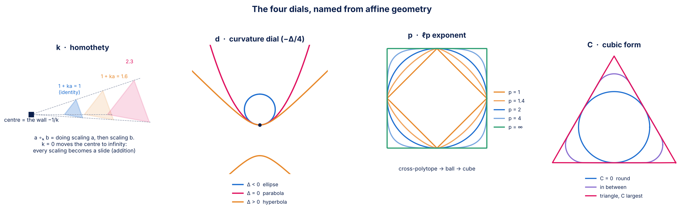
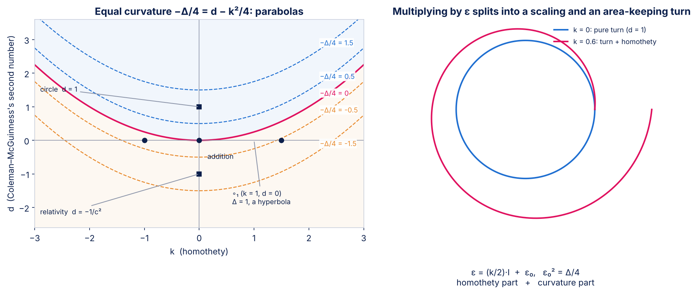
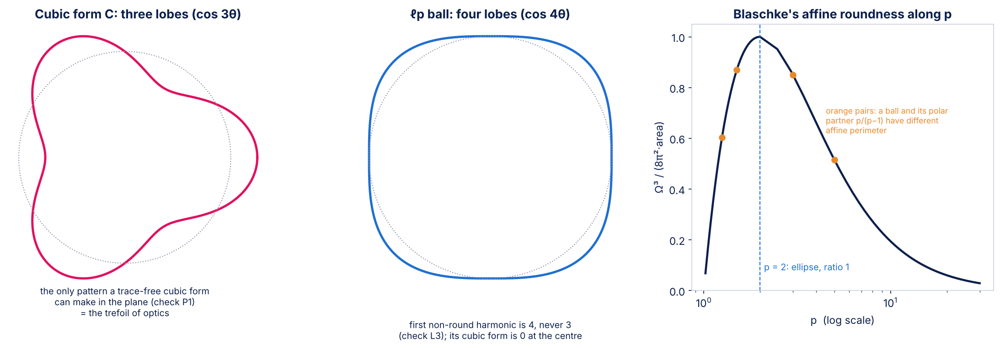
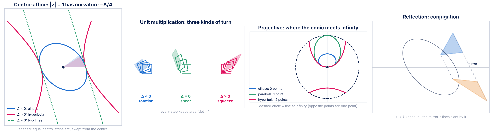
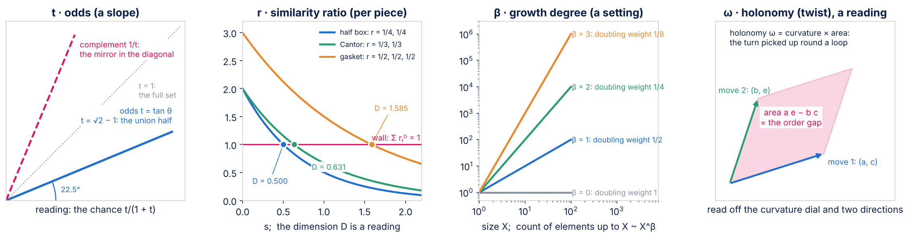
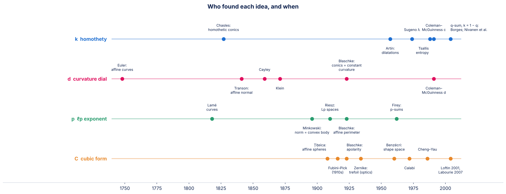

# DRAFT · The dials, named from affine geometry and their own fields

**DRAFT, Nov 26 2026.** Part of Hypercube Composition Theory (repo: fused-hyperoperation-algebra).
Asked for by Brennan: rename the dials "now that we know them better, preferring their existing names", names that are
"useful, not two people's last names", "from the language of shapes", "affine geometrical terms", with "a clear lineage"
crediting the authors, and "a coherent system, not a Frankenstein monster".
Builds on `conics/` (section 4, affine curvature), `simplex/` (section 7, the shape dial), `shape-dial-survey/`
(the three shape routes) and `names-review/` (the circle operation ∘ₖ and the letter d).
Checks: `checks.py` → `checks_output.txt`, **10 of 10 pass**; `checks_more.py` (section 5 and the Δ reading) **23 of 23**; `checks_dials6.py` (section 6) **12 of 12** (sympy exact where a closed form exists, numpy and scipy
otherwise). Pictures: `figures.py`, `figures_more.py` and `figures_dials6.py` → `figures/`.

## The names

All four come from one place: **affine geometry, as Blaschke organised it** (geometry where straight lines and areas
are kept, and lengths and angles are not). Three are standard objects of that theory; the fourth, p, has no name of its
own there, and the table says so instead of forcing one.

**The letters stay k, d, p and C** (Brennan's choice, Nov 26). k and d are the two coefficients of one form,
x² + kxy + dy², and they are the dials you turn. Curvature is not a separate dial: it is a reading of k and d, written
with the form's discriminant Δ = k² − 4d. The curvature is −Δ/4 = d − k²/4, and the sign of Δ sorts the conics.
No new letter is added, so nothing looks like k.

| Old name | New name | Symbol | What it does, in shapes | Lineage (short) |
|---|---|---|---|---|
| k, the circle operation's dial (the "k dial") | **homothety** (homothety rate) | **k** | ∘ₖ is doing one scaling and then another, all about one centre, the wall −1/k. k = 0 sends the centre to infinity, and scalings become slides (addition). | Chasles (the word, 1827); Artin's dilatations (1957); Sugeno's λ (1974), Tsallis (1988), Coleman–McGuinness's c (1991), Borges and Nivanen–Le Méhauté–Wang's q-sum with k = 1 − q (2003–04) |
| plane dial d | **curvature dial** (d keeps its letter; the curvature is a reading of k and d) | **d**; curvature = −Δ/4 = d − k²/4, with the discriminant Δ = k² − 4d (curvature = d when k = 0) | Each setting is one conic. Δ < 0 ellipse, Δ = 0 parabola, Δ > 0 hyperbola, smoothly through zero. | Euler's affine curves (1748); Transon's affine normal (1841); Cayley (1859) and Klein (1871) for the measure; Blaschke (1923), conics are the curves of constant affine curvature; Coleman–McGuinness's d (1991) |
| roundness dial p | **ℓp exponent** (no Blaschke name; see section 3) | **p** | Cross-polytope (p = 1) → ball (p = 2) → cube (p = ∞). Its departure from round is four-lobed. | Lamé's curves (1818); Minkowski, a norm is a convex body (1896); Riesz's Lp spaces (1910); Blaschke's affine perimeter measures it (1923); Firey's p-sums (1962) |
| shape dial (round ↔ triangle) | **cubic form** (Fubini–Pick form) | **C** | Zero exactly for ellipses; largest for the triangle. In the plane it can only make a three-lobed pattern. | Țițeica's affine spheres (1908); Fubini and Pick (1910s); Maschke–Pick–Berwald theorem; Blaschke's apolarity (1923); Benzécri's shape space (1960); Calabi (1972); Cheng–Yau (1986); Loftin (2001), Labourie (2007) |

*Figure 1. The four dials, one picture each. Left to right: scalings about the wall; one conic for each curvature;
the ℓp balls from cross-polytope to cube; a disk sliding to a triangle.*

**One sign convention, stated once.** With ε² = kε − d (the repo's), d > 0 at k = 0 is the round side, like a sphere's
1/R², and Δ < 0 there. In general the round side is Δ < 0, the curvature −Δ/4 is positive, and the area-keeping unit
squares to Δ/4 (so at k = 0, d = 1 it behaves like i, with i² = −1). Relativity is k = 0, d = −1/c². This matches Gauss
curvature's sign. Tables that write i² = d (Yaglom's), and the Lean library's `CliffordW` with e² = κ, are the mirror of
it.

**What changes and what doesn't.** Only words in the prose change. Lean names and code identifiers stay as they are
(a comment maps them), so nothing breaks. The letter d stays in every formula where it already appears: it is
Coleman and McGuinness's second number, and −Δ/4 = d − k²/4 is what it means geometrically.

## The design rule: base dials in, readings out

**Rule (Brennan, Nov 26).** Every formula and function in the theory takes the **base dials** as its inputs. Anything
built from them is a **reading**, and readings are outputs only: they can name a region, be plotted or be reported, but
no formula takes one as an input where the base dials would do.

| Inputs | Outputs only (readings) |
|---|---|
| **Base dials:** homothety k, curvature dial d, ℓp exponent p, cubic form C; the odds t (one per element) and the similarity ratio r (one per piece), section 6 | discriminant Δ = k² − 4d; curvature −Δ/4 = d − k²/4; the conic's type; the Pick invariant J |
| **Settings** the problem fixes before anything is counted: the size measure's growth degree β (section 6), the scale ħ, the directions of two moves | similarity dimension D; the chance t/(1 + t); the effective homothety 2^(−β) of a size measure; the holonomy ω (twist); dimensions, residues and walls in general |

**Why.** A reading forgets things. Δ is the same along a whole parabola of (k, d) settings, so a formula fed Δ cannot
tell those settings apart, and a result written in Δ cannot be checked by plugging in the dials. With one list of
inputs, every result in every folder takes the same numbers, and a reading is never mistaken for a dial.

**What it changed (audit, Nov 26).** Three folders had formulas fed by a reading, and they now take k and d:
- the height-flow residue is résit = 1/3 − 4d/(3k²), not Δ/(3k²) (`height-flow/`, its chart and its check code);
- the norm after completing the square is X² + (d − k²/4)Y², not X² − (Δ/4)Y² (`conics/`, its figure and checks);
- the Cayley–Klein page gives each plane its own k_ab with the label κ_ab = −k_ab²/4 read off it, and its lift as
  e^(kθ), not k from κ (`why-i/cayley-klein/`).

Where a page sorts by a reading ("Δ < 0 is the ellipse side"), that is a reading reported, and it stays.

---

## 1. k is the homothety

*Figure 2. Left: the (k, d) plane. The lines of equal curvature −Δ/4 = d − k²/4 are parabolas; magenta is Δ = 0. Right:
multiplying by the plane number ε is a scaling (the homothety part, k/2) plus an area-keeping turn (the curvature part).*

- **The operation is composing scalings (H1).** Let T_a scale the line by 1 + ka about the point −1/k:
  T_a(x) = (1 + ka)·x + a. Then doing T_b and then T_a is exactly T_(a ∘ₖ b). This is the repo's motion rule, and
  the wall −1/k is the scaling's centre, the one point that never moves. A scaling about a centre is what geometers
  call a **homothety**.
- **k = 0 is a slide (H2).** When the centre runs off to infinity, a homothety becomes a translation, and ∘₀ is
  addition. Artin's name for the whole family, homotheties and translations together, is the **dilatations**.
- **Only k = 0 versus k ≠ 0 is a shape fact (H3).** Rescaling the ruler, a → λa, turns ∘ₖ into ∘_(k/λ). So every
  k ≠ 0 is the same homothety law with a different ruler, which is why its size depends on what the page composes
  (weights, probabilities). The rule from the names review still holds: every page says what quantity it composes.
- **The same k in the plane (C1, C2).** Multiplying by ε (with ε² = kε − d) has trace k and determinant d. Splitting
  off the scaling (k/2)·I leaves an area-keeping part ε₀ with ε₀² = Δ/4. So k is the homothety half of the plane law,
  and Δ (read with d) is the other half. Area grows at rate k under 1 + tε.

**Why this name.** "Homothety" says what k does in one word, in the language of shapes, and it is the word Chasles
coined for exactly this: his 1827–28 paper is about homothetic conics. **Known:** all of it. **Ours:** using it as the
dial's name, and the observation that the wall is the centre.

## 2. d is the curvature dial; the curvature is −Δ/4

- **Each setting is a conic (from `conics/`).** The setting (k, d) is the conic x² + kxy + dy² = y, and its chord rule
  is our law.
- **Its curvature is −Δ/4 (C3).** In equi-affine geometry (areas kept, lengths not), the conics are exactly the curves
  of constant curvature. For our conic it is 2^(4/3)·(−Δ/4), with Δ = k² − 4d, checked at six settings including both
  sides of zero. The 2^(4/3) is a fixed unit; only Δ moves.
- **Δ, not d alone, decides the type.** The circle operation ∘ₖ sits at d = 0, but Δ = k² > 0: it is a hyperbola, not
  a parabola. Relativity (d = −1/c²) and the circle (d = 1) sit at k = 0, where the curvature is d itself.
- **Why no new letter.** Δ is the form's own discriminant, the oldest name for this quantity, and its sign is the
  textbook test for ellipse, parabola and hyperbola. A separate curvature letter would sit next to k and look like it
  (Brennan noticed k and κ), and the Lean library already uses κ for other things.
- **It matches the other pages.** The hypersphere page found the plane dial is "the sphere's 1/radius" and "1/R²".
  Those are curvatures; this pass says which one.

**Why this name.** The plane dial's job on every page is elliptic / parabolic / hyperbolic, which is the sign of a
curvature, and affine curvature is the one that matches our law exactly. Section 5 gives an even cleaner reading:
the centro-affine curvature of the unit circle \|z\| = 1 is −Δ/4 itself. **Known:** conics have constant affine
curvature (Blaschke 1923; Nomizu and Sasaki 1994). **Ours:** that it equals −Δ/4 for our form.

## 3. p has no Blaschke name, and where it sits

*Figure 3. Left: the only pattern a cubic form can make in the plane, three lobes. Middle: an ℓp ball departs from
round with four lobes. Right: Blaschke's affine roundness of the ℓp ball, 1 at p = 2 and falling toward 0 at both ends.
Orange dots are pairs p and p/(p − 1).*

I looked for a true affine-geometry name for the roundness dial and did not find one. Here is where it sits instead.

- **It moves through the same space of shapes as the cubic form**, but along the shapes with a centre of symmetry.
  A cubic form is odd, so it is zero at any centre of symmetry (P2). That is why the simplex page found every ℓp ball
  "round at the centre" and only the triangle not.
- **Its departure from round is four-lobed, never three (L3).** The cubic form's is three-lobed (P1). So the two shape
  dials are different directions, not one dial twice.
- **Blaschke's own measure tracks it (L1).** The affine isoperimetric ratio Ω³/(8π²·area) is 1 exactly at the ellipse
  (p = 2) and falls toward 0 at the cross-polytope and the cube, where all the affine perimeter has gone into corners.
- **A ball and its polar partner are not the same point (L2, a measurement).** The ℓp ball and the ℓ(p/(p−1)) ball are
  polar to each other, but their affine roundness differs (0.869 versus 0.850 at p = 1.5 and 3). So the dial is not
  symmetric about p = 2 in affine terms, even where a law built on it is (Bell's 2^(1 + max(1/p, 1 − 1/p))).

**Why this name.** "ℓp exponent" is what every geometer and analyst already calls p, and it is how Minkowski's theory of
convex bodies talks about these balls, so it is the existing name. Forcing a Blaschke word onto it would claim more than
is true. If a one-word affine name is wanted later, the honest candidate is the measure, not the dial: affine perimeter.

## 4. The shape dial is the cubic form

- **Zero means ellipse.** A surface whose cubic form vanishes is a quadric (the Maschke–Pick–Berwald theorem). On our
  dial that is the round end.
- **The triangle is the far end.** The affine sphere over a triangle is Țițeica's surface xyz = 1, whose cubic form never
  vanishes, and which is as symmetric as a shape can be. The simplex page found the turn going from −1 (round) to
  0 (triangle) along every route.
- **In the plane it is three-lobed (P1).** Blaschke's apolarity condition makes the cubic form trace-free, and a
  trace-free cubic in two dimensions is A·cos 3θ + B·sin 3θ, nothing else. That is the same angular pattern optics calls
  **trefoil** (Zernike, 1934), so the optics name is a fair bridge for the picture, though the dial's name stays
  "cubic form".
- **Its space is Benzécri's.** The dial runs through the space of convex shapes up to projective change; Cheng and Yau
  attach one affine sphere to each shape, and Loftin and Labourie read the shapes of whole surfaces off cubic forms.

**Why this name.** It is the standard name for exactly this quantity, and it pairs with the curvature −Δ/4: affine curvature and cubic form
are the two basic invariants of an affine sphere. That pairing is the lead the conics page opened (plane dial + shape dial =
the two invariants of one affine sphere), and these names now say it on their face. **Known:** all of it. **Ours:** reading
the shape dial as this quantity (simplex page, section 7).

## 5. Other transformations from affine geometry

Brennan asked: "Are there any other transformations from affine geometry that we should incorporate?" Checks:
`checks_more.py` → `checks_more_output.txt`, **23 of 23 pass**.

**Verdict.** One adds something real: **centro-affine geometry** (maps that keep one point fixed). It gives the
curvature −Δ/4 exactly, with no 2^(4/3), and it shows the curvature dial choosing between rotation, shear and squeeze. Projective
geometry is too coarse to name a dial, because it treats every conic as the same, but it gives two good readings of Δ.
The rest of the affine group is already in our dials.

| Transformation | What it is in our theory | Adds something real? |
|---|---|---|
| **Centro-affine** (fix a centre, keep area) | The unit circle of the plane numbers, \|z\|² = x² + kxy + dy² = 1, has centro-affine curvature **exactly −Δ/4** at every (k, d) (CA1, CA2). | **Yes.** A cleaner reading of the curvature than the chord conic's 2^(4/3)·(−Δ/4). |
| **Rotation, shear, squeeze** | Multiplying by a unit plane number keeps area and turns: a rotation when Δ < 0, a shear when Δ = 0, a squeeze when Δ > 0 (CA3). | **Yes, as a unification.** Shear and squeeze already appear across our notes; they are the curvature dial at zero and below. No new dial. |
| **Equi-affine** (keep area) | ε = (k/2) + ε₀ splits each move into a scaling (rate k) and an area-keeping part (type set by Δ) (EQ1). | Already on this page (Figure 2). It confirms the system: k is exactly the part that is not equi-affine. |
| **Translation** | The homothety dial at k = 0 (H2). | No, already there. |
| **Dilation** | The homothety dial at k ≠ 0, about the wall (H1, CA4). The half-turn about the wall is the element a = −2/k (RF2). | No, already there. |
| **Reflection** | Conjugation z → z̄ (ε → k − ε) is a slanted mirror that keeps \|z\| (RF1). | Small. Worth one line, not a dial. |
| **Projective** | All conics are one conic projectively (PR3), so it cannot hold the curvature. It reads Δ's sign as how many points the conic has at infinity, 0, 1 or 2 (PR1), and the angle of a plane number as a logarithm of a cross-ratio, one formula for circular and hyperbolic angle (PR2). | **As a bridge, not a name.** Goes in the lineage. |

*Figure 5. Left to right: the unit circles \|z\| = 1 for Δ < 0, = 0, > 0, with equal centro-affine arcs shaded; unit
multiplication as rotation, shear and squeeze, every step keeping area; the chord conics with the plane squeezed into a
disk, so the line at infinity is the dashed circle; conjugation as a slanted mirror.*

- **Where the centre is.** In the plane-number picture the centre is 0 and the identity is 1. On the line, the moves
  T_a(x) = (1 + ka)x + a fix the wall −1/k, not 0 (CA4), and in u = 1 + kx the law is plain multiplication. So the law
  is centro-affine about the wall; 0 is its identity, not its centre.
- **The centro-affine normal adds nothing.** In centro-affine geometry the normal is the line to the centre, so it
  carries no information about the dial. The curvature is what matters.
- **What this changes.** The curvature −Δ/4 is best read as the centro-affine curvature of the unit circle \|z\| = 1,
  with the chord conic's equi-affine curvature 2^(4/3)·(−Δ/4) as the second reading. The letters stay k and d. Rotation,
  shear and squeeze are the words for the three kinds of turn the curvature dial makes.

**Known:** centro-affine curvature, its formula det(z′, z″)/det(z, z′)³ and that central conics have constant
centro-affine curvature (Olver's notes; Mayer and Myller 1933; Țițeica's centro-affine surfaces 1907); Laguerre's
angle formula and the Cayley–Klein measure. **Ours:** that the constant equals −Δ/4 = d − k²/4 for the plane numbers'
unit circle, and the table's matching of each transformation to a dial.

---

## 6. The other four dials: odds, similarity ratio, growth degree, holonomy

Brennan asked (Nov 26) for the same treatment for t, r, β and the twist. Each keeps the name and letter of the field it
already lives in, and each is sorted by the design rule above. The dial survey (`dial-survey/`) found only two
independent numbers in the scalar law, k and t; the rest are per-piece inputs, settings or readings, and this section
says which.

| Old name | New name | Letter | Role | What it does, in shapes | Lineage (short) |
|---|---|---|---|---|---|
| per-element dial t | **odds** | **t** | base dial, one per element | t = tan θ is a slope. Two independent elements join by t ∘₁ s, and the complement is 1/t, the mirror in the diagonal (T1–T3). The chance t/(1 + t) is a reading. | Cardano's odds (written c. 1564, printed 1663); Lewis's fugacity (1901), where a mode's odds of being filled is fugacity × Boltzmann factor (T4); Berkson's logit, the log of the odds (1944) |
| zoom dial r | **similarity ratio** (contraction ratio) | **r** | base dial, one per piece | A piece is a shrunken copy, a homothety with ratio r. Ratios multiply down a tree, and the weight r^D acts as the homothety dial k (R2, R3). The dimension D is a reading: it solves Σ rᵢᴰ = 1 (R1). | Moran's equation (1946); Hutchinson's self-similar sets with ratios rᵢ (1981); Mandelbrot's similarity dimension D (1977); Lapidus and van Frankenhuijsen's complex dimensions (2000s) |
| size dial β | **growth degree** (degree of polynomial growth) | **β** | setting of the size measure | How fast the count of elements up to size X grows, like X^β: 0 sharp count, 1 the naturals, 2 the plane, 3 space. Its doubling weight 2^(−β) is ratio 1/2 at D = β (R4), and the repetition share it leaves is 2^(−β), 1/8 in space, the Stefan–Boltzmann 7/8 (B1, B2). | Weyl's law (1911); Fermi–Dirac integrals of order β (Fermi and Dirac 1926; tabulated by McDougall and Stoner 1938); growth of groups (Milnor 1968, Bass 1972, Gromov 1981) |
| twist | **holonomy** | **ω** | reading (output) | The turn picked up going round a loop, equal to curvature × enclosed area. In the order dial it is the oriented area a e − b c between two moves, which is exactly what makes order matter (W1). For boosts, tan(ω/2) = d(u × v)/(1 − d u·v) at k = 0, read off the curvature dial and two directions (W2). | Gauss's curvature × area for triangles (1827), Bonnet (1848); Grassmann's oriented area (1844); Thomas (1926) and Wigner (1939) for boosts; Cartan's holonomy (1926); Weyl's form of the Heisenberg relations (1927) |

*Figure 6. Left to right: the odds as a slope, with the union half √2 − 1 (22.5°) and its complement mirrored in the
diagonal; the similarity ratios of three fractals going in and their dimensions D coming out at the wall Σ rᵢᴰ = 1;
counts growing like X^β, with the doubling weight each β leaves; two moves and the oriented area between them, which the
holonomy measures.*

- **Why these names.** Each is the word that field already uses for exactly this number, and each has a shape: a slope,
  a shrunken copy, a growth rate, a turn round a loop. The similarity ratio is a homothety ratio, so it sits next to k.
  The holonomy measures area, the one thing equi-affine geometry keeps, so it sits next to d.
- **"Twist" means one thing now.** Two notes used "twist" for the homothety dial k ("a size weight w is the twist
  k = w"). They now say homothety; twist means only the holonomy.
- **Letters kept.** t, r, β and ω are the letters these dials already have, so no note changes letter except where it
  clashed: the dimension is written D, not d, and the second shift in the order dial is e, not d (see the clash table).
- **Checks:** `checks_dials6.py` → `checks_dials6_output.txt`, **12 of 12 pass** (sympy, numpy, mpmath).

### Clashes, checked

| Letter | Clashes with | What we do |
|---|---|---|
| t | time; the half-velocity tanh(φ/2) in `twisted-boosts/` | kept; the half-velocity is that page's own letter |
| p (as a probability) | the ℓp exponent p | the chance is written t/(1 + t), a reading; p stays only for primes and the multifractal weights the literature writes p |
| r | radius in the polar notes; interest rate in the order dial's compounding example | kept; each is local to its page |
| d (as a dimension) | the curvature dial d | dimension is D (Mandelbrot's letter) in `zoom-dial/` and `fractal-dials/` |
| d (as a shift) | the curvature dial d | the order dial's second shift is e |
| β | inverse temperature 1/kT; the generalized-uncertainty β in `why-i/e-i-pi/g-dials/` | kept; growth degree is a setting and never sits in the same formula as 1/kT |
| ω | angular frequency; a cube root of 1 | kept; the symplectic area form is also written ω, which fits |
| q | two meanings already: q = k + 1 (`dial-survey/`, Tsallis) and the landscape q of `twisted-boosts/`, which is d at k = 0 | flagged, not changed here |

## Lineage

*Figure 4. Who found each idea, and when.*

**k, homothety.** Michel Chasles coined *homothétie*; his "Mémoire sur les projections stéréographiques, et sur les coniques
homothétiques" appeared in Gergonne's Annales, 1827–28. Emil Artin's *Geometric Algebra* (1957) groups homotheties and
translations as the dilatations. The same one-parameter law reached us from four other directions: Sugeno's λ-measures
(1974, A + B + λAB), Tsallis's entropy (1988, whose pseudo-additivity is this law), Coleman and McGuinness's rational formal
group laws (1991, the letter c), and the q-sum x ⊕_q y = x + y + (1 − q)xy written as an operation by Borges (preprint
2003, Physica A 2004) and, independently, Nivanen, Le Méhauté and Wang (Rep. Math. Phys. 52, 2003). In that notation
k = 1 − q.

**d, the curvature dial (curvature −Δ/4).** Euler (1748) named "affine" the curves related by transformations more general than
similarities. Transon (1841) found the affine normal of a curve, the first result of affine differential geometry. Cayley
(1859) and Klein (1871) built distance from a fixed conic, which is our ruler. Pick (around 1906) and Blaschke's school
made the invariants systematic; Blaschke's *Vorlesungen über Differentialgeometrie II: Affine Differentialgeometrie*
(1923) shows that constant affine curvature characterises the conics. Coleman and McGuinness (1991) gave the plane law
the letter d. For the centro-affine reading (section 5): Țițeica's centro-affine surfaces (1907), Mayer and Myller on
centro-affine plane curves (1933), Schirokow and Schirokow's *Affine Differentialgeometrie* (1962), and Olver's moving-frame
notes, which give the curvature as det(z′, z″)/det(z, z′)³. For the projective reading: Laguerre's formula (1853), the
angle as a logarithm of a cross-ratio, which Cayley (1859) and Klein (1871) made into a measure; Yaglom (1979) set out
the nine plane geometries it gives.

**p, ℓp exponent.** Gabriel Lamé studied the curves |x|^p + |y|^p = 1 (1818). Hermann Minkowski's *Geometrie der Zahlen*
(1896) showed that a norm and its unit ball are the same thing, which is why these are "ℓp balls". Frigyes Riesz
introduced the Lp spaces (1910). Blaschke's affine perimeter (1923) is the affine measure of their roundness. William Firey's
p-sums (1962) build ℓp balls from segments and start the Lp Brunn–Minkowski theory.

**C, cubic form.** Gheorghe Țițeica introduced affine spheres (Rend. Circ. Mat. Palermo, 1908–09), including xyz = 1.
The cubic form carries the names of Guido Fubini and Georg Pick (1910s); Maschke, Pick and Berwald proved that a vanishing
cubic form means a quadric. Blaschke (1923) derived it, with the affine metric, from the affine normal and imposed
apolarity. Jean-Paul Benzécri (1960) studied the space of convex shapes. Eugenio Calabi (1972, "Complete affine
hyperspheres I") conjectured the picture that Shiu-Yuen Cheng and Shing-Tung Yau proved (1977, 1986). John Loftin
(Amer. J. Math., 2001) and François Labourie (Pure Appl. Math. Q., 2007) parametrised convex projective surfaces by cubic
differentials. Frits Zernike's trefoil (1934) is the optics bridge.

## Checks

| Check | What | Result |
|---|---|---|
| H1–H3 | ∘ₖ is composition of homotheties about −1/k; k = 0 is translation; rescaling sends k to k/λ | pass |
| C1–C3 | trace k, determinant d, area-keeping part ε₀² = Δ/4; area rate k; affine curvature 2^(4/3)·(−Δ/4) at six settings | pass |
| P1–P2 | trace-free cubic in 2D is cos 3θ, sin 3θ; cubic form is 0 at a centre of symmetry | pass |
| L1, L3 | affine roundness of ℓp balls peaks at p = 2; their first non-round harmonic is 4 | pass |
| L2 | affine roundness of a ball versus its polar partner (measurement) | differ |
| CA1–CA4 | unit circle \|z\| = 1 has centro-affine curvature −Δ/4 (six settings, and exactly for ellipses); unit multiplication is rotation / shear / squeeze with det 1; the line moves fix the wall | pass |
| EQ1, RF1–RF2 | area rate k, trace-free part keeps area; conjugation is a mirror keeping \|z\|; a = −2/k is the half-turn | pass |
| PR1–PR3 | points at infinity counted by the sign of Δ; Laguerre angle for Δ < 0 and Δ > 0; one projective swap turns a circle into a hyperbola | pass |
| DL1–DL3 | curvature = −Δ/4 = d − k²/4; trace-free part squares to Δ/4; the repo's round side (k = 0, d = 1) has Δ < 0 | pass |
| T1–T4, R1–R4, B1–B2, W1–W2 | odds join by ∘₁ and the complement is 1/t; Fermi–Dirac odds; Moran's D for three fractals; ratios multiply; a weight acts as k; growth-degree halves and the 2^(−β) share; the order gap is the oriented area; the boost twist formula | pass |

## Letters, checked against the sources

Brennan asked whether we have two k's. Affine geometry has the same clash, which is why we add no curvature letter.

| Dial | Letter here | What the sources write |
|---|---|---|
| homothety | k | k for a homothety's ratio (Encyclopedia of Mathematics, Wikipedia); ours is the rate, and the ratio is 1 + ka. Sugeno wrote this same law with λ. |
| curvature dial | d, read as −Δ/4 | k for the curvature of a plane curve, κ for the general-affine curvature (Encyclopedia of Mathematics); Olver writes κ for centro-affine curvature. Δ is the usual discriminant of a quadratic form. |
| ℓp exponent | p | p (Riesz, Minkowski); affine geometry has no letter of its own |
| cubic form | C | C in the Nomizu–Sasaki line (Nomizu–Pinkall); ψ in the Encyclopedia of Mathematics; the Pick invariant is J |

The Lean library already uses κ in two other senses (the k dial in `Behaviour`, and e² = κ in `CliffordW`, the mirror
sign). Those identifiers stay; the notes no longer use κ for a dial.

## What this pass does not settle

- Section 6 names the odds, similarity ratio, growth degree and holonomy. The repetition, temperature and corner-weight
  dials were not asked about and keep their names. The two meanings of q are flagged, not fixed.
- The dates for Fubini and Pick are given as "1910s" because I did not reach their original papers.
- I did not reach Laguerre's 1853 paper, Mayer–Myller (1933) or Țițeica's 1907 centro-affine paper; they are cited
  through Olver's notes and the papers below.

## Sources

- M. Chasles, "Mémoire sur les projections stéréographiques, et sur les coniques homothétiques", Annales de
  Mathématiques Pures et Appliquées 18 (1827–28), 305–.
- E. Artin, *Geometric Algebra* (1957).
- M. Sugeno, thesis (1974); C. Tsallis, J. Stat. Phys. 52 (1988); A. Coleman and S. McGuinness, Pacific J. Math. 147
  (1991); E. P. Borges, "A possible deformed algebra and calculus inspired in nonextensive thermostatistics",
  arXiv:cond-mat/0304545, Physica A 340 (2004); L. Nivanen, A. Le Méhauté and Q. A. Wang, Rep. Math. Phys. 52 (2003).
- A. Transon (1841); A. Cayley, Phil. Trans. 149 (1859); F. Klein, Math. Ann. 4 (1871).
- W. Blaschke, *Vorlesungen über Differentialgeometrie II: Affine Differentialgeometrie* (Springer, 1923);
  K. Nomizu and T. Sasaki, *Affine Differential Geometry* (1994); Encyclopedia of Mathematics, "Affine differential
  geometry".
- G. Lamé (1818); H. Minkowski, *Geometrie der Zahlen* (1896); F. Riesz (1910); W. Firey, Math. Scand. 10 (1962).
- G. Tzitzéica, "Sur une nouvelle classe de surfaces", Rend. Circ. Mat. Palermo 25 (1908) and (1909); E. Calabi,
  "Complete affine hyperspheres I", Symposia Mathematica 10 (1972); S.-Y. Cheng and S.-T. Yau, Comm. Pure Appl. Math. 30
  (1977) and 39 (1986); J. Loftin, "Affine spheres and convex RPⁿ-manifolds", Amer. J. Math. 123 (2001); F. Labourie,
  "Flat projective structures on surfaces and cubic holomorphic differentials", Pure Appl. Math. Q. 3 (2007);
  J. Loftin, "Survey on affine spheres", arXiv:0809.1186 (Maschke–Pick–Berwald attribution); J.-P. Benzécri, Bull. Soc.
  Math. France 88 (1960).
- K. Nomizu and U. Pinkall, MPIM preprint 1986-66 (Pick–Berwald theorem); Blaschke–Santaló dates from the Encyclopedia
  of Mathematics.
- F. Zernike, Physica 1 (1934).
- P. J. Olver, "Moving Frames and Differential Invariants in Centro-Affine Geometry", https://www-users.cse.umn.edu/~olver/mf_/centro.pdf
  (centro-equi-affine curvature of plane curves; history: Țițeica, Mayer–Myller 1933, Schirokow 1962, Gardner–Wilkens 1997).
- M. Salvai, "Centro-affine invariants and the canonical Lorentz metric on the space of centered ellipses", Kodai Math. J. 40 (2017),
  arXiv 1611.02347 (normalisations differ by a constant; lineage Lie, Darboux, Klein).
- M. Troyanov, "On the origin of Hilbert geometry", arXiv 1407.3777, and "On Klein's so-called non-Euclidean geometry", arXiv 1406.7309
  (Laguerre's 1853 formula, and that Cayley and Klein did not know it).
- I. M. Yaglom, *A Simple Non-Euclidean Geometry and Its Physical Basis* (Springer, 1979).
- Encyclopedia of Mathematics, "Affine differential geometry" and "Homothety" (letters: equi-affine curvature k, general-affine
  curvature κ, cubic form ψ; homothety ratio k).
- G. Cardano, *Liber de ludo aleae* (written c. 1564, printed 1663); G. N. Lewis, "The law of physico-chemical change",
  Proc. Amer. Acad. Arts Sci. 37 (1901); J. Berkson, J. Amer. Statist. Assoc. 39 (1944).
- P. A. P. Moran, Proc. Cambridge Philos. Soc. 42 (1946); J. E. Hutchinson, "Fractals and self similarity", Indiana Univ.
  Math. J. 30 (1981); B. Mandelbrot, *Fractals: Form, Chance and Dimension* (1977); M. Lapidus and M. van Frankenhuijsen,
  *Fractal Geometry, Complex Dimensions and Zeta Functions* (2006, 2nd ed. 2013).
- H. Weyl, Math. Ann. 71 (1912; announced 1911); J. McDougall and E. C. Stoner, Phil. Trans. A 237 (1938); J. Milnor,
  J. Diff. Geom. 2 (1968); H. Bass, Proc. London Math. Soc. 25 (1972); M. Gromov, Publ. Math. IHÉS 53 (1981).
- C. F. Gauss, *Disquisitiones generales circa superficies curvas* (1827); O. Bonnet, J. École Polytech. 19 (1848);
  H. Grassmann, *Die lineale Ausdehnungslehre* (1844); L. H. Thomas, Nature 117 (1926); E. Wigner, Ann. Math. 40 (1939);
  É. Cartan, Acta Math. 48 (1926); H. Weyl, Z. Phys. 46 (1927).
