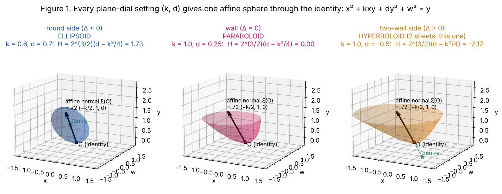
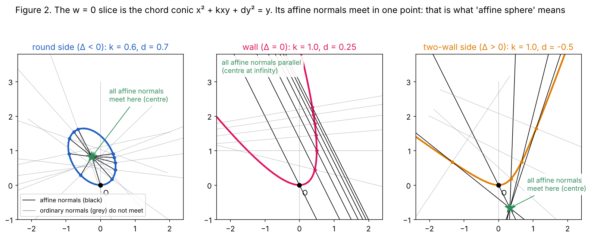
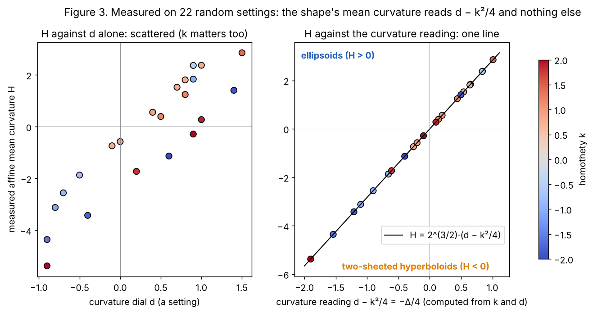
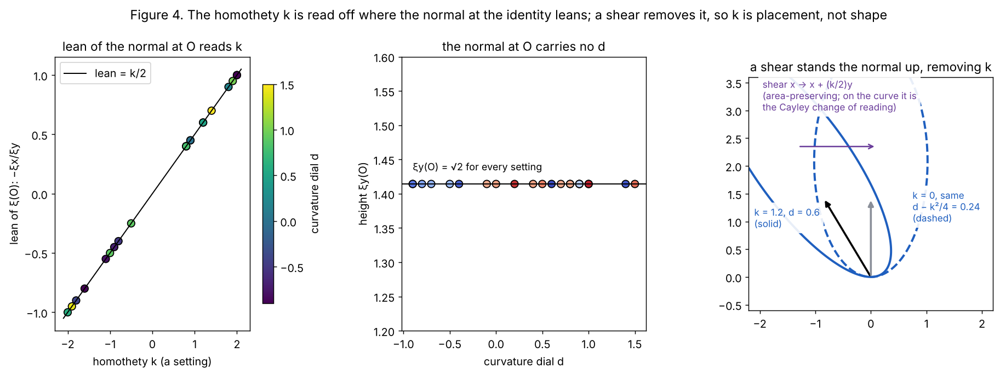
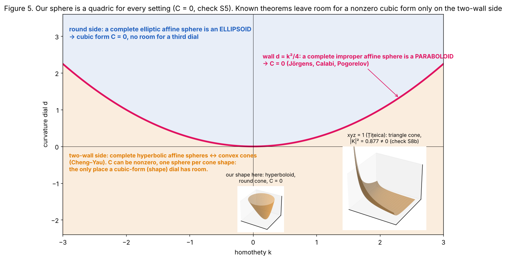
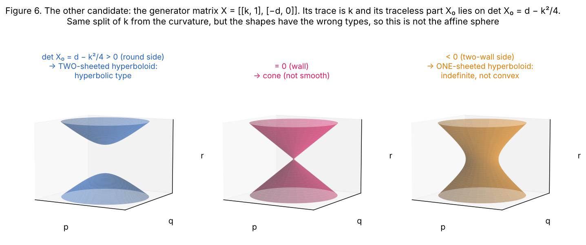

# DRAFT · Do the homothety k and the curvature dial d come from one affine sphere?

**DRAFT, Nov 26 2026.** Part of Affine Composition Theory. Asked for by Brennan: "I'd like to see if the K dial and
the D dial might come from a single shape. an affine sphere." Builds on `conics/` (each plane-dial setting is one conic
x² + kxy + dy² = y, and its chord rule is the law) and `affine-names/` (names: homothety k, curvature dial d; readings
Δ = k² − 4d and curvature −Δ/4 = d − k²/4; cubic form C).
Checks: `checks.py` → `checks_output.txt`, **29 of 29 pass** (sympy, exact or at 30 to 45 digits).
Figure data: `measure.py` → `measured.json` (22 random settings). Pictures: `figures.py` → `figures/`.

## The answer

**Yes, with one qualifier.** For every setting (k, d) there is one affine sphere through the identity,
the quadric x² + kxy + dy² + w² = y. Both dials can be read off it.

- **Its affine mean curvature reads the curvature:** H = 2^(3/2)·(d − k²/4), for every k and d.
- **Its affine normal at the identity reads k:** the normal is √2·(−k/2, 1, 0) and has no d in it.

The qualifier is that only the curvature d − k²/4 belongs to the shape itself. k says how the shape sits in the law's
frame. An area-preserving shear removes k, and on the curve that shear is the Cayley change of reading
T = a/(1 + (k/2)a). The sphere is a quadric for every setting, so its cubic form C is zero. Known theorems leave room
for a nonzero cubic form, the shape dial, only on the two-wall side (Δ > 0).

The ellipsoid, paraboloid and hyperboloid facts are classical (Blaschke). The match to our two dials, the formula
H = 2^(3/2)(d − k²/4), and the lean of the normal at the identity are ours. We did not find them written down, and they
follow in a few lines from the classical facts.

## 1. The shape: the chord conic with one round direction added

The chord conic x² + kxy + dy² = y from `conics/` gets one extra round direction w:

  x² + kxy + dy² + w² = y.

Through the identity O = (0, 0, 0) it has a rational parametrisation with the same q as the conic:

  (x, y, w) = (u, u² + v², v) / q,  q = 1 + k·u + d·(u² + v²)  (check S1, for symbolic k and d).

The slice w = 0 is the chord conic itself, with points (a, a²)/(1 + ka + da²) and the law as its chord rule.

**Affine sphere** means all affine normals meet in one point, the centre, or are all parallel. The affine normal is the
transversal direction that equi-affine geometry picks out (Blaschke 1923). It is not the ordinary perpendicular.
Figure 2 shows it on the slice: the black affine normals meet, and the grey ordinary normals do not.

The type follows the sign of Δ, which comes out of k and d:

| Setting | Shape | Affine sphere type | Centre |
|---|---|---|---|
| Δ < 0 (round side) | ellipsoid | elliptic, H > 0 | (−k, 2, 0)/(4d − k²) |
| Δ = 0 (wall) | paraboloid | improper, H = 0 | at infinity, along (−k/2, 1, 0) |
| Δ > 0 (two-wall side) | the sheet of a two-sheeted hyperboloid through O | hyperbolic, H < 0 | (−k, 2, 0)/(4d − k²) |

Check S3 confirms ξ = −H(x − centre) at three points for six settings, two of each type, to 10⁻³⁰.
For the paraboloids it confirms ξ is constant.

## 2. The mean curvature reads d − k²/4

Complete the square. The shear X = x + (k/2)y has determinant 1, and it turns the surface into

  X² + (d − k²/4)·y² + w² = y  (check S2, symbolic).

For d − k²/4 > 0 this is an ellipsoid with semi-axes 1/(2√(d − k²/4)) (twice) and 1/(2(d − k²/4)). Blaschke's formula
H = (abc)^(−1/2) then gives

  **H = 2^(3/2)·(d − k²/4)**,

and the same formula holds with sign on the other two sides (checks S3 and S10). In n dimensions it is
H = 4^((n+1)/(n+2))·(d − k²/4) (check S7b). The curve case n = 1 gives 2^(4/3)(d − k²/4), the affine curvature found in
`conics/` section 4 (check S7).

Figure 3 is measured, not drawn from the formula. On 22 random settings, H scatters against d alone and falls on one
line against d − k²/4.

**Polish (S10).** The slope was first fitted from 15-digit evaluations, then re-evaluated at 45 digits. It matches
2^(3/2) to 2 × 10⁻⁴⁶. The re-evaluation cost 28 s on one core.

## 3. The normal at the identity reads k

At O the affine normal is

  **ξ(O) = √2·(−k/2, 1, 0)** for every d (check S4, six settings).

So the lean of the normal, −ξx/ξy = k/2, reads the homothety, and the height ξy = √2 never changes.
In one dimension it is ξ(O) = 2^(1/3)·(−k/2, 1) (check S7).

Together, the normal at O and the mean curvature give back both settings from the shape alone:

  k = −2·ξx/ξy at O,  d = H/2^(3/2) + k²/4  (check S6, error below 10⁻³⁰).

**Why k is placement and not shape.** The lean is measured against the axes in which the law writes its points
(a, a²)/q. The shear x → x + (k/2)y fixes O, keeps areas and stands the normal upright. It carries the (k, d) sphere
onto the (0, d − k²/4) sphere. On the curve, that shear is exactly the Cayley change of reading T = a/(1 + (k/2)a)
(check S2b), which `conics/` already found removes k from the law. Two settings with the same d − k²/4 give the same
sphere up to an equi-affine motion that fixes the identity.

## 4. Where a shape dial could live

Our sphere is a quadric for every setting, so its cubic form C (Fubini–Pick) is zero (check S5, |K|² below 10⁻⁶⁰).
That is the Maschke–Pick–Berwald theorem: C = 0 exactly for quadrics. To get a third dial, the sphere would have to stop
being a quadric. Known theorems on **complete** affine spheres say where that is possible:

- **Round side.** A complete elliptic affine sphere is an ellipsoid (Blaschke for closed surfaces; Calabi for complete ones in any dimension), so C = 0.
- **Wall.** A complete improper affine sphere is a paraboloid (Jörgens for n = 2, Calabi for n ≤ 5, Pogorelov in
  general), so C = 0.
- **Two-wall side.** Complete hyperbolic affine spheres match proper convex cones one to one (Calabi's conjecture, proved
  by Cheng and Yau). The round cone gives our hyperboloid. The triangle cone gives Țițeica's surface xyz = 1, whose cubic
  form is nonzero and constant (check S8b, |K|² = 0.877). Every other cone gives another sphere.

So the cubic form, which `affine-names/` calls the shape dial, has room only on the two-wall side.
There, round cone to triangle cone is the round-to-triangle shape dial of `simplex/` section 7.

A consistency check on the code: for xyz = 1 the computed values satisfy J + H = 0 (J = |K|²/2 = 0.4387,
H = −0.4387). That is the affine theorema egregium for its flat Blaschke metric.

## 5. The other candidate: the generator matrix

The law is also a matrix product: with X = [[k, 1], [−d, 0]], (I + aX)(I + bX) = (1 − dab)I + (a + b + kab)X
(check S9). Its trace is k and its determinant is d, and its traceless part X₀ = X − (k/2)I has det X₀ = d − k²/4.
So the matrix gives the same split: k is a shift along the identity, and the curvature picks a level of det on the
traceless matrices.

The shapes have the wrong types, though. On traceless 2×2 matrices det is −p² − q² + r² (check S9b). The round side
lands on a two-sheeted hyperboloid, which is the hyperbolic type, and the two-wall side lands on a one-sheeted
hyperboloid, which is not convex. These levels are the coadjoint orbits of SL(2, R) (Kirillov). They are a true picture
of the same split, but they are not the affine sphere that matches the law.

## Assumptions and limits

- **The extra round direction w is a choice.** The curve alone (n = 1) already works: the chord conic is an affine
  circle. Adding w² makes it a surface. Any number of round directions gives the same picture, with the constant
  4^((n+1)/(n+2)) (check S7b).
- **Completeness matters in section 4.** Small pieces of affine spheres with C ≠ 0 exist on every side. The "only the
  two-wall side" statement is about complete ones.
- **The size of H is fixed by the reading scale.** Rescaling the reading a → λa sends (k, d) to (λk, λ²d) and H to
  λ²H (`conics/` check D2). Equi-affine motions keep H, but only its sign survives every change of reading.
- **Lean against a frame.** "The normal leans by k/2" is measured against the law's own axes. It is a statement about how
  the sphere sits, which is why a shear can remove it.

## Checks (`checks_output.txt`)

S1 parametrisation lies on the surface (symbolic k, d) · S2 shear removes k (symbolic) · S2b shear is the Cayley map ·
S3 ξ = −H(x − centre), six settings · S4 ξ(O) = √2(−k/2, 1, 0) · S5 cubic form zero · S6 both dials recovered from the
shape · S7 curve case · S7b any dimension · S8, S8b Țițeica surface · S9, S9b generator matrix · S10 polished slope.
Method: Blaschke metric h = G/|det G|^(1/(n+2)) with G_ij = det(x_1, …, x_n, x_ij); affine normal ξ = (1/n)Δ_h x;
induced connection from x_ij = Γ^k_ij x_k + h_ij ξ; difference tensor K = Γ − (Levi-Civita of h). Code: `blaschke.py`.

## Sources

- W. Blaschke, *Vorlesungen über Differentialgeometrie II: Affine Differentialgeometrie*, Springer 1923.
- K. Nomizu and T. Sasaki, *Affine Differential Geometry*, Cambridge 1994 (Blaschke structure, cubic form,
  Maschke–Pick–Berwald, the quadric formulas).
- G. Țițeica, "Sur une nouvelle classe de surfaces", C. R. Acad. Sci. Paris 146 (1908).
- K. Jörgens, "Über die Lösungen der Differentialgleichung rt − s² = 1", Math. Ann. 127 (1954).
- E. Calabi, "Improper affine hyperspheres of convex type and a generalization of a theorem by K. Jörgens",
  Michigan Math. J. 5 (1958); "Complete affine hyperspheres I", Symposia Math. 10 (1972).
- A. V. Pogorelov, "On the improper convex affine hyperspheres", Geom. Dedicata 1 (1972).
- S.-Y. Cheng and S.-T. Yau, "Complete affine hypersurfaces. Part I. The completeness of affine metrics",
  Comm. Pure Appl. Math. 39 (1986).
- J. Loftin, "Survey on affine spheres", in *Handbook of Geometric Analysis II* (2010), arXiv:0809.1186.
- A. A. Kirillov, *Lectures on the Orbit Method*, AMS 2004 (coadjoint orbits of SL(2, R)).
- Cayley map and the chord-rule law: `conics/` README and its sources.
