# DRAFT · Shapes beyond the hypercube: which ones close our gaps?

Nov 26, 2026. Asked for by Brennan on a voice call: "is it possible that different shapes other than the hypercube
could help bridge some of the gaps that we're looking at?" He said yes to looking into it.
Checks: `checks.py` → `checks_output.txt`, **30 of 30 pass** (numpy, scipy, sympy, mpmath). Pictures: `figures.py` →
`figures/`. Data for the 3D associahedron: `assoc6.json`. Second pass (section 3b, random geodesics, Brennan's yes on
Nov 26): `checks2.py` → `checks2_output.txt`, **10 of 10 pass**, pictures from `figures2.py` (figs 9 to 13). DRAFT: everything is known work unless marked **ours**, and
the "ours" items are readings and small derivations, not theorems.

Builds on, and does not repeat: `number-theory-geometries/` (tropical cuts, permutohedron growing from a point, cluster
coupling bending the cube into associahedra), `probability-entanglement/` (the AdS₃ cross-ratio as a clock probability),
`newton-g/`, `precession/`, `ns-same-shape/`, `cube-weights/`, `quantum-to-classical/`, `boolean-lattice/`.

## The answer in plain words

Two shapes carry the theory further on a specific gap, and neither one predicts anything new. **The associahedron**
(the shape behind the ABHY picture of particle scattering) has our union rule built into its own coordinates, so when
directions are coupled the cube bends into it and still composes by ∘₋₁; the same numbers are the AdS₃ linking
probabilities on our probability page, and a simulation of random geodesics (section 3b) gives every one of its
equations its own probability meaning: for each chord, "both crossing channels linked" is exactly as likely as
"neither", and this only works when the random clock ticks at rate 1. **The elliptope** is the known answer to the question our probability page left
open, why quantum correlations stop at 2√2: the cube's corners make the classical shape, and the quantum shape is the
rounded body around it. Three more are doors or testbeds, not results: the pentagon as an exactly solved flow (past one
loop), the double copy as the one known road from associahedra to gravity, and total positivity as the ground the
amplituhedron stands on. The rest (permutohedron, zonotope, simplex, cross-polytope, Birkhoff, cyclic) are pretty
restatements for these gaps. **No shape touches the Navier–Stokes stretching corner, frame dragging, or a value for G**,
and the reason is the same each time: those gaps are about the size of a force or a coefficient, and a shape only
rearranges which terms combine.

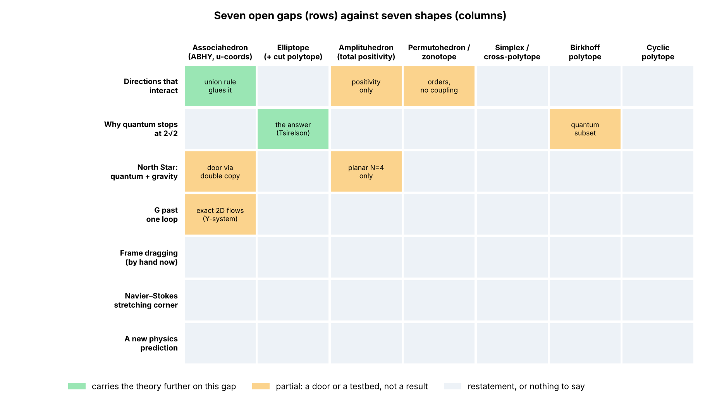

## The gaps we tested against

Taken from the notes, most fundamental first.

1. **Directions that interact.** The cube treats directions as independent (each is its own interval). The twisted-boosts
   and cluster work want a ready-made way for directions to couple.
2. **Why quantum stops at 2√2.** The probability page found that no hidden loop or helix explains the Tsirelson limit.
3. **The North Star: quantum mechanics with gravity.** Nothing in the theory yet touches gravity's quantum structure.
4. **G past one loop.** The circle operation is exact for the one-loop running of G and fails beyond it (the ρ mismatch,
   1/3 for our height flow against 3/5 for 2D gravity).
5. **Frame dragging.** The swap rule gives Thomas, Foucault and Berry precession, but frame dragging needs gravity's own
   input put in by hand.
6. **The Navier–Stokes stretching corner.** No rung matches vortex stretching; the danger sits in the far corner of the
   stretch-rate cube, carried by the cross-chirality term.
7. **A new physics prediction.** None yet.

| Shape | Gap it reaches | Verdict | Known or ours |
|---|---|---|---|
| Associahedron (ABHY, u-coordinates) | 1, and doors to 3 and 4 | **Lead worth following** | equations known; union-rule reading and AdS₃ match ours |
| Elliptope (with the cut polytope) | 2 | **Answers it with known math; small lead beyond** | known (Tsirelson 1980, Pitowsky 1989); placement ours |
| Pentagon as a Y-system | 4 | **Testbed, not a result** | known (Zamolodchikov 1991) |
| Double copy (KLT) | 3 | **Door, unchecked by us** | known (KLT 1986; Mizera 2017) |
| Amplituhedron, total positivity, cyclic polytope | 3 (planar N = 4 only) | **Restatement for our gaps; underpinning only** | known; placement ours |
| What the cube becomes as k turns (cube → simplex → axes) | none directly | **Small; a possible home for partial exclusion, unchecked** | boundary known (Sugeno 1974); picture ours |
| Permutohedron, zonotope, Birkhoff | 1 partly | **Restatement** (orders, no coupling) | known |
| Simplex, cross-polytope | none | **Restatement** | known |
| Any shape | 5, 6, 7 | **None reaches them** | — |

---

## 1. What the cube itself becomes as the dial turns (fundamental)

Before reaching for new shapes: what does our own dial do to the cube? Take the region of inputs whose combined value
stays at or under 1, {x ∘ₖ y ≤ 1}.

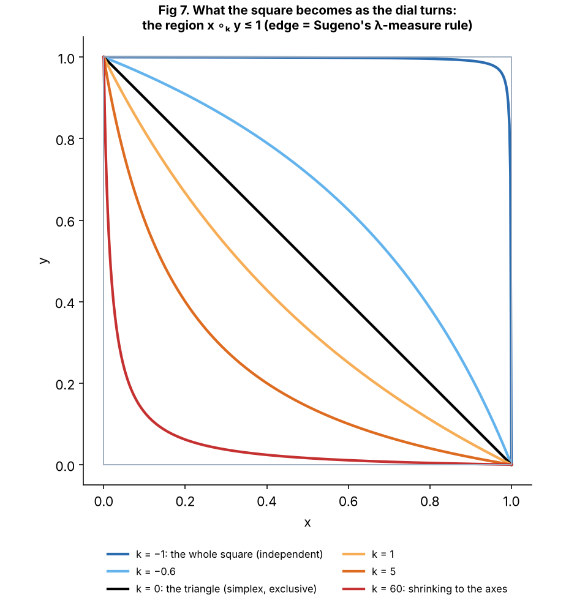

- **At k = −1 it is the whole cube** (independent events: any combination is allowed), **at k = 0 it is the simplex**
  (exclusive events: the parts must add to at most 1), and as k grows it shrinks onto the axes (F1, F2). Its area is
  ((1+k)ln(1+k) − k)/k², from 1 down through 1/2 to 0 (F1).
- **The edge is Sugeno's λ-measure rule** (1 + k·x)(1 + k·y) = 1 + k (F3): the set of weights that make a valid
  λ-measure. Known (Sugeno 1974). The cube-to-simplex picture is ours, and elementary.
- **Verdict: small.** It is exactly what the cube deforms into under k. It interpolates "anything goes" and "at most one",
  which is the shape of partial exclusion, so it might be a home for Haldane's crowding dial; that is unchecked, and the
  counting may well not match.

## 2. The elliptope: the classical shape is the cube's corners, the quantum shape is rounder (gap 2)

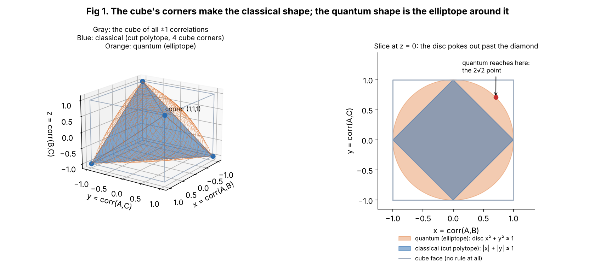

- **The classical shape is made of cube corners.** For three ±1 measurements, the possible correlations of a classical
  (hidden-variable) system fill a tetrahedron whose four vertices are corners of the cube, the ones with x·y·z = +1 (A1).
  This is the *cut polytope*; its 0/1 version is Pitowsky's *correlation polytope*, and its coordinates (P(A), P(B),
  P(A and B)) are exactly the cube's corner terms. Our union rule p ∘₋₁ q = p + q − pq is exact on the saddle surface
  P(A and B) = pq inside it (A4, Fig 3).
- **The quantum shape is the elliptope**, all correlation matrices that are positive semidefinite. It contains the
  tetrahedron and pokes out past it (A2a, A2b; volume π²/2 against 8/3, A2c).
- **The 2√2 is where the elliptope pokes out.** On cube corners the CHSH score tops out at 2 (A3a). With unit vectors,
  the points of the elliptope, it reaches 2√2 (A3b), and random strategies never beat it (A3c). A no-signalling box
  reaches 4 (A3d).

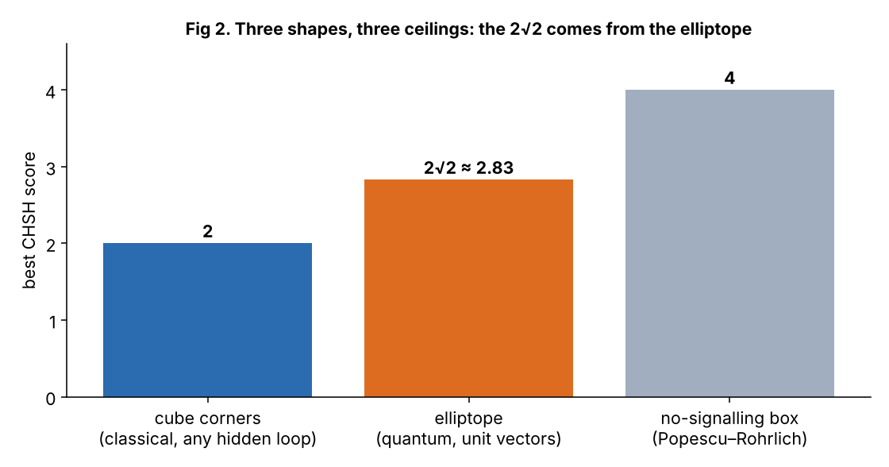

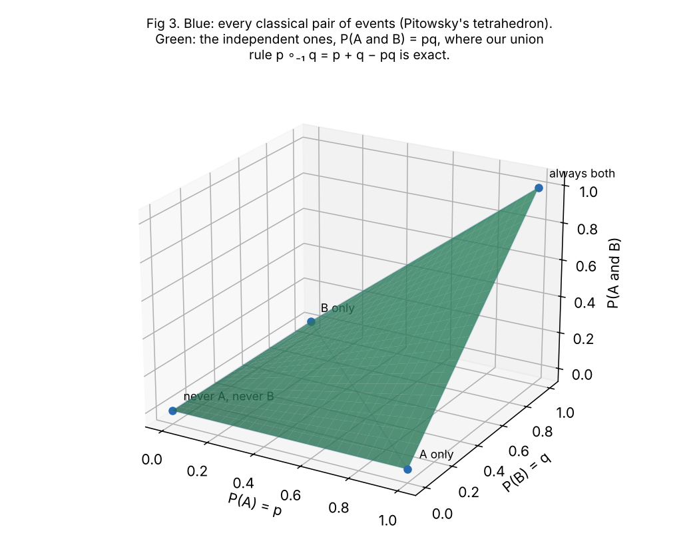

- *Known:* all of it (Tsirelson 1980; Pitowsky 1989; Laurent and Poljak on the elliptope, 1995). *Ours:* the placement,
  "the cube's corners are the classical correlation shape, and our union rule lives on its independence surface".
- **Verdict.** It answers gap 2 with known math, and the answer belongs in our README: the 2√2 is not a property of any
  loop or path on the cube, it is the shape of the set of inner products. A small reading on top (ours): the cube's ±1
  corners are the phases 0 and π, and the elliptope's 2D points are cos(θᵢ − θⱼ) for any angles, which is our circle
  class. That is probably only a restatement of "quantum needs phases"; it would become a lead only if our dial produced
  the inner-product rule by itself, which the probability page already found it does not.

## 3. The associahedron: our union rule is built into its coordinates (gap 1; doors to 3 and 4)

**What it is.** The associahedron is the shape whose corners are the ways to cut a polygon into triangles. The cluster
pass found that coupling three directions bends the cube into it. Arkani-Hamed, Bai, He and Yan (ABHY, arXiv 1711.09102,
Nov 2017) put it inside the space of particle momenta: its canonical form is the tree-level amplitude of φ³ theory.
(Verified: the voice assistant's dates are right; the amplituhedron is Arkani-Hamed and Trnka, arXiv 1312.2007, Dec 2013.)

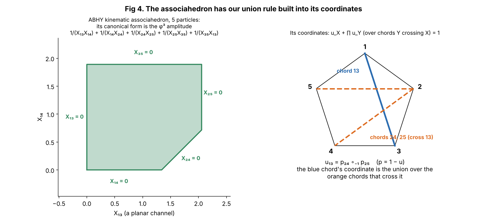

- **The amplitude is the shape (known).** For five particles the region is a pentagon (B6a), and its canonical form
  equals 1/(X₁₃X₁₄) + 1/(X₁₄X₂₄) + 1/(X₂₄X₂₅) + 1/(X₂₅X₃₅) + 1/(X₃₅X₁₃), the φ³ amplitude, to 14 digits (B6b). For six
  particles it is the 3D associahedron, 14 corners and 21 edges (B7, Fig 5).
- **Its coordinates obey our union rule (reading ours; equations known).** The associahedron has natural coordinates u,
  one per chord of the polygon, tied by the "u-equations": u_X + ∏ u_Y = 1, the product over chords Y that cross X
  (Arkani-Hamed, He and Lam 2019; Brown's dihedral coordinates 2009). Checked for 5 to 8 particles (B1). Written with
  p = 1 − u, that is exactly
  **u_X = ∘₋₁ of p_Y over the chords that cross X** (B2): each chord's coordinate is the union of the others that cross
  it. For the pentagon, u₁₃ = p₂₄ ∘₋₁ p₂₅.
- **Why it holds (derivation ours as written).** Every u-equation is the four-point identity u(a,c) + u(b,d) = 1, with
  the blocks glued together from the crossing chords by our union rule (B5). So the whole associahedron, at any size, is
  one four-point fact plus ∘₋₁ gluing. Likely familiar to experts; not found stated this way.

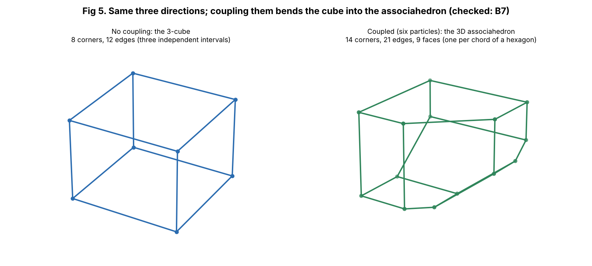

- **The same numbers as our AdS₃ probability (ours).** Each u is 1 minus the cross-ratio of two sides of the polygon
  (B3), and that cross-ratio is the x our probability page read as "the chance a random geodesic links the two
  regions". Gluing neighbouring regions is ∘₋₁ in both places (B4, the probability page's H4).

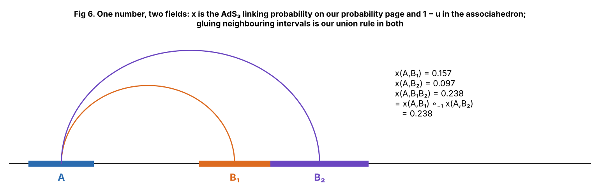

- **Verdict: lead worth following.** On gap 1 it carries the theory further: it is a fully worked-out way for directions
  to interact (the cube is the no-coupling case, Fig 5), and the interacting version still composes by our own rule.
  It also joins two of our threads, the AdS₃ clock probability and scattering geometry, by literally the same numbers.
  What it does not do: predict anything. Concrete next steps, fundamental first:
  1. *Done in section 3b:* each u-equation reads "both crossing channels linked is as likely as neither", and only at
     clock rate 1.
  2. The ABHY string integrals ∫ ∏ u^(α′X) run from field theory (α′ → 0) to a tropical limit (α′ → ∞). Test whether
     α′ plays the part of our semiring dial (Maslov dequantization on the quantum-to-classical page).
  3. Loops: the 2023 "surfaceology" work (Arkani-Hamed, Frost, Salvatori, Plamondon, Thomas, arXiv 2309.15913) uses the
     same u-variables at all loop orders. Check whether the union reading survives there.

## 3b. Each associahedron equation as a probability (second pass, simulation)

Brennan said yes to testing whether each of the associahedron's equations has its own random-geodesic meaning. Model,
from the probability page: scatter hyperbolic geodesics in the disk at random, with the standard Crofton intensity, at
rate 1 per unit of that measure (a Poisson soup). Two boundary arcs are **linked** if some geodesic joins them. One
universe has about 314 geodesics; we ran 20,000 universes on a random hexagon.

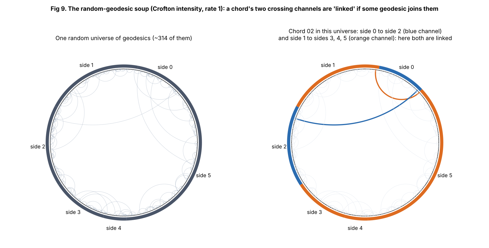

- **Each coordinate is a "no link" probability (known).** u for sides i and j equals P(no geodesic links side i to side
  j), for all 9 chords of the hexagon (P1). This is the probability page's clock, now checked on every coordinate.

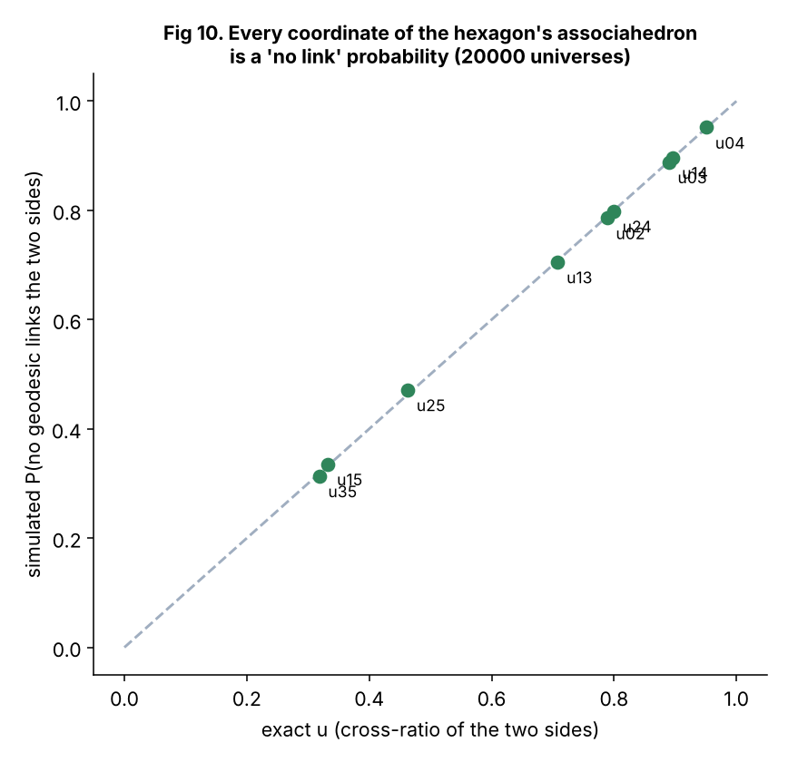

- **Gluing is independence (known).** The chance that the two blocks between i and j are unlinked equals the product of
  the crossing chords' u's (P2), because a Poisson soup is independent on separate channels. So the union-rule gluing of
  section 3 is an event: "at least one of the crossing channels is linked".
- **The meaning of each equation (ours).** For every chord there are two crossing channels: side i to side j, and the
  block between them on one side to the block on the other. The chord's equation u_X + ∏u_Y = 1 says, exactly:
  **"both channels linked" and "neither linked" are equally likely.** Simulated for all 9 chords (P4, Fig 11); with
  independent channels this is equivalent to the equation, not a weaker shadow of it (P5); and it holds for every chord
  of 7-, 8- and 9-gons (N1). They are equal in probability; they are different events.

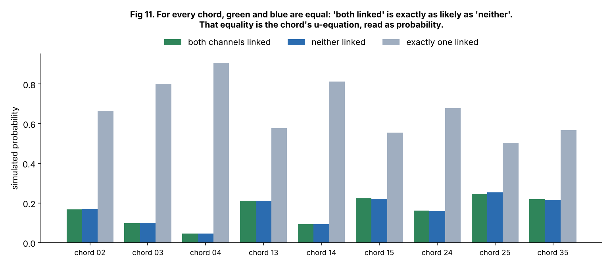

- **The equations fix the clock's rate (ours).** Run the soup at rate λ and the left side becomes u^λ + (1 − u)^λ (R1).
  It equals 1 only at λ = 1: above 1 for a slower clock, below for a faster one (R2). The probability page picked "rate 1
  per unit of Crofton measure" by hand; the associahedron forces it.

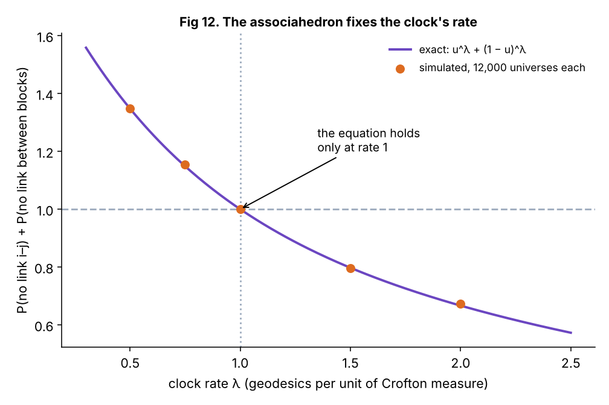

- **Facets and corners as certainty (reading ours).** As the side between sides 0 and 2 shrinks, those two sides become
  surely linked (u → 0, which is a facet of the associahedron) and every crossing channel becomes surely unlinked (C1,
  simulated). So two crossing channels can never both be certain (C2), and the associahedron's corners, the non-crossing
  sets of chords, are exactly the largest sets of channels that can be certain together.

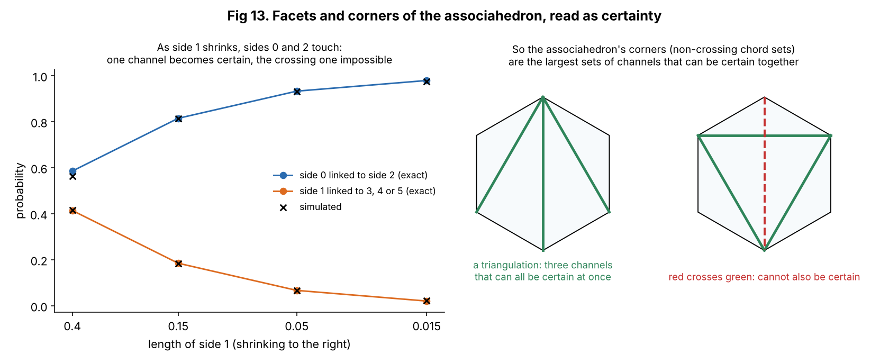

- **Verdict.** The answer to the question is yes: every equation of the associahedron reads as one plain probability
  statement about random geodesics, and the associahedron fixes the clock rate. That makes the lead in section 3
  firmer, and it ties our AdS₃ probability page to scattering geometry more tightly than shared numbers. It is still a
  reading, not a prediction. The open question it raises: the physical rate on the probability page is set by the
  central charge (x = 1 − e^(−3I/c)), so does rate 1 here pick out a particular c? Unchecked.

## 4. The pentagon as an exactly solved flow (gap 4: a testbed past one loop)

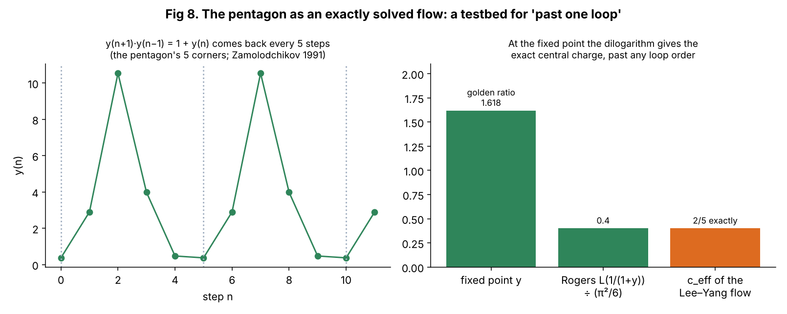

- The pentagon's swap rule y(n+1)·y(n−1) = 1 + y(n) repeats every 5 steps (C1). This is the Y-system of the scaling
  Lee–Yang model, a real 2D quantum field theory flowing between fixed points (Zamolodchikov 1991). Its factors 1 + y are
  our lift ℓ₁ (C3).
- At the fixed point y is the golden ratio, and the Rogers dilogarithm gives the central charge c_eff = 2/5 exactly (C2),
  with no loop expansion at all.
- *Known:* all of it. *Ours:* only noting the lift.
- **Verdict: a testbed, not a result.** It is a place where a running coupling is known exactly past every loop order,
  and it is built from our ∘₁ lift. So it is the right place to ask the question the G work keeps failing: does the
  circle operation's structure persist past one loop when the full answer is known? It says nothing about G itself:
  these are 2D flows, not 4D gravity.

## 5. The double copy: the one road from associahedra to gravity (gap 3: a door)

- Gravity's tree amplitudes are built from two gauge amplitudes glued by a kernel, and that kernel is the inverse of the
  matrix of bi-adjoint scalar amplitudes, which are associahedron data (Kawai, Lewellen and Tye 1986; Cachazo, He and
  Yuan 2014; Mizera 2017). At four particles the kernel is −s (D1), and the result is fully symmetric in s, t, u, as
  gravity must be (D2).
- **Verdict: a door, unchecked by us.** It is the only known place where a polytope's canonical form feeds into
  gravity. Walking through it would mean computing the bi-adjoint matrix from our coupled cube; that is untried. It
  does not touch G's value: the gravitational coupling enters as an outside constant.
- As far as I know (June 2026), there is no accepted positive geometry for gravity amplitudes themselves; the
  amplituhedron covers planar N = 4 super Yang–Mills, which has no gravity in it.

## 6. The amplituhedron, total positivity and the cyclic polytope (underpinning only)

- The amplituhedron lives in the positive Grassmannian, the world of total positivity. Our corner weights touch it: for
  k > 0 and positive inputs, the weights k^m·e_m form a totally nonnegative (Pólya frequency) sequence (E1); on the union
  side k < 0 they do not, unless the inputs are flipped (E2). The simplest amplituhedron (one particle-type, m = 4) is a
  cyclic polytope, the hull of points on the moment curve (1, t, t², …), and turning our dial k moves along that same
  curve.
- *Known:* Aissen, Schoenberg and Whitney 1952; Edrei 1952; Arkani-Hamed and Trnka 2013. *Ours:* the placement.
- **Verdict: restatement for our gaps.** It is true and gives the k > 0 side a positivity meaning, but it closes nothing.

## 7. Permutohedron, zonotope, Birkhoff, simplex, cross-polytope (restatements)

- **Permutohedron and zonotope.** The permutohedron is a zonotope, a sum of segments (G2), and the shadow of the
  Birkhoff polytope (G1). The number-theory pass already found it grows from a point as k turns. For our gaps it
  organizes order effects (where precession lives), but it adds no coupling and no force. Restatement.
- **Birkhoff polytope.** Its quantum part, the matrices a unitary can make, is smaller than the whole (G3), the same
  "quantum is a rounder subset" story as the elliptope, but weaker and less clean. Restatement.
- **Simplex.** It is the k = 0 member of section 1. **Cross-polytope.** The cube's dual; corners trade places with
  faces. Neither reaches a gap.

## 8. The gaps no shape reaches, and why

- **Navier–Stokes stretching corner.** The danger is how big a self-feeding quadratic term gets at small scales. Tao's
  averaged Navier–Stokes (on our same-shape page) keeps every structural feature and still blows up, so any shape that
  only rearranges which terms combine cannot decide the question. None of these shapes changes a size estimate.
- **Frame dragging.** It needs the rotating mass's G·J as input. A shape can say how turns combine (the precession page
  already has that); none supplies a force constant.
- **G past one loop and a value for G.** Amplitude geometries take the gravitational coupling as a given expansion
  parameter and produce integrands, not running couplings. The pentagon testbed (section 4) is exact, but in 2D.
- **A new prediction.** No shape here yields a number we did not put in.

## Leads, judged on their own merits

1. **Associahedron u-coordinates and the union rule.** Worth following. Directions can interact and still compose by
   ∘₋₁, the numbers are the same as our AdS₃ probability, and each equation reads as "both crossing channels linked is as
   likely as neither", with the clock rate forced to 1 (section 3b). Next: whether rate 1 picks out a central charge;
   whether α′ is our semiring dial; whether it survives at loops.
2. **The elliptope.** Answers the 2√2 question with known math; add it to the README's probability story. The
   circle-class reading on top is probably a restatement.
3. **The pentagon as an exact flow.** A clean testbed for "past one loop", built from our lift. Worth one pass.
4. **The double copy.** The only road from these shapes to gravity; a real but long walk.
5. **The cube-to-simplex region.** Small; check against Haldane's counting only if the crowding dial comes back.
6. **Amplituhedron, permutohedron, zonotope, Birkhoff, simplex, cross-polytope, cyclic polytope.** Restatements for these
   gaps.

## Sources

- Arkani-Hamed, Trnka, "The Amplituhedron", arXiv 1312.2007 (2013).
- Arkani-Hamed, Bai, He, Yan, "Scattering forms and the positive geometry of kinematics, color and the worldsheet",
  arXiv 1711.09102 (2017).
- Arkani-Hamed, He, Lam, "Stringy canonical forms", arXiv 1912.08707 (2019); Brown, "Multiple zeta values and periods of
  moduli spaces M₀,ₙ" (2009), dihedral coordinates.
- Arkani-Hamed, Frost, Salvatori, Plamondon, Thomas, "All loop scattering as a counting problem", arXiv 2309.15913 (2023).
- Tsirelson, "Quantum generalizations of Bell's inequality" (1980); Pitowsky, *Quantum Probability, Quantum Logic* (1989);
  Laurent, Poljak, "On a positive semidefinite relaxation of the cut polytope" (1995); Popescu, Rohrlich (1994).
- Zamolodchikov, "On the thermodynamic Bethe ansatz equations for reflectionless ADE scattering theories" (1991);
  Kirillov, "Dilogarithm identities" (1995); Nahm, Zagier on dilogarithms and central charges.
- Kawai, Lewellen, Tye (1986); Cachazo, He, Yuan, "Scattering of massless particles: scalars, gluons and gravitons"
  (2014); Mizera, "Inverse of the string theory KLT kernel" (2017).
- Aissen, Schoenberg, Whitney (1952); Edrei (1952), Pólya frequency sequences.
- Sugeno, PhD thesis (1974), λ-fuzzy measures.
- Postnikov, "Permutohedra, associahedra, and beyond" (2009); Birkhoff (1946).
