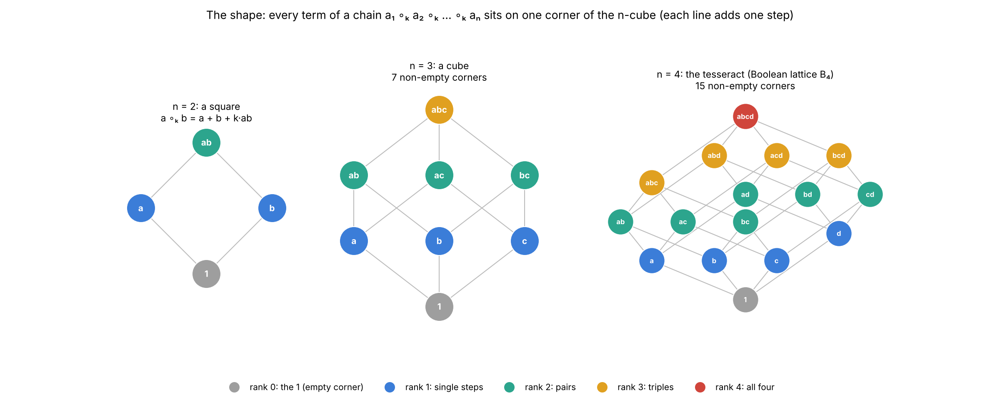
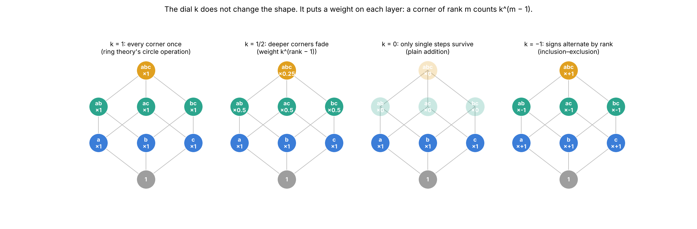
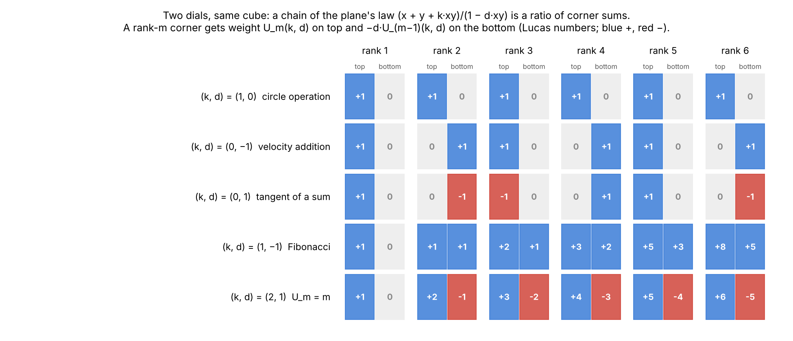
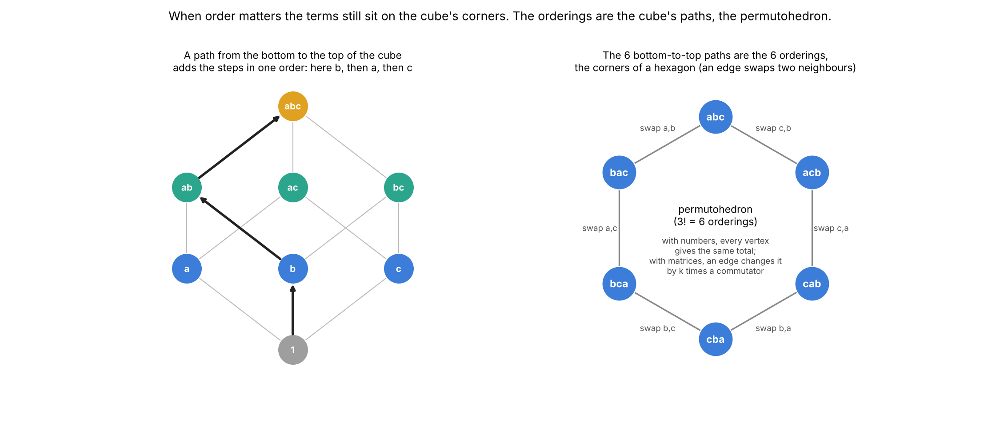

# The theory's shape: the Boolean lattice (the n-cube)

**Verdict.** The shape already has a name. Every term of a chain a₁ ∘ₖ a₂ ∘ₖ … ∘ₖ aₙ sits on one corner of the
**n-cube**, which order theory calls the **Boolean lattice Bₙ** (the subsets of n things, ordered by inclusion). At
n = 4 it is the tesseract. Nothing needs coining. The dials do not change the shape: they put a weight on each layer.
Order does not change it either: the orderings are the paths from bottom to top, and they form the **permutohedron**.
Almost all of this is known, mostly from Rota's 1964 theory of Möbius functions and its relatives. What looks new is
one formula: on the plane's two dials (k, d), a corner of rank m is weighted by the Lucas number U_m(k, d).

Checked: 92 exact checks (`checks.py`, output in `checks_output.txt`) and 9 Lean theorems (`lean/BooleanLattice.lean`,
core Lean 4.37, standard axioms only).

## The shape

Expand (1 + a)(1 + b)(1 + c) and you get one term per subset of {a, b, c}: 1, a, b, c, ab, ac, bc, abc. Draw a line
whenever one subset is the other plus one letter and you get a cube. That is the classical fact behind the tesseract
page (`topics/tesseract`), which already named it the Boolean lattice.

With a dial k, a chain is a sum over the non-empty corners, a rank-m corner weighted k^(m − 1):

a₁ ∘ₖ … ∘ₖ aₙ = Σ over non-empty corners S of k^(|S| − 1) · ∏ aᵢ (i in S)

This is the generating function of the elementary symmetric polynomials, ∏(1 + t·aᵢ) = Σ eₘ tᵐ, with t = k
(classical; Newton and Girard). Lean: `chain4_corners` (the tesseract, all 15 corners).

- **k = 1:** every corner counts once. Ring theory's circle operation (called mult-add before 1.0).
- **k = 0:** only the single steps survive. Plain addition.
- **k = −1:** signs alternate by rank. This is inclusion–exclusion for independent events (Lean: `incl_excl3`).
- **In between:** deeper corners fade or grow as k^(m − 1). With all entries equal, the layers are the binomial
  coefficients C(n, m), so the shifted power (a + 1)^n − 1 is the cube with every edge the same.

## The plane's two dials: Lucas numbers on the layers

The plane's law (x + y + k·xy)/(1 − d·xy) (Coleman and McGuinness 1991) also lives on the cube. A chain of it is a
ratio of two corner sums: a rank-m corner gets weight U_m(k, d) on top and −d·U_(m−1)(k, d) on the bottom, where U is
the Lucas sequence U₀ = 0, U₁ = 1, U_m = k·U_(m−1) − d·U_(m−2).

- **(k, d) = (0, −1), relativistic velocity addition:** odd corners over even corners. Known (the tanh of a sum).
- **(k, d) = (0, 1):** odd corners over even corners with alternating signs, the classical tangent of a sum of angles
  (ProofWiki, "Tangent of Sum of Series of Angles").
- **(k, d) = (1, −1):** the weights are the Fibonacci numbers.
- **d = 0:** the weights are k^(m − 1), the single-dial case above.

Why it works: with k = α + β and d = αβ, the map x ↦ (1 + αx)/(1 + βx) turns the law into multiplication (Lean:
`plane_lift`). That linearisation is standard for rational formal group laws. **The Lucas-weighted corner formula for
the whole plane is ours as stated.** I found it for the two tangent cases but not in general; it is probably folklore.
It is checked exactly for chains of up to 5 at six (k, d) points, and proved in Lean for chains of 3
(`plane_chain3_num`, `plane_chain3_den`, `tangent3`, `velocity3`).

## When order matters

Over matrices or operators, the terms still sit on the same corners. Each corner's product keeps the chain's order
(Lean: `nchain3_corners`). What order adds is a second shape: the paths from bottom to top of the cube are the n!
orderings, and the orderings are the corners of the **permutohedron** (a hexagon at n = 3). All bottom-to-top paths,
long and short, are the ordered set partitions, which are the permutohedron's faces (checked to n = 5: 1, 3, 13, 75,
541). With numbers every ordering gives the same total. With matrices, swapping two neighbours changes it by k times a
commutator (`circ_swap` in the names review).

## What existing work already has, and what it adds

| Existing work | Contains our result? | What it adds that we don't have | Lead worth following? |
|---|---|---|---|
| **Boolean lattice / hypercube.** The Hasse diagram of Bₙ is the n-cube graph. | Yes, the shape itself. | Nothing new for us; it is the name. | It is the name to use. |
| **Rota's incidence algebras and Möbius inversion** (1964). On Bₙ, μ(S, T) = (−1)^\|T − S\|. | Yes. Write ζ = 1 + η (η counts strict steps). The Möbius function is 1 + (the way back of η under the circle operation). Lean: `way_back_of_strict_zeta`; checks on B₃. | It works on **every** poset, not only cubes, and the incidence algebra is non-commutative. | **Yes.** It is a ready-made home for the circle operation when order matters, on any partial order, not just a chain of steps. |
| **Philip Hall's theorem** (1936; Stanley, *Enumerative Combinatorics* I, Prop. 3.8.5): μ = alternating count of chains. | Yes at k = 1. With the dial, (1 + k·η)⁻¹ = Σ (−k)^m η^m counts chains weighted by (−k)^length, Stanley's chain and zeta polynomials. | Topology: μ is the reduced Euler characteristic of the order complex. | **Yes.** The dial k becomes "evaluate the chain-counting polynomial at −k", which may connect the repetition dial to Euler characteristics. Unchecked. |
| **Inclusion–exclusion.** | Yes: the k = −1 chain (already on the tesseract page). | Dependent events: one Möbius step over the cube. | No; done. |
| **Zeta and Möbius transforms, subset convolution** (Yates 1937; Björklund, Husfeldt, Kaski and Koivisto 2007). | Yes: the tesseract page's box coordinates and union product. | Fast algorithms, about n·2ⁿ steps. Subset convolution is multiplication in R[x₁..xₙ]/(xᵢ²). | Small: only if we compute with very large cubes. |
| **Elementary symmetric polynomials and tangent-of-sum formulas.** | Yes for one dial (t = k) and for the two tangent points of the plane. | Newton's identities linking eₘ to power sums. | The general (k, d) Lucas form above is our addition. Worth a literature check before calling it new. |
| **The cube's face lattice** (faces are intervals [S, T]; f-polynomial (2 + t)ⁿ). | No; our terms use only the corners. | The Möbius step sums over faces. | Small. |
| **q-analogues of Bₙ** (subspaces of a finite vector space; Gaussian binomials). | **No.** The dial k weights layers; it is not a q-deformation. | Counting with q. | **Maybe.** A q-version would come from entries that q-commute (ba = q·ab), where reordering costs a power of q. That ties the order dial to the q-across topic. Unchecked. |
| **Chen's path signature, Ree's shuffle product, Hoffman's quasi-shuffle, the iterated-sums signature** (Chen 1957; Ree 1958; Hoffman 2000; Diehl, Ebrahimi-Fard and Tapia 2020). | Yes: the ordered corner sums are the strict iterated sums, and splitting a chain in two multiplies (Chen's identity). | The shuffle and quasi-shuffle products of two signature entries. | **Yes.** The k^(m − 1) weighting may be one of Diehl, Ebrahimi-Fard and Tapia's deformed quasi-shuffles. Unchecked. |
| **Permutohedra** (faces are ordered set partitions; Ardila, Denham and Huh 2020 state the face poset). | Yes: orderings are the cube's maximal chains. | A polytope on which to draw how totals change between orderings. | Some: a picture of non-commutativity, edge by edge. |
| **Associahedra** (bracketings). | Not needed: the circle operation is associative, so all bracketings agree. | — | No. |

## How much of the theory the shape covers

- **Covers:** the circle operation and its dial k, the plane's second dial d, inclusion–exclusion and probability,
  the shifted power rung (equal entries), and order (corners keep their order; orderings are the permutohedron).
- **Covers only partly:** the physics bridges, through the plane (velocity addition) and the dials.
- **Misses:** tetration and the higher rungs, and the geometry pages (toric charts, elliptic curves, the zoom dial's
  fractal dimension), which use other shapes.

## Known versus new

- **Known:** the shape (Boolean lattice, n-cube), the expansion, inclusion–exclusion, Möbius functions and Hall's
  theorem, the tangent-of-sum formulas, the path signature, permutohedra.
- **Ours:** the Lucas-weighted corner formula for the whole (k, d) plane, as stated (not found in the literature
  searched on 2026-11-25; probably folklore), and putting the dials, inclusion–exclusion, Möbius and orderings on one
  picture of one shape.

## Sources

- Rota, G.-C. (1964). On the foundations of combinatorial theory I: Theory of Möbius functions.
- Stanley, R. P. *Enumerative Combinatorics* I, Prop. 3.8.5 (Hall's theorem), §3.12 (zeta polynomial).
- Hall's theorem statement: https://users.math.msu.edu/users/magyarp/Math880-2017/HW-08.pdf and https://arxiv.org/pdf/1803.06664
- Tangent of a sum: https://proofwiki.org/wiki/Tangent_of_Sum_of_Series_of_Angles ; tanh: https://www.johndcook.com/blog/2023/10/07/tanh-sum-proof/
- Coleman, C. and McGuinness, J. (1991). Rational formal group laws. Pacific J. Math. 147.
- Lucas sequences and formal groups: https://www.mathstat.dal.ca/FQ/Papers/57-3/yamagishi06142019.pdf
- Permutohedral fan faces as ordered set partitions: Ardila, Denham and Huh, https://arxiv.org/pdf/2004.13116
- Björklund, Husfeldt, Kaski and Koivisto (2007). Fourier meets Möbius: fast subset convolution.
- Diehl, Ebrahimi-Fard and Tapia (2020). Time-warping invariants of multidimensional time series (iterated-sums signature).
- Hypercube in algebraic combinatorics (Terwilliger algebra): https://arxiv.org/pdf/2301.08366
