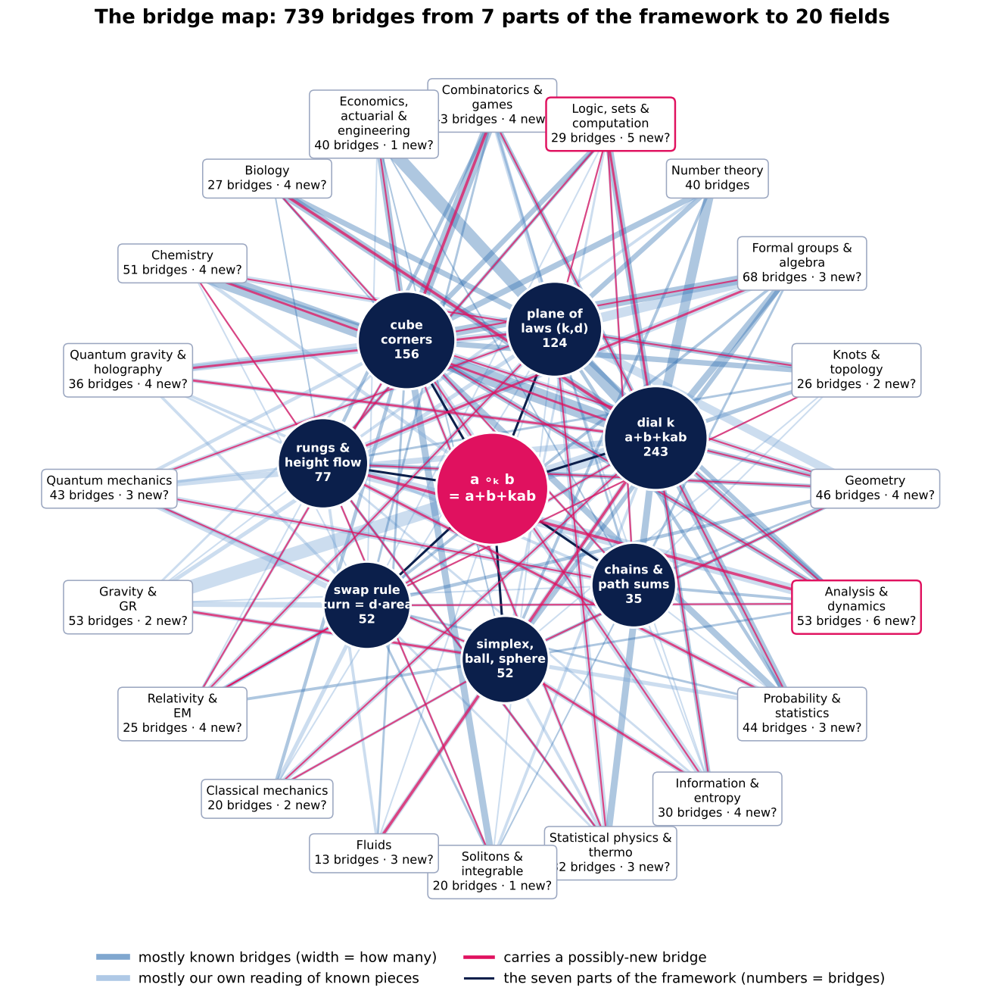
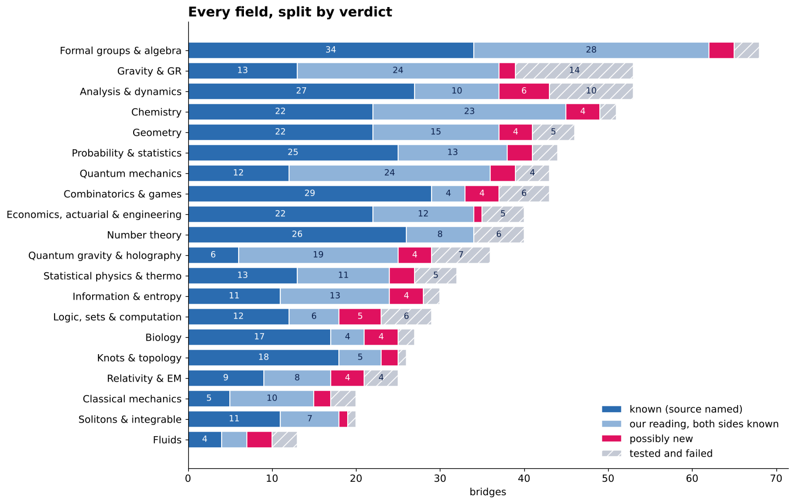
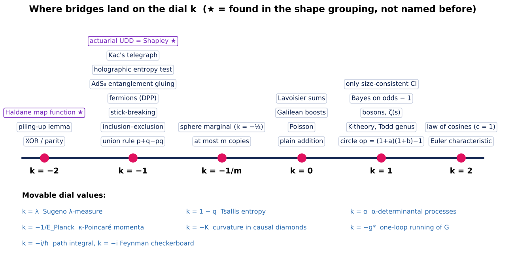
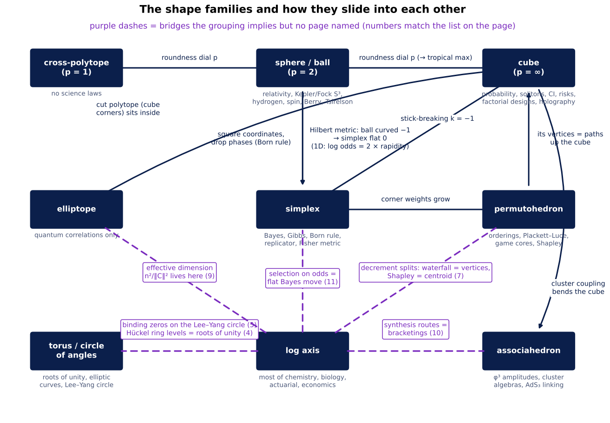
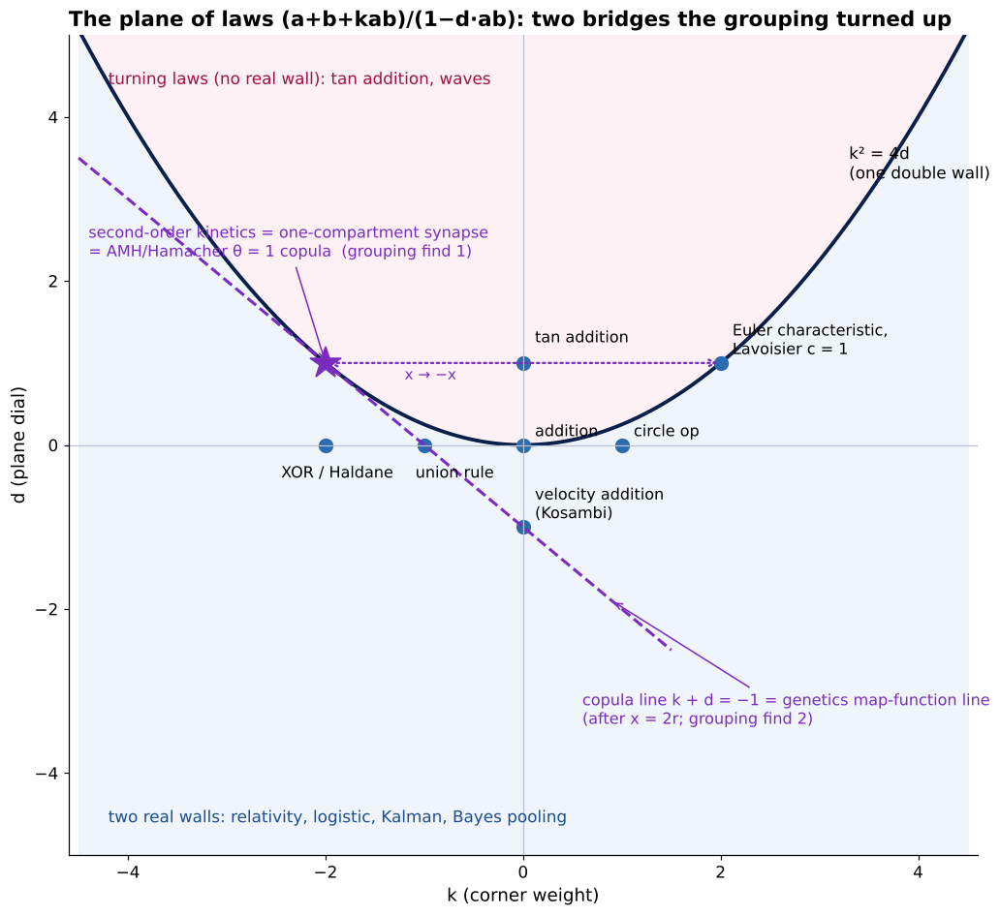
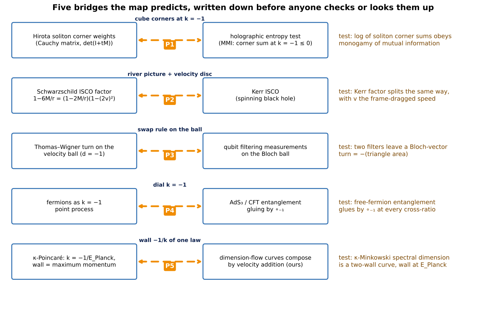

# Bridge survey: every place the theory lands on an established field

> **Names:** some words or symbols on this page (fused, rung, wall, Tsallis q) also mean something else in standard math, physics or computing, or inside this project. [NAMING-COLLISIONS.md](../../NAMING-COLLISIONS.md) says which meaning is in play.

DRAFT, Nov 26, 2026. Affine Composition Theory (formerly Hypercube Composition Theory; a ∘ₖ b = a + b + k·ab, with the curvature dial d, formerly the plane dial).

**The result in two sentences.** Across all the pages there are about 739 distinct bridges into 20 fields: 338 land on results the write-ups name as known, 247 are our own reading of known pieces, 92 were tested and failed, and 62 are marked possibly new, of which about 20 join two fields (the rest are new small results inside one field). Grouping the results by shape turned up 16 more bridges no page had named, and the strongest bridge the map predicts but nobody has checked is that Hirota's soliton corner weights should pass the same "has a geometry" test as holographic entanglement (P1 below).

The verdicts are each write-up's own, gathered from the pages in the shared folder and the repo; this survey did no new literature search, and it cites earlier checks instead of redoing them. The count of 739 comes from 780 rows after merging repeats that two folders filed separately, so it is approximate: split bridges more finely or more coarsely and it moves by a few dozen.

*How to read it.* The magenta disc is the operation. The seven dark discs are the parts of the framework that do the bridging: the dial k itself, the plane of laws (k, d), the cube's corners and their weights, the rungs and height flow, the swap rule (turn = d × area), the shapes (simplex, ball, sphere) and the chains and path sums. Each outer box is a field, with its count and how many of its bridges are possibly new. Two fields have a magenta border: logic and sets (the fractional power set results) and analysis and dynamics (the rung and height-flow results). That is where the possibly-new work clusters.

## 1. The count, field by field

| Verdict | Bridges | What it means |
|---|---:|---|
| Known | 338 | The write-up names the established source. |
| Our reading of known pieces | 247 | Both sides are known; the link or the picture is ours. |
| Possibly new | 62 | The write-up found nothing in print. About 20 join two fields. |
| Tested and failed | 92 | A bridge that was tried and did not hold. Kept, because each one saves effort. |

Two things stand out in the bars. Formal groups, number theory and topology are almost all blue: the operation is a well-known object there, so every bridge in those fields is a known result seen again. Possibly-new bridges sit instead where the operation meets something less standard: set theory without choice, iteration theory at fractional heights, holographic entropy, and orbit precession.

## 2. Where the bridges land on the dial

The line is not to scale. The crowding at k = −1 is the clearest pattern in the whole survey. Inclusion–exclusion, stick-breaking, fermion point processes, Kac's telegraph walk, AdS₃ entanglement gluing and the holographic entropy test all sit at the same dial value, and they come from five different fields. That crowding is what the predictions in section 5 lean on.

## 3. The strongest bridges (known)

These are exact matches with an established result, each checked on its page. They are listed because they carry the framework's weight, not because they are new.

| Our side | Their side | Source the page cites | Folder |
|---|---|---|---|
| The plane of laws (a+b+kab)/(1−d·ab) | Classification of rational formal group laws; one-parameter Möbius groups | Coleman and McGuinness 1991; Lie, Klein | landscape |
| a+b+ab and its powers | K-theory's formal group law and Adams operations, which settle Hopf invariant one | Adams and Atiyah 1966 | topology |
| Cauchy-matrix corner weights, det(I + tM) | KdV/KP soliton tau functions, pair factor ((pᵢ−pⱼ)/(pᵢ+pⱼ))² | Hirota 1971; Date–Jimbo–Kashiwara–Miwa | corner-weights |
| Lucas weights U_m(k, 1); silent layers U_m = 0 | Jones–Wenzl traces; Beraha points of Temperley–Lieb | Jones, Wenzl, Beraha | lucas-temperley-lieb |
| Dial at k = −1/E_Planck; the wall −1/k | κ-Poincaré momentum addition; maximum momentum | Lukierski et al. 1991–92; Majid and Ruegg 1994 | why-i/kappa-poincare |
| Velocity addition = circle op in d = 2u/(1−u) | Rapidities add, Doppler factors multiply | Einstein; Bondi | relativity |
| Dial at k = 1 − q | Tsallis q-sum and q-entropy | Tsallis 1988 | dial-survey, information-theory |
| Dial at k = α | α-determinantal point processes: fermions, Poisson, bosons | Shirai and Takahashi 2003 | dial-point-processes |
| Dial at k = λ | Sugeno λ-measure | Sugeno 1974 | measure-probability |
| Prime products ∏(1 − k·p⁻ˢ)^(−1/k) | Fermionic and bosonic primon gas | Julia 1990; Spector 1990 | dial-survey |
| Cube corner sum at k = −1 on entanglement entropies | The holographic entropy test (one-sign pattern) | Hernández-Cuenca, Hubeny and Jia 2023, Prop 3 | holographic-entropy-cube |
| One boost, clock and ruler deficits as circle inverses | The river model of a black hole | Painlevé 1921; Gullstrand 1922; Hamilton and Lisle 2008 | general-relativity |
| Rung step eˣ − 1 | Critical Poisson(1) branching; the 2/(σ²n) survival law | Kolmogorov | height-flow |
| ∘ₖ with its paired sum | Generated semiring; Maslov dequantization | Mesiar and Pap; Maslov | semiring-audit, quantum-to-classical |
| Kepler orbits on the 3-sphere | Hydrogen's n² degeneracy | Fock 1935 | hypersphere |
| Swap rule at d = −1 and d = +1 | Thomas, Foucault and Berry precession | Thomas; Foucault; Berry | precession |
| Weighted chain at k = −i and k = −1 | Feynman's checkerboard; Kac's telegraph | Feynman; Kac | why-i/checkerboard |
| The zoom dial's wall Σ rᵢˢ = 1 | Moran's equation for fractal dimension | Moran 1946 | zoom-dial |

## 4. The possibly-new bridges, judged one by one

These are the ones the write-ups found nowhere in print and that join two fields. Each says whether it opens a lead worth following and why.

| # | Bridge | Folder | Lead worth following? |
|---|---|---|---|
| N1 | A soft (log-sum-exp) min cut is a ferromagnetic Ising free energy, and it obeys monogamy of mutual information on every graph. The proof uses Griffiths–Ginibre inequalities; five-party facets are numerical only. | exploration, holographic-entropy-cube | **Yes.** It is a proof, not a pattern, and it ties a standard tool of statistical mechanics to the holographic entropy cone. The next step is the five-party inequalities. |
| N2 | 1 − 6M/r = (1 − 2M/r)(1 − (2v)²) for any static round spacetime; the innermost stable orbit sits at 2v = c and the photon sphere at v = c. Not yet checked against the literature. | hypersphere/orbits, curved-space | **Yes.** It gives a sharp test with a known answer to compare against: does Kerr split the same way (P2)? |
| N3 | The Sommerfeld fine-structure advance per lap equals the Thomas turn of the circular orbit with the same angular momentum. Verdict from the hypersphere thread: implied by Biedenharn 1983 (via Vickers) but not stated as an equality. | hypersphere/orbits | **Small.** A clean equality worth a paragraph, not a programme. |
| N4 | The AdS₃ cross-ratio as the chance that a steady random clock on one region's own time ticks while sweeping the other region. | probability-entanglement | **Yes.** It can fail a sharp test in excited states, so it is falsifiable. |
| N5 | 1 − cross-ratio as a random-geodesic linking probability; each associahedron equation then reads "both channels linked as often as neither", and that forces the clock to tick at rate 1. | beyond-the-cube | **Yes, modest.** The open question is whether rate 1 picks out a central charge. |
| N6 | The dial and the swap rule are one number q = β/α; face weights are the fixed-point formula of Hirzebruch's χ_y genus. The elliptic end (Krichever, Buchstaber–Bunkova) is unchecked. | polar-recast | **Yes.** It is the top lead of the polar recast, and the elliptic end is a concrete next check. |
| N7 | Dimension-flow curves of quantum gravity (asymptotic safety, causal sets, Calcagni) are two-wall curves that compose by velocity addition. | why-i/e-i-pi/asymptotic-safety | **Modest.** Exact where it holds; it feeds prediction P5. |
| N8 | (Planck length / de Sitter radius)² = GħΛ/c³, the same number as a published G dial. | why-i/e-i-pi/g-dials | **Weak for now.** It hangs on whether the short length really is the Planck length. |
| N9 | Critical branching gets a next correction, −(2·residue/σ²)(log n)/n², with the residue 1 − (2/3)κ. Checked numerically to n = 20,000. | parabolic-fingerprints | **Yes, small.** It is a checkable prediction for probabilists. |
| N10 | The rung step's branching process has no continuous-time or fractional version (a rate comes out negative, u₃ = −0.2506). | fractional-steps | **No, as a lead; yes, as a note.** It closes a door, which saves others the effort. |
| N11 | The dial game v(S) = (∏(1 + k·xᵢ) − 1)/k has a closed-form Shapley value; k = −1 is the actuarial UDD split. | game-theory | **Small, practical.** A one-knob synergy model. |
| N12 | Four-ended tangles never fall inside the parabola k² = 4d; six-ended ones can. | lucas-temperley-lieb | **Small.** It answers the knot page's open question. |
| N13 | In one dimension, Bayes odds multiply exactly when velocities add Einstein's way: log odds = 2 × rapidity. | simplex | **No.** Elementary and likely noticed before; useful as a teaching line. |
| N14 | A temperature dial slides the free-energy body from the ball (curvature −1) to the simplex (flat). 26 of 26 checks, no write-up yet. | simplex | **Yes, once written up.** It is the cubic-form dial (the shape dial) with a geometric meaning. |
| N15 | CHSH over p-norm state spaces is 2^(1 + max(1/p, 1 − 1/p)): 2√2 at p = 2, the PR box's 4 at p = 1 and ∞. No write-up; provisional. | shape-dial-survey | **Check the literature first.** Polygon state spaces are studied (generalized probabilistic theories); the p-norm formula may be there. |
| N16 | Smets' disjunctive rule for belief functions is "facet heights multiply" on shape weights. | polar-coordinates | **Small.** Each half is known; the join is ours. |
| N17 | Quantum channels sit on one straight line k = −L/(L−1); depolarizing at −d²/(d²−1); the floor at −2 is proved in Lean. | landscape | **Small.** New as a picture. |
| N18 | Integrated rate laws on the plane: second order at (−2, 1); order n touches the plane at (−n, n(n−1)/2). | chemistry 9 | **Small.** Packaging, but it feeds grouping find 1. |
| N19 | Dependence copulas (Ali–Mikhail–Haq, Hamacher) lie on the line k + d = −1. | statistics | **Small.** New as a line on the map; feeds grouping find 2. |
| N20 | Predator interference runs from Beddington–DeAngelis (k = 0) to Crowley–Martin (k = 1); linear global epistasis is path-consistent only on the dial. | biology | **Small.** Two ecology and evolution families on one dial. |
| N21 | Lucas weights U_m(k, d) weight the rank-m corners of a two-dial chain. | boolean-lattice, corner-weights | **No.** The write-ups call it probably folklore. |

The other possibly-new rows are new small results inside one field rather than bridges: the fractional power set with and without choice (the project's strongest pure result, set theory), no functor square root of the power set, the horn coefficient of eˣ − 1, the kiss constants of the fused rungs, the rung sheet's area gauge, the shape number s, three-body loop types, the shell-model toys for Navier–Stokes, a rounding fact for fused multiply-add, a Shor-code threshold box and the Madelung exceptions. All are in `bridges.csv`.

## 5. Found in the shape grouping (16, none named before)

Brennan's point was that grouping by shape might itself have turned up bridges. It did. Each item below is a coincidence in the grouping that no page names. Items 1 to 6 are exact algebra or numerics that hold; whether the cross-link is already in print is not checked. Items 7 to 16 are unchecked.

| # | What the grouping shows | Status | My read |
|---|---|---|---|
| G1 | One law, (a + b − 2ab)/(1 − ab) at (k, d) = (−2, 1), is used by second-order kinetics, one-compartment synaptic summation and the Ali–Mikhail–Haq/Hamacher θ = 1 copula. In each the odds add. Flipping x → −x lands on the Euler-characteristic law at (2, 1), where Lavoisier's c = 1 also sits. | Algebra holds | Three fields, one law, no cross-citation. Worth a short note. |
| G2 | Genetics' map-function line 2k + d = −4 becomes the copula line k + d = −1 under x = 2r. Haldane lands on independence, Kosambi on velocity addition. So map functions are a one-parameter copula family on 2r. | Algebra holds | The most useful of the plane finds: it gives geneticists a copula reading of interference. |
| G3 | Haldane's addition rule is the piling-up lemma: 1 − 2(r₁ + r₂ − 2r₁r₂) = (1 − 2r₁)(1 − 2r₂). | Trivially true | Both sides are textbook; only the cross-link is new. |
| G4 | The N-atom Hückel chain polynomial is the Lucas corner weight U_{N+1}(x, 1); its levels 2cos(jπ/(N+1)) are the Beraha points. Rings with all-integer levels exist only for N = 1, 2, 3, 4, 6 (the crystallographic restriction). | Algebra holds | This gives the "probably folklore" Lucas corner formula a literature anchor in chemistry, and ties Hückel theory to Temperley–Lieb. |
| G5 | Cooperative binding zeros lie on a Lee–Yang circle: |x| = ω^(−(n−1)/2) for n sites with pairwise cooperativity ω (checked for n = 3, 4, 5). The concerted (MWC) model puts its zeros on a different circle, so the zeros tell pairwise and concerted cooperativity apart. | Holds; follows from the Lee–Yang theorem | The Lee–Yang side is a theorem, so the identity is safe. The diagnostic use for binding data looks like the part worth checking. |
| G6 | In discounting, the horizon n acts as the ℓp dial (the roundness dial) p: the averaged discount factor is an n-norm, and Weitzman's "lowest rate wins" is the p → ∞ limit. | Numbers hold | The norm is Weitzman's own formula; the roundness-dial reading is ours. |
| G7 | Actuarial UDD = Shapley is the centroid of the k = −1 base polytope, and each waterfall order is a stick-breaking vertex. | Unchecked | Likely true and likely known to cooperative-game people. |
| G8 | Rulecraft's spillover dividends are Postnikov's y_I; a positive synergy is a convex game. | Unchecked | Useful for Rulecraft, if it holds. |
| G9 | The effective dimension n²/‖C‖² of a correlation matrix lives on the elliptope: 1 at the cube corners, n at the identity. | Unchecked | It would give the elliptope its first non-quantum field. |
| G10 | Synthesis routes are bracketings, i.e. associahedron vertices, with a depth-sensitive yield weight. | Unchecked | Plausible, small. |
| G11 | Selection on odds is the flat simplex Bayes move: steps commute, with no precession. | Unchecked | Follows from the simplex page if selection is multiplicative on odds. |
| G12 | Chemistry's n² shells use the same Fock 3-sphere as the hypersphere page, but the two pages never cross-link. | Bookkeeping | Link the pages. |
| G13 | Chemistry 2's binding angle and the hypersphere velocity disc are two rewrites of Dirac hydrogen; whether they agree for excited states is open. | Unchecked | A clean test. |
| G14 | One order parameter q runs through Rényi order, Hill-number order, reaction order and the Clayton copula. | Weak | Probably just the power mean appearing four times. |
| G15 | Two duckweed inhibitor mixtures (α ≈ −0.94, −0.98) may sit where no two-inhibitor binding scheme can reach. | Unchecked | Needs the data checked before anything else. |
| G16 | Hill's muscle hyperbola is Boyle's hyperbola, the unit circle of the circle operation. | Minor | True and harmless. |

The grouping also shows three gaps. The cross-polytope holds no science laws at all; the elliptope holds only quantum correlations; the associahedron holds only amplitudes and cluster algebras. Most applied laws (chemistry, biology, actuarial, economics) are filed only on the log axis, by their composition law, never by a shape. G4, G5, G7 and G9 to G11 are the first attempts to give those laws a shape.

## 6. Bridges the map predicts, written down before checking

The map's shape suggests where bridges should exist. Each prediction below comes from a hub that already reaches two fields with exact, known bridges, so the missing link has a definite form. None has been checked or looked up. Each states the test that would settle it.

| # | Prediction | Why the map predicts it | The test |
|---|---|---|---|
| **P1** | Hirota's soliton corner weights pass the holographic "has a geometry" test. | The cube's corners hold two exact known bridges: soliton tau functions (det(I + tM) with a Cauchy matrix) and the holographic entropy test (the corner sum at k = −1). They have never been put together. | Take S(A) = log det(I + M_A) over subsets A of solitons; check that the k = −1 corner sum obeys monogamy of mutual information (I₃ ≤ 0) for every positive Cauchy matrix. A yes, or a clean counterexample, settles it. |
| P2 | Kerr's innermost stable orbit factors like Schwarzschild's: a river factor times (1 − (2v)²), with v the frame-dragged orbital speed. | N2 holds for every static round spacetime, and the swap rule already gives frame dragging (gravity-from-theory). | Factor the Kerr ISCO condition r² − 6Mr ± 8a√(Mr) − 3a² and see whether it splits that way. |
| P3 | Two qubit filtering measurements in a row leave a turn of the Bloch vector equal to the area of their triangle on the Bloch ball, with sign set by d = −1. | The ball is relativity's velocity space (simplex page), the swap rule gives Thomas–Wigner turns there, and filtering measurements act on the Bloch ball. | Apply two non-commuting filters K = √E, extract the leftover rotation, compare with the hyperbolic triangle area. |
| P4 | Free-fermion entanglement glues by ∘₋₁ at every cross-ratio, not only where holography does. | Fermions sit at k = −1 in the point-process table, and AdS₃ gluing sits at k = −1 too (figure 3). | Check x(A, B₁B₂) = x₁ ∘₋₁ x₂ in the free-fermion two-interval entropy formula. |
| P5 | The spectral dimension of κ-Minkowski space is a two-wall curve that composes by velocity addition, with its wall at the Planck energy. | κ-Poincaré is the dial at k = −1/E_Planck with its wall at maximum momentum, and N7 found the same two-wall shape in other dimension-flow curves. | Take the published κ-Minkowski spectral-dimension curve and test whether it is a two-wall Möbius curve. |

**The strongest is P1.** It joins the two largest clusters of exact, known bridges through one shared object, at one dial value, and the answer is a sharp yes or no.

Three calibration predictions are included because the map predicts them and they are almost certainly known. If they turn out known, that is evidence the map points the right way:

- At d = 0 (Galilean) the swap rule's area survives as a phase: Galilean boosts commute only up to m × area / ħ (Bargmann's central extension).
- The elliptope's boundary is straight in angle coordinates, and the classical-to-quantum gap 2 → 2√2 is a Grothendieck constant (Tsirelson; Goemans–Williamson rounding).
- Hückel rings use the trace version of the Lucas weights: the ring polynomial is V_N(x, 1) − 2 = 2T_N(x/2) − 2, next to the chain's U_{N+1}(x, 1) in G4.

This is the honest version of the voice-call test: a framework that keeps landing on bridges earns something when it names one before anyone looks.

## 7. What the shape of the map says

- **Most bridges run through the dial k and the cube's corners** (243 and 156). The rungs and height flow carry the highest share of possibly-new bridges (12 of 77), which matches the magenta border on analysis and dynamics.
- **Every field touches at least four of the seven hubs.** That is the "one shape everywhere" claim seen as a graph.
- **Fluids is the thinnest field** (13 bridges, touching only four hubs), and three of its possibly-new rows are toy models. That matches the Navier–Stokes verdict on its own pages: mapped, not close.
- **Known fields stay known.** Where the operation is already a standard object (formal groups, K-theory, Euler products), each bridge is a re-sighting of known mathematics, and the survey found nothing to change those verdicts.

## Files

- `bridges.csv`: all 780 rows, with our side, their side, field, the part of the framework, verdict, cited source, folders and a repeat flag.
- `raw/`: the three sweeps (physics, pure math, shapes and applied) and `shape-grouping.md`, the full shape-grouping notes.
- `merge.py`, `figures.py`: the merge and the six pictures.
