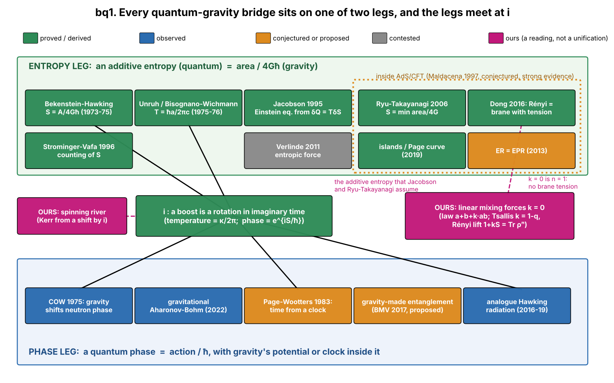
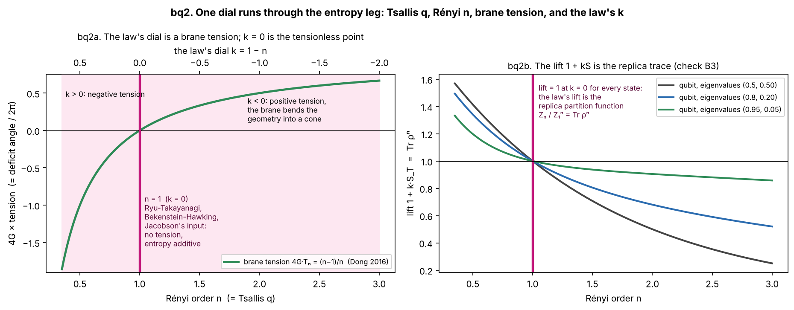
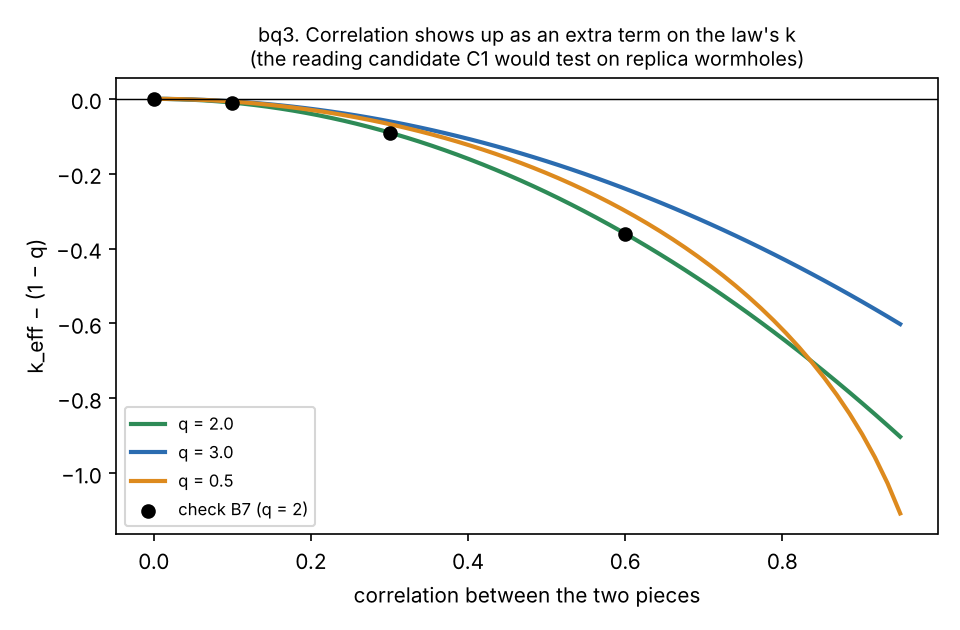

# DRAFT · All the quantum–gravity bridges as one study, ours included (Nov 28, 2026)

**DRAFT. Not versioned, not proved in Lean.** Asked by Brennan on a voice call: "let's look at all of the bridges together as one
study including this new bridge and see if that can help us give a shape for some more new bridges that might come up."

Checks: [`checks.py`](checks.py) → [`checks_output.txt`](checks_output.txt), **8 of 8 pass** (a few seconds; numpy, sympy), numbers in
[`results.json`](results.json). Pictures: [`figures.py`](figures.py) → [`figures/`](figures/) bq1 to bq3. Hashes: [`SHA256SUMS`](SHA256SUMS).
Colour key on every picture: **green = proved or derived from stated assumptions, blue = observed, orange = conjectured or proposed,
grey = contested, magenta = ours (a reading, not a unification), dashed = a link that is our reading.**

Builds on, and doesn't redo: [`physics-bridges/`](../physics-bridges/README.md) (the law against the big theories),
[`gr-bridges/`](../gr-bridges/README.md) (four routes to Einstein), [`bridge-survey/`](../bridge-survey/README.md) (739 bridges inside maths),
[`spin-i-tie/`](../spin-i-tie/README.md) (linear mixing, interference, information causality) and
[`gravity-from-theory/spinning-river/`](../gravity-from-theory/spinning-river/README.md).

## The shape, first

**Every bridge between quantum theory and gravity sits on one of two legs, and the two legs meet at i.** On the *entropy leg* an
additive quantum entropy equals an area in Planck units (A/4Għ). On the *phase leg* a quantum phase equals an action over ħ with
gravity's potential or clock inside it. They meet because a boost is a rotation in imaginary time: that one fact gives Unruh's and
Hawking's temperatures (κ/2π) and the phase e^{iS/ħ}.

**Where a bridge has a dial, the standard result sits exactly at the dial's additive point, and that point is our k = 0.** Dong's
Rényi entropies are areas of branes with tension (n − 1)/(4nG); the tension vanishes only at n = 1, which is Ryu–Takayanagi. In the
law's language n = 1 − k, so **k = 0 is the tensionless point**, and our linear-mixing result is a quantum-side reason the entropy on
this leg must sit there. That is a small bridge into a known dictionary, not quantum gravity.

*bq1. The bridge map. Top band: the entropy leg. Bottom band: the phase leg. The green hub in the middle is the i that joins them. The
dotted orange frame holds the bridges that live inside AdS/CFT. Our two pieces are magenta: the linear-mixing result (right) lands at
the tensionless point of Dong's family and supplies the additive entropy that Jacobson and Ryu–Takayanagi assume; the spinning river
(left) uses a shift by i to build Kerr, so it hangs off the hub.*

## 1. The bridges in one table

Status words: *proved* = a theorem or a derivation from stated assumptions; *observed* = measured; *conjectured*; *contested*.

| Bridge | Quantum side | Gravity side | Shared object | Status | Who |
|---|---|---|---|---|---|
| Black-hole entropy and radiation | quantum fields near a horizon radiate thermally | horizon area, surface gravity κ | S = A/4Għ, T = ħκ/2πc | derived, not observed in astronomy | Bekenstein 1973; Hawking 1974–75 |
| Counting black-hole entropy | string states (D-branes) | extremal black-hole area | the number of states = e^{A/4Għ} | proved for those black holes | Strominger–Vafa 1996 |
| Analogue Hawking radiation | phonons in a flowing condensate | a sonic horizon | thermal spectrum from a horizon | observed (analogue only) | Steinhauer 2016, 2019 |
| Unruh effect | the vacuum looks thermal to an accelerated observer | the Rindler horizon | boost = rotation in imaginary time (modular flow) | proved in QFT; not directly observed | Fulling 1973; Davies 1975; Unruh 1976; Bisognano–Wichmann 1975–76 |
| Thermodynamics of spacetime | entanglement entropy ∝ area, Unruh T | Einstein's equations | δQ = T δS on every local horizon | derived (assumes area law and equilibrium) | Jacobson 1995 |
| Entropic gravity | holographic screens | Newton's law, inertia | F = T ∇S | contested | Verlinde 2011 (objection: Kobakhidze 2011) |
| Gauge/gravity duality | a conformal field theory on the boundary | gravity in anti-de Sitter space | equal partition functions | conjectured, very strong evidence | Maldacena 1997; Gubser–Klebanov–Polyakov 1998; Witten 1998 |
| Ryu–Takayanagi | entanglement entropy of a region | the minimal surface's area | S = Area/4G | proved inside AdS/CFT's assumptions | Ryu–Takayanagi 2006; Lewkowycz–Maldacena 2013 |
| Einstein from entanglement | the entanglement first law δS = δ⟨K⟩ | linearised Einstein equations | the first law on small balls | proved inside AdS/CFT | Lashkari–McDermott–Van Raamsdonk 2014; Faulkner et al. 2014 |
| **Rényi as branes** | Rényi entropy S_n | a cosmic brane with tension Tₙ = (n−1)/(4nG) | area of a tensioned surface; tension 0 at n = 1 | proved inside AdS/CFT's assumptions | Dong 2016 |
| Islands and the Page curve | radiation entropy rises then falls | replica wormholes, an island inside the horizon | the generalised entropy | derived (semiclassical gravity) | Penington 2019; Almheiri–Engelhardt–Marolf–Maxfield 2019 |
| ER = EPR | entangled pairs | wormholes | entanglement ↔ connection | conjectured | Maldacena–Susskind 2013 (also Van Raamsdonk 2010) |
| COW | neutron interference | Earth's gravity | phase = (potential × time)/ħ (check B8) | observed | Colella–Overhauser–Werner 1975 |
| Gravitational Aharonov–Bohm | atom interference | a nearby mass's potential | a phase with no force | observed | Overstreet et al. 2022 |
| Time from a clock | a stationary universe, Hψ = 0 | the Wheeler–DeWitt constraint | time = correlation with a clock | proposed; toy lab demo | Page–Wootters 1983; Moreva et al. 2014 |
| Gravity-made entanglement | two masses in superposition | the Newtonian field between them | entanglement only if gravity is quantum | proposed, not yet done | Bose et al. 2017; Marletto–Vedral 2017 |
| Non-additive horizon entropy | Tsallis-type entropies | black-hole and cosmological horizons | S ∝ A^δ, non-additive composition | proposed, disputed | Tsallis–Cirto 2013 (comment: Pessoa–Costa 2020) |
| **Ours** | linear mixing and phase averaging force k = 0; information causality plus the round state shape tie k to quantum structure | none directly; reaches gravity only through the known Tsallis/Rényi → Dong dictionary | the law a + b + k·ab; its lift 1 + kS = Tr ρⁿ | ours: a reading, with small checks | `spin-i-tie/` rounds 1–8 |
| Ours (gravity side) | none | Kerr built from a source shifted by i (the Newman–Janis shift) | the dial's rotation number i | ours: a rebuild of known GR | `spinning-river/` |

The voice assistant on the call named Jacobson 1995 as the closest to Brennan's bridge because both run through entropy. That holds.
Dong 2016 is closer still in the mathematics, because it is the one bridge with a dial, and its dial is ours.

## 2. The shared shape, piece by piece

1. **Two legs.** Every row above is either "an entropy = an area" or "a phase = an action". None is both, except through the hub.
2. **The hub is i.** Temperature on the entropy leg comes from asking a horizon to be smooth when time turns imaginary: the period
   must be 2π/κ, so T = κ/2π (check B5, Schwarzschild and Kerr). On the phase leg the phase is e^{iS/ħ}. Same i, the one that
   [`why-i/`](../why-i/) argues quantum mechanics needs.
3. **One dial on the entropy leg, and the standard sits at its additive point.**

*bq2a. Dong's brane tension against the Rényi order n (bottom) and the law's dial k = 1 − n (top). The magenta line is n = 1, k = 0:
no tension, no backreaction, Ryu–Takayanagi and Bekenstein–Hawking. Away from it the brane bends the geometry into a cone with
deficit angle 2π(n−1)/n (check B4). bq2b. The law's lift 1 + kS_Tsallis is exactly Tr ρⁿ, which is the replica partition function
Zₙ/Z₁ⁿ that gravity computes (check B3). Every curve passes through 1 at k = 0.*

   - Tsallis entropies combine by the law with k = 1 − q (check B1, Tsallis 1988); Rényi entropies add at every order (B2). The
     two are the same thing in two coordinates: the lift 1 + kS_T equals e^{kS_R} (B3). That part is known; reading it as the law's
     lift is ours (from `spin-i-tie/chain-rule/`).
   - Jacobson's derivation needs the horizon entropy to be linear in area. If it goes as A^δ, Newton's constant becomes
     G ∝ A^{1−δ} and stops being a constant unless δ = 1 (check B6). So the additive point is also where G is a constant.
4. **Where our result lands.** On the quantum side, linear mixing (round 8) and phase averaging (interference round) both force
   k = 0. Through the dictionary in point 3, k = 0 is n = 1, the tensionless, additive point that Jacobson, Ryu–Takayanagi and
   Bekenstein–Hawking all assume. So our result gives a reason for an assumption the entropy-leg bridges make. It doesn't add any
   gravity of its own.

## 3. Does the shape open leads?

**Yes, one, and it is worth following on its merits.** The shape itself is mostly known: the two legs, the i hub (Bisognano–Wichmann,
Gibbons–Hawking) and the dial with the standard at n = 1 (Dong) are all in print. What is ours is joining Dong's dial to the law's k
and to our k = 0 result. That join makes a gravity-side claim our quantum work didn't make before: **an entropy at k ≠ 0 can't be the
entropy of linearly mixing quantum states. In gravity it can only be a tensioned surface, a deformed geometry.** Several cosmology
models use non-additive horizon entropies (Tsallis–Cirto, Barrow, Tsallis holographic dark energy). Our result says they owe an
explanation of why horizon entropy escapes linear mixing. That objection is partly known (Pessoa–Costa 2020 argue additivity is
fundamental; a 2023 review of entropic cosmologies lists inconsistencies), so the lead is a sharp, cheap way to join a live debate.
It is not a new law.

The shape doesn't suggest any bridge that skips the hub. Every candidate below goes through i or through the dial.

## 4. Candidate bridges to test next (offered, not run)

- **C1. Put the non-additive horizon entropies on our dial.** For Tsallis–Cirto (A^δ), Barrow (A^{1+Δ/2}) and Tsallis holographic
  dark energy, sort each into (a) a composition change, which is our k, or (b) a power of area, which changes G (check B6). Then ask
  whether linear mixing rules it out as the entropy of a quantum state, and what brane tension it would need instead.
  *Why it's worth it:* it is the one place where our k = 0 result makes a claim about gravity models people fit to data. Cheap, mostly
  literature plus a few lines of algebra. *Risk:* it may mostly confirm the known critiques.
- **C2. Euclidean Kerr from the river's shift by i.** Gibbons and Hawking (1977) make Kerr Euclidean by taking its spin imaginary.
  The river builds Kerr by shifting the source by i·a. Turn time imaginary as well and the two i's multiply to a real shift. Test
  whether the river's own rules then give Kerr's temperature, horizon spin rate and S = A/4 from smoothness alone.
  *Why it's worth it:* it would put our gravity model on the entropy leg, and it is where the dial's i and imaginary time meet in one
  calculation. The answer from general relativity is known, so pass or fail is clean.
- **C3. Replica wormholes as the law's cross term.** For independent pieces the law's k is exactly 1 − q; correlation shows up as an
  extra term (bq3, check B7). In a solvable black-hole model (JT gravity), replica wormholes are exactly where the two-piece partition
  function stops splitting. Track that extra term across the Page time.
  *Why it's lower priority:* it is likely the known Rényi Page curve in the law's coordinates. Worth doing only if C1 shows the dial
  matters on the gravity side.

*bq3. The setup for C3. For two independent pieces the law's dial is exactly 1 − q (zero on the vertical axis). As the pieces become
correlated, an extra term appears and grows. Black dots are check B7.*

**Candidates run (Nov 28):** C1, C2 and C3 are in [`candidates/`](candidates/README.md). C2 passed (Kerr's temperature and S = A/4 from the shifted source); its two-body follow-up failed and is in [`c2-two-body/`](c2-two-body/README.md), where spin shows up as a helix in imaginary time; the one-body follow-up in [`c2-one-body/`](c2-one-body/README.md) found the river's exact shift gives the moved mass and its horizon shell gives the helix, while the 1PN moving-body rules carry only the first step; and [`helix-from-law/`](helix-from-law/README.md) derives the helix as the horizon rim composed with itself, on the law's existing d dial (Coleman–McGuinness 1991, already in the repo); [`winding-slowdown/`](winding-slowdown/README.md) then derives the clock slowdown and the helix as the real and imaginary parts of one composition, (1 + iv)². What's derived and what's assumed is tallied in [`TALLY.md`](TALLY.md); C1 is narrower than hoped; C3 is known physics in the law's coordinates.

## 5. Checks

| Check | What it shows | Result |
|---|---|---|
| B1 | Tsallis entropy of independent pieces combines by a + b + k·ab with k = 1 − q | pass (max err 4e-15) |
| B2 | Rényi entropy adds at every order | pass |
| B3 | the lift 1 + kS_T = Tr ρⁿ = e^{kS_R} on random quantum states | pass |
| B4 | Dong's tension (n−1)/(4nG) vanishes only at n = 1; the deficit angle is 8πG·T; in the law's dial T = −k/(4G(1−k)) | pass |
| B5 | T = κ/2π from the imaginary-time period (Schwarzschild); Kerr's T reduces to 1/(8πM) at zero spin | pass |
| B6 | entropy γA^δ gives G ∝ A^{1−δ}, constant only at δ = 1 | pass |
| B7 | the law's effective k drifts away from 1 − q as two pieces become correlated | pass |
| B8 | COW's phase is (potential difference × time)/ħ: Newtonian gravity inside Schrödinger's equation | pass |

These are small identities. They make sure the dictionary in section 2 is stated correctly; none of them is new physics.

## Sources checked for this page

Dong, "The gravity dual of Rényi entropy", Nature Communications 7, 12472 (2016), arXiv:1601.06788 (tension formula Eq. 5, checked);
Tsallis and Cirto, Eur. Phys. J. C 73, 2487 (2013); Pessoa and Costa, comment, arXiv:2008.13744; "On the foundations of entropic
cosmologies", arXiv:2307.01768; Sheykhi, arXiv:1806.03996 (Tsallis Friedmann equations). The other citations in the table are standard
references given from the literature; they weren't re-read for this draft.
