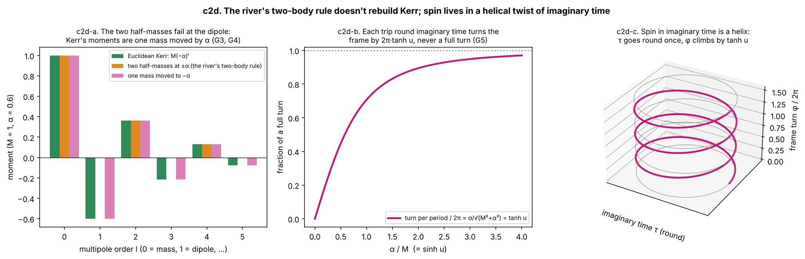

# DRAFT · C2 follow-up: does the river's two-body rule rebuild Kerr? (Nov 28, 2026)

**DRAFT. Not versioned, not proved in Lean.** Brennan said "Yes" to testing whether the river's two-body rule (spinning-river Part 7:
for bodies at rest the logs of the clock rates add), applied to the two half-masses that C2 found, rebuilds spinning Kerr.
Checks: [`checks.py`](checks.py) → [`checks_output.txt`](checks_output.txt), **5 of 5 pass** (sympy). Picture: [`figures.py`](figures.py)
→ [`figures/c2d_two_body_test.png`](figures/c2d_two_body_test.png). Hashes: [`SHA256SUMS`](SHA256SUMS).

## Result

**No. The two-body rule doesn't rebuild Kerr, and the reason corrects how I read C2.** The two half-masses come from one way of writing
Kerr: the real part of a complex field, which pairs z = +α with z = −α. The moments that don't depend on how you write it say something
else. Euclidean Kerr has the moments of **one** mass moved to z = −α, M(−α)ˡ. Two half-masses at ±α have no odd moments, so they fail
at the dipole (G3, G4). The C2 result itself (temperature and S = A/4) stands. The "spin is two bodies" lead I drew from it does not.

**What carries the spin instead is a helix in imaginary time.** Euclidean Kerr still has a real τ–φ cross term (G1), so it isn't a body
at rest, and no rule for bodies at rest can build it. Smoothness at the horizon glues the end of each imaginary-time loop back to its
start turned by an angle. Each trip round τ turns the frame by 2π·α/√(M² + α²) (G5). Writing α = M sinh u, that turn is 2π·tanh u:
it grows like a speed from a rapidity and never reaches a full turn.

*c2d-a. Multipole moments for M = 1, α = 0.6. Euclidean Kerr (green) matches one mass moved to −α (pink), not two half-masses (orange):
the two-body version has no dipole. c2d-b. The frame's turn per imaginary-time period, as a fraction of a full turn. c2d-c. The
same thing drawn: imaginary time goes round once, and the frame climbs by tanh u each time.*

## Known and ours

- **Known:** Kerr's Ernst potential ε = 1 − 2M/(r − ia cos θ); its axis form M/(z − ia), "a mass at ia", with moments M(ia)ˡ
  (Hansen 1974; the Newman–Janis picture). Euclidean Kerr and its rotated identification (Gibbons–Hawking 1977). That a static
  Weyl superposition can't make a stationary spinning solution is standard.
- **Ours, as a reading:** in imaginary time the spinning hole is one mass moved along its axis plus a helical gluing of time, and
  the turn per loop is tanh of the rapidity u with α = M sinh u. I didn't search for the tanh form in print.
- **Correction:** C2's "two half-masses" is true of the Kerr–Schild scalar only (check E2 in `../candidates/`). It isn't a two-body
  system.

## Checks

| Check | What it shows | Result |
|---|---|---|
| G1 | Euclidean Kerr's τ–φ term is real and nonzero: not a body at rest | pass |
| G2 | the real part of Kerr's Ernst potential is its clock rate squared on the axis | pass |
| G3 | the axis potential is M/(z − ia); Euclidean: M/(z + α), moments M(−α)ˡ | pass |
| G4 | two half-masses at ±α: odd moments 0, so they miss Kerr's dipole −Mα | pass |
| G5 | turn per imaginary-time period = 2πα/√(M² + α²) = 2π tanh u | pass |

## A next test, if wanted (not run)

The river's Part 8 rules handle moving and spinning bodies through light-speed lag and clock multiplication. The natural test is
whether one mass moved by α, plus the helical gluing of imaginary time, is what those rules produce for a single spinning body. That
would make the helix the river's own account of spin rather than a feature borrowed from Gibbons–Hawking.
