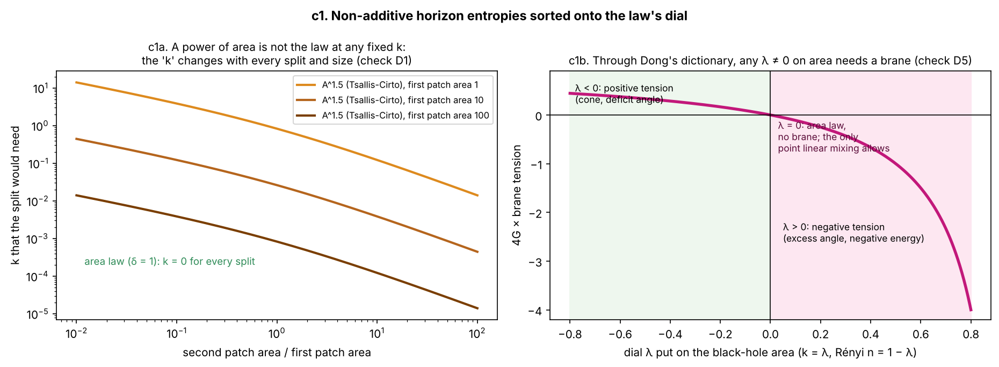
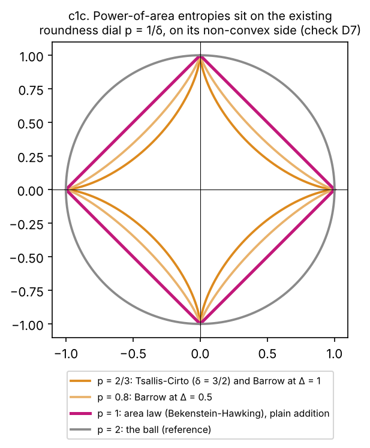
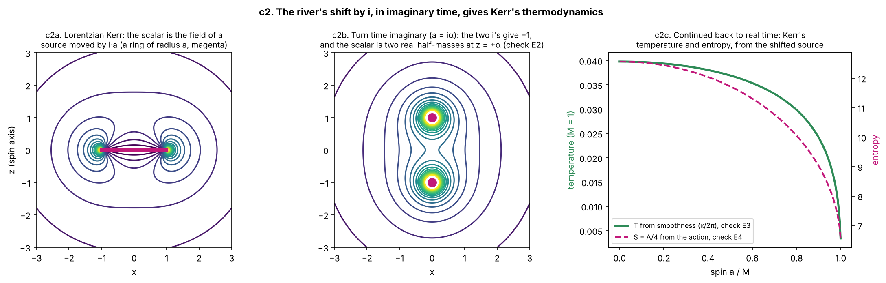
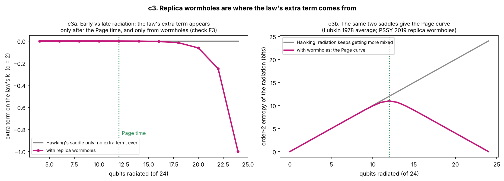

# DRAFT · Bridges study, candidates C1 to C3 (Nov 28, 2026)

**DRAFT. Not versioned, not proved in Lean.** Brennan, in the task thread: "I do want to run c1 next", then "But I'd also like to
look at c2 and c3". Follows [`../README.md`](../README.md) (the bridges study and its shared shape).

Checks: [`checks.py`](checks.py) → [`checks_output.txt`](checks_output.txt), **14 of 14 pass** (under a minute; numpy, sympy), numbers in
[`results.json`](results.json). Pictures: [`figures.py`](figures.py) → [`figures/`](figures/) c1 to c3. Hashes: [`SHA256SUMS`](SHA256SUMS).
Colour key: **green = known physics, magenta = the law or ours, orange = a model under test, grey = reference.**

## The results first

- **C2 passes, and it is the strong one.** In imaginary time the river's shift by i·a becomes a real shift, because the two i's multiply
  to −1. Kerr's field then reads as two ordinary half-masses sitting at ±α on the spin axis. Asking that picture to be smooth at the
  horizon gives Kerr's temperature, and its action gives S = A/4. So the river lands on the entropy leg. ~~Opens a lead: spin looks like two bodies at an imaginary distance.~~ Tested since and corrected in
  [`../c2-two-body/`](../c2-two-body/README.md): the two half-masses are a feature of the Kerr–Schild scalar only. The moments are one mass
  moved by α, and the spin sits in a helical gluing of imaginary time.
- **C1 is narrower than hoped.** The cosmology entropies (Tsallis–Cirto, Barrow, Tsallis dark energy) aren't the law's dial at all. They
  change how entropy depends on area, so our k = 0 result doesn't touch them. It does rule out one family, the "Rényi entropy of a black
  hole" constructions, if the black-hole entropy is the entropy of a quantum state. Through Dong's dictionary they would also need a
  brane.
- **C3 is a picture of known physics.** With Hawking's calculation alone, early and late radiation keep the law's k at exactly its
  independent value forever. Replica wormholes add the law's extra term, and only after the Page time. That is the information coming
  out, written in the law's coordinates. Not new.

## C1. The non-additive horizon entropies on our dial

*c1a. Split one horizon into two patches. For a power-of-area entropy the k the split would need changes with every split and every
size, so it is not the law at any k. For the area law it is 0 every time. c1b. If a dial λ is put on the area itself, Dong's dictionary
(Rényi order n = 1 − λ) says the area must belong to a brane with tension −λ/(4G(1 − λ)). Only λ = 0 needs no brane.*

| Proposal | What it changes | Sort | Does linear mixing rule it out? |
|---|---|---|---|
| Tsallis–Cirto 2013, S ∝ A^δ | how entropy depends on area | area-law change, not our dial (D1) | No. Separate horizons still add. In Jacobson's route Newton's constant becomes area-dependent (D2, as arXiv:2407.00484 also says). |
| Barrow 2020, S ∝ A^{1+Δ/2} | a rough, fractal horizon | area-law change (D2) | No. Read literally as the true area of a rough surface, it is the area law at k = 0. |
| Tsallis holographic dark energy | builds on Tsallis–Cirto | area-law change | No, for the same reason. |
| Rényi entropy of a black hole (Biró–Czinner 2013; Czinner–Iguchi 2016) | treats S_BH as composing by a + b + λab and takes ln(1 + λS)/λ | **exactly the law's dial and its unlift** (D3) | **Yes, if S_BH is a quantum state's entropy:** an unrelated coin would multiply what's left to learn by 1 + λS(coin) (D4). Holographically it needs a brane, with negative tension if λ > 0 (D5). |
| The usual motive: S ∝ M² is not additive when black holes merge | — | not a fixed k: k_eff = 2/√(S₁S₂) (D6) | Merging isn't joining two independent systems, so it isn't a reason for the law. |

**Verdict:** our k = 0 result says something about one family only. It is a clean short note. It won't settle the cosmology debate,
because those models change the area law, not the composition. I didn't confirm which sign of λ the Rényi black-hole papers use.

### Added after Brennan's note ("I'm always on the lookout for a new dial")

*c1c. The roundness dial p (cross-polytope at 1, ball at 2). The power-of-area entropies land on its non-convex side.*

**The area exponent δ isn't a new dial. It is the existing roundness dial p, landing on horizon entropy (check D7).** An entropy γA^δ
combines two patches of a horizon as the ℓ^p sum, S₁₂ = (S₁^p + S₂^p)^{1/p}, with p = 1/δ, exactly. So:
- area law (Bekenstein–Hawking): p = 1, the cross-polytope, plain addition;
- Tsallis–Cirto (δ = 3/2) and Barrow at its largest roughness (Δ = 1): both p = 2/3;
- Barrow in general: p = 2/(2 + Δ), between 2/3 and 1.

That gives horizon entropy two of the law's existing dials, each with the standard result at its additive point. **k** is the
composition dial (Tsallis/Rényi), and linear mixing pins it to 0 from the quantum side. **p** is the roundness dial; read in the derivation direction, the area law (p = 1) is what makes Newton's constant come out the
same everywhere (D2). That is about G being constant, not about its value, which stays open (see `../../newton-g/`). That pairing, one pin from each side, is ours as a reading. The ℓ^p sum
is textbook (Minkowski), so the identity itself isn't new.

## C2. Euclidean Kerr from the river's shift by i

*c2a. Real time: Kerr's field is the real part of a point mass moved to z = i·a. Its singularity is a ring of radius a (magenta,
seen edge-on). c2b. Imaginary time (a = iα, as Gibbons and Hawking 1977 do): the same field is two real half-masses at z = ±α. c2c.
Smoothness at the horizon gives the temperature κ/2π. The action I = βM/2 gives S = A/4. Both match Kerr at every spin.*

- E1: Kerr's scalar M r³/(r⁴ + a²z²) is the real part of a Coulomb field at z = i·a. That is known (Newman; it underlies the
  Newman–Janis shift).
- E2: with a = iα it is the average of two real Coulomb fields at z = +α and −α, to machine precision. *Ours as a reading.* Euclidean Kerr
  itself is Gibbons–Hawking 1977. I didn't find the two-half-masses picture in print, but this was a lean pass, not a real search.
- E3: smoothness of the Euclidean horizon fixes κ with no dependence on the polar angle. Turning α back into −i·a gives Kerr's κ, so
  T = (r₊ − r₋)/(4π(r₊² + a²)).
- E4: S = β(M − ΩJ) − I = π(r₊² + a²) = A/4, and Smarr's relation M = 2TS + 2ΩJ holds.

**Scope:** I checked the Kerr–Schild scalar and the Euclidean metric. I didn't rebuild the river's cell-by-cell rules in imaginary time.
**Lead:** test whether the river's two-body rule from round 7 (clock-rate logs add, with a strut between bodies at rest), applied to two
half-masses at ±α, rebuilds Euclidean Kerr. If it does, spin and two bodies in the river are one rule seen in two kinds of time. **Tested: it doesn't** (see `../c2-two-body/`).

## C3. Replica wormholes as the law's extra term

*c3a. A 24-qubit black hole radiates. Split the radiation into early and late halves. The extra term on the law's k (order 2) is exactly
0 at every step with Hawking's calculation alone. With replica wormholes it appears after the Page time and reaches −1 when the black hole
is gone. c3b. The same two contributions give the Page curve.*

- F1: the average purity of a random pure state, (d_X + d_Y)/(d_X d_Y + 1) (Lubkin 1978), matches 4,000 random states.
- F2: it is a Hawking term 1/d_X plus a wormhole term 1/d_rest, the two saddles of Penington–Shenker–Stanford–Yang 2019.
- F3: the track in c3a.

**Verdict:** this is the known Page-curve physics (Page 1993; PSSY 2019; Almheiri–Hartman–Maldacena–Shaghoulian–Tajdini 2019) in the law's
coordinates. The extra term is the order-2 mutual information between early and late radiation. Nice to look at; not a new result.

## Checks

| Check | What it shows | Result |
|---|---|---|
| D1 | a power-of-area entropy needs a different k for every split; the area law needs k = 0 | pass |
| D2 | Barrow's entropy gives an area-dependent Newton's constant unless Δ = 0 | pass |
| D3 | ln(1 + λS)/λ turns a + b + λab into plain addition | pass |
| D4 | at λ ≠ 0 an unrelated coin multiplies what's left to learn by 1 + λS(coin) | pass |
| D5 | Dong's tension in the law's dial: −λ/(4G(1 − λ)); sign follows λ | pass |
| D7 | γA^δ combines patches as the ℓ^p sum with p = 1/δ (the roundness dial) | pass |
| D6 | black-hole mergers give k_eff = 2/√(S₁S₂), not a fixed k | pass |
| E1 | Kerr's scalar = real part of a Coulomb field at z = i·a | pass |
| E2 | Euclidean: two real half-masses at ±α | pass |
| E3 | smoothness gives Kerr's κ after continuing back | pass |
| E4 | S = A/4 from I = βM/2; Smarr holds | pass |
| F1 | random-state purity matches Lubkin | pass |
| F2 | purity = Hawking term + wormhole term | pass |
| F3 | the law's extra term: 0 with Hawking alone, appears after the Page time with wormholes | pass |

## Sources checked in this pass

Czinner and Iguchi, "Rényi entropy and the thermodynamic stability of black holes", Phys. Lett. B (2016), arXiv:1511.06963 (abstract
read; sign of λ not confirmed); Barrow, "The area of a rough black hole", arXiv:2004.09444; arXiv:2407.00484 (area-dependent G from
generalized entropies). Other citations are standard references, not re-read here.
