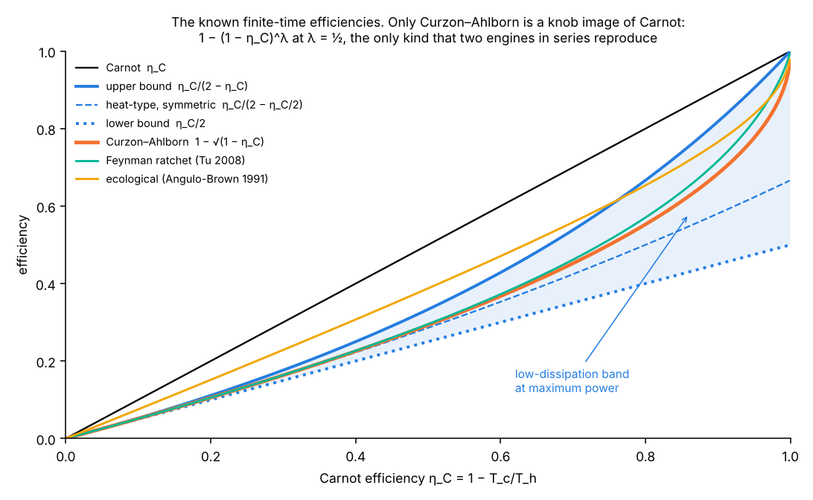
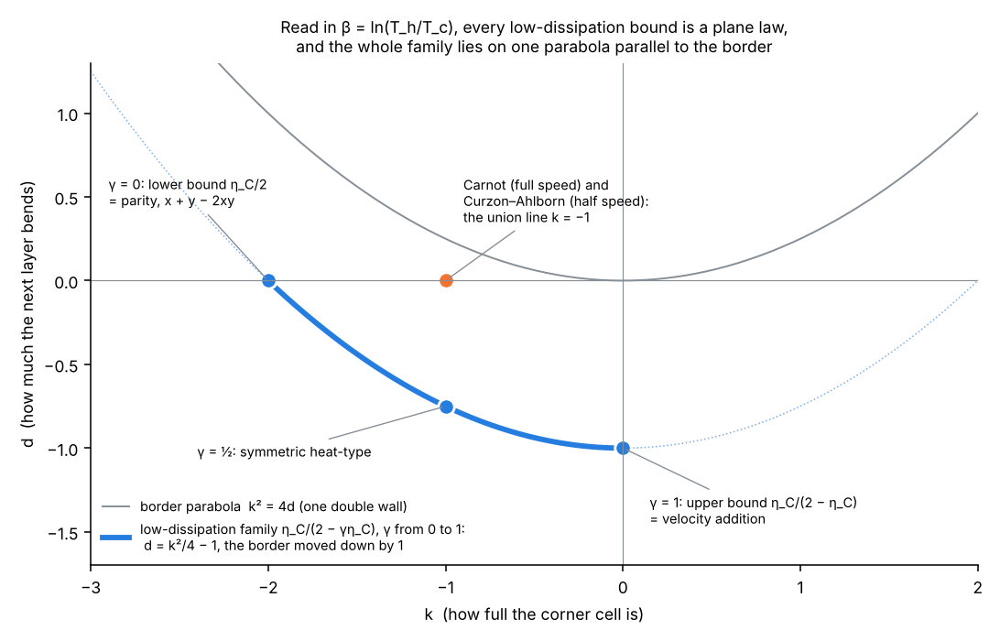
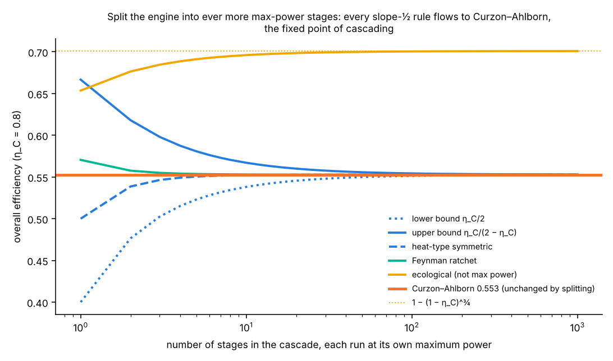
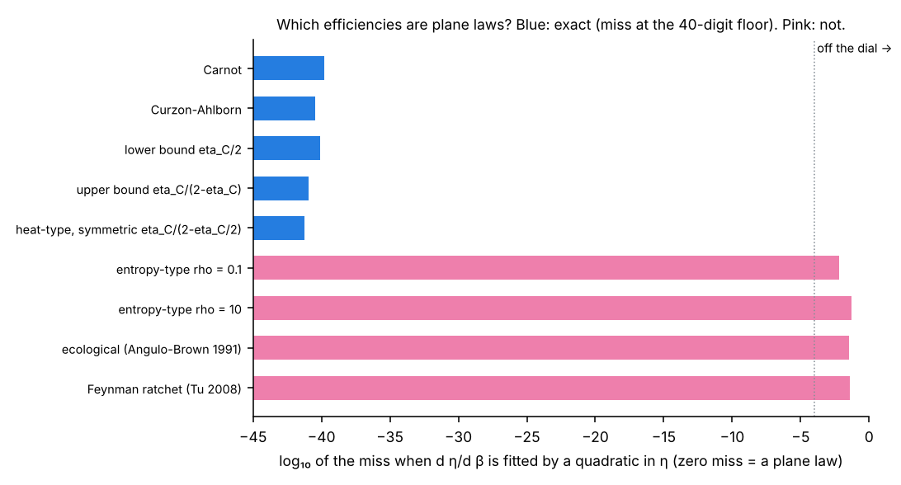
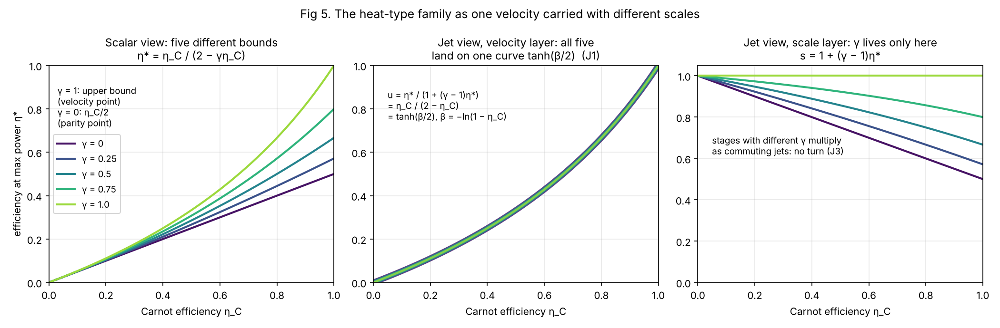

# Carnot cascade and the finite-time efficiencies (DRAFT)

**Result in one sentence:** only Curzon–Ahlborn is a knob image of Carnot. The other known efficiency bounds are not,
but read in the right coordinate they are all plane laws. The whole low-dissipation family lies on one parabola
parallel to the border, running from the parity point to the velocity point. Cascading many engines pulls every
max-power rule back to Curzon–Ahlborn.

Status: DRAFT, not reviewed, not published. Follows small reopen S1 in `../closed-leads-revisit/README.md`. Reopens
the closure in `../thermodynamics/` ("0 new laws"), which already had engines in series on the union rule and
Curzon–Ahlborn as half a Carnot step. 22 of 22 checks pass.

## The question in plain words

Run a second engine on the first engine's waste heat. The waste fractions multiply, so efficiencies combine by the
union rule η = η₁ + η₂ − η₁η₂ (our ∘₋₁, k = −1). Carnot fits this exactly. A "knob" is a change of scale that leaves
the union rule alone: in the waste fraction τ = T_c/T_h it is τ → τ^λ. Curzon–Ahlborn, 1 − √τ, is the knob at λ = ½.

The lead asked: are the other known finite-time efficiencies also knob images? If so they would be one family; if
not, where do they sit?

## Fig 1. The known efficiencies

- **Knob images (checks A):** 1 − τ^λ composes by the union rule for every λ, and by Cauchy's functional equation
  nothing else does. So "a knob image of Carnot" means exactly "two engines in series, each at this rule, give the
  same rule across the whole span". Curzon–Ahlborn passes. The low-dissipation bounds η_C/2 and η_C/(2 − η_C) and the
  symmetric case η_C/(2 − η_C/2) fail.
- **Low-dissipation engines, derived (checks B):** an engine whose irreversible losses fall like 1/(time) on each
  stroke, run at maximum power, has η* = η_C(1 + a)/(2(1 + a) − η_C), where a is the dissipation ratio. Checked
  against a brute-force maximum of the power in 9 cases.
  - If the losses are counted as **entropy** (Esposito et al. 2010), a depends on the temperatures, and symmetric
    losses give exactly Curzon–Ahlborn.
  - If they are counted as **heat**, a is a constant and η* = η_C/(2 − γη_C) with γ = 1/(1 + a) between 0 and 1: the
    Schmiedl–Seifert form. γ = 0 and γ = 1 are the two known bounds.

## Fig 2. Where they sit on the dial

- Use the coordinate that adds across a cascade, β = ln(T_h/T_c). A rule is on the plane dial when dη/dβ is a
  quadratic in η (a Riccati equation), dη/dβ ∝ 1 + kη + dη².
- **The whole heat-type family is on the dial (checks C1):** dη/dβ = ½(1 + (2γ − 2)η − γ(2 − γ)η²), so
  k = 2γ − 2 and d = −γ(2 − γ). As γ runs from 0 to 1 the point traces **d = k²/4 − 1**, the border parabola moved down
  by exactly 1 (checks C2). Every member has discriminant k² − 4d = 4.
- **The two ends are laws we already know (checks C3, C6):** the lower bound η_C/2 combines by parity, x + y − 2xy,
  the same law as Ising bonds in series. The upper bound η_C/(2 − η_C) = tanh(β/2) combines by velocity addition,
  the same law as the Fermi function and Ising bonds in parallel.
- Curzon–Ahlborn sits on the union line k = −1 with Carnot, but runs at half speed in β (checks C4). It is not on the
  parabola: it is the knob image, the others are Möbius images of Carnot's waste fraction (checks C5).

## Fig 3. Cascading pulls everything to Curzon–Ahlborn

- Split the temperature span into n stages, each an engine of the same kind run at its own maximum power, and combine
  them by the union rule. As n grows, every rule tends to Curzon–Ahlborn (checks E1). Curzon–Ahlborn itself does not
  move under any split (checks E3).
- The reason is one line: the limit is 1 − e^(−β·s), where s is the rule's slope at small η_C, and every max-power
  rule has slope ½ there (the linear-response result η_C/2) (checks E4). So Curzon–Ahlborn is the fixed point of
  cascading, and the knob value λ = ½ is that universal slope.
- Splitting raises the lower edge and lowers the upper edge (checks E2). The ecological efficiency, which is not a
  max-power point, has slope ¾ and flows to 1 − τ^¾ instead (checks E5).

## Fig 4. Which efficiencies are plane laws

Carnot, Curzon–Ahlborn, both bounds and the symmetric heat-type case fit the Riccati form to 40 digits. The
entropy-type low-dissipation rule away from symmetry, the ecological efficiency and Feynman's ratchet miss by 10⁻²
or more (checks D). So the dial does not swallow everything: it picks out the heat-type family and Curzon–Ahlborn.

## Fig 5. The same family as a jet (added Nov 27)

Brennan asked that wherever velocity addition shows up, we consider the jet instead (the frame-dragging work is why:
velocity alone got spin right only to first order). Here the upper bound tanh(β/2) uses velocity addition, so we wrote
each bound as a two-layer jet, 1 + η·N with N = (γ − 1)·I + J and J² = I.

*Fig 5. Left: the five heat-type bounds look different. Middle: the jet's velocity layer u = η*/(1 + (γ − 1)η*) is
the same curve tanh(β/2) for every γ. Right: γ lives only in the scale layer s = 1 + (γ − 1)η*.*

- **One velocity, many scales (J1):** every heat-type bound has the same velocity layer, η_C/(2 − η_C) = tanh(β/2).
  The dissipation ratio γ changes only the scale layer. So the parabola of Fig 2 is one velocity addition carried
  with different scales.
- **It is the S1 dial point (J2):** N has trace 2γ − 2 and determinant −γ(2 − γ), exactly the (k, d) of Fig 2, and
  multiplying jets gives the plane law.
- **No turn (J3):** stages with different γ multiply as commuting jets, and the total velocity is tanh(Σβ/2).
  In frame dragging the jet's extra layer was a turn, and it mattered. Here the extra layer is a scale, and the turn
  is zero, because every N shares one J. Writing the same laws as companion matrices does not commute (J4), so the
  shared J is the real content.

Known vs ours: plane laws with the same discriminant are Möbius conjugates of one another, which is standard. Reading
the Schmiedl–Seifert family as one velocity with a γ-dependent scale layer is ours. Checks: `jet_checks.py`,
4 of 4 pass; figure from `jet_figure.py`.

## Is this a lead worth following?

Not much further. The lead's own question gets a clean no: only Curzon–Ahlborn is a knob image. What turned up
instead is a tidy placement: the heat-type low-dissipation family is a parabola on the dial between two laws we
already had. That organises known results; it does not predict a new efficiency. The fixed-point reading of
Curzon–Ahlborn is a nice picture, and most of it is probably in the literature already. One small thing that would
be worth one more check: whether "discriminant 4" (the parabola) has a physical meaning, such as a fixed ratio of
the two walls' rates in β.

## Known versus ours

| Piece | Status |
|---|---|
| Engines in series combine by the union rule; Carnot fits; Curzon–Ahlborn is half a step | Known physics; reading in `../thermodynamics/` |
| Curzon–Ahlborn efficiency | Known: Curzon and Ahlborn 1975 (also Novikov, Chambadal 1957) |
| Low-dissipation η* with bounds η_C/2 and η_C/(2 − η_C); symmetric entropy-type gives Curzon–Ahlborn | Known: Esposito, Kawai, Lindenberg, Van den Broeck 2010 |
| η_C/(2 − γη_C), γ in [0, 1] | Known: Schmiedl and Seifert 2008 |
| Slope ½ at small η_C (linear response); Curzon–Ahlborn as the linear-response bound | Known: Van den Broeck 2005; Esposito, Lindenberg, Van den Broeck 2009 |
| Only 1 − τ^λ is cascade-stable | Elementary (Cauchy); likely known |
| Fine cascades of any slope-½ rule tend to Curzon–Ahlborn | Elementary limit; may well be known (I couldn't confirm whether Van den Broeck 2005 uses a stack of engines) |
| The heat-type family on the dial as the parabola d = k²/4 − 1, ends at parity and velocity addition | Ours |

## Checks (22 of 22 pass)

Run `python3 checks.py` (sympy, numpy, mpmath). Output in `checks_output.txt`, results in `checks.json`.

- A1–A3: knob images compose by the union rule; Curzon–Ahlborn is λ = ½; the bounds are not knob images.
- B1–B6: low-dissipation η* derived symbolically and by brute force; entropy-type symmetric = Curzon–Ahlborn;
  heat-type = η_C/(2 − γη_C); the bounds at γ = 0, 1.
- C1–C6: the Riccati form for every γ; the parabola d = k²/4 − 1; its ends; Curzon–Ahlborn on the union line at half
  speed; Möbius form; parity and velocity laws at the ends.
- D1–D2: the 40-digit Riccati test on 9 efficiencies.
- E1–E5: fine cascades tend to Curzon–Ahlborn; splitting moves the edges in opposite ways; Curzon–Ahlborn does not
  move; the slope-½ reason; the ecological exception.

## Files

`checks.py`, `checks_output.txt`, `checks.json`, `figures.py`, `figures/fig1-efficiencies.png`, `figures/fig2-dial.png`,
`figures/fig3-cascade-flow.png`, `figures/fig4-riccati-test.png`, this README.

## Sources

- Curzon and Ahlborn, Am. J. Phys. 43, 22 (1975). From memory.
- Schmiedl and Seifert, EPL 81, 20003 (2008). From memory, form confirmed through a review found by search.
- Esposito, Kawai, Lindenberg, Van den Broeck, "Efficiency at maximum power of low-dissipation Carnot engines",
  PRL 105, 150603 (2010): https://arxiv.org/pdf/1008.2464
- Van den Broeck, "Thermodynamic efficiency at maximum power", PRL 95, 190602 (2005):
  https://documentserver.uhasselt.be/handle/1942/2168
- Esposito, Lindenberg, Van den Broeck, PRL 102, 130602 (2009), universality to second order. From memory.
- Angulo-Brown, J. Appl. Phys. 69, 7465 (1991); Tu, J. Phys. A 41, 312003 (2008). From memory.
