# DRAFT · Chaos as repeated self-composition (category-theory frame)

> **Names:** some words or symbols on this page (wall, trace monoid) also mean something else in standard math, physics or computing, or inside this project. [NAMING-COLLISIONS.md](../../NAMING-COLLISIONS.md) says which meaning is in play.

**DRAFT, Nov 27 2026.** Part of Affine Composition Theory, built on Fused Hyperoperation Algebra. Follows
[order-dial](../order-dial/README.md) (composition as the frame) and builds on [dynamical-systems](../dynamical-systems/README.md).
Asked for by Brennan: chaos next, "in the same frame", after he chose category theory as the frame for the composition
work ("Yeah, I want to use category theory as the frame for the composition work").

Checks: [`checks.py`](checks.py) → [`checks_output.txt`](checks_output.txt), **52 of 52 pass** (sympy, numpy, mpmath).
Lean: [`lean/ChaosComposition.lean`](lean/ChaosComposition.lean), **23 theorems**, core Lean 4.37, no `sorry`, standard
axioms only; compiled in the shared library as `FusedAlgebra.Topics.ChaosComposition` (namespace `CircleOp.ChaosComposition`; imports `Dynamics` and `OrderDial`), all 23 theorems, no proof changed.
Pictures: [`figures.py`](figures.py) → [`figures/`](figures/). Colour key: **orange = known, blue = known pieces in our
reading, green = not found in print.**

## The answer first

**Chaos fits the composition frame, and the frame says one definite thing about it: iterating can't see the order of
two maps, but chaos can't happen without order.**

1. **Iteration is blind to order.** Iterating f ∘ g and iterating g ∘ f give the same system, seen through g. For
   affine maps the order only moves the centre, and the commutator is a pure shift by the wedge, which slopes and
   Lyapunov exponents can't see. Known (shift equivalence); the wedge reading is ours.
2. **Chaos needs order.** A chaotic map has several backward branches, and its entropy is how fast the number of
   distinct branch compositions grows. Branches that share a centre commute, so only the bag of letters matters: n + 1
   composites and entropy 0. Branches with different centres give a different composite for every word: 2ⁿ composites
   and entropy log 2. Both are proved in Lean.
3. **In between (not found in print).** When some branches share a centre, the composites form a *trace monoid* (letters
   commute exactly when their maps share a centre). The entropy is then read off the pattern of shared centres by the
   Cartier–Foata polynomial. Three maps with two sharing a centre grow like φ², and four maps sharing in pairs grow like
   2 + √2. The counting is Cartier–Foata's (1969); stating it for affine maps through their centres is ours, as far as
   three searches found. It needs the maps to stay apart: with large slopes, accidental coincidences cut the count.

Four smaller results:

- **The circle-operation dial makes no chaos of its own.** Every dial square x ∘ₖ x is the same dynamical system as
  x ∘₁ x, orbit for orbit, in other units. The whole dial sits at one point of the logistic family, r = 2, the first
  superstable map. Chaos at r = 4 is the same squaring run on the circle |1 + x| = 1 and folded by the circle inverse,
  along whole orbits (Lean).
- **Turning the order dial partway gives no partial chaos.** Weigh each word by q to its out-of-order count, as the
  order-dial page did. For every q below 1 the weighted count grows only linearly, so the entropy is 0; at q = 1 it is
  log 2. For chaos the dial is a switch (§6, figure 11). Elementary; probably folklore.
- **Feigenbaum is still unconnected.** Period doubling is "compose with yourself, then change units": the same two
  moves as the dial, but applied to maps, not numbers. The dial square is the first curve in the cascade, not its limit.
- **Your data-structure question, answered for chaos.** Chaos is iterating `tail` on an infinite list. A finite orbit is
  a linked list whose last node points back into itself (the ρ of Pollard's factoring method). After the fold, the
  logistic map's left/right record is the Gray code of the angle's binary digits.

Tried against the main goals: the one not-in-print item opens no lead on quantum gravity or the Millennium problems
([new-facts-levers](../new-facts-levers/README.md) §9).

## 1. The frame: a dynamical system is a functor

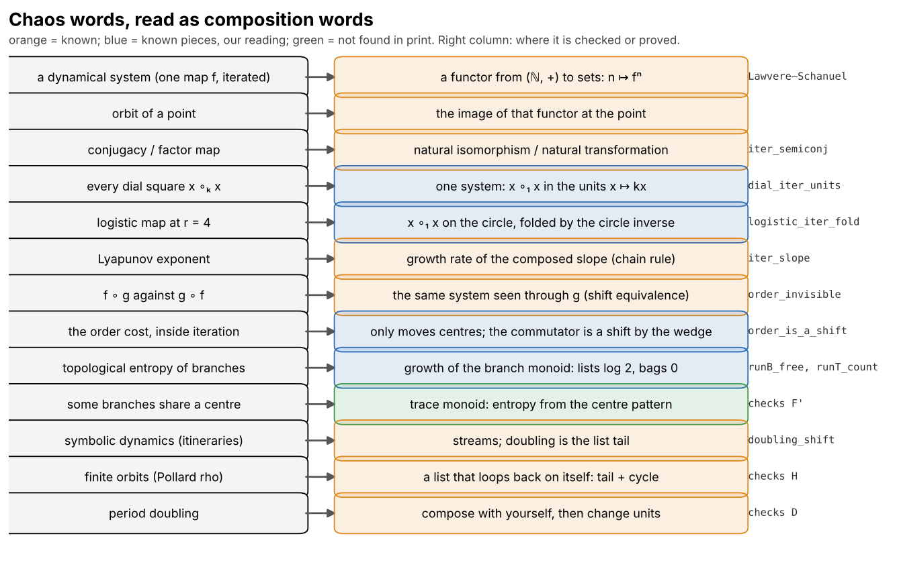

*Figure 1. The dictionary used on this page. Left: the word dynamics uses. Middle: the same thing as composition. Right:
the Lean theorem or check behind it.*

A monoid is a category with one object, and its elements are the arrows ([order-dial](../order-dial/README.md) §1). The
natural numbers under + are the simplest one: one arrow, 1, and all its composites. **A dynamical system is a functor
out of that category:** it sends the object to a set X and the arrow 1 to a map f : X → X. It then has no choice for the
rest: n must go to fⁿ, because a functor sends m + n to fᵐ ∘ fⁿ (`iter_add`).

The usual words of dynamics then come for free.

- **Orbit:** the functor's image at one point.
- **Conjugacy:** an isomorphism of functors (a natural isomorphism).
- **Factor map** (semiconjugacy): a natural transformation, a map h with h ∘ f = g ∘ h. It carries orbits to orbits
  (`iter_semiconj`) and cycles to cycles of the same period (`periodic_semiconj`).

This is the standard picture (Lawvere and Schanuel call these "sets with an endomap"). What the frame buys here is that
every later result is a statement about which arrows commute.

## 2. One arrow composed with itself

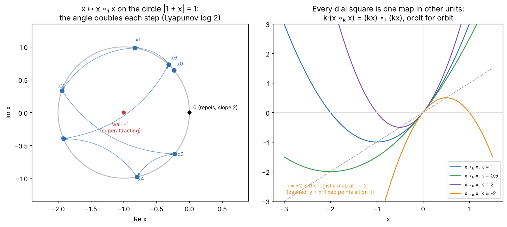

*Figure 2. Left: x ↦ x ∘₁ x on the circle |1 + x| = 1. The angle doubles each step, so nearby points separate by a
factor 2 per step: Lyapunov exponent log 2. The wall −1 (the circle's centre) attracts everything inside the circle.
Right: x ∘ₖ x for four values of k. They are one map in different units.*

Through the lift z = 1 + x, circle-operation squaring is z ↦ z² ([dynamical-systems](../dynamical-systems/README.md)).
Two facts are new in Lean on this page.

- **The slope of the n-th iterate** is 2ⁿ(1 + x)^(2ⁿ − 1) (`iter_slope`). On |1 + x| = 1 every factor has size 1, so
  the composed slope has size exactly 2ⁿ. The Lyapunov exponent, the growth rate of the composed slope, is log 2 (check C3).
- **The dial is a change of units, orbit for orbit:** k · (x ∘ₖ x)ⁿ = ((kx) ∘₁ (kx))ⁿ (`dial_iter_units`). In the
  language of §1, x ↦ kx is a natural isomorphism. So every k ≠ 0 is one dynamical system, and k = −2 is the logistic
  map at r = 2 (check A5).

The whole quadratic family z² + c is "square by the circle operation, then shift by c" (`quadratic_lift`): two arrows,
and §5 shows their order doesn't matter.

## 3. Chaos at r = 4 is a quotient of a group law

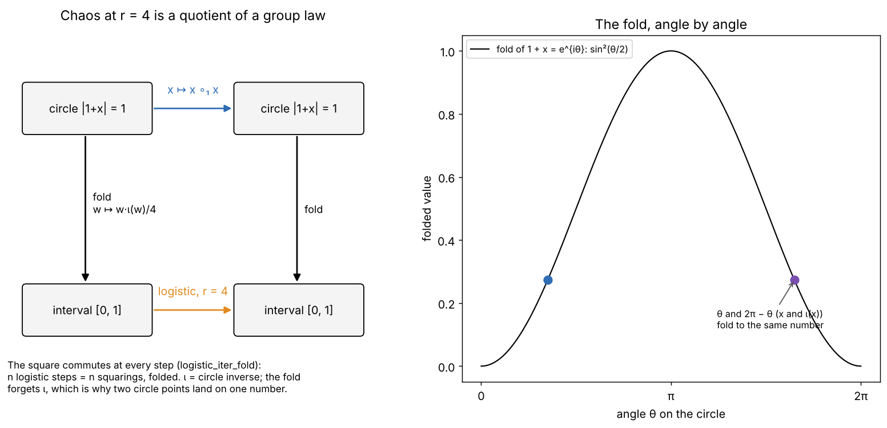

*Figure 3. Left: the square commutes. Squaring on the circle and then folding gives the same answer as folding and then
running the logistic map at r = 4. Right: the fold sends angle θ to sin²(θ/2). The points θ and 2π − θ, which are x and
its circle inverse ι(x), land on the same number.*

The repo already had one step of this: the fold w ↦ w · ι(w)/4 turns x ∘₁ x into 4y(1 − y)
([dynamical-systems](../dynamical-systems/README.md), `logistic_fold`). Here it holds along whole orbits: **n logistic
steps are n squarings, folded** (`logistic_iter_fold`, with the side condition that the start is off the wall, which
`iter_msq_ne_wall` then carries to every step).

In the frame of §1 the fold is a factor map. It is also a quotient: squaring commutes with the circle inverse ι, so it
passes down to the set of pairs {x, ι(x)}, and that set is the interval [0, 1]. The chaos of the logistic map at r = 4 is
the chaos of a commutative group law (multiplication on the circle) with one symmetry divided out. Lyapunov log 2
carries down (checks C1, C2). The map is Ulam and von Neumann's (1947); reading the fold through the circle inverse
is the repo's.

## 4. Where chaos starts, and where the dial sits

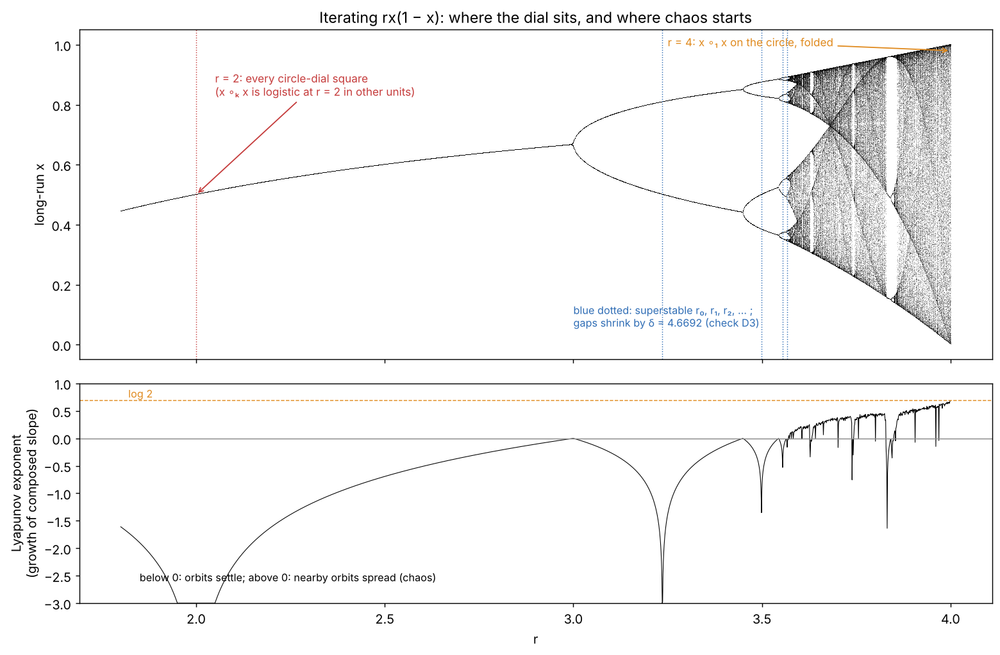

*Figure 4. Top: where orbits of rx(1 − x) end up, for r from 1.8 to 4. Red dotted: r = 2, where every circle-dial square
lives. Blue dotted: the superstable parameters r₀, r₁, r₂, … of the period-doubling cascade. Bottom: the Lyapunov
exponent. Above 0, nearby orbits spread apart.*

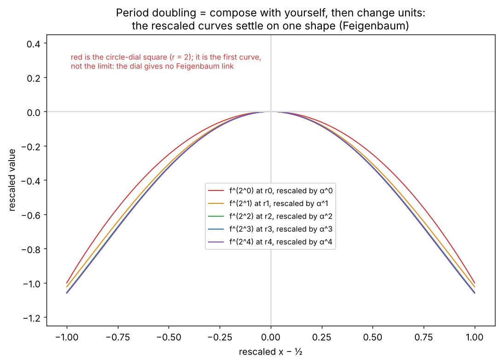

*Figure 10. Period doubling as composition: take f ∘ f, zoom in by Feigenbaum's α = −2.5029, and repeat. The rescaled
curves settle on one shape. Red, the circle-dial square, is the first curve and not the limit.*

The cascade's numbers come out as they should. The superstable gaps shrink by δ = 4.669201 (check D3), and the
rescaling ratio is α = −2.50291 (check D4). The first superstable parameter is r₀ = 2, the dial square (D1).

**What the frame says.** Feigenbaum's renormalization is "compose with yourself, then change units". The dial
identity k · (x ∘ₖ x) = (kx) ∘₁ (kx) has the same two moves, but it squares a *number* where renormalization composes a
*map* with itself. The dial square z ↦ z² gives z⁴ under composition, which no change of units turns back into z². So
the dial is not a fixed point of renormalization, and the earlier verdict stands: **no Feigenbaum connection.**

## 5. Order is invisible to iteration

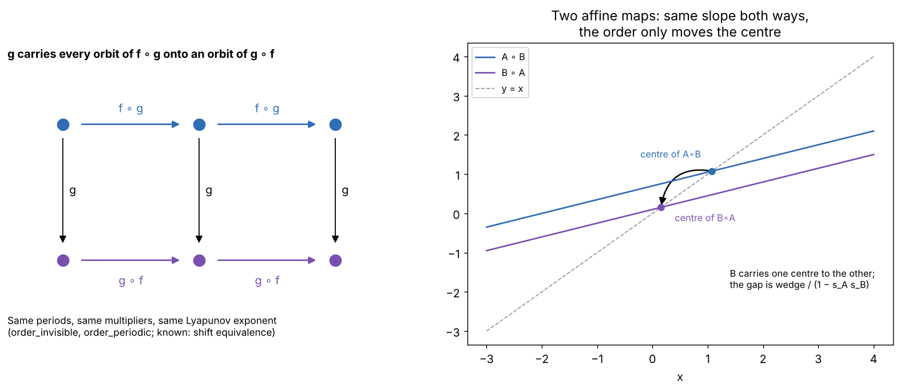

*Figure 5. Left: g turns every orbit of f ∘ g into an orbit of g ∘ f, step by step. Right: for two affine maps A and B,
A ∘ B and B ∘ A have the same slope. Each has its own centre (its fixed point), and B carries one centre to the other.*

For any maps f and g, g ∘ (f ∘ g)ⁿ = (g ∘ f)ⁿ ∘ g (`order_invisible`). So **the two orders are the same system, seen
through g**:

- the same periods, in both directions (`order_periodic`, `order_periodic_back`);
- the same multipliers;
- the same Lyapunov exponent (check E3).

For affine maps the order shows up in exactly one place:

- **The centre moves.** B carries the centre of A ∘ B to the centre of B ∘ A (`affine_centre_transfer`). The gap
  between them is wedge / (1 − s_A s_B) (check E2), where the wedge is (s_A − 1)t_B − (s_B − 1)t_A, the oriented area
  of [order-dial](../order-dial/README.md).
- **The commutator is a pure shift by the wedge:** A ∘ B = (shift by the wedge) ∘ B ∘ A (`order_is_a_shift`; check F'5
  for A B A⁻¹ B⁻¹). Slopes multiply in either order (`affine_orders`).

Group theory has a short name for this. The slope is the affine group's abelian shadow (its abelianization), and the
translations are its commutators. A Lyapunov exponent is a function of slopes only, so it reads the abelian shadow;
the wedge is the part it can't see.

The general fact is shift equivalence (Williams 1973). Its linear-algebra cousin is that AB and BA have the same nonzero
eigenvalues. The wedge reading is ours. The [three-body-order](../three-body-order/README.md) page found periods "almost
blind to order"; this is the cleanest case of that, but only as an analogy, not an explanation of the three-body result.

## 6. Order is what makes chaos

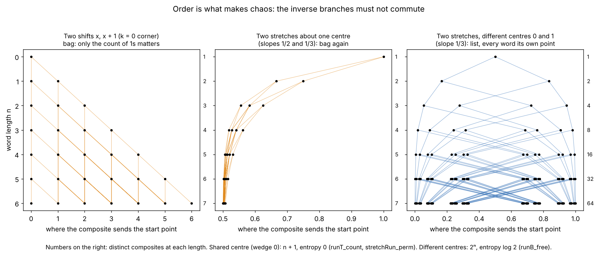

*Figure 6. Every composite of two branches up to length 6, drawn as a tree. Each node is where the composite sends the
start point; the number on the right counts distinct composites. Left and middle: the branches commute, and the counts
grow by one per level. Right: the branches have different centres, and the counts double.*

Run a chaotic map backwards and it branches. Doubling has the two backward branches x ↦ x/2 and x ↦ (x + 1)/2, and the
logistic map has two as well. **Topological entropy is the growth rate of the number of distinct compositions of
branches.** That turns entropy into a statement about the branch monoid.

- **List corner, entropy log 2.** For the branches x ↦ 2x + b with b = 0, 1 (centres 0 and −1, the halving branches in
  integer units), two words of the same length give the same composite only if they are the same word (`runB_free`).
  Every composite is x ↦ 2ⁿx + its value at 0 (`runB_affine`), so there are 2ⁿ of them (checks F1, F4).
- **Bag corner, entropy 0.** Shifts x ↦ x + b (the k = 0 slice, with the centre at infinity) only count the 1s
  (`runT_count`, `runT_perm`). Stretches about one shared centre compose to a stretch by 1 + (the circle-operation fold
  of the letters) (`stretchRun_eq`), so only the bag matters (`stretchRun_perm`). That gives n + 1 composites (F2, F3).

So **positive entropy needs branches that don't commute, which for affine maps means different centres, a nonzero
wedge.** This is the order-dial page's cube of laws again: the list corner (free monoid) is where chaos lives, and the
bag corner (free commutative monoid) has none.

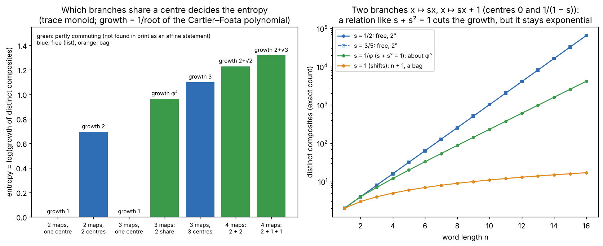

*Figure 7. Left: the entropy of a family of affine branches depends only on which of them share a centre. Green bars are
the partly commuting cases. Right: two branches with slope s. A relation like s + s² = 1 (s = 1/φ) makes some words
collide, but the count still grows exponentially. Only at s = 1, where both maps are shifts, does it collapse to n + 1.*

**In between: a trace monoid.** Maps that share a centre commute, and maps with different centres don't
([order-dial](../order-dial/README.md), `commute_iff`). Sharing a centre is an equivalence relation, so the branches fall
into classes. Inside a class everything commutes, and across classes nothing does. The branch monoid is then a free
product of free commutative monoids, a special *trace monoid*. Computer science uses these for concurrent processes:
independent actions commute (Mazurkiewicz traces). Cartier and Foata (1969) count its words. If the classes have sizes
m₁, m₂, …, the number of distinct composites of length n is the tⁿ coefficient of 1/μ(t), where

μ(t) = 1 + Σᵢ [(1 − t)^(mᵢ) − 1].

The growth rate is 1 over the smallest positive root of μ.

| Centre pattern | μ(t) | Growth per step | Entropy |
|---|---|---|---|
| 2 maps, one centre | (1 − t)² | 1 | 0 |
| 2 maps, two centres | 1 − 2t | 2 | log 2 |
| 3 maps, two share | 1 − 3t + t² | φ² = 2.618 | 0.962 |
| 3 maps, three centres | 1 − 3t | 3 | log 3 |
| 4 maps, two pairs | 1 − 4t + 2t² | 2 + √2 | 1.228 |
| 4 maps, a pair and two singles | 1 − 4t + t² | 2 + √3 | 1.317 |

For the pattern "three maps, two share", the counts are 3, 8, 21, 55, 144, …, every other Fibonacci number (check
F'2). Exact counts of composites for slopes 1/10, 1/11, 1/13, 1/17 match the trace counts for all five patterns tested
(F'1). **The assumption matters:** with slopes 1/2, 1/3 and 1/5, two different words collide by accident at length 7,
giving 986 composites where the trace count is 987 (F'4). The same kind of accident at special slopes is Garsia's
(1962) for Bernoulli convolutions. The right panel of figure 7 shows one: at s = 1/φ the count grows like φⁿ, not 2ⁿ (F5).

### Turning the order dial partway

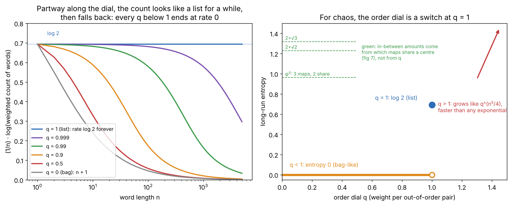

*Figure 11. Left: (1/n)·log of the weighted count of two-letter words, each word weighted by q to its number of
out-of-order pairs. Every q below 1 tracks the list rate log 2 for a while (longer the closer q is to 1), then falls to
0. Right: the long-run entropy is 0 for every q below 1, log 2 at q = 1, and unbounded above 1. The green levels, the
amounts between 0 and log 2 in table form above, come from which maps share a centre, not from q.*

The [order-dial](../order-dial/README.md) page found a smooth dial between bag and list: weigh each arrangement by q to
its number of out-of-order pairs. At q = 0 only the sorted order counts (the bag), at q = 1 every order counts (the
list). Brennan asked (Nov 27) whether chaos is that same turn of the dial. It is at the two ends: a shared centre is the
q = 0 end, with n + 1 composites, and different centres are the q = 1 end, with 2ⁿ. Partway along, though, the dial
gives no partial chaos.

- **The weighted count.** Summed over all two-letter words of length n, the weights give W_n(q) = Σₖ [n choose k]_q,
  a sum of Gaussian binomials (the Rogers–Szegő polynomial at 1; check J1). W_n(0) = n + 1 and W_n(1) = 2ⁿ (J2).
- **Below 1, entropy 0.** Each factor (1 − qⁿ⁻ⁱ) on top of a Gaussian binomial is at most 1, so for 0 ≤ q < 1 every
  [n choose k]_q is at most 1/((1 − q)(1 − q²)(1 − q³)⋯), a fixed number for each q. So n + 1 ≤ W_n(q) ≤ (n + 1) times
  that number: linear growth and entropy 0 (J3). Close to 1 it takes a long time to show. At q = 0.99 the rate is still
  0.67 at n = 20 but 0.04 at n = 4000 (J4).
- **Above 1, faster than any exponential.** For q > 1 the count grows like q^(n²/4) (J5).
- **Why it is a switch.** The out-of-order count is a count of *pairs*, so its weight scales like n², not n. Any q ≠ 1
  either crushes or swamps the 2ⁿ words. In the language of thermodynamic formalism (Ruelle), it is a long-range pair
  interaction, not a local one, and only the local kind gives a smooth pressure. Dynamics also has no fractional
  version of "these two words give the same map": two composites are equal or they aren't. So the in-between amounts of
  chaos come from a different knob, which pairs of maps commute (the trace monoid above), and they come in fixed steps
  (φ², 2 + √2, 2 + √3), not a smooth slide.

**What entropy measures.** Topological entropy says how much chaos exists somewhere in a system, not whether a typical
orbit is chaotic. In the period-3 window of the logistic map the entropy is log φ (check G), yet almost every start
settles onto the stable three-cycle; the chaos lives on a thin set. Whether typical orbits are chaotic is the Lyapunov
exponent's job (§4). This page uses entropy because it is the measure that becomes a count of compositions.

*Known vs new:* Gaussian binomials and their bound are classical (Gauss; Andrews, *The Theory of Partitions*). The
reading "the order dial is a switch for entropy" is ours and is a few lines, so it is probably folklore.

## 7. Streams, Gray code and loops: the data-structure view

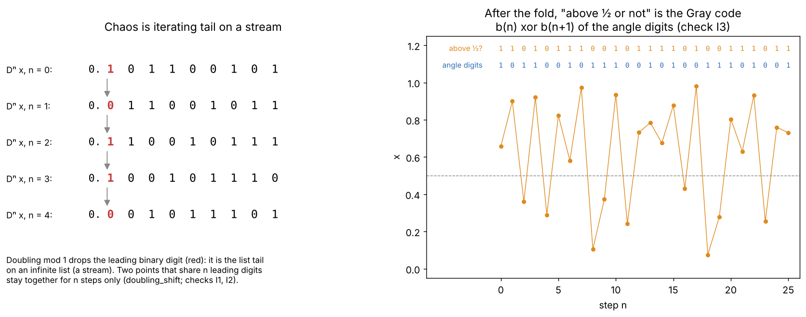

*Figure 8. Left: doubling mod 1 drops the first binary digit (red), which is the `tail` of an infinite list. Right: after
the fold, whether the logistic orbit is above ½ is the exclusive-or of two neighbouring angle digits, the Gray code.*

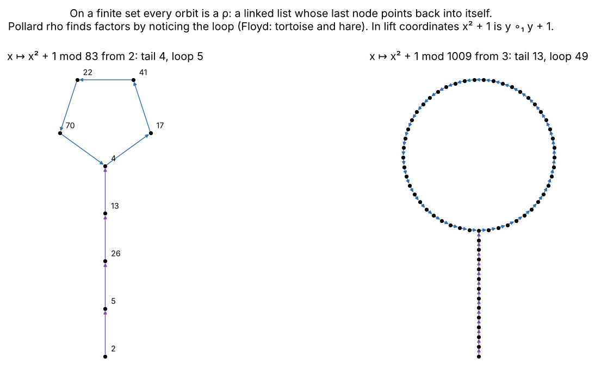

*Figure 9. On a finite set every orbit runs down a tail into a loop: a linked list whose last node points back into
itself. Left: mod 83, tail 4 and loop 5. Right: mod 1009, tail 13 and loop 49.*

Brennan's first question in this thread was about data structures. Chaos answers it in three ways.

- **Chaos is `tail` on a stream.** On binary fractions, doubling moves every digit up one place (`doubling_shift`). Read
  from the front, that is the list tail. Two points that share n leading digits stay together for exactly n steps (check
  I2). In category language, streams are the final coalgebra of X ↦ 2 × X, and the left/right record of an orbit is the
  unique map into it (Rutten 2000).
- **Folding turns binary into Gray code.** The logistic map at r = 4 is above ½ at step n exactly when the angle's
  digits n and n + 1 differ (check I3). This is a known relation from kneading theory, and the fold of §3 is why it holds.
- **Finite orbits are ρ-shaped.** Pollard's factoring method (1975) iterates x² + 1 mod N. It finds the factor 97 of
  8051 by noticing the loop, using Floyd's tortoise and hare (check H1). In lift coordinates the map is y ∘₁ y + 1, with
  the same tail and loop (H2).

## 8. Neighbours: the dial map and Mathlib

- **Dial map** ([dial-map](../dial-map/README.md), read first as the convention asks). The neighbours are the order dial
  (the wedge decides commuting) and the repetition dial k (here only a change of units). The centre pattern of §6 is a
  combinatorial invariant, not a continuous dial. The slope s of §6 is the ratio dial's Bernoulli parameter, already
  surveyed in [ratio-dial-survey](../ratio-dial-survey/README.md). **No new dial.**
- **Mathlib** ([mathlib-map](../mathlib-map/README.md)). Mathlib has the general lemmas this page proves in core Lean:
  `Function.iterate_add_apply`, `Function.Semiconj.iterate_right`, `Function.Commute`, `Function.IsPeriodicPt`. It also
  has a topological-entropy development under `Mathlib/Dynamics/TopologicalEntropy`. These names are from memory and
  were not re-checked against today's Mathlib. A Mathlib port would borrow the first four and keep only the affine and
  branch-monoid results.

## 9. Verdict

- **The frame holds and says something definite.** Iteration is the one-arrow functor. Conjugacy and factors are
  natural transformations. Order is invisible to iteration and indispensable to entropy.
- **Small not-in-print item:** entropy of affine branches from their centre pattern (§6). It is a direct use of
  Cartier–Foata, so it is small; it needs separation, and it is checked numerically, not proved in Lean.
- **Nothing new on Feigenbaum,** and the dial adds no chaos of its own: it is one system at r = 2.
- **The order dial is a switch for chaos (§6, Nov 27).** Partway turns give entropy 0. In-between amounts of chaos come
  only from which maps share a centre. Not a lead: it closes the question of whether q gives a smooth amount of chaos.
- **Three bodies: nothing added.** The frame restates known physics: two bodies are integrable (their flows commute),
  three are not (Poincaré). The order tools were already tried on three bodies in [three-body-order](../three-body-order/README.md),
  which found no strong lead. Three-body words have no commuting letters, so the trace-monoid count has nothing to
  act on.
- **Next, if wanted:** prove the trace-monoid count in Lean for the free-product case; or try the same lens on random
  compositions (random dynamical systems), where the order of the maps is drawn by chance and the Lyapunov exponent
  becomes Furstenberg's.

## Assumptions

- Lean results hold in any commutative ring (`dial_iter_units`, `quadratic_lift`, `iter_slope`, `stretchRun_*`) or any
  field (`logistic_iter_fold`, which also assumes the start is off the wall, 1 + w ≠ 0). The affine order results use
  integer coefficients (OrderDial's `comp`). `runB_*` and `runT_*` work in ℕ, with the halving branches scaled up to
  x ↦ 2x + b.
- The definition of entropy as growth of distinct branch composites matches topological entropy for expanding maps
  with full branches (doubling, logistic r = 4). For an affine family it is the growth of the semigroup the maps
  generate, which is the entropy of the branch shift only when composites don't collide.
- The trace-monoid count (§6) **assumes separation**: no two words outside the trace relations give the same map.
  Checked exactly with fractions for small slopes (1/10 to 1/17) up to length 8, not proved in general. It fails for
  large slopes (F'4).
- Lyapunov exponents (C1, C2, E3), the lap-count entropies (G1–G3), Feigenbaum's δ and α (D3, D4) and the
  bifurcation picture are numerical. The lap counts use a grid of 2²⁰ points; G2 and G3 read growth ratios at n = 10–12.
- Mathlib names in §8 are from memory, not re-checked today.
- The order-dial switch (§6): the bound for q < 1 is a short proof written out above, and it is checked numerically
  for q = 0.5, 0.9 and 0.99 up to n = 4000 (J3). The rates in J4 and the q^(n²/4) growth in J5 are numerical. The q
  weighting counts words, not distinct maps, so it is a weighted count, not the entropy of any one dynamical system.

## Known vs new

| Item | Status | Source |
|---|---|---|
| Dynamical system as a functor out of (ℕ, +); conjugacy and factors as natural maps | Known | Lawvere and Schanuel, *Conceptual Mathematics* (1997) |
| x ∘₁ x is z² through the lift; Julia set, angle doubling, Lyapunov log 2 | Known | Fatou, Julia 1918–19; `dynamical-systems/` |
| Every dial square is x ∘₁ x in other units, orbit for orbit (`dial_iter_units`) | Known pieces, our statement | `dynamical-systems/` (one step); here all steps |
| Logistic r = 4 as folded squaring, along whole orbits (`logistic_iter_fold`) | Known map; fold through the circle inverse is the repo's reading | Ulam and von Neumann 1947 |
| f ∘ g and g ∘ f conjugate through g (`order_invisible`) | Known | Williams 1973 (shift equivalence) |
| Affine commutator is a shift by the wedge; Lyapunov reads only the abelian shadow | Known group theory; wedge reading ours | affine group ax + b; `order-dial/` |
| Entropy as growth of branch composites; free branches log 2, commuting branches 0 | Known | standard symbolic dynamics |
| **Entropy of affine branches from the pattern of shared centres (trace monoid, Cartier–Foata)** | **Not found in print** (three searches, Nov 27) | Cartier and Foata 1969 for the count; this page, checks F'1–F'4 |
| Coincidences at special slopes (s = 1/φ: growth φ) | Known | Garsia 1962 |
| Feigenbaum δ, α; renormalization | Known; no link to the dial | Feigenbaum 1978; checks D1–D4 |
| Topological entropy from laps; period-3 window at log φ | Known | Milnor and Thurston 1988 |
| Doubling = shift; itinerary = map to the final coalgebra of streams | Known | Rutten 2000 |
| Gray-code itinerary of the logistic map at r = 4 | Known | kneading theory (Milnor and Thurston) |
| Pollard rho; Floyd cycle finding | Known | Pollard 1975; Knuth vol. 2 §3.1 |
| Order dial q is a switch for entropy: 0 for q < 1, log 2 at q = 1, faster than exponential above | Classical bound (Gaussian binomials); the reading is ours, probably folklore | Andrews, *The Theory of Partitions* (1976); checks J1–J5 |

**Searches for the not-in-print item (Nov 27):** "iterated function system affine maps common fixed point commuting trace
monoid growth entropy Cartier-Foata"; "semigroup generated by affine contractions free product of free abelian semigroups
shared fixed point growth rate"; "trace monoid iterated function system commuting maps entropy". The nearest hits were
freeness criteria for two affine maps (Bergelson, Misiurewicz and Senti; arXiv:2105.09387), growth series of trace
groups (Bouillard and Mairesse), and probabilistic concurrent systems (Abbes, arXiv:2111.00507). None states the affine
centre-pattern formula. Because it follows in a few lines from Cartier–Foata, it may well be folklore.

## Files

- `checks.py` → `checks_output.txt`: 52 checks in sections A–J (A: dial as units; B: fold; C: Lyapunov; D: period
  doubling; E: order invisible; F, F': branch growth and centre patterns; G: laps; H: Pollard rho; I: streams and Gray code; J: the order dial q).
- `figures.py` → `figures/fig1` to `fig11`.
- `lean/ChaosComposition.lean`: 23 theorems (copy of the library module `FusedAlgebra/Topics/ChaosComposition.lean`).

## References

- P. Cartier and D. Foata, *Problèmes combinatoires de commutation et réarrangements*, Lecture Notes in Math. 85 (1969).
- M. Feigenbaum, Quantitative universality for a class of nonlinear transformations, J. Stat. Phys. 19 (1978).
- A. Garsia, Arithmetic properties of Bernoulli convolutions, Trans. Amer. Math. Soc. 102 (1962).
- F. W. Lawvere and S. Schanuel, *Conceptual Mathematics* (1997).
- J. Milnor and W. Thurston, On iterated maps of the interval, Lecture Notes in Math. 1342 (1988).
- J. M. Pollard, A Monte Carlo method for factorization, BIT 15 (1975).
- J. J. M. M. Rutten, Universal coalgebra: a theory of systems, Theoret. Comput. Sci. 249 (2000).
- S. Ulam and J. von Neumann, On combination of stochastic and deterministic processes, Bull. AMS 53 (1947).
- R. F. Williams, Classification of subshifts of finite type, Ann. of Math. 98 (1973).
