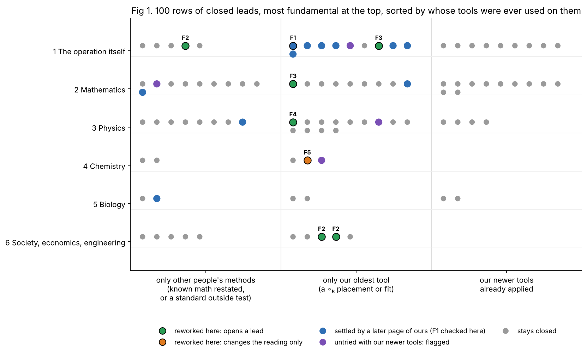
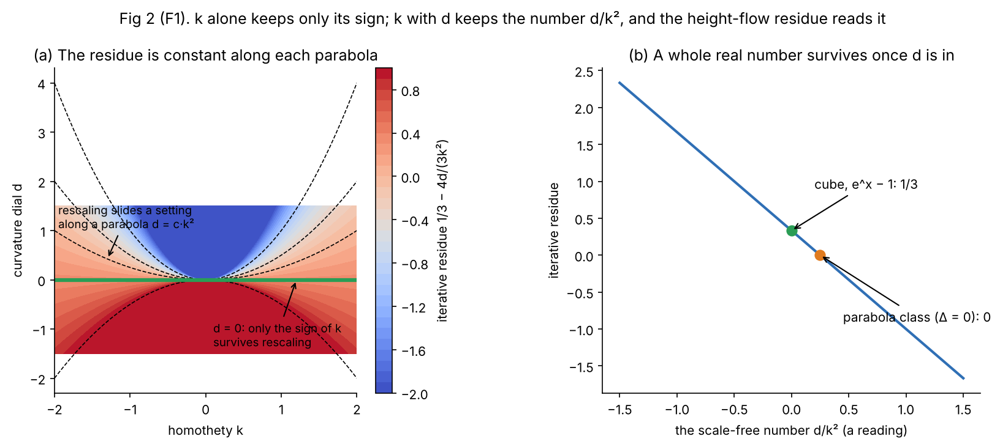
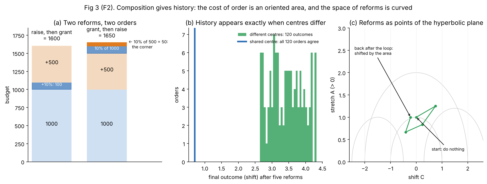
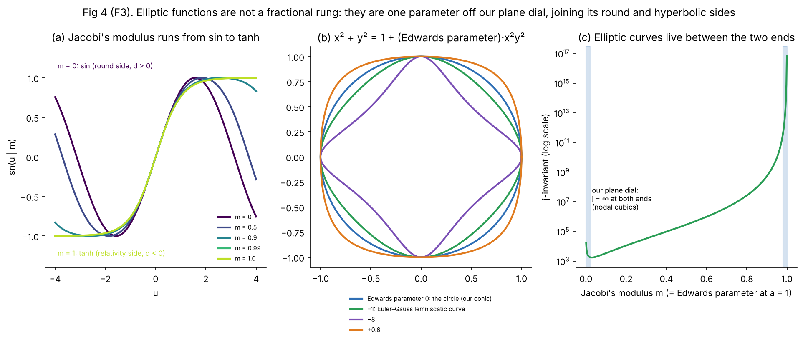
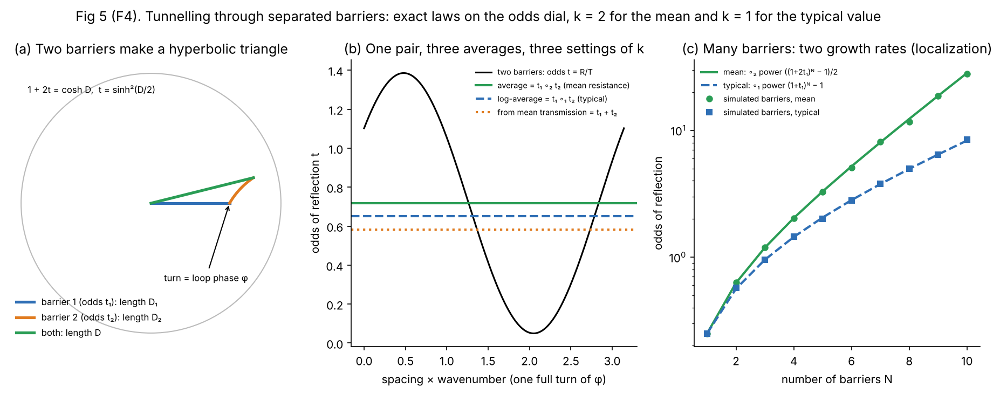
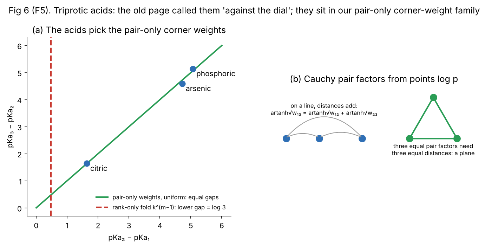

# DRAFT · Closed leads, looked at fresh from our own tools

> **Names:** some words or symbols on this page (✳, mult-add, fused, rung, wall, twist, Tsallis q) also mean something else in standard math, physics or computing, or inside this project. [NAMING-COLLISIONS.md](../../NAMING-COLLISIONS.md) says which meaning is in play.

**DRAFT, Nov 26 2026.** Part of Affine Composition Theory (repo: fused-hyperoperation-algebra). Nothing here is
reviewed or published.

Asked for by Brennan (voice, Nov 26): "make a similar pass on … anything we've ruled out so far. To say, have we looked
at anything from a fresh perspective, not just tried to apply the existing tricks of … previous mathematicians to look
at the problem?" And: "start with the most fundamental and work our way to the more derived." The three-body problem
is being done the same way in its own task and is left out here; Newton's G was just re-checked and stays closed.

Builds on `closed-leads-revisit/` (which re-judged about 140 closed leads and reopened R1–R6) and uses the tools that
came after it: `order-dial/` (order costs an oriented area; the holonomy ω is that reading), `affine-names/` (dials
k, d, p, C, odds t, similarity ratio r, growth degree β; base dials in, readings out), `named-functions/` (every law
with a generator that touches the identity has rungs and a hypernatural logarithm), `height-flow/` (the iterative
residue), `corner-weights/` (pair-only Cauchy weights), `hypersphere/`, `mathlib-map/`.

Checks: `checks.py` → `checks_output.txt`, **36 of 36 pass** (numpy, scipy, sympy, mpmath; under 2 seconds).
Polish: `polish.py` → `polish_output.txt` (the load-bearing identities again at 30 digits, and error bars on the
simulations; about 2 seconds). Pictures: `figures.py` → `figures/`. The sort: `sort_data.py` → `make_sort.py` →
`SORT.md`. Lean: `lean/FreshLook.lean`, four polynomial identities, compiled in the shared library on Nov 26 as
`FusedAlgebra.Topics.FreshLook`. Colour key in the pictures: green = reworked and opens a lead, orange = reworked and changes the reading only,
blue = settled by a later page of ours, purple = flagged, grey = stays closed.

## The result in plain words

**Most of what we closed was never looked at with our newer tools, and three of those leads open once we do.**
Out of 100 rows of closed leads, 74 had only other people's methods or only our oldest tool (one ∘ₖ placement)
applied to them. Reworked from our own side:

1. **Tunnelling opens, exactly.** It was closed as "only approximately ∘₋₁". Through separated barriers, the odds of
   reflection compose by the hyperbolic law of cosines, with the loop phase as the angle. Averaging over that angle
   gives exact laws on the odds dial: ∘₂ for the mean, ∘₁ for the typical value.
2. **Elliptic functions open as a new direction.** They were closed as a failed fractional rung. They sit one known
   parameter off our plane dial (Edwards' parameter, which is Jacobi's modulus m), and that parameter joins our round
   side (m = 0, sin) to our relativity side (m = 1, tanh).
3. **History in Rulecraft opens.** It was closed because ∘ commutes. Reforms that mix a percentage with a fixed amount
   have different centres, so their order matters, by exactly an oriented area. The space of such reforms is the
   hyperbolic plane, which is the curved policy space the book wanted.

One rework only changes the reading (triprotic acids sit in our pair-only corner weights, not "against the dial").
One was already settled by later pages and is checked here (k alone keeps only its sign; with d in, a whole number
survives). Four more are flagged for a later pass. The hyperbolic plane turns up in two of the three new leads.

**Fig 1.** Every closed row, most fundamental layer at the top. Left column: only other people's methods (known math
restated, or a standard outside test). Middle: only our oldest tool. Right: our newer tools were already applied.

---

## Part 1. The sort

The question for each closed lead: did we ever attack it with our own tools, or only with standard methods? Full table
in `SORT.md`. In short:

| Layer (fundamental first) | Rows | Only others' methods | Only our oldest tool | Newer tools already used | Reworked here |
|---|---|---|---|---|---|
| 1 The operation itself | 24 | 5 | 10 | 9 | F1, F2, F3 |
| 2 Mathematics | 30 | 10 | 9 | 11 | F3 |
| 3 Physics | 25 | 8 | 13 | 4 | F4 |
| 4 Chemistry | 5 | 2 | 3 | 0 | F5 |
| 5 Biology | 6 | 2 | 2 | 2 | none |
| 6 Society, economics, engineering | 10 | 5 | 5 | 0 | F2 |

- **Never touched by our newer tools: 74 rows.** For most of them that is fine: they failed a data test that no new
  tool changes (rotation curves, the Higgs mass, Danish fire claims), or they are known results restated.
- **Where a newer tool bears on the piece that failed**, the five reworks below take it up, most fundamental first.
- **Settled by later pages (10):** the twist is now the holonomy, a reading, not a dial; "the twist forces i" is
  answered by the curvature dial and the hypersphere (i is the step that stays on the circle); "d collapses into one
  Cayley–Klein label" is answered by the design rule (d is a base dial; the label is a reading); the finite half power
  set by `no_functor_half`; fractal size by the similarity ratio and growth degree; det(I + kA) by corner weights;
  "framework forces gravity" by the order dial and precession; Feigenbaum by R2; thermodynamics by S1; epidemics by R4.

---

## Part 2. The reworks, fundamental first

### F1. "k alone: only the sign survives rescaling" (the operation itself)

**Fig 2.** (a) The iterative residue of each (k, d) law, 1/3 − 4d/(3k²), over the dial plane. Rescaling slides a
setting along a parabola d = c·k² (dashed), and the residue does not change along it. On the green line d = 0 only the
sign of k is left. (b) The residue against the scale-free number d/k²: the cube's e^x − 1 at 1/3, the parabola class
at 0.

- **Old closure** (`dial-survey/`, `shape-directions/`): rescale x → λx and k → k/λ, so k by itself carries no number,
  only a sign. Tested with ∘ₖ alone.
- **Fresh look.** With the curvature dial, rescaling sends (k, d) to (k/λ, d/λ²) (F1.1). So the number d/k² survives,
  and the height-flow fingerprint reads it: the generator's iterative residue is 1/3 − 4d/(3k²) (F1.2, built from k
  and d as the design rule asks), unchanged by any rescaling (F1.3), and stuck at 1/3 when d = 0 (F1.4).
- **Known versus ours.** Iterative residues are Écalle's. The formula was already in `height-flow/` after the design-rule
  audit; what is new here is only the remark that it answers this closure.
- **Verdict: settled by later work; correct one sentence.** The old page is right for k alone. It should say "for k
  alone; with d, one scale-free number survives, and the residue measures it." Not a lead by itself.

### F2. "∘ commutes, so no history" and "one dimension is flat" (the operation, then Rulecraft)

**Fig 3.** (a) A 10% raise and a 500 grant on a budget of 1000, in both orders. They differ by 50, the raise on the
grant: the corner. (b) Five reforms, all 120 orders. Sharing one centre (blue), every order lands in one place. With
different centres (green), the 120 orders give 120 outcomes. (c) Reforms x ↦ Ax + C as points (C, A) of the upper
half-plane. Going round the loop f, g, f⁻¹, g⁻¹ does not come home: it ends shifted by the oriented area.

- **Old closures** (`rulecraft/`, `groups-lie/`, `differential-geometry/`): "Percent reforms on one quantity can never be
  path-dependent; curvature needs more"; "decision gravity: one-dimensional mult-add is flat"; "1-D curvature is
  unmeasurable". Tested with ∘ₖ alone, which treats every reform as one number.
- **Fresh look with the order dial.** A real reform is a map, a stretch and a shift: "raise by 10%" is a stretch,
  "add 500" a shift, and most policies are both. Each map has a centre, the value it leaves alone.
  - Maps that share a centre commute: that is the whole ∘ₖ family (F2.1).
  - Maps with different centres do not. Swapping two neighbouring reforms moves the outcome by exactly their oriented
    area a₁c₂ − a₂c₁, scaled by the reforms that come after (F2.3). The loop f, g, f⁻¹, g⁻¹ leaves a pure shift equal to
    that area, which is zero only when the centres agree (F2.4, the same wedge as `order_gap`).
  - So "history" is real, and it has a size: five reforms with different centres give 120 different outcomes over the
    120 orders (F2.2).
  - The space of all such reforms is not flat. With the metric that composing reforms leaves unchanged, it is the
    hyperbolic plane, curvature −1 (F2.6, F2.7).
- **Known versus ours.** All of it is known: the affine group, its commutator, and the fact that the "ax + b" group
  with its invariant metric is the hyperbolic plane (the upper half-plane model). Ours: reading Rulecraft's two closed
  questions, order of reforms and decision gravity, through it.
- **Verdict: opens a lead, for the book rather than for new math.** The old sentence is right only for pure percentage
  reforms. Any rule set that mixes percentages with fixed amounts is path-dependent, by a computable area, and lives in
  a curved space with a known geometry. Next step: write each of Rulecraft's model rules as a stretch and a shift, find
  each one's centre, and list which pairs of reforms are order-sensitive and by how much.

### F3. "Elliptic functions are not a fractional rung" (the dial plane, then mathematics)

**Fig 4.** (a) Jacobi's sn(u | m) for m from 0 to 1: sin at m = 0, tanh at m = 1. (b) The curves
x² + y² = 1 + (Edwards parameter)·x²y². Parameter 0 is the circle, our conic. Parameter −1 is the curve of Euler's and
Gauss's lemniscatic functions. (c) The j-invariant against m. It is infinite at both ends, where the curve degenerates
to one of our conic laws.

- **Old closures** (`elliptic/`, "near misses fail at layer 8"; `clifford/`, "no 2-D ✳ torus yet: needs two commuting
  dials and a lattice"). The elliptic test compared elliptic functions with fractional rungs of the cube's e^x − 1, our
  oldest tool.
- **Fresh look with the plane dial and the named-functions rule.** The question is not "which rung?" but "where is the
  law?"
  - Take the twisted Edwards curve a x² + y² = 1 + (Edwards parameter)·x²y² with its known addition law. With the
    parameter at 0 it is the conic a x² + y² = 1, and in the slope x/y its law is exactly ours at k = 0, d = a (F3.1).
    Our other k follow by the slide σ, as in `named-functions/`.
  - With the parameter on, the law stays on its curve and stays associative (F3.2): a genuine elliptic curve.
  - At a = 1 the Edwards parameter is Jacobi's modulus m, and the law is Jacobi's addition theorem for sn
    (F3.5; at 30 digits in the polish). At m = 0 it is sin, the round side of our plane; at m = 1 it is tanh and the law
    is velocity addition, our k = 0, d = −1 (F3.6, F3.7).
  - The j-invariant blows up at both ends, like 16a over the parameter near 0 (F3.3, F3.4): our conic laws are the
    degenerate (nodal) limits of elliptic curves.
  - Our tools carry over. The law's own logarithm, height 1 of its hypernatural logarithm, is Legendre's elliptic
    integral F(arcsin x | m) (F3.8). sn touches the identity at 0, so by the named-functions rule it has fractional
    iterates: an elliptic rung ladder exists (F3.9). On the real line, Jacobi's denominator never vanishes for
    0 ≤ m < 1, so this chart has no wall (F3.10).
  - The Clifford torus: the circle operation on complex numbers, taken modulo one multiplicative period q, is Tate's elliptic
    curve, and as q → 0 it opens back into our law. That is the "two commuting dials plus a lattice" the Clifford page
    asked for. (Known; not checked here beyond the j → ∞ pattern above.)
- **Known versus ours.** Jacobi's and Legendre's functions, Edwards curves (Edwards 2007; Bernstein and Lange's twisted
  form), the j-invariant and Tate's curve are all known. Ours: that our whole conic family is the parameter-0 slice,
  and that Jacobi's modulus runs between our round and relativity sides.
- **Verdict: opens a lead.** The old closure stands as a rung test, but elliptic functions now have an exact home one
  parameter off the plane, and every structural question we ask (rungs, hypernatural logarithm, walls) can be asked
  there. Next steps: compute the elliptic rung ladder and see how its fingerprint moves with m; and, for the corner
  weights, note that KdV solitons are the m → 1 limit of cnoidal waves, so the soliton corner weights should continue
  to m < 1 as theta-function weights (known KdV theory, not yet tied to our cube). Followed up in [`elliptic-modulus/`](../elliptic-modulus/README.md) (DRAFT).
- **Naming.** "Edwards parameter" and "Jacobi's modulus m" are the existing names. The literature writes the Edwards
  parameter as d, which clashes with our curvature dial, so this page writes it out in words. It is not added to the
  dial list; if it is adopted, the design rule makes it an input.

### F4. "Tunnelling glues by ∘₋₁ only approximately" (physics)

**Fig 5.** (a) Each barrier is a step of length D in the hyperbolic plane, with 1 + 2t = cosh D for its odds of
reflection t = R/T. Two barriers make a triangle whose turn is the loop phase φ. (b) One pair of barriers as the spacing
changes (black). Averaged over the loop phase: t₁ ∘₂ t₂ (green), the log-average t₁ ∘₁ t₂ (blue), and the mean
transmission t₁ + t₂ (orange). (c) Many barriers with random spacings: the mean grows as the ∘₂ power, the typical
value as the ∘₁ power; dots are simulated barriers.

- **Old closure** (`probability-entanglement/`, test T1): "blocked" glues by ∘₋₁ up to an edge term that fades from 13%
  to 2%. The test cut one thick barrier into two adjacent slices and used the standard Gamow exponent.
- **Fresh look with the odds dial and the loop phase.** Take two separated barriers and write each by its odds of
  reflection, t = R/T (the odds dial, one per element).
  - The pair's odds are exactly t = t₁ ∘₂ t₂ − 2√(t₁t₂(1 + t₁)(1 + t₂))·cos φ, where φ is the phase picked up on one
    round trip between the barriers (F4.1).
  - That is the hyperbolic law of cosines, 1 + 2t = cosh D₁ cosh D₂ − sinh D₁ sinh D₂ cos φ (F4.2).
  - Averaged over the loop phase, three exact laws come out. The mean odds compose by ∘₂ (F4.3). The log-average
    composes by ∘₁, so the typical "blocked" chance glues by ∘₋₁ exactly (F4.4). The mean transmission of one pair
    gives plain addition (F4.5; this one holds for a pair only, not along a chain).
  - More generally, every Legendre function of 1 + 2t multiplies on average (F4.6; at 30 digits in the polish). The ∘₂
    law is its first case.
  - Along a chain of barriers with random spacings, the mean odds follow the ∘₂ power ((1 + 2t₁)ᴺ − 1)/2 and the
    typical value the ∘₁ power (F4.7, F4.8; the polish puts the simulations within 0.02 and 0.27 standard errors).
    The two growth rates differ (F4.9): mean resistance runs ahead of typical, the known signature of one-dimensional
    localization.
  - The old test lands inside the fixed-phase band, 13% off ∘₁ (F4.10): adjacent slices have one fixed phase and no
    averaging, which is where its edge term came from.
- **Known versus ours.** The physics is known: Landauer's resistance R/T (1970); Anderson, Thouless, Abrahams and
  Fisher's ∘₂ rule for the phase-averaged resistance and the additive log (1980); transfer matrices as hyperbolic
  motions; the product formula for Legendre functions on the hyperbolic plane. Ours: reading the three standard
  averages as three settings of the homothety k on the odds dial, and the composition as a hyperbolic triangle whose
  angle is the loop phase.
- **Verdict: opens a lead.** It is exact, it is geometric (a triangle in the hyperbolic plane), and k = 2 is forced by
  the physics, not fitted. It also gives the hypersphere page a hyperbolic twin. Next steps: check whether the full
  spread of t along a chain is a flow on the dial (the known one-dimensional DMPK equation is the natural comparison),
  and whether the curvature dial d is what sets the geometry of the barrier triangle.
- **Inputs and readings.** The inputs are each barrier's odds t₁, t₂ (base dials) and the loop phase φ (a setting).
  The pair's odds t and the lengths D are readings.
- Worked up in [`tunnelling/`](../tunnelling/README.md) (Nov 26).

### F5. "Triprotic acids reject the dial's fold" (chemistry)

**Fig 6.** (a) The pKa gaps of citric, phosphoric and arsenic acid sit on the equal-gaps line of uniform pair-only
weights, far from the rank-only fold, which pins the lower gap at log 3. (b) If the pair factors come from a Cauchy
matrix with points on a line, the distances add, so three equal pair factors are impossible on a line.

- **Old closure** (`chemistry/11-acids-bases/`): folding the dial over three sites pins pKa₂ − pKa₁ at log 3, and real
  acids have nearly equal gaps instead, so the page called it "against the dial" in favour of classical pairwise
  electrostatics (Bjerrum; Kirkwood and Westheimer).
- **Fresh look with the corner weights.** The fold the page tested is the rank-only weighting k^(m−1), one of our two
  weight families. The other is pair-only: a Cauchy matrix's corner weights have the triple corner equal to the product
  of the three pair corners (F5.1). Uniform pair-only weights give equal gaps, which is what the acids show. So the acids
  sit inside the theory, in the pair-only family, the same family as the soliton pair weights.
- One sharper statement: when the Cauchy points lie on a line, the pair factors obey a velocity-addition rule,
  artanh√w₁₃ = artanh√w₁₂ + artanh√w₂₃ (F5.2), so exactly equal pair factors cannot come from a line (F5.3). Testing
  that on real acids needs site-by-site constants, which this pass did not have, and nothing physical says a molecule
  should obey a line rule.
- **Known versus ours.** Pairwise electrostatics and Cauchy determinants are known. Ours: placing the acids in the
  pair-only corner weights.
- **Verdict: changes the reading only.** Correct the record: "against the rank-only fold; consistent with the pair-only
  corner weights." Not a lead.

---

## Part 3. Flagged: untried with our newer tools, worth one pass later

| Lead (folder) | Why it is worth a look | What it could turn out to be |
|---|---|---|
| Jet composition: "∘ only to first order" (`jet-fields/`) | Under the order dial, affine maps are first-order jets and Möbius maps (the landscape) are second-order jets | Lie's theorem says no other finite family acts on a line, so likely a clean "why it stops", not a lead |
| Ihara zeta: "Euler product only" (`graph-theory/`) | Bass's formula writes it as a determinant det(I − uA + u²Q), the same shape as our corner weights det(I + tM) | A corner-weight reading of graph zetas; known math, possibly a useful tie |
| Varying dial field as gravity: "bends light by half" (`general-relativity/`) | The hypersphere split puts the missing half in space curvature, our d | Likely the known 1911-versus-1915 story (time part plus space part); kept separate from the closed G lead |
| Reaction order as one law (`chemistry/09-rates/`) | Each order n is its own one-parameter law with its own logarithm (a Tsallis q-log), so the named-functions rule gives it rungs | A placement, not a forced landscape law; probably bookkeeping |

## Part 4. Correct the record (four sentences)

Applied on Nov 26, on Brennan's yes: each page now carries the corrected sentence with a pointer back here.

| Page | What it says | What it should say |
|---|---|---|
| `dial-survey/` | Only the sign of k survives rescaling | For k alone. With d, the number d/k² survives, and the iterative residue reads it (F1) |
| `rulecraft/` | Percent reforms can never be path-dependent; curvature needs more; 1-D is flat | True for pure percentage reforms. Reforms mixing percentages and fixed amounts are path-dependent by an oriented area, and their space is the hyperbolic plane (F2) |
| `probability-entanglement/` | Tunnelling glues by ∘₋₁ only approximately | Exactly, for separated barriers averaged over the loop phase: ∘₁ on the typical odds, ∘₂ on the mean (F4) |
| `chemistry/11-acids-bases/` | Triprotic acids go against the dial | Against the rank-only fold; consistent with the pair-only corner weights (F5) |

## Sources

Named from memory and not opened in this pass; check each before citing.

- Écalle, J. (1975). Théorie itérative: introduction à la théorie des invariants holomorphes. J. Math. Pures Appl.
- Edwards, H. M. (2007). A normal form for elliptic curves. Bull. AMS 44. Bernstein, D. J., Birkner, P., Joye, M.,
  Lange, T. and Peters, C. (2008). Twisted Edwards curves.
- Jacobi, C. G. J. (1829). Fundamenta nova theoriae functionum ellipticarum. Legendre, A.-M. (1825–28). Traité des
  fonctions elliptiques. Tate, J. (1959, published 1995). A review of non-Archimedean elliptic functions.
- Landauer, R. (1970). Electrical resistance of disordered one-dimensional lattices. Phil. Mag. 21.
- Anderson, P. W., Thouless, D. J., Abrahams, E. and Fisher, D. S. (1980). New method for a scaling theory of
  localization. Phys. Rev. B 22.
- Bjerrum, N. (1923). Kirkwood, J. G. and Westheimer, F. H. (1938). Cauchy, A.-L. (1841), the Cauchy determinant.
- Bass, H. (1992). The Ihara–Selberg zeta function of a tree lattice. Lie, S. (1880s), transformation groups on a line.
