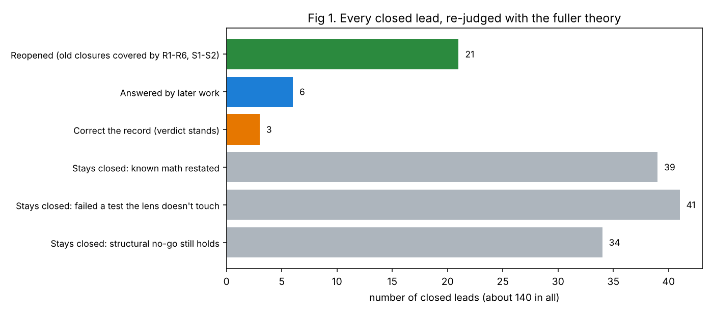
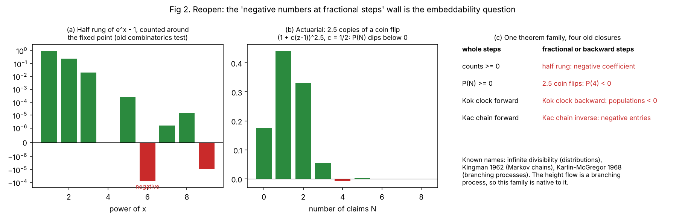
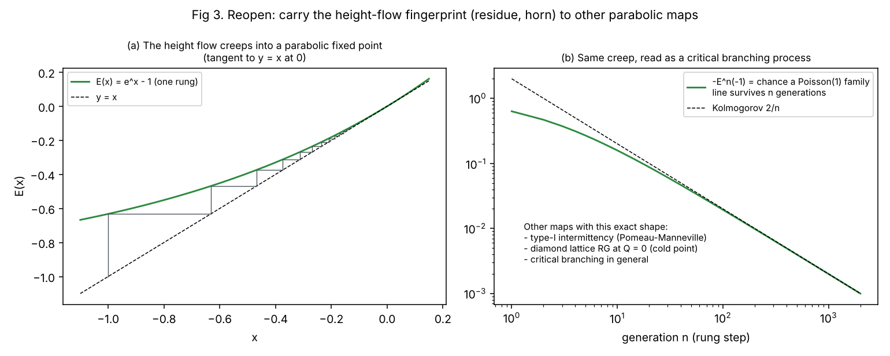
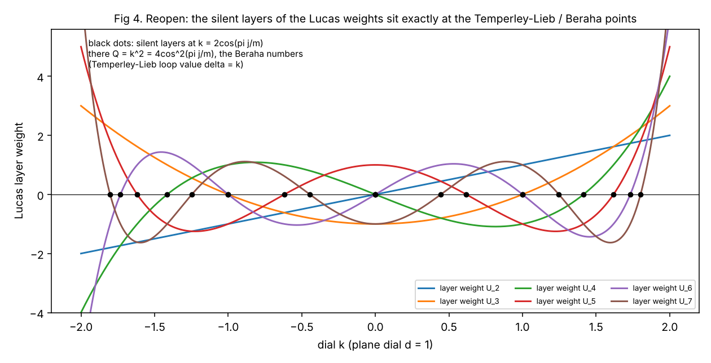
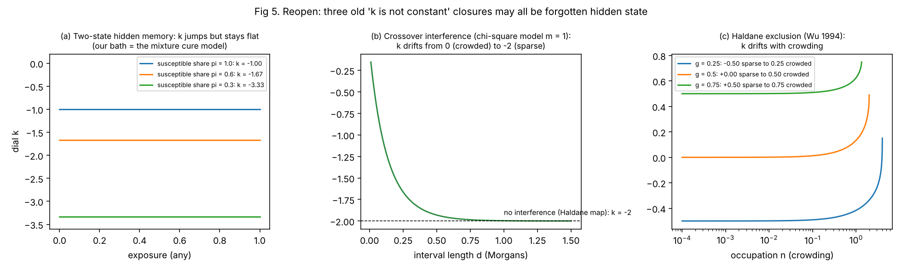
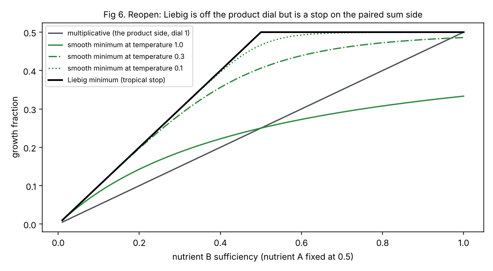
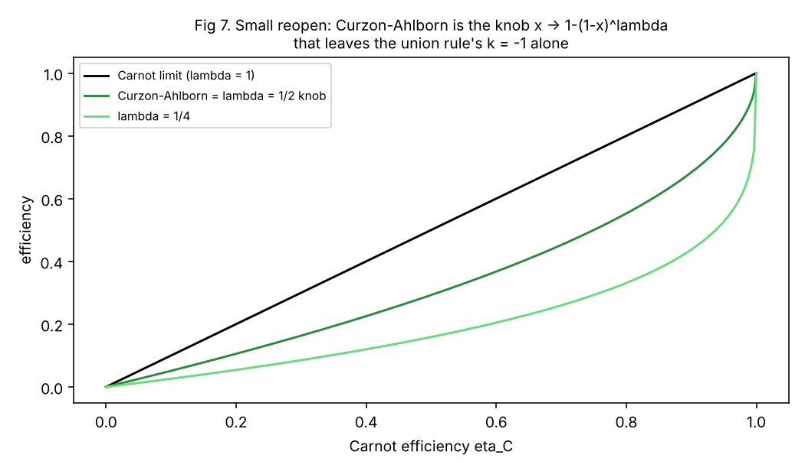

# Closed leads, re-judged with the fuller theory (DRAFT)

> **Names:** some words or symbols on this page (⊕, fused, rung, wall, twist) also mean something else in standard math, physics or computing, or inside this project. [NAMING-COLLISIONS.md](../../NAMING-COLLISIONS.md) says which meaning is in play.

**DRAFT, 2026-11-25.** Nothing here is a new theorem. Every lead below was already set aside on an earlier
page; this page asks again, one at a time, whether what we now know changes the verdict. Where a reading is ours
it says "ours". Pictures are made by `figures.py` from known formulas; nothing is fitted.

## The result in plain words

Out of about 140 leads we had closed, **six deserve to be reopened**, plus two small ones. Each reopens for a
concrete reason that did not exist before: the old test used the wrong operation (only ∘ₖ, never its paired sum
⊕ₖ), the wrong coordinate (counts instead of probabilities), or no home in known math, and the new lens supplies
one. Everything else stays closed, almost always because it is known math restated or because it failed a numerical
test that the new lens does not touch. Three old pages also need a sentence corrected.

What "the fuller theory" means here (from `probability-entanglement/`, `quantum-to-classical/`, `height-flow/`,
`corner-weights/`, `cube-weights/`, `lucas-weights/`, `exploration/`):

- ∘₋₁ is the union rule of independent events, and the AdS₃ cross-ratio is a real probability.
- k stays −1 under heat, squeeze and spin, and moves only when a hidden state (a bath) is forgotten.
- ∘ₖ paired with ⊕ₖ = a + b + 1/k is a semiring at every k. That is Maslov dequantization: counting, log-sum-exp,
  min-plus (tropical) and max-plus (Viterbi) are stops on one dial.
- The height flow is a critical Poisson(1) branching process; it creeps into a parabolic fixed point and has a
  fingerprint (iterative residue 1/(3s), horn size 64.153).
- Corner weights are det(I + tM); with a Cauchy matrix they are soliton pair weights; the companion matrix gives
  the Lucas weights.

**Fig 1.** Every closed lead found, sorted by the new verdict. Green: reopen. Orange: the old page
states something the new lens shows is wrong, though the verdict stands. Blue: a later page already answered it.
Grey: stays closed.

---

## Part 1. The leads worth reopening (fundamental first)

### R1. "Negative numbers at fractional steps" is one known question: embeddability

**Fig 2.** (a) The half rung of e^x − 1, expanded around its fixed point: x + x²/4 + x³/48 + 0·x⁴ + … turns
negative at x⁶ (red). (b) 2.5 copies of a coin flip, (1 + c(z − 1))^2.5 with c = ½: the chance of 4 claims comes
out negative. (c) Four old closures with the same shape: whole steps are fine, fractional or backward steps go
negative.

- **Old closures it covers.** Fractional rungs are not counts (`combinatorics/`); the half iterate blocks a natural
  fractional power set (`fractional-powerset/`); the Poisson floor goes negative below height 1
  (`fractional-rungs/e-every-height/`); two half steps of (1 + x/n)ⁿ miss at x³ (`information-theory-full/`);
  fractional count models give negative probabilities (`actuarial/`); running the Kok oxygen clock backward gives
  negative populations (`photosynthesis-twists/`); the inverse of the real-dial chain has negative entries
  (`why-i/e-i-pi/chain-resolves/`).
- **Why reopen.** Each was closed as a failure of our operation. Read through the new lens, they are all one
  well-known question: can a process that runs in whole steps be run in fractional steps and stay a process?
  For distributions that is infinite divisibility; for Markov chains it is Kingman's embedding problem (1962);
  for branching processes it is Karlin and McGregor's embeddability (1968). Since the height flow *is* a branching
  process, this family is native to our theory rather than an obstacle to it.
- **The one new question it raises.** The old combinatorics test expanded the half rung around the fixed point
  (powers of x). The probability question expands around zero offspring (powers of s, with x = s − 1), and that
  test was never run. So: does the critical Poisson(1) branching process embed in a continuous-time branching
  process? Karlin–McGregor may already answer it. If the answer is no, "no natural half rung" stops being a failed
  search and becomes a known theorem with a name. If it is yes, a natural half rung exists in the probability
  coordinate. Either way we learn something.
- **Known versus ours.** The theorem family is known. Tying our seven closures to it is ours.

### R2. Parabolic fixed points elsewhere: carry the height-flow fingerprint

**Fig 3.** (a) E(x) = e^x − 1 is tangent to y = x at 0, so repeated rung steps creep in slowly. (b) The same creep
read as a branching process: the chance a family line survives n generations falls like Kolmogorov's 2/n.

- **Old closures it covers.** Diamond hierarchical lattice "predicts nothing beyond Chang–Roeder–Shrock 2020"
  (`diamond-lattice/`), whose cold fixed point turns parabolic exactly at Q = 0; Feigenbaum "no genuine
  connection" (`dynamical-systems/`); and the horn-map coefficients c₂, c₃ left undone there.
- **Why reopen.** When these were closed we had no fingerprint for a parabolic point. Now we do: the iterative
  residue and the Écalle–Voronin horn coefficient. The same shape appears in known places: Feigenbaum was the wrong
  partner (period doubling is a hyperbolic fixed point), but type-I intermittency (Pomeau–Manneville; RG by
  Hirsch, Nauenberg and Scalapino 1982) sits exactly at a tangent fixed point like ours, and so does the diamond
  lattice at Q = 0. Computing the fingerprint for those maps is a direct test of whether ours means anything outside
  our own operation.
- **Known versus ours.** The invariants and the intermittency RG are known. Computing horn coefficients for these
  RG maps, and comparing them with E's, would be ours if not found published.

### R3. The silent layers of the Lucas weights are the Temperley–Lieb / Beraha points

**Fig 4.** The Lucas layer weights U_m at curvature dial (the plane dial) d = 1. Each is silent (zero) at k = 2cos(πj/m); then
Q = k² = 4cos²(πj/m), the Beraha numbers.

- **Old closures it covers.** The Beraha cluster test (`lee-yang/`, p = 0.099, closed) and the knot-theory bend
  ("2-tangles only reach the dial line"; 6-ended tangles left unasked, `knot-theory/`). Also the "folklore"
  verdict on the Lucas corner formula (`lucas-weights/`).
- **Why reopen.** The old Beraha test was statistical (do placed laws cluster at Q = k + 1?) and it stays closed as
  a statistics question. The new match is structural and exact: with d = 1, the Lucas recurrence
  U_{m+1} = k·U_m − d·U_{m−1} is the Temperley–Lieb / Jones–Wenzl recurrence with loop value δ = k (in general
  δ = k/√d). So the three regions of the dial plane line up with Jones' index: inside the parabola k² < 4d is the
  discrete series below 4 (silent layers at roots of unity), on the parabola is index 4, outside is the continuous
  range. That gives the Lucas weights an existing name and ties the knot page's loop value d to our curvature dial.
- **Known versus ours.** Chebyshev polynomials, Temperley–Lieb and Jones' index are known. That our curvature dial
  (k, d) is the Temperley–Lieb loop value δ = k/√d is our reading; it needs a literature check before we call it
  new.

### R4. Where k moves: a forgotten hidden state, frozen or running

**Fig 5.** (a) A hidden state that is frozen across both events (a share π of the population susceptible, the rest
immune): k jumps to −1/π and stays flat. (b) Crossover interference in the chi-square model m = 1: the hidden
phase runs along the chromosome and k drifts from 0 at short range to −2 at long range. (c) Haldane exclusion
statistics: k drifts from 2g − 1 when sparse to g when crowded.

- **Old closures it covers.** Haldane crowding, "genuinely outside" and deferred to 1.x (`repetition-dial/`);
  genetic interference "not exactly on the line" (`biology/04-genetics/`); population and epidemics "everything is
  the or law" (`biology/09-population/`); the k = −1/m stalks of α-determinantal processes
  (`dial-point-processes/`).
- **Why reopen.** Before, a drifting k just meant "not our law". The bath result now says k moves only when a hidden
  state is forgotten, which makes every drifting-k case a test of that rule. Two things came out of setting them
  side by side:
  - Our two-state bath result, k′ = −1/π, is exactly the **mixture cure model** of survival analysis (Boag 1949;
    Berkson and Gage 1952): a share π can have the event, the rest never will, and two exposures of the same
    person glue by ∘ with k = −1/π. That is an existing name for our bath.
  - A hidden state that is frozen across the events (cure model) keeps k flat. A hidden state that runs along the
    line being composed (the chi-square interference phase) makes k drift, even with only two levels. So the rule
    "two-state bath keeps us in the family" needs the word *frozen*. Haldane crowding is the open case: is its
    hidden state frozen with many levels, or running?
- **Known versus ours.** The cure model, the chi-square model and Wu's equation are known. The frozen-versus-running
  split and reading Haldane's drift through it are ours, untested.

### R5. Liebig's law of the minimum is a stop on the paired-sum side

**Fig 6.** Growth with nutrient A fixed at half. The product law (grey) is where the old page looked. The smooth
minimum at falling temperature (green) slides to Liebig's minimum (black), the tropical stop.

- **Old closure.** "Liebig's minimum is provably off the dial; best k = 0 misses by 17%" (`biology/02-metabolism/`).
- **Why reopen.** That proof is right about ∘ₖ. But a minimum is not a product-side law at all; it is the
  tropical end of the paired sum ⊕ₖ under Maslov dequantization. The page never had ⊕ₖ. On the paired side,
  co-limitation becomes a one-parameter family (a smooth minimum, log-sum-exp in log units) running from additive
  resistance at temperature 1 to Liebig at temperature 0. That is testable on the same co-limitation data.
- **Known versus ours.** Smooth-minimum and generalized-mean co-limitation models are known in ecology. Placing
  Liebig as a Maslov stop of our dial is ours.

### R6. The decrement-path picture in actuarial work (the blocker is gone)

- **Old closure.** The one actuarial piece called worth pushing (uniform distribution of deaths = Shapley, constant
  force = log coordinates; competing risks glued by ∘₋₁) was left without Lean because "mathlib blocked"
  (`actuarial/`).
- **Why reopen.** Not the lens this time: the Mathlib build now runs on main. And it is a k = −1 probability
  path through the cube, which is now the centre of the theory rather than a side reading.
- **Known versus ours.** The formulas are known actuarial practice; the cube-path picture is ours.

### Small reopens

**Fig 7.** Efficiency against Carnot efficiency. Curzon–Ahlborn, 1 − √(1 − η_C), is the knob x → 1 − (1 − x)^λ at
λ = ½.

- **S1. Carnot cascade and Curzon–Ahlborn** (`thermodynamics/`, closed "0 new laws"). Engines in series glue by the
  union rule; Curzon–Ahlborn is the λ = ½ knob, the same automorphism that heat and squeeze apply to the AdS₃
  cross-ratio without moving k. Worth one check: whether the known finite-time efficiency bounds are images under
  such knobs. Small, because it may only be a picture.
- **S2. A name for the k^(m−1) weighting** (`boolean-lattice/`, left "unchecked"). Cube weights found k^(m−1) is the
  only rank-only weighting that composes. That has the shape of the weight-λ quasi-shuffle (Guo–Keigher mixable
  shuffle, Rota–Baxter algebras of weight λ; Diehl, Ebrahimi-Fard and Tapia 2020). A naming check, so we don't call
  something ours that already has a name.

---

## Part 2. Correct the record (verdict stands, one sentence is wrong)

| Page | What it says | What the fuller theory says |
|---|---|---|
| `p-vs-np/` | "At k = 0 it becomes plain addition. That's a contraction, not a tropical limit: the dial doesn't turn + into min." | With the paired sum ⊕ₖ the dial does reach min-plus. The sharper statement: #P (counting) and optimization (tropical) are dial stops; NP's "or over witnesses" is the Boolean semiring, which `quantum-to-classical/` shows is unreachable. P vs NP stays closed. |
| `category-theory/` | "Negative k has no set model." | True for sets; k = −1 has a probability model (union of independent events). Say "no set model, but a measure model". |
| about 20 pages (consensus, actuarial, statistics, elliptic, quantum noise, entropy-noise, information theory, thermodynamics, abstract algebra, infinities, rung shape, landscape, osgood-inverse, topology, simple laws, q-across, toric, photosynthesis) | "Nothing as promising as the solitons." | Re-judged here on each lead's own merits. Only thermodynamics (S1) and actuarial (R6) change. |

## Part 3. Already answered by later work

| Old lead | Where it was left | Answered by |
|---|---|---|
| Horn coefficient of the rung step "no new lead" | `complex-analysis/` | `height-flow/`: it is half of the flow's fingerprint |
| Soliton pairs "follow a second road" | `solitons-rungs/` | `corner-weights/`: Cauchy determinant, vertex operators |
| Hall's chain polynomial at −k, "unchecked" | `boolean-lattice/` | `cube-weights/`: Möbius with the dial is the Fubini polynomial at −k |
| q-analogue from q-commuting entries, "unchecked" | `boolean-lattice/` | `cube-weights/`: q-commuting inputs give the soliton corners |
| Missing zoom dial | `fractal-dials/` | `zoom-dial/` (Moran 1946) |
| k-deformed MMI: only k = −1 works | `exploration/` | The union rule: k = −1 is the only value that removes the one-body part |

## Part 4. Stays closed, with one reason each

Grouped by reason. "Lens" means: does the fuller theory touch what failed? In every row below, no.

### 4a. Known math, restated (the lens adds a reading, not content)

| Lead | Folder | Reason it stays closed |
|---|---|---|
| Consensus mapping (confirmations, 51%, BFT 1/3) | consensus | Standard results in new clothes |
| Econ identities (Fisher, volatility drag, Gordon) | econ-forecasting | Exact restatements, no forecasting gain |
| Game theory (MW, Kelly, Elo, Sugeno–Shapley) | game-theory | Every proof was already a log-of-a-product proof |
| Data-center energy, five leads | datacenter-energy | Bookkeeping or affinity laws |
| Rulecraft society tensor = 2ᵏ factorial design | rulecraft | Yates 1937 |
| Statistics dependence line k + q = −1 | statistics | AMH/Hamacher copulas (1978) |
| Chemistry pages 02, 03, 05–08, 10, 12, 13 | chemistry | Known physics reparametrised |
| Size-consistency (only k = 1 corner weight) | chemistry/01 | Why coupled cluster replaced CISD |
| Physiology, behaviour; helix–coil and predator dials | biology/06, 11, 01, 10 | Exact relabellings; the wall is not a physical temperature |
| Thermodynamics' 30 placed laws | thermodynamics | Known; only S1 above reopens |
| Information theory, 44 laws | information-theory | All known |
| Entropy family inside Tempesta's group entropies | height-flow | Expected, not new |
| Quantum noise as weighted ∘; concatenation flow | quantum-noise | 1996–97 results; thresholds need statistical physics |
| κ-Poincaré / DSR | why-i/kappa-poincare | Lukierski 1991; Majid–Ruegg 1994 |
| Hagedorn wall and primon gas | string-theory | Bookkeeping |
| GUP / minimum length placement | string-theory | Coordinate-dependent; no new physics |
| S-duality, modular invariance | string-theory | Outside our Borel half of SL(2) |
| Field superposition | electromagnetism | Plain addition (k = 0) |
| Lie groups; 1-D geometry | groups-lie, differential-geometry | 1-D groups fully classified; 1-D curvature unmeasurable |
| Category theory (These / Par) | category-theory | No new mathematics |
| Abstract algebra structures | abstract-algebra | Every group and ring made is a known one |
| det(I + kA) sweep | linear-algebra | Every nonzero k is one law up to units |
| Boolean logic, rung decidability | logic-sets | Known facts re-read |
| Bernoulli convolutions; odds of an "and" | measure-probability | Generic product; odds against work |
| Ihara zeta | graph-theory | Euler product only |
| Numerical kit | numerical-analysis | Practical, not research |
| K-theory (Adams–Atiyah 1, 3, 7) | topology | Known |
| Osgood converses (non-NS) | osgood-inverse | Classical |
| Zoom dial | zoom-dial | Moran 1946 |
| Half by joining | fractional-powerset-dials | p-biased measures, OR-convolution |
| α-determinantal counts | dial-point-processes | Shirai–Takahashi, Maunoury (the −1/m stalks go to R4) |
| Paths, orientations, Möbius on the cube | cube-weights | Known homes, no new dial |
| Lucas weights alone | lucas-weights | Folklore-level (the Temperley–Lieb tie is R3) |
| Probability is entanglement (general) | probability-entanglement | Purification, Zurek: known |
| Helix instead of circle | probability-entanglement | Universal cover; no new physics |
| Running coupling form of the height flow | height-running-coupling | Generic for any double fixed point |
| Suzuki–Trotter, Wilson loops, Kaplan–Meier chain | why-i/path-integral-strong | Tools or known; open nothing |
| Actuarial formulas (Lundberg, decrements) | actuarial | Known (except R6) |
| Population and epidemics formulas | biology/09 | Known (the hidden-state angle is R4) |

### 4b. Failed a test, and the lens does not touch the failing piece

| Lead | Folder | The number that closed it |
|---|---|---|
| Stake fused with time | consensus | 20% attacker took 68% of blocks |
| log(1 + s) weighting | consensus | 30% stake split 1,000 ways gains 14% |
| Systemic risk as lost dimension | econ-forecasting | Volatility +1.4% S&P, −0.4% Dow; AUC fell |
| Growth of growth (finite-time pole) | econ-forecasting | Out-of-sample R² −0.017; poles 6 months to 30 years off |
| Lundberg root on Danish fire data | actuarial | 0.0090 jumps to 0.0151 without the top claim |
| Mortality pole | actuarial | Tables can't decide |
| Bond-energy ladder | chemistry/04 | Nitrogen increments grow; fits only C–C |
| Three-site acid fold | chemistry/11 | Pins a gap at 0.48; citric shows 1.63/1.64 |
| Reaction order as one law | chemistry/09 | q drifts 2.31 to 2.92 |
| Richards growth shapes | biology/05 | Rejected at p ≤ 0.005 |
| Global epistasis, common slope | biology/08 | Order changes fitness by 0.02 |
| Drug-mixture α | biology/03 | Scatter −1.0 to 0.4; Bliss rejected in all three sets |
| Rotation curves by ∘ | dark-sector | Closes 1.1% and 4.7% of the gap; corner points the wrong way |
| Local pull ⊕ cosmic background | dark-sector | 1.5× Newton's G in the solar system |
| MOND as minus the ∘ inverse | dark-sector | Fits, but the algebra chooses neither μ nor a0 |
| Fused expansion laws without Λ | dark-sector | Δχ² +83 to +2105 against ΛCDM |
| Layer-weight cube | dark-sector | Measures what DESI's w already does |
| Dial as the Higgs | dial-potential | 128.7 ± 1.0 vs 125.2 GeV (3.3σ); formulas at chance |
| Dial as light's coupling, conformal, steep exponential | dial-potential | α shift 9%; Cassini 12,000σ |
| Anomalies (Hubble, neutron lifetime, dipole) | dark-sector notes | 0.1% vs 8.6%; 0.02 s vs 9 s |
| Born–Infeld field cap | electromagnetism | 0.9029 vs 0.9479; ATLAS bound |
| Half-bit threshold rule | entropy-noise | 0.110 vs 0.103 / 0.1093 |
| Bohr–Sommerfeld from the chain | why-i/path-integral-strong | 18% off for x⁴ at n = 0 |
| Real dial as the quantum step | why-i/chain-resolves | Fails 4 of 5; distinguishability 2.00 → 0.021 |
| Quarter-turn catalyst metric | photosynthesis-twists | R² 0.67 vs 0.76 for the standard descriptor |
| Golden ratio as a force | patterns | 4 hits vs 1.8 by chance, p ≈ 0.11 |
| Beraha clustering of placed laws | lee-yang | p = 0.099 (the structural tie is R3) |
| Dial wall as the phase-change point | lee-yang | Transitions at k = 3 ± 2√2; no zero near −2…1 |
| Fill-then-spill | lee-yang | Different mechanisms |
| Shorter proofs through the operation | proof-complexity | Never beat the control on six results |
| New closed form for non-integrable PDEs | PDE notes | Fisher–KPP residue 4/81; others clash (corner weights now explain why: only pair-only Cauchy works) |
| 54.5% as a hidden dial | size-dial-residual | One twist comes within 0.06 points, not exactly |
| Natural constants up the rungs | fused-constants | Slope and cut-finer tests don't climb |
| New transcendental B½(1,1) | pi | No PSLQ relation at 110 digits |
| e at height ½ | fractional-rungs | Failed a 120-digit integer-relation search |
| Rung sheet helix | rung-shape | 2% off; unit curve doesn't pin the law |
| Proof-shape and whole-law order | shape-dependencies | 27% vs 44% null; 13 up, 12 down |
| Tunnelling glued by ∘₋₁ | probability-entanglement | Only approximate (edge term 13% → 2%) |
| Potts q = 3 fuzzy monogamy | exploration | I₃ = +3.3·10⁻⁵ breaks it |
| Rényi rescue of random states | exploration | Doesn't rescue |
| Three KP solitons sharing one A | corner-weights | Only if A > 1 |

### 4c. A structural no-go that still holds

| Lead | Folder | Why it still holds |
|---|---|---|
| "The twist forces i" | why-i | Orientation alone never gives i |
| Path integrals as a special case (strong) | why-i/path-integral-strong | Needs H, ħ and a measure; the semiring gives only the stops |
| Checkerboard turn as Wick rotation | why-i/checkerboard | The dial multiplies turns, not time |
| Checkerboard with a potential | why-i/checkerboard-potential | Negative V means branching, not probability |
| d as a second Cayley–Klein dial | why-i/cayley-klein | Collapses to one Cayley–Klein label, −Δ/4 = d − k²/4 |
| Framework forces gravity | why-i/dial-map | Every one-number law is a ruler change of + |
| k alone; weight k | dial-survey, shape-directions | Only the sign survives rescaling (with ⊕ₖ, temperature needs an action unit, the same as "ħ cancels") |
| Twist, choice | dial-survey | No new prediction; not a dial |
| Order dial inside the formula | order-dial | Associative only at λ = 0, 1 |
| Affine group as quantum mechanics | order-dial | Wrong group; needs Heisenberg |
| Path dependence in Rulecraft | rulecraft | ∘ commutes; q-commuting inputs give a fixed factor per swap, not history |
| Decision gravity, love, faith | rulecraft | 1-D is flat; no structure |
| Fractional rungs as landscape laws | landscape | Baker: gap 5 truly empty |
| Fractional rungs on relativity | relativity | Third-layer match only |
| q-deformation as a step along the flow | q-across | Chord vs arc, differ at third order |
| Fractional steps on a soliton | solitons-rungs | Only t = 1 gives KdV |
| Fractal boxes; fractal dimension as size | fractal-boxes, infinities | Not canonical; a scale inside the continuum |
| Finite wall for a half power set; GCH | fractional-powerset | No f with f(f(n)) = 2ⁿ (the ZF case stays open) |
| Jet composition | jet-fields | ∘ only to first order |
| Tesseract rotations in corner coordinates | tesseract | Needs a² and b², which no corner holds |
| Unmatched Clifford pieces | clifford | Need ∘ on divisors or two commuting dials |
| Rung-3 expansion | dark-sector | No growth at t = 0 forces none ever |
| g_s as a dial like k | string-theory | Zero radius of convergence |
| Varying dial field as gravity | general-relativity | Bends light by half (Cassini) |
| Cube edge weights; pair weights on numbers | cube-weights | Not associative (misses by A²(1 − A)xyz) |
| No-3-body does not force no-4-body | corner-weights | 152 of 359 solutions carry a 4-body term |
| Other size weights for solitons | corner-weights | Break KdV |
| Bell's wall for loops and helices | probability-entanglement | Local hidden variables can't reach 2√2 |
| Three-or-more-level bath | probability-entanglement | Leaves the ∘ₖ family (frozen two-level stays; see R4) |
| 1-D Ising RG as the height flow | quantum-to-classical | Linear, not marginal |
| Boolean and bottleneck semirings | quantum-to-classical | Unreachable on the dial |
| Kaniadakis, Hill form, trace form | height-flow | Odd; Rényi in other units; composes only at s = 0, 1 |
| Elliptic as a fractional rung | elliptic | Near misses fail at layer 8 (already in negative results) |
| Feigenbaum (period doubling) | dynamical-systems | Hyperbolic, not parabolic (the parabolic partner is R2) |

## Left alone on purpose

- **Has an open thread now:** precession; semiring audit; number-theory geometries (Fermat, toric and the primes,
  Sato–Tate, the prime-dial wall and Dahlquist, copies points vs Lee–Yang, Borger lifts); curved space (sombrero,
  scalar place dial); Newton's G (all G dials, running beyond one loop); Navier–Stokes (Osgood for NS, jets, NS
  rungs, the same-shape search).
- **Not closed, only paused or not chosen:** the rolling dark-energy dial (supernova test on hold at Brennan's
  request), the exploration runners-up, Haldane crowding (deferred, picked up under R4).

## Sources for the new names

- Karlin, S. and McGregor, J. (1968). Embeddability of discrete time simple branching processes into continuous
  time branching processes. Trans. AMS 132.
- Kingman, J. F. C. (1962). The imbedding problem for finite Markov chains. Z. Wahrsch. 1.
- Hirsch, J. E., Nauenberg, M. and Scalapino, D. J. (1982). Intermittency in the presence of noise: a
  renormalization group formulation. Phys. Lett. A 87.
- Pomeau, Y. and Manneville, P. (1980). Intermittent transition to turbulence in dissipative dynamical systems.
- Jones, V. F. R. (1983). Index for subfactors. Invent. Math. 72. Temperley, H. N. V. and Lieb, E. H. (1971).
- Boag, J. W. (1949). Maximum likelihood estimates of the proportion of patients cured by cancer therapy.
  Berkson, J. and Gage, R. P. (1952). Survival curve for cancer patients following treatment. JASA 47.
- Foss, E., Lande, R., Stahl, F. W. and Steinberg, C. M. (1993) and Zhao, Speed and McPeek (1995): chi-square
  interference model. Wu, Y.-S. (1994), PRL 73: Haldane statistics.
- Litvinov, G. L. (2007). Maslov dequantization, idempotent and tropical mathematics.
- Guo, L. and Keigher, W. (2000). Baxter algebras and shuffle products. Diehl, Ebrahimi-Fard and Tapia (2020).

These were named from memory and have not yet been opened; check each before citing.
