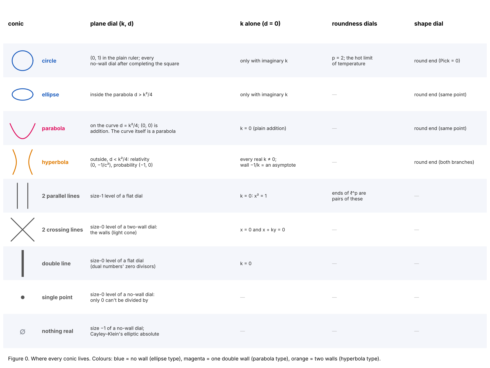
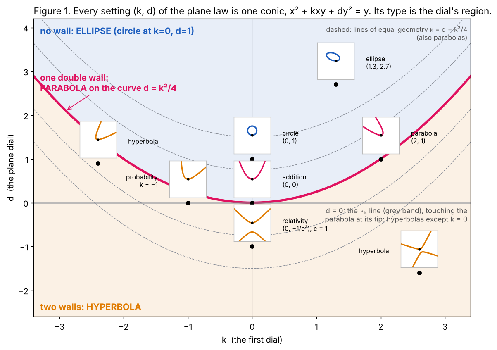
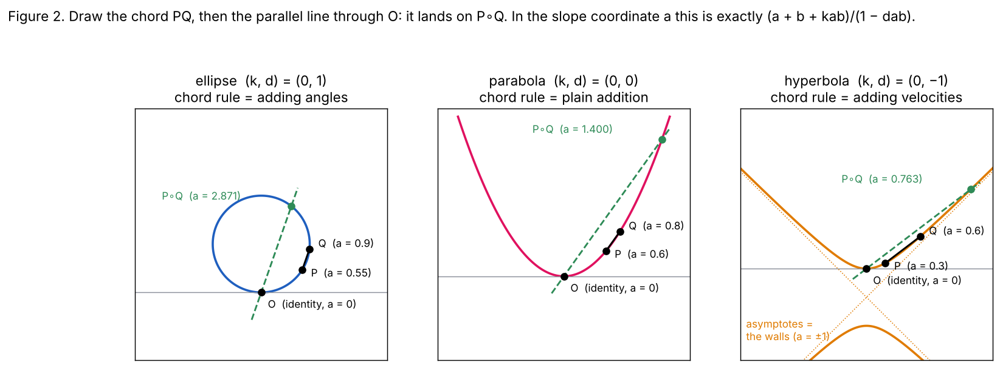
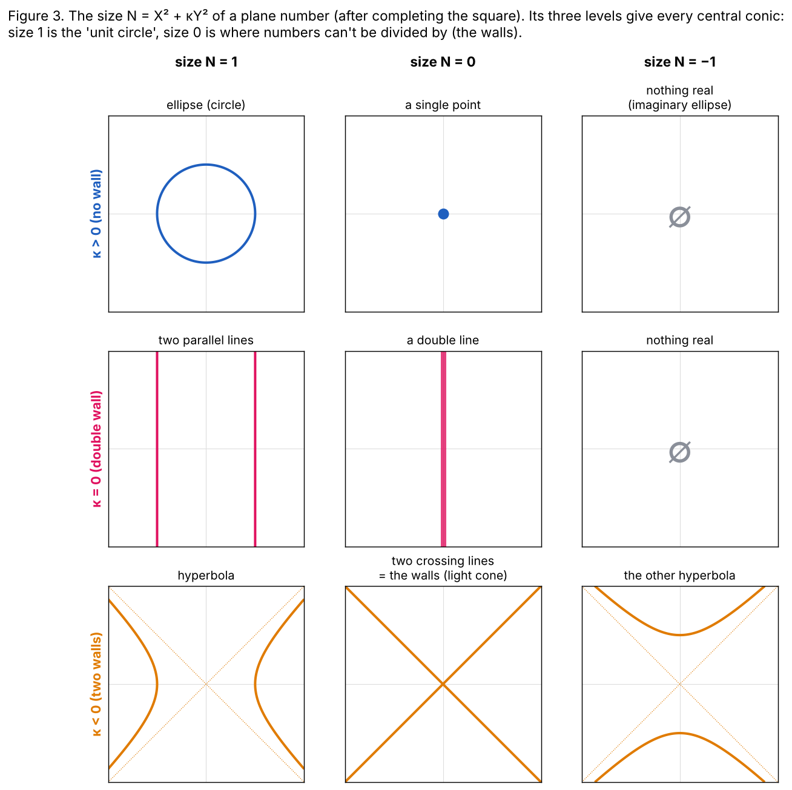
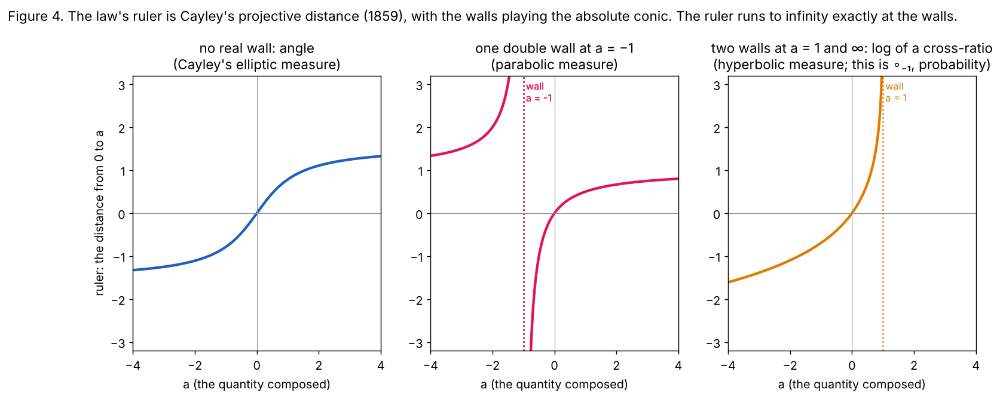
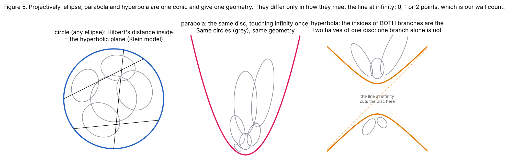
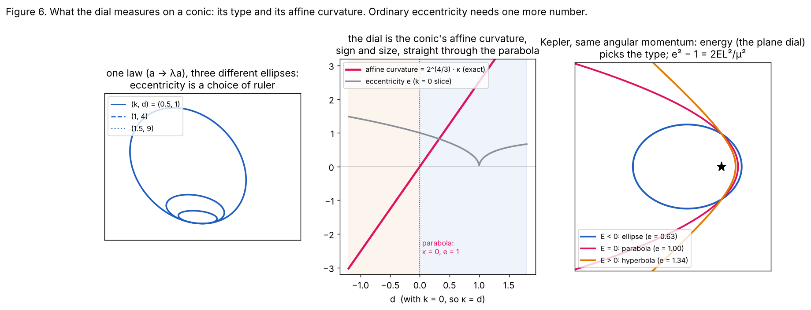
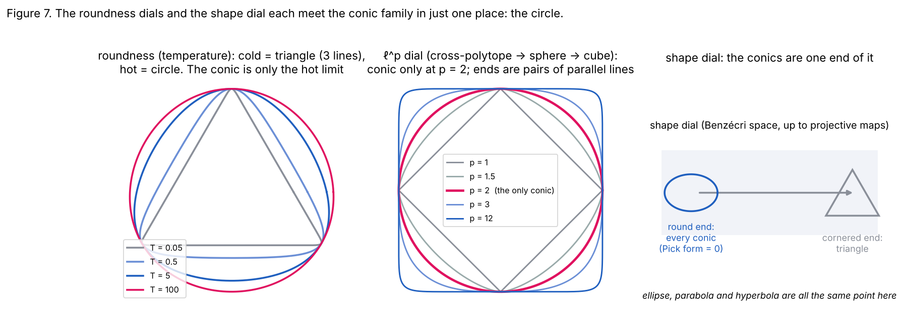

# DRAFT · Where every conic section lives in our framework

**DRAFT, Nov 26 2026.** Part of Hypercube Composition Theory (repo: fused-hyperoperation-algebra).
Asked for by Brennan: look at all of the conic sections, not just one, since "the conics may already be hiding in the
catalog as the dial itself."
Builds on `why-i/cayley-klein/` (κ = d − k²/4), `polar-recast/` (section 3, the conics as the plane dial's shape),
`simplex/` (section 7, the shape dial), `hypersphere/` (section 5) and `gravity-from-theory/` (section N.3, Kepler).
Checks: `checks.py` → `checks_output.txt`, **22 of 22 pass** (sympy for the exact identities, numpy for the rest).
Pictures: `figures.py` → `figures/`. No Lean in this pass (no Lean on this machine).

## The answer in two sentences

**Yes, the conics are the plane dial itself.** Each setting (k, d) of the plane law is one conic,
x² + kxy + dy² = y: ellipses fill the inside of the parabola d = k²/4, parabolas sit on it, hyperbolas fill the
outside, and the old "chord rule" on that conic is exactly our law, with the walls where the conic runs off to infinity.
The degenerate conics (point, double line, crossing lines) are where a number's size is 0, and the Cayley–Klein picture
matches literally for one line's measure but not as "one conic per geometry", because ellipse, parabola and hyperbola
are a single conic seen from different places.

*Figure 0. Where every conic lives, by dial.*

*Figure 1. The (k, d) plane. Each dot's little box shows its conic. The magenta curve d = k²/4 is where the parabolas
are, and it is itself a parabola. The dashed curves, lines of the same geometry κ = d − k²/4, are parabolas too.*

A note on signs before the details. In the repo the plane number obeys ε² = kε − d, so with k = 0 it squares to
**−d**. That is why **d > 0 is the round (elliptic) side** and d < 0 the hyperbolic side, the reverse of a convention
that writes i² = d. The picture on the call ("positive, zero, negative look like hyperbolic, parabolic, elliptic")
is right in the i² = d convention and flips in ours. Nothing else changes.

---

## 1. Every dial setting is one conic, and the chord rule on it is our law

*Figure 2. Pick two points P and Q on the conic, draw the chord through them, then draw the line through O parallel to
it. Where that line meets the conic again is P∘Q. Measured by the slope a of the line from O, this is exactly
(a + b + kab)/(1 − dab).*

Take the conic **x² + kxy + dy² = y**. It passes through the origin O, which plays the identity. The line y = a·x meets
it once more, at P(a) = (a, a²)/(1 + ka + da²), so the slope a labels every point (A1).

- **The chord rule is our law, exactly** (A2, sympy): the chord from P(a) to P(b) has slope
  (a + b + kab)/(1 − dab). So the line through O parallel to it lands on P(a ∘ b).
- **The conic is never degenerate** (A3): its 3×3 matrix has determinant −1/4 for every (k, d).
- **Its type is the dial's region** (A4): ellipse when k² − 4d < 0, parabola when k² − 4d = 0, hyperbola when
  k² − 4d > 0. The plane dial's discriminant k² − 4d is literally the conic discriminant B² − 4AC.
- **The walls are the conic's points at infinity** (A5): the roots of 1 + ka + da² are the directions in which the
  conic runs off. Two walls = a hyperbola's two ends. One double wall = the single end of a parabola. No wall = an
  ellipse, which never leaves.
- **The dial's centre (0, 0) is the parabola y = x², and its chord rule is plain addition** (A6).
- **The k line (d = 0) touches the parabola only at its tip.** So every ∘ₖ law with real k ≠ 0 is a hyperbola, and its
  famous wall −1/k is one of the two asymptotes (the other is a = ∞). Relativity (0, −1/c²) and probability
  (k = −1, wall at certainty a = 1) are hyperbolas; the circle needs d or an imaginary k.

**Known:** the group law on a conic by chords (classical; a modern account is Lemmermeyer, "Conics, a poor man's
elliptic curves", 2003), and the plane law with its discriminant (Coleman and McGuinness 1991). **Ours:** the one
conic per dial setting, x² + kxy + dy² = y, whose chord rule is our law with the walls at infinity. It is the kind of
fact that may be folklore, so treat it as a clean statement, not a discovery. **Verdict: a real bridge.** It answers
the question directly: the dial plane is a map of the conics.

## 2. The "unit circle" of each plane number, and where the degenerate conics come from

*Figure 3. Every plane number has a size N = x² + kxy + dy² that multiplies. After completing the square it reads
X² + κY². Its levels 1, 0 and −1 give every conic centred at the origin, the degenerate ones included.*

- **Size multiplies, and multiplying composes directions by our law** (B1, B2). So the plane law is the law of the
  "unit circle" N = 1, read by direction a = y/x.
- **Completing the square is the Cayley map** (B3). X = x + ky/2 turns N into X² + κY² with κ = d − k²/4, and the
  slope change it causes, a = T/(1 − (k/2)T), is exactly the Cayley map the Cayley–Klein page used. A two-line
  algebra fact, but it explains that page's formula: κ is what is left after completing the square.
- **Size 1:** ellipse (circle after rescaling) when κ > 0; **two parallel lines** X = ±1 when κ = 0; hyperbola when
  κ < 0. So the flat setting's "unit circle" is **not a parabola**. It is a pair of parallel lines, and multiplying by
  1 + tε slides along one of them (a Galilean shear) (B6). The parabola lives in section 1's conic instead, which is
  never centred.
- **Size 0** (the numbers you can't divide by): **a single point** when κ > 0, **a double line** when κ = 0 (the dual
  numbers' zero divisors), **two crossing lines** when κ < 0 (B4). Those crossing lines are the walls: the
  asymptotes of the unit hyperbola, the light cone of relativity (B5).
- **Size −1:** nothing real for κ ≥ 0 (an "imaginary ellipse"); the other hyperbola for κ < 0.

**Known:** Yaglom's three kinds of plane numbers and their zero divisors (Yaglom, *Complex Numbers in Geometry*, 1968).
**Ours:** the full 3 × 3 placement with the walls as the size-0 level. **Verdict: unifies; every degenerate conic has
a fixed home.**

## 3. Cayley–Klein: literal for one line, not for the whole geometry

*Figure 4. The law's ruler (its logarithm, the "hidden coordinate") is Cayley's projective distance with the two walls
as the absolute points. It runs to infinity exactly at the walls.*

**Literal match.** Cayley (1859) and Klein (1871) measure distance along a line by where the line meets a fixed
conic, the **absolute**: two real points give hyperbolic measure (log of a cross-ratio), one double point gives
parabolic measure, two imaginary points give elliptic measure (an angle). Our law's ruler ∫ da/(1 + ka + da²) is
exactly this with the walls as the absolute points (C1): (1/√disc)·log of the cross-ratio of (a, 0) with the walls;
log(1 + ka)/k for ∘ₖ; arctan with no real walls; a/(1 + ka/2) with a double wall. So **the dial is literally
Cayley's choice of measure on a line.** This sharpens the Cayley–Klein page's "the hidden coordinate is the arc
length".

*Figure 5. Hilbert's distance inside a circle is the hyperbolic plane (Klein's model). Inside a parabola it is the
same plane, with the same circles. A hyperbola gives it only with both branches together.*

**Not literal: "one conic per geometry".**

- The background on the call is right that **an ellipse as the absolute, with Hilbert's distance, gives the
  hyperbolic disc** (C2: matches the Klein-model formula on 30 random pairs).
- But **a parabola gives the same hyperbolic plane** (C3: the distances agree to 10⁻⁶ after a projective map). In
  projective geometry ellipse, parabola and hyperbola are one conic. They differ only in how they meet the line at
  infinity: 0, 1 or 2 points, which is our wall count.
- A hyperbola gives the hyperbolic plane only if you take the insides of **both** branches; one branch alone is half a
  disc and a different geometry (C4).
- What does change the plane geometry in Cayley–Klein is the **absolute itself**: a real conic (hyperbolic plane, and
  de Sitter outside it), an imaginary conic (elliptic), or a degenerate one for the flat geometries (Euclidean: the line
  at infinity with two imaginary points on it; Minkowski: with two real points; Galilean: with one double point).

So the plane dial picks **one** Cayley–Klein measure, the one on a line. The nine plane geometries need two such
choices (distance and angle), which the Cayley–Klein page already showed a single scalar law can't carry.

**Known:** Cayley 1859, Klein 1871, Beltrami 1868, Hilbert 1895; absolutes of the nine geometries (Yaglom 1979;
Struve and Struve 2004). **Ours:** walls = absolute points, ruler = Cayley's distance, stated for our law.
**Verdict: a precise version of the hunch, with one correction.**

## 4. Is the dial the eccentricity? No. It is the affine curvature.

*Figure 6. Left: three ellipses with the same law (rescaling a). Middle: along d with k = 0, the conic's affine
curvature is a straight line through the parabola; the eccentricity is not. Right: Kepler orbits with one angular
momentum; energy picks the type.*

- **Not the eccentricity.** Rescaling a → λa gives the same law with (λk, λ²d), but a differently shaped ellipse
  (D2: e = 0.63 versus 0.88). Only the sign of e² − 1 is fixed by the dial (D3, 300 random dials). Eccentricity needs
  one more number, a ruler. Kepler shows it plainly: **e² − 1 = 2EL²/μ²** (D4), where the energy E is the plane dial
  (gravity page) and the angular momentum L is the extra number.
- **The affine curvature.** In equi-affine geometry (lengths replaced by areas), conics are exactly the curves of
  constant curvature: positive for ellipses, zero for parabolas, negative for hyperbolas. For our conic it comes out as
  **2^(4/3) · κ, with κ = d − k²/4, sign and size, smoothly through the parabola** (D1, eight dials, two points each).
  So the dial is a curvature after all, just not the ordinary one.

**Known:** constant affine curvature of conics and its sign (Blaschke 1923; Nomizu and Sasaki, *Affine Differential
Geometry*, 1994); Kepler, Hamilton's hodograph, Milnor 1983. **Ours:** that this curvature is exactly our κ.
**Verdict: a lead worth following** (section 6).

## 5. The other dials touch the conics once

*Figure 7. Temperature turns a triangle into a circle only in the hot limit. The ℓᵖ dial passes through one conic, at
p = 2. On the shape dial, every conic is the same round end.*

- **k alone** (d = 0): hyperbolas for every real k ≠ 0, the parabola at k = 0; ellipses only with imaginary k, the
  Cayley–Klein flip the why-i pages found.
- **Roundness by temperature** (Maslov): the free-energy level set is a circle only in the hot limit; its
  out-of-roundness falls like T^(−1/2) (E1). Cold, it is the triangle, three straight lines.
- **Roundness by p** (cross-polytope → sphere → cube): a conic only at p = 2 (E2). Its two ends are each made of two
  pairs of parallel lines: the flat setting's unit circle, twice.
- **Shape dial** (Benzécri's space): ellipse, parabola and hyperbola are all one point, the round end where the Pick
  cubic form vanishes (Pick–Berwald). The other end is the triangle.

**Known:** all of it. **Ours:** the placement. **Verdict: unifies; no new lead from these three.**

## 6. Does this open a lead?

**Yes, one, and it is worth following on its own merits.** Section 4 puts the plane dial in **affine differential
geometry** as the curvature of a curve. That same theory has exactly one more basic quantity for surfaces: the **Pick
cubic form**, which is the shape dial (simplex page, section 7). The objects that carry both are the **affine
spheres** (Calabi 1972; Cheng and Yau 1977, 1986; Loftin 2001): their constant mean curvature is elliptic, parabolic
or hyperbolic, the quadrics are the ones with Pick form zero, and the hyperbolic ones sit over exactly the convex
shapes of Benzécri's space. So the conjecture is: **the plane dial and the shape dial are the two invariants of one
known object, an affine sphere.** Checked here only for curves, where there is no Pick form. The next step is to check
surfaces: that the quadric affine spheres have mean curvature proportional to κ, and that moving the Pick form away from
zero reproduces the shape dial's turn field.

The rest of this pass is bridges, not leads: the chord conic, the 3 × 3 placement, and the Cayley ruler are clean
statements of known mathematics in our dial language.

## Checks

| Check | What | Result |
|---|---|---|
| A1–A6 | chord conic: on the conic, chord rule = law (sympy exact), never degenerate, type = discriminant, walls at infinity, origin = addition | pass |
| B1–B6 | unit conic: size multiplies, directions compose by the law, completing the square = Cayley map, levels 0 and 1, flat case is parallel lines | pass |
| C1–C4 | ruler = Cayley distance in all three cases; Hilbert inside circle = Klein; parabola = same plane; one hyperbola branch ≠ | pass |
| D1–D4 | affine curvature = 2^(4/3)κ; eccentricity not invariant; sign(e² − 1) = sign(k² − 4d); Kepler e² − 1 = 2EL²/μ² | pass |
| E1–E2 | temperature gives a circle only hot; ℓᵖ is a conic only at p = 2 | pass |

## Assumptions

- Real conics and real dials, except where imaginary k is named.
- "Circle" depends on a ruler: in the plain (x, y) ruler the chord conic is a circle only at (0, 1); after completing
  the square and rescaling, every no-wall setting is a circle.
- The affine-curvature formula uses the equi-affine (area-preserving) normalization; under a → λa it scales like κ,
  so only its sign is a true invariant, as for κ.

## Sources

- A. Coleman and S. McGuinness, "Rational formal group laws", Pacific J. Math. 147 (1991).
- F. Lemmermeyer, "Conics: a poor man's elliptic curves", arXiv:math/0311306 (2003).
- I. M. Yaglom, *Complex Numbers in Geometry* (1968); *A Simple Non-Euclidean Geometry and Its Physical Basis* (1979).
- A. Cayley, "A sixth memoir upon quantics", Phil. Trans. R. Soc. 149 (1859); F. Klein, "Über die sogenannte
  Nicht-Euklidische Geometrie", Math. Ann. 4 (1871); E. Beltrami (1868); D. Hilbert (1895).
- H. Struve and R. Struve, "Projective spaces with Cayley–Klein metrics", J. Geom. 81 (2004).
- W. Blaschke, *Vorlesungen über Differentialgeometrie II: Affine Differentialgeometrie* (1923); K. Nomizu and
  T. Sasaki, *Affine Differential Geometry* (1994).
- E. Calabi (1972); S.-Y. Cheng and S.-T. Yau (1977, 1986); J. Loftin, "Affine spheres and convex RPⁿ-manifolds",
  Amer. J. Math. 123 (2001); J.-P. Benzécri (1960).
- J. Milnor, "On the geometry of the Kepler problem", Amer. Math. Monthly 90 (1983).
- G. L. Litvinov, "Maslov dequantization, idempotent and tropical mathematics" (2005).
