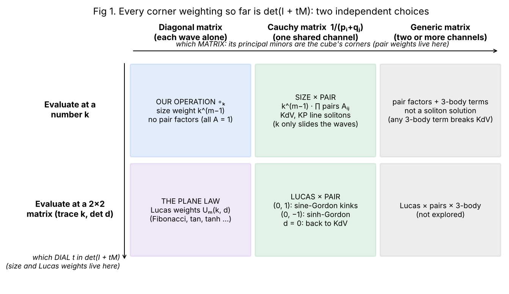
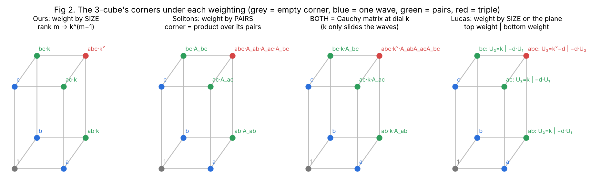
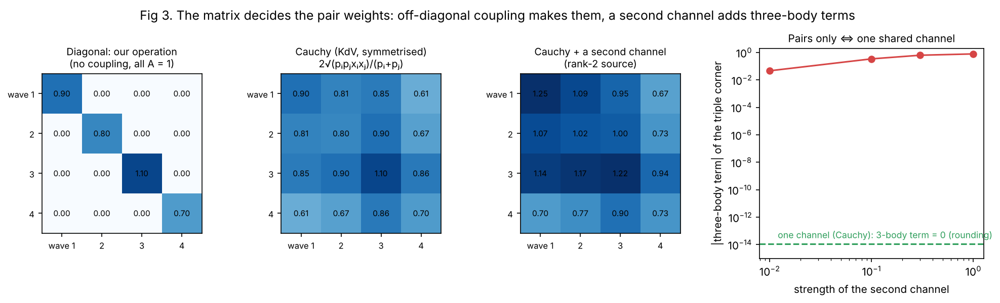
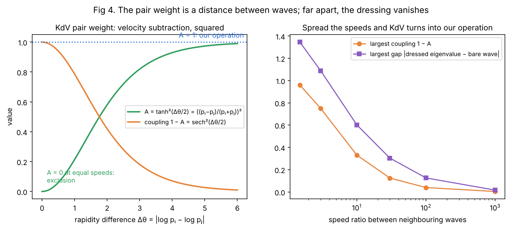
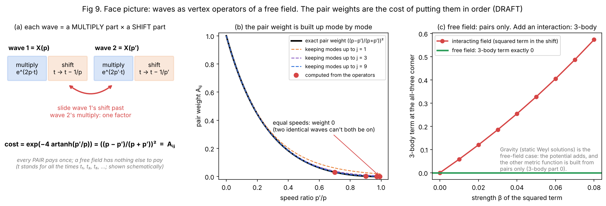
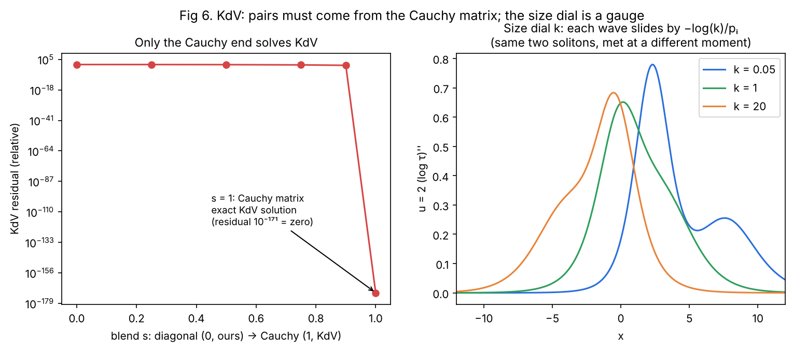
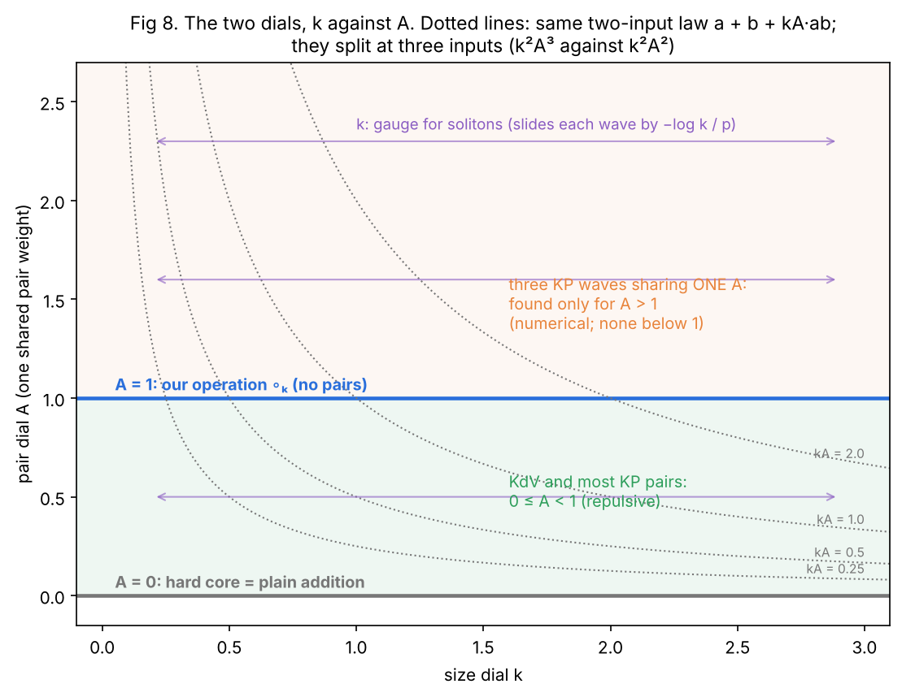
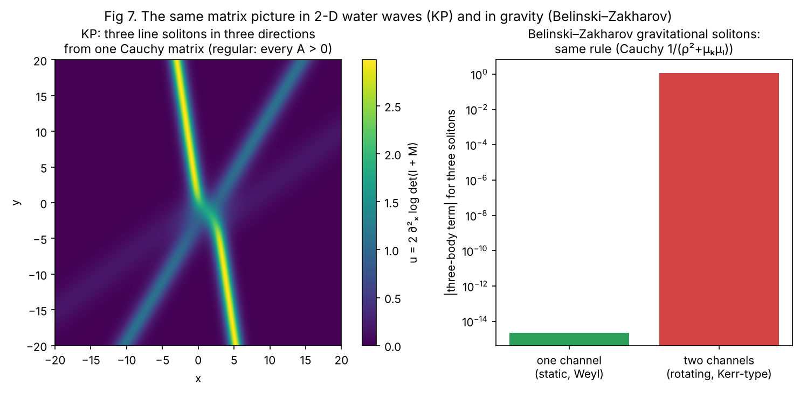
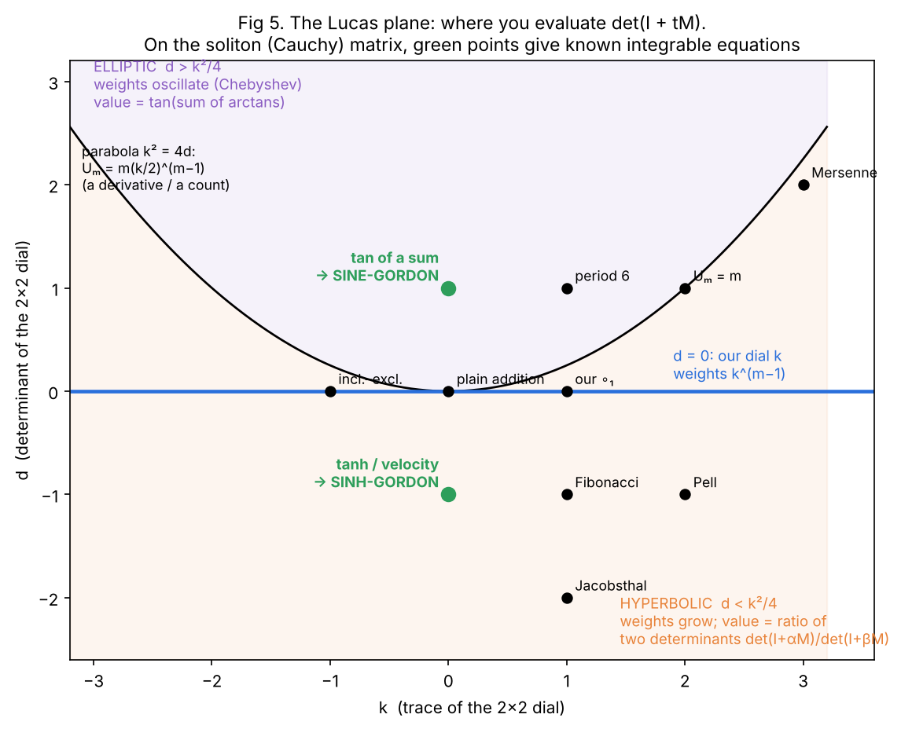

# Corner weights: size, pairs, and where the pairs come from

> **Names:** some words or symbols on this page (rung) also mean something else in standard math, physics or computing, or inside this project. [NAMING-COLLISIONS.md](../../NAMING-COLLISIONS.md) says which meaning is in play.

*Nov 25, 2026. 54 of 54 checks pass (`checks.py`). Parts marked **DRAFT** are not finished. Pushed Nov 25. The Lean file (`lean/CornerWeights.lean`, 12 theorems) compiles and is in the shared library as `FusedAlgebra.Topics.CornerWeights`.*

## Verdict

**This is a lead, and it is worth following as the frame that organizes the work.** It does not give new physics yet.

You were right that the pair weights come from something more basic. There are two ways to see it, and they turn out to be the same thing:

- **Matrix picture.** Every corner of the cube is a principal minor of one matrix M. The corner sum is det(I + tM). When M is a Cauchy matrix 1/(pᵢ + qⱼ), which means all the waves share one channel, each corner comes out as exactly a product over its pairs. That is Hirota's weighting.
- **Face picture.** Each wave is a vertex operator of a free field: a *multiply* part times a *shift* part. Putting them in order costs one factor per pair, and that factor is ((pᵢ − pⱼ)/(pᵢ + pⱼ))². A free field has nothing else to pay, so you get pairs only.

Cauchy's determinant is the dictionary between the two pictures (bosons = fermions). Your size weight is a separate choice: the number you put in for t. For solitons it is a gauge, meaning it only slides the waves. Putting a 2×2 matrix in for t instead gives the Lucas weights. On the soliton matrix, the dial points (0, 1) and (0, −1) give sine-Gordon and sinh-Gordon.

Almost all the ingredients are known (the table is below). What is ours is how they are put together, plus a few findings. Four questions are still open; see Leads.

---

## 1. One matrix, two choices

Take any n×n matrix M. For each set S of waves (each corner of the n-cube), the principal minor det M_S is that corner's weight. Then:

  Σ over corners of t^|S| · det M_S = det(I + tM)  (check A1)

Every weighting we have met is this one formula with two choices:

| choice | options | what it does |
|---|---|---|
| **which matrix** | diagonal / Cauchy / generic | decides whether there are pair factors and 3-body terms |
| **which dial t** | a number k / a 2×2 matrix N (trace k, det d) | decides the size weight or the Lucas weight |

- **Diagonal M** gives your operation: the corners are ∏xᵢ, and every pair factor is 1 (A2). With the size dial, the sum is your ∘ₖ folded over the eigenvalues (A1b, already on the [linear-algebra page](../linear-algebra/)).
- **Cauchy M**, with Mᵢⱼ = 2pᵢxᵢ/(pᵢ + pⱼ), gives every corner = ∏xᵢ · ∏ over pairs Aᵢⱼ with Aᵢⱼ = ((pᵢ − pⱼ)/(pᵢ + pⱼ))². That is Hirota's KdV weight (A3).
- **Size × pair**, the weighting you first asked for, w(S) = k^(|S|−1) ∏Aᵢⱼ, is exactly (det(I + kM) − 1)/k. That is your operation run on the eigenvalues of the Cauchy matrix (A3b).

### Why "one shared channel" means pairs only

- **The pair factor in any matrix.** For any matrix, the pair factor is Aᵢⱼ = 1 − mᵢⱼmⱼᵢ/(mᵢᵢmⱼⱼ) (A4).
- **One source, no 3-body terms.** A Cauchy-like matrix solves the Sylvester equation PM + MQ = r sᵀ, where the right-hand side has rank one: one source feeds every wave. For any r and s, the corners are then pure pair products (A5a, A5b).
- **A second channel adds them.** Add a second, rank-2 source and a 3-body term appears. It grows with the second source's strength (A5c).
- **Each wave on its own channel.** If every wave has its own channel (a diagonal source), you are back to your operation (A5d).
- **Exclusion.** Two waves at the same speed give a pair factor of 0, and the matrix loses rank (A6).

The pair weight also has a clean reading. √Aᵢⱼ = (pᵢ − pⱼ)/(pᵢ + pⱼ) is relativistic velocity subtraction of u = (p − 1)/(p + 1) = tanh(θ/2), so Aᵢⱼ = tanh²(Δθ/2) (A7a). In KP, Aᵢⱼ is 1 minus a cross-ratio of four points (A7b).

---

## 2. The face picture: where the pair weights come from (**DRAFT**)

This follows up the face-weights lead from the [cube-weights page](../cube-weights/). That page found that inputs which q-commute on square faces, X_jX_i = q_ij X_iX_j, give the soliton corners when the q's are chosen right. Here is where those q's come from.

**Each wave is a vertex operator** of a free field with times t₁, t₃, t₅, …:

  X(p) = exp(Σ_odd 2pʲ tⱼ) · exp(−Σ_odd (2/(j pʲ)) ∂ⱼ)

- The first factor *multiplies*. The second *shifts* every time tⱼ by −2/(j pʲ).
- When you build the product (1 + a₁X(p₁))(1 + a₂X(p₂))(1 + a₃X(p₃))·1, every shift has to pass every later multiply. Each passing costs

  exp(−Σ_odd 4(p′/p)ʲ/j) = exp(−4 artanh(p′/p)) = ((p − p′)/(p + p′))²

**What this means for each of the coordinator's questions:**

1. **The commutation factors are Hirota's A.** Every corner of the product is ∏aᵢ · ∏ over pairs Aᵢⱼ. Checked numerically with the modes cut off at J: the error falls from 2·10⁻² at J = 5 to machine precision at J = 81 (I1).
   - The cost is an artanh. That is the flat coordinate of the (0, −1) velocity law from the Lucas plane (I1b), so the same law appears inside the pair weight.
   - Two waves closing in on the same speed cost more and more, reaching 0 at equal speeds (I1c). That is the exclusion from A6 again: X(p)X(p) = 0. So the "simpler thing" underneath is a free field (free bosons, equivalently free fermions).
2. **The face picture and the matrix picture are the same thing.**
   - With four waves, all 16 vertex-operator corners equal the principal minors of the Cauchy matrix one by one (I2b).
   - In general, the product of one reordering factor per pair (bosons) equals the determinant of a single matrix 1/(zᵢ − wⱼ) (fermions). That is Cauchy's determinant (G1). With z = p and w = −q, the factor is KP's (G2).
3. **KdV and KP at three or more waves.**
   - KdV holds at 3 and 4 waves (I1, I2b, and the τ checks B1, C1c).
   - The KP vertex operator X(p, q) gives the KP pair factors for three line solitons heading in different directions (I2, error 10⁻¹⁵).
4. **Gravity.**
   - The static (Weyl) gravitational solitons are this free-field case. The potential ψ simply adds, and the other metric function γ is built from pairs only: its 3-body part is 0 to 10⁻¹⁰ (I4).
   - Rotating solitons need two channels and carry a genuine 3-body term (D3, section 4).
5. **Adding an interaction breaks it.** Put a squared term into the shift and a 3-body term appears, growing steadily with its strength (I3).
   - So a free field gives pairs only, and this interaction spoils that.
   - **Not shown:** the converse, that *every* pairs-only weighting comes from a free field. Section 7 shows why this is subtle.

How this answers the [cube-weights page](../cube-weights/)'s three catches:

- **Readout.** The weight is the cost of normal-ordering, not a phase between the X's.
- **Finite matrices.** You don't need infinite operators. A real 4×4 Cauchy matrix gives real pair factors strictly between 0 and 1 (G3).
- **Why reversed order.** The shifts have to pass the multiplies that come after them.

---

## 3. Your size dial k, in soliton land

- **k is a gauge.** Multiplying the corner weights by k^|S| is the same as multiplying each wave by k. That shifts each wave's phase, sliding it by −log(k)/pᵢ.
  - Every k still solves KdV: the same two solitons, met at a different moment (B1, B1b).
  - k < 0 gives singular solitons.
- **Other size weights fail.** A size weight that is not a power of k breaks KdV (B2).
- **Your operation alone is not a soliton.** A diagonal matrix gives separate waves that never collide (B3).
- **Blending fails too.** A straight-line blend from the diagonal matrix to the Cauchy matrix solves KdV only at the Cauchy end (B4).
- **The integrable route to your operation is to spread the speeds.** As the speeds pull apart, the couplings go to 0, every A goes to 1, and the eigenvalues go to the bare waves (B5).

**k against A.** For two waves, only the product kA matters (fig 8). From three waves on they come apart:

- With all pair factors equal to A, the size × pair rule is not an iterated two-input law. The excess at the triple corner is k²A²(A − 1)abc (F1).
- A = 0 (hard core) gives plain addition, and A = 1 gives your operation. So the pair dial runs between the same two ends as k (F2).
- In statistical-mechanics terms, A = 1 + f is a Mayer bond, and log τ minus the one-body logs is the sum of connected clusters (F3).

---

## 4. KP and gravity

- **KP line solitons** heading in different directions: τ = det(I + Cauchy matrix) solves KP exactly for three of them (C1c).
  - **Numerical finding:** three line solitons can share a single pair factor A only when A > 1. Damped Newton found none for A < 1 or A < 0 in 1500 starts each, and on a line (KdV) it never happens (C2). This is a numerical scan, not a proof.
- **Belinski–Zakharov gravitational solitons:**
  - With one channel (static, Weyl-type), the pole matrix Γₖₗ ∝ 1/(ρ² + μₖμₗ) is Cauchy, so every minor is a pair product (D1). The metric component g_tt itself is a product of one-body factors, which is the size-only, no-pairs case (D2).
  - With two channels (rotating, Kerr-type), three solitons carry a 3-body term of about −1.18 (D3). Two solitons, such as Kerr, still sit inside the pair picture (D3b).

---

## 5. Lucas weights: the dial as a 2×2 matrix (merged from `lucas-weights/HANDOFF.md`)

The Lucas thread found that the Lucas weights U_m(k, d) are **known**, and the corner formula is a folklore-level corollary (the handoff credits Yamagishi 2019, Coleman–McGuinness 1991, Greene, and Yaglom). This page answers its open question 1: **yes, the Lucas weights come from one matrix.**

- **Put the 2×2 companion N = [[k, 1], [−d, 0]] in for t.** Cayley–Hamilton gives Nᵐ = U_m N − d U_{m−1} I. So det(I + tM) evaluated at t = N has U_m on top and −d U_{m−1} below (E1, E2), which is the plane law (x + y + kxy)/(1 − dxy) folded over the eigenvalues.
- **The same value as a ratio of two ordinary determinants:** (det(I + αM) − det(I + βM)) / (α det(I + βM) − β det(I + αM)), with α + β = k and αβ = d (E3).
- **Or as your operation on a resolvent:** use dial α − β on M(I + βM)⁻¹, then map back with y → y/(1 − βy) (E4).
- **Run on the soliton Cauchy matrix:**
  - (0, 1): φ = 4 arctan(Lucas-weighted corners) solves sine-Gordon φ_xt = sin φ for three kinks, and φ/4 = Σ arctan(eigenvalue) (E5, E5b).
  - (0, −1): φ = 4 artanh(…) solves sinh-Gordon (E6).
  - On the parabola (2, 1), where U_m = m, the total is tr M(I + M)⁻¹ (E7).

---

## 6. Known vs ours

| piece | status |
|---|---|
| Corner sum = det(I + tM); principal minors; Cauchy determinant | known (classical) |
| Hirota τ for KdV/KP as det(I + Cauchy matrix); A as a cross-ratio | known (Hirota; Sato school; Cauchy matrix approach) |
| Vertex operators, normal-ordering cost, boson = fermion | known (Date–Jimbo–Kashiwara–Miwa) |
| KP line solitons in many directions | known (Kodama and coauthors) |
| Belinski–Zakharov poles, Weyl γ from pairs | known (Belinski–Zakharov; Weyl) |
| Lucas / Cayley–Hamilton corner weights | known, folklore level (see the Lucas handoff) |
| k as a dial on det(I + kA); α-determinantal processes | known (Vere-Jones; Shirai–Takahashi); already on our [dial-point-processes](../dial-point-processes/) and [linear-algebra](../linear-algebra/) pages |
| Hard core / Mayer reading | known (lattice gas) |
| Earlier project pages: weighted cube, KdV corners multiply over pairs, 3-body breaks KdV, q-commuting faces | ours, earlier ([solitons-rungs](../solitons-rungs/), [boolean-lattice](../boolean-lattice/), [cube-weights](../cube-weights/)) |
| The two-choice frame (which matrix × which dial); "one shared channel = pairs only" stated as the reason | **ours (framing)** |
| k is a gauge for solitons, stated and checked; speed-spreading as the route to your operation | ours (easy, probably known in pieces) |
| Lucas dial on the soliton Cauchy matrix giving sine-Gordon at (0, 1) and sinh-Gordon at (0, −1) | ours as a connection; sine-Gordon via arctan is classical |
| artanh in the KdV pair cost = the (0, −1) flat coordinate | ours (an observation) |
| KP: equal pair factor needs A > 1 | **ours, numerical**, not checked against the literature |
| "No 3-body in any triple" does not force "no 4-body" | **ours, numerical** |

I have not done a full literature search on the last three rows. They could already be known.

## 7. Leads (open questions)

1. **Which matrices have pair-only minors?** With a symmetric 4×4 matrix with unit diagonal and no 3-body term in any triple, there are 359 numerical solutions: 207 with no 4-body term and 152 *with* one (H1). Pairs-only is therefore a global property. Does pairs-only force the Cauchy form, meaning a free field? This connects to the principal minor assignment problem (Holtz–Sturmfels). **Open.**
2. **The KP obstruction.** Why does an equal pair factor need A > 1? It might be a statement about Kodama's resonant solitons. **Open.**
3. **A 3×3 dial.** Putting a 3×3 matrix in for t would give a three-term recurrence. Does any of it carry over to solitons? **Not started.**
4. **Beyond principal minors.** Kodama's resonant KP solitons use the full Grassmannian, not just principal minors. Is that the next layer of the cube? **Not started.**

## 8. Lean status

`lean/CornerWeights.lean` has 12 theorems in the style of `boolean-lattice/lean/BooleanLattice.lean` (core Lean 4.37 + `grind`): the 3×3 corner sum, the cleared Cauchy 2×2 and 3×3 determinants, the KP cross-ratio, the KdV velocity law, the blend's 3-body term, the two Lucas determinant identities, the resolvent map, the companion cube, size × pair not iterated, and hard core = addition.

- **Compiled Nov 25** with core Lean 4.37.0-rc1: all 12 theorems check, no `sorry`, standard axioms only.
- Every identity is confirmed by `lean/identities_sympy_check.py` (16 of 16 hold).
- It is in the shared library as `FusedAlgebra.Topics.CornerWeights`, which CI builds on every push.

## Files

- `checks.py` → `checks_output.txt`, `results.json` (54 checks; needs numpy and sympy)
- `figures.py` → `fig1`–`fig9` (reads `results.json`; needs matplotlib)
- `lean/CornerWeights.lean`, `lean/identities_sympy_check.py`

## Sources (cited from memory; I did not reopen them this session)

- R. Hirota, "Exact solution of the Korteweg–de Vries equation for multiple collisions of solitons", Phys. Rev. Lett. 27 (1971) 1192.
- E. Date, M. Jimbo, M. Kashiwara, T. Miwa, "Transformation groups for soliton equations" (1983); T. Miwa, M. Jimbo, E. Date, *Solitons* (CUP, 2000).
- F. Nijhoff, J. Atkinson, J. Hietarinta, "Soliton solutions for ABS lattice equations I: Cauchy matrix approach", J. Phys. A 42 (2009).
- Y. Kodama, *KP Solitons and the Grassmannians* (Springer, 2017); Kodama and Williams, "KP solitons and total positivity for the Grassmannian", Invent. Math. (2014).
- V. Belinski, E. Verdaguer, *Gravitational Solitons* (CUP, 2001); Belinski and Zakharov, Sov. Phys. JETP 48 (1978).
- D. Vere-Jones, "Alpha-permanents and their applications…", N.Z. J. Math. 26 (1997); T. Shirai, Y. Takahashi, J. Funct. Anal. 205 (2003).
- O. Holtz, B. Sturmfels, "Hyperdeterminantal relations among symmetric principal minors", J. Algebra 316 (2007).
- Lucas sources as listed in `../lucas-weights/HANDOFF.md`.
