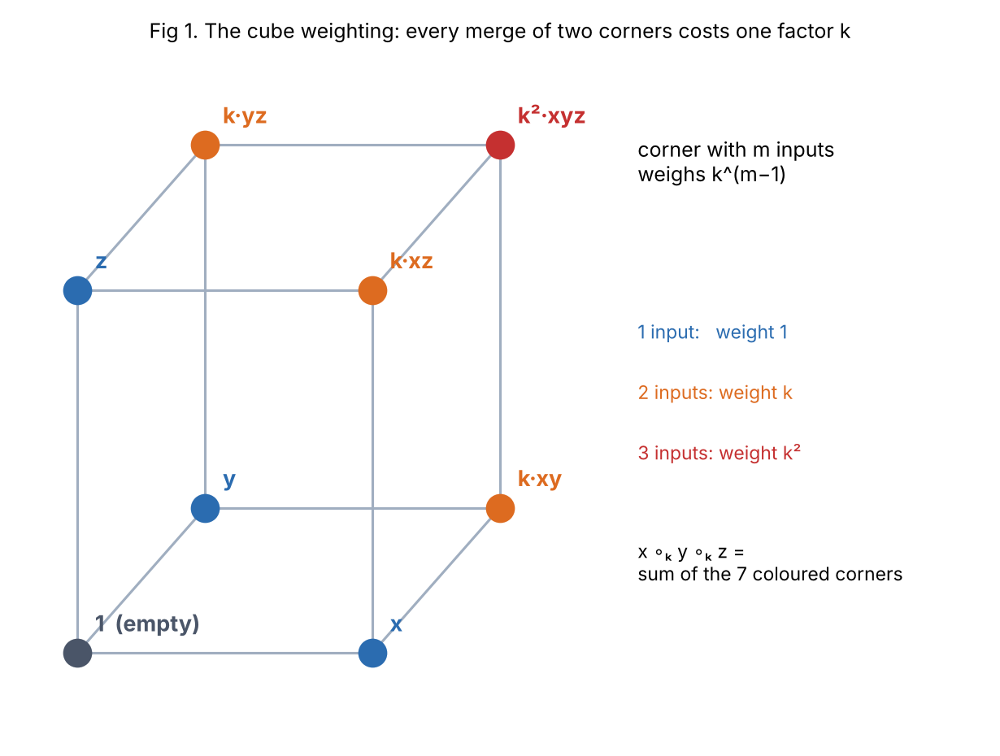
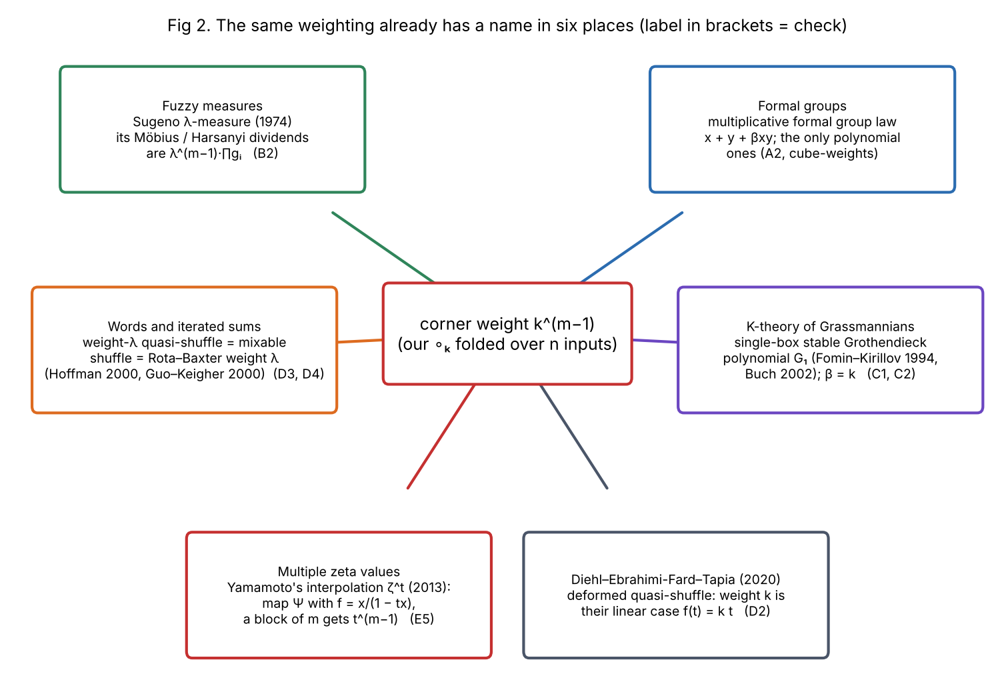
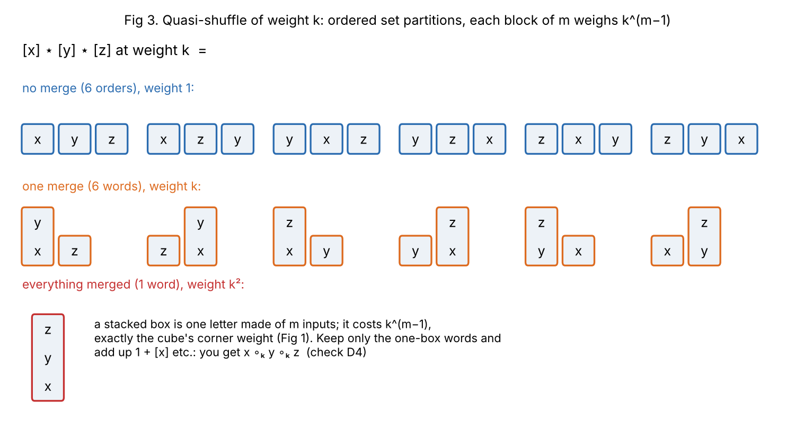
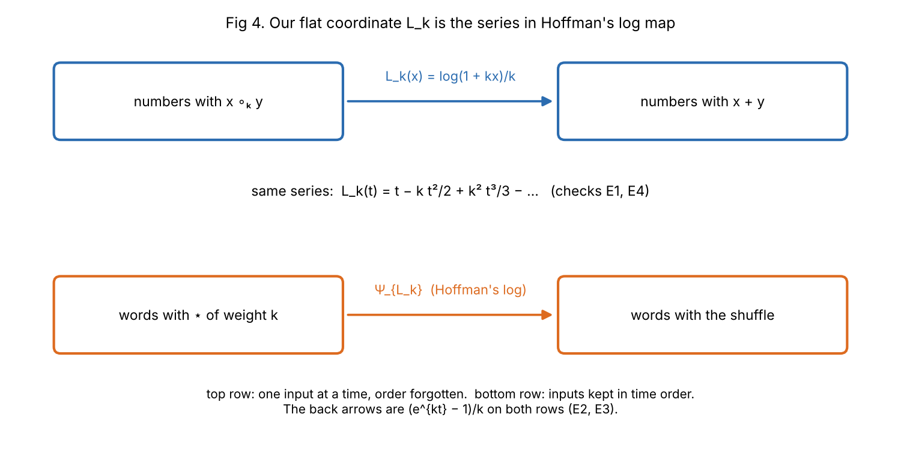

# DRAFT: What is the k^(m−1) cube weighting already called? (Nov 27, 2026)

**Result in two sentences.** The k^(m−1) corner weighting is not ours: it already has a name in at least six fields,
including Sugeno's λ-measures, the multiplicative formal group law, the single-box Grothendieck polynomial of K-theory,
and the weight-λ quasi-shuffle (mixable shuffle, Rota–Baxter weight λ). The one useful find is a bridge. Our flat
coordinate L_k = log(1 + kx)/k is exactly the series in Hoffman's log map, so the time-ordered version of ∘ₖ is the
weight-k quasi-shuffle algebra, and our dial k is Yamamoto's t, which slides multiple zeta values (k = 0) to
multiple zeta-star values (k = 1).

Asked by Brennan ("Yes", Nov 27, to the naming check S2 from `closed-leads-revisit/`). The lead came from
`boolean-lattice/`, which left "the k^(m−1) weighting may be one of Diehl, Ebrahimi-Fard and Tapia's deformed
quasi-shuffles" unchecked.

All numbers are from `checks.py`: **17/17 pass** in exact fractions, including a negative control that the
identities can fail.

---

## 1. The weighting

*Fig 1. Folding x ∘ₖ y ∘ₖ z adds up the cube's corners. A corner holding m inputs gets weight k^(m−1): every time two
corners merge, one factor k is paid.*

Folding n inputs with x ∘ₖ y = x + y + kxy gives Σ over nonempty corners S of k^(|S|−1)·∏ x_S, which is
(∏(1 + kxᵢ) − 1)/k (A1, A1b, n = 1 to 6). If the weight depends only on how many inputs a corner holds and comes
from one two-input law, it must be k^(m−1) (A2, a re-check of `cube-weights/` A2).

## 2. Six places it already has a name

*Fig 2. Each box is a field where this exact weighting is standard. The label in brackets is the check that confirms
it here.*

| Field | Name there | What matches | Check | Source |
|---|---|---|---|---|
| Fuzzy measures | Sugeno λ-measure | its Möbius transform (Harsanyi dividends) is λ^(m−1)·∏gᵢ | B1, B2 | Sugeno 1974 (already on `measure-probability/`) |
| Formal groups | multiplicative formal group law x + y + βxy | the only polynomial formal group laws | A2 | already on `cube-weights/` |
| K-theory of Grassmannians | single-box stable Grothendieck polynomial G₁ | G₁ = 1 − ∏(1 − xᵢ) is our union rule; any k by rescaling, β = k | C1, C2 | Fomin–Kirillov 1994; Buch 2002, Thm 3.1 |
| Words, iterated sums | weight-λ quasi-shuffle = mixable shuffle = Rota–Baxter weight λ | a block of m merged letters costs λ^(m−1) | D1, D3, D4 | Hoffman 2000; Guo–Keigher 2000; Ebrahimi-Fard–Guo 2006 |
| Multiple zeta values | Yamamoto's interpolation ζ^t | the map Ψ_f with f = x/(1 − tx) gives a block of m the weight t^(m−1) | E5 | Yamamoto 2013; Hoffman 2018 survey |
| Signatures of time series | Diehl–Ebrahimi-Fard–Tapia deformed quasi-shuffle | weight k is their simplest case, the linear f(t) = kt | D2 | Diehl, Ebrahimi-Fard and Tapia 2020 (J. Algebra 2023) |

The single-box Grothendieck row is new to the project. A set-valued tableau of one box is just a nonempty set S of
inputs, signed (−1)^(|S|−1) (Buch's Theorem 3.1), so the union rule k = −1 is literally G₁. The other k come from
fold_k(x) = −G₁(−kx)/k (C2).

**The boolean-lattice question, answered.** Yes, weight k is one of Diehl, Ebrahimi-Fard and Tapia's deformations,
but only the plain one. Their family is Ψ_f⁻¹(Ψ_f u ⋆ Ψ_f v) for a power series f. Weight k is f(t) = kt, a rescaling
of Hoffman's weight-1 product (D2). Their nonlinear f are not our weighting.

## 3. The quasi-shuffle picture

*Fig 3. The weight-k quasi-shuffle of three one-letter words. Every term is an ordered set partition. A stacked box
is one letter built from m inputs and weighs k^(m−1), the cube's corner weight.*

In the weight-k quasi-shuffle, (a u) ⋆ (b v) = a(u ⋆ bv) + b(au ⋆ v) + k[ab](u ⋆ v). The product is associative and
commutative (D1). Multiplying one-letter words [x₁] ⋆ … ⋆ [xₙ] gives every ordered set partition, with each block of m
inputs weighted k^(m−1) (D3, n = 1 to 5). Keep only the one-letter words of ∏(1 + [xᵢ]) and you get exactly the fold
x₁ ∘ₖ … ∘ₖ xₙ (D4). So the cube weighting is the order-forgetting shadow of the quasi-shuffle.

## 4. The bridge: L_k is Hoffman's log

*Fig 4. One series does the same job on two rows. On numbers, L_k turns ∘ₖ into +. On words, Hoffman's map Ψ built
from the same series turns the weight-k quasi-shuffle into the shuffle.*

Hoffman (2000) showed that the quasi-shuffle is no more general than the shuffle over the rationals: an exp map
carries one to the other. Hoffman and Ihara (2017) wrote exp = Ψ_{e^t − 1} and log = Ψ_{log(1+t)}, with
Ψ_f Ψ_g = Ψ_{f∘g} (their Theorem 3.1). Checked here for every k:

- Ψ_{L_k}, with L_k(t) = log(1 + kt)/k = t − kt²/2 + k²t³/3 − …, turns ⋆ of weight k into the shuffle (E1).
- Ψ_{(e^{kt} − 1)/k} goes back (E2), and the two are inverse (E3).
- L_k is our flat coordinate, the one with L_k(x ∘ₖ y) = L_k x + L_k y (E4).

**Known vs ours.** The weighting, all six names, Hoffman's exp and log and Yamamoto's interpolation are known.
Reading them as one object is ours, as is seeing that our flat coordinate L_k is the series in Hoffman's log. I did not
search for it written down for this law, and it is a one-line consequence of Hoffman–Ihara's Theorem 3.1, so it
should not be claimed as new mathematics.

## 5. What it contributes, and what would make it a lead

- **Record fixed.** `boolean-lattice/` can now say "named" instead of "unchecked", and k^(m−1) should never be
  called ours. The Grothendieck name is new to the project.
- **A door.** The time-ordered version of ∘ₖ is a quasi-shuffle algebra. That brings Hoffman's exp and log, Rota–Baxter
  algebra (Spitzer's identity, Atkinson factorization) and the multiple zeta value toolkit. Our dial k is Yamamoto's t.
- **What would make it a lead.** The plane dial has a second number d. Hoffman and Ihara's q-deformation changes the
  letter product to z_i ◇ z_j = z_{i+j} + (1 − q)·z_{i+j−1} (their §6.4). Yamamoto's map uses f = x/(1 − kx), which is
  a Möbius-shaped series like our plane law. If one of these turns out to be our d, the whole plane dial would live
  in the quasi-shuffle world, and the multiple zeta value relations could be read as statements about the dial. That is
  unchecked and is the concrete next test. The Riemann stream may care, since multiple zeta values are its neighbours.

## Files

- `checks.py` → `checks_output.txt`, `checks.json` (17/17). Sections: A weighting, B Sugeno, C Grothendieck,
  D quasi-shuffle, E exp/log and Yamamoto, F negative controls.
- `figures.py` → fig1 to fig4.

## Sources

- M. Sugeno, Theory of fuzzy integrals and its applications, PhD thesis, Tokyo Institute of Technology (1974).
- S. Fomin and A. N. Kirillov, Grothendieck polynomials and the Yang–Baxter equation (1994).
- A. S. Buch, A Littlewood–Richardson rule for the K-theory of Grassmannians, Acta Math. 189 (2002); arXiv math/0004137,
  Theorem 3.1 (set-valued tableaux).
- M. E. Hoffman, Quasi-shuffle products, J. Algebraic Combin. 11 (2000).
- L. Guo and W. Keigher, Baxter algebras and shuffle products, J. Pure Appl. Algebra 150 (2000).
- K. Ebrahimi-Fard and L. Guo, Mixable shuffles, quasi-shuffles and Hopf algebras, J. Algebraic Combin. 24 (2006).
- M. E. Hoffman and K. Ihara, Quasi-shuffle products revisited, J. Algebra 481 (2017); arXiv 1610.05180 (§3, Thm 3.1;
  §6.4).
- S. Yamamoto, Interpolation of multiple zeta and zeta-star values, J. Algebra 385 (2013).
- M. E. Hoffman, Quasi-shuffle algebras and applications, arXiv 1805.12464 (2018).
- J. Diehl, K. Ebrahimi-Fard and N. Tapia, Generalized iterated-sums signatures, arXiv 2012.04597 (2020);
  J. Algebra (2023), doi 10.1016/j.jalgebra.2023.06.007.
