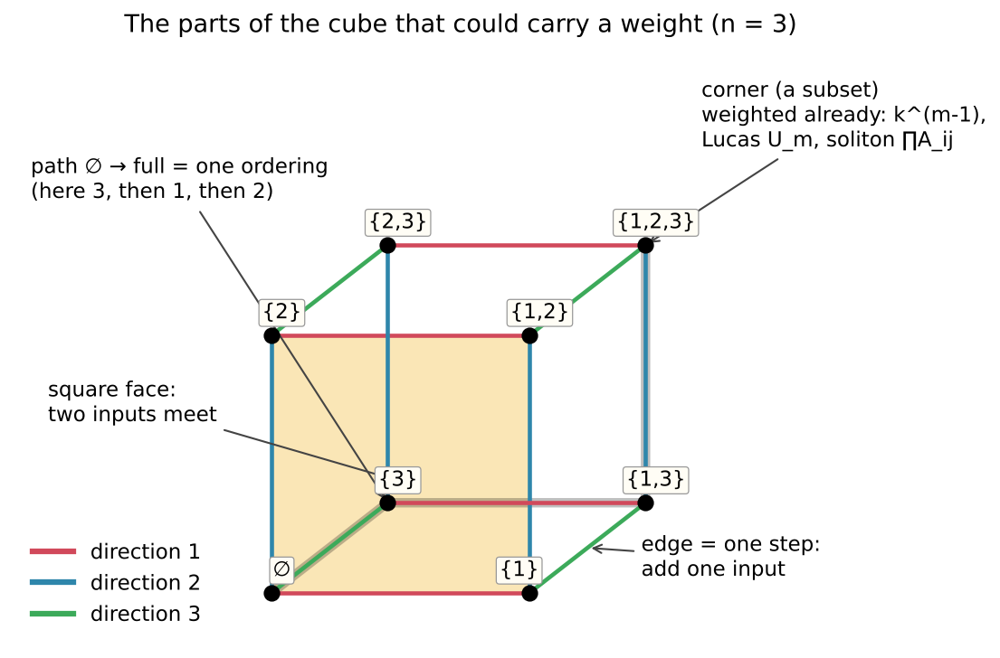
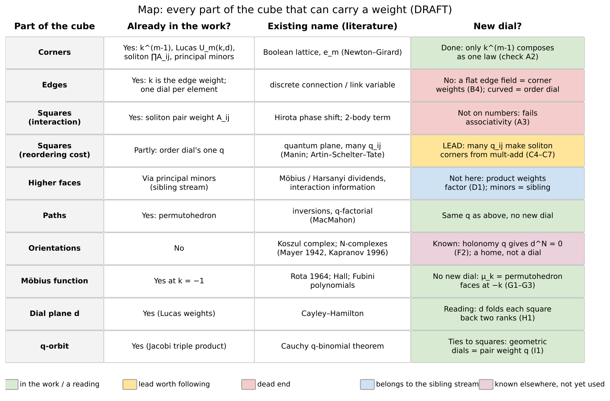
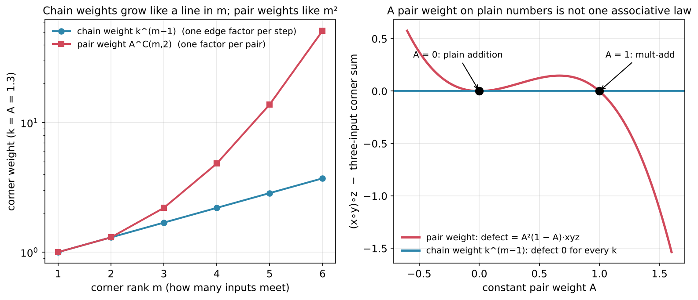
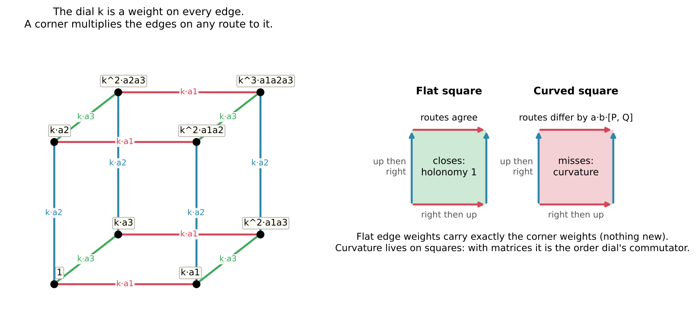
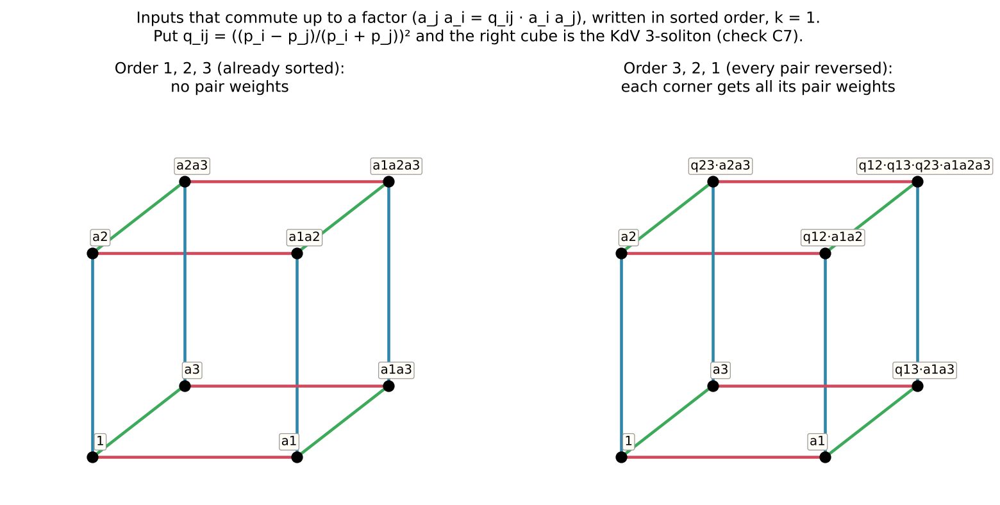
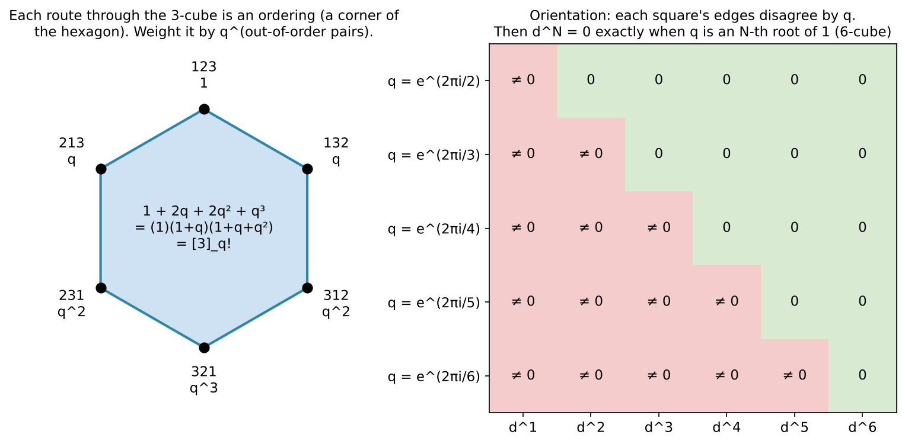
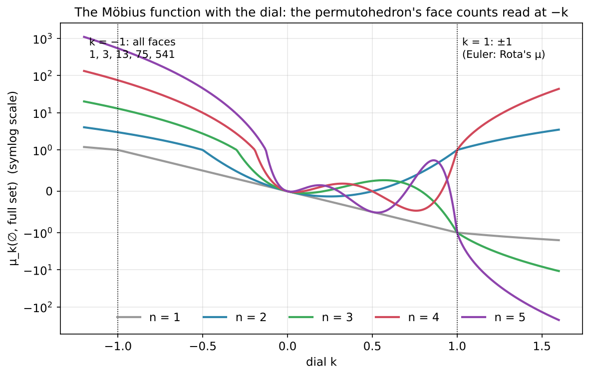
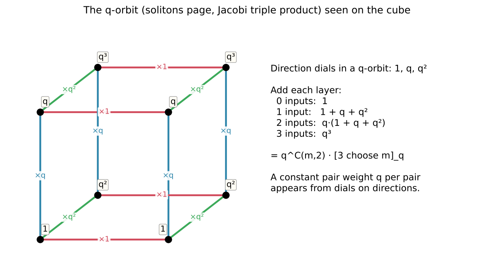

# DRAFT: Which parts of the cube can carry a weight? (Nov 25, 2026)

> **Names:** some words or symbols on this page (mult-add) also mean something else in standard math, physics or computing, or inside this project. [NAMING-COLLISIONS.md](../../NAMING-COLLISIONS.md) says which meaning is in play.

**Result in two sentences.** Besides corners, the cube's edges, square faces, higher faces, paths, orientations and Möbius function can all carry weights, but most turn out to be either the corner weights in disguise or the dial k we already have. The one genuinely useful new place is the **square face as a "reordering cost"**: if inputs commute only up to a factor q_ij per pair, the plain circle operation (called mult-add before 1.0; still one associative law) produces exactly the soliton corner weights ∏ q_ij, which is the known vertex-operator picture of solitons and bears directly on the pair-weights stream.

Brennan's question (voice call, Nov 25): "we have this idea of corner weights. Are there any other weights within the structure that could be identified as well?" He said yes to checking edges, faces, paths and the Möbius function.

Checked: `checks.py`, **41 of 41 pass** (`checks_output.txt`; sympy and numpy). Figures from `figures.py`. No Lean in this pass (no toolchain here).

## The map at a glance

| Part | Already in the work? | Known name | New dial? |
|---|---|---|---|
| Corners | Yes (k^(m−1), Lucas U_m, soliton ∏A_ij, principal minors) | Boolean lattice, elementary symmetric polynomials | Settled: only k^(m−1) composes as one law on numbers |
| Edges | Yes: k is the edge weight; one dial per element | discrete connection, link variable | **Dead end** as a new dial |
| Squares, as interaction | Yes: soliton pair weight | Hirota phase shift, 2-body term | **Dead end** on plain numbers (not associative) |
| Squares, as reordering cost | Partly (order dial's single q) | multiparameter quantum plane | **Lead worth following** |
| Higher faces | Through principal minors | Möbius transform / Harsanyi dividends / interaction information | Belongs to the sibling corner-weights stream |
| Paths | Yes (permutohedron) | inversions, q-factorial | Same q as the reordering cost, nothing extra |
| Orientations | No | Koszul complex, N-complexes | Known; a home for q, not a new dial |
| Möbius function | Yes at k = −1 | Rota, Hall, Fubini polynomials | No new dial: it is k again |
| Dial plane d | Yes (Lucas) | Cayley–Hamilton | A reading: d folds each square back |
| q-orbit | Yes (Jacobi triple product) | Cauchy q-binomial theorem | Ties direction dials to a pair weight |

I read "q-orbit" as the solitons page's orbit w, wq, wq², … (check 4b there). If it meant something else, tell me.

---

## 1. Corners (already used): only one family composes

Every term of a chain a₁ ∘ₖ … ∘ₖ aₙ sits on a corner of the cube; a rank-m corner gets k^(m−1) (check A1; already on the Boolean lattice page).

New here, a uniqueness check: suppose the corner weight depends only on rank, W₁ = 1, W₂, W₃, …. Asking that it come from one associative two-input law forces W₃ = W₂² and W₄ = W₂³ (check A2). So **k^(m−1) is the only rank-only weighting that composes**. Known: the only formal group laws that are polynomials are x + y + c·xy (standard; e.g. formal-group lecture notes, and Coleman–McGuinness 1991 for the rational ones, which give our plane law). Label: known.

A constant pair weight A (corner weight A^C(m,2), what solitons look like with equal pair weights) fails: grouping misses by A²(1 − A)·xyz, zero only at A = 0 (addition) and A = 1 (the circle operation) (check A3).

## 2. Edges: k already lives here; nothing new

- **k is an edge weight.** In the lift ∏(1 + k·aᵢ), every step up the cube multiplies by k·aᵢ; a corner is the product along any route to it (check B1). A reading, not new math.
- **One weight per direction** is the "dial per element" page (`fractional-powerset-dials/`). Already used.
- **Weights that depend on where the step happens** (state and direction) are a discrete connection, the link variables of lattice gauge theory (Wilson 1974). If every square closes ("flat"), the edge field is just corner weights in disguise: you can rebuild the corner weights from any one route (checks B2, B4). If squares don't close ("curved"), the 24 routes through the 4-cube give different totals (check B3), and the mismatch lives on the squares.
- **Matrix edges.** With one matrix N (the plane's Lucas weights) all edges commute: flat (B5). With different matrices the square misses by a·b·[P, Q] (B6), the order dial's commutator (`order-dial/`).

Verdict: **dead end as a new dial.** Flat edge weights add nothing to corners; curved ones are the order dial.

## 3. Squares: two different weights a square can carry

**(a) Interaction.** Read a square's four corners as W(S+i+j)·W(S) / (W(S+i)·W(S+j)). For the lifted k-dial it is 1 everywhere: no pair term (C1). For solitons it is exactly the pair weight A_ij on every square (C2). For the plane's Lucas weights it changes with rank, so they are not a pair weight (C3). Known (Hirota's phase shift). As shown in §1, a pair weight on plain numbers can't be one associative law. **Dead end on numbers.**

**(b) Reordering cost: the lead.** Let the inputs commute only up to a factor: aⱼ·aᵢ = q_ij·aᵢ·aⱼ (a multiparameter quantum plane, Manin 1988; Artin–Schelter–Tate 1991). The circle operation on such inputs is still associative: it is the circle operation of a ring (C6c). Now run a chain in some order and write the answer in sorted order:

- each corner picks up q_ij for every pair the order reversed (all 24 orders, C4);
- in fully reversed order, every corner gets **all** its pair weights, k^m · ∏ q_ij · ∏ aᵢ, which is exactly the soliton corner form (C5);
- the same holds with real 9×9 clock-and-shift matrices (C6a, C6b), and the pair-weighted cube equals 1 + k·(a₄ ∘ₖ a₃ ∘ₖ a₂ ∘ₖ a₁) (C6d);
- put in the KdV pair weights q_ij = ((p_i − p_j)/(p_i + p_j))² and read each sorted word aᵢaⱼ… as e^(ηᵢ+ηⱼ+…): you get the KdV 3-soliton, which solves Hirota's equation to 10⁻¹⁶⁴ (C7).

**Known vs ours.** Known in substance: the vertex-operator construction of soliton tau functions (Date, Jimbo, Kashiwara and Miwa, early 1980s; Kac and van de Leur, hep-th/9308137), where multiplying vertex operators produces a pair factor times their normal-ordered product, and N-solitons come from products of (1 + a·Γ). Quantum planes are textbook. Ours: putting it on the cube as "the reordering cost of a square", and the contrast with §1 (pair weights can't be one law on commuting numbers, but are one law on inputs that commute up to a factor).

**Why it's a lead.** It answers the soliton stream's question (something fundamental from which pair weights fall out) with a concrete mechanism: **pair weights are what reordering costs**, and the composition law stays the plain circle operation. It also ties the solitons to the order dial and the quantum route on `order-dial/`.

**Honest catches.**
1. Reading the sorted words as exponentials is the normal-ordering readout. It is linear but not multiplicative, so the soliton is not the circle operation of plain numbers; it is the circle operation of non-commuting inputs, then read out.
2. KdV's factors are real numbers between 0 and 1. Finite matrices only give roots of 1 (order-dial check G4), so a real model needs infinite-dimensional operators (the vertex operators).
3. Why the reversed order? In the quantum plane that's a choice. In the vertex-operator picture the factor comes from normal ordering and is the same whatever the order. I haven't reconciled the two yet.

Suggested next step (not done): check, with a free-boson model, that the KdV factor ((p − p′)/(p + p′))² is the reordering cost of two actual vertex operators, and hand this to the pair-weights stream rather than running it here.

## 4. Higher faces: product weights factor; the rest is the sibling stream

- Faces of the cube are words in {out, in, free}. Any face weight built element by element just factors: the sum over all 81 faces of the 4-cube is ∏(1 + aᵢ + t·bᵢ) (D1). The face count by dimension is (2 + t)ⁿ (D2, classical). Nothing new.
- The real higher-face weights are the **interactions**: the Möbius transform of log W gives one number per face type T, the |T|-body term. Known as Harsanyi dividends (game theory), interaction information (McGill 1954), log-linear models, and the Möbius transform of a set function (Grabisch, Marichal and Roubens 2000). Principal minors of a Cauchy matrix stop at pairs (D3); a generic matrix has 3- and 4-body terms (D4). That is exactly the size/pair-weights stream's ground, so I stopped there.

## 5. Paths and orientations: the same q, and a known home for it

- With commuting inputs every route gives the same product, so paths carry nothing new.
- Weighting each route by q^(out-of-order pairs) sums to the q-factorial [n]_q! (E1, n ≤ 6; MacMahon). At a cube root of 1 the routes cancel from n = 3 on (E2). That q is the reordering cost of §3(b), already met as the order dial.
- **Orientations.** Put signs on the edges so every square disagrees by −1 and the boundary step d squares to zero: that is the Koszul complex (F1). Replace −1 by q: then d^N = 0 exactly when q is a primitive N-th root of 1 (F2; generic q never vanishes early, F3). Known: N-complexes (Mayer 1942; Kapranov 1996, q-alg/9611005; Dubois-Violette 1998). A known home for the reordering q, not a new dial.

## 6. The Möbius function with the dial: it is k again

Invert ζ_k = 1 + k·(strict steps) on the cube (Rota's ζ at k = 1). The result depends only on the size gap r: μ_k = Σ_m (−k)^m · m! · S(r, m), the Fubini polynomial at −k (G1, 5-cube, four k values). Those coefficients are the face counts of the permutohedron, so **μ_k is the permutohedron's face count read at −k**: at k = 1 Euler's formula gives Rota's (−1)ⁿ; at k = −1 it counts every face, 1, 3, 13, 75, 541 (G2). Generating function 1/(1 + k(e^x − 1)), the lift of e^x − 1 inverted (G3).

Known: Fubini polynomials, permutohedron faces as ordered set partitions. Ours: the reading "k evaluates the permutohedron's face count". No new dial.

## 7. The dial plane d and the q-orbit: readings that tie things together

- **d** comes from Cayley–Hamilton, N² = k·N − d·I (H1): on each square the top corner folds back into one edge (weight k) and the bottom corner (weight −d). Already in the Lucas work; this is just where d sits on the cube.
- **q-orbit.** Direction dials 1, q, q², … make each layer q^C(m,2)·[n choose m]_q (I1, n ≤ 7; Cauchy's q-binomial theorem). So a constant pair weight q comes out of dials on directions, which links the solitons page's q-orbit to the square weights above.

## Files

- `checks.py`, `checks_output.txt`: 41 checks (sections A–I as above).
- `figures.py` → `fig1`–`fig8` PNGs.
- This README. Not pushed; marked DRAFT.

## Sources

- Rota, G.-C. (1964). On the foundations of combinatorial theory I: Theory of Möbius functions.
- Coleman, C. and McGuinness, J. (1991). Rational formal group laws. Pacific J. Math. 147. https://www.math.columbia.edu/~om/Pac-J-Math-1991.pdf
- Polynomial formal group laws are x + y + cxy: https://www2.math.uni-wuppertal.de/~ruelling/GRK-Retreat2024/Introduction%20to%20formal%20group%20laws-Pengcheng.pdf
- Kapranov, M. (1996). On the q-analog of homological algebra. https://arxiv.org/abs/q-alg/9611005 ; Dubois-Violette, M. (1998). d^N = 0. https://arxiv.org/pdf/q-alg/9710021
- Kac, V. and van de Leur, J., arXiv hep-th/9308137 (its introduction summarizes the Sato/DJKM vertex-operator construction of N-soliton tau functions). https://arxiv.org/abs/hep-th/9308137 ; see also Elliptic soliton solutions: tau functions, vertex operators and bilinear identities, https://arxiv.org/pdf/2204.01240
- Grabisch, M., Marichal, J.-L. and Roubens, M. (2000). Equivalent representations of set functions. Math. Oper. Res. 25(2). https://orbilu.uni.lu/bitstream/10993/10979/1/EquivalentRepresentationsLGS99.pdf
- Permutohedron faces as ordered set partitions, Fubini numbers: https://arxiv.org/pdf/1606.09643 ; https://en.wikipedia.org/wiki/Ordered_Bell_number
- Manin, Yu. (1988). Quantum groups and non-commutative geometry; Artin, Schelter and Tate (1991), Quantum deformations of GL_n.
- Wilson, K. (1974). Confinement of quarks (lattice gauge theory: weights on edges, curvature on squares).
- McGill, W. (1954). Multivariate information transmission (interaction information).
