# Curvature-dial survey: which proved laws slide into one another (DRAFT)

Page: https://claude.ai/artifact/L31drHBF2SgMgC6hCCg9EE

**DRAFT, Nov 26 2026.** Part of Affine Composition Theory (repo: fused-hyperoperation-algebra).
Asked for by Brennan: "I'd like similar surveys for the other dials as well", the same survey as the shape-dial one ("a
survey of all of our laws that we've proven to see if the shape dial is able to move from one to another … really all of
them", then "check all laws … to see if a new law emerges and what it might be for", with a cheap polishing step).
This page does it for **d, the curvature dial**: the plane law a ∘ b = (a + b + k·ab)/(1 − d·ab), with k held fixed.
Curvature = −Δ/4 with Δ = k² − 4d is a reading, never an input.
Checks: `checks.py` → `checks_output.txt`, **65 of 65 pass** (sympy exact, numpy/scipy numeric; 4 polish checks with
mpmath at 30 digits cost **0.05 s**; the whole script takes about 1 min 45 s, nearly all sympy).
Law list: `laws.py` → `laws.json`. Pictures: `figures.py` → `figures/`. No Lean in this pass.
Colour key: **blue = our reading, orange = already known, grey = endpoints / background.**

## The result

I sorted the 65 law groups of `dial-catalog/catalog.py`. Holding k fixed and turning only d:

- **17 groups slide** into another proved law, with the carrying quantity checked along the whole dial.
- **3 are plausible**: the numbers slide, the law in between is not proved (rung heights, cube face weights, Newton's G).
- **6 survive on part of the dial** and break on the rest (Bayes, the union rule, Maxwell's wave equation,
  causal-diamond counting, π, Euler's identity).
- **1 is another parameter in disguise** (the elliptic modulus moves the t⁴ term, off the (k, d) plane).
- **1 is the dial itself** (the plane law).
- **37 do not slide** (they live on the k dial, the shape dial, or do not use d).

**The plain conclusion.** At k = 0 the d dial has exactly three stops and **nothing in between**: every d < 0 is
Einstein's addition for some light speed, d = 0 is Galileo, every d > 0 is tangent addition with some scale (section N3,
proved). Almost every slide in this survey is that one three-way switch read in a different field: two walls, one wall
at infinity, no wall. At k ≠ 0 the switch moves to the parabola d = k²/4, and the turning side gains a ladder of special
settings, the **finite clocks** (section N1). All of this is the Cayley–Klein / Yaglom family and Coleman–McGuinness's
classification (1991); the survey's own part is which proved laws ride on it and the corner reading below.

The leads, in order, each judged on its own:

1. **Corner weights become Lucas numbers (C2), slides.** The n-fold plane law is a ratio of two corner sums, and a corner
   of size n carries the Lucas number U_n(k, d) = αⁿ⁻¹[n]_q. At d = 0 this is the cube's corner expansion; at k = 0 it is
   the tangent-sum formula; in between it is q-counting. Worth following as an organising formula: it puts three proved
   modules (Base/Cube, q-counting, the genus) on one line. The pieces are classical; the corner reading was not found in
   my search.
2. **Finite clocks on the turning side (N1), proved, elementary.** At d/k² = 1/(4cos²(πj/N)), "add infinity" has exact order
   N, the size-N corner weight vanishes, q is an N-th root of unity, and the χ_y parameter is minus a root of unity, which
   is Hirzebruch's level-N cusp value (1988). Each piece is known; the bundle is a tidy explainer, not a new theorem.
3. **Jets: finite difference → derivative → complex step (C11), slides.** In R[u]/(u² − ku + d), f(a + bu) samples f at two
   points that merge on the parabola and go complex past it. Known pieces (Lyness and Moler 1967; Squire and Trapp
   1998); the placement on the dial is ours. Useful as an explainer and for numerics, not a research lead.
4. **Physics slides that are all known and all consistent (C3, C4, C12, C13).** The twist turns on with d (Thomas,
   Foucault); Kepler's velocity space has curvature −2E; the carrier mass is m² = −d; a barrier and a beam splitter are
   one twist B_d(u) at d = ∓1. Good checks of the theory, no new prediction.
5. **Negative results, useful.** Nothing new lives between the k = 0 stops (N3). The elliptic modulus is a second road
   that meets the d road only at its ends (C15). Waves, light cones and probability need two walls; π and Euler's identity
   need none (C6, C7, C10).

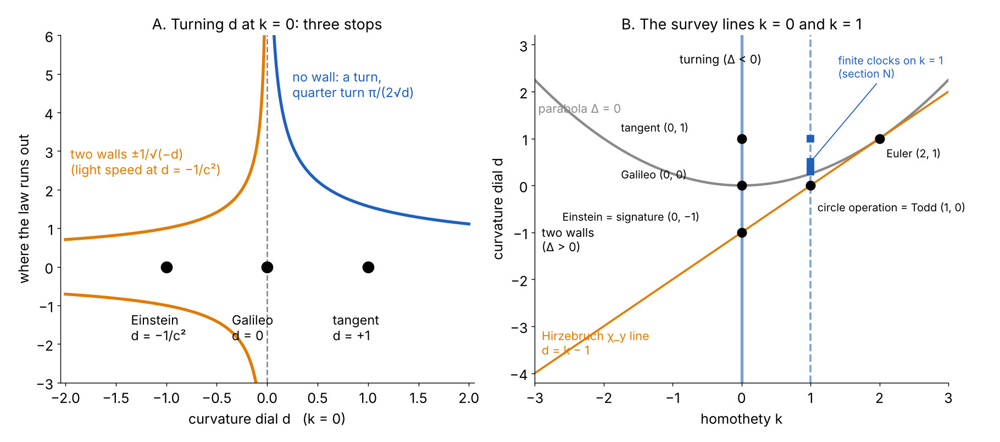

*Figure 0. A: at k = 0, turning d moves the walls ±1/√(−d) in from infinity (orange, Einstein side) or replaces them by a
turn whose quarter is π/(2√d) (blue, tangent side). Galileo sits between. B: the (k, d) plane. The survey runs on the
line k = 0 and then on k = 1. The parabola d = k²/4 is where the kind changes. Hirzebruch's χ_y line d = k − 1 passes the
Todd genus (the circle operation ∘₁), the Euler characteristic (on the parabola) and the signature (Einstein at c = 1).
Blue squares on k = 1: the finite clocks of section N1.*

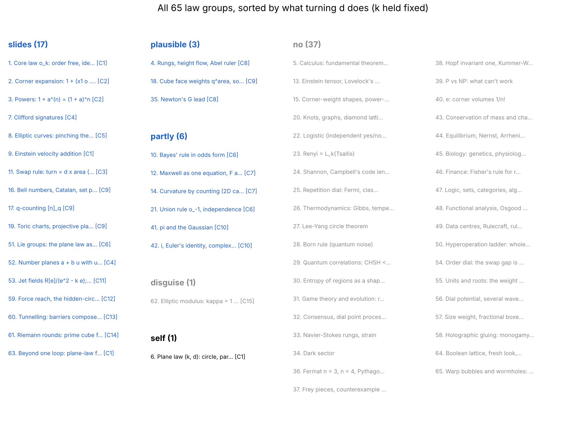

*Figure 1. All 65 groups, sorted by verdict. The candidate number is in brackets.*

---

## How I tested a slide

For each group I read the Lean module and the topic page it rests on, held k fixed, and turned d. A group **slides**
when both ends are proved (a Lean theorem or a checked page) and the quantity that carries one end into the other is
checked along the whole dial: exactly (sympy) where a closed form exists, numerically elsewhere. **Plausible** means
the numbers move but the law in between is not proved. **Partly** means the law holds on one side and fails on the
other. Two facts are used everywhere:

- **Units (check A6, Lean `Landscape.units_den`).** Rescaling a ↦ λa moves (k, d) to (λk, λ²d). So at k = 0 only the
  sign of d is a law; its size is a unit.
- **Charts (check A7).** A chart x ↦ x/(1 + cx) that fixes 0 moves (k, d) to (k − 2c, d − kc + c²) and keeps Δ. So at fixed
  k, turning d is the same as turning Δ, up to a chart. With charts and units together only the sign of Δ survives:
  the three kinds of Coleman–McGuinness. With units alone, d/k² is an invariant, and that is what C2, C8, C9 and N1 read.

---

## C1. Galileo ↔ Einstein ↔ tangent: walls come in from infinity — slides (and the dial itself)

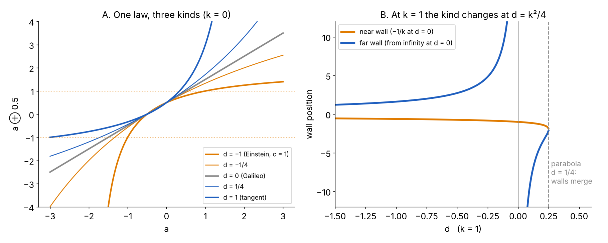

*Figure 2. A: a ⊕ 0.5 at k = 0 for five settings of d. Einstein's curves saturate at the walls ±1; Galileo's is a straight
line; the tangent curves run off and wrap. B: at k = 1 the circle operation (d = 0) already has two walls; the far wall
comes in from infinity as d leaves 0, and the two walls merge at d = 1/4.*

- **Both ends proved.** Galileo, Einstein and tangent addition are `NumberPlane.dual_point`, `split_point`,
  `complex_point` and `GroupsLie.theta_dual`, `theta_velocity`, `theta_tan`; associativity for every (k, d) is
  `Landscape.assoc_num/den` (check A2).
- **The carrying quantity.** At k = 0 the law is T_d(T_d⁻¹a + T_d⁻¹b) with T_d(t) = tan(√d·t)/√d, one function that is
  entire in d: tanh for d < 0, the identity at d = 0, tan for d > 0 (A1, polished to 30 digits in Q1). Einstein at
  d = −1/c² gives 0.5c ⊕ 0.6c = 0.846c (A3).
- **Crossing d = 0.** The walls ±1/√(−d) run off to infinity as d → 0⁻ (A4). Past zero there is no wall: the value runs to
  infinity at rapidity π/(2√d) and wraps round (A5). The flow x′ = 1 + dx² (`BeyondOneLoop.plane_generator`) is T_d(t),
  and its wall exponents ∓2√(−d) shrink to 0 at d = 0 (A8): the marginal "creep like 1/L" of the parabola.
- **At k ≠ 0.** d = 0 is no longer special: it is the circle operation ∘ₖ, still two walls (A9). The kind changes at
  d = k²/4.
- **Known (orange):** the Cayley–Klein family and its velocity laws (Yaglom 1979; Herranz, Ortega and Santander 2000;
  Lévy-Leblond 1976); Coleman and McGuinness (1991), also Bismuth (1976, unpublished thesis).
  **Ours (blue):** nothing new here; this is the frame the rest of the survey uses.
- **Verdict: solid, known.** It is the dial's own picture.

## C2. Corner weights become Lucas numbers — slides

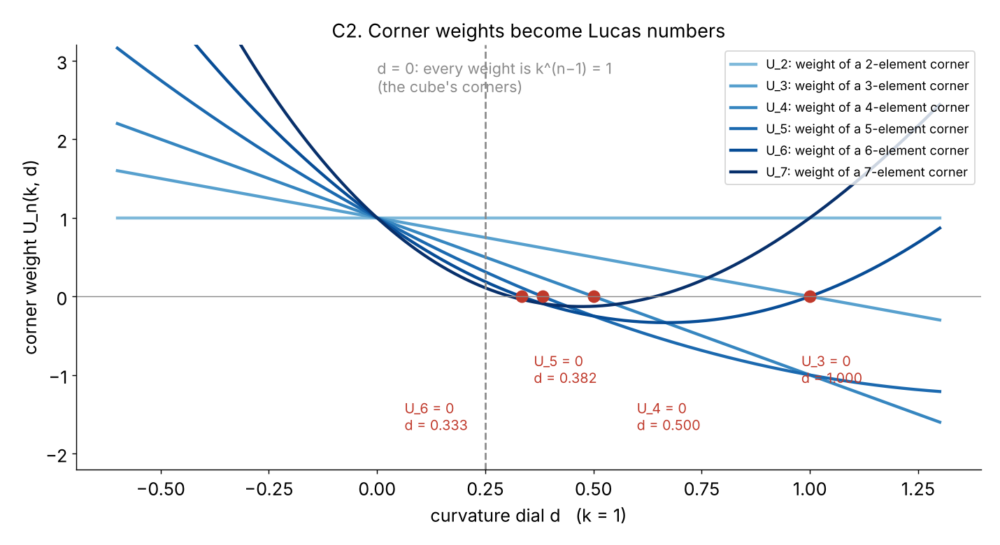

*Figure 3. The weight U_n(k, d) of an n-element corner, at k = 1. At d = 0 every weight is kⁿ⁻¹ = 1 (the cube). Turning d
spreads them; each U_N first vanishes at a finite-clock setting (red dots, section N1).*

- **The formula (B1, sympy, n = 2 to 5).**
  x₁ ∘ … ∘ xₙ = Σ_S U_|S|(k, d)·x^S / (1 − d·Σ_S U_|S|−1(k, d)·x^S), sums over nonempty corners S, where U is the Lucas
  sequence U₀ = 0, U₁ = 1, U_{n+1} = k·U_n − d·U_{n−1}. Proof in one line: in the number plane u² = ku − d,
  ∏(1 + x_j u) = A + Bu with u^m = U_m u − d·U_{m−1}, and (1 + au)(1 + bu) = (1 − dab)(1 + (a ∘ b)u).
- **Both ends.** At d = 0, U_n = kⁿ⁻¹ and the formula is the cube's corner expansion 1 + k(x₁ ∘ … ∘ xₙ) = ∏(1 + kx_j) (B2;
  Lean `Base`, `Cube`). At k = 0 the odd corners go to the numerator and the even ones to the denominator:
  (e₁ − d e₃)/(1 − d e₂ + d² e₄), the tangent-sum formula (B3).
- **Powers and the lift.** The lift 1 + kx becomes the norm V(x) = 1 + kx + dx², which multiplies up to the square of the
  denominator: V(a ∘ b)(1 − dab)² = V(a)V(b) (B4, Lean `NumberPlane.norm_mul`). So 1 + k a⁽ⁿ⁾ = (1 + ka)ⁿ becomes
  V(a⁽ⁿ⁾)·(den)² = V(a)ⁿ (B5).
- **q-counting is the same weight.** U_n = αⁿ⁻¹·[n]_q with α + β = k, αβ = d, q = β/α (B6). So the corner weight is a
  q-integer, and d sets q.
- **Known:** Lucas sequences (Lucas 1878) and their Binet form; the tangent-sum formula with elementary symmetric
  functions; the norm of a quadratic algebra. **Ours:** the n-fold plane law as a corner sum with Lucas weights, which
  ties the cube's corner expansion, the tangent sum and [n]_q together. **Not found in my search** (queries listed under
  Known vs new).
- **Verdict: worth following as an organising formula.** It is short, exact for every (k, d), and joins three proved
  modules. It is not a deep theorem.

## C3. The twist turns on with d — slides

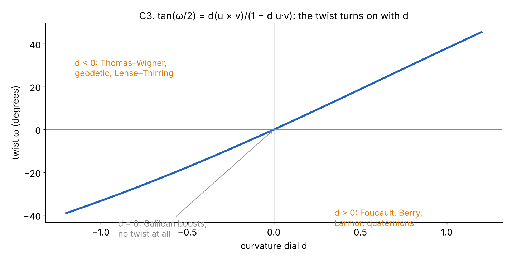

*Figure 4. The twist ω for two fixed half-velocities as d is turned. Zero at d = 0, opposite signs on the two sides.*

- **The law (Lean `TwistedBoosts.twist_half_angle`):** tan(ω/2) = d(u × v)/(1 − d u·v). At d = 0 there is no twist in any
  directions (`galilean_no_twist`, check C2). The sign of the twist follows the sign of d (C3).
- **The carrying quantity, checked independently (C1).** |ω| equals |d| × the area of the triangle (0, u, u ⊕ v), with the
  area from L'Huilier's formula on the sphere (d > 0) and the hyperbolic plane (d < 0): 80 random pairs, error 3e-15.
- **What rides on it** (from `gravity-from-theory/spinning-river/` figure 5, which sorted 17 frame ideas by dial): d = +1,
  Foucault, Coriolis, Larmor and Berry; d = 0, Galilean boosts and river cells, nothing precesses; d = −1, Thomas–Wigner,
  geodetic, Lense–Thirring (checked against Gravity Probe B and the double pulsar in `twisted-boosts/`).
- **Known:** Thomas (1926), Wigner (1939), Ungar's gyrogroups, Gauss–Bonnet. **Ours (repo):** the twist as the phase of the
  split corner, read off the curvature dial.
- **Verdict: solid, known.** A clean picture of the d dial switching precession on.

## C4. Number planes, Clifford's ω², and Kepler's velocity space — slides

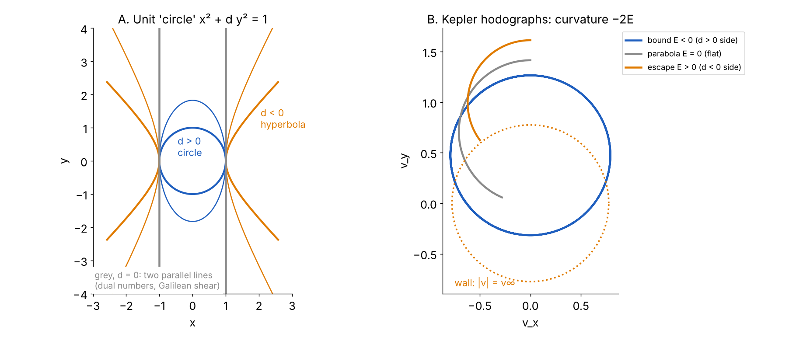

*Figure 5. A: the unit "circle" x² + dy² = 1 is a circle, two parallel lines (d = 0) or a hyperbola. B: Kepler
hodographs (velocity curves). Bound orbits close, the parabolic one passes through v = 0, the escaping one stays outside
the dotted circle |v| = v∞.*

- **Number planes (D1, D2; Lean `NumberPlane`, `Clifford.division_cases`).** In R[u]/(u² + d), slopes compose by
  (s₁ + s₂)/(1 − d s₁s₂). The norm x² + dy² splits into two light-cone factors (d < 0), is one square (d = 0) or never
  vanishes (d > 0). Clifford's biquaternion unit ω² = +1, 0, −1 (1873) is d = −1, 0, +1, one generator at a time.
- **Kepler (D3–D5).** Hodographs are circles with |centre|² − R² = 2E (E = −0.2, 0, 0.3, error under 1e-6). Fock's velocity
  metric 2|dv|/(|v|² − 2E) has curvature exactly −2E (sympy). So the energy is the curvature dial: bound orbits on the
  turning side, the parabola at the flat stop, escape on the two-wall side. On the escape side the wall is the circle
  |v| = v∞ = √(2E): every speed stays above it (D4), as every velocity stays below c in relativity.
  The repo's κ = −1/(2E) (`gravity-from-theory/` N9) is the κ-stereographic chart's parameter; it has the same sign, and
  the size is a unit choice (A6).
- **Known:** complex, dual and double numbers (Yaglom 1979); Clifford (1873); Hamilton's hodograph (1846), Fock (1935),
  Moser (1970), Milnor (1983). **Ours:** reading the escape speed v∞ as the wall of the d < 0 chart (a small reading).
- **Verdict: solid, known.** Kepler is the clearest physical case of all three stops on one dial.

## C5. Pinched cubics: split node → cusp → non-split node — slides

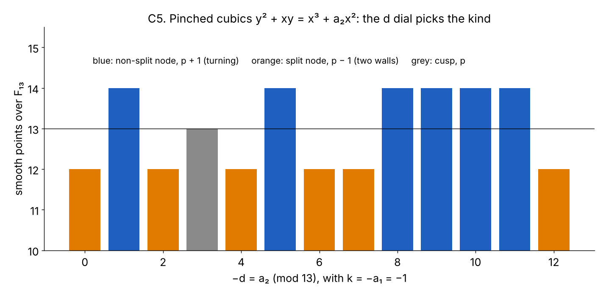

*Figure 6. Smooth points of y² + xy = x³ + a₂x² over F₁₃ for every a₂. The count is p − 1, p or p + 1 as the d dial moves
the curve between the three kinds.*

- The pinched cubic y² + a₁xy = x³ + a₂x² sits at (k, d) = (−a₁, −a₂) (Lean `Elliptic.node_param`, `walls_are_branches`).
  Over F_p it has p − 1 smooth points (split node, two walls), p (cusp, the parabola) or p + 1 (non-split node, turning),
  as Δ = a₁² + 4a₂ is a nonzero square, zero or a non-square (E1, all d for p = 7, 11, 13).
- **Known:** the group of smooth points of a singular cubic is the multiplicative group, the additive group, or a
  norm-one torus (Silverman, *The Arithmetic of Elliptic Curves*, §III.2). **Ours (repo):** the placement on the dial,
  already drawn in `elliptic/`.
- **Verdict: solid, known.** Only the pinched curves ride the dial; smooth elliptic curves are off the plane (C15).

## C6. Anchors: Möbius kinds, and why probability needs two walls — slides (Lie groups), partly (Bayes, union rule)

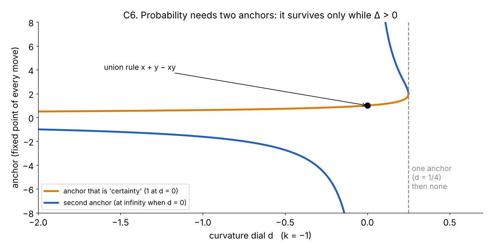

*Figure 7. At k = −1, the two fixed points (anchors) of every move x ↦ x ∘ c. At d = 0 they are 1 (certainty) and
infinity. They merge at d = 1/4 and then vanish.*

- **The Lie-group slide (Lean `GroupsLie.mob_dial`, `theta_*`).** The plane law is a Möbius product; turning d carries a
  hyperbolic one-parameter group (two fixed points) into a parabolic one (one) and an elliptic one (none). The fixed
  points are the roots of 1 + kx + dx² (F1; `rulecraft-history/` H15).
- **Bayes and the union rule survive only while Δ > 0.** At k = −1 every d < 1/4 is the union rule x + y − xy in a moved
  chart plus units (F2): "certainty" is just the moved anchor. No chart reaches d ≥ 1/4, because charts keep Δ and union has
  Δ = 1 > 0 (F3). Bayes in odds form is the same story at k = 1. Past the parabola there is no bounded slider to keep
  (rulecraft-history §7: "Δ < 0 rules have no anchor").
- **Known:** Möbius maps sorted by the discriminant and commuting exactly when they share fixed points (textbook).
  **Ours (repo):** Δ as the anchor count, and what it means for odds and rules.
- **Verdict: solid, known.** A clear "partly": probability lives on one side of the parabola.

## C7. Waves and light cones need walls — partly (Maxwell, causal-diamond counting)

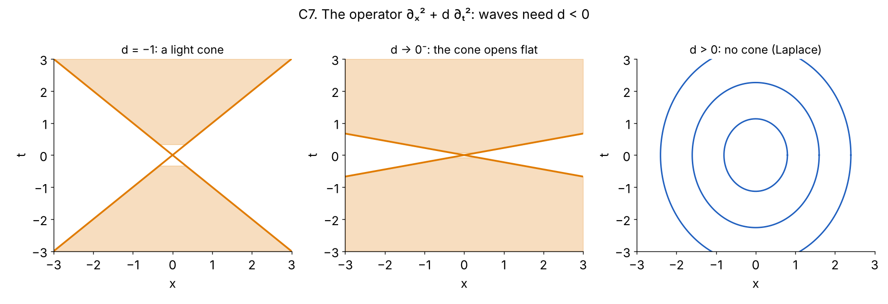

*Figure 8. The d-boost keeps the operator ∂ₓ² + d∂ₜ². For d < 0 its characteristics form a light cone; as d → 0⁻ the
cone opens flat; for d > 0 there is no cone, only ellipses (Laplace).*

- **The law (G1, sympy):** ∂ₓ² + d∂ₜ² is unchanged by the d-boost t′ = γ(t + dvx), x′ = γ(x − vt), γ = (1 + dv²)^(−1/2), and two
  d-boosts compose by (v + w)/(1 − dvw) (G2). So each d has its own invariant operator: a wave equation with c² = −1/d for
  d < 0, a degenerate ∂ₓ² at d = 0, Laplace's operator for d > 0 (G3).
- **Maxwell (`electromagnetism/`):** the wave equation survives a dial boost only at d = −1/c², and ε₀μ₀ fixes that d. On
  the whole d < 0 side Maxwell survives with its own c. At d = 0 it splits into the two Galilean limits of Le Bellac and
  Lévy-Leblond (1973). For d > 0 it is the Euclidean (Wick-rotated) theory with no propagation.
- **Causal-diamond counting (`curved-space/`):** it needs a light cone. Every d < 0 gives the same counting (only units
  change); at d = 0 the cone opens flat and every pair is time-ordered; past it there is no order to count.
- **Known:** all of it (Le Bellac and Lévy-Leblond 1973; Wick rotation; Myrheim 1978 and Meyer 1988 for counting).
  **Verdict: not a lead.** It says plainly where these laws live: on the two-wall side only.

## C8. At fixed k, d reads as a height — plausible (rungs, Newton's G)

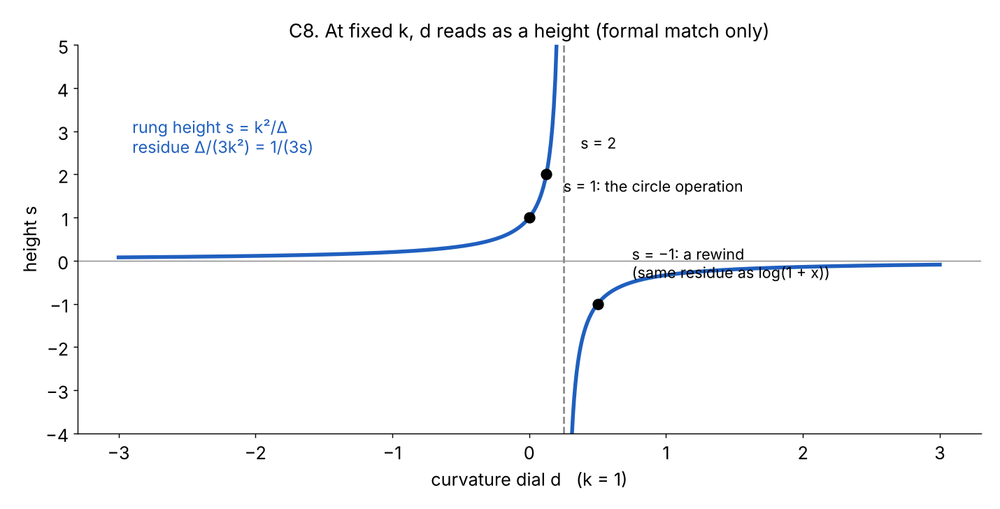

*Figure 9. At k = 1, the rung height s = k²/Δ that matches the plane law's formal invariant. s = 1 at the circle
operation, s → ∞ at the parabola, and negative (a rewind) on the turning side.*

- **The quantity (H1, sympy).** The exponential map of the plane law has iterative residue 1/3 − 4d/(3k²) = Δ/(3k²). Height s
  of e^x − 1 has residue 1/(3s) (`height-flow/`). So at fixed k, d sets a matching height s = k²/Δ (Lean
  `Landscape.rung_equivalent`): s = 1 at d = 0, s = 2 at d = k²/8, s → 0 as d → −∞ (H2).
- **Past the parabola, s is negative.** At d = k²/2, s = −1: the turning law has the residue −1/3 of log(1 + x), the rewind
  of e^x − 1 (H3).
- **Why only plausible.** The residue is a formal invariant (Écalle). It does not decide analytic conjugacy; the repo's horn
  size (`closed-leads-revisit/`) shows rungs carry more. And at k = 0 the conic laws' fingerprint is stuck at 3/10 for every
  d (H4), so d moves nothing formal there. Newton's G (`newton-g/`): the second-loop number 1/3 − 4d/(3k²) can be put
  anywhere by d, so gravity's 3/5 is a choice (d = −k²/5), as that page already concluded.
- **Known:** iterative residues and their behaviour under iteration (Écalle). **Ours (repo):** the residue formula along
  the dial. **Verdict: a tidy reading, not a lead.**

## C9. One genus, d picks the parameter — slides (Bell/Catalan, q-counting, toric), plausible (cube face weights)

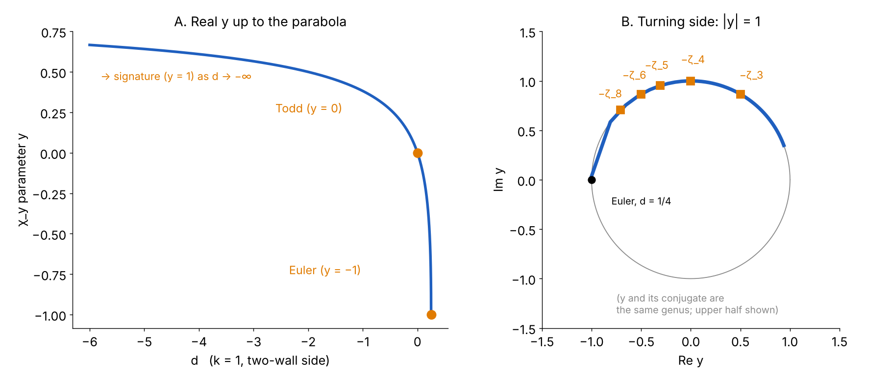

*Figure 10. At k = 1, the χ_y parameter y of each d (up to units). A: real y from the signature end (d → −∞) through
Todd (d = 0) to Euler (the parabola). B: past the parabola y lies on the unit circle; the orange squares are minus the
roots of unity, where the finite clocks of section N1 sit.*

- **The reading (I1, I2).** Each (k, d) with 1 + kx + dx² = (1 + αx)(1 + βx) is Hirzebruch's two-parameter genus. Up to units it
  is the χ_y genus at (1 − y, −y) (Lean `Landscape.chi_y_line`, `chi_y_touch`), with k²/d = −(1 − y)²/y. At fixed k, turning d
  runs the whole real χ_y family once: signature (y → 1) as d → −∞, Todd (y = 0) at d = 0, the Euler characteristic
  (y = −1) on the parabola. Past the parabola y = e^(iθ) is on the unit circle, with k²/d = 4 sin²(θ/2).
  So at fixed k the d dial *does* move along the χ_y family, once the units are taken out; in raw coordinates the χ_y line
  d = k − 1 is crossed only once.
- **The shape picks the polynomial (I3).** h-vectors at q = −y: simplex [n]_q, cube (1 + q)ⁿ, permutohedron Eulerian,
  associahedron Narayana. All equal 1 at d = 0 (q = 0) and count corners on the parabola (q = 1): 4, 8, 24, 14, as in the
  shape-dial survey's C5. Cube face weights q^area ride the same q, but the law between is not proved.
- **Known:** Hirzebruch (1966); toric h-vectors (Danilov, Stanley). **Ours:** "at fixed k, d is the χ_y parameter, and the
  turning side is |y| = 1". Likely folklore; treat it as a clean statement.
- **Verdict: tidy, mostly known.** It is what makes the finite clocks of N1 meet Hirzebruch's level-N genera.

## C10. π and i live only on the turning side — partly

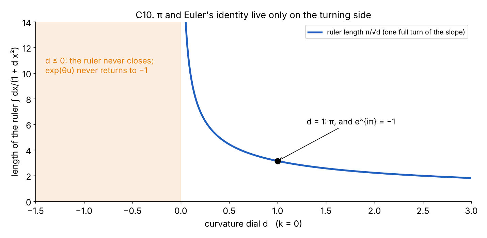

*Figure 11. The length of the ruler ∫dx/(1 + dx²) is π/√d for d > 0. For d ≤ 0 it never closes.*

- exp(πu/√d) = −1 at d = 0.37 in R[u]/(u² + d) (J1); at d = 0, exp(θu) = 1 + θu never returns; at d < 0 the real part is
  cosh θ ≥ 1. The ruler length is π/√d for d > 0 and diverges for d ≤ 0 (J2).
- **Known:** all of it. **Verdict: a clean "partly".** Euler's identity is the turning side's statement, not the dial's.

## C11. Jets: finite difference → derivative → complex step — slides

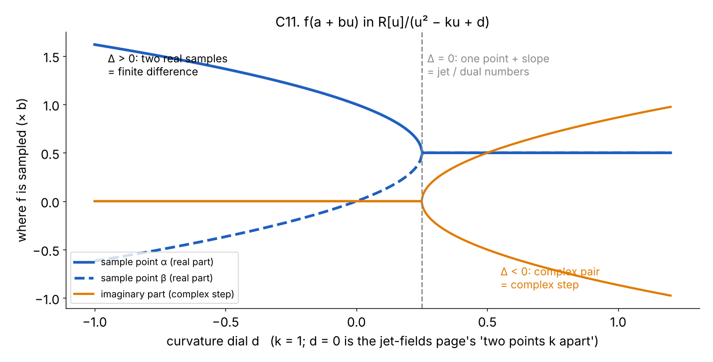

*Figure 12. In R[u]/(u² − ku + d), f(a + bu) samples f at a + αb and a + βb, the roots of u² − ku + d. At k = 1 the two
points are real (finite difference), merge on the parabola (a jet, dual numbers) and become a complex pair (complex step).*

- **The law (K1, sympy).** The u-part of f(a + bu) is the divided difference (f(a + αb) − f(a + βb))/(α − β). On the
  parabola it is b·f′(a + kb/2), the jet (K2). Checked for f = exp by matrix exponentials on both sides (K3). At k = 0,
  d = h², it is the complex-step derivative Im f(a + ih)/h, exact to 1e-12 at h = 1e-8 with no cancellation (K4).
- **Both ends proved.** d = 0 is the jet-fields page's R[e]/(e² − ke), "two sample points k apart" (Lean `JetFields`);
  the parabola is the dual numbers (`GroupsLie.theta_dual`). The jet river (Schwarzschild, Kerr) sits at the flat middle
  (`spinning-river/`, Lean `shear_sq`) and does not slide.
- **Known:** Hermite interpolation / the Chinese remainder theorem for R[u]/((u − α)(u − β)); dual numbers in automatic
  differentiation; the complex step (Lyness and Moler 1967; Squire and Trapp 1998). **Ours:** the three methods as three
  stops of one dial. No source in my search put them on one parameter.
- **Verdict: a useful explainer.** It is practical (the complex step avoids cancellation) but not a research lead.

## C12. Force reach: Yukawa → Coulomb → oscillating — slides

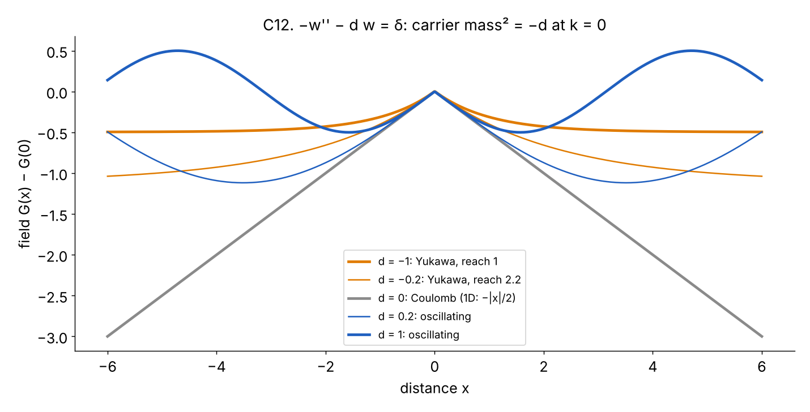

*Figure 13. One-dimensional fields of −w″ − dw = δ. Yukawa for d < 0, Coulomb's −|x|/2 at d = 0, an oscillating field for
d > 0.*

- **What the repo proved (Lean `ForceReach`):** `drift_removal` (the carrier mass is m² = Δ/4), `double_root_iff_border`
  (massless exactly on the parabola), `raychaudhuri_is_law`, `yukawa_deff`. At k = 0, m² = −d (L4 re-derives it).
- **The slide (L1–L3).** exp(−√(−d)·r)/(4πr) solves ∇²φ + dφ = 0 off the source for every d (sympy): Yukawa with reach 1/√(−d)
  for d < 0, Coulomb at d = 0, an outgoing wave for d > 0. In one dimension the three Green's functions are checked, and
  both sides meet Coulomb's −|x|/2 at d = 0, the gap closing like √|d|.
- **What the repo reads on the turning side.** `force-reach/` reads Δ < 0 as a closed ruler, a circle of length 2π/√(−Δ)
  with a Kaluza–Klein tower of masses n√(−Δ). The open-space oscillating field above is the other reading of the same
  sign; neither is a short-range force.
- **Known:** Yukawa (1935), Helmholtz's equation, Kaluza–Klein. **Verdict: solid, known.** A good consistency check:
  the massless forces sit exactly on the parabola.

## C13. Tunnelling: one twist for barrier, free flight and beam splitter — slides

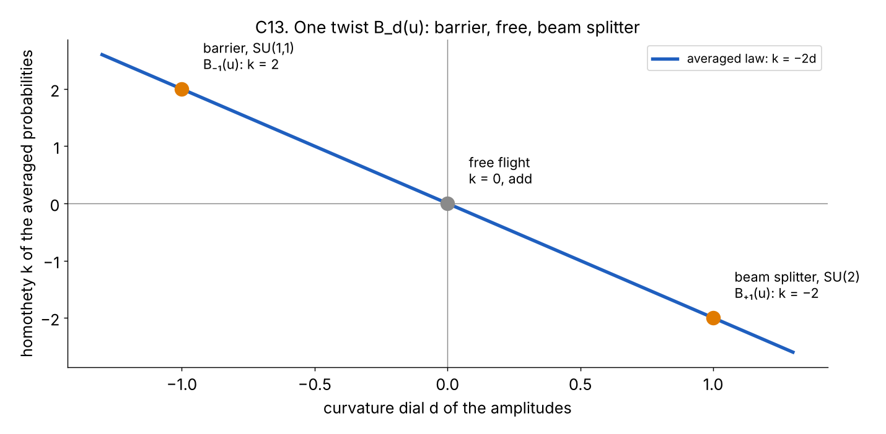

*Figure 14. Amplitudes compose by the d dial; averaged over the phase, probabilities compose by ∘ₖ with k = −2d.*

- **Both ends exact (M2, sympy).** An SU(1,1) barrier [[a, b], [b̄, ā]] is diag(a, ā)·B₋₁(b/a), and an SU(2) beam splitter
  [[a, b], [−b̄, ā]] is diag(a, ā)·B₊₁(b/a), with B_d(u) = [[1, u], [−dū, 1]] the boost of `twisted-boosts/`.
- **The carrying quantity (M1).** Averaged over the angle, half-chords t = (1 − cos√K·D)/(2K) compose by ∘ₖ with k = −2K,
  checked at K = −1, −0.3, 0.5, 1 (Lean `Tunnelling.mean_law_curvature`). Barrier odds ∘₂ at K = −1, plain addition at K = 0,
  the piling-up lemma ∘₋₂ at K = +1.
- **Known:** SU(1,1) multilayers (Monzón, Sánchez-Soto and coauthors); Anderson, Thouless, Abrahams and Fisher (1980);
  Matsui (1993). **Ours (repo):** k = −2K, and the barrier as B₋₁. **Verdict: solid.** It is the clearest place where the
  d dial turns into the k dial (by averaging).

## C14. Riemann pairs: the heat flow is the d dial — slides (as a reading)

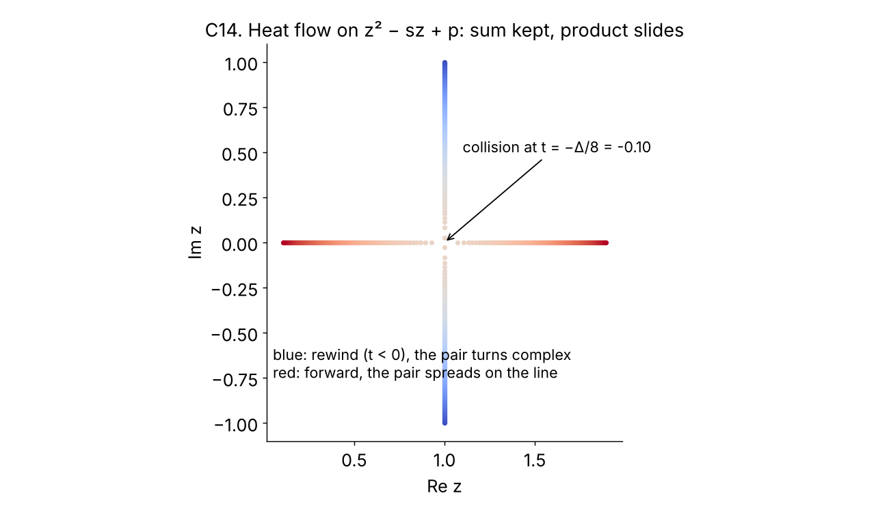

*Figure 15. Zeros of z² − sz + (p − 2t). Forward, the pair spreads on the line; rewound, it meets at t = −Δ/8 and turns into
a complex pair.*

- z² − sz + (P − 2t) solves f_t = −f_zz: the sum (k) is kept and the product (d) slides by −2t (N1, Lean
  `RiemannRound3.heat_pair_disc`). Its discriminant is Δ + 8t, so the collision is the parabola (N2).
- **Known:** de Bruijn (1950), Newman (1976), Rodgers and Tao (2020, Λ ≥ 0). **Verdict: a clean reading, not a lead**,
  as `riemann/round3/` already found: the hypothesis needs a sign, and the dial gives none.

## C15. The elliptic modulus is a second road — disguise

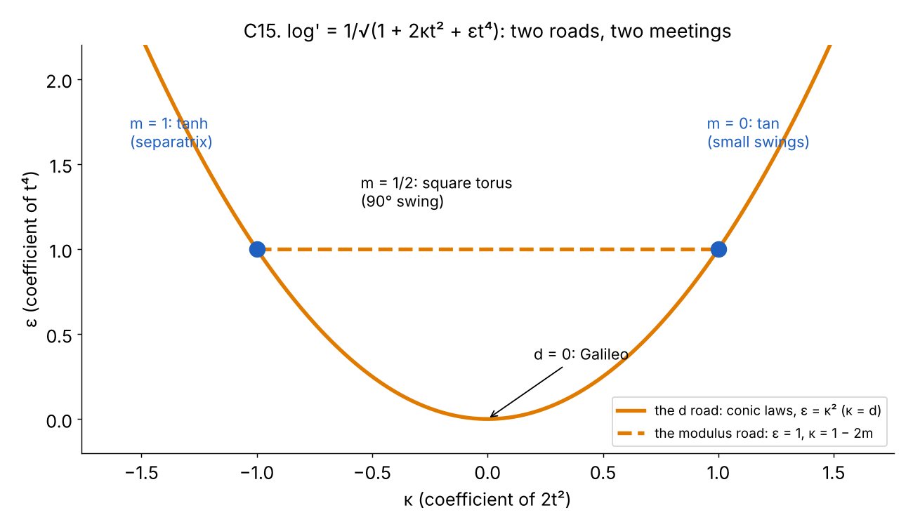

*Figure 16. Laws with log′ = 1/√(1 + 2κt² + εt⁴). The d road (conic laws, ε = κ², through Galileo) and the modulus road
(ε = 1, κ = 1 − 2m) meet only at κ = ±1.*

- At k = 0 the conic laws have log′ = 1/(1 + dt²) = 1/√(1 + 2dt² + d²t⁴): ε = κ² (O1). The modulus road keeps ε = 1 (O2). They
  meet at tan (m = 0, small swings) and tanh (m = 1, the separatrix) and nowhere else. The pendulum's κ = cos θ₀ (O3) and
  its quarter period K(m) ~ ln(4/√(1 − m)) at the separatrix (Q3, 30 digits) belong to the modulus, not to d.
- **Verdict: not a d-dial slide.** The modulus moves the t⁴ term, off the (k, d) plane. The two roads share their ends,
  which is why `elliptic-modulus/` calls it "a road round the border instead of through it".

---

## N. New laws at in-between settings

At k = 0 there are none (N3). At k ≠ 0 the turning side has one family of special settings (N1), with one formal reading
attached (N2).

### N1. Finite clocks at d/k² = 1/(4cos²(πj/N)) — proved (elementary)

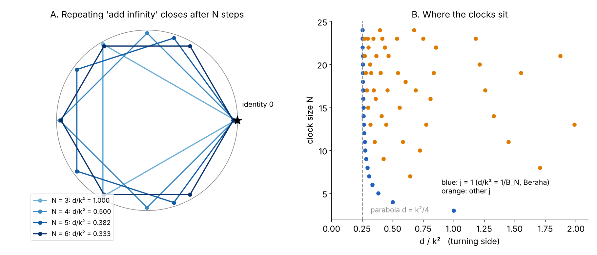

*Figure 17. A: at the clock settings, repeating "add infinity" returns to 0 after N steps. B: where the settings sit on
the turning side. The j = 1 settings are k²/d = 4cos²(π/N), the Beraha numbers; they crowd toward the parabola.*

**Statement.** Fix k ≠ 0 and d > k²/4. Let α, β be the roots of x² − kx + d and q = β/α. The following are the same:

1. d/k² = 1/(4cos²(πj/N)) with gcd(j, N) = 1;
2. q is a primitive N-th root of unity;
3. the move x ↦ x ∘ ∞ = −(1 + kx)/(dx) has exact order N;
4. U_N(k, d) = 0 and U_n(k, d) ≠ 0 for 0 < n < N: corners of size N drop out of the numerator of C2;
5. the χ_y parameter of (k, d) is y = −q, minus a primitive N-th root of unity.

**Proof.** k²/d = (α + β)²/(αβ) = q + 2 + 1/q = 4cos²(φ/2) for q = e^(iφ), so 1 ⇔ 2. The move in 3 has matrix
[[−k, −1], [d, 0]], whose eigenvalues are −α and −β; its N-th power is scalar exactly when (α/β)^N = 1, so 2 ⇔ 3. Binet's
form U_n = (αⁿ − βⁿ)/(α − β) gives 2 ⇔ 4. The relation k²/d = −(1 − y)²/y of C9 with y = −q gives 5. ∎
Checked: P1–P4 for N = 3 to 12 and every j (exact for N = 3, 4, 6: d = k², k²/2, k²/3), polished at N = 7 to 30 digits (Q4);
P5 finds nothing like it on the two-wall side.

**What it might be for.**
- **A clock inside a turning law.** At these settings the turning law contains Z/N through ∞. The repo's finite clocks
  (`GroupsLie.f5_cyclic`, `f7_cyclic`) were over finite fields; these are the real-number versions.
- **Truncated corner expansions.** At a clock setting the size-N corners vanish from the numerator, so the n-fold law is
  shorter than it looks.
- **Hirzebruch's level-N genera.** At the cusps of Γ₁(N), Hirzebruch's elliptic genus of level N reduces to χ_y with −y an
  N-th root of unity (Hirzebruch 1988). Condition 5 says these d are exactly those cusp values, read on the d dial.
- **Beraha numbers.** At j = 1, k²/d = 4cos²(π/N), the Beraha numbers of Potts and chromatic-polynomial theory. The
  diamond-lattice page tested them and found no clustering in its map, so I claim no link beyond the shared numbers.

**Known vs ours.** Each equivalence is textbook: degenerate Lucas sequences (U_n = 0 exactly when α/β is a root of
unity), finite-order elliptic Möbius maps (trace²/det = 4cos²(πj/N); Beardon 1983), and Hirzebruch's cusp values (1988).
Ours: bundling them as the special in-between settings of the d dial. **Verdict: a clean explainer, modest lead.** It
joins three repo modules (finite clocks, Lucas corners, the genus line), but I see no new theorem behind it.

### N2. The clocks sit at negative rung heights — checked (formal), meaning a conjecture

The height reading of C8 puts the clocks at s = k²/Δ = −cot²(πj/N) (P6): s = −1/3 at N = 3, −1 at N = 4, −3 at N = 6. So
the order-4 clock is exactly the setting with the residue of log(1 + x), the rewind of e^x − 1 (H3). This is a formal
match only. I do not know whether it means anything; it is listed so nobody has to find it again.

### N3. Nothing in between at k = 0 — proved

By units (A6, Lean `Landscape.units_den`), every d < 0 is Einstein's law with c = 1/√(−d) and every d > 0 is tangent
addition with a scale. So the k = 0 line holds exactly three laws. Any law "between Galileo and Einstein" on one line must
move k too, or leave the plane (as the modulus does, C15). Negative, and it saves effort.

---

## Assumptions

- **Fixed k.** Every verdict holds k fixed and turns d alone. Moves that change k and d together (the diamond lattice's
  Potts Q on k + d = −1, the χ_y line) are sorted as "no" or read through units.
- **Charts and units.** "Same law" means equal after a linear rescaling (units). Where a Möbius chart is also allowed I say
  so (C6, A7). With both, only the sign of Δ survives.
- **Real numbers.** The survey works over ℝ, except C5 (finite fields) and the complex readings of C9 and N1.
- **Numeric only:** the twist-area check C1 (80 random pairs), Kepler D3–D4 (integrated orbits), the jets check K3–K4,
  the 1D Green's functions L2–L3, the averaged-chord check M1, and the clock orders P1–P3, P5 (floating point; N = 3, 4, 6 are
  exact, N = 7 is polished to 30 digits).
- **Formal only:** C8 and N2 compare iterative residues, a formal invariant; they say nothing about analytic conjugacy.
- **Verdicts rest on the repo's own status** of each Lean module and page; this pass re-checks only the quantities listed.

## Known vs new

| Item | Status | Source |
|---|---|---|
| The (k, d) plane, three kinds by the sign of Δ | known | Coleman and McGuinness (1991); Bismuth (1976 thesis) |
| Galileo / Einstein / tangent as one family | known | Yaglom (1979); Herranz, Ortega and Santander (2000); Lévy-Leblond (1976) |
| Twist = d × area | known | Thomas (1926); Wigner (1939); Gauss–Bonnet |
| Kepler velocity space curvature −2E | known | Fock (1935); Moser (1970); Milnor (1983) |
| Escape speed as the wall of the d < 0 chart | ours, small reading | this page (D4) |
| Pinched cubics G_m / G_a / torus | known | Silverman, AEC §III.2 |
| Galilean electromagnetism at d = 0 | known | Le Bellac and Lévy-Leblond (1973) |
| Complex step / dual numbers / finite difference | known separately | Lyness and Moler (1967); Squire and Trapp (1998) |
| …as three stops of one dial | ours | not found in my search |
| n-fold plane law with Lucas corner weights U_|S|(k, d) = α^(|S|−1)[|S|]_q | ours (from classical pieces) | not found in my search |
| d at fixed k as the χ_y parameter; turning side |y| = 1 | likely folklore | Hirzebruch (1966) for χ_y |
| Finite clocks: equivalence of 1–5 in N1 | known pieces, our bundle | Lucas (1878); Beardon (1983); Hirzebruch (1988) |
| Clocks at heights −cot²(πj/N) | ours, formal | this page (P6) |
| Signature (L-genus) law = Einstein at c = 1 | standard background | the "Lorentz formal group law" (u + v)/(1 + βuv) appears in Hoffnung, Malagón-López, Savage and Zainoulline (arXiv:1208.4114); the L-genus link was not confirmed by a source in my search |

**Searches run (Nov 26, 2026):** "Hirzebruch chi_y genus y root of unity genus of level N"; "Coleman McGuinness 1991
rational formal group laws (x+y+cxy)/(1-dxy)"; "Lucas sequence U_n(P,Q) vanishes alpha/beta root of unity degenerate
4cos^2(pi/n)"; "signature L-genus formal group law (x+y)/(1+xy) relativistic velocity addition"; "complex step derivative
dual numbers finite difference one family R[x]/(x^2 - h^2) hyperbolic numbers derivative"; "Kepler problem velocity space
curvature proportional to energy Fock Moser Milnor hodograph"; "Lucas sequence U_n equals q-integer [n]_q times
alpha^(n-1)"; "Le Bellac Lévy-Leblond 1973 Galilean electromagnetism"; "elliptic Möbius transformation finite order trace
squared 4cos^2(pi/n) Beardon"; "n-fold formal group law (x+y+axy)/(1-bxy) iterate Chebyshev Lucas polynomials elementary
symmetric tangent addition formula generalization". The corner-sum formula of C2 and the one-dial reading of C11 did not
turn up; that is "not found in my search", not "not in print".

## Sources

- Coleman, R. F. and McGuinness, F. O. (1991), "Rational formal group laws", *Pacific J. Math.* 147(1), 25–27. Bismuth, R.
  (1976), McMaster master's thesis (unpublished), same result.
- Yaglom, I. M. (1979), *A Simple Non-Euclidean Geometry and Its Physical Basis*, Springer. Herranz, F. J., Ortega, R. and
  Santander, M. (2000), trigonometry of spacetimes, *J. Phys. A* 33. Lévy-Leblond, J.-M. (1976), "One more derivation of
  the Lorentz transformation", *Am. J. Phys.* 44.
- Hirzebruch, F. (1966), *Topological Methods in Algebraic Geometry*, Springer. Hirzebruch, F. (1988), "Elliptic genera of
  level N for complex manifolds", MPI Bonn preprint 88-24, in *Differential Geometrical Methods in Theoretical Physics*,
  Kluwer.
- Lucas, É. (1878), "Théorie des fonctions numériques simplement périodiques", *Amer. J. Math.* 1.
- Beardon, A. F. (1983), *The Geometry of Discrete Groups*, GTM 91, Springer, §4.3.
- Clifford, W. K. (1873), "Preliminary sketch of biquaternions", *Proc. London Math. Soc.* 4.
- Thomas, L. H. (1926), *Nature* 117; Wigner, E. (1939), *Ann. Math.* 40.
- Fock, V. (1935), *Z. Phys.* 98; Moser, J. (1970), *Comm. Pure Appl. Math.* 23; Milnor, J. (1983), "On the geometry of the
  Kepler problem", *Amer. Math. Monthly* 90.
- Silverman, J. H., *The Arithmetic of Elliptic Curves*, GTM 106, §III.2.
- Le Bellac, M. and Lévy-Leblond, J.-M. (1973), "Galilean electromagnetism", *Nuovo Cimento B* 14.
- Lyness, J. N. and Moler, C. B. (1967), *SIAM J. Numer. Anal.* 4; Squire, W. and Trapp, G. (1998), *SIAM Review* 40.
- Écalle, J., iterative residue (*Les fonctions résurgentes*, 1981–85).
- Repo pages read for every verdict: `landscape/`, `conics/`, `relativity/`, `twisted-boosts/`, `electromagnetism/`,
  `gravity-from-theory/` (and `jet-river/`, `spinning-river/`), `general-relativity/`, `gr-bridges/`, `jet-fields/`,
  `tunnelling/`, `elliptic-modulus/`, `elliptic/`, `force-reach/`, `rulecraft-history/` §7, `riemann/round3/`, `clifford/`,
  `diamond-lattice/`, `height-flow/`, `newton-g/`, `why-i/cayley-klein/`, `affine-names/`, `dial-map/`,
  `shape-dial-survey/` (read only), and the Lean modules named in each section.
