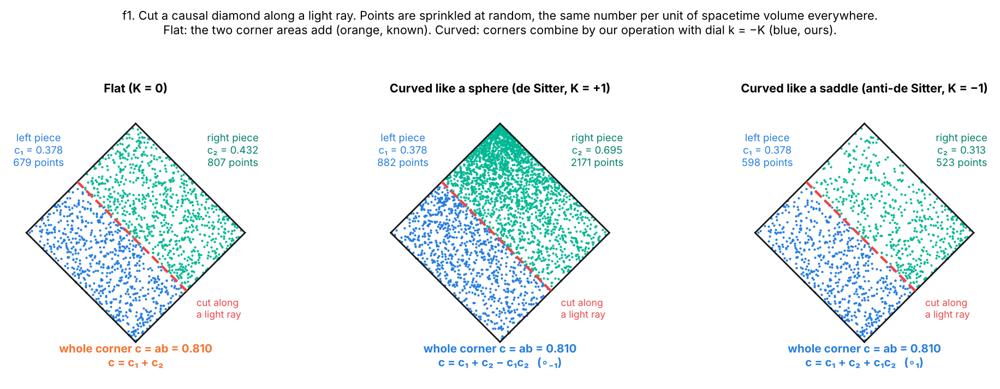
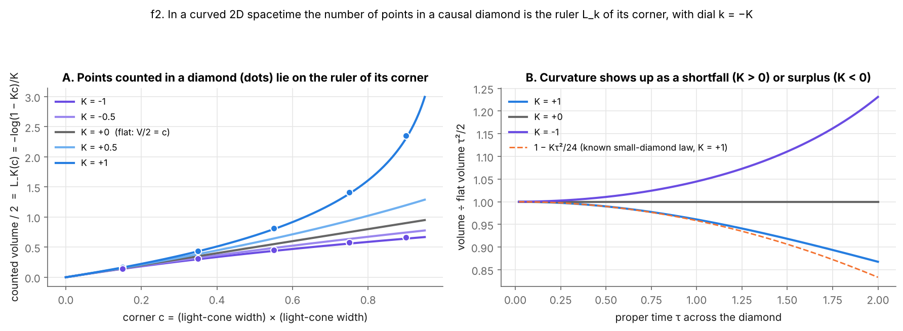
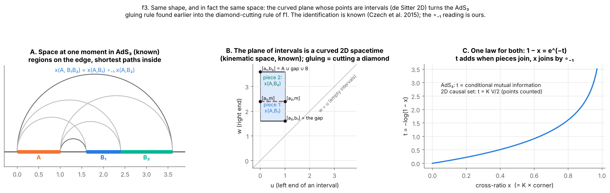
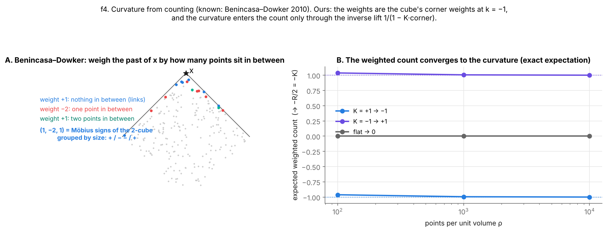
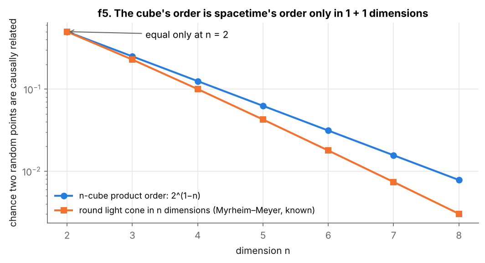
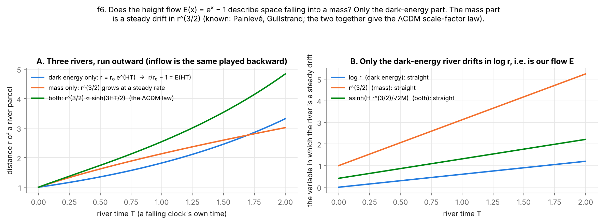
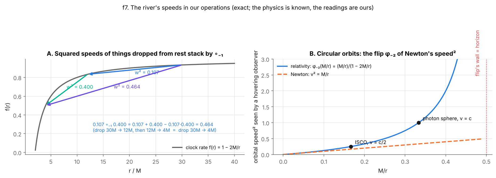
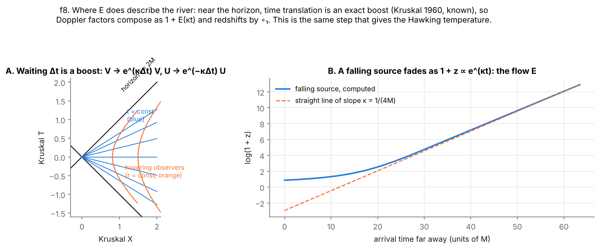

# Curved space from the theory: counting and the river (DRAFT)

*DRAFT, Nov 25 2026. Checks: `checks.py` → `checks_output.txt` (36 of 36 pass, about 5 s), `results.json`.
Pictures: `figures.py` → `figures/f1 … f8`. Colour key in every picture: **orange = known, blue = ours**.*

Brennan's ask (Nov 25): follow the leads, and look for math "that has the same shape, not necessarily a direct
underlying identical mechanic". Goal of this pass: get curved space out of the theory along two routes,
(1) curvature from counting (causal sets) and (2) the river picture of space flowing into a mass.

Notation: a ∘ₖ b = a + b + k·ab; lift ℓₖ(x) = 1 + kx; ruler Lₖ(x) = log(1 + kx)/k; flip φₖ(x) = x/(1 + kx);
height flow E(x) = eˣ − 1, with E(a + b) = E(a) ∘₁ E(b).

## Verdict first

- **Route 1 gives a clean, exact, geometric result, in 1 + 1 dimensions.** There the causal order of any spacetime,
  curved or not, is exactly the 2-cube's order (the product of two light-cone directions). Curvature lives only in
  *how many points* sit in each causal diamond. That count is our ruler of the diamond's corner, with the dial set to
  minus the curvature: V = 2·L₋K(corner). Cut a diamond along a light ray and the corners combine by our operation
  with k = −K (the union rule ∘₋₁ for de Sitter, the circle operation ∘₁ (called mult-add before 1.0) for anti-de Sitter, plain addition when flat).
  **Ours as a reading; the geometry underneath is known and sure.**
- **It is the "same shape" Brennan asked for, and more than a resemblance.** The AdS₃ gluing rule from the holographic
  exploration, x(A, B₁B₂) = x(A,B₁) ∘₋₁ x(A,B₂), is *the same identity*: the curved plane whose points are boundary
  intervals (kinematic space, known) is exactly our de Sitter plane, and gluing regions is cutting a diamond.
- **Counting gives curvature (known, Benincasa–Dowker 2010), and in 2D it uses the cube's own weights.** The weights
  (1, −2, 1) are the Möbius (corner) weights of the 2-cube grouped by size, and the curvature enters the count only
  through the inverse lift 1/(1 − K·corner). Checked exactly: the weighted count goes to −R/2.
- **It stops at 1 + 1 dimensions.** In 3 and 4 dimensions the cube's product order is not the order of a round light
  cone (chance of two points being related: 1/4 vs 0.229, 1/8 vs 0.1), and the 4D counting weights (1, −9, 16, −8)
  are not cube weights. 2D gravity also has no Einstein dynamics of its own. So this route gives the *geometry* of
  curvature from counting, not Einstein's equations.
- **Route 2: the height flow E describes the river in exactly two places, not the mass inflow itself.** E is the
  dark-energy river (r ∝ e^{HT}) and the horizon (waiting is a boost, 1 + z ∝ e^{κt}, the Hawking step). The mass part
  of the inflow is a steady drift in r^{3/2}, not E. Two exact readings came out along the way: squared drop speeds
  stack by ∘₋₁ in any static spacetime, and circular-orbit speeds are the flip φ₋₂ of Newton's.
  **No new physics; the readings are ours.**

| Lead | Judgement on its own merits |
|---|---|
| 2D diamonds: count = ruler of the corner, cuts compose by ∘₋K | **Worth following.** Exact and geometric; ties the corner, the ruler, the union rule and the AdS₃ gluing together through one picture. Natural next step: the radial plane of a black hole (curvature 2M/r³, check C9), where spherical symmetry makes 4D gravity a 2D problem. |
| Cube weights = 2D counting-curvature weights | Worth a sentence in the write-up; a true dictionary entry, but the 4D weights are not cube weights, so it does not extend. |
| E in the river | Dictionary entry. True where it holds (dark energy, horizons); does not describe the mass inflow. |
| Drop speeds by ∘₋₁, orbits by φ₋₂ | Dictionary entries; exact and pretty, no new prediction. |

---

## Route 1. Curvature from counting

### f1. Cut a causal diamond along a light ray

*f1. Points sprinkled at random with the same density everywhere (Poisson), in a flat, a de Sitter and an anti-de
Sitter 2D spacetime. The diamond is cut along a light ray into two diamonds. Flat: corners add (known). Curved: the
corners combine as c = c₁ + c₂ − K c₁c₂, which is our operation with dial k = −K (ours). The point counts follow
the volumes.*

Setup (all exact, checks A1–A8): in light-cone coordinates every 2D metric of constant curvature K can be written
ds² = −4 du dv/(1 − K uv)² (scalar curvature R = 2K, check A1). Causal curves only move up in u and in v, so the
causal order is the product order of the two light-cone directions, the 2-cube's order, whatever K is. The diamond
from the origin to (a, b) has volume

  **V = −(2/K) log(1 − K ab) = 2·L₋K(ab)** (check A2; flat limit 2ab, check A2b).

For any two points p, q the invariant that matters is x(p,q) = K(u₂−u₁)(v₂−v₁)/((1 − K u₁v₂)(1 − K u₂v₁)):
geodesic proper time obeys tanh²(√K τ/2) = x (18 geodesics shot numerically, error 2e-14, check A5), and the
volume of the diamond is −(2/K) log(1 − x) (check A7). So **1 − x = e^{−KV/2}**. Volumes of the two pieces add,
so x(whole) = x(left) ∘₋₁ x(right) for any diamond and any cut (checks A8, A8c). In terms of the corners
c = x/K: c = c₁ ∘₋K c₂ (A8b).

Sprinkling test (A10): 6000 points per unit volume at K = 0.8; counts in four diamonds, including both halves of a
cut diamond, match ρV within 0.7 standard deviations.

### f2. The count is the ruler of the corner

*f2. A: counted volume (dots, sprinkled) against the ruler L₋K(c) of the corner for five curvatures. B: the same
volume against proper time; the small-diamond law 1 − Kτ²/24 is known (Gibbons–Solodukhin, with R₀₀ = −R/2 in 2D,
check A4b). Note the two panels measure the diamond's size differently: at a fixed corner a K > 0 diamond holds
more points, at a fixed proper time it holds fewer.*

Exact closed form: V(τ) = (4/K) log cosh(√K τ/2) = τ²/2 − Kτ⁴/48 + K²τ⁶/720 − … (check A4).

### f3. Same shape as the AdS₃ gluing, and in fact the same space

*f3. A: three regions on the edge of AdS₃ at one moment, with their shortest paths (known). B: the plane whose
points are intervals [u, w]; the substitution w = 1/(Kv) turns our metric into 4 du dw/(K(w − u)²), the kinematic
space of Czech, Lamprou, McCandlish and Sully (2015) (check A11). The diamond spanned by the big interval [a₁,b₂]
and the gap [a₂,b₁], cut at w = m, has pieces whose invariants are x(A,B₁) and x(A,B₂). C: one law for both.*

The invariant x(p,q) is a cross-ratio of four points on one line, (u₁, u₂; 1/(Kv₁), 1/(Kv₂)) (check A6), and the
AdS₃ gluing law of `../exploration/` (Part 1) is the same cross-ratio identity (check A9). In kinematic space the
volume of a causal diamond is known to be a conditional mutual information; the exploration's "t" (a region's width
in another region's modular time) is our K·V/2. **Known: kinematic space and the volume–entropy link. Ours: reading
both the gluing and the diamond cut as ∘₋₁, with the dial equal to minus the curvature.** This is why the two
results looked alike: they are one result.

### f4. Curvature from counting, with the cube's weights

*f4. A: Benincasa–Dowker's rule weighs each past point of x by how many points sit in between: +1 for none, −2 for
one, +1 for two. B: the exact expected weighted count, computed with our volume law, goes to −R/2 = −K for
K = +1, −1 and 0.*

- The 2D weights (1, −2, 1) are the 2-cube's Möbius weights grouped by size, (−1)^k C(2,k), and they are the
  Laguerre polynomial L₂ (checks B1, B1b; the Laguerre form is known from Aslanbeigi, Saravani and Sorkin 2014; the
  cube reading is ours).
- With our exact volume law, the expected count needs only three numbers: ∫ L₂ e⁻ˢ = 0, ∫ L₂ s e⁻ˢ = 0 and
  ∫ L₂ s log s e⁻ˢ = ½. The flat part gives the □ of the field (check B3, normalisation □t² = −2). The curvature
  enters only through the inverse lift 1/(1 − K w) = e^{KV/2} of the corner w, and gives exactly −K (check B2:
  −0.99916 at ρ = 10⁴ for K = 1; error falls like 1/ρ).

### f5. Why it stops at 1 + 1 dimensions

*f5. Chance that two random points are causally related: the n-cube's product order gives 2^{1−n}; a round light
cone in n dimensions gives the Myrheim–Meyer value (known). They agree only at n = 2 (check B4, Monte Carlo too).*

The cube's order is a box-shaped cone; spacetime's cone is round. In 4D, Benincasa–Dowker's weights are
(1, −9, 16, −8), not the 4-cube's (1, −4, 6, −4, 1) (check B4b). So the clean 2D law does not lift directly.

---

## Route 2. The river (space flowing into a mass)

Known background (from `../general-relativity/` and `../gr-bridges/`): Schwarzschild is the metric
−dT² + (dr + v dT)² + r²dΩ² with river speed v² = 2M/r (Painlevé 1921, Gullstrand 1922, Hamilton & Lisle 2008).
In those coordinates light moves at v ± 1, a plain sum (check C2, the flat dial q = 0), while every local frame is
relativistic.

### f6. Does the height flow describe the inflow?

*f6. A: three rivers. B: the variable in which each river is a steady drift. Only the dark-energy river drifts in
log r, which makes it our flow E: r/r₀ − 1 = E(HT) (check C3). The mass river drifts in r^{3/2} (check C4). Both
together give r^{3/2} ∝ sinh(3HT/2) (check C5), the same law as the ΛCDM scale factor (known: one Newtonian equation
underlies both).*

**Answer: no for the mass inflow, yes for the dark-energy part.** Every flow can be rewritten as E by a change of
variable, so the honest test is whether E appears in the natural variable (distance). It does only for v = Hr.

### f7. Two exact readings of the river's speeds

*f7. A: drop something from rest at height a, catch its speed w at b (measured by a hovering observer). Squared
speeds stack: w²(a→c) = w²(a→b) ∘₋₁ w²(b→c). The picture's numbers: 0.107 ∘₋₁ 0.400 = 0.464. B: circular-orbit
speed² seen by a hovering observer is the flip φ₋₂(M/r) of Newton's v² = M/r.*

- Drop speeds (checks C1–C1c): because 1 − w² = f(b)/f(a) for the clock rate f, in **any** static spacetime. Checked
  by integrating geodesics in Schwarzschild and in a charged black hole (error 8e-13). The river speed itself is the
  case a = ∞: 2M/r = w²(r₀→r) ∘₋₁ (2M/r₀). Known in substance (redshift factors multiply); the ∘₋₁ reading is ours.
- Orbits (checks C8–C8c): Kepler's law holds exactly in Schwarzschild time, and dividing by the clock's lift
  ℓ₋₂(M/r) = 1 − 2M/r turns it into the flip. The flip marks the known places: ISCO (M/r = 1/6) at speed c/2, the
  photon sphere (1/3) at c, and the flip's wall (1/2) is the horizon. Flips add their dials, φ₋₂ = φ₋₁ ∘ φ₋₁.

### f8. Where E does describe the river: the horizon

*f8. A: in Kruskal coordinates, waiting Δt in Schwarzschild time is an exact boost, V → e^{κΔt}V, U → e^{−κΔt}U
with κ = 1/(4M) (checks C6, C6b). B: a source falling in fades as log(1 + z) = κt + const (check C7, fitted slope
0.2493 against 0.25).*

So Doppler factors near a horizon compose as 1 + E(κt), and successive redshifts by ∘₁. This is the same step
that gives the Hawking temperature, and `../gr-bridges/` (J2) already reads the Unruh temperature as the circle operation
flow. Known (Kruskal 1960); reading ours.

### Where the two routes meet

The radial (t, r) plane of a black hole is a 2D spacetime with Gaussian curvature 2M/r³ (check C9), the same rate
as the loop twist found in `../general-relativity/` (route b). So locally, small diamonds in the radial plane cut by
light rays should compose by ∘ₖ with k = −2M/r³: the river's tidal stretch is the corner dial. This is the step
the next pass should test: spherical 4D gravity is known to reduce to a 2D problem (with the sphere's area as an
extra field), so the counting law might reach real 4D gravity there.

**Tested (26 Nov, see [`radial-plane/`](radial-plane/README.md)).** The plain radial-plane count does read
K = 2M/r³. But once each point is weighted by its sphere's area (the real 4D count), the mass cancels at leading order:
the coefficient is 2E² − 1, set only by the free-fall energy E, so a river parcel counts exactly as in empty space.
The mass shows only through the sphere sizes themselves (the Misner–Sharp mass) or one order further out. Exact and
tidy, but no new physics.

---

## Known versus ours

| Piece | Status | Source / check |
|---|---|---|
| 2D causal order = product of the two light-cone orders (conformal flatness) | Known | standard; A1 |
| Diamond volume in 2D de Sitter, small-diamond expansion | Known | Gibbons & Solodukhin 2007; A2–A4b |
| Volume as the ruler L₋K of the corner; cuts compose by ∘₋K (∘₋₁ on x) | **Ours (reading, exact)** | A2, A7, A8–A8c, A10 |
| Kinematic space of a line = 2D de Sitter; diamond volume ↔ conditional mutual information | Known | Czech, Lamprou, McCandlish, Sully 2015 (arXiv:1505.05515); A11 |
| AdS₃ gluing and diamond cutting are one cross-ratio identity | **Ours (reading)** | A6, A9 |
| Curvature from counting (2D d'Alembertian, mean → □φ − ½Rφ) | Known | Benincasa & Dowker 2010 (arXiv:1001.2725); B2, B3 |
| 2D weights = Laguerre L₂ | Known | Aslanbeigi, Saravani, Sorkin 2014 (arXiv:1403.1622) |
| 2D weights = 2-cube Möbius weights; curvature enters through the inverse lift | **Ours (reading)** | B1, B3b |
| Cube order ≠ light-cone order above 2D | Ours (check); Myrheim–Meyer values known | Myrheim 1978, Meyer 1988; B4 |
| River metric, light speeds v ± 1, ΛCDM-form of the Schwarzschild–de Sitter river | Known | Painlevé, Gullstrand, Hamilton & Lisle 2008; C2–C5 |
| Λ river = E; horizon time translation = boost with factor 1 + E(κt) | Known physics; E reading ours | Kruskal 1960; C3, C6, C7 |
| Squared drop speeds stack by ∘₋₁ (any static spacetime) | **Ours (reading, exact)** | C1–C1c |
| Orbit speed² = φ₋₂(M/r) | **Ours (reading, exact)**; the numbers are known | C8–C8c |

Names: no new names were coined. "Kinematic space", "causal diamond", "Möbius function", "river model" are the
existing terms.

## Open, next steps (not done)

1. ~~Radial-plane counting for a black hole~~: done in [`radial-plane/`](radial-plane/README.md). Leading order sees
   only the free-fall energy E; the mass cancels.
2. A short Lean file for the algebraic identities (A6, A8, A8c, A9, B1, C1, C8c); not written here because no Lean
   toolchain is available in this session.

## Files

- `checks.py` → `checks_output.txt`, `results.json`: 36 of 36 pass (sympy, mpmath, scipy, numpy).
- `figures.py` → `figures/f1_cut_diamond.png … f8_horizon_boost.png` (reads `results.json`).
- `radial-plane/`: the black-hole radial-plane count (README, `checks.py` with 10 of 10 passing, figures g1–g3).
