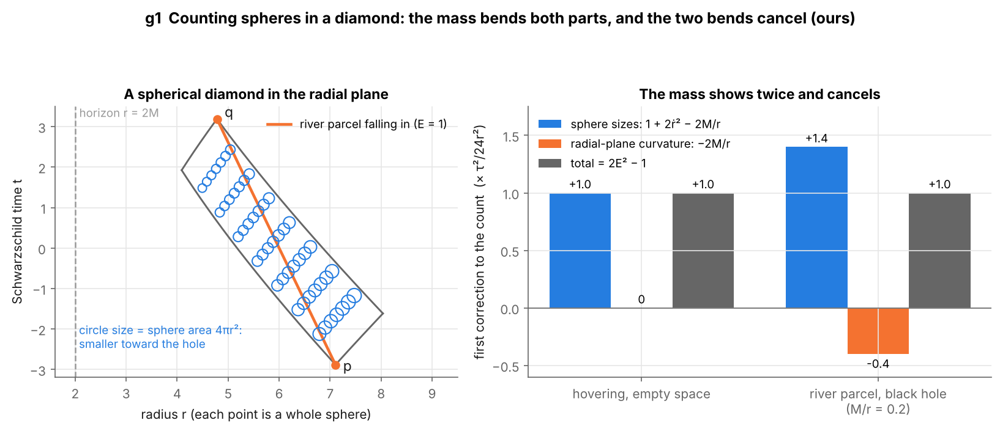
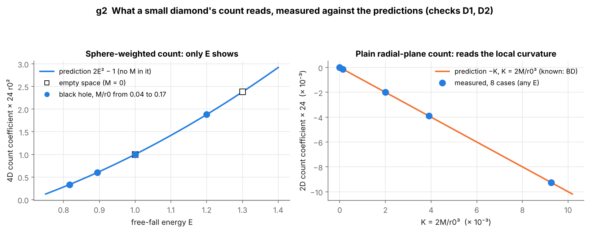
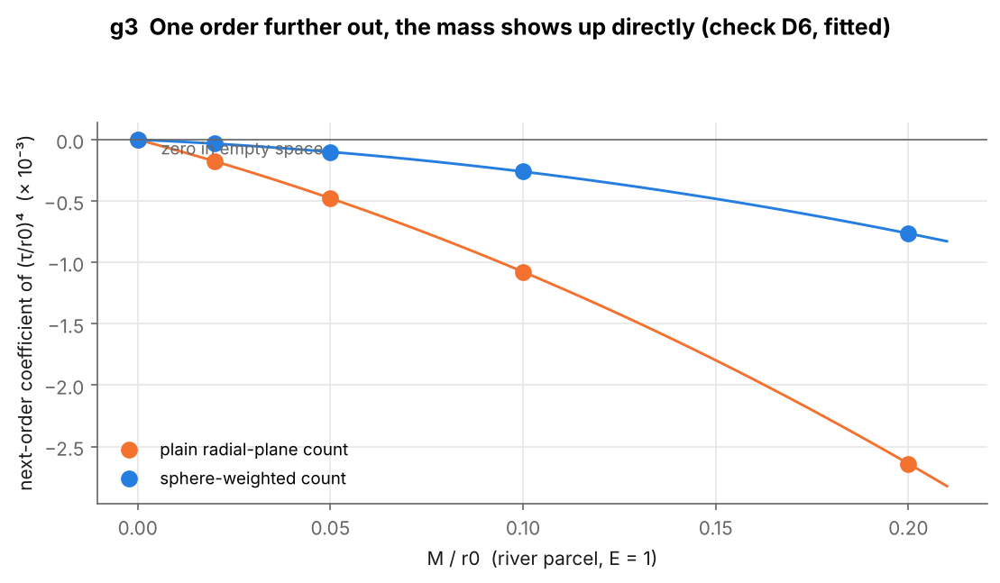

# Counting in a black hole's radial plane (DRAFT)

> **DRAFT, 26 Nov 2026.** Exploratory note under `curved-space/`. Nothing here is published, versioned or proved in Lean.
> Every number below comes from `checks.py` (10 of 10 checks pass, output in `checks_output.txt`).

**Verdict first.** If you count the spheres inside a small spherical diamond around a body falling into a black hole,
the first correction to the count does not see the mass at all. It reads only the free-fall energy E. A river parcel
(E = 1) counts exactly as if it were hovering in empty space. The mass bends two things, the sizes of the spheres and the
radial plane itself, and the two bends cancel. Counting points of the radial plane alone does see the mass, through the
plane's curvature K = 2M/r³, as Benincasa–Dowker would predict. To read M from sphere counting you also need the
sphere sizes (the Misner–Sharp mass) or the next order in the size of the diamond.

**Judgement.** The result is exact and checks cleanly, and it is a nice small fact. It gives no new physics, and it
doesn't make E(x) = e^x − 1 or the lift/flip do any new work. It is worth keeping as a worked example of what counting can
and can't see.

---

## 1. The set-up: one point of the plane is a whole sphere

**Picture g1, left.** Outside a black hole, every point of the (t, r) plane stands for a whole sphere of area 4πr².
A *spherical diamond* between two spheres p and q is everything the light shells from p and q enclose. In light-cone
coordinates u = t − r\*, v = t + r\* it is a rectangle. The orange line is a river parcel falling in, from p to q in
proper time τ. The blue circles show sphere size: smaller toward the hole.

We count in two ways:

- **plain count V2:** every point of the plane counts once (the 2D volume of the rectangle);
- **sphere-weighted count V4:** every point counts by its sphere's area (the real 4D volume).

## 2. What the counts read

**Picture g2.** Small-diamond expansions, measured in 8 cases (empty space and black holes; E from 0.82 to 1.3) and set
against the predictions:

| Count | Result | Status |
|---|---|---|
| plain, V2 | (τ²/2)(1 − K τ²/24 + …), with K = 2M/r³, **for any E** | the plane's curvature R = 4M/r³ is known; the BD/Gibbons–Solodukhin form of the count is known |
| sphere-weighted, V4 | 2πr² τ² (1 + (2E² − 1) τ²/(24 r²) + …): **no M** | ours (elementary computation) |
| sphere-weighted, empty space | exact: 2πr² τ² (1 + cosh(2η) τ²/(24 r²)), η = rapidity | ours (sympy check D3) |

Measured errors: under 6 × 10⁻⁶ (in units of M) for V2 and under 4 × 10⁻⁷ for V4.

## 3. Why the mass cancels

**Picture g1, right.** The τ² correction to V4 is the average of r² over the small diamond. Two things set it:

1. **Sphere sizes (blue):** how r² bends across the diamond. In this geometry ∇∇r = (M/r²)g and □r² = 2, the same as
   in empty space. Along the path this gives 1 + 2ṙ² − 2M/r.
2. **Radial-plane curvature (orange):** a curved plane has fewer points in a diamond. That gives −K r² = −2M/r.

Add them, and use ṙ² = E² − 1 + 2M/r for free fall: 1 + 2(E² − 1 + 2M/r) − 2M/r − 2M/r = **2E² − 1**. The M terms
cancel exactly (checks D4a–D4e). For a river parcel, E = 1, so the total is 1, the same as a hovering observer in empty
space. In the bar chart, at M/r = 0.2 the two parts are +1.4 and −0.4.

This is the counting version of something general relativity already says: outside the hole there is no matter, so
there is nothing local for a volume count to pick up except the observer's own motion. (The Ricci tensor is zero there,
and Gibbons–Solodukhin's leading volume correction is a Ricci term.)

## 4. Where the mass does show

- **With sphere sizes as well:** knowing r and ṙ along the path gives M = (r/2)(1 − E² + ṙ²). That is the
  Misner–Sharp mass (known, 1964), check D5.
- **One order further out:** at (τ/r)⁴ the mass enters directly. For a river parcel at r0 = 10 the fitted coefficients
  are about −(M/r0)/120 − 0.024(M/r0)² for the plain count and about −(M/r0)/720 − 0.012(M/r0)² for the
  sphere-weighted one. Both are zero in empty space (check D6, picture g3). These are numerical fits, not derived
  formulas. The −1/120 and −1/720 look like clean fractions, but we haven't derived them.

## 5. Known versus ours

| Piece | Status | Source |
|---|---|---|
| Radial plane of Schwarzschild has R = 4M/r³ | known | standard textbook result |
| Counting relations in 2D reads curvature | known | Benincasa & Dowker, arXiv:1001.2725 |
| Small-diamond volume expansions in curved space | known | Gibbons & Solodukhin, arXiv:hep-th/0703098 |
| Diamonds with spheres for tips in static spherical spacetimes | known (related) | Berthiere, Gibbons & Solodukhin, arXiv:1507.03619 |
| Reduced 2D Schwarzschild for causal-set counting near horizons | known (related) | Dou & Sorkin 2003, as cited in arXiv:2307.04150 |
| Misner–Sharp mass | known | Misner & Sharp 1964 |
| Sphere-weighted coefficient 2E² − 1, M cancelling, river parcel = empty space | **ours** | checks D2, D4 |
| Next-order mass coefficients | **ours**, numerical fit only | check D6 |

We searched for a source that computes the sphere-weighted count for a falling observer and didn't find one. This is
quick, standard calculus, though, so it may well already be in the literature, for example in the
Berthiere–Gibbons–Solodukhin line of work, whose full text we did not read.

## 6. Files

- `checks.py`: 10 checks (D1–D6). Run `python3 -W ignore checks.py > checks_output.txt` (a few seconds).
- `figures.py`: draws g1–g3 from `results.json`.
- `results.json`, `checks_output.txt`: the last run.
