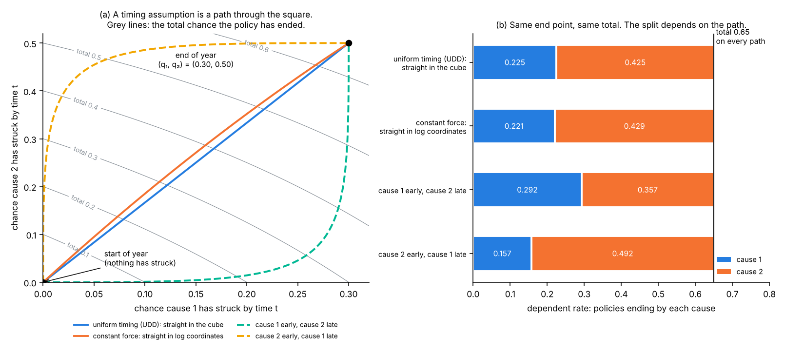
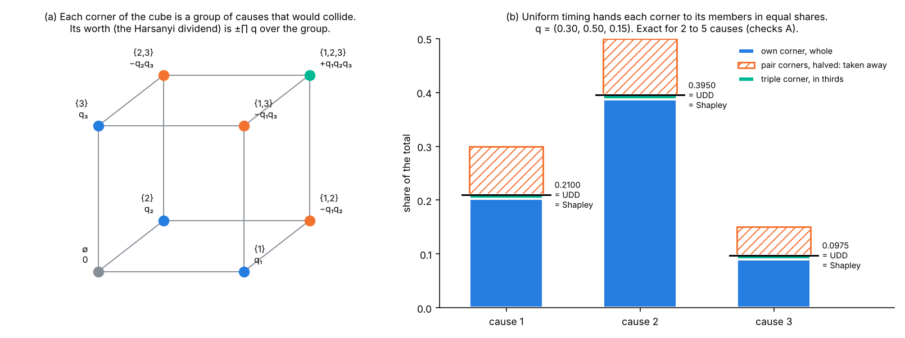
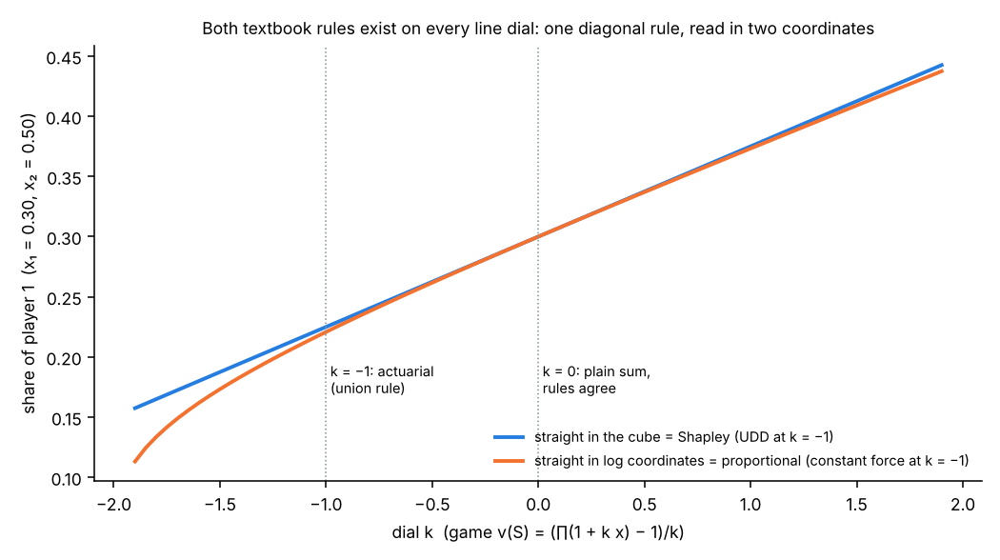
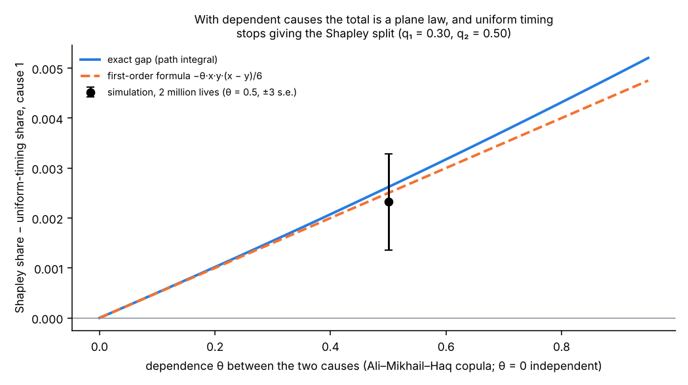

# Decrement paths: a timing assumption is a path through the cube (DRAFT)

**Result in one sentence:** yes, the picture holds for any number of causes. Uniform timing hands each corner of
the cube to its members in equal shares, which is the Shapley value, and constant force is the same straight-line
rule read in log coordinates. The fuller theory adds one new thing. When the causes depend on each other, the total
becomes a plane law, and uniform timing stops giving the Shapley split. To first order the gap is −θ·x·y·(x − y)/6.

Status: DRAFT, not reviewed, not published. Follows lead R6 in `../closed-leads-revisit/README.md`. Reopens the
note in `../actuarial/` that the decrement-path identity was "the best candidate once [Mathlib is] reachable".
The Lean file here is written for the Mathlib library but **not built**: there is no Lean on the machine that wrote
it. 25 of 25 Python checks pass.

## The question in plain words

A policy can end several ways in a year: death, lapse, disability. Each cause j has an absolute rate qⱼ, the chance
it would strike if it were the only cause. If the causes are independent, the chance the policy ends at all is the
union rule (our ∘₋₁): 1 − ∏(1 − qⱼ). Actuaries also need the **dependent rates**, how many policies end by each
cause, and that depends on *when* in the year each cause strikes. Textbooks offer two timing assumptions, uniform
(UDD) and constant force.

The old page read each timing assumption as a path through the cube and checked the readings for 3 causes. The lead
asked for three things: test the picture for any number of causes, put it into Lean now that the Mathlib build runs,
and see what the fuller theory (the plane dial) says about it.

## Fig 1. Same end point, same total, different split

- The point p(t) = (chance each cause has struck by time t) runs from the empty corner to (q₁, q₂). The dependent rate
  of cause j is the integral of ∂ⱼ(total) along the path, times how fast pⱼ moves.
- **Path independence (checks B):** 25 random paths, front-loaded and back-loaded, all give the total 1 − ∏(1 − qⱼ)
  to 10 decimal places. The reason is one line: the derivative of 1 − ∏(1 − pⱼ) is the sum of the causes' rates
  (the product rule). The split between causes moves a lot: with 30% and 50%, cause 1 gets anywhere from 0.157 to
  0.292 of the 0.65 total.

## Fig 2. Uniform timing is the equal corner split, which is Shapley

- Uniform timing is the straight line through the cube, pⱼ(t) = t·qⱼ.
- Expand ∏(1 − t·qᵢ) over the other causes and integrate tᵐ to 1/(m + 1). What comes out is: each corner of the cube
  (a group of causes that would collide, worth ±∏q over the group) is shared equally among its members.
- That equal split of corner worths is exactly the Shapley value (Harsanyi 1959). **Checks A:** exact as
  polynomials for 2, 3, 4 and 5 causes, against the Shapley value computed by averaging over all orders.

## Fig 3. On every line dial it is one rule in two coordinates

- Replace the union rule with any line dial, v(S) = (∏(1 + k·xᵢ) − 1)/k. The straight path in the cube still gives the
  Shapley value, now with corners k^(|S|−1)·∏x shared equally (checks D1, D2, symbolic in k). This is Owen's
  diagonal formula (1972) for a game that is multilinear.
- The straight path in the dial's own log coordinate L_k(x) = log(1 + k·x)/k gives a split in proportion to L_k
  (checks D3, for k = −1, −0.4, 0.7 and 2). At k = −1 this is constant force: share ∝ log(1 − qⱼ), the textbook formula
  (checks C1 to C3).
- So the two textbook assumptions are not two separate ideas. They are one diagonal rule (Aumann–Shapley) applied
  in two coordinate systems. At k = 0 the law is a plain sum and the two rules agree.

## Fig 4. Dependent causes: the total is a plane law, and the Shapley reading breaks

- Let the two causes depend on each other through the Ali–Mikhail–Haq copula with strength θ (θ = 0 is independent).
  The total chance of ending becomes q = (q₁ + q₂ − (1 + θ)q₁q₂)/(1 − θq₁q₂). That is the plane dial with
  k = −(1 + θ), d = θ, the same plane law that lead R4 found for frailty.
- The path picture survives: totals still add up on every path, and **a 2-million-life simulation of dependent
  causes matches the path integral** within 3 standard errors (checks F1).
- What breaks is the Shapley reading. Uniform timing now gives the larger cause more than its Shapley share. The gap
  is −d·x·y·(x − y)/6 + O(d²), the same for every k (checks E1, symbolic). The simulation rules out the Shapley split
  at more than 5 standard errors (checks F2).
- The other half of the rule survives: a straight path in the plane law's own log coordinate,
  ∫ dx/(1 + kx + dx²), still splits in proportion to those logs (checks E5).

**Why it breaks:** the straight-line formula equals Shapley only for a law that is linear in each cause separately.
A line dial is; a plane law (d ≠ 0) is not. So "uniform timing = Shapley" is a fact about independent causes.

**How big it is in practice:** at death 0.4% and lapse 6% with θ = 0.5, the gap moves the death share by 0.03%. That is
small, but it is the same size as the whole difference between the two textbook timing assumptions at those rates
(also 0.03%). So for dependent causes, the choice of timing assumption and the dependence matter about equally.

## The Lean file

`DecrementPaths.lean` states, for any finite set of causes, with real numbers and Mathlib's integrals:

| Theorem | What it says |
|---|---|
| `path_total` | On every differentiable path, the dependent rates add up to the total 1 − ∏(1 − pᵢ) at the end minus the start |
| `udd_corner` | Uniform timing gives cause j each corner containing j, worth (−1)^|S|·qⱼ·∏_S q, divided by \|S\| + 1 |
| `const_force_split` | Constant force gives cause j the share μⱼ/Σμ of 1 − e^(−Σμ) |
| `const_force_total` | The constant-force total is 1 − e^(−Σμ) |

The step from the equal corner split to the Shapley value is Harsanyi's theorem. For 2 and 3 causes the library
already proves it in core Lean (`GameTheory.shapley2_union`, `GameTheory.shapley3_corners`); for general n it is
cited, not proved here. **Not built.** The proofs are first drafts and may need repair on the first Mathlib build.

## Is this a lead worth following?

Yes, as a clean, small result. The independent-cause picture is now exact for any number of causes and stated in
Lean. The dependent-cause gap is the part with a little new content: it says which textbook identity silently assumes
independence, and it gives the size of the error. It is not a new law. A natural next step would be to compare the
gap with a published dependent-decrement study (for example the copula work at City, University of London cited
below), which would need their data.

## Known versus ours

| Piece | Status |
|---|---|
| UDD and constant-force formulas for dependent rates | Known: Bowers et al., *Actuarial Mathematics* (1986) |
| Shapley value; equal split of corner worths (Harsanyi dividends) | Known: Shapley 1953, Harsanyi 1959 |
| Straight-line (diagonal) formula for the Shapley value; Aumann–Shapley | Known: Owen 1972, Aumann and Shapley 1974 |
| AMH copula; dependent competing risks with copulas | Known: Ali, Mikhail, Haq 1978; Kaishev, Dimitrova, Haberman 2007 |
| Reading a timing assumption as a path through the cube; UDD = Shapley; constant force = log coordinates | Ours, as far as two searches show (Shapley appears in demographic decompositions, not in decrement timing) |
| The gap −d·x·y·(x − y)/6 under dependence, and the ruling that the Shapley reading needs independence | Ours |

## Checks (25 of 25 pass)

Run `python3 checks.py` (sympy and numpy). Output in `checks_output.txt`, results in `checks.json`.

- A2–A5, A2b–A5b: uniform timing = equal corner split = Shapley, and the shares add to the total, exactly, 2 to 5 causes.
- B1–B3: path independence on 25 random paths; the split moves; the product-rule identity, symbolic.
- C1–C4: constant force = straight in log coordinates = the textbook formula; the two textbook splits differ.
- D1–D3: every line dial k: straight path = Shapley; corner weights k^(|S|−1); log-straight = proportional.
- E1–E5: plane dial: the gap formula; zero at θ = 0; nonzero at θ = 0.5, 0.9; log-straight still proportional.
- F1–F2: simulation of AMH-dependent causes matches the path integral and rules out the Shapley split.

## Files

`checks.py`, `checks_output.txt`, `checks.json`, `figures.py`, `figures/fig1-paths.png`, `figures/fig2-corner-split.png`,
`figures/fig3-every-dial.png`, `figures/fig4-dependent.png`, `DecrementPaths.lean` (unbuilt), this README.

## Sources

- Bowers, Gerber, Hickman, Jones, Nesbitt, *Actuarial Mathematics* (1986), multiple decrement chapters. From memory.
- Harsanyi (1959), Owen (1972), Aumann and Shapley (1974). From memory.
- Kaishev, Dimitrova, Haberman, "Modelling the joint distribution of competing risks survival times using copula
  functions" (2007), City, University of London open access: https://openaccess.city.ac.uk/4040/
- Lee, Ha, Lee (2021), decrement rates under competing risks, *Computational Statistics & Data Analysis*:
  https://ideas.repec.org/a/eee/csdana/v156y2021ics0167947320302164.html
- shapleyHALE (CRAN), Shapley decomposition of health-adjusted life expectancy, the nearest Shapley use found:
  https://cran.r-universe.dev/shapleyHALE/doc/shapleyHALE_introduction.html
