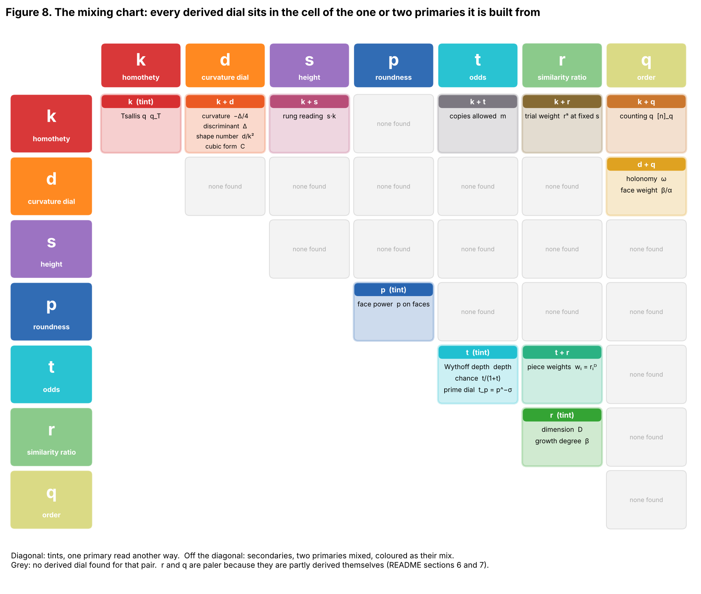

# Derived dials: the mixing chart (DRAFT)

> DRAFT, Nov 26, 2026. Companion to the [dial audit](README.md). Source list: [derived_dials.py](derived_dials.py); picture: [fig8](figures/fig8-mixing-chart.png).

**In one line:** every derived dial we have found is built from one or two primaries, so they are catalogued like secondary colours: one cell per pair of primaries, each dial in the cell of the primaries it comes from.

## Why a table and not a wheel

A colour wheel works because each secondary colour mixes two *neighbouring* primaries. The dials don't mix that way: k mixes with five other dials (d, s, t, r, q), and d mixes with both k and q. On a wheel, mixes of far-apart dials land at the same angle and pile up, and a graph with lines tangles around k. A mixing table puts every pair in its own cell, so nothing overlaps, and the grey cells show which pairs have no derived dial yet. That makes the empty cells a short list of places to look.

- **Diagonal (tints):** one primary read another way, like a lighter shade of one colour.
- **Off the diagonal (secondaries):** two primaries mixed, coloured as their mix.
- **Paler heads (r, q):** these two are partly derived themselves (audit sections 6 and 7).

## The catalogue

| Derived dial | Symbol | Built from | How | Why it is derived | Where checked |
|---|---|---|---|---|---|
| curvature | −Δ/4 | k + d | d − k²/4 | a function of k and d; adds no law of its own | affine-names DL1; dial-audit A7 |
| discriminant | Δ | k + d | k² − 4d; its sign sorts the laws into three kinds | a function of k and d | landscape; dial-audit A7 |
| shape number | d/k² | k + d | the one number of the (k, d) plane a unit change keeps | k and d with the unit divided out | dial-audit A6, Lean ratio_unit_free |
| cubic form | C | k + d | zero on every (k, d) law (their unit curves are conics) | fixed at 0 by k and d (Brennan, Nov 26); nonzero only as a reading of shapes p reaches | dial-map note; affine-names §4 |
| Tsallis q | q_T | k | 1 − k (Tsallis 1988; Borges 2004) | a relabelling of k | dial-survey finding 2 |
| copies allowed | m | k + t | k = −1/m is m one-copy slots, each at odds t/m | k read through the odds | dial-audit D4; dial-survey finding 4 |
| rung reading | s·k | k + s | the homothety reading of rung s of ∘ₖ | the first generator coefficient of a rung law | dial-audit B1 |
| face power | p on faces | p | p applied to a polytope's face normals (the family is a discrete choice) | the ℓp sum taken over face normals | shape-dials (settled Nov 26) |
| Wythoff depth | depth | t | odds on a family's corner shapes, joined by a Minkowski sum | a weighted Minkowski sum of shapes p and the family already give | shape-dials §6, depth_checks 20/20 |
| chance | t/(1+t) | t | the probability reading of the odds | a function of t | affine-names §6 |
| prime dial | t_p = p^−σ | t | odds on the primes, set by one exponent | per-element odds on primes | dial-survey finding 1 |
| dimension | D | r | solves Moran’s Σ rᵢᴰ = 1 | a reading of r | ratio-dial-survey; dial-audit E1 |
| piece weights | wᵢ = rᵢᴰ | r + t | relative odds between pieces (which piece the natural measure picks) | r with D divided out; the categorical cousin of t | dial-audit E1–E4 |
| trial weight | rˢ at fixed s | r + k | acts as the homothety k at a fixed trial exponent (not at D) | k in disguise | ratio-dial-survey C3 |
| growth degree | β | r | doubling weight 2^−β is ratio ½ read at D = β | a setting read through r | affine-names §6 R4 |
| holonomy | ω | d + q | d × the area two moves span (Gauss–Bonnet) | a reading of d and two directions | twisted-boosts; dial-audit F3, F4 |
| counting q | [n]_q | q + k | the n-fold ∘ₖ power of 1 at k = q − 1 (Jackson 1910) | k in disguise | dial-audit F1, F2, Lean qint_is_circ_power |
| face weight | β/α | q + d | the order survey’s face weight q = β/α | a reading of the curvature dial | order-dial-survey |

The ℓp sum is left out on purpose: it is a *relation* between two primaries (rung s of the Pythagorean sum is ℓp with p = 2^s), not a new dial built from them.

## What the chart shows

- **k is the most mixed primary**, with derived dials paired with five of the other six. Only k + p has no mix yet.
- **Height mixes only with k** (the rung reading s·k), and **p mixes with nothing**; its one entry is the face-power tint.
- **No derived dial needs three primaries.** If one turns up, it gets its own row in the catalogue and a note in this file.

## Assumptions

- A dial counts as derived when it is a function of the listed primaries alone, given the setting in the "How" column. Rows whose "Where checked" points into this folder are checked in [checks.py](checks.py) (37/37) or in the Lean file [DialAudit.lean](lean/DialAudit.lean); the others rest on the topic named.
- The list is what the repo has found so far, not a proof that no other derived dial exists. A grey cell means none found, not none possible.

## Known vs new

- **Known:** each individual reduction is either standard (Δ and its sign, Ignatowski 1910 and Lévy-Leblond 1976; Tsallis q = 1 − k, Tsallis 1988; Moran's equation for D, Moran 1946; q-integers as powers, Jackson 1910; holonomy as curvature × area, Gauss–Bonnet) or from an earlier topic in this repo, cited in the last column.
- **New (ours):** collecting them by the primaries they are built from, and the mixing-table picture. This is bookkeeping, not a theorem.
