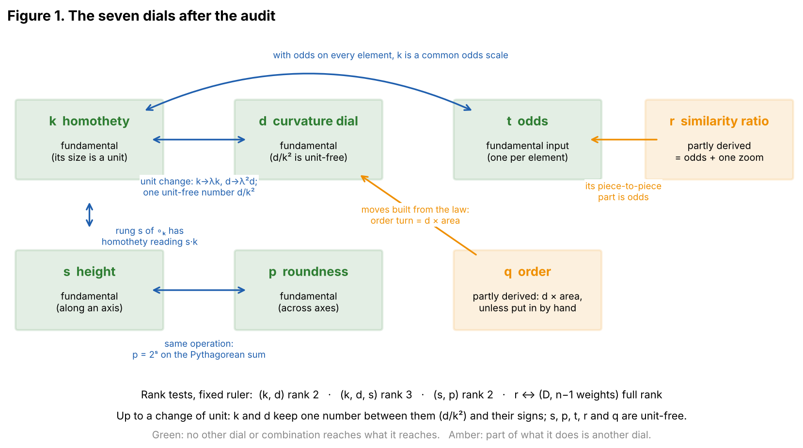
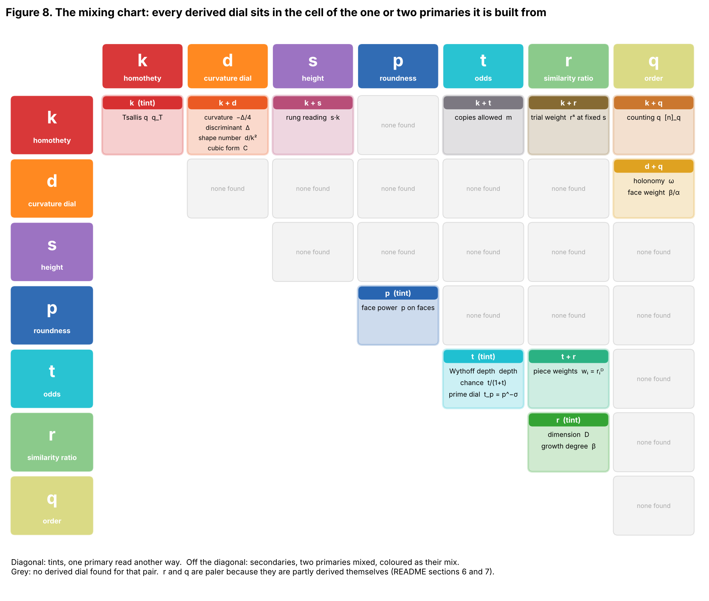
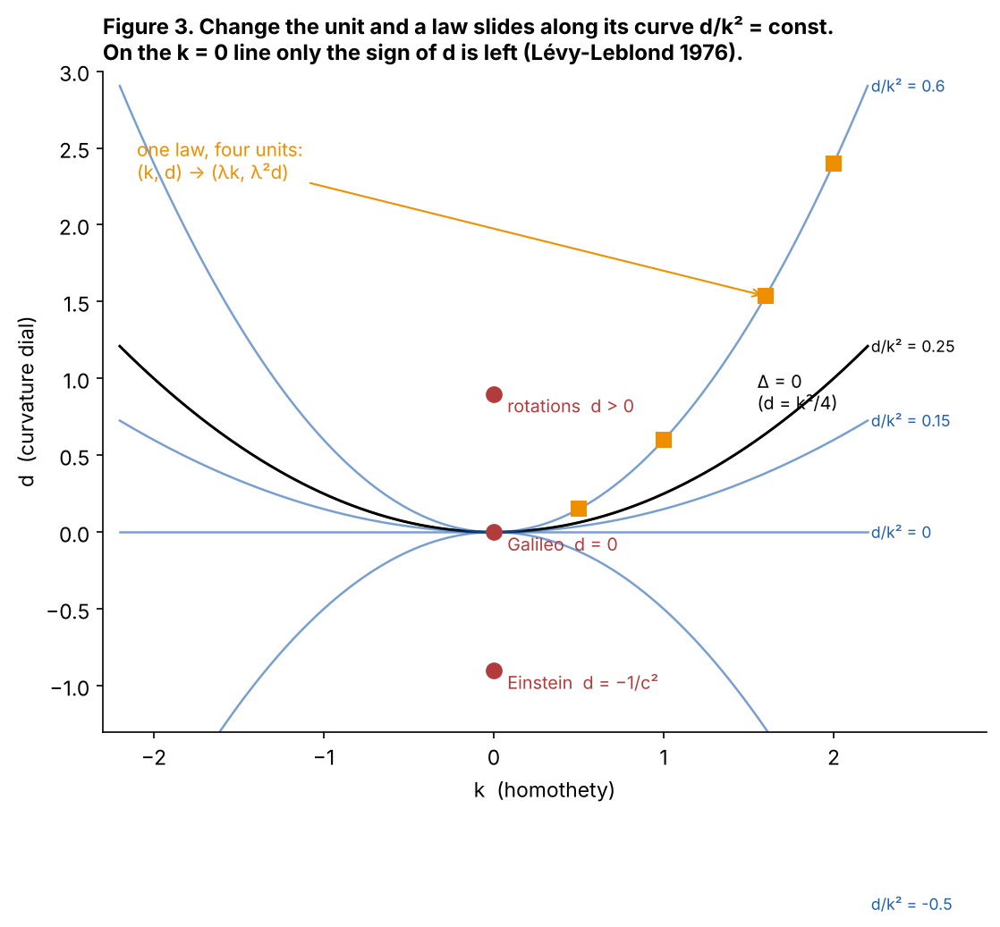
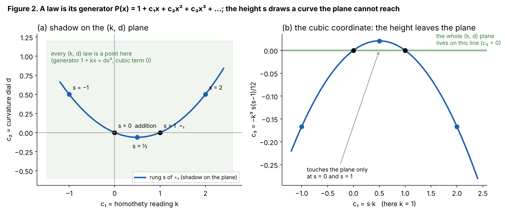
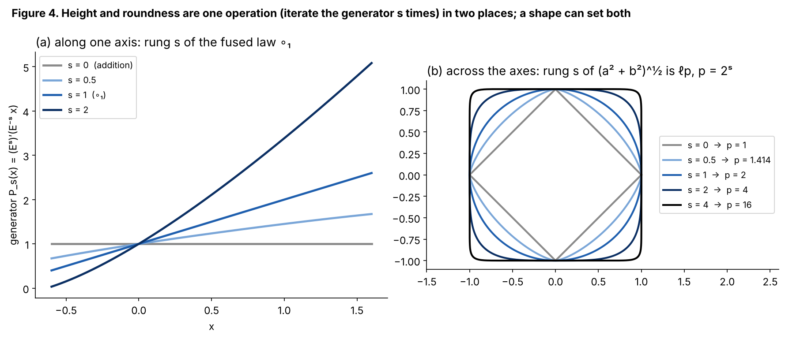
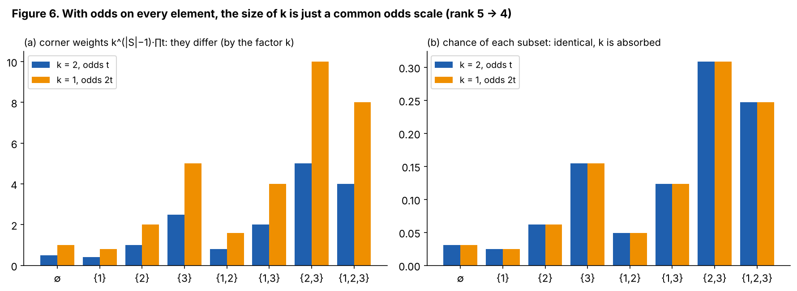
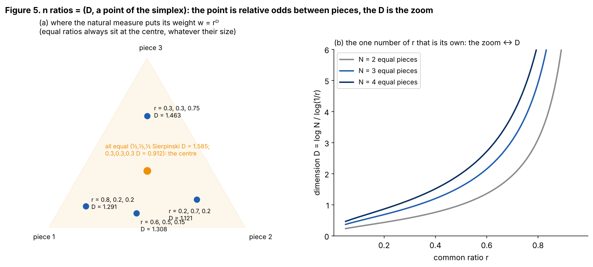
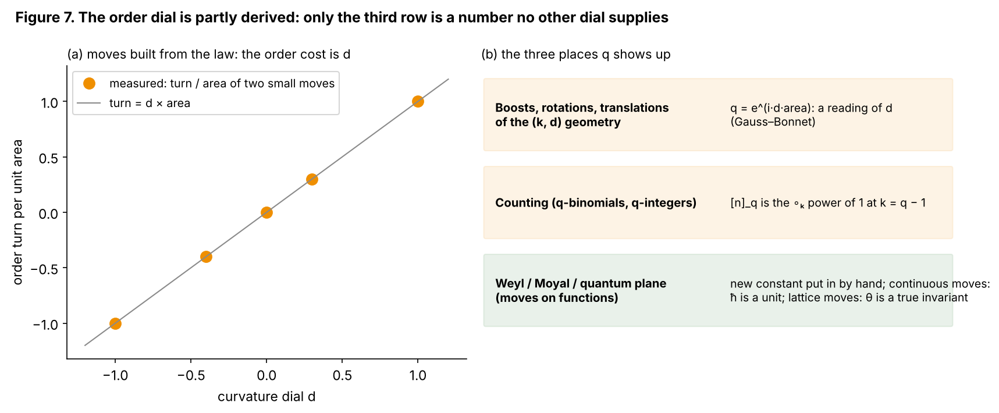

# DRAFT · Dial audit: which of the seven dials are fundamental, and which are derived

> **Names:** some words or symbols on this page (fused, rung, twist, Tsallis q) also mean something else in standard math, physics or computing, or inside this project. [NAMING-COLLISIONS.md](../../NAMING-COLLISIONS.md) says which meaning is in play.

**DRAFT, Nov 26 2026.** Part of Affine Composition Theory, built on Fused Hyperoperation Algebra.
Asked for by Brennan (voice, Nov 26): "we should probably look at the other dials to make sure they really are
fundamental ... what if one is like curvature we found is really K and D together", and "make sure it's really a new
dial in as rigorous a way as you can do ... I only want to add things, and I also don't want things to be treated as
fundamental if they really are derived."

Checks: [`checks.py`](checks.py) → [`checks_output.txt`](checks_output.txt), **37 of 37 pass** (sympy, numpy, scipy,
mpmath; three polish checks at 30 digits). Lean: [`FusedAlgebra/Topics/DialAudit.lean`](../../lean-library/FusedAlgebra/Topics/DialAudit.lean)
(copy in [`lean/`](lean/)), **9 theorems**, core Lean, no `sorry`, compiled in the shared library (3,560 theorems).
Pictures: [`figures.py`](figures.py) → [`figures/`](figures/). This audit renames and removes nothing; section 9 is a
proposal for Brennan to decide.

## The verdict

**No dial is a hidden combination of the others the way curvature turned out to be k and d together. Five are
fundamental (k, d, s, p, t) and two are partly derived (r and q). One pair, s and p, is the same operation used in
two places.**

| Dial | Verdict | Exactly why |
|---|---|---|
| **k** homothety | **Fundamental** in a fixed ruler; its size is a choice of unit | First coefficient of the law's generator. Changing the unit sends k → λk, so only its sign (and k = 0) is unit-free. Known (repo's `units_change_weight`). |
| **d** curvature dial | **Fundamental** | Second coefficient of the generator; rank 2 with k. Up to units, k and d share **one** number, d/k² (equivalently Δ/k²). Curvature −Δ/4 stays a reading. |
| **s** height | **Fundamental** | Rung s of a law reaches laws with a cubic term, which no (k, d) law has. Rank 3 with k and d. Unit-free. |
| **p** roundness | **Fundamental**, but **the same operation as s** | p = 2ˢ: rung s of the Pythagorean sum is the ℓp sum (already proved in [`named-functions/`](../named-functions/)). s works along one axis, p across axes; a shape can set both (rank 2). |
| **t** odds | **Fundamental, as an input** (one number per element), not a dial of the law | Odds join by the k = 1 law and nothing else gives per-element strengths. With odds on every element, k's size is just a common odds scale. |
| **r** similarity ratio | **Partly derived** | n ratios are exactly (the dimension D, plus n − 1 relative odds between pieces). Only one number, the overall zoom (equivalently D), is r's own. |
| **q** order | **Partly derived** | For moves built from the (k, d) geometry, the order cost is d × area (Gauss–Bonnet). In counting, q enters only as k = q − 1. It is a new number only when put in by hand (Weyl, Moyal, the quantum plane). |

The other open dial question, Wythoff depth, was checked in [`shape-dials/`](../shape-dials/) §6 the same day and is
also derived (odds on a family's corner shapes, joined by a Minkowski sum). This audit does not repeat it.

*Figure 1. Green: nothing else reaches what the dial reaches. Amber: part of what the dial does is another dial. Blue
lines: exact relations, each proved or checked below.*

## The derived dials, catalogued like secondary colours

Every derived dial found so far is built from one or two primaries, so the catalogue is a mixing table: one cell per pair, tints on the diagonal. A wheel didn't fit because k mixes with five other dials and the mixes piled up. Full list, with how each is built and where it is checked: [DERIVED-DIALS.md](DERIVED-DIALS.md).

## 1. The three tests

Every dial was put through the same three tests.

1. **Reach and rank, in a fixed ruler.** Does turning the dial reach laws or shapes that every setting of the other
   dials misses? Is the Jacobian from the dials to the thing they make full rank? This is the test curvature failed:
   it is a function of k and d, so it adds no reach.
2. **Units.** Does the dial move when you change the ruler's unit (x → λx)? A dial that only moves with the unit is a
   choice of unit, not a number the law carries.
3. **Known reductions.** Is there an exact identity that writes the dial through the others?

The coordinates that make test 1 sharp are old. Every one-dimensional composition law with identity 0 is the flow of
a vector field, its **generator** P(x) = ∂F/∂b (x, 0) (Lie; Aczél 1948 for the generator form). Write
P(x) = 1 + c₁x + c₂x² + c₃x³ + …. The law is rebuilt from P by L′ = 1/P and F(a, b) = L⁻¹(L(a) + L(b)), so the
coefficients c₁, c₂, c₃, … are coordinates on the space of all such laws, one law per point.

## 2. k and d: the first two coordinates, and one unit-free number between them

The plane law (a + b + k·ab)/(1 − d·ab) has generator exactly **1 + kx + dx²** (A1), and it solves
∂F/∂b = P(F)/P(b) (A2), so the law fixes (k, d) and (k, d) fix the law. The Jacobian of (c₁, c₂) in (k, d) is the
identity (A3). So in a fixed ruler, **neither k nor d is built from the other**, and none of the other dials can
produce a quadratic generator coefficient without a cubic one except through d. These are Lie's projective vector
fields 1, x, x² (the plane law is the Möbius family, as [`order-dial/`](../order-dial/) §1 already notes), and
Coleman and McGuinness (1991) showed these are the rational formal group laws.

Brennan's worry was the other way round: is one of them really two things together? The units test answers it.

*Figure 3. Changing the unit moves a law along its own curve d/k² = const (orange squares: one law in four units). On
the k = 0 line only the sign of d is left: Galileo, Einstein, rotations.*

- A unit change sends **k → λk and d → λ²d** (A4; proved in Lean as `LandscapeMap.units_num` and `units_den`), and
  every higher coefficient c_n → λⁿc_n (A5).
- So the only unit-free number in the (k, d) plane is **d/k²** (or Δ/k² = 1 − 4d/k²), plus the signs (A6, A7; Lean
  `ratio_unit_free`, `discriminant_scales`). The curvature −Δ/4 scales like 1/unit², so it is a reading that carries
  units, not a unit-free number.
- On the k = 0 line it is only the sign of d. Einstein's velocity addition is k = 0, d = −1/c² (A8); in units with
  c = 1, d = −1. That the velocity laws come in exactly three kinds by the sign of one constant is Ignatowski (1910)
  and Lévy-Leblond (1976, who uses causality to drop the d > 0 kind).

**Verdict.** Both are fundamental as settings. As shape numbers, k and d together carry one number, d/k², and their
signs. This is the precise version of "k and d together", and it is a units fact, not a hidden dial.

## 3. s, the height: a third direction the plane can't reach

Rung s of a law with generator G is G^s pushed onto addition (rung 0 is +, rung 1 the law itself;
[`named-functions/`](../named-functions/) §1, regular iteration after Szekeres 1958 and Écalle). For the fused law ∘ₖ,
its generator comes out as (B1, B2, computed exactly to order x⁵):

P_s(x) = 1 + **s·k** x + k² s(s − 1)/4 · x² − k³ s(s − 1)/12 · x³ + k⁴ s(s − 1)(s + 4)/144 · x⁴ − …

*Figure 2. (a) The rung-s laws of ∘₁ cast a shadow on the (k, d) plane. (b) In the cubic coordinate they leave it:
every (k, d) law has c₃ = 0, and the rung curve meets c₃ = 0 only at s = 0 (addition) and s = 1 (∘₁ itself).*

- Every coefficient past the first carries s(s − 1) (B3), and the cubic and quartic coefficients share no root but
  s = 0 and s = 1 (B4; polished at 30 digits, B8). So **for every other s the rung law is not a (k, d) law**.
- Checked against a closed form: at k = 1, s = 2 the generator is (1 + x)(1 + ln(1 + x)) (B5).
- **Rank test.** Take rung s of the full plane law (k, d). The first four generator coefficients have rank **3** in
  (k, d, s) at every random point tried (B6). So s is a third independent number, not a function of k and d.
- **Units.** c_n = kⁿ f_n(s): k carries the unit and s is unit-free (B2). The rung law's own homothety reading is s·k,
  which is why s looks like "more k" at first order.

**Verdict.** Fundamental.

## 4. p, roundness: the same height, applied across the axes

[`named-functions/`](../named-functions/) §1 already proved that rung s of the Pythagorean sum (a² + b²)^½ is the ℓp
sum with **p = 2ˢ** (rechecked, C1). The ℓp norm is that sum taken over coordinates (and the face power of
[`shape-dials/`](../shape-dials/) is the same sum over face normals). So p is the height operation applied across the
axes, where s is the same operation applied along one axis.

*Figure 4. (a) Along an axis: the generator of rung s of ∘₁ for four heights. (b) Across the axes: rung s of the
Pythagorean sum is the ℓp ball with p = 2ˢ.*

- **Reach.** Every (k, d) law has a quadratic norm a² + k·ab + d·b², so its unit curve is a conic (C3). The ℓp unit
  curve lies on a conic only at p = 2 (C2). So p ≠ 2 reaches shapes the law dials can't.
- **Rank test.** A shape with height s along each axis and roundness p across them has rank 2 in (s, p) (C5): both
  numbers are needed.
- **Units.** The ℓp norm is homogeneous, so no unit change moves p (C4).

**Verdict.** Fundamental as a number. It is not a separate *kind* of dial: it is the height, used across the axes.

## 5. t, the odds: an input, one per element

- "In A or in B" for independent elements has odds t₁ ∘₁ t₂, and the complement is 1/t (D5; repo's `odds_union`). So
  odds are the argument of the k = 1 law: data the law acts on, not a setting of the law.
- Nothing else supplies them. n elements need n odds, and the other dials are a fixed handful of numbers.
- **k is absorbed into t when every element has odds.** Three odds fused at dial k are, over k, the k = 1 fusion of
  the odds k·t (D1; Lean `odds_absorb_k`, `odds_absorb_k_lift`). Rank test on four elements: the corner weights
  k^(|S|−1)·∏t see k (rank 5), but the chance of each subset does not (rank 4) (D2).
- The same holds for "how many copies": the per-element factor (1 − kz)^(−1/k) has log = (1/k)·f(kz) (D3), and
  k = −1/m is literally m one-copy slots at odds z/m (D4). This is Gentile's statistics (1940) in the repo's words.

*Figure 6. (a) Corner weights at (k = 2, odds t) and (k = 1, odds 2t) differ by the factor k. (b) The chance of each
subset is the same: k's size has been absorbed into the odds.*

**Verdict.** Fundamental as an input, not as a law dial. Wherever odds sit on every element, k keeps only its sign.

## 6. r, the similarity ratio: odds across pieces, plus one zoom

- **Exact reparametrisation.** n ratios r₁ … r_n are the same information as the Moran dimension D (Σ rᵢᴰ = 1) and the
  piece weights wᵢ = rᵢᴰ, a point of the simplex. The map is a bijection (E1, 30 digits) and full rank (E2).
- The simplex point is a set of **relative odds between pieces** (which piece the natural measure picks). Turning one
  piece alone moves it (E4), as [`ratio-dial-survey/`](../ratio-dial-survey/) C3 found.
- N equal pieces always weigh 1/N, however r is turned (E3). So the uniform part of r is exactly one number, the zoom,
  read as D.
- Ratios multiply as the k law's multipliers, (1 + ka)(1 + kb) = 1 + k(a ∘ₖ b) (E5): a single ratio is a point on the
  same group k acts on.

*Figure 5. (a) Where five fractals put their weight; every equal-ratio fractal sits at the centre whatever its size.
(b) The one number r has of its own: the zoom, read out as D.*

**Verdict.** Partly derived. Its piece-to-piece part is odds (the categorical cousin of t: one piece chosen, where t
is each element in or out). Its one number of its own is the zoom.

## 7. q, the order dial: mostly a reading of d

q shows up in three places, and only the third is a new number.

*Figure 7. (a) Two small moves of the (k, d) geometry fail to commute by a turn equal to d × the area they span, at
five settings of d. (b) The three places q appears.*

1. **Moves built from the law** (boosts, rotations, translations on the surface of curvature d). Their generators obey
   [K_x, K_y] = d·J_z, so two small moves fail to commute by a turn d × area (F3), and a finite loop turns by exactly
   curvature × area (F4, Gauss–Bonnet). This matches [`twisted-boosts/`](../twisted-boosts/) (ω = d × area). Here q is
   a reading of d.
2. **Counting.** The q-integer [n]_q is the n-fold ∘ₖ power of 1 at **k = q − 1** (F1; Lean `qint_is_circ_power`),
   and the Gaussian binomials that (x + y)ⁿ produces when yx = q·xy are built from those powers (F2). Known (Jackson
   1910; the Tsallis k = 1 − q reading).
3. **Moves put in by hand** (Weyl, Moyal, the quantum plane, moves on functions). Here q is new. It is unit-free:
   rescaling the moves leaves yx = q·xy alone (F5; Lean `swap_constant_unit_free`), and two quantum planes are
   isomorphic only when q′ = q^±1 (Alev and Dumas for q not a root of unity; Gaddis 2012 in general). But for
   continuous moves the size of ħ in q = e^(iħ) is a unit (F6; Stone 1930, von Neumann 1931), and only on a lattice
   is the angle θ a real invariant (Rieffel 1981; Pimsner and Voiculescu 1980).

**Verdict.** Partly derived. It is the only non-commutative dial, so it stays a dial, but most of its uses are readings
of d or of k.

## 8. What this does not settle

- **Is the hand-put ħ itself a reading of d?** Known contractions get the Heisenberg relation as a limit of curved moves
  (Inönü and Wigner 1953; spin coherent states going to Glauber's, Arecchi et al. 1972), where d goes to 0 while a spin
  grows. There ħ is d times a size, not d alone. Not tested here; it is the one place q might lose its third row.
- Generator coordinates cover laws with an identity that are smooth there. The ℓp sums are not smooth at 0, which is
  why p was tested through its own law (the Pythagorean sum) and not through c₁, c₂, ….
- t, r and q were tested against the other dials, not against every topic's private dials (temperature, repetition,
  growth degree β). β is a setting, not a dial ([`affine-names/`](../affine-names/) §6).
- The rank tests are numerical at random points (exact rational arithmetic for B6 and D2), so they show generic rank,
  not rank at every point. Rank can only drop on special sets, such as k = 0 for d/k².

## 9. Proposal for Brennan (nothing changed)

A minimal list that keeps every independent number and says what kind each is:

- **Law dials:** k, d. Up to units they carry one number, d/k², plus signs.
- **Height:** s along an axis; p across axes (p = 2ˢ there). One operation, two places.
- **Inputs:** t, one per element. r reduces to t across pieces plus one zoom number.
- **Order:** q, only where moves are put in by hand; elsewhere it is d × area or k = q − 1.

So nothing needs to leave the list. Two labels would make it honest: r as "odds + zoom" and q as "a reading of d unless
put in by hand". Whether to show s and p as one height dial is a naming choice for 1.0.

## Assumptions

- "Fundamental" means: in a fixed ruler, no setting of the other dials reproduces what this dial reaches, and the joint
  rank goes up by one when it is added. A dial can be fundamental and still change with units (k, d).
- The rung-s generator is computed from the formal regular iteration (Szekeres, Écalle), as power series to order x⁵;
  the series for e^x − 1 diverges (Baker), so coefficients, not sums, are what is checked. Fractional heights in the
  rank test C5 use the truncated series at small inputs.
- The plane-law moves in F3 are the generators of SO(3), the Euclidean group and SO(2,1), scaled by d. Holonomy is
  checked infinitesimally at five values of d and exactly for one finite spherical triangle.
- Numerical-only checks: B6, C1, C2, C5, D2 (exact at one rational point), E1 to E4, F3 to F5. Exact: A1 to A8, B1 to
  B5, D1, D3 to D5, E5, F1, F2, F6. Lean covers the unit-free numbers, the odds absorbing k, the q-integers and the
  unit-freeness of q.

## Known vs new

- **Known:** generators of composition laws (Lie; Aczél 1948); the plane law as Lie's projective vector fields and as
  the rational formal group laws (Coleman and McGuinness 1991); unit changes k → λk (repo, Nov 25); velocity laws by the
  sign of one constant (Ignatowski 1910; Lévy-Leblond 1976); regular iteration (Szekeres 1958; Écalle); ℓp as rung
  log₂ p of the Pythagorean sum (repo, [`named-functions/`](../named-functions/)); Moran's equation (1946); Gentile's
  statistics (1940); Gauss–Bonnet; q-integers (Jackson 1910); quantum-plane isomorphism (Alev and Dumas; Gaddis 2012);
  Stone–von Neumann; Rieffel (1981), Pimsner and Voiculescu (1980).
- **Ours:** this audit and its verdicts; the rung-s generator coefficients for ∘ₖ in closed form to x⁴ (a direct
  computation from known iteration theory; I did not search for them in print and claim nothing for them); the
  reading "r = odds across pieces + one zoom"; the three-row placement of q.

## Sources

Aczél, J. (1948), Bull. Soc. Math. France 76. Coleman, R. F. and McGuinness, W. (1991), rational formal group laws.
Ignatowski, W. von (1910), Arch. Math. Phys. 17. Lévy-Leblond, J.-M. (1976), Am. J. Phys. 44, 271. Szekeres, G.
(1958), Acta Math. 100. Moran, P. A. P. (1946), Proc. Camb. Phil. Soc. 42. Gentile, G. (1940), Nuovo Cimento 17.
Jackson, F. H. (1910), Quart. J. Pure Appl. Math. 41. Alev, J. and Dumas, F., on the division ring of the quantum
plane (cited through Gaddis). Gaddis, J. (2012), "Isomorphisms of some quantum spaces", arXiv:1210.8413. Stone, M. H.
(1930); von Neumann, J. (1931), Math. Ann. 104. Rieffel, M. A. (1981), Pacific J. Math. 93. Pimsner, M. and
Voiculescu, D. (1980), J. Operator Theory 4. Inönü, E. and Wigner, E. P. (1953), PNAS 39. Arecchi, F. T., Courtens, E.,
Gilmore, R. and Thomas, H. (1972), Phys. Rev. A 6.
