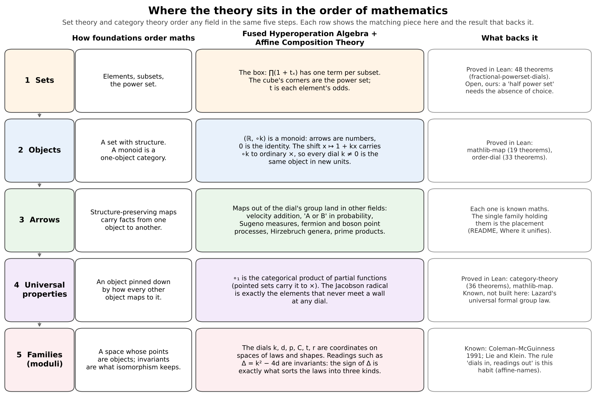
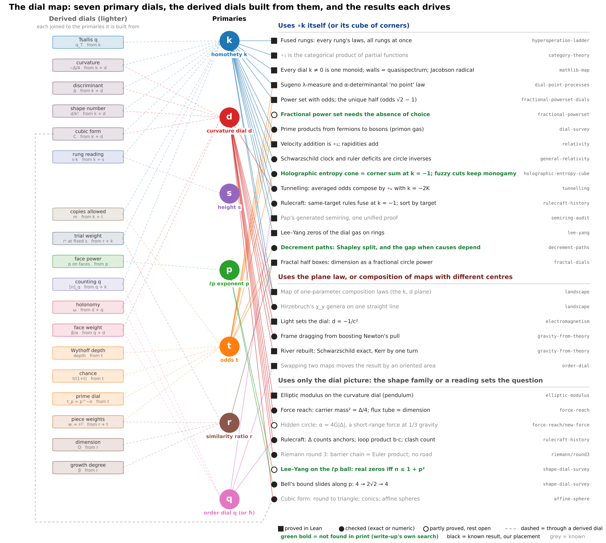
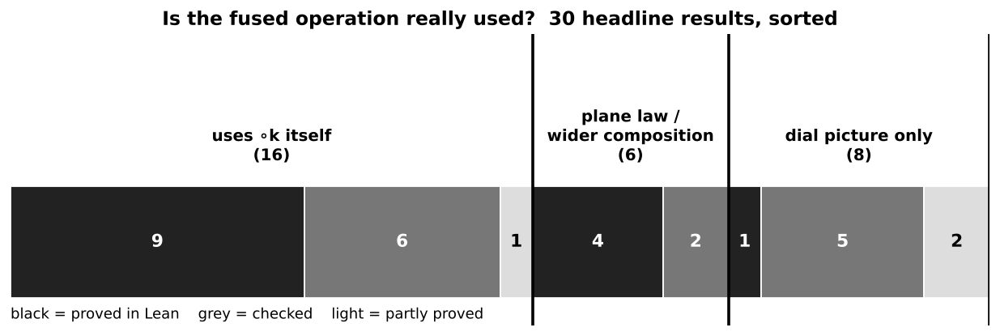
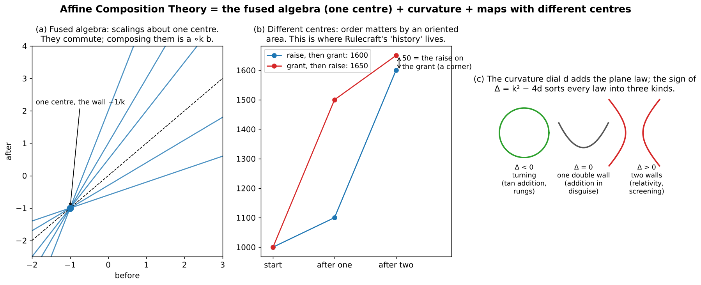
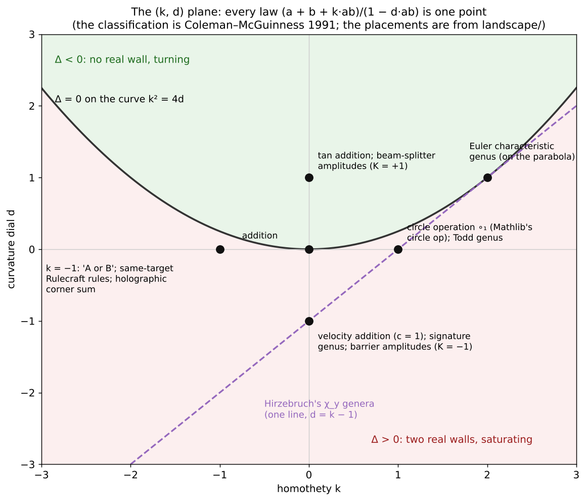
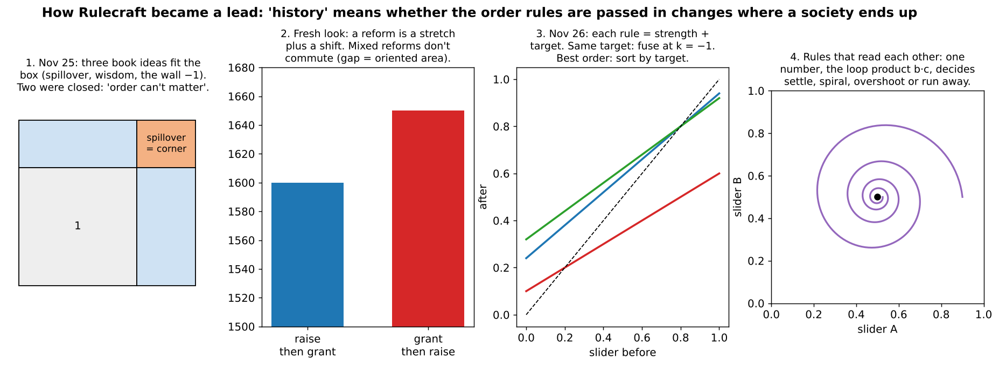

# DRAFT · The dial map: where the theory sits in the order of maths, and what each dial drives

**DRAFT, Nov 26 2026.** Part of Affine Composition Theory, built on Fused Hyperoperation Algebra.
Asked for by Brennan: one map of the dials and the results each one drives, to answer two questions from the night
before: is the fused algebra really used, and how did Rulecraft turn into a math lead. He then added: "I want the map to
sell the theory to me in terms of how set and category theory order the mathematical landscape", and "please sell it
in real benefits, not over promises".
Checks: [`checks.py`](checks.py) → [`checks_output.txt`](checks_output.txt), **16 of 16 pass** (sympy, with a 30-digit
polish). Pictures: [`figures.py`](figures.py) → [`figures/`](figures/). The list of results is one file,
[`results.py`](results.py), read off each folder's README on Nov 26. Nothing new is proved here: this page is a map.

## The short answer

- **Yes, the fused operation is really used.** Of 30 headline results, 16 use a ∘ₖ b = a + b + k·ab itself (or its cube
  of corners), 6 use its two-dial extension, and 8 use only the dial picture, where the shapes set the question and the
  proof is other mathematics (figure 6).
- **Where it sits:** in category language, the fused algebra is one object (a monoid) seen in every set of units, with
  structure-preserving maps out to many fields and one universal property proved. The theory on top is a family of
  such objects, with the dials as coordinates and readings such as Δ as invariants (figure 1).
- **Rulecraft:** "history" there means *does the order rules are passed in change where a society ends up*. It does,
  by a computable area, once rules have different centres. That is a lead for the book, not new mathematics (figure 5).

## 1. Where the theory sits in the order of mathematics

*Figure 1. Set theory and category theory order a field in five steps: what the elements are, what structure they carry,
which maps keep that structure, which objects are pinned down by a universal property, and how objects vary in families.
Each row gives the piece of this theory that fits, and what backs it.*

The point of the picture: the theory is not a new foundation. It is a well-placed object inside the usual one.

- **Objects.** (ℝ, ∘ₖ) is a monoid, and a monoid is a one-object category ([`order-dial/`](../order-dial/) §1). The shift
  x ↦ 1 + kx is an isomorphism onto ordinary multiplication, so every k ≠ 0 is the same object in different units
  ([`mathlib-map/`](../mathlib-map/), proved in Lean).
- **Arrows.** Each row of the README's "Where it unifies" table is a structure-preserving map from a dial's group into
  another field: velocity addition, "A or B" for independent events, Sugeno measures, fermion and boson point
  processes, Hirzebruch genera, prime products. Each map is known; holding them in one family is the placement.
- **Universal property.** ∘₁ is the categorical product in the category of sets and partial functions
  ([`category-theory/`](../category-theory/), 36 Lean theorems). The Jacobson radical is exactly the elements that never
  meet a wall at any dial ([`mathlib-map/`](../mathlib-map/)).
- **Families.** The (k, d) plane is a space of composition laws, and the sign of Δ = k² − 4d is the invariant that sorts
  them into three kinds (Coleman–McGuinness 1991). The design rule "base dials in, readings out"
  ([`affine-names/`](../affine-names/)) is the category habit of keeping coordinates apart from invariants.

## 2. The dial map

*Figure 2. The seven primaries (from the [dial audit](../dial-audit/README.md)) are the hubs. Derived dials are drawn
lighter on the left, each joined by dashed lines to the primaries it is built from, so work phrased in derived terms
(curvature, Tsallis q, dimension, holonomy) still finds its neighbours. Solid lines join a dial to a result it drives;
a dashed grey line means the result is labelled by a derived dial. Results are grouped by how much of the fused
operation they use. Squares are proved in Lean, filled circles are checked, open circles are partly proved. Green bold
marks results not found in print in the write-up's own search; black marks a known result in our placement; grey marks
known results.*

**Primaries and derived dials on one map (Brennan, Nov 26: "Show both that way").** The map's job is finding
neighbouring work, and other fields usually speak in derived terms: physicists say curvature, not k and d. So both are
shown, the primaries as the axes and the derived dials lighter. The derived list is read from the one catalogue,
[`../dial-audit/derived_dials.py`](../dial-audit/derived_dials.py) (table in
[DERIVED-DIALS.md](../dial-audit/DERIVED-DIALS.md)), so the two stay in step. Height s is a hub with no headline result
on the map yet; it reaches results only through the rung reading.

| Dial | What turning it does | Drives (folders) |
|---|---|---|
| **k**, homothety | Moves the wall −1/k that every scaling shares. k = 0 is addition, 1 the circle operation, −1 "A or B". | hyperoperation-ladder, category-theory, mathlib-map, dial-point-processes, dial-survey, relativity, general-relativity, holographic-entropy-cube, tunnelling, rulecraft-history, semiring-audit, lee-yang, landscape |
| **d**, curvature dial (derived reading: curvature −Δ/4) | Bends ∘ₖ into the plane law (a + b + k·ab)/(1 − d·ab). The sign of Δ picks the kind. | landscape, electromagnetism, gravity-from-theory, tunnelling, elliptic-modulus, force-reach, rulecraft-history §7, riemann/round3, conics |
| **s**, height | Rung s of a law; leaves the (k, d) plane (dial audit §3). | fractional-rungs, height-flow (no headline result on the map yet) |
| **p**, ℓp exponent | Slides the shape from cross-polytope (1) through ball (2) to cube (∞). | shape-dial-survey (Lee–Yang on the ℓp ball, Bell's bound) |
| **C**, cubic form (derived from k and d; drawn as a derived dial) | Slides round to triangle. Zero exactly for ellipses. | simplex, affine-sphere, shape-dial-survey |
| **t**, odds | How strongly each element takes part. All t = 1 is the plain power set. | fractional-powerset-dials, fractional-powerset, dial-survey, dial-point-processes, decrement-paths, fractal-dials |
| **r**, similarity ratio | The zoom of each piece; dimension D comes out as a reading. | fractal-dials |
| **q**, order dial (or ħ) | Turns order on. The swap gap is an oriented area, the holonomy ω. | order-dial, rulecraft-history |

**C is derived from k and d, not a free dial (Nov 26).** Brennan: "It is derived from k and d." It fits what the laws do: every law (a + b + k·ab)/(1 − d·ab) has a quadratic norm a² + k·ab + d·b², so its unit curve is a conic. Conics are the round end of the cubic-form dial, where C = 0 ([`affine-names/`](../affine-names/) §4, Maschke–Pick–Berwald; every non-degenerate conic is projectively an ellipse). So within the (k, d) laws C never moves off zero: it adds no freedom of its own and only measures shapes the laws don't make. The row stays because the results it labels are real. Figure 2 now draws C as a derived dial joined to k and d, and the seven hubs are the audit's primaries: k, d, s, p, t, r, q. The other dials each have a survey: [k](../homothety-dial-survey/), [d](../curvature-dial-survey/), [q](../order-dial-survey/), [t](../odds-dial-survey/), [r](../ratio-dial-survey/), and p in [shape-dial-survey](../shape-dial-survey/).

The growth degree β is a setting, not a dial ([`affine-names/`](../affine-names/) §6), so it has no hub here.

Which of these dials are fundamental, and which derived dials are built from them, is worked out in the [dial audit](../dial-audit/README.md); its [mixing chart](../dial-audit/DERIVED-DIALS.md) catalogues the derived dials by the primaries they come from.

## 3. How much of the work uses the fused operation

*Figure 6. The 30 results of figure 2, sorted. Black: proved in Lean. Grey: checked. Light: partly proved.*

Read it plainly. In the left block the operation does the work: the result is a statement about ∘ₖ or its corners. In
the middle block the work is done by its extension (the plane law, or maps with different centres). In the right block
the dials name the family of shapes and the question, and the proof comes from elsewhere: Lee–Yang on the ℓp ball uses
Pólya, Laguerre and Cartwright–Levinson, not ∘ₖ. That is not a weakness to hide, and it is not a hidden use either.

## 4. One centre, two centres, curvature

*Figure 3. (a) a ∘ₖ b is "scale by b, then by a", all about one centre, the wall −1/k. Maps with one centre commute.
(b) A 10% raise and a grant of 500 have different centres, so the order matters: 1600 against 1650. The gap is an
oriented area. (c) The curvature dial adds the plane law, and the sign of Δ sorts every law into three kinds.*

So the layers sit inside one another. The fused algebra is the scalings that share one centre. Affine Composition Theory
adds curvature (the plane law, where the composition laws are the one-parameter groups of Lie and Klein) and maps with
different centres (where order turns on). Rulecraft's history result lives in panel (b).

## 5. The (k, d) plane

*Figure 4. Every law (a + b + k·ab)/(1 − d·ab) is one point. Above the parabola k² = 4d the law turns (no real wall);
below it the law saturates (two walls). Hirzebruch's χ_y genera lie on one line, from the Todd genus at the circle
operation to the Euler characteristic on the parabola. Placements from [`landscape/`](../landscape/).*

## 6. Real benefits, each with what backs it

Only benefits that point to a proved or checked result are listed. Anything unproved says so.

| Benefit | What backs it | Status |
|---|---|---|
| **Prove once, get every dial.** A theorem about ordinary multiplication carries to every k ≠ 0 through x ↦ 1 + kx, and at k = 1 the law is Mathlib's circle operation, which about 1,550 Mathlib theorems already build on. | [`mathlib-map/`](../mathlib-map/): one monoid for every dial; walls = quasispectrum; Jacobson radical | Proved in Lean (19 theorems) |
| **A machine-checked base to build on.** | [`lean-library/`](../../lean-library/): 3,529 theorems, no `sorry`, only Lean's three standard axioms, rebuilt by CI on every push | Proved in Lean |
| **Read a law at a glance.** From (k, d) you get its walls, its kind and the coordinate that turns it into plain addition. | [`landscape/`](../landscape/): 44+ laws placed | 27 Lean theorems, 65 checks. The classification is known |
| **Carry results across fields along the maps.** Three transfers done: the α-determinantal existence rule is Sugeno's wall rule; a society passing rules one at a time runs the same recursion as stochastic gradient descent, so its memory regimes split at 1/2 and 1; a chain of random-phase tunnelling barriers is zeta's Euler product. | [`dial-point-processes/`](../dial-point-processes/), [`rulecraft-history/`](../rulecraft-history/) §6 and §8, [`riemann/round3/`](../riemann/round3/) | 40 Lean theorems and 101 checks; 24 checks; 23 checks |
| **A few results not found in print.** Fuzzy min cuts never break monogamy; the Lee–Yang rule on the ℓp ball (n ≤ 1 + p²); the dependent-cause gap in decrement paths. | [`holographic-entropy-cube/`](../holographic-entropy-cube/), [`shape-dial-survey/`](../shape-dial-survey/), [`decrement-paths/`](../decrement-paths/) | Proved in the write-up; partly proved (the band p + 1 < n ≤ 1 + p² is open); 25 checks, Lean not built |
| **Sharp open questions.** Whether a half power set can exist without choice; whether a category of signed objects has a + b − ab as its product. | [`fractional-powerset/`](../fractional-powerset/), [`category-theory/`](../category-theory/) | Open (the with-choice half is proved in Lean) |
| **Negative results that save effort.** Proofs through ∘ₖ are not shorter; a one-number dial for gravity bends no light; five Riemann roads stop at the same sign. | [`proof-complexity/`](../proof-complexity/), [`gr-bridges/`](../gr-bridges/), [`riemann/round3/`](../riemann/round3/) | Measured; proved and checked; checked |

**What it does not give, yet.**
- No new physical prediction that can be tested now. The hidden-circle force ([`force-reach/new-force/`](../force-reach/new-force/))
  is half finished: it needs what holds the circle's size fixed.
- No shorter proofs (row above).
- The link to Lazard's universal formal group law and Quillen's theorem on cobordism is known mathematics that sits behind
  the (k, d) plane, but it is not built in this repo.
- Against 22 prerequisites for a quantum-gravity answer, 4 are met, 7 only with an input put in by hand, and 7 not met
  ([`DEPENDENCY-MAP.md`](../../DEPENDENCY-MAP.md)).

## 7. How Rulecraft became a lead

*Figure 5. The four steps. Panel 2 is the same raise-and-grant example as figure 3b.*

1. **Nov 25, first fit** ([`rulecraft/`](../rulecraft/)). Three of the book's ideas took an exact shape in the box:
   spillover is the corner that straddles a boundary, wisdom is a corner area, and total loss is the wall −1 that can
   never be undone. Two were closed: "percent reforms can never be path-dependent" and "one dimension is flat".
2. **Fresh look** ([`closed-leads-fresh-look/`](../closed-leads-fresh-look/), F2). A real reform is a map, a stretch and a
   shift, and each has a centre. ∘ₖ is exactly the maps that share one centre, which is why the first pass saw no order
   effect. Mixed reforms have different centres and don't commute; the gap is an oriented area, and the space of reforms
   is the hyperbolic plane. The closure was reopened.
3. **Nov 26, strength and target** ([`rulecraft-history/`](../rulecraft-history/) §1–8). On a 0-to-1 slider every rule
   is a strength and a target. Rules with one target fuse by the k = −1 law; order changes how the pull is split, never
   its total; the best order is "sort by target".
4. **Coupling** (§9). When rules read other sliders, the clash graph counts the histories that really differ, and one
   number, the loop product b·c, decides whether two rules settle, spiral, overshoot or run away.

All the mathematics is known (the affine group, stick-breaking, Robbins–Monro, Stanley's acyclic orientations, Jury's
test). What is ours is reading it as sliders, and the result is useful to the book: lock-in and the order of reforms get
numbers.

## 8. Neighbours: finding associated work on the map (DRAFT, Nov 26)

Brennan: "this is how i feel like the map will be most useful is to be able to find associated work". Every problem placed on the map gets a short **Neighbours** table: the other problems on the same layer with the same shape of statement. Proved neighbours come first, because those are the ones we can learn a method from; then false ones, because they rule methods out; then open ones.

| Column | What goes in it |
|---|---|
| Neighbour | the problem's name |
| Where | same layer, one layer up, or one layer down |
| Status | proved (by whom, year), open, or false |
| Key ingredient | the one idea that makes the proof work, or why it fails |
| Can our dials say it? | yes / partly / no, with the dial |
| Mathlib | what it could build on, and the main gap |

### First example: the Riemann hypothesis

RH sits on Layer 1 (k = −1 folded over the prime cube gives 1/ζ) and Layer 2 (each local factor 1 + k·u + d·u² should be on the elliptic side). Full write-up: [riemann-neighbours](../riemann-neighbours/README.md).

| Neighbour | Where | Status | Key ingredient | Our dials? | Mathlib |
|---|---|---|---|---|---|
| Ihara zeta, Ramanujan graphs | Layer 1 → 2 | proved for LPS/Margulis graphs (1988); every degree, bipartite (Marcus–Spielman–Srivastava 2015) | fold = det(I − uB), a polynomial; Ramanujan bound | yes: Ramanujan is \|k̂\| ≤ 2 | walk counts, Hermitian adjacency; no Ihara zeta |
| Curves over F_p (Hasse, Weil) | Layer 2 | proved (Hasse 1933, Weil 1948, Deligne 1974) | Frobenius; degree form positive definite | yes: the degree form is our norm a² + kab + db² | `WeierstrassCurve.localPolynomial` is our dial point; no Hasse bound |
| Selberg zeta | Layer 2 | proved (Selberg 1956); λ₁ ≥ 1/4 open for congruence surfaces | self-adjoint Laplacian | yes: factor s² − s + λ is (−1, λ), elliptic iff λ ≥ 1/4 | nothing |
| Lee–Yang | Layer 1 with edges | proved (Lee–Yang 1952, Asano 1970) | ferromagnetic coupling, contraction | yes: two spins are ∘ₖ with k = 1/a; more spins are k on each edge (our dial gas) | nothing |
| Davenport–Heilbronn | Layer 2 only | **false**: zero at 0.8085 + 85.6993 i | functional equation without a fold | shows Layer 1 is needed | Dirichlet L-functions are there |
| Dirichlet, Dedekind, Hecke, Selberg class | Layers 1 and 2 | open (GRH) | none yet | same as ζ | Euler products, functional equations, non-vanishing on Re s = 1 |
| Bost–Connes | Layer 3 | partition function ζ(β), phase transition at β = 1 (Bost–Connes 1995) | sees the pole, not the zeros | yes: the q dial | nothing |

**What the neighbours say together.** Every proved row has an operator whose determinant is the prime fold and a positivity that puts its factors on the elliptic side. Our dials say the positivity. The operator for ζ is unknown (Hilbert–Pólya), which is why RH stays open on the map.

## Assumptions

- The 30 results are the headline results of the folders named, read from their READMEs on Nov 26, 2026. Each status
  ("proved in Lean", "checked", "partly proved") is the folder's own; this page re-checks none of them.
- The sort into three groups is a judgement, made by one rule: does the result's statement or proof run through ∘ₖ (or
  its corners), through the plane law or composition of affine maps, or only through the dial as a label for a family?
  Borderline cases: the river rebuild and frame dragging use plane-dial boosts, so they sit in the middle group; the
  jet-river layer Q is a corner of the cube, but the Kerr step is a shift by i, so the pair sits in the middle too.
- The category reading of figure 1 is standard category theory applied to results already in the repo; it adds no
  theorem.
- `checks.py` checks only the concrete claims drawn here (the composition and shift identities, the worked example, the
  plane placements, the counts).

## Known vs new

- **Known:** monoids as one-object categories; the shift isomorphism (the circle operation of ring theory); Par and
  pointed sets; Coleman–McGuinness's classification of rational formal group laws (1991); Lie and Klein's one-parameter
  Möbius groups; Hirzebruch's χ_y genera; Lazard (1955) and Quillen (1969); the affine group and its hyperbolic metric.
- **Ours:** this map, the three-way sort, and the framing. The results the map points to carry their own known-vs-new
  labels in their folders.

## Sources

Coleman, R. F. and McGuinness, W. (1991), rational formal group laws. Hirzebruch, F. (1966), *Topological Methods in
Algebraic Geometry*. Lazard, M. (1955), sur les groupes de Lie formels à un paramètre. Quillen, D. (1969), on the formal
group laws of unoriented and complex cobordism theory. Mac Lane, S. (1971), *Categories for the Working Mathematician*.
Every other source is cited in the folder it belongs to.
