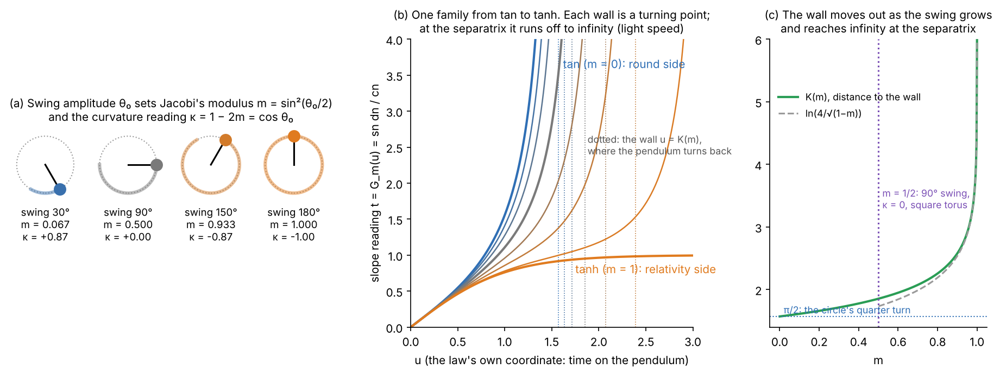
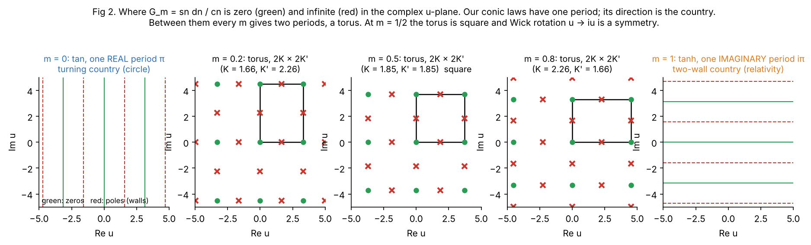
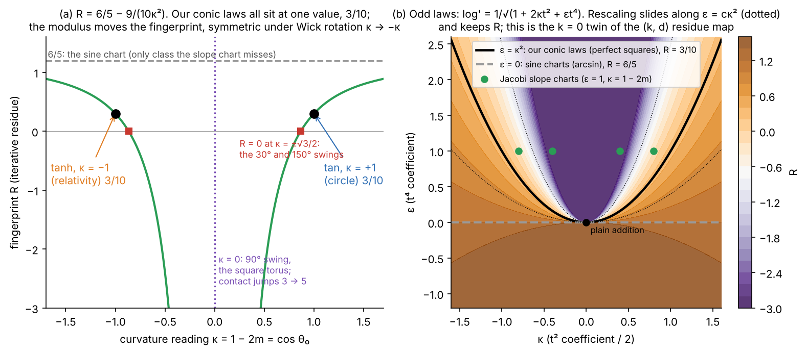
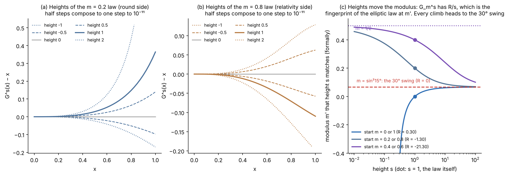
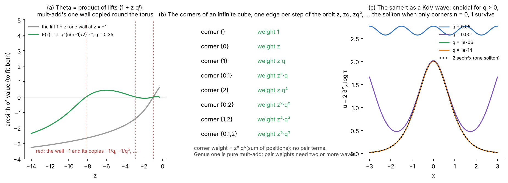
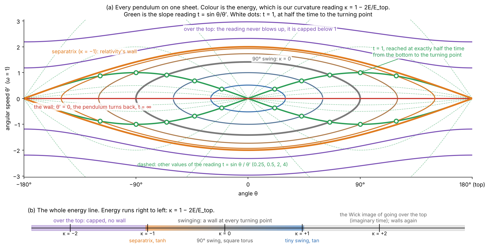
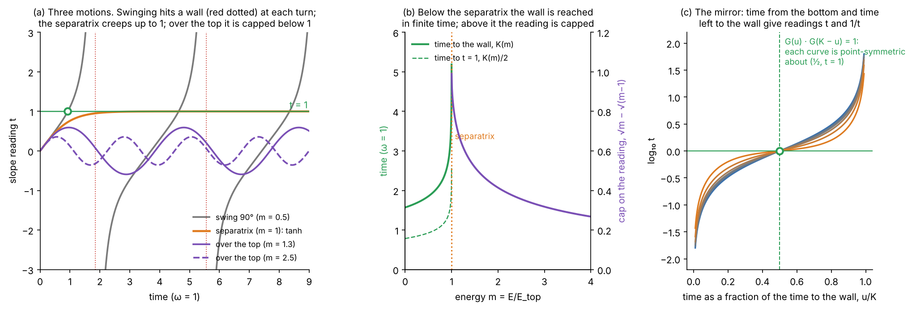
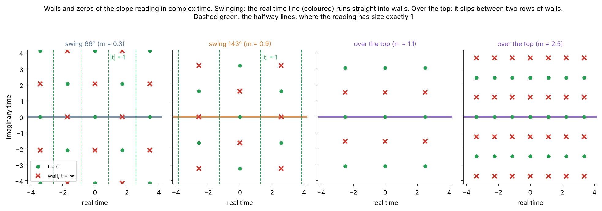

# DRAFT · The elliptic modulus: a pendulum dial between our round side and our relativity side

**DRAFT, Nov 26 2026.** Part of Affine Composition Theory, built on Fused Hyperoperation Algebra (repo: fused-hyperoperation-algebra).
Asked for by Brennan (timeline, Nov 26, voice): work on the elliptic functions lead reopened in
[`closed-leads-fresh-look/`](../closed-leads-fresh-look/) (F3), and "just explore … just trying out the model and maybe seeing if
there's anything that comes of it, that just looks promising as a feature … of the model", "that might be useful in other areas".
So this page plays with the model one parameter off the plane dial and reports what came out, each finding judged on its own.
Builds on F3, [`elliptic/`](../elliptic/) (Tate's curve, the node), [`named-functions/`](../named-functions/) (generators,
heights, the hypernatural logarithm), [`height-flow/`](../height-flow/) (the fingerprint), [`corner-weights/`](../corner-weights/).

**Checks:** `checks.py` → `checks_output.txt`, **30 of 30 pass** (sympy exact; mpmath 40 digits; about 30 s); section 7 adds `pendulum/pendulum_checks.py`, **12 of 12 pass**.
**Polish:** `polish.py` → `polish_output.txt` (the fingerprint read off a 200,000-step orbit; wall distances by quadrature;
a half height at 50 digits). **Lean:** `lean/EllipticModulus.lean`, **11 theorems, compiled** in the shared library as
`FusedAlgebra.Topics.EllipticModulus`, no `sorry`. **Pictures:** `figures.py` → `figures/`. Heights: `heights.py`; series: `series.py`, `numseries.py`.
Colour key: **blue = round side, orange = relativity side, green = ours, grey = known background.**

Naming: "Jacobi's modulus" or "parameter" **m** is the existing name. The literature's Edwards parameter is the same number
here (a = 1); it is written out because its usual letter, d, is our curvature dial. Nothing here is added to the dial list.

---

## What came out, most fundamental first

1. **One parameter, one reading.** In the slope chart t = x/y of the Edwards curve, Jacobi's modulus m shows up in our
   curvature reading as exactly **κ = 1 − 2m**. m = 0 is the circle (κ = +1, tan), m = 1 is relativity (κ = −1, tanh),
   and halfway, m = 1/2, is κ = 0. The law's logarithm is ∫ dt/√(1 + 2κt² + t⁴); our conic laws are the case where the
   quartic under the root is a perfect square, (1 + κt²)².
2. **The fingerprint has a closed form, and it is the k = 0 twin of F1.** For any odd law whose logarithm is
   ∫ dt/√(1 + 2κt² + εt⁴), the iterative residue is **R = 6/5 − (9/10)·ε/κ²**, linear in the one number that survives
   rescaling, just as F1's residue 1/3 − 4d/(3k²) is linear in d/k². On our conic laws it is stuck at 3/10. The modulus is
   what moves it.
3. **Every odd contact-3 map is formally an elliptic law.** Because (contact order, R) is a complete formal invariant, any
   odd map x + ax³ + … (a ≠ 0) with fingerprint R ≠ 6/5 is, after a change of chart, the elliptic slope law with
   κ² = 9/(12 − 10R).
4. **Heights move the modulus.** Height s divides the fingerprint by s, so a fractional rung of an elliptic law is, formally,
   an elliptic law at another modulus. Climbing to large heights always heads to one place: the 30° swing.
5. **The pendulum reads it all.** A pendulum of amplitude θ₀ has m = sin²(θ₀/2), so **κ = cos θ₀**. The wall of the
   chart is the moment the pendulum turns back; relativity's light-speed wall is the separatrix, which reaches the top
   only in infinite time; the flat point κ = 0 is the 90° swing, where the torus is square.
6. **Periods tell the country.** Our conic laws have one period: real for turning country, imaginary for two-wall country,
   none on the border. Elliptic laws have both. The modulus is a smooth road between the two countries that goes round
   the border instead of through it.
7. **Theta is the lift copied round the torus.** Jacobi's theta function is the product of our lifts 1 + zqʲ along
   Tate's orbit, a corner sum over an infinite cube, and its zeros are the circle operation's one wall at −1, copied once per turn.
   As q → 0 only two corners survive and it becomes the lift 1 + z and the KdV soliton.
8. **The pendulum picture, worked out (Nov 27).** Our curvature reading is the pendulum's energy, κ = 1 − 2E/E_top. The
   reading is exactly 1 at half the time to the turning point, on every swing. Past the separatrix the wall is replaced
   by a cap, √m − √(m − 1). Our conic laws, tan and tanh, are exactly the border between swinging and going over the top.

---

## 1. One parameter, one reading

**Fig 1.** (a) Four pendulums. The swing θ₀ sets Jacobi's modulus m = sin²(θ₀/2) and the curvature reading κ = cos θ₀.
(b) The slope-chart generator G_m(u) = sn dn/cn for m from 0 (blue, tan) to 1 (orange, tanh). Each dotted line is the
wall u = K(m). (c) The distance to the wall, K(m), grows from π/2 (the circle's quarter turn) and runs off to infinity at
the separatrix like ln(4/√(1 − m)).

- **The chart.** F3 found that the Edwards curve x² + y² = 1 + m x²y², read in the slope t = x/y, carries our conic law
  at m = 0. With m on, the slope is G_m(u) = sn(u|m)·dn(u|m)/cn(u|m), and the Edwards addition law is G(u) ⊕ G(v) = G(u + v)
  (A4, 40 digits).
- **The reading.** G_m(u) = u + (1 − 2m)u³/3 + 2(1 − m + m²)u⁵/15 + … (A1). Our conic laws on the k = 0 line have
  generator tan_κ = u + κu³/3 + …, so the bend reads **κ = 1 − 2m**.
- **The law's logarithm** (height 1 of its hypernatural logarithm) is
  L(t) = ∫₀ᵗ dτ/√(1 + 2κτ² + τ⁴) (A2, checked at complex u and m; Lean `slope_log_quartic`). Our k = 0 conic laws have
  L′ = 1/(1 + κt²) = 1/√((1 + κt²)²): the same formula with t⁴ coefficient κ² instead of 1 (A3; Lean `conic_is_square`).
- **Wick rotation** u → iu swaps the two sides exactly: G_m(iu) = i·G₁₋ₘ(u), so κ → −κ (A6). Its fixed point is m = 1/2.
- **Known versus ours.** Jacobi's functions, the Edwards curve and Euler's addition theorem for ∫ dt/√(quartic) are known
  (Euler 1750s; Edwards 2007). Ours: reading the modulus as κ = 1 − 2m through our curvature reading, and seeing the conic
  laws as the perfect-square quartics.
- **Verdict: the base fact the rest stands on.** Not a result by itself, but it puts the elliptic family on our map with a
  reading we already use.

## 2. Periods tell the country

**Fig 2.** Zeros (green) and poles, the walls (red), of G_m in the complex u-plane. tan has one real period π; tanh has
one imaginary period iπ; every m in between has two, 2K and 2iK′, a torus (A5). At m = 1/2 the torus is square, K = K′
(A7).

- Our conic laws have one period, and its direction is the country: **real** for turning country (circle, ellipse),
  **imaginary** for two-wall country (relativity, and ∘₁ itself, whose generator eˣ − 1 has period 2πi), **none** on the
  border (the parabola class, whose generator x/(1 − cx) is rational).
- Elliptic laws have both periods. As m runs from 0 to 1 the imaginary period comes in from infinity and the real one goes
  out to infinity. To get from the circle to relativity inside the plane you must cross the border (κ = 0, the parabola
  class or plain addition). The modulus goes round it: at κ = 0 it is a smooth square torus, not a degenerate law.
- **Known versus ours.** The periods are textbook. The statement "the period's direction is the country" is ours; it is
  elementary, and it agrees with the node picture on the `elliptic/` page (two real branches = two walls, complex
  branches = turning).
- **Verdict: a clean organizing fact; small but worth keeping.** It gives the three countries one sentence and shows the
  elliptic family is what you get when a law is allowed both kinds of period at once.

## 3. The fingerprint along the modulus

**Fig 3.** (a) The iterative residue R of the slope chart against κ = 1 − 2m (green). Our conic laws, tan and tanh, both
sit at 3/10 (black dots). R falls to −∞ at κ = 0 (the 90° swing) and passes 0 at κ = ±√3/2. It tends to 6/5, the sine
chart, but never reaches it. (b) All odd laws with logarithm ∫ dt/√(1 + 2κt² + εt⁴), coloured by R. Our conic laws are
the parabola ε = κ² (black), the sine charts the line ε = 0 (dashed), plain addition the origin; rescaling slides along
ε = cκ² and keeps R. Compare F1's Fig 2.

- **The formula.** R = 6/5 − (9/10)·ε/κ² for any odd chart of this kind (B2, sympy, general κ and ε; Lean
  `fingerprint_general`). In the slope chart ε = 1: **R(m) = 6/5 − 9/(10(1 − 2m)²)** (B1).
- **Ends.** ε = κ² gives 3/10 for every conic law (B3). ε = 0 gives 6/5, the class of sin (the chart x = sn at m = 0, B4).
- **Symmetry.** R(m) = R(1 − m): the fingerprint cannot tell a law from its Wick rotation (B5; Lean `slope_numerator_wick`).
  It depends only on m(1 − m), as the j-invariant does, so between the circle and relativity it is a function of j alone.
  In the other common chart, x = sn, the same formula gives R = 6(1 − m + m²)/(5(1 + m)²), symmetric under m → 1/m
  instead (B4).
- **The flat point changes class.** At m = 1/2 the cubic term vanishes: G = u + u⁵/10 + u⁹/120 + …, with only powers
  u^(4j+1), because Wick rotation is now a symmetry. The contact order jumps from 3 to 5, and the new class has its own
  residue, **5/3** (B6).
- **The orbit agrees.** Iterating G at m = 0.8 200,000 times and fitting the orbit's logarithmic drift gives R = −1.30002,
  against the formula's −1.3 (polish P1). So the number is a property of the dynamics, not only of the series.
- **Normal form (ours).** (Contact order, R) is a complete formal invariant of a map tangent to the identity (Écalle). So
  every odd map x + ax³ + … with R ≠ 6/5 is formally conjugate to an elliptic slope law, with κ² = 9/(12 − 10R) (Lean
  `normal_form_inverse`). Two moduli fit, m and 1 − m: a Wick pair.
- **Known versus ours.** Écalle's iterative residue, its completeness, and the rule R(fⁿ) = R(f)/n are known. We found
  nothing in print computing the residue of Jacobi's functions, or using them as a normal-form family; a short search
  found neither, so treat "ours" as unconfirmed until a fuller literature check.
- **Verdict: opens a lead.** On the k = 0 line our conic plane gives odd laws only one fingerprint, 3/10, and nothing that
  survives rescaling but a sign. The modulus supplies the missing scale-free number, exactly as d/k² does in F1. That
  makes it a natural third dial for odd laws. It also hands dynamics a concrete family, Jacobi's functions, that reaches
  every formal class but one.

## 4. Heights move the modulus

**Fig 4.** (a), (b) Heights s = −1, −½, 0, ½, 1, 2 of the elliptic law at m = 0.2 (round side) and m = 0.8 (relativity
side), drawn as G^s(x) − x. Half a height applied twice gives the law to 10⁻¹¹ (D1); heights add (D3). (c) The modulus m′
whose elliptic law has the same fingerprint as height s of the law at m. Starts at m and 1 − m share a curve. Every curve
heads to m = sin²15° as s grows.

- **Heights exist.** G_m touches the identity, so it has fractional iterates (F3.9). `heights.py` computes them by regular
  iteration on the real line; they compose correctly (D1, D3) and agree with a 50-digit computation (polish P3).
- **Heights divide the fingerprint**: R(G^s) = R(G)/s (B7, generic s and m; Lean `height_scales_fingerprint`). So by the
  normal form, height s of the law at m is formally the elliptic law at the m′ with R(m′) = R(m)/s.
- **Directly, without a chart change**, the half height of the m = 0.2 law matches a rescaled elliptic law at
  m′ = 0.2567 through u⁵ and first differs at u⁷ (B8). On [0, 0.8] they differ by at most 0.0019, against a bend of 0.15
  (D2).
- **Where climbing goes.** As s → ∞, R/s → 0, the class with residue 0, which on this road is κ = √3/2:
  **m = sin²15°, the 30° swing**. Going down toward height 0 runs the other way, to m = 1/2 (for laws with R < 0).
- **Formal only.** The Julia series (the iterative logarithm) of G_m diverges, at m = 0 and 0.2 its terms reach 10²⁶ and
  10¹⁶ by order 137 (B9). So heights live on petals, as for eˣ − 1, and the match between heights and moduli is between
  power series, not yet between functions.
- **Known versus ours.** Regular iteration (Szekeres, Écalle) is known. "Height and modulus are one dial, formally" is
  ours. It is the elliptic twin of `named-functions/`' finding that on ℓp balls height and the p dial are one dial.
- **Verdict: a lead worth one more step.** The fact is exact at the level of series. The question that decides whether it
  is a real feature is whether the change of chart converges, that is, whether the analytic (Écalle–Voronin) invariants
  also match. The divergence in B9 makes that doubtful, so the honest reading today is "same formal class".

## 5. The pendulum reading, and the walls

(See Fig 1.)

- **κ = cos θ₀** (C1; Lean `pendulum_kappa`). Integrating the pendulum θ̈ = −ω² sin θ, the slope reading
  t = ω sin θ/θ̇ is exactly G_m(ω·time) at swings of 34°, 90° and 149° (C2, to 6·10⁻¹¹).
- **The wall is the turning point.** G has its pole at u = K, where θ̇ = 0 and the pendulum turns back (C3). That is
  "turning country" in the most literal sense. In the slope chart there is no other wall: G′ > 0 on (−K, K) because its
  numerator is a sum of squares (Lean `slope_monotone_sos`).
- **Relativity's wall is the separatrix.** As m → 1, K → ∞ like ln(4/√(1 − m)) (C4) and G → tanh, whose law is velocity
  addition (C5). The pendulum that just reaches the top takes infinite time to get there: that is the light-speed wall.
- **The wall distance is the law's logarithm at infinity**: K(m) = ∫₀^∞ dt/√(1 + 2κt² + t⁴) (polish P2, 19 digits).
- **Landmarks on one swing.** 30° swing: fingerprint 0, where heights end up. 90° swing: κ = 0, the square torus,
  contact order 5. 150° swing: fingerprint 0 again (κ = −√3/2). 180°: relativity.
- **Imaginary time.** Wick rotation sends m to 1 − m (A6): in imaginary time a pendulum is the upside-down pendulum with
  the complementary swing. That is the standard instanton picture of tunnelling. The tunnelling thread may want it; it
  was not followed here.
- **Known versus ours.** The pendulum's modulus sin²(θ₀/2), its period 4K/ω, and the lemniscatic 90° swing are textbook.
  Ours: the reading κ = cos θ₀, the wall as the turning point, and the separatrix as relativity's wall.
- **Verdict: opens a lead, mainly for explaining and teaching the theory.** It is the most intuitive face of the elliptic
  road: one physical knob, the swing, runs from our round side through a flat point to our relativity side, and the
  theory's walls become things you can watch.

## 6. Theta: the lift copied round the torus

**Fig 5.** (a) The lift 1 + z (grey) has one wall, at z = −1. Theta (green) is zero at −1 and at every copy of it,
−1/q, −1/q², … (red). (b) Theta's corners: subsets of the orbit z, zq, zq², …, each weighted zⁿ times q to the sum of its
positions. (c) The same τ as a KdV wave, u = 2∂²ₓ log τ: cnoidal for q = 0.05, 10⁻³, 10⁻⁶, and the one-soliton
2 sech²x once only the corners n = 0, 1 are left.

- **Triple product as the circle operation.** Σ q^(n(n−1)/2) zⁿ = ∏(1 − qⁿ)(1 + zqⁿ⁻¹)(1 + qⁿ/z) (E1, Jacobi 1829). The factor
  ∏ⱼ(1 + zqʲ) is the lift of the ∘₁-fold z ∘₁ zq ∘₁ zq² ∘₁ … (E2; Lean `theta_fold_three` for three steps). So theta is
  the circle operation run along Tate's orbit, both ways. This is the function form of the `elliptic/` page's sentence "an elliptic
  curve is the circle operation where multiplying the lift by q does nothing".
- **Corners.** Expanding the product gives a sum over the corners of an infinite cube, with corner weight q^(sum of
  positions) (E3, Euler's sum). There are no pair terms: in genus one the corner weights are the pure circle operation.
- **Walls.** Theta's zeros are z = −q^(−j) (E4): the one wall of ∘₁, copied once round each turn of the torus.
- **Solitons.** As q → 0 only the corners n = 0, 1 survive: τ → 1 + e^(2kx), our lift, and u → 2k² sech²(kx), the KdV
  soliton (E5, 10⁻²³). For q > 0 the same τ is a cnoidal wave: it solves the KdV travelling-wave equation (E6, 10⁻²⁷).
- **On F3's question** ("do the soliton corner weights continue to m < 1 as theta weights?"). In genus one the answer is
  yes, and trivially: there is only one wave, so no pair weight to continue. The real question is two or more waves,
  where theta's off-diagonal period entries B_ij become the pair weights ((kᵢ − kⱼ)/(kᵢ + kⱼ))² in the soliton limit.
  That is known (Its and Matveev 1975; Belokolos, Bobenko, Enolski, Its and Matveev 1994) and **not checked here**.
- **Known versus ours.** All the mathematics is known. Ours: reading theta as the lift's fold over the Tate orbit and its
  zeros as copies of our wall.
- **Verdict: a good picture, not new math.** It ties three earlier pages (the lift, the Tate torus, the soliton corners)
  together in one function. The genus-two check would be the next step if the corner-weight work wants it.

---

## 7. The pendulum picture, worked out (Nov 27)

Asked for by Brennan (thread, Nov 26): "Let's work on the pendulum picture here." Checks: `pendulum/pendulum_checks.py` →
`pendulum/pendulum_checks_output.txt`, **12 of 12 pass** (mpmath 30 digits; the pendulum itself integrated with scipy at
10⁻¹²). Lean: `pendulum/lean/EllipticPendulum.lean`, **7 theorems, compiled** in the shared library as `FusedAlgebra.Topics.EllipticPendulum`, standard axioms only. Pictures:
`pendulum/figures_pendulum.py` → Figs 6–8. Time is in units where ω = 1.

**Fig 6.** (a) Every pendulum on one sheet, angle across and speed up. Each closed or wavy curve is one energy, coloured by
our curvature reading. The green curves are the slope reading t = sin θ/θ′, which is a sine curve on this sheet; the bold
one is t = 1. The red axis θ′ = 0 is the wall: the pendulum turns back and the reading is infinite. White dots mark t = 1
on each swing. (b) The whole energy line.

- **Our dial is the energy.** Writing E for the energy measured from the bottom and E_top for the energy that just reaches
  the top, Jacobi's modulus is m = E/E_top, so **κ = 1 − 2E/E_top** (C1 again; Lean `kappa_is_energy`). The dial is linear in
  energy: κ = +1 at rest, 0 at half the top energy (the 90° swing), −1 at the top.
- **The reading draws itself on the sheet.** The level curves of the slope reading are sine curves θ′ = sin θ/t, all
  through the bottom and the top. So the whole slope chart is one family of curves laid over the energy curves, and the
  law is "add times along one energy curve, read where you land".
- **Halfway to the wall the reading is exactly 1, on every swing.** The law has a mirror: **G(u)·G(K − u) = 1** (P1, 10⁻³⁰;
  Lean `complementary_time`). Time from the bottom and time left to the turning point give readings t and 1/t. So t = 1
  at exactly half the time to the turning point, at the angle **cos θ\* = 2 cos(θ₀/2) − 1** (P4, from the integrated
  pendulum; Lean `halfway_condition`, `halfway_root`). For a tiny swing this is θ₀/√2; on the separatrix it is the top,
  reached only after infinite time. In complex time the same mirror says the reading has size exactly 1 on the whole
  vertical line halfway to the wall (P2).
- **Over the top the wall goes away and a cap comes in.** Past the separatrix (m > 1) the pendulum never stops, so the
  reading never blows up. It swings between ±(√m − √(m − 1)), always below 1 (P5 matches the integrated pendulum to 10⁻¹²;
  P6 the cap to 10⁻³⁰; P8 its period 2K(1/m)/√m). The cap and its partner 1/cap are the roots of the law's quartic
  1 + 2κt² + t⁴, which reads the same backwards (P7; Lean `cap_partner`, `cap_is_root`, `quartic_palindromic`).
- **Wick swaps caps and walls.** In imaginary time going over the top becomes m < 0 (κ > 1), and there the real-time
  reading has walls again (P12). So the energy line has three bands (Fig 6b): κ < −1 capped, −1 < κ < 1 walls at the
  turning points, κ > 1 walls again as the imaginary-time image of the capped band.

**Fig 7.** (a) The reading against time. Swinging (grey) runs into a wall at every turn; the separatrix (orange, tanh)
creeps up to 1; going over the top (purple) stays under a cap. (b) Below the separatrix the time to the wall K(m), and to
t = 1, K(m)/2, both blow up at the separatrix; above it the cap falls from 1. (c) The mirror on a log scale: every swing's
curve is point-symmetric about (half the time to the wall, t = 1).

**Fig 8.** Walls (red) and zeros (green) of the reading in complex time. When swinging, the real time line runs straight
into walls. Over the top it slips between two rows of walls. The separatrix is where the real line stops hitting them.
Dashed green: the halfway lines, where the reading has size exactly 1.

- **Our conic laws are the border between swinging and going over the top.** The one number an odd quartic law keeps under
  rescaling is ε/κ² (section 3), and here it is 1/κ². It is above 1 for every swing (walls at turning points) and below 1
  on the capped band and its Wick image. It equals 1 at exactly two places, the two ends of the swinging band, and those
  are our conic laws: tan at the tiny swing and tanh at the separatrix. So the conic plane is where elliptic laws change
  from one behaviour to the other.
- **Known versus ours.** The pendulum's phase portrait, its energy, its modulus, the separatrix and the quarter-period
  shift formulas that give G(u)·G(K − u) = 1 are textbook. Ours, and not found in a short look: the curvature reading as
  the energy, the slope reading drawn as sine curves on the phase sheet, "t = 1 at half the time to the turning point"
  with cos θ\* = 2 cos(θ₀/2) − 1, the cap √m − √(m − 1) as the over-the-top replacement for the wall, and the conic laws as
  the border between the two behaviours. Each is elementary once seen.
- **Verdict: opens a lead, for the theory's own picture more than for new mathematics.** It gives the walls a physical
  meaning (turning back), gives the region past relativity a meaning (going over the top, capped), and places the conic
  plane exactly on the border between them. It also hands statistical physics a familiar shape to compare with: the
  separatrix's logarithmic blow-up of K(m) is the same function behind Onsager's logarithmic specific heat in the 2D
  Ising model. Whether that is more than a resemblance in our setting is a question for the Lee–Yang work, not checked here.

---

## What was not done

- **k ≠ 0.** The slide σ carries all of this to k ≠ 0, but there an elliptic law has the same fingerprint as some conic
  law, since only the cubic term enters a contact-2 residue. Telling them apart needs analytic invariants. The full
  elliptic family off the plane also has two shape numbers, not one: the curve's j and where the chart's second zero sits.
  Not worked out.
- **Whether heights and moduli match as functions**, not only as series (section 4).
- **Genus-two theta weights** against the soliton pair weights (section 6).
- **Overlap.** The Riemann thread's elliptic object (Li numbers) was not touched. Tunnelling: only the pointer in section 5.

## Lean

`lean/EllipticModulus.lean`, 11 identities over Int with denominators cleared, compiled in the shared library as
`FusedAlgebra.Topics.EllipticModulus` (the old name `MultAdd.multAdd` updated to `CircleOp.circ`): `wick_flips_kappa`, `slope_log_quartic`, `conic_is_square`, `fingerprint_general`,
`slope_numerator`, `slope_numerator_wick`, `height_scales_fingerprint`, `normal_form_inverse`, `slope_monotone_sos`,
`pendulum_kappa`, `theta_fold_three`. Section 7: `pendulum/lean/EllipticPendulum.lean`, 7 identities over Int (core Lean,
no import): `kappa_is_energy`, `halfway_condition`, `halfway_root`, `cap_partner`, `cap_is_root`, `quartic_palindromic`,
`complementary_time`; compiled in the shared library as `FusedAlgebra.Topics.EllipticPendulum` (namespace
`CircleOp.EllipticPendulum`), no proof changed.

## Files

`checks.py`, `checks_output.txt`, `checks.json`; `polish.py`, `polish_output.txt`; `series.py` (exact series),
`numseries.py` (high-precision series, Julia field, flows), `heights.py` (fractional heights on the real line),
`julia_growth.py`, `julia_growth.json`; `figures.py`, `figures/`; `lean/EllipticModulus.lean`.
Section 7: `pendulum/pendulum_checks.py`, `pendulum/pendulum_checks_output.txt`, `pendulum/pendulum_checks.json`,
`pendulum/figures_pendulum.py` (Figs 6–8), `pendulum/lean/EllipticPendulum.lean`.
