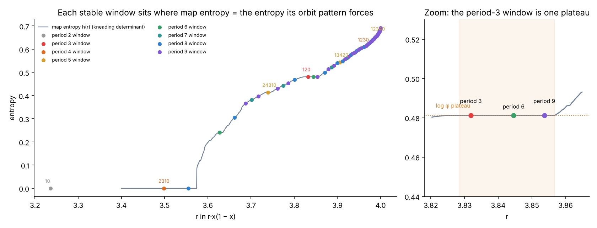
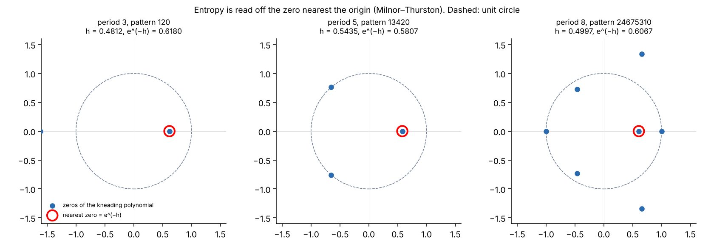
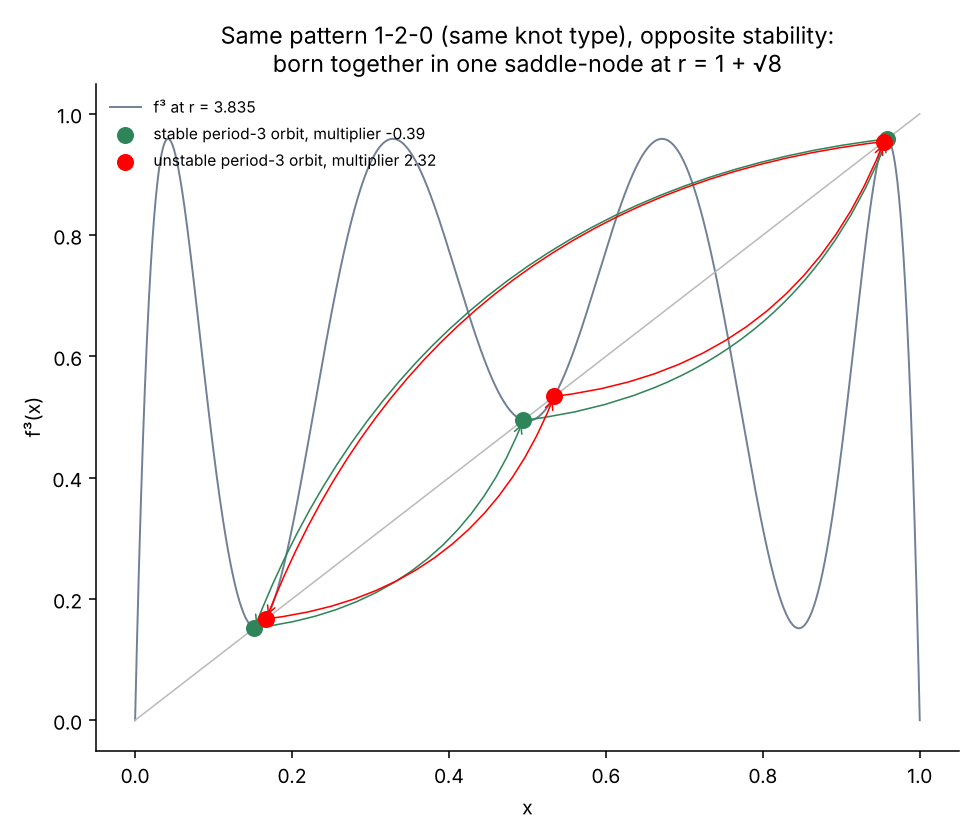
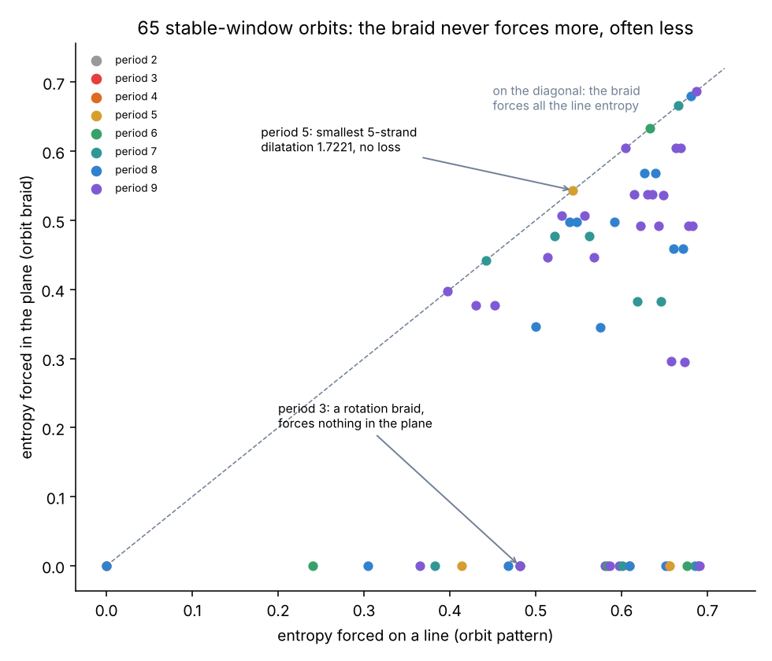
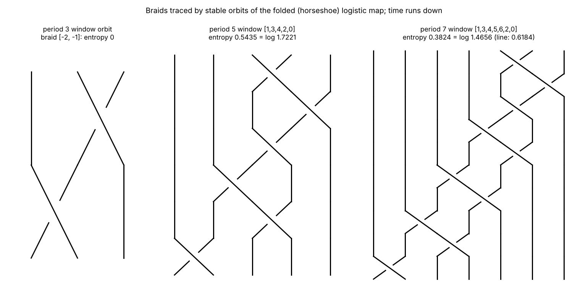
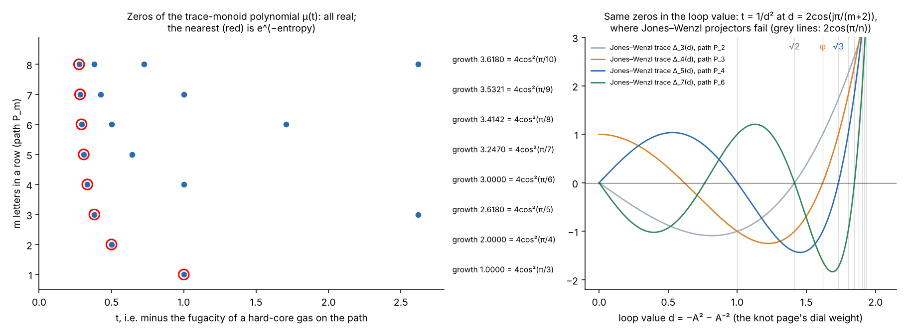
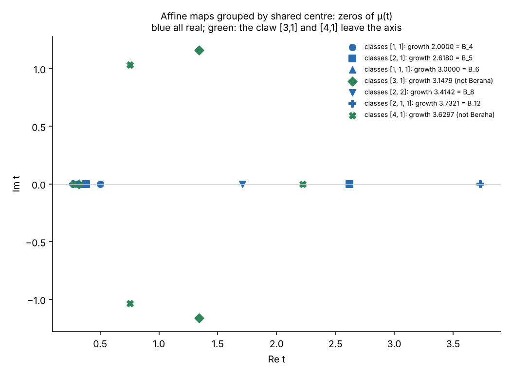
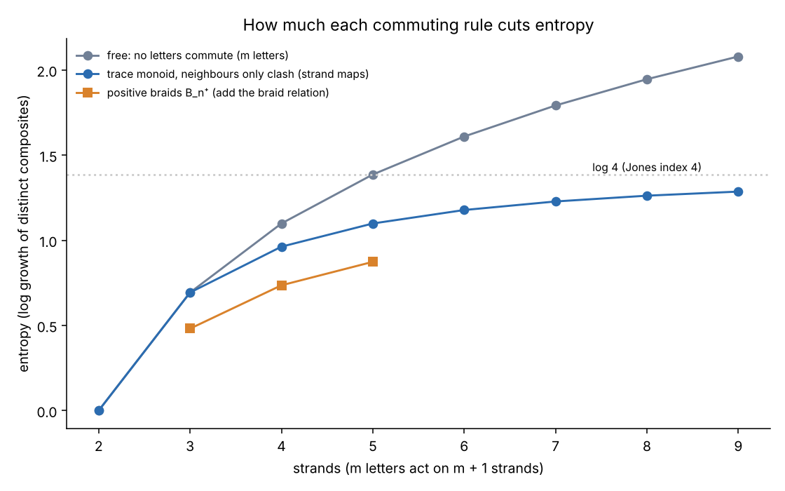

# DRAFT · Entropy and knots: do they find zeros or stable orbits?

**DRAFT, Nov 27 2026.** Part of Affine Composition Theory, built on Fused Hyperoperation Algebra. Follows
[chaos-composition](../chaos-composition/README.md) (entropy as a count of compositions, the Cartier–Foata polynomial)
and [knot-theory](../knot-theory/README.md) (tangle sum as the circle operation at the loop value). Asked for by Brennan
on Nov 27: "Can we look at the tie of entropy to knot theory in finding zeros or stable orbits".

Checks: [`checks.py`](checks.py) → [`checks_output.txt`](checks_output.txt), **25 of 25 pass** (numpy, scipy, sympy,
mpmath; about 2 minutes). Lean: [`lean/EntropyKnots.lean`](lean/EntropyKnots.lean), **12 theorems**, core Lean 4.37, no
`sorry`, standard axioms only; compiled in the shared library as `FusedAlgebra.Topics.EntropyKnots`.
Pictures: [`figures.py`](figures.py) → [`figures/`](figures/). Colour key where it applies: **orange = known, blue =
known pieces in our reading, green = the exception in a picture.**

## The answer first

**Not a lead.** The tie between entropy and knots is real and well mapped, and every piece of it below is known
mathematics. It finds zeros in one exact sense and stable orbits only on a line. Neither part gives a new way to find
Riemann zeros or to predict which three-body orbits are stable, and the reasons are clear enough to close the question.

1. **Entropy is a zero.** A periodic orbit's knot type (on a line, the order in which it visits its points; in the plane,
   the braid it traces) gives a matrix, and the entropy it forces is −log of the smallest zero of that matrix's
   determinant det(I − tA). For the logistic map that zero is also the smallest zero of the Milnor–Thurston kneading
   determinant. Checked for all 65 stable windows up to period 9 (figure 2). Known (Milnor and Thurston 1988).
2. **On a line, the knot type finds the stable orbit's window.** Map entropy rises with r, so solving
   "map entropy = the entropy this pattern forces" lands on the plateau that holds the window where that orbit is stable.
   Exact for all 65 windows (figure 1). But a plateau holds a whole window with all its sub-windows (period 3, 6 and 9
   share log φ), so entropy finds the window, not the orbit inside it. Known.
3. **Knot type never says which orbit is the stable one.** Orbits are born in pairs, one stable and one unstable, at
   one saddle-node. The two have the same knot type (figure 5, check A5). Stability is local information that knot
   type can't carry. This is why braid entropy added only 0.01 R² to three-body stability
   ([three-body-order](../three-body-order/README.md) §6). Known (Boyland 1994).
4. **In the plane, braids force less.** For the 65 window orbits, the braid keeps all the line entropy in 8, part of it
   in 31, and none in 23 (figure 3). The period-3 orbit braids as a rotation: period 3 forces chaos on a line
   (Li–Yorke) but nothing in the plane. Braid entropy is a floor on map entropy, not a locator: it jumps up and down
   along r while map entropy only rises (check B10). Known in principle (Thurston–Nielsen, Boyland); the 65-orbit tally
   is our computation.
5. **The in-between entropies of the chaos page sit at the Jones index.** The Cartier–Foata polynomial is a hard-core
   gas's partition function at negative fugacity. When letters clash only with their neighbours (the Temperley–Lieb
   pattern, which affine "strand maps" realise exactly) its zeros are at 1/(4cos²(jπ/(m+2))). The nearest zero is
   e^(−entropy), and the same zeros, read in the loop value d, are where Jones–Wenzl projectors fail: Jones's index
   values 4cos²(π/n) (figure 6, proved in Lean for all m). φ², 2 + √2 and 2 + √3 from the chaos page are B₅, B₈ and B₁₂.
   Each piece is known (Viennot 1986, Jones 1983, Wenzl 1987); joining them is one line and probably folklore.

Nothing on this page is claimed new, so nothing goes to [new-facts-levers](../new-facts-levers/README.md).

## 1. On a line: the orbit's pattern pins its window

*Figure 1. Left: the logistic map's entropy h(r) (grey), with the 65 stable windows of period 2 to 9 placed at their
superstable r and at the entropy their orbit pattern forces. Every dot lands on the curve. Labels give the pattern for
periods up to 5 (for example 120: the orbit visits the middle point, then the right one, then the left one). Right:
the period-3 window, its period-6 doubling and its period-9 sub-window all sit on one plateau at log φ.*

A periodic orbit on a line visits its points in some order. That order, a cyclic permutation called the orbit's
**pattern**, is the one-dimensional version of a knot type: it is what stays fixed when the map is deformed without
the orbit's points colliding. Connect the dots of the orbit by straight lines and you get the simplest map with that
pattern. Its gaps map over each other according to a 0/1 matrix A, and the entropy every map with that pattern must have
is log of A's largest eigenvalue (Block and Coppel; Alsedà, Llibre and Misiurewicz).

At a superstable parameter the critical point is on the orbit, and the map has exactly the entropy its stable orbit
forces (check A2, agreement to 10⁻¹⁴ for all 65 windows). Map entropy only rises with r (Milnor and Thurston; Douady
and Hubbard), so the equation "h(r) = h(pattern)" picks out one plateau, and the window lies on it.

The plateau is coarser than the window. Inside the period-3 window the map acts like a smaller logistic map on three
pieces, whose own entropy is at most log 2 / 3 ≈ 0.23, below log φ ≈ 0.48. So the entropy stays at log φ across the
whole window, and the period-6 and period-9 orbits born inside it share it (check A4). **Entropy finds the window; the
pattern finds the orbit.**

## 2. Entropy is the nearest zero

*Figure 2. Zeros of the kneading polynomial for the period-3, period-5 and period-8 windows. The zero nearest the origin
(red) is e^(−h). The rest lie farther out, most near the unit circle.*

Milnor and Thurston's kneading determinant is a power series built from the left/right record of the critical orbit.
Its smallest zero is e^(−h), and it equals the orbit-counting (Artin–Mazur) zeta function's reciprocal up to a simple
factor. For each window the same number e^(−h) is also a zero of det(I − tA) for the pattern's matrix (check A3), so the
knot type's matrix and the map's zeta function agree on the zero that matters. This is the precise sense in which
"entropy finds zeros": it *is* a zero, the nearest one, of a determinant the knot type writes down.

## 3. Same knot type, opposite stability

*Figure 5. Inside the period-3 window (r = 3.835) there are two period-3 orbits. Both visit their points in the order
middle, right, left. One has multiplier −0.39 (stable), the other 2.32 (unstable). They were born together in one
saddle-node at r = 1 + √8.*

At a saddle-node a stable orbit and an unstable one appear at the same point and pull apart. Their points never
collide afterwards, so they keep one knot type (check A5). The same holds in the plane, where the pair has one braid
type, and in Hamiltonian systems such as three bodies, where the pair is one elliptic orbit and one hyperbolic orbit.
**So knot type, and any entropy it forces, cannot tell the stable member of a pair from the unstable one.** That is
the theoretical reason behind the three-body result: braid entropy speaks about the flow around an orbit, and the
Floquet multiplier is a local property of the orbit itself.

What knot type does give is existence. If one orbit's braid type forces another's (Boyland's forcing order), every map
with the first orbit has the second. That predicts which orbits must already exist when a given one appears, and in
the horseshoe the order in which orbits are created (Hall 1994; de Carvalho and Hall's conjecture). It says nothing
about which of them are stable.

## 4. In the plane, braids force less

*Figure 3. For each stable-window orbit: the entropy its pattern forces on a line (across) and the entropy its braid
forces in the plane (up). Dots on the diagonal keep all the entropy; dots on the bottom keep none.*

*Figure 4. Braids traced by three window orbits when the logistic map is thickened into a horseshoe in the plane. Left:
period 3 is a rotation (entropy 0). Middle: period 5 keeps all its line entropy; its dilatation 1.7221 is the smallest
any 5-strand braid can have (Ham and Song 2007). Right: period 7 drops from 0.618 on the line to 0.382 in the plane,
the smallest 7-strand value (Lanneau and Thiffeault 2011).*

Thicken the line into a strip and fold it (Smale's horseshoe). Each orbit then traces a braid in space-time. The braid
was built here by swinging the folded half over the rest, and its entropy was measured by the growth of words under the
braid's action on the free group (checked on σ₁σ₂⁻¹, σ₁²σ₂⁻¹ and the rotation σ₁σ₂: checks B1–B3).

- **Never more than on the line** (check B4). A line map is a plane map squeezed flat, so the plane's minimum can only
  be lower. That is the Thurston–Nielsen floor sitting below the interval floor.
- **Often less, sometimes nothing** (B5). 8 of the 62 positive-entropy orbits keep everything, 31 keep part and 23
  keep nothing. Every rotation pattern (period n visiting 1, 2, …, n − 1, then 0) braids with entropy 0 (B7). The
  period-3 orbit is the first of these: "period 3 implies chaos" is a theorem about lines only.
- **Not a locator** (B10). Along r the braid entropy jumps down 19 times by more than 0.05 while map entropy only rises.
  In a family of plane maps, braid entropy says the map's entropy is at least this much once the orbit exists. It
  doesn't say where the orbit appears.

## 5. The chaos page's entropies sit at the Jones index

*Figure 6. Left: for m letters in a row, each clashing only with its neighbours, the zeros of the Cartier–Foata
polynomial μ(t) are all real, and the nearest is e^(−entropy). The growth rates are the Beraha numbers 4cos²(π/(m+2)).
Right: the same zeros as functions of the loop value d (t = 1/d²): the Jones–Wenzl traces Δ_{m+1}(d) vanish at
d = 2cos(jπ/(m+2)). The labels φ, √3 and √2 mark three of those walls.*

The chaos page counted the distinct compositions of affine branches with the Cartier–Foata polynomial
μ(t) = Σ over sets of mutually commuting letters of (−t)^size. Read with t = −x, that is the **independence
polynomial** of the clash graph (letters joined when they don't commute), which is the partition function of a hard-core
gas on that graph at fugacity x (Shearer 1985; Scott and Sokal 2005). The entropy is −log of the zero nearest the origin,
the gas's singularity on the negative fugacity axis.

**Letters that clash only with their neighbours** are exactly the Temperley–Lieb generators e₁, …, e_m of knot theory
(eᵢ and eⱼ commute when |i − j| ≥ 2). For that clash graph, a path, the polynomial obeys the same recursion as the
Jones–Wenzl traces: d^(m+1) μ(1/d²) = U_{m+1}(d/2), a Chebyshev polynomial (`path_jones_wenzl`, `jw_chebyshev`; check C1).
So:

- the zeros are at t = 1/(4cos²(jπ/(m+2))), all real (C2);
- the entropy is 2 log(2cos(π/(m+2))), the log of the Beraha number B_{m+2};
- read in the loop value d = −A² − A⁻², the zeros are the walls where a Jones–Wenzl projector fails, the values behind
  Jones's index theorem (index below 4 only at 4cos²(π/n)).

The [knot-theory](../knot-theory/README.md) page found that tangle sum is the circle operation with k set to the loop
value d. So these walls are points on that dial: d = 1, √2, φ, √3, …, approaching 2.

**Affine maps realise this pattern exactly.** Give each letter an affine map gᵢ that acts only on coordinates i and
i + 1 of Q^(m+1). Maps on disjoint coordinates commute (`disjoint_commute`), neighbours generically don't, and the
number of distinct composites matches the trace count exactly for m = 2 to 6, up to length 6 to 8 (C6). Cycles give
4cos²(π/(2m)) (C3).

*Figure 7. One-dimensional affine maps commute exactly when they share a centre, so their clash graphs are complete
multipartite. The five patterns with growth below 4 that have only real zeros land on Beraha numbers. The claw [3,1]
(one map against three that share a centre) and [4,1] do not: their zeros leave the real axis, as Chudnovsky and
Seymour's theorem allows: a graph with no claw has only real zeros (both of these contain one).*

So φ² (three maps, two sharing), 2 + √2 (two pairs) and 2 + √3 (a pair and two singles) are B₅, B₈ and B₁₂ (C4), but
that is a small-number pattern, not a rule: [3,1] gives 3.1479 and [4,1] gives 3.6297, neither Beraha (C5).

*Figure 8. Entropy of distinct composites for m letters on m + 1 strands. Free words: log m. Neighbour-only clashes
(strand maps, Temperley–Lieb pattern): climbs toward log 4. Adding the braid relation σᵢσᵢ₊₁σᵢ = σᵢ₊₁σᵢσᵢ₊₁ (positive
braids) cuts it further.*

**Adding the braid relation.** Burau matrices at t = 3/7 satisfy the braid relations. Their distinct positive products
match Deligne's count for positive braids exactly for 3, 4 and 5 strands (C7). Positive 3-braids grow like φ (C8,
`deligne_b3`), positive 4-braids like 2.0868. Each relation lowers entropy (C9).

Two small coincidences, recorded so nobody chases them. The trace monoid of three maps with two sharing a centre has
μ(t²) = (1 − t − t²)(1 + t − t²), where 1 − t − t² is the period-3 window's kneading polynomial (`graeffe_period3`, C10):
its growth φ² is the square of that window's φ. Positive 3-braids also grow like φ. Both follow from the golden
polynomial turning up in small cases, not from a shared mechanism we could find.

## 6. Riemann zeros and three bodies: where the known road goes

- **Modular knots.** Ghys (2007) showed that the closed orbits of the geodesic flow on the modular surface, the knots
  traced by SL(2, ℤ) classes, are exactly the Lorenz knots of Birman and Williams (1983). The
  [three-body-order](../three-body-order/README.md) page found three-body runs behave like trips into the modular
  surface's cusp, so those orbit words are modular knot words. That is a known road, not a new one.
- **Riemann zeros.** The lengths of those same closed geodesics feed the Selberg zeta function of the modular surface.
  The Riemann zeros appear there as scattering resonances, through ζ(2s) in the scattering determinant (Selberg; see
  Hejhal's volumes). This is the classical route by which knotted orbits "see" Riemann zeros. It places the zeros but
  does not constrain their real parts, so it is not a route to RH. Not recomputed here.
- **Stability.** Section 3 explains the three-body negative: stable and unstable orbits come in pairs with one braid.

## 7. Neighbours: the dial map and Mathlib

- **Dial map** ([dial-map](../dial-map/README.md)). The only dial touched is k at the loop value (section 5). The
  Beraha walls are a discrete set of points on it, not a new dial. The order dial q was already shown to be a switch
  for entropy ([chaos-composition](../chaos-composition/README.md) §6). **No new dial.**
- **Mathlib** ([mathlib-map](../mathlib-map/README.md)). Mathlib has Chebyshev polynomials (`Polynomial.Chebyshev.U`)
  and a topological-entropy development under `Mathlib/Dynamics/TopologicalEntropy`. A port would state
  `path_jones_wenzl` against `Polynomial.Chebyshev.U` rather than the local `cheb`. Names from memory, not re-checked
  against today's Mathlib.

## 8. Verdict

- **Zeros:** entropy is the nearest zero of a determinant that the knot type writes down. True and known. It does not
  reach the Riemann zeros except by the known Selberg road, which says nothing about their real parts.
- **Stable orbits:** on a line, pattern plus entropy finds the window exactly (known). In the plane and for three
  bodies, braid type finds neither the place nor the stability: stable and unstable orbits share a braid, and braids
  often force less than the line does. That closes the three-body question from the theory side.
- **Worth keeping (small, known pieces):** the chaos page's in-between entropies are hard-core gas zeros, and for the
  Temperley–Lieb pattern those zeros are the Jones index walls on the loop-value dial. It links two repo pages
  ([chaos-composition](../chaos-composition/README.md), [knot-theory](../knot-theory/README.md)) cleanly, and it is
  the hard-core (repulsive) cousin of the [lee-yang](../lee-yang/README.md) work. It opens no new question.
- **Not recommended as a next phase.**

## Assumptions

- **Superstable windows** were found by scanning r on a grid of 200,000 points and refining roots of f^n(½) = ½ at 60
  digits. The count 1, 1, 2, 3, 5, 9, 16, 28 for periods 2 to 9 matches the known window counts (Metropolis, Stein and
  Stein 1973), so none was missed in that range.
- **Map entropy** at a window uses the exact kneading determinant of the periodic critical orbit, with the critical
  symbol taken from either side (both agree). The h(r) curve in figure 1 uses a truncated kneading series of 110 and 170
  terms and is a picture only.
- **Braids** are those of the logistic map thickened into a horseshoe, built by one particular isotopy (the right half
  swings over the left through the upper half plane). A different thickening could mirror every braid, which doesn't
  change entropy. They are the braids the orbits have in the horseshoe, not in any specific Hénon or three-body flow.
- **Braid entropy** is a numerical growth rate of free-group words over up to 400 iterations or 2 million letters.
  Values below 0.01 are read as 0 (polynomial growth shows up as about 0.003). Agreement with known minimal dilatations
  for 5 and 7 strands is to 2·10⁻⁴.
- **Strand maps and Burau counts** (C6, C7) are exact rational computations up to the stated lengths. They confirm the
  counts there; they don't prove that no accidental relation appears later.
- The **Selberg and Ghys** statements in section 6 are quoted from the literature, not recomputed.
- **Lean** results hold over ℤ as polynomial identities (`path_jones_wenzl` for every m by induction). The locations of
  the zeros at 2cos(jπ/(m+2)) need trigonometry and are checked numerically (C2), not in Lean.

## Known vs new

| Item | Status | Source |
|---|---|---|
| Entropy = −log of the smallest zero of the kneading determinant | Known | Milnor and Thurston 1988 |
| Entropy forced by a pattern = log of the largest eigenvalue of its connect-the-dots matrix | Known | Block and Coppel 1992; Alsedà, Llibre and Misiurewicz 1993 |
| At a superstable window the map's entropy equals its orbit pattern's (65 windows) | Known; checked here (A2) | as above |
| Map entropy rises monotonically with r | Known | Milnor and Thurston 1988; Douady and Hubbard |
| Window counts 1, 1, 2, 3, 5, 9, 16, 28 | Known | Metropolis, Stein and Stein 1973 |
| Saddle-node pairs share knot type; braid forcing gives existence, not stability | Known | Boyland 1994 |
| Order of creation of horseshoe orbits | Known (partly conjectural) | Hall 1994; de Carvalho and Hall |
| Period 3 forces chaos on a line, not in the plane (rotation braid) | Known | Li and Yorke 1975; Boyland |
| Braid entropy ≤ pattern entropy; the 8 / 31 / 23 tally for 65 window orbits | Inequality known; tally is our computation | checks B4, B5 |
| Smallest dilatations 1.7221 (5 strands), 1.4656 (7 strands) | Known | Ham and Song 2007; Lanneau and Thiffeault 2011 |
| Cartier–Foata polynomial = independence polynomial at −t (hard-core gas) | Known | Cartier and Foata 1969; Viennot 1986; Scott and Sokal 2005 |
| Path heaps give Chebyshev U; zeros at 1/(4cos²(jπ/(m+2))) | Known | Viennot 1986; arXiv:2012.03878 (Lemma 3) |
| Jones–Wenzl traces are Chebyshev U in d; index values 4cos²(π/n) | Known | Jones 1983; Wenzl 1987; Kauffman and Lins 1994 |
| Trace-monoid entropy of the Temperley–Lieb pattern = 2 log(2cos(π/(m+2))), the Jones walls | Known pieces joined in one line; probably folklore | this page, C1–C2, `path_jones_wenzl` |
| Claw-free graphs have real independence zeros | Known | Chudnovsky and Seymour 2007 |
| Positive braid growth series | Known | Deligne 1972; Saito |
| μ_P3(t²) = (1 − t − t²)(1 + t − t²) | Elementary; a small-number coincidence | `graeffe_period3` |
| Modular knots = Lorenz knots | Known | Ghys 2007; Birman and Williams 1983 |
| Riemann zeros as resonances of the modular surface | Known | Selberg; Hejhal |

**Searches (Nov 27):** "Scott Sokal repulsive lattice gas independent-set polynomial … heaps of pieces Cartier-Foata
trace monoid"; "trace monoid growth rate Beraha number 4cos²(π/n) independence polynomial path Chebyshev heaps
Temperley-Lieb"; "Viennot heaps of pieces dimers on a segment Chebyshev"; "braid type periodic orbit forces topological
entropy Boyland Hall horseshoe forcing order"; "topological entropy superstable unimodal map … kneading determinant
smallest zero". No source stated the trace-monoid entropy as the Jones wall in so many words, but both halves are
textbook, so it is labelled folklore rather than new.

## Files

- `windows.py` → `windows.json`: the 65 superstable windows, patterns, pattern matrices, entropies, kneading polynomials.
- `braids.py`, `window_braids.py`: horseshoe braids of the window orbits and their entropies (added to `windows.json`).
- `zeros.py` → `zeros.json`: trace-monoid polynomials, zeros, Beraha matches, strand-map counts.
- `posbraid.py` → `posbraid.json`: positive braids by Burau products and by Deligne's formula.
- `checks.py` → `checks_output.txt`: 25 checks in three groups (A: line, B: plane, C: zeros). Reruns the four scripts.
- `figures.py` → `figures/fig1`–`fig8`.
- `lean/EntropyKnots.lean`: copy of the library module (12 theorems).
