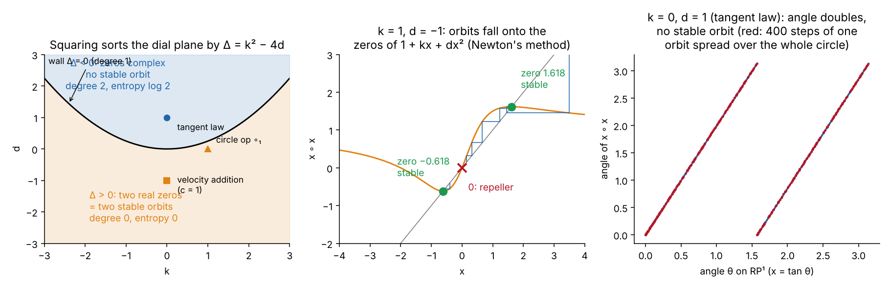
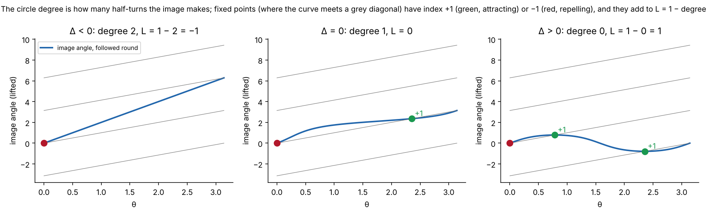
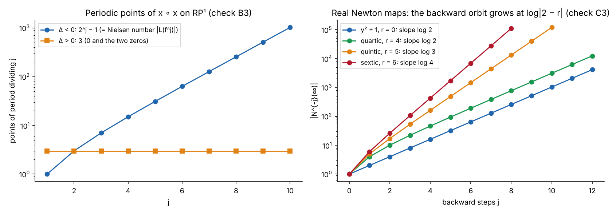
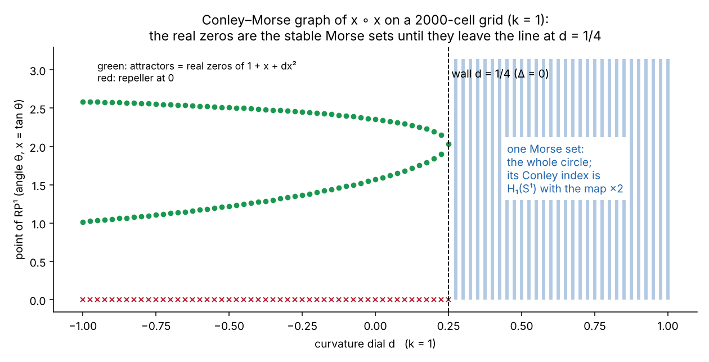
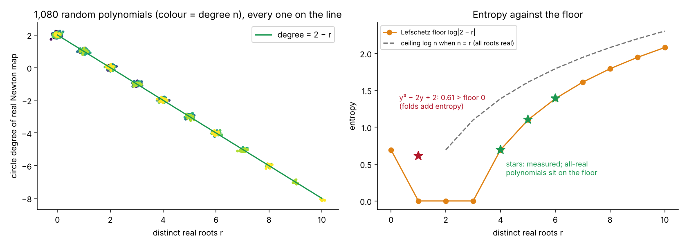
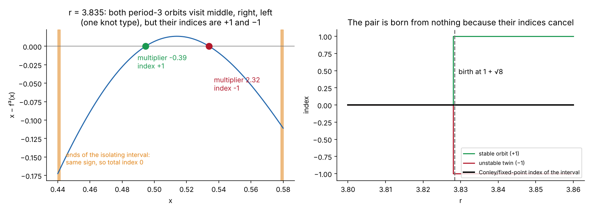
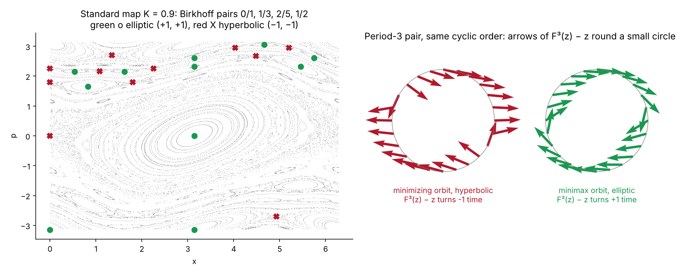
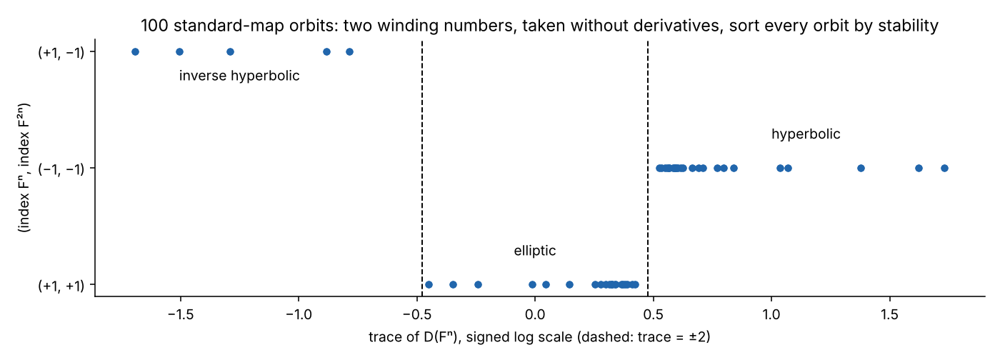
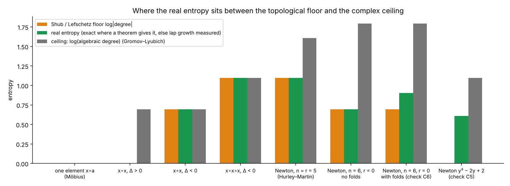
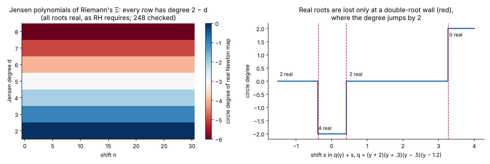

# DRAFT · Entropy plus topology: do they find zeros or stable orbits?

**DRAFT, Nov 27 2026.** Part of Affine Composition Theory, built on Fused Hyperoperation Algebra. Follows
[entropy-knots](../entropy-knots/README.md), which found that knot type can't tell a stable orbit from its unstable
twin. Asked for by Brennan on Nov 27 ("Yes" to "Should I look into it as a new task, starting with the Conley index?"):
does topology beyond knot type (the Conley index, Lefschetz and Nielsen fixed-point counts, Shub's entropy conjecture)
help find zeros or stable orbits, using the dials first?

Checks: [`checks.py`](checks.py) → [`checks_output.txt`](checks_output.txt), **30 of 30 pass** (numpy, scipy, sympy;
about 1½ minutes; it reruns `windows_index.py` and `jensen.py` first). No Lean module yet (section 9 says what would
port). Pictures: [`figures.py`](figures.py) → [`figures/`](figures/) (needs matplotlib). Colour key where it applies:
**orange = known, blue = our reading of known pieces, green = not found in print.**

## The answer first

Yes, in one clear way and one new way, with grades two ways: **worth following** (does it open work worth doing) and
**could reach a proof** (could it become a theorem that matters).

1. **The Conley index tells stable from unstable where knot type can't** (figures 6–8). Saddle-node twins share knot
   type but have fixed-point indices +1 and −1, so their indices cancel, which is why the pair can be born from nothing
   (check D1–D2). In all 65 logistic windows the stable orbit has index +1 and its twin −1 (D3). In area-preserving
   maps, two indices read from winding numbers alone, with no derivatives, sort every orbit into elliptic, hyperbolic
   or inverse hyperbolic (100 standard-map orbits, 9 Hénon orbits; D4–D6). Known (Conley, Dold, Greene's residue,
   MacKay–Meiss). What it adds here: it closes the open point in entropy-knots, and it is the tool behind
   computer-assisted proofs of chaos (Mischaikow–Mrozek 1995 for Lorenz).
   **Worth following: high**, for the three-body stability question. **Could reach a proof: medium**: for one given
   system, an interval-arithmetic Conley index proof of an orbit's existence and residue class is a standard road.
   It proves existence and type, not long-term stability (that needs KAM on top).
2. **Squaring under the dial law is Newton's method** (figure 1). With x = 1/y, x ∘ x = (2x + kx²)/(1 − dx²) is Newton's
   method on y² + ky + d, and the m-fold power is König's root-finder of order m (m = 3 is Halley); all exact (A1–A3).
   So every point of the (k, d) plane is a root-finder for its own dial polynomial 1 + kx + dx². Velocity addition is
   Newton's method finding the light speed c, with jet slope 0 at c (B6). The identity is elementary and Newton on a
   quadratic is old (Cayley, Schröder); the group-law statement was not found in print. **Worth following: moderate**
   (it gives every dial a dynamics reading). **Could reach a proof: low** (it is an identity).
3. **The sign of Δ = k² − 4d is an entropy switch** (figures 2–4, 10). On the circle RP¹, the dial square has degree 2,
   no stable orbit and entropy log 2 when Δ < 0; degree 0, two stable orbits (the real zeros) and entropy 0 when Δ > 0.
   Lefschetz, Nielsen and a grid-computed Conley–Morse graph all switch at the wall (B1–B5). On the elliptic side the
   real entropy meets Shub's floor and the complex ceiling at once (E2). Each piece is known; the dial reading is ours.
   It ties to [riemann-neighbours](../riemann-neighbours/README.md): a local factor 1 + ku + du² is on the elliptic side
   exactly when its own dial square has entropy log 2 and no real stable orbit (Selberg's 1/4 for (−1, λ) becomes an
   entropy switch). **Worth following: moderate. Could reach a proof: low** (a restatement of known positivity).
4. **Real Newton's method counts real roots by a degree** (figure 5). For a real polynomial of degree n ≥ 2 with r
   distinct real roots, Newton's map on RP¹ has circle degree 2 − r. Proof in two lines from the Lefschetz formula
   (section 4); checked on 3,300 random polynomials (C1–C2). So entropy ≥ log|2 − r| (Misiurewicz–Przytycki), equal
   when Newton has no folds and above it when it does (C5–C6). Not found stated in print; the pieces are Barna and
   Hurley–Martin, so it is likely folklore. **Worth following: moderate. Could reach a proof: low** on its own; it is
   the counting tool for item 5.
5. **A topological door to the Riemann hypothesis, not a key** (figure 9). RH holds iff every Jensen polynomial of
   Riemann's Ξ has only real roots (Pólya 1927). By item 4 that is the same as: every one of their Newton maps has
   circle degree 2 − d. All 248 we computed (d ≤ 8, n ≤ 30) do (F2), which Griffin–Ono–Rolen–Zagier already prove for
   large n. Real roots can only be lost where two merge, and there the degree jumps by 2 (F3). **Worth following:
   low to moderate. Could reach a proof: low.** It would become a lead with a continuation argument showing no Jensen
   polynomial meets a double-root wall; that is the de Bruijn–Newman question in another dress (Rodgers–Tao 2018).

New dial: **none.** The curvature dial d crossing the Δ wall does all the switching. The jet replaces velocity
addition throughout: the slope of the dial square at a zero is 0 (superattraction), and the sign of 1 − slope is the
fixed-point index the Conley theory reads.

Nothing here proves anything about ζ or three bodies. What is new is small: items 2 and 4 as stated, and the
assembled dial picture. Both are in [new-facts-levers](../new-facts-levers/README.md) as L13 and L14.

## 1. The dial square is Newton's method

*Figure 1. Left: the (k, d) plane split by the wall Δ = 0 (black). Blue (Δ < 0): the dial polynomial 1 + kx + dx² has
complex zeros, so squaring has no stable orbit. Orange (Δ > 0): two real zeros, two stable orbits. The tangent law
(k = 0, d = 1), velocity addition (k = 0, d = −1, c = 1) and the circle operation ∘₁ (k = 1, d = 0) are marked.
Centre: k = 1, d = −1; a cobweb (blue) of x ↦ x ∘ x falls onto the zero 1.618; the zeros are green, the repeller 0 is red.
Right: the tangent law doubles the angle; 400 steps of one orbit (red) spread over the whole circle.*

The two-dial law x ∘ a = (x + a + kax)/(1 − dax) in homogeneous form is (u₁, v₁) ∘ (u₂, v₂) = (u₁v₂ + u₂v₁ + k u₁u₂,
v₁v₂ − d u₁u₂) (`dialtop.compose_h`). Facts, all checked symbolically:

- **A1.** x ∘ x = 1/N(1/x), where N(y) = y − q(y)/q′(y) is Newton's method on q(y) = y² + ky + d.
- **A2.** The m-fold power x ∘ x ∘ … ∘ x is König's method of order m on q, for m = 2 to 6.
- **A3.** Under z = (y − e₁)/(y − e₂), with e₁, e₂ the roots of q, the m-fold power is z ↦ zᵐ.
- **A4–A5.** The fixed points of x ∘ x are 0 (multiplier 2, a repeller) and the zeros of 1 + kx + dx² (multiplier 0,
  superattracting).
- **A6.** On the wall Δ = 0 a zero meets a pole and x ∘ x drops to the Möbius map 2x/(1 − kx/2).

Why it holds: the law is a one-parameter group, conjugate to multiplication by the same Möbius map that sends the roots
of q to 0 and ∞. Newton's method on a quadratic is conjugate to z ↦ z² by that map (Cayley 1879, Schröder 1870).
So the identity is two known conjugacies meeting, and probably folklore. We did not find it stated for group laws.

**The jet, not velocity addition (B6–B7).** At k = 0, d = −1/c² the law is relativistic velocity addition, and
composing a speed with itself is Newton's method finding ±c. The jet of x ∘ x at c has slope 0, so the error squares
each step: e_{n+1}/e_n² → 1/(2c) (checked at c = 3: 0.1667). At k = 0, d = 1 (the tangent law) the jet along a typical
orbit grows like 2ⁿ, Lyapunov exponent log 2.

## 2. Degree, Lefschetz and Nielsen: the Δ switch

*Figure 2. The lifted angle of x ∘ x as θ runs once round RP¹. Grey diagonals are where a fixed point would sit. Left
(Δ < 0, the tangent law): the image goes round twice (degree 2); only 0 is fixed, index −1, Lefschetz number
L = 1 − 2 = −1. Centre (on the wall, k = 2, d = 1): degree 1; 0 (index −1) and the double zero x = −1 (multiplier ½,
index +1) give L = 0. Right (Δ > 0, k = 0, d = −1): degree 0; 0 (index −1) and the zeros x = ±1 (index +1 each) give
L = 1.*

- **B1.** Circle degree of the m-fold power: m when Δ < 0, 1 on the wall, m mod 2 when Δ > 0 (12 dial points, m = 1..6).
- **B2.** The fixed-point indices of x ∘ x add to L = 1 − degree at every dial point off the wall (Lefschetz).
- **B3.** Points of period dividing j: exactly 2ʲ − 1 when Δ < 0 (the Nielsen number |L(fʲ)| = |1 − 2ʲ|), exactly 3
  for every j when Δ > 0.
- **B4.** Entropy: log 2 when Δ < 0, 0 when Δ > 0.

*Figure 4. Left: period counts, Δ < 0 (blue, 2ʲ − 1, exactly the Nielsen number) against Δ > 0 (orange, 3 forever).
Right: real Newton maps; the number of real preimages of ∞ after j backward steps grows at exactly log|2 − r| (check C3).*

## 3. The Conley–Morse graph on the dial line

*Figure 3. A Conley–Morse graph of x ∘ x computed on a 2000-cell grid of RP¹ along k = 1. For d < 1/4 the Morse sets are
two attractors at the real zeros of 1 + x + dx² (green) and a repeller at 0 (red). At the wall d = 1/4 the attractors
meet. For d > 1/4 there is one Morse set, the whole circle (blue bars), whose Conley index is H₁(S¹) with the map ×2.*

Method after Arai, Kalies, Kokubu, Mischaikow, Oka and Pilarczyk (2009): cover each cell's image by grid cells, take the
strongly connected components of the cell graph, and read the order by reachability (`morse_graph.py`). Check B5
counts the Morse sets at d = −1, 0.2, 0.25, 0.3, 1: 3, 3, 2, 1, 1. The grid gives an outer bound, so the count at the
wall itself (2) reflects cell size, not a third behaviour.

What this adds: the computed Morse graph finds the stable orbits (the real zeros) without solving for them, and its
change of shape is the wall. The same computation runs on maps with no formula, which is why it matters for item 1.

## 4. Real Newton's method: degree 2 − r

*Figure 5. Left: 1,080 random real polynomials of degree 2 to 10 (colour = degree, jittered); the circle degree of the
Newton map is 2 − r for every one. Right: the floor log|2 − r| (orange), the ceiling log n when all n roots are real
(grey dashes), measured entropies of all-real cases (green stars, on the floor, as Hurley–Martin proved) and the cubic
y³ − 2y + 2 (red star, 0.61 above a floor of 0).*

**Statement.** Let q be a real polynomial of degree n ≥ 2 with r distinct real roots, and N its Newton map on RP¹.
Then deg N = 2 − r.

**Proof.** N is a C¹ self-map of RP¹ ≅ S¹, so the Lefschetz number is 1 − deg N and equals the sum of fixed-point indices.
The fixed points are the r real roots and ∞. At a root of multiplicity m the multiplier is (m − 1)/m < 1, index +1.
At ∞, N(y) ≈ (1 − 1/n)y, so the multiplier is n/(n − 1) > 1, index −1. So 1 − deg N = r − 1. ∎
(For degree n = 1 Newton is constant and the statement fails, so n ≥ 2.)

- **C1–C2.** 3,300 random polynomials, and 193 with repeated roots (using the reduced map num = yP − Q, den = P from
  the distinct roots): all satisfy it.
- **C3.** The backward orbit of ∞ grows at exactly log|2 − r| in 7 examples.
- **C4.** All roots real: lap growth (turning points of Nʲ) is log(n − 2), the floor (Hurley–Martin 1984).
- **C5.** y³ − 2y + 2 (one real root, degree 1, floor 0) has lap growth 0.609.
- **C6.** Two sextics with no real roots (degree 2, floor log 2): one without folds (q″ has no real root) has no
  turning points at all, so h = log 2 exactly; one with folds grows at 0.904.

So the topology fixes a floor, and the folds (critical points of N, at the real roots of q″) decide the excess. That is
the shape of Yomdin's theorem: entropy above the homological floor needs derivative growth.

## 5. Same knot type, opposite index

*Figure 6. Left: x − f³(x) for the logistic map at r = 3.835. Both period-3 orbits visit middle, right, left (one knot
type). The stable one (green, multiplier −0.39) has index +1, the unstable one (red, multiplier 2.32) index −1. At the
ends of the interval [0.44, 0.58] (orange) the curve has the same sign, so the interval's total index is 0. Right: as r
crosses 1 + √8 the two orbits appear; their indices +1 and −1 cancel, so the interval's index (black) stays 0.*

The index of a fixed point of fⁿ with multiplier λ ≠ 1 is sign(1 − λ), and the index of an interval is
(sign g(b) − sign g(a))/2 with g = x − fⁿ(x), read from its two ends only (`orbits.interval_index`).

- **D1.** At r = 3.835 the two period-3 orbits share one pattern; indices +1 and −1.
- **D2.** The interval's index stays 0 across the birth near r = 3.829.
- **D3.** All 65 windows of period 2 to 9 (from entropy-knots): the stable orbit has index +1. 60 have a same-pattern
  twin, always of index −1. The other 5 have no twin because they are born by period doubling: (period 2, r = 3.2361),
  (4, 3.4986), (8, 3.5546), (6, 3.8446), (8, 3.9609).

What this contributes: entropy-knots §3 said knot type can't tell the stable orbit from its twin. The index can, and it
explains why: a pair born from nothing must have total index 0.

## 6. In the plane: two indices sort every orbit

*Figure 7. Left: the standard map at K = 0.9 with Birkhoff pairs of rotation numbers 0/1, 1/3, 2/5, 1/2; green circles
elliptic, red crosses hyperbolic. Right: the period-3 pair. The two orbits have the same cyclic order (braid type).
The arrows of F³(z) − z on a small circle turn −1 time round the minimizing orbit (hyperbolic) and +1 time round the
minimax orbit (elliptic).*

*Figure 8. 100 standard-map orbits: the pair (index of Fⁿ, index of F²ⁿ), from winding numbers only, against the trace
of the derivative (signed log scale; dashed at trace ±2). Each class falls in its own row.*

For an area-preserving map the index of a nondegenerate fixed point is sign det(I − DF) = sign(2 − tr DF). With Greene's
residue R = (2 − tr)/4 this gives **i(Fⁿ) = sign R and i(F²ⁿ) = sign R(1 − R)** (since 2 − tr(M²) = 16R(1 − R)). So:

| Class | Greene's residue | (i(Fⁿ), i(F²ⁿ)) |
|---|---|---|
| hyperbolic | R < 0 | (−1, −1) |
| elliptic | 0 < R < 1 | (+1, +1) |
| inverse hyperbolic | R > 1 | (+1, −1) |

- **D4.** Standard map, K = 0.9: 50 Birkhoff pairs of period 1 to 13 (8 more did not converge and are left out). In every
  pair the two orbits share their cyclic order, yet the index pair sorts all 100 orbits: 50 hyperbolic, 40 elliptic,
  10 inverse hyperbolic.
- **D5.** The index is the parity of the Morse index of the action W = Σ(Δx)²/2 − K Σcos xᵢ: i(Fⁿ) = (−1)^(Morse + 1).
  The minimizer (Morse 0) is always hyperbolic.
- **D6.** The area-preserving Hénon map (cos α = 0.24): the same index pair classifies all 9 orbits found
  (2 elliptic, 5 hyperbolic, 2 inverse hyperbolic).

What this contributes: a stability class read from topology alone, robust to small errors in the map, and computable by
interval arithmetic. Precisely: it gives the residue class (linear type) of a nondegenerate orbit. Elliptic is not the
same as stable for all time; that needs a twist condition and KAM.

## 7. Shub's floor, the folds, and the ceiling

*Figure 10. For each map: Shub's floor log|degree| (orange), the real entropy (green: exact where a theorem gives it,
otherwise measured lap growth from checks C5–C6), and the ceiling log(algebraic degree) (grey), the entropy of the
complex rational map (Gromov, Lyubich).*

- **E1.** One composition x ↦ x ∘ a is a Möbius map of degree sign(1 + ka + da²), entropy 0 (60 random elements). All
  the entropy comes from self-composition.
- **E2.** On the elliptic side the real entropy of x ∘ x equals the floor log 2 and the ceiling log 2 at once. On the
  hyperbolic side it is 0 against a complex log 2: the chaos moved off the real line.
- For Newton maps the floor (Misiurewicz–Przytycki) and Ivanov's Nielsen bound agree on the circle: log|2 − r|. The
  excess above it is set by folds (C5, C6).

The order of work asked for Shub with Yomdin's and Ivanov's bounds. On a circle Shub's conjecture is an old theorem
(Misiurewicz–Przytycki 1977 for C¹ maps), so the conjecture itself has nothing left to test here. The useful part is
the ladder floor ≤ real ≤ ceiling, and which side of the wall makes it tight.

## 8. The Riemann door

*Figure 9. Left: circle degree of the real Newton map of the Jensen polynomials J^{d,n} of Ξ, for d = 2..8 and shift
n = 0..30. Every row has degree 2 − d, meaning all roots real. Right: a quartic family q + s; the degree only jumps,
by 2, at the red lines where two real roots merge.*

Jensen polynomials J^{d,n}(X) = Σⱼ C(d, j) γ(n + j) Xʲ, with γ(m) the Taylor coefficients of Ξ (computed from
Riemann's kernel Φ to 7 terms; γ(0) = ξ(1/2) = 0.4971207781883141, check F1). RH ⇔ all J^{d,n} hyperbolic (Pólya 1927;
Jensen 1913) ⇔ (by section 4) every Newton degree is 2 − d.

- **F2.** All 248 with d ≤ 8, n ≤ 30 are hyperbolic, degree 2 − d.
- **F3.** Along q(y) + s, q = (y + 2)(y + 0.3)(y − 0.5)(y − 1.2), the degree takes the values −2, 0, 2 and jumps only at
  s = −0.394, 0.41, 3.248, where two roots merge.

What it would take to be a lead: an argument that as (d, n) or a deformation parameter moves, no Jensen polynomial
meets a double-root wall. That is what the de Bruijn–Newman constant Λ measures (real zeros for t ≥ Λ; Rodgers–Tao
proved Λ ≥ 0, so RH ⇔ Λ = 0). The degree adds a topological counter for walls crossed; it adds no new control over them.

## 9. Neighbours: the dial map and Mathlib

- **Dial map** ([dial-map](../dial-map/README.md)). Only k and d are used; the sign of Δ already sorts the plane there.
  New here: Δ as an entropy switch, and each dial point as a root-finder for its own dial polynomial. The link to
  riemann-neighbours' Layer 2 (local factors on the elliptic side) is item 3. **No new dial.**
- **Mathlib** ([mathlib-map](../mathlib-map/README.md)). Mathlib has a Newton map (`Polynomial.newtonMap`, in
  `Mathlib/Dynamics/Newton.lean`) and topological entropy (`Mathlib/Dynamics/TopologicalEntropy`). I don't know of a
  Lefschetz number or a circle degree there. What would port first: A1 as a polynomial identity (the dial square equals
  the reversed Newton map) against `newtonMap`, and the index sum for degree 2 − r once a circle degree exists.
  Names from memory, not re-checked against today's Mathlib.

## Assumptions

- **Circle degree** is computed two ways: by unwrapping the image angle (`rp1_degree`) and by counting signed preimages
  of a regular value (`rp1_degree_alg`, with a relative tolerance and five trial values). Both are numerical; the
  degree 2 − r has the proof in section 4.
- **Entropy** of interval and circle maps is read as the growth rate of turning points (lap numbers), using
  Misiurewicz–Szlenk (laps grow at the entropy for piecewise-monotone maps). Rates come from 8 to 18 backward steps
  with a cap of 40,000–60,000 points, so they are estimates to about 0.01. The value log 2 on the elliptic side and
  log(n − 2) for all-real roots are theorems, not estimates.
- **Morse graphs** come from a 2000-cell grid with 16 samples per cell and a margin equal to the largest sample gap.
  This is an outer approximation without interval arithmetic, so it is evidence, not a proof.
- **Periodic orbits** of the logistic, standard and Hénon maps are found numerically (grid plus brentq; Newton on the
  action with least squares). Indices are winding numbers on a circle of radius chosen below half the nearest-point
  distance, sampled at 720 points.
- The **8 standard-map pairs** that did not converge are left out of D4–D5; they are not counted as agreeing.
- **Jensen polynomials** use Riemann's kernel truncated at 7 terms and quadrature in double precision; checked only
  for d ≤ 8 and n ≤ 30. Nothing about larger d is claimed beyond the GORZ theorem.
- **Elliptic ≠ stable.** The index pair gives linear type. Long-term stability is a separate (KAM) question.
- **Literature status** of items 2 and 4 rests on the searches listed below; "not found" is not "new".

## Known vs new

| Item | Status | Source |
|---|---|---|
| Newton on a quadratic is conjugate to z ↦ z² | Known | Schröder 1870; Cayley 1879 |
| König's methods of order m | Known | König 1884 |
| Dial square = Newton on y² + ky + d; m-fold power = König order m (A1–A3) | **Not found in print as a group-law statement**; follows from two conjugacies, likely folklore | this page; L12 |
| Index sum = Lefschetz number; Nielsen number on the circle | Known | Lefschetz 1926; Nielsen 1927; Brown 1971 |
| Δ sorts (k, d) laws into three kinds | Known | Coleman and McGuinness 1991 |
| Δ as an entropy and Morse-graph switch for the dial square (B1–B5, E2) | Known pieces, our reading | this page |
| Conley index; Conley–Morse graphs on grids | Known | Conley 1978; Szymczak 1995; Arai, Kalies, Kokubu, Mischaikow, Oka, Pilarczyk 2009 |
| Computer-assisted chaos proofs by the Conley index | Known | Mischaikow and Mrozek 1995 |
| Real Newton maps: Barna's theorem; (n − 2)ᵏ cycles, entropy ≥ log(n − 2) | Known | Barna 1953, 1956; Hurley and Martin 1984; Saari and Urenko 1984; Wong 1984 |
| Circle degree of real Newton = 2 − r (section 4) | **Not found stated**; two lines from Lefschetz, likely folklore | this page; L13 |
| Entropy ≥ log|degree| for C¹ maps | Known | Misiurewicz and Przytycki 1977 |
| Shub's entropy conjecture; Yomdin's theorem for C^∞ | Known (conjecture 1974; C^∞ case proved) | Shub 1974; Yomdin 1987; Manning 1975 |
| Entropy ≥ growth of Nielsen numbers | Known | Ivanov 1982 |
| Entropy of a rational map of degree n is log n | Known | Lyubich 1983; Gromov 2003 (preprint 1977) |
| Laps grow at the entropy | Known | Misiurewicz and Szlenk 1980 |
| Saddle-node twins have indices +1 and −1; index of iterates | Known | Dold 1983; Le Calvez and Yoccoz 1997 |
| 65-window index tally; the 5 period-doubling windows without twins (D3) | Our computation | checks D3 |
| Greene's residue and its three classes | Known | Greene 1968, 1979 |
| Index pair (sign R, sign R(1 − R)) | Elementary from the residue | this page |
| Index = parity of the action's Morse index; Birkhoff minimizing and minimax orbits | Known | Conley and Zehnder 1984; MacKay and Meiss 1983; Aubry; Mather |
| RH ⇔ all Jensen polynomials of Ξ hyperbolic | Known | Pólya 1927; Jensen 1913 |
| Hyperbolic for each d once n is large | Known | Griffin, Ono, Rolen and Zagier 2019 (PNAS) |
| de Bruijn–Newman constant Λ ≥ 0 | Known | Rodgers and Tao 2020 (Forum Math. Pi; arXiv 2018) |

**Searches (Nov 27):** "Newton's method quadratic conjugate z² Cayley Schröder group law Möbius addition"; "circle
degree real Newton map number of real roots Lefschetz"; "Saari Urenko 1984 Newton's method circle maps and chaotic
motion degree real roots"; "Greene residue fixed point index iterates area-preserving map elliptic hyperbolic inverse
hyperbolic". Saari and Urenko (Amer. Math. Monthly 91, 1984) treat real Newton as a circle map; we read only secondary
citations of it, so the degree formula may be there. Until someone reads it, L14 stays "not found", not "new".

## Files

- `dialtop.py`: the dial law in homogeneous form, powers, circle degree (two ways), Newton parts, backward trees.
- `orbits.py`: logistic, standard-map and Hénon orbits; interval and winding indices; Birkhoff pairs.
- `windows_index.py` → `windows_index.json`: indices of the 65 windows (reads `../entropy-knots/windows.json`).
- `morse_graph.py`: grid Conley–Morse graphs on RP¹.
- `jensen.py` → `jensen.json`: Taylor data of Ξ and the Jensen polynomials.
- `checks.py` → `checks_output.txt`: 30 checks in six groups (A symbolic, B dial switch, C Newton, D Conley index,
  E Shub ladder, F Riemann door).
- `figures.py` → `figures/fig1`–`fig10`.
