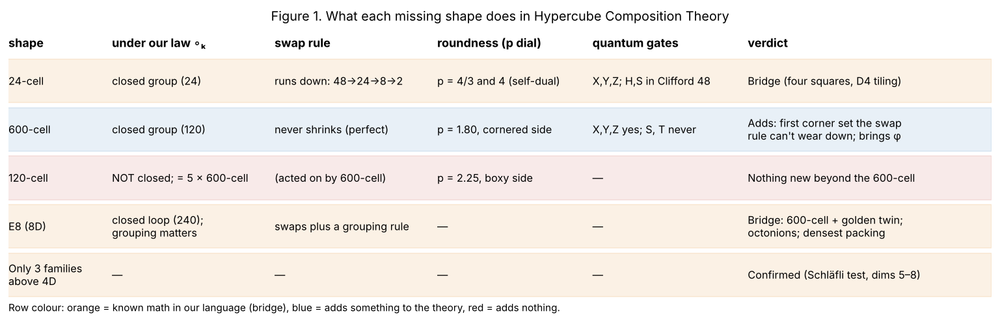
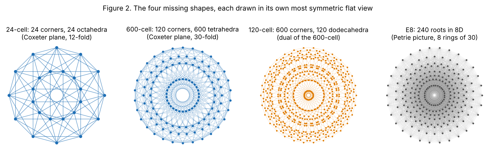
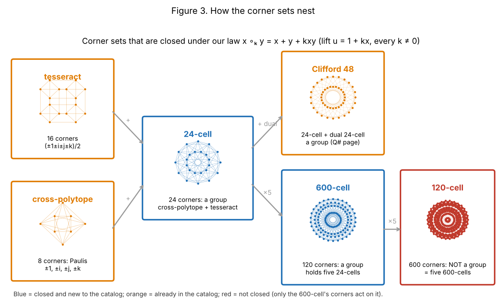
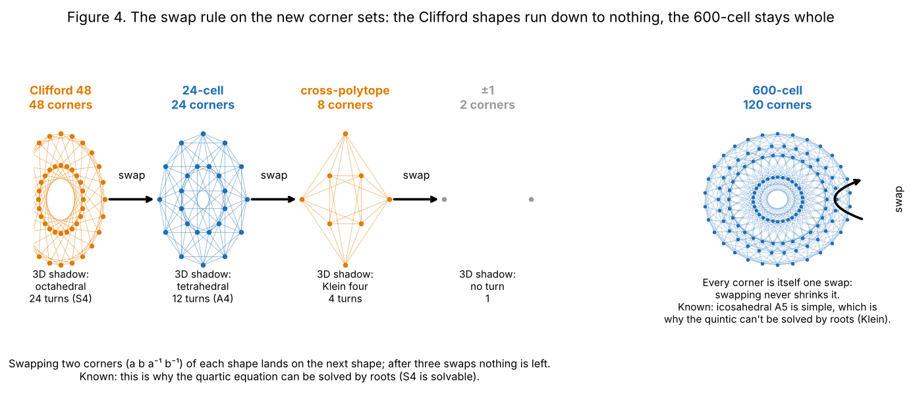
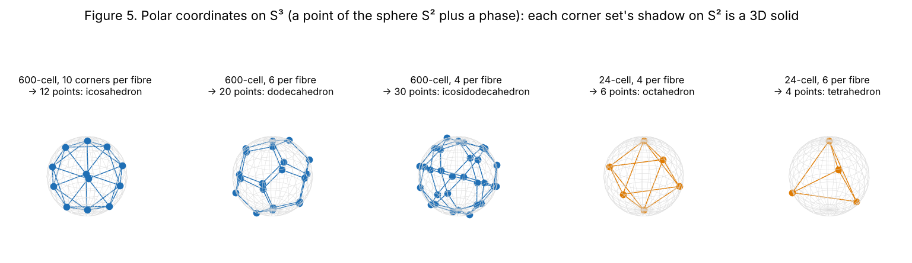
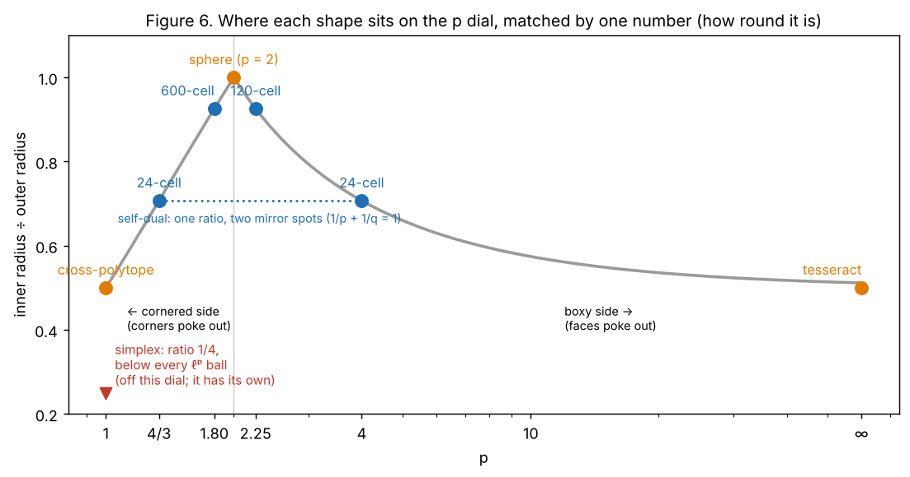
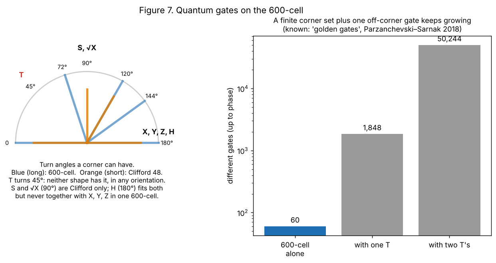
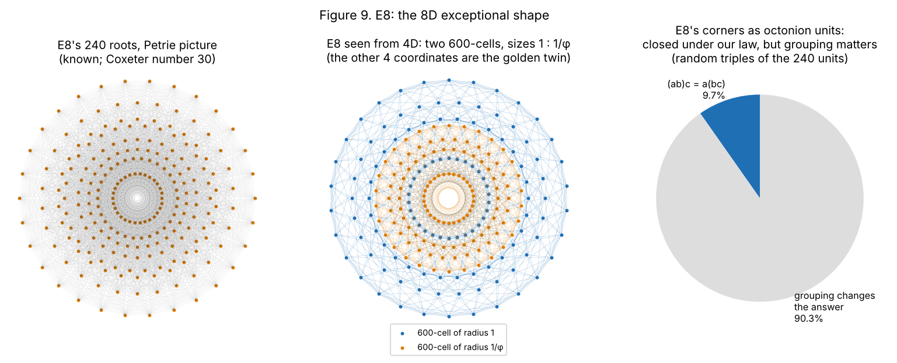
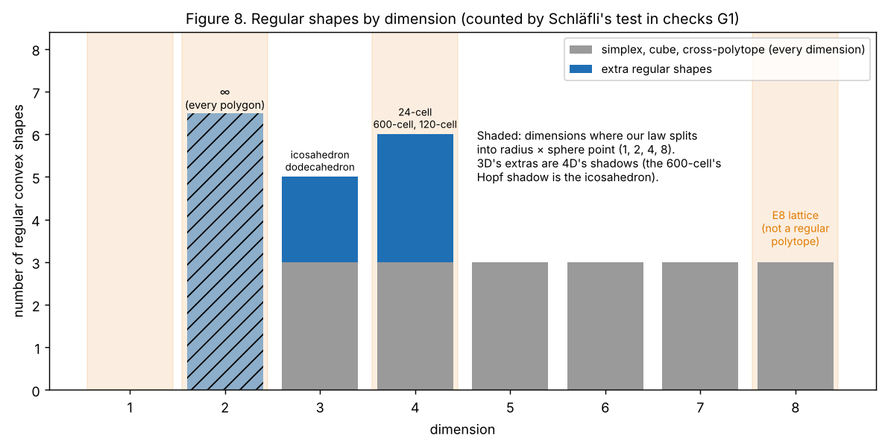
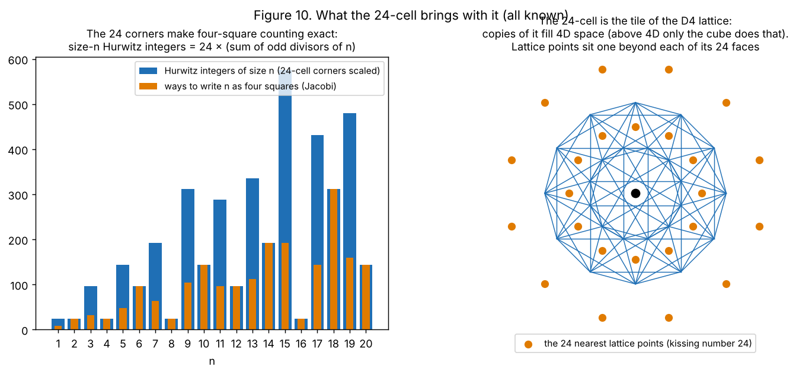

# DRAFT · The missing shapes: the 24-cell, the 600-cell and E8

**DRAFT, Nov 26 2026.** Part of Hypercube Composition Theory (repo: fused-hyperoperation-algebra).
Asked for by Brennan ("Yes." to testing the regular shapes the catalog was missing: the 24-cell, the 600-cell and its
dual the 120-cell in 4D, and the E8 lattice in 8D). He also asked, mid-pass, for a light **polishing step** on every
method; section 9 says what that was and what it cost.

Builds on `hypersphere/` (our law splits as radius × sphere point only in dimensions 1, 2, 4, 8), `qsharp-functors/`
(Paulis on the cross-polytope, the axis-cycling Cliffords on the tesseract, T on no corner), `polar-coordinates/`
(the ℓp dial: cross-polytope p = 1, sphere p = 2, cube p = ∞) and `simplex/` (the separate cubic-form dial). Checks:
`checks.py` → `checks_output.txt`, **61 of 61 pass** (numpy, scipy; 5.2 s plus 0.5 s of polish). Shared
constructions: `shapes.py`. Pictures: `figures.py` → `figures/`. Colour key: **orange = known**, **blue = ours or new
to the theory**, **red = does not hold or adds nothing**. No Lean was compiled (no Lean on this machine).

## The short answer

**The 600-cell is the one that adds something.** Its 120 corners are closed under our law, and it is the first corner
set the swap rule cannot wear down: every corner is itself a swap of two others. It brings the golden ratio into the
theory. The 24-cell and E8 are bridges to known math (four squares, the D4 and E8 lattices, the octonions). The
120-cell adds nothing beyond the 600-cell. "Only three families above 4D" is confirmed.

*Figure 1. What each missing shape does in our framework.*

- **Our law.** Put a corner g of the 3-sphere into our coordinates as x = (g − 1)/k. Then x ∘ₖ y = x + y + kxy is
  exactly multiplying corners, for every k ≠ 0. The 24-cell (24 corners) and the 600-cell (120) are closed under
  ∘ₖ: composing two corners always gives a corner. The 120-cell is not closed (not one of its 360,000 products lands
  on a corner), but it is exactly five 600-cells, and the 600-cell's corners act on it. The 600-cell in turn is
  exactly five 24-cells.
- **The swap rule.** Swapping two corners (a b a⁻¹ b⁻¹) of the Clifford shapes walks down a ladder: Clifford 48 →
  24-cell → cross-polytope → ±1 → nothing. On the 600-cell, swaps give back the whole 600-cell. That is the known
  reason the quartic equation is solvable by roots and the quintic is not (Klein, 1884), seen in our swap rule.
- **Polar coordinates.** In polar form on S³ (a point of the sphere S² plus a phase), the 600-cell's shadow on S²
  is the icosahedron, the dodecahedron or the icosidodecahedron, depending on which phase circle you use. So 3D's
  extra regular solids are shadows of 4D's.
- **The ℓp dial (the roundness dial).** Matched by how round they are, the 24-cell sits at the mirror pair p = 4/3 and p = 4 (it is its own
  dual), the 600-cell at p = 1.80 on the cornered side, the 120-cell at p = 2.25 on the boxy side. The simplex is
  off the dial altogether, which fits the simplex page's finding that it has its own dial.
- **Gates.** X, Y and Z sit on 600-cell corners. S and √X (90° turns) and T (45°) sit on no 600-cell corner in any
  orientation; H fits one, but never together with X, Y and Z. T is closer to the 600-cell (0.236) than to the
  Clifford corners (0.393), but on neither.
- **E8.** E8's 240 corners are a 600-cell plus a 600-cell shrunk by the golden ratio, with the golden ratio's "twin"
  (√5 → −√5) supplying the other four coordinates. As octonion units they are closed under our law, but grouping
  matters: (ab)c = a(bc) for only 9.7% of triples.
- **Only three families above 4D:** confirmed. The coordinator's guess that the gaps sit "in dimensions 4 and 8"
  needs one correction: extra regular shapes exist in 2D, 3D and 4D, and none in 8D. 8D's exceptional object, E8, is
  a lattice, not a regular polytope.

---

## 0. Setting the shapes up in our coordinates

*Figure 2. Each shape drawn in its most symmetric flat view (its Coxeter plane).*

The 3-sphere S³ is the unit quaternions, and in our coordinates it is the sphere |1 + kx| = 1, radius 1/|k|, plane
dial d = k² (Q# page, section 1). Each new 4D shape is a set of points on it:

| Shape | Corners as unit quaternions | Count | Known name |
|---|---|---|---|
| 24-cell | ±1, ±i, ±j, ±k and (±1 ± i ± j ± k)/2 | 24 | Hurwitz units, binary tetrahedral group 2T |
| 600-cell | the 24 above plus ½(±φ, ±1, ±1/φ, 0) in even orders | 120 | icosians, binary icosahedral group 2I |
| 120-cell | the 600-cell's 600 cell centres, pushed out to the sphere | 600 | dual of the 600-cell |
| E8 (8D) | (±1, ±1, 0⁶) in any order and (±½)⁸ with an even number of minus signs | 240 | E8 roots, Gosset polytope 4₂₁ |

Here φ = (1 + √5)/2 = 2 cos(π/5), the golden ratio. Checks A1 to A7 confirm the counts, edge lengths (24-cell edge =
radius; 600-cell edge = 1/φ), and cell counts (24 octahedra, 600 tetrahedra, 120 dodecahedra).

## 1. The core law: which corner sets are closed

*Figure 3. Corner sets closed under x ∘ₖ y, and how they sit inside one another.*

With x = (g − 1)/k, our law gives x_g ∘ₖ x_h = x_{gh} (the lift 1 + kx turns ∘ₖ into multiplication). So a corner
set is closed under ∘ₖ exactly when the corners multiply among themselves. Tested at k = 1, −1, ½ and 2 (B1):

- **24-cell: closed (24).** It is the cross-polytope (8) plus the tesseract (16), the two shapes the Q# page found.
- **600-cell: closed (120).** It is the largest finite closed set on S³ that is not a circle or a prism.
- **Clifford 48: closed.** The 24-cell plus its dual, already on the Q# page.
- **120-cell: not closed.** None of its 360,000 products lands on a corner (B2). But multiplying any 120-cell corner
  by a 600-cell corner gives a 120-cell corner, and the 600 corners split into **five 600-cells** (B3).
- **The 600-cell is five 24-cells** (A7).

**Known:** the finite subgroups of the unit quaternions (cyclic, prisms, 2T, 2O, 2I; Klein, Du Val), the compounds of
five. **Ours:** reading them as the closed corner sets of ∘ₖ, for every k. **Status: proved** (counted, then redone
exactly in section 9).

## 2. The swap rule: Clifford shapes wear down, the 600-cell does not

*Figure 4. Swapping two corners lands on the next shape down. The 600-cell maps to itself.*

The precession page's swap rule is "turn = d × enclosed area" for small turns; for corners the swap is the exact
commutator a b a⁻¹ b⁻¹. Taking all swaps of a corner set and everything they generate (C1, C2):

| Start | Swaps generate | 3D shadow |
|---|---|---|
| Clifford 48 | 24-cell (24) | octahedral, 24 turns (S4) → tetrahedral (A4) |
| 24-cell | cross-polytope (8) | tetrahedral → Klein four |
| cross-polytope | ±1 (2) | Klein four → nothing |
| **600-cell** | **the whole 600-cell (120)** | **icosahedral (A5) → itself** |

On the 600-cell each of the 120 corners is already a single swap of two corners. Group theorists call such a group
**perfect**; apart from the trivial group, the 600-cell's is the only perfect finite group on S³.

What it means: on every shape the catalog had, repeated swapping eventually kills all turning. On the 600-cell it
never does. This is the dividing line Klein used: the octahedral group's ladder ending is why the quartic equation
can be solved by roots, and the icosahedral group's lack of one is why the quintic cannot.

**One more consequence, known:** dividing S³ by the 600-cell's group gives Poincaré's dodecahedral space, and
"perfect" is exactly why that space has no loops that can't be undone by swapping (its first homology is zero). It was
proposed as the shape of the universe (Luminet et al. 2003); Planck's data later found no sign of it.

**Known:** commutator subgroups, Klein's icosahedron, Poincaré's homology sphere. **Ours:** the reading through the
swap rule, and that the 600-cell is the first shape in our catalog where it never runs down. **Status: proved
(counted).**

## 3. Polar coordinates: 3D's extra solids are 4D's shadows

*Figure 5. Each corner set's shadow on S² under the Hopf map, for three choices of phase circle.*

Our polar form on S³ is a point of S² plus a phase (the Hopf map; hypersphere page, section 6). Choosing the phase
circle along one of the 600-cell's turn axes groups its corners into rings of equal phase (E1):

- along a 72° axis: rings of **10** corners over **12** points, the **icosahedron**;
- along a 120° axis: rings of 6 over 20 points, the **dodecahedron**;
- along a 180° axis: rings of 4 over 30 points, the **icosidodecahedron**.

The 24-cell gives the octahedron (6 points) and the tetrahedron (4 points) the same way (E2). So in polar form the
600-cell's corners are "an icosahedron vertex plus a phase in steps of 36°", and the golden ratio enters through
that 36° = π/5.

**Known:** the Hopf fibrations of the 600-cell (Coxeter). **Ours:** that this is our polar split, and that it
explains 3D's extra regular solids as shadows of 4D's closed corner sets. **Status: proved (counted).**

## 4. Roundness: where they sit on the ℓp dial

*Figure 6. The ℓp dial in 4D (grey), with each shape placed by how round it is.*

The ℓp dial runs cross-polytope (p = 1) → sphere (p = 2) → cube (p = ∞). To place a shape that is not an ℓᵖ ball, I
match one number, inner radius ÷ outer radius (F1 to F3). In 4D an ℓᵖ ball has ratio 4^(−|½ − 1/p|), which takes
each value twice, at p and at its mirror partner q with 1/p + 1/q = 1 (Hölder conjugates). Dual shapes trade sides.

- **24-cell: ratio 1/√2, exactly at p = 4/3 and p = 4.** It is its own dual, and it sits on both sides at once.
- **600-cell and 120-cell: ratio φ²/√8 = 0.9256**, so p = 1.80 for the 600-cell (cornered side, like the cross-polytope it is triangle-faced)
  and p = 2.25 for the 120-cell (boxy side).
- **Cross-polytope and tesseract: ratio ½**, the two ends p = 1 and p = ∞.
- **Simplex: ratio ¼, lower than any ℓᵖ ball.** It is off this dial. That matches the simplex page: the simplex has
  its own dial.

A second measure (how much of its outer ball each shape fills, F4) agrees on the order: the 600-cell (78%) and
120-cell (85%) are far rounder than the 24-cell (41%). The exact p values depend on which measure you use, so read
them as positions, not constants.

**Cubic-form dial (not computed here).** The simplex page found that every centrally symmetric polygon looks round at its
centre on the cubic-form dial (the shape dial), and only the triangle is flat. All four new shapes are centrally symmetric, so I expect them
to look round at their centres too, but I did not run the 4D version.

**Known:** in/out radii, Hölder duality. **Ours:** the placement, and that self-duality means "sits on both sides".
**Status: measured.**

## 5. Quantum gates on the 600-cell

*Figure 7. Left: the turn angles each shape's corners can have, and where the gates fall. Right: a finite corner set
plus T keeps growing.*

Every corner of a shape turns the Bloch sphere by an angle fixed by the shape, and that angle does not change when
you rotate the shape. The 600-cell's corners turn by 0°, 72°, 120°, 144° or 180°; Clifford's by 0°, 90°, 120° or
180° (C4). So (D1 to D4):

- **X, Y, Z (180°)** are 600-cell corners in the standard orientation, since the cross-polytope sits inside.
- **H (180°)** fits some 600-cell, but no 600-cell holds H together with X, Y and Z: X·H turns 90° (D3).
- **S and √X (90°)** fit no 600-cell, in any orientation.
- **T (45°)** fits no 600-cell either. Its nearest possible corner is 0.236 away on S³, against 0.393 for the
  Clifford corners (the Q# page's 0.39).

Adding T to the 600-cell's 60 gates (up to phase) gives 1,848 gates with one T and 50,244 with two (D5): the set
keeps growing, which is what makes a gate set universal. Using the 600-cell's group plus one extra gate in exactly
this way is known: Parzanchevski and Sarnak's icosahedral "super golden gates" (2018), which use a specific
reflection, not T.

**Known:** the gate angles, golden gates. **Ours:** the placement on our shapes. **Status: proved (counted).**

## 6. E8: the 8D exceptional shape

*Figure 9. Left: E8's 240 roots. Middle: their shadow in 4D, two 600-cells. Right: as octonion units, grouping
changes the answer for most triples.*

- **E8 is the 600-cell doubled by the golden ratio.** Take the 600-cell's 120 corners and the same 120 shrunk by φ.
  Write each as numbers a + b√5, and use as four extra coordinates the "twin" with √5 replaced by −√5. With the right
  scale on each half, the 240 points are an exact E8 root system (H3), and their shadow in the first four coordinates
  is the two 600-cells, radii in ratio φ (H4). **Known** (Elser and Sloane 1987; Moody and Patera 1993; Conway and
  Sloane's icosians).
- **As octonion units, closed under our law but grouping matters.** The 240 integral octonions of unit size are closed
  under octonion multiplication (H5), so under ∘ₖ. But (ab)c = a(bc) for only 9.7% of random triples and ab = ba for
  2.9% of pairs; the weaker Moufang law holds throughout (H6). This is the hypersphere page's "S⁷ is not even
  associative" made concrete on 240 corners. In our language: in 8D the swap rule gains a partner, a **grouping rule**.
  **Known:** integral octonions (Coxeter 1946, correcting Kirmse 1924; Conway and Smith 2003). **Ours:** the swap
  rule and grouping rule reading.
- **The cross-polytope is closed in every split dimension.** In 8D, ±1 and the seven ±eᵢ are closed too (H7), so the
  cross-polytope is the one regular shape that is a closed corner set in 1, 2, 4 and 8 dimensions.
- **E8 is also the densest packing of 8D balls** (Viazovska 2016) and its 240 roots are a perfectly balanced point
  set on the sphere (Cohn and Kumar 2007, who also proved the same for the 600-cell). **Known.**

**Verdict: a bridge.** It ties our 4D corners to 8D through the golden ratio, and it shows non-associativity on a
finite set. Nothing here is a new theorem.

## 7. Only three families above 4D

*Figure 8. Regular convex shapes by dimension, with the dimensions where our law splits shaded.*

Schläfli's test: a regular shape {p, q, r, …} exists exactly when a small matrix built from cos(π/p), cos(π/q), …
is positive definite. Running it over every symbol with entries up to 12 (G1) gives **5 shapes in 3D, 6 in 4D and 3 in
each of dimensions 5 to 8**: the simplex, cube and cross-polytope. Where the matrix is only just singular, the symbol
tiles flat space instead (G2); in 4D the 24-cell tiles space, and above 4D only the cube does.

**How this matches our law's split.** Extra regular shapes exist in 2D (every polygon), 3D (icosahedron,
dodecahedron) and 4D (24-cell, 600-cell, 120-cell), and none in 8D.

- 2D's polygons are the closed corner sets on the circle (the roots of unity).
- 4D's are the closed corner sets on S³ and their duals.
- 3D's are 4D's shadows (section 3), and 3D has no polar split of its own.
- 8D has no extra regular polytope; its exceptional object is the E8 lattice, whose roots are the closed set of
  octonion units.

So every exceptional shape traces back to a dimension where our law splits, but "the gaps sit in 4 and 8" is not
right as stated: 8D's contribution is a lattice, and 3D's extras come through 4D. **Known:** Schläfli 1852,
Coxeter's *Regular Polytopes*. **Ours:** the tracing. **Status: counted.**

## 8. What the 24-cell brings with it

*Figure 10. Left: four-square counting. Right: the 24-cell as the tile of the D4 lattice.*

- **Four squares.** Our 4D polar split, |uv| = |u||v|, is Euler's four-square identity. With the 24 corners as units,
  the number of Hurwitz integers of size n is exactly 24 × (sum of the odd divisors of n), and Jacobi's count of ways
  to write n as four squares follows (I1, n = 1 to 30). This is Hurwitz's 1919 proof of Lagrange's theorem that every
  number is a sum of four squares. **Known.** It may be worth linking to the number-theory geometries pass.
- **Tiling and kissing.** The 24-cell is the tile of the D4 lattice, and its 24 neighbours touching one ball give the
  4D kissing number 24 (I2; proved optimal by Musin 2008). **Known.**
- **Not perfectly balanced.** Unlike the 600-cell and E8, the 24-cell's corners are not a universally optimal point
  set (Cohn, Conway, Elkies and Kumar 2007). **Known.**

**Verdict: a bridge.** It was already half in the catalog through the Q# page.

## 9. Polish (Brennan's ask)

Every numerical result got a cheap exact pass after the floating-point one (P1 to P5):

| Result | Polish | Cost |
|---|---|---|
| 600-cell closed (A1, B1) | all 14,400 products redone exactly in numbers a + bφ, no rounding | 0.4 s |
| 24-cell closed | all 576 products redone in exact fractions | < 0.1 s |
| E8 inner products | exact rationals on 9,600 pairs | < 0.1 s |
| 24-cell at p = 4/3 and 4 | closed form (Hölder conjugates), no fitting | none |
| 600-cell ratio and p = 1.80 | matched to the closed form φ²/√8 to 15 digits; p polished with 4 Newton steps | < 0.01 s |

Total 0.5 s against 5.2 s for the checks: about 9% extra. Every polish agreed with the first pass.

---

## Leads, judged on their own merits

1. **The 600-cell as the theory's first "unsolvable" corner set (section 2). Worth following.** It is the one place in
   the catalog where the swap rule never runs down, and it connects the swap rule to two real structures: why the
   quintic can't be solved by roots, and Poincaré's dodecahedral space. The cosmology test of that space came back
   negative, so the lead is structural, not a prediction.
2. **E8 as the 600-cell plus its golden twin (section 6). Worth following if the string-theory or North Star work
   needs an 8D shape;** it is the cleanest bridge from our 4D gate shapes to 8D, and it shows where the grouping rule
   starts. Known math, so the value is in connecting, not discovering.
3. **3D solids as 4D shadows (section 3). Worth keeping as a write-up point,** since it explains why our law's split
   dimensions account for every exceptional regular shape. Known pieces, our tracing.
4. **p-dial placement (section 4). Not a lead on its own.** It is a tidy way to file the shapes, but the exact p
   values depend on the measure chosen.
5. **120-cell. Nothing to follow.** It is the 600-cell's dual and five copies of it.

## Next (offered, not started)

- Run the cubic-form dial (Vinberg's turn) on the 24-cell and 600-cell in 4D, to see how fast each flattens toward its
  faces.
- Put the closures and swap ladders in Lean: they are finite, exact checks (24-cell over fractions, 600-cell over
  a + bφ), so they suit the library's no-mathlib style.
- Treat Poincaré's dodecahedral space as a shape in our framework (S³ with the 600-cell's swaps glued shut).

## Files

- `README.md`: this write-up
- `shapes.py`: constructions (quaternions, 24-cell, 600-cell, 120-cell, E8 three ways, octonions, Coxeter planes)
- `checks.py` → `checks_output.txt` (61/61, with timing)
- `figures.py` → `figures/fig1` … `fig10`
- `page_build.py` → `index.html` (the published page)

## References

- F. Klein, *Vorlesungen über das Ikosaeder*, 1884. P. Du Val, *Homographies, Quaternions and Rotations*, 1964.
- L. Schläfli, *Theorie der vielfachen Kontinuität*, 1852 (publ. 1901). H. S. M. Coxeter, *Regular Polytopes*, 3rd ed., 1973.
- A. Hurwitz, *Vorlesungen über die Zahlentheorie der Quaternionen*, 1919.
- H. S. M. Coxeter, "Integral Cayley numbers", Duke Math. J. 13 (1946); J. H. Conway and D. A. Smith, *On Quaternions
  and Octonions*, 2003; J. H. Conway and N. J. A. Sloane, *Sphere Packings, Lattices and Groups*, ch. 8.
- V. Elser and N. J. A. Sloane, "A highly symmetric four-dimensional quasicrystal", J. Phys. A 20 (1987);
  R. V. Moody and J. Patera, "Quasicrystals and icosians", J. Phys. A 26 (1993).
- O. Parzanchevski and P. Sarnak, "Super-Golden-Gates for PU(2)", Adv. Math. 327 (2018), arXiv:1704.02106.
- H. Cohn and A. Kumar, "Universally optimal distribution of points on spheres", J. AMS 20 (2007), arXiv:math/0607446;
  H. Cohn, J. H. Conway, N. D. Elkies and A. Kumar, "The D4 root system is not universally optimal", Exp. Math. 16 (2007).
- M. Viazovska, "The sphere packing problem in dimension 8", Ann. Math. 185 (2017). O. R. Musin, "The kissing number in
  four dimensions", Ann. Math. 168 (2008).
- J.-P. Luminet, J. Weeks, A. Riazuelo, R. Lehoucq and J.-P. Uzan, "Dodecahedral space topology as an explanation for
  weak wide-angle temperature correlations in the cosmic microwave background", Nature 425 (2003); Planck
  Collaboration, "Planck 2015 results. XVIII. Background geometry and topology of the Universe", A&A 594 (2016).
