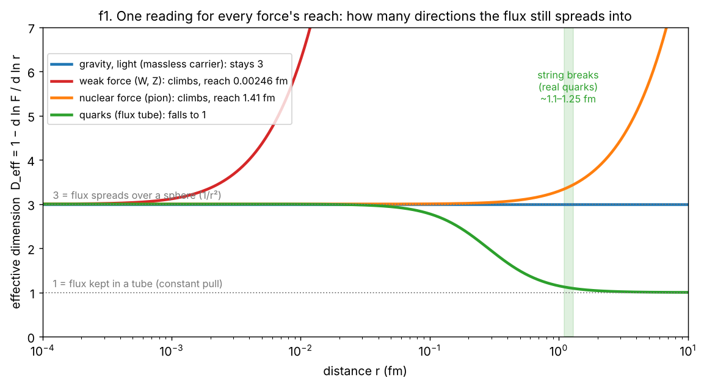
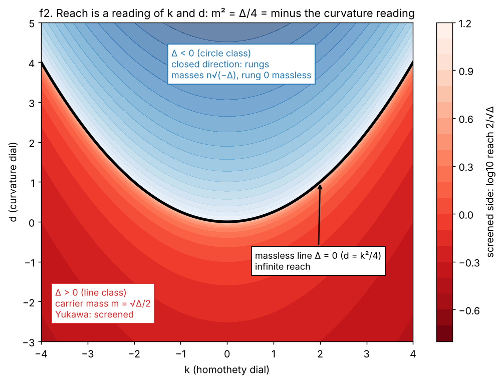
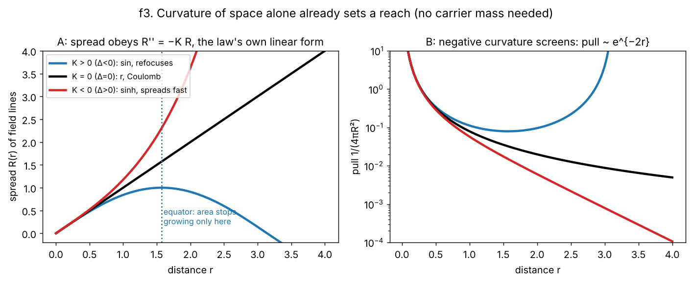
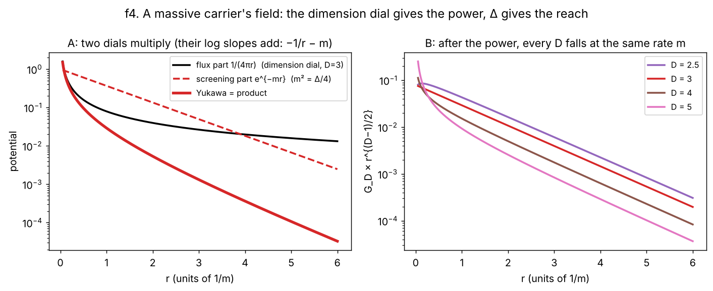
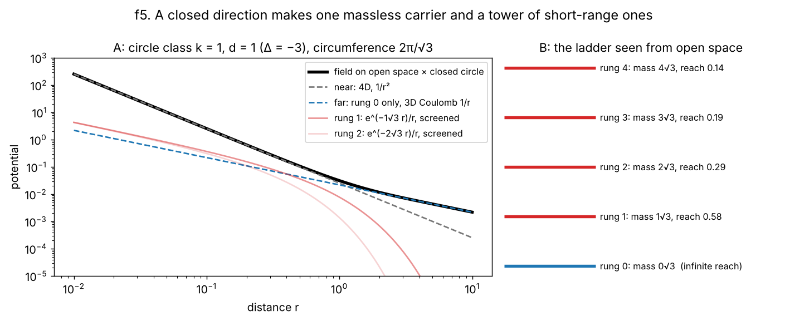
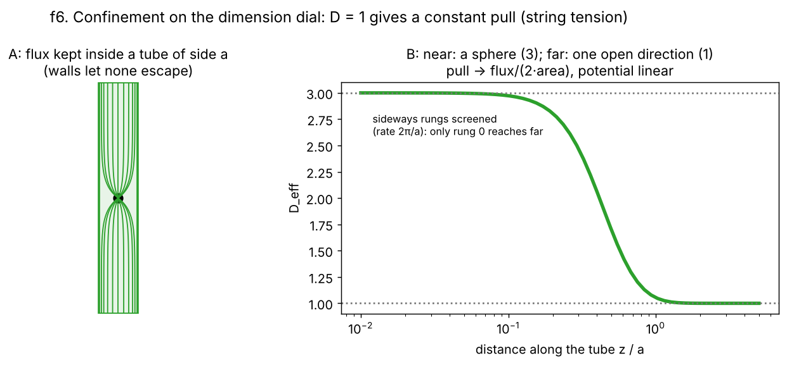
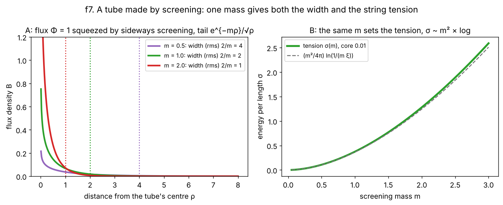
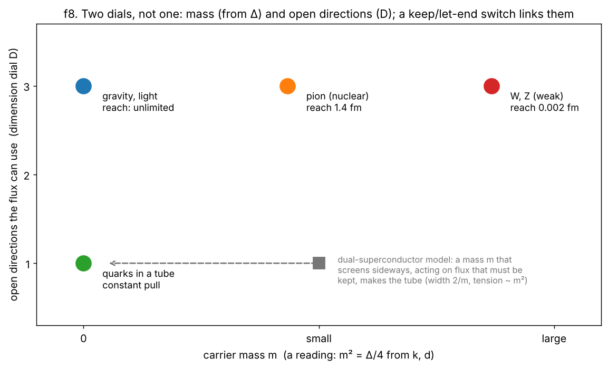

# DRAFT · Does one dial set the reach of every force?

*Nov 26, 2026. Brennan asked on a voice call (recorded as his words): "Is it possible that the distance of force... gravity versus weak nuclear force or strong nuclear force. Are those distances somehow one dial?" He said yes to looking for a dial that plays the carrier-mass role, then added: "Or it might be two dials if you're saying there's two different forces at work."*

Checks: `checks.py` → `checks_output.txt`, **41 / 41 pass** (numpy, scipy, sympy, mpmath; about 7 s), including a 30-digit polishing step (part P). The first run had 6 failures, all in my own setups or claims; each was fixed by correcting the setup or the claim (list at the end). Pictures: `figures.py` → `figures/f1` to `f8`. Lean: `lean/ForceReach.lean`, 8 theorems, **not compiled** (no Lean toolchain here); every statement checked true by `lean/check_statements.py`.

## The result in two sentences

**It's two dials, as Brennan guessed.** The reach of a force with a massive carrier (the weak force, and the nuclear force between protons and neutrons) is set by one reading of our base dials, the carrier mass m with m² = Δ/4, which is minus our curvature reading; the reach of the quark force is set by a different dial, how many open directions the flux can spread into (the dimension dial at D = 1, a flux tube).

The two meet in one known model: a mass that screens the field sideways, acting on flux that cannot end, squeezes it into a tube whose width (2/m) and tension (about m²) come from that same mass. So the honest picture is **one continuous dial (mass) and one dimension dial, linked by a yes/no switch: can the flux end, or must it be kept?**

*f1. One reading covers every force: the effective dimension D_eff = 1 − d ln F / d ln r, the number of directions the flux still spreads into. Gravity and light stay at 3 forever. A massive carrier makes it climb without limit (screening, red and orange). Quark flux falls to 1 (a tube). Real quarks break the tube at about 1.1–1.25 fm (green band).*

**Lead or not, on its own merits:** not a new physics lead. Every mechanism here is known. What is ours is the placement, and it is a coherent one: the same reading Δ that gave the Yang–Mills page its gap (Δ < 0, rungs) gives the carrier mass on the other side (Δ > 0, screening), and the massless forces sit exactly on the border line Δ = 0. That makes this a good explainer and a consistency check on the theory, not a direction that predicts anything (it does not give the W mass or the quark string tension). No README Promising-leads entry proposed.

---

## Pass 1: with our own tools (fundamental to derived)

### 1. The law's own linear form is the equation for a force's reach

*f2. The (k, d) dial plane. Black: the border Δ = k² − 4d = 0, where the reach is unlimited (massless). Red, below: the line class, where a carrier of mass m = √Δ/2 is screened; lighter red = longer reach 2/√Δ. Blue, above: the circle class, where a closed direction makes a ladder of masses n√(−Δ) with rung 0 massless.*

- The law's generator v(x) = 1 + kx + dx² is a Riccati flow. Writing x = −u′/(d·u) turns it into the linear equation u″ − k u′ + d u = 0 (A1). Taking out the drift (u = e^{kL/2} w) leaves **w″ = (Δ/4) w** (A2).
- That is exactly the equation for the field of a massive carrier along a line, with **m² = Δ/4**, which is minus our curvature reading −Δ/4 (B6: the Green's function of −w″ + (Δ/4)w falls at rate √Δ/2 for four settings). The reach is the reading **2/√Δ**, built from the base dials k and d, as the design rule asks: reach is an output.
- The three classes give the three behaviours (A3 to A5):
  - **Δ > 0:** the flow reaches its wall exponentially, rate √Δ (polished to 30 digits, P2): a reach scale.
  - **Δ = 0:** it creeps in like 1/L, a power with no scale: unlimited reach, like gravity and light.
  - **Δ < 0:** the ruler closes into a circle of length 2π/√(−Δ): rungs.

### 2. The same equation is how field lines spread through curved space

*f3. A: the spread R(r) of field lines leaving a point obeys R″ = −K R (the Jacobi equation). Flat space gives r, negative curvature sinh, positive curvature sin. B: the pull 1/(4πR²). In negatively curved space the pull falls like e^{−2r}: a reach with no carrier mass at all. (On the sphere the naive pull is drawn; a closed space also needs an opposite charge somewhere.)*

- The rate at which field lines spread, θ = R′/R, obeys θ′ = −K − θ², the Raychaudhuri equation. With x = −θ/K this is **our law x′ = 1 + K x²** with k = 0, d = K, and its curvature reading is exactly K (A6, A6b, Lean `raychaudhuri_is_law`).
- So the law's curvature reading is literally the curvature that bends field lines. On hyperbolic space of curvature −s², a massless field is s(coth(sr) − 1)/(4π): Coulomb near the source (B7b), **e^{−2sr} far away** (B7c). Negative curvature screens on its own, with mass (D − 1)√|K| in D space dimensions.

### 3. A massive carrier's field is two dials multiplied

*f4. A: Yukawa's potential e^{−mr}/(4πr) is the dimension dial's flux part 1/(4πr) times the screening part e^{−mr}. B: in any dimension, after the power r^{−(D−1)/2}, the field falls at the same rate m.*

- e^{−mr}/(4πr) solves ∇²φ = m²φ (B1), and it is the Fourier transform of 1/(q² + m²) (B2, polished to 30 digits, P1).
- In 3D the log slope is exactly **−1/r − m** (B4): the power from the dimension dial and the screening from Δ simply add. In other dimensions the massive Green's function is a Bessel function; as m → 0 it becomes the dimension-dial page's flux answer (B3), and far away it always falls at rate m (B3b).
- The effective dimension reading for Yukawa is **D_eff = 3 + m²r²/(1 + mr)** (B5, Lean `yukawa_deff`): 3 near the source, climbing without limit beyond the reach 1/m. For a massless carrier it stays 3 (B5b).

### 4. A closed direction makes one massless carrier and a tower of short-range ones

*f5. A field in open space times a circle of the circle class (k = 1, d = 1, Δ = −3). Near: it sees 4 dimensions. Far: only rung 0 survives, a 3D Coulomb field with unlimited reach. Rungs 1, 2, … are carriers of mass n√3, screened.*

- Summing images round the circle equals summing rungs: coth(πr/P)/(4πrP) both ways (C1). The rung masses are n√(−Δ) (C1b, Lean `rung_mass`), and far away rung 1 is already e^{−√3 r} below rung 0 (C2).
- So the circle class does give "one massless force plus short-range ones" from one reading. This is Kaluza–Klein's mechanism. It is not how the W and Z get their mass in the Standard Model (that is the Higgs field), so it explains the pattern, not the weak force itself.

### 5. Confinement is a different dial: open directions

*f6. A: a charge in a tube whose walls keep the flux in. B: D_eff along the tube goes from 3 near the charge to 1 far away. Far away the pull is constant, flux / (2 × area), so the potential grows linearly: a string tension.*

- On the dimension dial, D = 1 gives a constant pull 1/(S₁ r⁰) = 1/2 per unit charge (D1). Quark confinement is this: the flux uses one open direction.
- A charge in a square tube: the wall-mode sum and the image sum agree (D2), D_eff runs from 3.0000 to 1.000000 (D2b), and the far pull is exactly flux / (2 × area) (D2c). The sideways modes are massive (rate 2π/a, D2d): **the tube is a closed direction again, but with only one direction left open**, so rung 0 is a 1D Coulomb field, which is linear.
- **Can a single (k, d) make a tube?** No (D3). A point source in constant curvature spreads as sin, r or sinh; the area stops growing only at isolated points (the sphere's equator) and then shrinks. Keeping the area fixed needs flux lines that run parallel, which no curvature setting gives from a point. That is why it's a second dial.

### 6. Where the two dials meet: a tube made by screening sideways

*f7. A: flux Φ squeezed by a medium that screens sideways with mass m (London / Abrikosov tube): width (rms) exactly 2/m, tail e^{−mρ}/√ρ. B: its tension (energy per length) is (Φ²m²/4π)(mξ)K₀(mξ)K₁(mξ) ≈ (Φ²m²/4π) ln(1/(mξ)), about m².*

- The profile B = Φ m² K₀(mρ)/(2π) carries flux exactly Φ (E1, polished P4) with rms radius exactly 2/m (E1), and its sideways tail falls at the Yukawa rate m (E3).
- The tension has a closed form (E4, polished P3) and grows like m² times a slow log (E5).
- So in this model **one mass sets both reaches**: a field that may end is screened with reach 1/m; flux that must be kept is squeezed into a tube of width 2/m and tension about m². What decides which you see is a yes/no switch, not a dial: whether the flux can end in the medium.

*f8. The answer: two dials. Across, the carrier mass (a reading of k and d). Up, the open directions (the dimension dial). Gravity and light: no mass, three directions. Weak force and pion: mass, three directions. Quarks: one direction, a tube. Grey: in the dual-superconductor model the tube itself is made by a sideways screening mass acting on flux that must be kept.*

---

## The forces placed (numbers from `checks.py`, part F)

| Force | Carrier | Mass | Reach ħ/(mc) | Which dial |
|---|---|---|---|---|
| Gravity | graviton | below 2.42 × 10⁻²³ eV (LIGO–Virgo–KAGRA, GWTC-3, published) | above 8 × 10¹⁵ m | on the border Δ = 0 |
| Electromagnetism | photon | below 10⁻¹⁸ eV (PDG) | above 2 × 10¹¹ m | on the border Δ = 0 |
| Weak | W, Z | 80.37 GeV, 91.19 GeV | 0.0025 fm, 0.0022 fm | Δ > 0, screened |
| Nuclear (between protons and neutrons) | pion | 139.6 MeV | 1.41 fm | Δ > 0, screened (Yukawa's original 1935 case) |
| Quark force | gluon flux tube | string tension about (440 MeV)² ≈ 980 MeV/fm | grows, until the tube breaks at about 1.1–1.25 fm | dimension dial D = 1 |

One nuance worth keeping: with real light quarks the tube breaks (a quark–antiquark pair pops out), so the strong force's everyday reach of about a femtometre ends up as the pion's Yukawa reach. The two dials hand off to each other.

---

## Pass 2: what is known and what is ours

| Piece | Known | Ours? |
|---|---|---|
| Reach = 1/(carrier mass); e^{−mr}/r | Yukawa 1935; Proca 1936 | No |
| W, Z mass from a condensate | Anderson 1963; Higgs, Englert–Brout 1964 | No |
| Riccati flow ↔ second-order linear equation | standard (Riccati, Bernoulli era) | No |
| Field-line spreading: Jacobi equation, Raychaudhuri equation | Jacobi; Raychaudhuri 1955 | No |
| Massless field on hyperbolic space falls exponentially | the hyperbolic Coulomb / Kepler problem (Lobachevsky 1835, Schering 1873; Infeld–Schild 1945) | No |
| Closed direction gives a massless mode plus a tower n/R | Kaluza 1921, Klein 1926 | No |
| Confinement = flux tube, linear potential, area law | Wilson 1974; Cornell potential (Eichten et al. 1975) | No |
| Tube made by screening (vortex), width and tension from the mass | London 1935; Abrikosov 1957; Nielsen–Olesen 1973 | No |
| Quark confinement as a dual superconductor | Nambu 1974; 't Hooft 1975; Mandelstam 1976 (a model; not proven for QCD) | No |
| Higgs region and confinement region connected, no boundary (fundamental matter) | Fradkin–Shenker 1979 (a 2015 preprint by Grady disputes it; I did not check whether that challenge holds) | No |
| String breaking at about 1.1–1.25 fm | Bali et al. (SESAM) 2005 | No |
| **Carrier mass² = Δ/4 = minus our curvature reading; massless forces on the border Δ = 0** | | **Placement, ours** |
| **Raychaudhuri's equation is our law with k = 0, d = K** | (the Riccati form is known) | **Placement, ours** |
| **Same reading Δ: gap on the circle side (Yang–Mills page), screening on the line side (here)** | | **Ours (framing)** |
| **One reading D_eff for all three behaviours; two dials plus a keep/end switch** | the pieces are known | **Ours (framing)** |

Brennan's two-dial guess, checked: right. The weak force's reach is a mass; the quark force's reach is a geometry of the flux (one open direction). In the best-known model they share the mass, and Fradkin–Shenker says the two regimes can be smoothly connected, so "two dials with a link" is the fair description, not "one dial".

## What this does not do

- It does not predict any mass or the string tension. Those are inputs.
- The dual-superconductor picture of quark confinement is a model with lattice support, not a theorem.
- Gravity and light sitting exactly on Δ = 0 is a placement; the measured bounds say only that their masses are tiny.
- Lean statements are algebra (and one derivative). Six of the eight are compiled in core Lean in the shared library (`FusedAlgebra.Topics.ForceReach`); `rung_mass` (√ and π) and `yukawa_reduced` (a derivative) need Mathlib and are checked by `lean/check_statements.py` only.

## First-run failures, fixed by correcting the setup or the claim

1. A4: I started the border flow at x = 0, where it escapes to infinity first; restarted below the wall (x = −3).
2. B3: I claimed the massless limit was reached at m = 10⁻⁶ in every dimension; at D = 2.5 the approach is slow, like (mr)^{D−2}. Claim corrected and tested at m = 10⁻¹².
3. B6: a shooting setup crossed zero; replaced with a direct grid Green's function, which also matches the exact grid mass.
4. B7c: coth − 1 underflowed in double precision; rewritten as 2/(e^{2x} − 1).
5. D2d: measured at z = 2–3 the next sideways mode still showed (rate 6.288 vs 2π); measured at z = 6–7 it is 2π to 10⁻⁸.
6. P2: my closed-form flow had the walls swapped; corrected, and the gap to the wall computed directly.

## Files

- `checks.py`, `checks_output.txt`, `results.json`
- `figures.py`, `figures/f1` to `f8`
- `lean/ForceReach.lean` (8 theorems stated against Mathlib, not compiled), `lean/check_statements.py`; the six algebraic ones are compiled in core Lean as [`FusedAlgebra.Topics.ForceReach`](../../lean-library/FusedAlgebra/Topics/ForceReach.lean)

## Sources (pass 2, checked Nov 26)

- Graviton mass bound, GWTC-3 tests of GR (preprint 1.27 × 10⁻²³ eV; published PRD 2025 gives 2.42 × 10⁻²³ eV): https://arxiv.org/pdf/2112.06861
- Photon mass limit, PDG: https://pdglive.lbl.gov/view/S000M
- Fradkin–Shenker, Phys. Rev. D 19, 3682 (1979): https://scilit.com/publications/a5dd00039ef0400b8314f651528a4a6d ; challenge: https://arxiv.org/pdf/1502.04362 ; revisit: https://arxiv.org/pdf/1704.06201
- String breaking in QCD (Bali et al. 2005): https://arxiv.org/abs/hep-lat/0505012 and proceedings with r_c ≈ 1.25 fm (1.13 fm extrapolated): https://arxiv.org/abs/hep-lat/0512018
- Particle masses (W, Z, pion) are standard PDG values, not re-fetched for this draft.
- Other references (Yukawa, Proca, Higgs, Kaluza–Klein, Raychaudhuri, Wilson, Nielsen–Olesen, Nambu, 't Hooft, Mandelstam, Abrikosov, London) are standard and cited from general knowledge, not re-checked in print for this draft.
