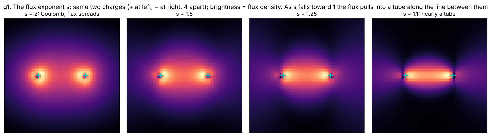
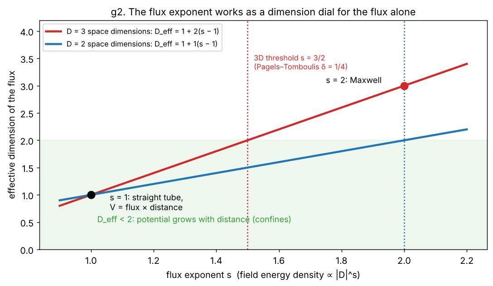
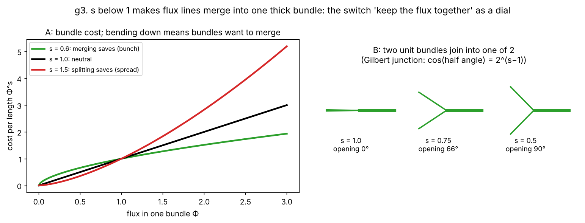
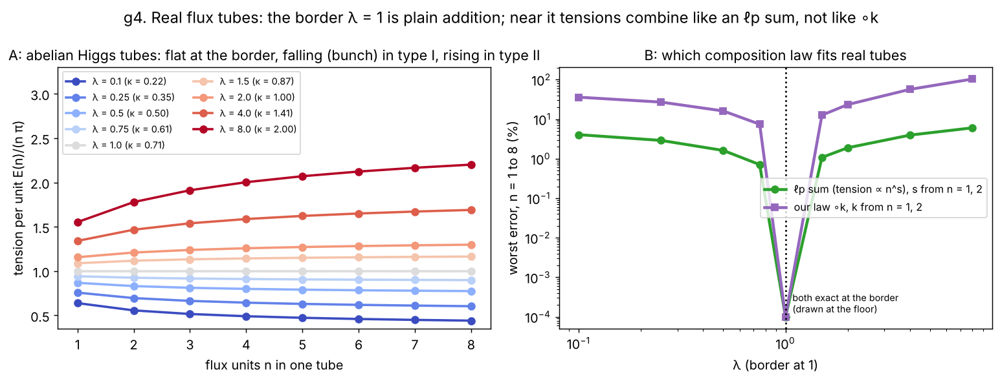
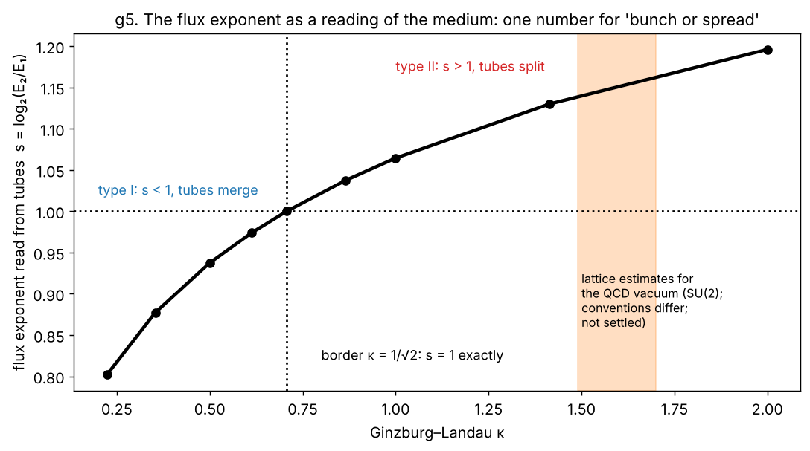
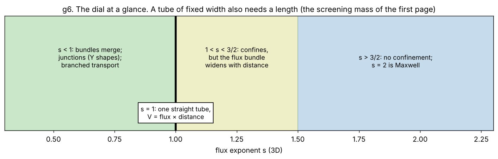

# DRAFT · A dial that makes a flux tube

*Nov 26, 2026. Follow-up to the force-reach page. Brennan: "let's try to find a new dial that would create a flux tube".*

Checks: `checks.py` → `checks_output.txt`, **25 / 25 pass** (numpy, scipy, sympy; about 19 s), with a polishing step (part P). Heavy runs: `make_data.py` (about 4 min) writes `data/`. Pictures: `figures.py` → `figures/g1` to `g6`. Lean: `lean/FluxTubeDial.lean`, 9 pure-algebra statements, uncompiled here (no Lean toolchain in this container), every one checked true by `lean/check_statements.py`.

## The result in two sentences

**The dial is the flux exponent s: give the field an energy density proportional to |D|^s instead of |D|². At s = 2 the flux spreads in every direction (ordinary electricity); as s falls the flux pulls in toward the line between the charges, the effective dimension slides down as D_eff = 1 + (D − 1)(s − 1), it starts to confine below s = 3/2 in three dimensions, and at s = 1 all the flux sits on one straight tube with energy = flux × distance.**

The dial is real but known: it is the power δ in the Pagels–Tomboulis effective action (1978), with s = (2 + 4δ)/(1 + 4δ). What is ours is modest: on real flux tubes (vortices in a superconductor-type model) the border between type I and type II sits exactly at s = 1, plain addition of flux, and near it the tube tensions combine as an ℓp sum with p = 1/s, which is our roundness dial; our own law ∘k does not fit them.

*g1. Same two charges (+ left, − right, 4 apart) on a 2D grid; brightness is flux density, solved by minimising Σ|D|^s/s with Gauss's law held exactly. s = 2 is Coulomb. At s = 1.1 nearly all flux runs between the charges.*

**Lead or not, on its own merits:** not a lead. The dial and its threshold are in the literature, and the s = 1 end is a classic of optimal transport. The one new-looking piece (tensions as an ℓp sum, border at p = 1) is a fit within 2% near the border that drifts to 4–6% far from it, so it is a good description, not a law. No README Promising-leads entry proposed.

---

## Pass 1: with our own tools

### 1. The flux exponent is a dimension dial for the flux alone

*g2. D_eff = 1 + (D − 1)(s − 1). Space keeps its D dimensions; only the flux behaves as if it had fewer. Green: D_eff < 2, where the pair energy grows with distance.*

- Energy density |D|^s/s with Gauss's law. For a point charge in D dimensions, |D| ∝ r^{−(D−1)}, so the pair energy scales as **L^{D − (D−1)s}** (A1). In 3D: s = 2 gives 1/L (Coulomb), s = 3/2 gives a log, s = 1 gives L (A1b).
- Reading this exponent as a force law gives **D_eff = 1 + (D − 1)(s − 1)** (A2, Lean `deff_from_exponent`). s = 2 gives D (`deff_maxwell`), s = 1 gives 1 in every dimension (`deff_tube`).
- It **confines** (energy grows with distance) exactly when s < D/(D − 1); 3D: s < 3/2 (A3, `threshold_exponent_zero`, `confines_below_threshold`). In that same range the self-energy near a point charge is finite (A3b).
- This is the first page's dimension dial, moved from space onto the field. The first page needed a separate switch, "flux can't end", to get a tube; here the field's own energy does it.

### 2. s = 1: the straight tube is the cheapest flow

- At s = 1 the energy is the total flux ∫|D|. Minimising that under Gauss's law is the **Beckmann minimal-flow problem**, whose answer is the Wasserstein-1 (earth mover's) distance. For one pair it is flux × distance, with all the flux on the straight segment.
- Checked exactly by a linear programme on a 21 × 11 grid: cost 12 for charges 12 apart, every unit of flux on the 12 edges of the segment (B1, P2). Three sources into one sink cost the sum of their distances (B2): at s = 1 tubes neither attract nor repel.
- The continuum solver at 1 < s < 2 shows the narrowing (C1 to C3): mid-plane width / L at L = 4 is **0.42, 0.29, 0.18** for s = 1.5, 1.25, 1.1.
- One honest gap: on that grid the fitted energy slopes (0.70, 0.82, 0.84) have not reached the point-charge value 2 − s, because the charges are smeared and L only runs 2 to 5. The widths are still shrinking with L, so the grid is short of the scaling regime (C4 note). The exact statements in part A do not depend on it.

### 3. s below 1: the switch "keep the flux together" becomes a dial

*g3. A: cost per length of a bundle carrying flux Φ is Φ^s. Below s = 1 the curve bends down, so two bundles save by merging. B: two unit bundles joining into one of flux 2 meet at the Gilbert angle, cos(half angle) = 2^{s−1}.*

- Two bundles of flux 1 cost 2; merged they cost 2^s. They **merge iff s < 1** and split iff s > 1 (A5).
- Merging branches meet at a fixed opening angle 2 arccos(2^{s−1}): 0° at s = 1, 65.5° at s = 3/4, 90° at s = 1/2, 107° at s = 1/4 (A7). This is **branched transport** (Gilbert 1967, Xia 2003).
- So the first page's yes/no switch (can flux end, or must it be kept) has a dial version: s > 1 spreads, s = 1 is neutral, s < 1 actively gathers flux into trunks.

### 4. Real tubes: vortices, where the border is s = 1

*g4. A: tension per flux unit of abelian Higgs vortices with n = 1..8 units, units e = v = 1. At λ = 1 it is flat (exactly π per unit); below it falls (units bunch), above it rises. B: worst error over n = 1..8 when the tensions are predicted from n = 1 and 2 alone. Green: power law n^s (an ℓp sum). Purple: our law ∘k with one k.*

- I solved the radial vortex equations for λ from 0.1 to 8 and n from 1 to 8 (D, `vortex_solver.py`).
- **At the border λ = 1** (κ = 1/√2) the tension is exactly πn, Bogomol'nyi's bound (D1; polished to 1.0000000025 π at a finer grid, P1). That is plain addition: s = 1.
- **Type I** (λ < 1): E(2) < 2E(1), units bunch, s < 1. **Type II** (λ > 1): E(2) > 2E(1), s > 1 (D2). This is the same split as g3.
- A power law E(n) ∝ n^s is an ℓp sum with p = 1/s: E(n₁ + n₂) = (E(n₁)^p + E(n₂)^p)^{1/p} (A6). Fixed by n = 1, 2 only, it predicts n up to 8 **within 2% for λ = 0.5 to 2** (D3), drifting to 4% at λ = 0.1 and 6% at λ = 8 (D3b).
- **Our law ∘k does not fit**: with k fixed the same way, errors are 7% to 104% (D4). Tube tensions combine along the ℓp exponent p, not the ∘k dial.

### 5. The dial as a reading of a medium

*g5. s = log₂(E₂/E₁) read from the vortex tensions, against the Ginzburg–Landau κ = √(λ/2). It rises steadily through 1 at the border. Orange: lattice estimates for the QCD vacuum treated as a dual superconductor (SU(2); conventions differ; not settled).*

- Read off the tubes, s runs 0.80 → 1.20 as κ goes 0.22 → 2 and crosses 1 exactly at the border (D5, D6).
- Taking the lattice band κ ≈ 1.5–1.7 at face value gives **s ≈ 1.15**, weakly type II: QCD flux tubes would mildly repel. I only read this off; the κ estimates are not settled, and the vortex model is abelian.

### The dial at a glance

*g6. The three regimes in 3D. A tube of fixed width also needs a length scale, which the dial alone does not give: that is the screening mass from the first page.*

---

## Pass 2: what is known and what is ours

| Piece | Known as | Ours? |
|---|---|---|
| Energy ∝ \|D\|^s, confinement below s = 3/2 | Pagels–Tomboulis effective action L ∝ F²(F²)^δ (1978), with s = (2 + 4δ)/(1 + 4δ): δ = 1/4 is the log border, δ → ∞ gives s → 1 (A4, `pt_quarter`, `pt_map_form`). Adler (1981) argued confinement for the leading-log effective action. | No |
| s = 1: straight tube, V = flux × distance | Beckmann's minimal-flow problem (1952); Kantorovich–Rubinstein duality makes it the Wasserstein-1 distance | No |
| s < 1: merging, Y junctions | Gilbert's minimum-cost networks (1967); branched transport (Xia 2003) | No |
| Border at λ = 1, tension πn | Bogomol'nyi (1976); type I attraction and type II repulsion of vortices (Jacobs–Rebbi 1979) | No |
| QCD vacuum as a dual superconductor, κ near the border | lattice studies, e.g. arXiv 1004.0166, 1702.06437, Koma 2025 (arXiv 2510.12168) | No |
| D_eff = 1 + (D − 1)(s − 1): the exponent as the first page's dimension dial applied to the flux | a one-line rewrite of the scaling; I did not find it written this way | Placement only |
| Tube tensions as an ℓp sum, p = 1/s, border at p = 1; ∘k fails | the fit is ours; the type I/II split itself is known | Modest, and only near the border |

The honest summary: the dial exists in the literature and does what Brennan wanted. Our contribution is to place it on two of our existing dials (dimension, the ℓp exponent p) and to show it is not our ∘k dial.

## What this does not do

- It does not derive s from anything deeper. Pagels and Tomboulis motivated δ from the running coupling; I did not.
- It does not give a tube of fixed width. At 1 < s < 3/2 the bundle widens with distance; at s = 1 it is a line of zero width. A real tube's width needs a length scale (the screening mass of the first page) or a medium (the vortex model).
- It does not give the QCD string tension, and it does not cover string breaking (real quark tubes break at about 1.1–1.25 fm, Bali et al.).
- A pointer, not checked: at s = 1 three charges joined by a junction would sit at the Steiner point (120°), which matches the "Y" shape lattice studies report for three-quark flux. I did not test whether the s < 1 junction angles have anything to do with baryons.

## First-run problems, fixed

- The s = 1 continuum solve (smoothed |D|) converged poorly: energy slopes 1.32, 1.08, 0.72 where the answer is 1. I replaced it with the exact linear-programme check (B1, B2, P2) rather than tune the smoothing until it looked right.
- The continuum slopes at 1 < s < 2 did not reach 2 − s. Kept and reported as a note (C4), not claimed.
- Two code faults, no claim affected: an import path lost under `python -I`, and the vortex solver printing on import.

## Files

- `checks.py` → `checks_output.txt`, `results.json`: all checks (parts A, B, C, D, P).
- `field_solver.py`: 2D minimiser of Σ|D|^s/s with Gauss's law held exactly (D = grad φ₀ + curl ψ, L-BFGS-B with an exact gradient).
- `vortex_solver.py`: radial abelian Higgs vortex, n flux units, any λ.
- `make_data.py` → `data/`: the slow runs (field maps, vortex tensions).
- `figures.py` → `figures/g1` to `g6`.
- `lean/FluxTubeDial.lean` (9 statements stated against Mathlib, not compiled), `lean/check_statements.py`; eight of the nine are compiled in core Lean as [`FusedAlgebra.Topics.FluxTubeDial`](../../../lean-library/FusedAlgebra/Topics/FluxTubeDial.lean), and `gilbert_s1` (a real power) needs Mathlib.

## Sources (pass 2, Nov 26)

- H. Pagels, E. Tomboulis, "Vacuum of the quantum Yang–Mills theory and magnetostatics", Nucl. Phys. B143 (1978) 485; discussed in arXiv hep-ph/0106038 and hep-ph/0505177.
- S. L. Adler, leading-log effective action and confinement (1981).
- M. Beckmann (1952); Kantorovich–Rubinstein duality.
- E. N. Gilbert, "Minimum cost communication networks" (1967); Q. Xia, "Optimal paths related to transport problems" (2003).
- E. B. Bogomol'nyi (1976); L. Jacobs, C. Rebbi (1979).
- Dual Ginzburg–Landau κ on the lattice: arXiv 1004.0166, arXiv 1702.06437, Y. Koma (2025) arXiv 2510.12168.
- G. Bali et al., string breaking on the lattice (2005).
