# DRAFT · Does the theory predict a force we don't know about?

*Nov 26, 2026. Follow-up to the force-reach and flux-tube-dial pages. Brennan: "So I'm trying to figure out if there is anything that might produce a new force we are unaware of", then "Not produce but predict".*

Checks: `checks.py` → `checks_output.txt`, **24 / 24 pass**; `strength_checks.py` → `strength_output.txt`, **12 / 12**; `hold_strength_checks.py` → `hold_strength_output.txt`, **20 / 20**; `investigate_checks.py` → `investigate_output.txt`, **17 / 17**; `repel_checks.py` → `repel_output.txt`, **17 / 17**; `other_forces_checks.py` → `other_forces_output.txt`, **14 / 14**; `leads_checks.py` → `leads_output.txt`, **11 / 11**; `sphere_hold_checks.py` → `sphere_hold_output.txt`, **8 / 8**; `sphere_winding_checks.py` → `sphere_winding_output.txt`, **9 / 9**; `sphere_dials_checks.py` → `sphere_dials_output.txt`, **8 / 8**. They run in any order or in parallel: each writes its own `results_<part>.json`, shared inputs come from `new_force_core.py`, and `figures.py` merges them into `results.json`. Numpy, scipy, sympy, mpmath; under a minute. Pictures: `figures.py` → `figures/h1` to `h17`. Lean: `lean/NewForce.lean`, 53 pure-algebra statements, every one checked true by `lean/check_statements.py`.

*Revised twice. First after Brennan's push-back: "Look harder please. The strength is something that could be derived at least in the special case from our work on electromagnetism", "I'm hoping it could generalize", and the reminder of the spinning black hole's frame dragging (section 6). Then, Nov 26 evening, after he said yes to finding what holds the circle, and added: "I'd really like to look at ways to derive the strength", "The strength seems related to the material or quality of the force", "So there are probably other variables at work" (sections 7 and 8). Then, Nov 27: "Let's investigate the new force more closely" (section 9), and "Is it possible the new force is actually the inverse? A very large distance and a very weak repelling force?", "Is it possible gravity is being confused with this force?", "If we have two forces that acts over long distances but maybe over different kinds of materials?" (section 10), and "I'd also like to find out more information on the other unknown forces as well" (section 11). Then, Nov 27 early morning: "Please chase the two new possible leads" (section 12), and his yes to checking whether the hold puts a sphere at the fundamental length (section 13). Then "Whoa, please let me know what this would even look like in our system" and his yes to checking whether our law picks one winding on the hidden sphere (section 14). Then "Try more than one dial" (section 15).*

## The result in two sentences

**Yes, in the special case: if electromagnetism's phase circle is read as gravity's closed direction (our rung class, Δ < 0), its strength is fixed, α = 4G|Δ|, which puts the circle at about 21 to 23 Planck lengths, makes every charge a whole multiple of e, and predicts a new force on ordinary matter at exactly 1/3 of gravity's strength.** What holds the circle is its own vacuum energy plus one more term, and any hold built only from the circle and gravity gives that new force a range of about 2000 Planck lengths, 10²⁷ times shorter than any lab can probe: the force is real in this picture but invisible.

**Up close (section 9):** the new force is carried by one particle, the circle's size, with mass about 6 × 10¹⁵ GeV. Ordinary matter feels it at 1/3 of gravity, the charged copies at 3 times gravity, and a passing light ray not at all, though electric strength itself shifts where the circle swells. Between the circle and the range, gravity is up to 4/3 of Newton. Every indirect trace checked (inflation, the early universe, relics, colliders, black holes) comes out invisible. The one striking fact is that each copy sits exactly on the extreme-black-hole line, which is known physics.

**The inverse (section 10):** the new force can't push: it is spin 0, and only a spin-1 carrier pushes like things apart. The same circle already has the inverse, though: its spin-1 piece is a push with no end to its reach, felt only by charged things, and for our circle that is electromagnetism. A second, bigger circle would give a second, weaker push, but our law caps it at 14 times the electric circle, so the weakest such push is 1/26,400 and only superheavy copies feel it. A 9 µm circle would give dark energy's size (the known "dark dimension"), but our law can't hold one next to the electric circle. And no second long-range force can hide inside gravity unless it grabs light and every material in gravity's own proportions; ours doesn't, and light bending and free-fall tests rule it out if it reached far.

**The other unknown forces (section 11):** each empty cell of the map now has a card. A massive new force: our law sets its range, not its strength, and tests already cap it far below gravity at long range. A long-range non-abelian force: possible from about 8 flavours up (not only above 16), and there the strength freezes at a value set by the particle count alone. Copies of W bosons or gluons: at 5 × 10¹⁷ GeV on our circle, 10¹⁴ times beyond the LHC. The abelian tube: a flux tube of fixed tension, whose fundamental form is a cosmic string, capped by the CMB at a breaking scale below 2 × 10¹⁵ GeV. One new wrinkle from our circles: a tilted pair of circles mixes a hidden photon with ours, giving hidden copies a small electric charge. What would make one of these a lead: our law fixing a strength or a scale in a cell where today it only fixes the shape.

**Chasing the two possible leads (section 12):** the cap on a second circle generalizes: with electromagnetism as gravity's circle, every extra dimension, however many, must be smaller than about 5 × 10⁻³³ m, so gravity cannot change below 5.2 × 10¹⁷ GeV. A dark-dimension signal at microns, or any sign of extra dimensions at a collider, would rule the reading out. That is a sharp test, but it is plain Kaluza–Klein's test, not ours alone. For the second lead, our law does fix strengths, though only to windows: a second circle between 1/23.7 and 1/26,400, a 2-sphere (an SU(2)-like force) between 1/25.1 and 1/634. The Standard Model's strengths at that scale (1/35, 1/48, 1/49) land inside. The top edges, reached when the hidden sizes equal the fundamental length, sit next to supersymmetric unification's 1/24 to 1/26, a coincidence to note, not evidence. What would make it a lead: a reason in our law for hidden spaces to sit at the fundamental length, which would turn the window into one number near 1/24.

**Does the hold put a sphere at the fundamental length? (section 13):** it can hold one, and more simply than the circle: a sphere's own curvature plus its vacuum energy hold it, with no extra term. But the hold doesn't single out the edge. The whole strength window, 1/25 to 1/634, is a sphere between 1 and 2.64 fundamental lengths, and where the hold puts it within that range is set by the size of the vacuum energy, which means the particle content. The strength goes as that size to the −2/3. With a few particles the sphere sits below the fundamental length, where nothing can be trusted; reaching the window takes roughly 900 to 110,000 extra fermion states (rough). So lead 2 comes back to section 8's "material". What would make it a lead now: something in our law that fixes the particle content on the hidden space.

**Does our law pick one winding? (section 14):** wrapping the electric circle n times around the hidden sphere does part of what section 13 asked. The winding holds the sphere by itself, at 0.306 n times the circle's radius, with no particle count in it, and it fixes the ratio of the two strengths, sphere force over circle force, at 48/(7n²). But our law doesn't pick n, and no whole winding matches the measured ratio: read four simple ways, the Standard Model needs n = 0.39, 0.58, 1.18 or 1.75, and the nearest whole windings miss by 23% or more. The wrapped space also has positive curvature, so it gives no massless fermions (the known chirality problem). It would become a lead if our law picked n and the charge unit and the ratio then came out within a few percent.

**More than one dial (section 15):** letting several circles wrap the sphere, each with its own winding, and choosing the angle between them, changes only one number, N, the squared length of the winding direction: the ratio becomes 48/(7N). More dials let N be any whole number, so the test is whether a reading of the measured strengths needs a whole N. The hypercharge readings don't (closest miss 7%). The electric reading needs N = 3.07, and N = 3 (three equal circles wound along a cube's body diagonal) misses by only 2.5%, but that puts the sphere at half the fundamental length, and such a near-hit turns up by chance about half the time. Continuous dials fit any number, so they make no test.

**Ways to derive a strength, in general (section 8):** Brennan's "material or quality" splits cleanly. The quality is the shape of the force's hidden space, which sets the number in front (α = s·G/size², s = 4 for a circle, 6 for a sphere). The material is the set of particles the force carries, which sets how the strength changes with energy (for the strong force, all of it, given one scale). The other variables at work are exactly those: one size, one shape and the particle content.

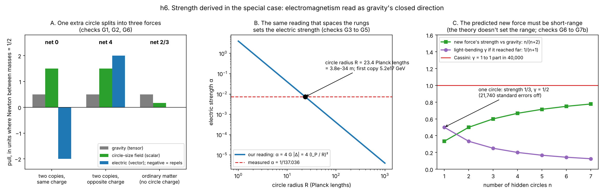
*h6. A: one extra circle splits into gravity, an electric force and a scalar force (the circle's size). Copies with the same circle charge feel no net force; ordinary matter feels gravity plus 1/3 more from the scalar. B: the electric strength falls as 1/R²; the measured α picks R = 23.4 Planck lengths. C: n circles give a scalar of strength n/(n+2); if it reached far, light bending would be γ = 1/(n+1), against Cassini's γ = 1.*

**What it contributes, on its own merits:** the physics is Kaluza–Klein (1921, 1926), Jordan–Thiry–Brans–Dicke, Appelquist–Chodos (1983) and Candelas–Weinberg (1984), so the derived numbers are known, not new. What is ours is where it sits: the same reading Δ that spaces the rungs sets the strength, and our design rule (base dials are constant inputs) asks for a held circle, which is what Cassini demands. Section 7 turns the open question into a clean negative prediction: no lab will see this new force, and if a 1/3-gravity force does turn up at microns, this reading would need a new small scale that our law doesn't have. Section 8's test, one hidden space setting all strengths, fails for the simplest shapes. What would make it a lead: a dial in our law that picks the hidden shape (and so the shape factor near 336 that section 8 needs), or that gives the hold a second, much smaller scale. Until then no Promising-leads entry is proposed.

The first version's map (h1) is still the context: it shows which kinds of new force our readings allow. Section 6 fills in the strength for one cell.

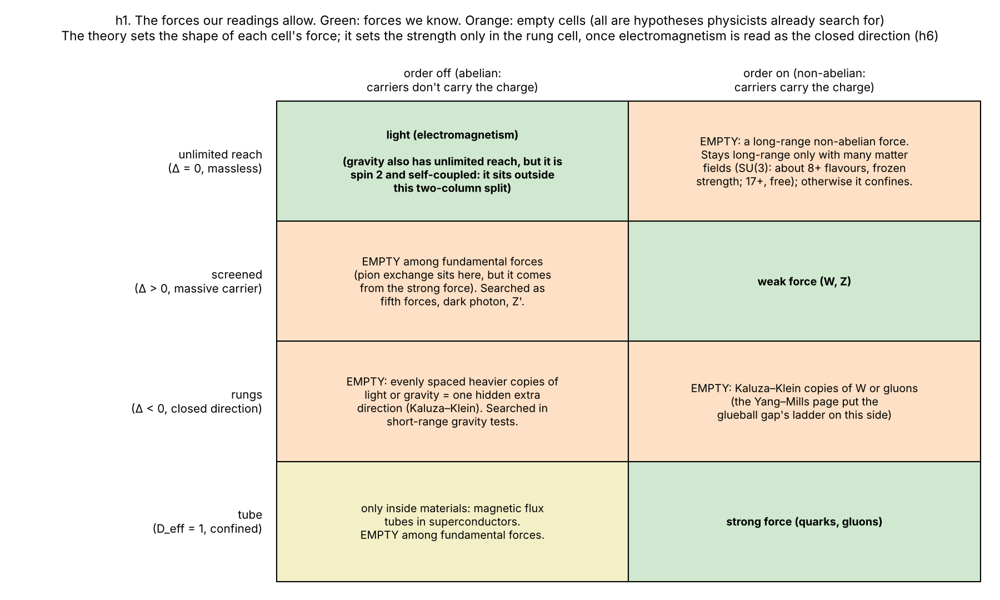
*h1. Rows: the reach class from the reading Δ = k² − 4d (first page), plus the tube (flux-tube page). Columns: the order dial, off (carriers don't carry the charge) or on (they do). Green: known forces. Orange: empty cells, each already a named hypothesis with experiments looking for it. Section 6 shows that the rung cell, order off, is where light itself can sit, and then its strength is set.*

---

## Pass 1: with our own tools (fundamental to derived)

### 1. One reading sorts every force into a reach class

- The law's linear form, with the drift taken out, is w″ = (Δ/4) w with Δ = k² − 4d (first page). The sign of Δ gives three classes (A1 to A3):
  - **Δ > 0:** the field dies off at rate √Δ/2. A massive carrier, reach 2/√Δ.
  - **Δ = 0:** no length scale. A massless carrier, unlimited reach.
  - **Δ < 0:** the law's ruler closes up every 2π/√(−Δ). A closed direction, with rungs at masses n√(−Δ).
- The flux-tube page added a fourth behaviour, the tube (D_eff = 1). The order dial adds a second axis: whether the carriers carry the charge themselves (non-abelian, like gluons and W bosons) or not (like light).
- That makes the 4 × 2 map in h1. Light sits at Δ = 0 with order off, the weak force at Δ > 0 with order on, and the strong force in the tube cell with order on. Gravity also has unlimited reach, but it is spin 2 and couples to itself, so it doesn't fit this two-column split.

### 2. The rung class is one more direction at short range

*h3. A: the law's rungs, evenly spaced; rung 0 is the massless force we see. B: if every rung couples equally, they add up to coth(r/2R), which is exactly the field of a point source in space × a circle. Inside R the force goes as one more dimension; far away it is plain 1/r with a small Yukawa tail.*

- If a force sits in the rung class, it comes with a ladder of heavier copies at masses n/R, two per rung (+n and −n), with R = 1/√(−Δ) (B5).
- With every rung coupled equally, the copies sum to **coth(r/2R)** times the plain 1/r potential (B1, Lean `tower_sum`). That equals, to 30 and 50 digits, the field of a point source on space × a circle of length 2πR, found by the method of images (B2, P1).
- So the effective dimension steps from **4 at short range down to 3 far away**, centred near r ≈ 4.1 R (B3, B3b). The law's rungs and the dimension dial from the first page are the same thing seen from two ends.
- Far away the copies look like one Yukawa term of strength **α = 2**, and a torus of d circles gives 2d (B4, `tower_leading_yukawa`). This matches Kehagias and Sfetsos (2000).

### 3. Each empty cell leaves its own fingerprint

*h2. The effective dimension D_eff = 1 − d ln F / d ln r of gravity or light with each kind of addition. A hidden direction is a step (4 → 3). A massive new force is a bump (or a dip if it repels). A drift in the flux exponent at weak fields is a drop to 2.*

- A **massive new force** (Δ > 0 cell, order off) adds α e^{−r/λ} to the potential. In the D_eff reading that is a bump at about 2λ that returns to 3 at both ends: up for α > 0, down for α < 0 (C1).
- The bump's position is set by the range for every α (C2). For a massive new force **the theory sets the range class and the shape, not α**; section 6 is the one cell where it does set the strength.
- The **rung cell** is a step from 4 to 3, not a bump (B3). So the two are told apart by shape, not just size.

### 4. Two dials that change a known force instead of adding one

These aren't new forces. They are the other ways our dials could show up in a force we already know.

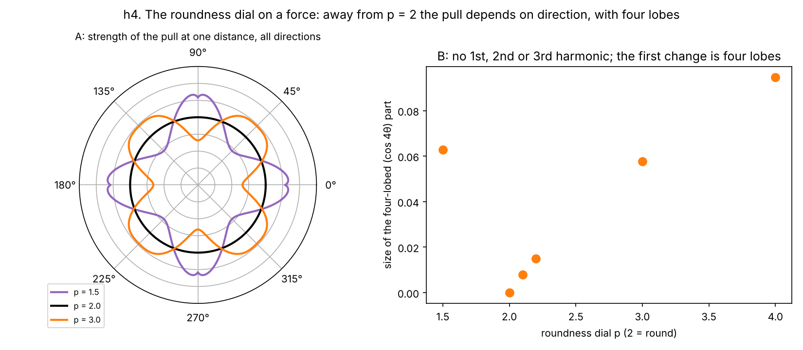
*h4. A force built on a non-round distance (roundness dial p ≠ 2). A: pull at one distance in every direction. B: there is no 1st, 2nd or 3rd harmonic; the first change is four-lobed, and its size grows in step with p − 2.*

- **Roundness dial p ≠ 2:** the pull depends on direction. The first departure from round is four-lobed (cos 4θ), with nothing at the 1st, 2nd or 3rd harmonic (E1 to E3). This matches the shape-dial survey's finding that roundness departs from round with four lobes. (An ellipse would be a 2nd harmonic, but that is only a change of coordinates.)

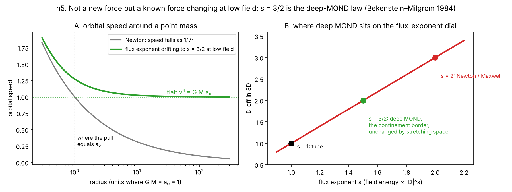
*h5. A: orbital speed around a point mass when the flux exponent drifts to s = 3/2 at weak fields: the curve flattens, with v⁴ = G M a₀. B: s = 3/2 is the flux-tube page's 3D confinement border, D_eff = 2.*

- **Flux exponent drifting at weak fields:** if gravity's s drifted from 2 down to 3/2 where the pull is weak, gravity would look two-dimensional far out. Orbital speeds would flatten, with v⁴ = G M a₀ (D2, D4). That is exactly the deep-MOND law.
- In field language s = 3/2 is the exponent 3 (D1, `dual_exponent_mond`, `holder_pair`). The action |∇φ|³ d³x is unchanged by stretching space, and only exponent = dimension has that property (D3). It is also the flux-tube page's confinement border (D5).

### 5. The order-on, unlimited-reach cell mostly fills itself

- A massless non-abelian force normally doesn't stay long-range: it confines and moves to the tube cell, as the strong force does. It stays long-range only if it carries enough matter fields to lose asymptotic freedom: more than 16 flavours for SU(3), 10 for SU(2) (F1, Lean `su3_flavour_bound`, `su2_flavour_bound`). *Refined in section 11: it also stays long-range, at a frozen strength, across the wider conformal window from about 8 flavours (SU(3), two loops).*

### 6. The strength, derived: electromagnetism as gravity's closed direction (part G)

- **The setup.** The electromagnetism page found that EM's gauge phase lives on a circle, with q = +1 (closed). In our map a closed direction is the rung class, Δ < 0, with radius R = 1/√(−Δ). Part G takes that literally: the circle is a fifth direction of space-time, and gravity runs in all five. This is Kaluza's 1921 idea and Klein's 1926 reading of it.
- **How the split works (G0 to G2).** Linear gravity between two sources in D dimensions has weight T₁·T₂ − T₁T₂/(D − 2). Seen from 4D, one circle gives three pieces: the 4D tensor (gravity), a vector (the off-diagonal metric part along the circle) and a scalar (the circle's size). For the copies, which move along the circle, the vector is **4 times** gravity and the scalar **3 times** (Lean `vector_over_tensor`, `scalar_over_tensor`). Same circle charge: the pieces cancel to **zero** net force. Opposite: they add to **4** (`like_charges_cancel`, `opposite_charges_add`).
- **The electric strength (G3, G4).** The vector piece is the Coulomb force. Matching it gives **α = e²/4π = 4G/R²** (Klein's relation e = √(16πG)/R, ħ = c = 1). In our reading that is **α = 4G|Δ|**: the reading that spaces the rungs also sets the strength (`klein_strength`).
- **What the measured α gives (G5, G5b).** R = 2 l_P √137 = **23.4 Planck lengths = 3.8 × 10⁻³⁴ m**. The first charged copy weighs (√α/2) M_P = **5.2 × 10¹⁷ GeV**. Copy n carries charge n·e, so **charge comes in whole units**: this was Klein's explanation of why charge is quantized.
- **The new force (G6, G6b, G6c).** The circle's size is a field too, and ordinary matter feels it. With one circle its pull is **exactly 1/3 of gravity's** (`one_circle_third`). With n circles it is n/(n+2) (Brans–Dicke ω = −(n−1)/n). A scalar of strength a changes light bending to γ = (1 − a)/(1 + a) = 1/(n+1) (`gamma_from_strength`).
- **Why it must be short-range (G7, G7b).** One circle would give γ − 1 = −1/2 (`one_circle_gamma`). Cassini measured γ − 1 = (2.1 ± 2.3) × 10⁻⁵, about **21,740 standard errors** away. So the circle's size can't be free: something must hold it fixed, which gives the new force a mass and a short range. For a force of gravity's strength the lab limit is a range under 38.6 µm (Eöt-Wash 2020). Our law doesn't fix the range.

**How the spinning black hole fits.** Around a spinning hole, frame dragging is carried by the metric's off-diagonal time–angle part. Kaluza's electric field is the same kind of part, time–circle instead of time–angle: a charge drags the hidden circle direction the way a spinning mass drags space around it. So the frame-dragging work and the EM work meet in one place, the vector piece of h6 panel A. One difference matters: the spinning-river page found g = 2 for the charged spinning hole (Kerr–Newman, Carter 1968), but Kaluza–Klein copies have g = 1 (Hosoya et al. 1984). So the electron, with g ≈ 2, is not one of the copies. Its charge would have to come some other way.

**How far it generalizes.**
- **Each closed direction** sets its own strength the same way, α_i = 4G|Δ_i|, and each adds its own scalar. Several circles give several abelian forces and a stronger scalar, n/(n+2).
- **The order-on column** (not checked here, from the literature): a closed direction that is a sphere instead of a circle gives a non-abelian force, again with strength set by G and the sphere's size. Witten (1981) found that the full set SU(3) × SU(2) × U(1) needs at least 7 extra dimensions, and that this route can't give the weak force's left-handedness on its own. That is where the generalization stops working cleanly.
- **What is not generalized:** the ratio of strengths to gravity, 4 (vector) and 3 (scalar), is fixed by D = 5. In D = 4 + n it becomes n/(n+2) for the scalar, as in h6 panel C.

### 7. What holds the circle, and the new force's range (part H)

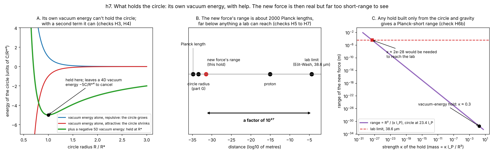
*h7. A: the circle's vacuum energy alone pushes it to grow or shrink; with a negative 5D vacuum energy added, it has a resting size R*. B: the range that hold gives the new force, on a ladder of distances. C: any hold whose only scales are the circle and gravity gives range R²/(κ l_P); reaching the lab would need κ near 10⁻²⁸.*

- **It can't be held by fiat (H1).** If the circle's size is simply set constant, its own field equation reads R₅₅ = (κ²/4)F², which is not zero for any electric field. Jordan (1947) and Thiry (1948) found this. So our "dials are constant" rule needs something physical behind it.
- **Its own vacuum energy (H2, H2b).** Every field on the circle has a vacuum (Casimir) energy, and it comes from the same image sum as the rung tower in section 2: −Γ(D/2)ζ(D)/(π^{D/2}L^{D−1}) per degree of freedom. The formula matches the mode sum in the test case D = 2 (−π/6L). In 5D it is 3ζ(5)/(64π⁶R⁴) per degree of freedom (Appelquist and Chodos 1983).
- **Alone it doesn't hold (H3).** The vacuum energy goes as 1/R⁶ in the 4D frame, with no turning point. Gravity's own share pulls the circle to shrink, as Appelquist and Chodos found.
- **With one more term it does (H4, H4b).** Add a 5D vacuum energy. A resting size exists only when that energy is negative and the circle carries more fermions than bosons. At rest the circle's size, as a field, has mass² = 20C/(M̄²R⁴) and leaves a 4D vacuum energy −5C/R⁴ that something else must cancel (the usual cosmological constant problem, not solved here). The same normalisation gives the field's pull on matter as 1/3 of gravity (H4c), matching section 6.
- **The range (H5, H5b).** With the circle at 23.4 Planck lengths and the smallest workable content (2 fermions), the range is **about 2000 Planck lengths, 3 × 10⁻³² m**. More particles only shorten it: 2 to 64 fermions all give 10⁻³³ to 10⁻³¹ m. Using section 8's refined circle (20.7 Planck lengths) changes it by about a fifth.
- **The general point (H6, H6b, H7).** Any hold whose only scales are the circle and gravity gives mass κ l_P/R², so range R²/(κ l_P). A natural hold has κ near 1. Reaching the Eöt-Wash limit of 38.6 µm would need κ ≈ 2 × 10⁻²⁸, a tuning of about one part in 10²⁷. At 1 µm the new force is suppressed by exp(−3 × 10²⁵).

**What it means:** our law has only two scales here, the circle and gravity. So the theory predicts the new force but also predicts that nobody will see it. That is testable in the negative: a short-range force at 1/3 of gravity's strength found at microns would mean a new small scale is at work, which our dials don't contain.

### 8. Ways to derive a force's strength: its quality and its material (part S)

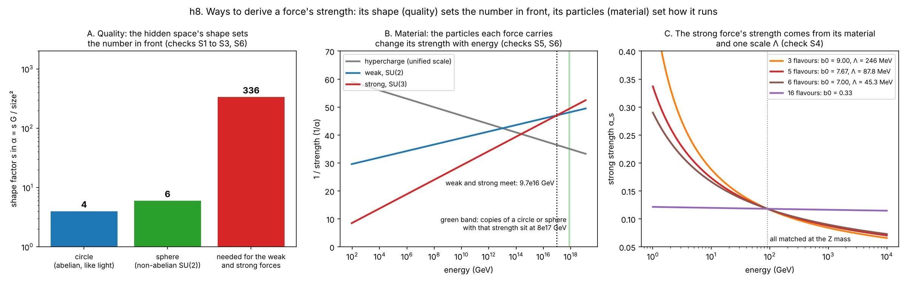
*h8. A: the shape of the hidden space sets the number in front of G/size². B: run with the Standard Model's particles, the weak and strong strengths meet near 10¹⁷ GeV, but copies of a circle or sphere with that strength would sit 8 times higher, and hypercharge misses. C: with the strong force, the particles it carries set its strength at every energy, given one scale.*

**Quality: the shape of the hidden space (S1 to S3).**
- A general rule for hidden-space forces: g² = 16πG/⟨|K|²⟩, where ⟨|K|²⟩ is the average squared length of the symmetry's motion, the distance a unit charge is carried per radian. For a circle this gives α = 4G/R², section 6's result, now from a second route.
- A sphere's rotations carry a non-abelian SU(2) force (the order dial on). Their average squared length is 2R²/3, so **α = 6G/R²**.
- So the force's quality sets the number in front: α = s·G/size², with s = 4 for a circle and 6 for a sphere. In our dials, the size is |Δ| and the order dial picks circle-like (abelian) or sphere-like (non-abelian).

**Material: the particles a force carries (S4).**
- The strength changes with energy at a rate set by the particles: b₀ = 11N/3 − 2n_f/3 (section 5). For the strong force this sets everything: α_s(μ) = 2π/(b₀ ln(μ/Λ)). From α_s(M_Z) = 0.118 with 5 flavours, Λ = 88 MeV at one loop.
- So two forces of the same quality but different material have different strengths at every distance, from one shared starting point (h8 C).

**Both together: does one hidden space give all three strengths? (S5 to S7)**
- Run with the Standard Model's particles (one loop), the weak and strong strengths meet at **9.7 × 10¹⁶ GeV**, with 1/α = 47. Hypercharge (in the unified normalisation) misses, at 1/α = 36.
- If one hidden space set both at its copy scale, the meeting point would fix its shape factor: s = α(M_P/μ*)² ≈ **340**. A circle gives 4 and a sphere 6, so their copies would sit near 8 × 10¹⁷ GeV, 8 times above the meeting point. The simplest shapes fail. A factor of 340 would need the force's symmetry to move charges about 9 times less far than the hidden space's largest size, a fit and not a prediction.
- A refinement of section 6: the strength that sets the circle is EM's strength at the copy scale (1/α = 107), not at rest (137). The circle is then 20.7 Planck lengths, not 23.4.

**The other variables, then:** a force's strength is set by gravity's G, one size (|Δ|), one shape factor (its quality) and its particles (its material). Our law supplies the size and whether the force is abelian; it doesn't yet supply the shape or the particle content. Those are where the other variables live.

### 9. The new force up close (part I)

*Brennan asked to investigate the new force more closely without naming an angle, so this takes four: what carries it and what feels it, what it does at its own range, its indirect traces, and what our framework adds.*

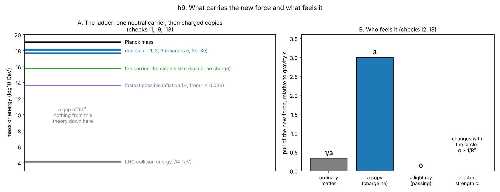
*h9. A: the ladder of particles this picture adds: one neutral carrier, then charged copies, all far above any collider. B: how strongly each kind of thing feels the new force, relative to gravity.*

**What carries it and what feels it (I1 to I3).**
- **The carrier** is one particle: the circle's size, spin 0, with no circle charge. Part H's hold gives it a mass of about **6 × 10¹⁵ GeV**. Above it sit the charged copies, n × 5.2 × 10¹⁷ GeV with charge n·e.
- **Who feels it:** ordinary matter at **1/3** of gravity; the copies at **3** times gravity, nine times more; a passing light ray **not at all** (light bending is unchanged by it).
- **Light still notices it another way.** Since α = 4G/R² (part G), electric strength depends on the circle's size: d ln α / d ln R = −2. So the carrier also couples to electric and magnetic fields, through the strength of the charge itself.

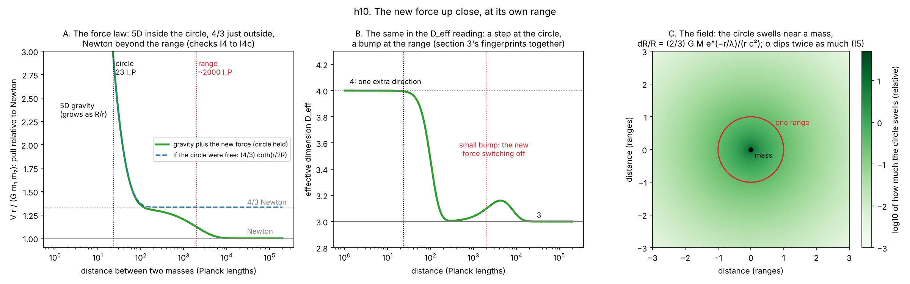
*h10. A: gravity between two masses at every distance. Inside the circle it is five-dimensional; just outside, the new force adds 1/3; past the range it is Newton. The dashed line is what an unheld circle would give. B: the same in the D_eff reading. C: the field around a mass: the circle swells, and electric strength dips.*

**What it does at its own range (I4 to I6).**
- **Every rung adds 4/3 (I4).** Between masses with no circle charge, each heavy rung pulls with 4/3 of Newton (the 5D weight 2/3 over the 4D weight 1/2). The zero rung's 4/3 is gravity's 1 plus the new force's 1/3.
- **So the new force is what makes the ladder whole (I4b).** V·r/(G m₁m₂) = 1 + (1/3)e^{−r/λ} + (4/3)(coth(r/2R) − 1). With an unheld circle this is exactly (4/3)coth(r/2R), the 5D image sum from section 2. Without the 1/3, the zero rung wouldn't match the others.
- **Three regimes (I4c).** Inside the circle (23 l_P) gravity is five-dimensional. Just outside, at about 5R, it reaches 4/3 of Newton, then eases back as the new force fades: 1.12 at the range, plain Newton beyond. The window is only about 85 circle-sizes wide.
- **The field picture (I5, I5b).** Near a mass the circle swells: linear 5D gravity gives h₅₅/h₀₀ = 1/2, so dR/R = (2/3)·GM e^{−r/λ}/(rc²). Electric strength dips twice as much: dα/α = −(4/3)·GM e^{−r/λ}/(rc²). If the range were long, that would be −2.8 × 10⁻⁶ at the Sun's surface.
- **Black holes (I6).** Only a black hole whose horizon fits inside the range (below about 0.02 g) feels the swollen circle at its horizon. Every astrophysical black hole is vastly bigger.

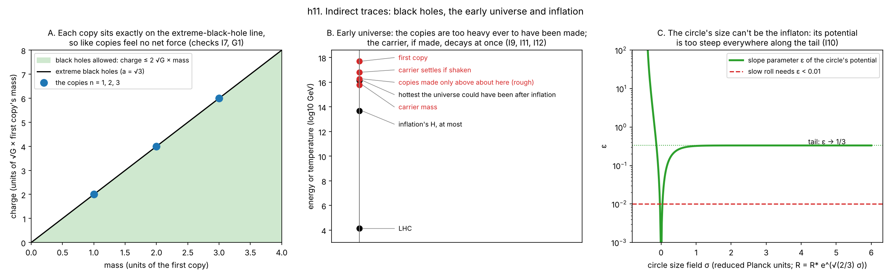
*h11. A: each copy sits exactly on the extreme-black-hole line. B: energies in the early universe: the copies are too heavy to have been made, and the carrier, if made, decays at once. C: the circle's potential is too steep to drive inflation.*

**Indirect traces (I7 to I13).**
- **The copies are extreme black holes (I7).** For each copy, charge²/(G·mass²) = αR²/G = 4 = 1 + a² with a² = 3. That is exactly the extreme Kaluza–Klein black hole (Gibbons and Maeda 1988), and it is why like copies feel no net force (G1). Holzhey and Wilczek (1992) showed that extreme black holes of this kind behave like elementary particles, so here the copies and the smallest charged black holes are the same objects. This is the one striking fact in this section, and it is known: it is also the textbook example of the "weak gravity" pattern (Arkani-Hamed, Motl, Nicolis and Vafa 2007).
- **Hawking radiation (I8).** A black hole radiates the carrier only once it is hotter than 6 × 10¹⁵ GeV, below about 2 × 10⁻³ g, in the last instant of evaporation. It radiates copies only near the Planck mass.
- **Inflation (I9, I10).** The carrier is at least 130 times heavier than the fastest expansion inflation allows (H < 4.7 × 10¹³ GeV, from r < 0.036), so it sits still: no fluctuations, no leftover energy, no "moduli problem". It can't drive inflation itself: along its tail the slope parameter is ε = 1/3, far above the 0.01 that slow roll needs.
- **Early universe (I11).** If it were ever shaken, the carrier would settle at about 6 × 10¹⁶ GeV and decay in about 10⁻³⁴ s (order of magnitude). There is no relic carrier and no change to α since then.
- **Relic copies (I12, rough).** Copies are stable by charge, so if made they would be heavy charged relics: the old "pyrgon" problem (Kolb and Slansky 1984). A rough estimate says pair production is negligible if the universe was never hotter than about 2 × 10¹⁶ GeV, and inflation's limit already keeps it below 1.4 × 10¹⁶ GeV. So no dark matter comes from the ladder, and none of it is left to find.
- **Colliders (I13).** The carrier is 4 × 10¹¹ times and the first copy 4 × 10¹³ times beyond the LHC's 14 TeV.
- **The vacuum term (I13b).** The hold's leftover vacuum energy is about −2.5 × 10⁻⁹ in Planck units, about 10¹¹⁴ times the observed dark energy and of the wrong sign. Something else must cancel it.

**What our framework adds (judged on its own merits).**
- **Known:** everything above is standard Kaluza–Klein physics: the radion and its couplings, the 4/3 per massive rung, the extreme a = √3 black holes, the moduli and pyrgon problems.
- **Ours, and modest:** the force law written as our rung tower (coth from section 2) plus the new force's 1/3, which shows the 1/3 is exactly what makes the zero rung match the rest; the D_eff fingerprint of the whole thing (a step at the circle, a bump at the range); and the copies as rungs of our law landing on the extreme-black-hole line because α = 4G|Δ|.
- **What it contributes:** a complete, checked portrait of the new force (17 checks): its carrier, who feels it, its force law, and every indirect trace, all consistent with observation and all invisible. **What would make it a lead:** anything that gave the hold a much smaller scale, which would bring the force within reach of labs or the early universe; our law doesn't supply one yet.

### 10. The inverse: a weak, long-range push? And could it pass for gravity? (part J)

Brennan's questions: could the new force be "the inverse", reaching very far with a very weak push; could gravity be confused with it; could two long-range forces act on different kinds of material?

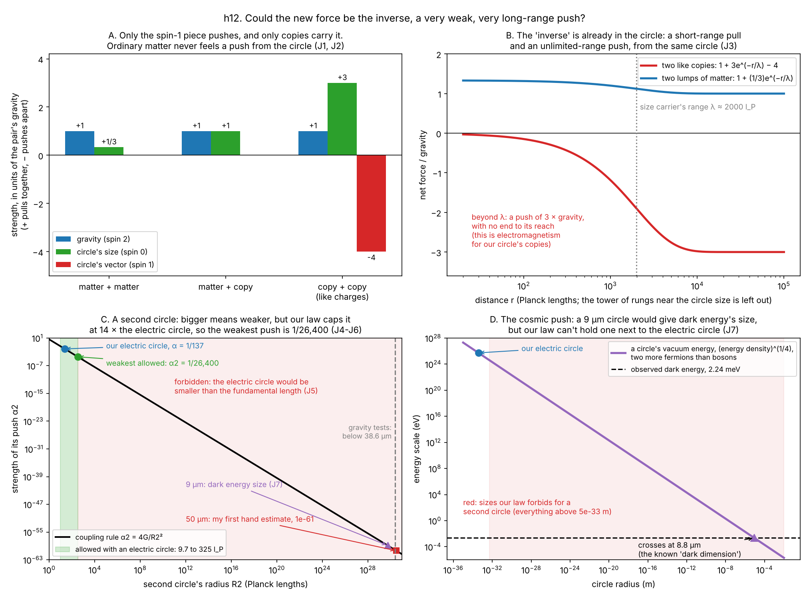
*h12. A: what each pair of bodies feels from the circle's three pieces, in units of the pair's gravity. Only the spin-1 piece pushes, and only charged copies carry it. B: two like copies feel nothing inside the size carrier's range and a push of 3 × gravity beyond it, forever; two lumps of matter feel 4/3 then 1. C: a second circle's push weakens as 1/R2², but keeping the electric circle above the fundamental length caps R2 at 325 Planck lengths (green band); everything to the right is forbidden, including my first hand estimate at 50 µm and the 9 µm dark-energy size. D: a circle's vacuum energy against its size; the curve crosses dark energy at 8.8 µm, deep in the forbidden region.*

- **Only spin 1 pushes (J1, J2).** Splitting the 5D weight into its 4D pieces: gravity (spin 2) and the circle's size (spin 0) always pull; the circle's vector (spin 1) pushes like charges apart, at 4 times their gravity for the copies. Ordinary matter carries no circle charge, so it never feels a push from the circle: matter–matter is gravity plus 1/3 (the size), matter–copy is gravity plus 1, copy–copy is gravity plus 3 minus 4.
- **The inverse is already in the circle (J3).** Inside the size carrier's range two like copies feel nothing at all (1 + 3 − 4 = 0, the no-force condition of extreme black holes). Beyond it the size drops out and they push apart at 3 times their gravity, with no end to the reach. So one circle gives both: a short-range pull on everything, and an unlimited-range push on charges. For our circle that push is electromagnetism (α/(G·M₁²) = 4).
- **A second, bigger circle (J4 to J6).** The same coupling rule gives a second push, α₂ = 4G/R₂², felt only by that circle's own copies (each sits on the same extreme line at every size). A bigger circle means a weaker push, which is the direction Brennan asked about. But a second circle dilutes gravity over both, so the true fundamental length grows, l₆⁴ = 4π²R₁R₂ l_P²; the one-circle case is fine (5.3 l_P against the circle's 23.4). Keeping the electric circle above l₆ caps the second circle at R₁³/(4π²) = 325 Planck lengths, 14 times the electric one. So the weakest second push our law allows is 1/26,400, about 190 times weaker than electromagnetism, and its lightest copy weighs 3.8 × 10¹⁶ GeV. My first hand estimate in chat (1e-61 at 50 µm) ignored this: a 50 µm circle would push the fundamental length to 2.3 × 10⁸ Planck lengths, ten million times the electric circle, which then couldn't be a circle at all.
- **The cosmic push (J7, J8).** A weak push that grows with distance is what dark energy looks like, and a circle's own vacuum energy can supply it: with two more fermions than bosons running round it, a circle of 8.8 µm leaves exactly the observed (2.24 meV)⁴ with the right sign. It even passes gravity tests (below 38.6 µm). This is known: it is the "dark dimension" of Montero, Vafa and Valenzuela (2022). But our law forbids it next to an electric circle (1.7 × 10²⁷ times over the cap). Such a circle would also need a far firmer hold than ours: our hold formula gives its size carrier a mass of 10⁻³² eV, a few times the Hubble rate, so a 1/3-gravity force would reach 10²⁵ m, which Cassini excludes (the known radion problem of Arkani-Hamed, Dimopoulos and March-Russell 1999).
- **Could a second force pass for gravity? (J9, J10).** Only if it grabs every body, light included, in exactly gravity's proportions; then it is indistinguishable and just changes the measured G. Ours fails twice if it reached far. It grabs matter at 1/3 but light not at all, so light would bend 3/4 as much as expected (Cassini: out by 21,740 standard errors). And because the circle's size also sets α, a body's electric binding energy feels it differently from its rest mass: titanium and platinum (2 × 10⁻³ and 4 × 10⁻³ of their mass electric) would fall differently by about 7 × 10⁻⁴ (rough), against MICROSCOPE's few × 10⁻¹⁵. What does pass both tests is Brennan's second picture: a long-range force on a different material that ordinary matter doesn't carry at all. In our law that is a second circle's push on its own copies, but those are 3.8 × 10¹⁶ GeV or heavier, above the most energy the early universe could have had, so few if any were made (rough).

**What our framework adds (judged on its own merits).**
- **Known:** spin and sign (any QFT text), the Kaluza–Klein no-force condition, the dark dimension, the radion problem, the equivalence-principle tests.
- **Ours, and modest:** the cap. Because our reading fixes α = 4G|Δ| for the electric circle, any second circle is at most 14 times bigger, so our law forbids a weak, long-range hidden push and a micron-sized hidden circle. That is a clean, checkable consequence: if a dark-dimension signal (gravity changing near a few microns) were found, electromagnetism could not be a circle in our sense.
- **What it contributes:** the inverse exists, as electromagnetism itself; our law proves a cap (a second circle at most 14 times the electric one), which rules out a very weak, very long-range push and a micron-sized hidden circle; and experiment rules out a force mistaken for gravity unless it grabs light and every material alike. **What would make it a lead:** the cap is testable in reverse: if gravity tests found a change near a few microns (the dark-dimension signal), our reading of electromagnetism as a circle would be wrong, and that would be a sharp result either way.

### 11. The other unknown forces, one cell at a time (part K)

Brennan: "I'd also like to find out more information on the other unknown forces as well." These are the orange cells of h1, each given the same treatment: what carries it, who feels it, what sets its strength, how it falls off, and where experiments stand.

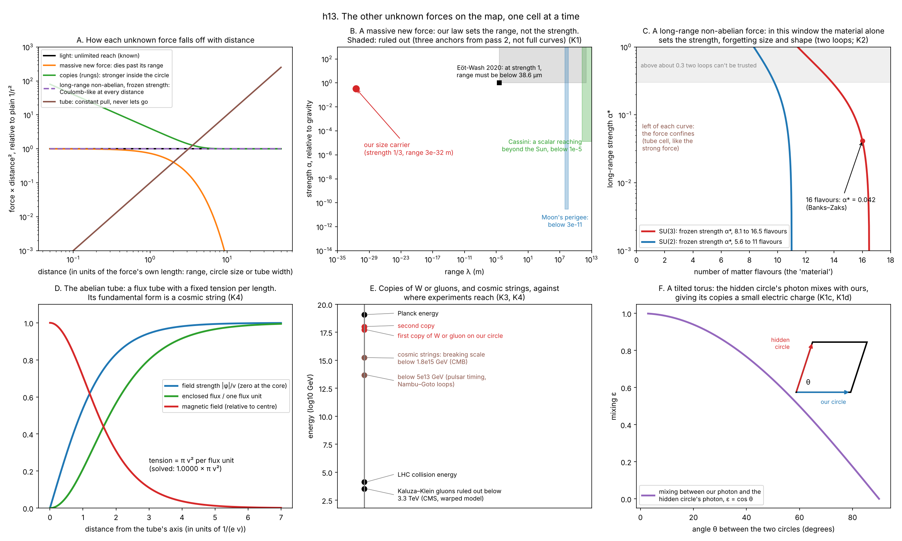
*h13. A: how each force falls off, as force × distance² (flat means plain 1/r²). B: a massive new force on the range–strength plane, with three anchors from experiment and our size carrier far to the left. C: the long-range non-abelian window, where the strength freezes at a value set by the number of flavours. D: the abelian flux tube, solved: field, flux and magnetic field across it. E: copies of W bosons and gluons, and cosmic strings, against what experiments reach. F: two tilted circles mix their photons by ε = cos θ.*

- **Screened, order off: a massive new force (K1).** Carried by a massive spin-0 or spin-1 particle; felt by whatever carries its charge (for a scalar, usually everything with mass). Our law fixes the range 2/√Δ and the shape (a bump in D_eff, section 3), but not the strength. Experiments cap it at about 3 × 10⁻¹¹ of gravity near the Moon's distance and about 10⁻⁵ for a scalar reaching beyond the Sun; at gravity's own strength its range must be below 38.6 µm. Section 10's second circle also lives here as a "dark photon", and our circles add one wrinkle: if the two circles are tilted at angle θ, the torus's own metric mixes the hidden photon with ours by ε = cos θ, which gives the hidden copies a small electric charge (known mechanism: Holdom 1986; the torus form is standard Kaluza–Klein). With the section 10 cap those copies weigh at least 4 × 10¹⁶ GeV.
- **Unlimited reach, order on: a long-range non-abelian force (K2).** Section 5 said this needs more than 16 flavours (SU(3)). That is where the force becomes free at long distance; there is a wider window, from about 8 flavours at two loops (the true lower edge is uncertain), where the force stays long-range because its strength stops running and freezes. At 16 flavours the frozen strength is α* = 0.042 (Banks–Zaks). Starting weak or strong at short distance, it flows to the same value far away. So here Brennan's "material" is the whole story: the long-range strength is set by the particle count alone and forgets the size and shape of any hidden space. It is felt only by particles carrying the hidden charge, a "dark conformal sector" (known: Caswell 1974, Banks–Zaks 1982; Georgi's "unparticles" 2007 if it touches ordinary matter).
- **Rungs, order on: copies of W bosons or gluons (K3).** If those forces live on our circle, their copies sit at n × 5.2 × 10¹⁷ GeV, carry the colour or weak charge themselves, and only interact when their rung numbers add up. The LHC has ruled out Kaluza–Klein gluons below about 3.3 TeV (CMS, 13 TeV, in a warped model); ours are 10¹⁴ times higher.
- **Tube, order off: abelian confinement (K4).** In materials this is a magnetic flux tube in a superconductor. Solved at the self-dual point, the tube carries tension exactly πv² per flux unit, so two charges joined by it feel a constant pull at every distance (D_eff = 1). Its fundamental form is a cosmic string. Planck's CMB limit Gμ < 1.3 × 10⁻⁷ caps the breaking scale at 1.8 × 10¹⁵ GeV; pulsar timing gives Gμ ≲ 10⁻¹⁰ (5 × 10¹³ GeV) for Nambu–Goto loops, a bound that weakens with field-theory loops (Kume and Hindmarsh 2024). A string at our circle's own scale would have Gμ = 0.011, far over the limit; nothing in our law makes one, and inflation would dilute any made before it (stated, not derived).
- **A base dial that varies in space and hides (K5).** A long-range scalar can escape the tests in section 10 if dense matter makes it heavy (chameleon screening, Khoury–Weltman 2004). Our size carrier is so heavy that ordinary density changes its mass² by 1 part in 10⁸⁶: no hiding, and none needed at its range.
- The two "changes to a known force" (roundness p ≠ 2 and deep MOND, section 4) are unchanged here; pass 2 lists where they stand.

**What our framework adds (judged on its own merits).**
- **Known:** every cell's physics: Yukawa forces and their bounds, the conformal window and Banks–Zaks, Kaluza–Klein gluons, Nielsen–Olesen strings and cosmic-string bounds, kinetic mixing, chameleons.
- **Ours, and modest:** the map itself, which puts these as one 4 × 2 grid from two of our dials (Δ and order); the correction to section 5 (the long-range non-abelian cell is the whole conformal window, not just above 16 flavours), which matches Brennan's "material sets the strength" exactly; and the tilted-torus mixing as the way a second circle in our law would talk to light.
- **What it contributes:** one grid from two of our dials that holds every one of these hypotheses, each cell's shape of force, the corrected long-range non-abelian window, and the tilted-torus mixing. **What would make it a lead:** our law fixing a strength or a scale in any of these cells (as it does for the rung cell in section 6); then that cell would give a number to test.

### 12. Chasing the two possible leads (parts L and M)

Brennan: "Please chase the two new possible leads." These are the two from sections 10 and 11: the cap on a second circle (lead 1) and a cell where our law fixes a strength or a scale (lead 2).

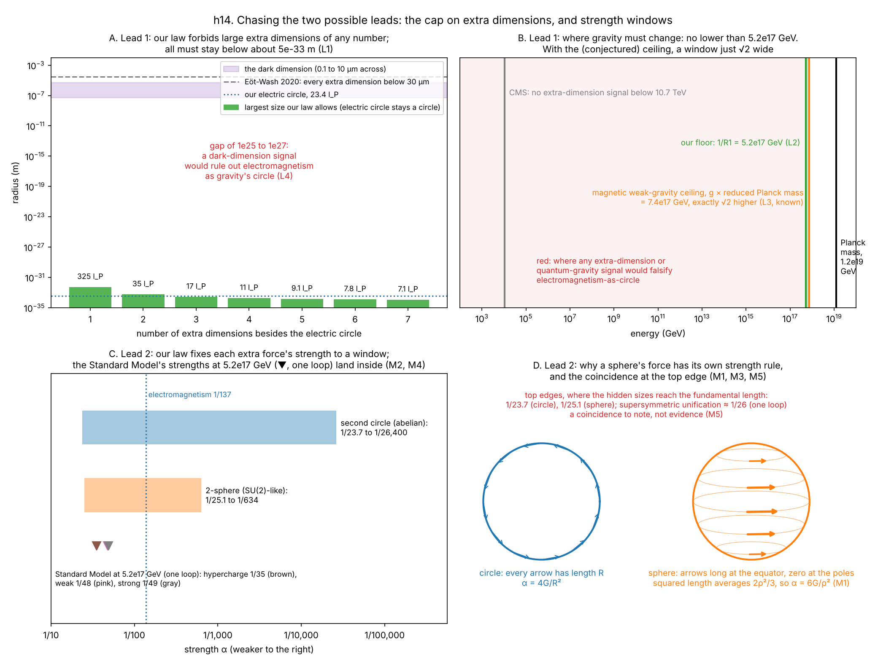
*h14. A: the largest size our law allows for 1 to 7 extra dimensions next to the electric circle, against the dark dimension and the Eöt-Wash limit. B: the energy where gravity must change: no lower than 5.2 × 10¹⁷ GeV, with the conjectured magnetic weak-gravity ceiling √2 above. C: the strength windows for a second circle and for a 2-sphere, with electromagnetism and the Standard Model's three strengths at 5.2 × 10¹⁷ GeV. D: why a sphere's force has strength 6G/ρ² (the rotation arrows average 2ρ²/3), and the coincidence at the top edge.*

**Lead 1: the cap (L1 to L4).**
- **It holds for any number of extra dimensions (L1).** Gravity spreads over the whole hidden space, so every extra direction raises the fundamental length; the electric circle (23.4 l_P) has to stay above it. One extra circle can be at most 325 l_P, two at most 35 l_P each, and many approach R1/2π = 3.7 l_P. Every extra dimension stays below about 5 × 10⁻³³ m.
- **So gravity's true scale is at least 5.2 × 10¹⁷ GeV (L2).** CMS has excluded large extra dimensions only below 10.7 TeV (two dimensions, full 13 TeV data); this reading puts the scale 5 × 10¹³ times higher, so no collider will see extra dimensions or tiny black holes.
- **A window √2 wide (L3).** The magnetic weak-gravity conjecture puts a ceiling at g × reduced Planck mass = 7.4 × 10¹⁷ GeV, exactly √2 above our floor. If both hold, gravity changes between 5.2 and 7.4 × 10¹⁷ GeV. That Kaluza–Klein sits this close to the ceiling is known; the √2 is Klein's formula in other words.
- **How to falsify it (L4).** The dark dimension (0.1 to 10 µm across, still allowed: Eöt-Wash puts every extra dimension below 30 µm) is 10²⁵ to 10²⁷ times over the cap. A short-range gravity signal at microns, or any collider sign of extra dimensions, would rule out electromagnetism as gravity's circle.

**Lead 2: does our law fix a strength or a scale? (M1 to M5).**
- **A sphere's own rule (M1).** On a sphere the rotation arrow has length ρ sin θ; its square averages 2ρ²/3, so a sphere's SU(2)-like force has α = 6G/ρ² where a circle has 4G/R². This checks the shape factor 6 that section 8 quoted from the literature.
- **Strength windows (M2, M3).** With the electric circle fixed, a second circle's strength must lie between 1/26,400 and 1/23.7, and a 2-sphere's between 1/634 and 1/25.1. The top edges have closed forms, (α/π⁴)^(1/3) and 6(α/(256π⁴))^(1/3), so they move only as the cube root of electromagnetism's strength.
- **A loose test passed (M4).** Run up to 5.2 × 10¹⁷ GeV (one loop), the Standard Model's strengths are 1/35 (hypercharge), 1/48 (weak) and 1/49 (strong), inside both windows. Values like 1/3 or 1/10,000 would have missed the sphere window. The windows are wide, so this is weak support.
- **A coincidence at the top edge (M5).** With superpartners at 1 TeV the three strengths meet near 10¹⁶ GeV at about 1/26 (one loop; two-loop studies give about 2 × 10¹⁶ GeV and 1/24 to 1/25). The top edges are 1/23.7 and 1/25.1. The edge is where the hidden sizes equal the fundamental length, which is where simple holds tend to put them (Candelas and Weinberg 1984 needed many matter fields to make held spheres big and couplings small). This is a coincidence to note, not evidence: the edge moves only as a cube root, and a smooth hidden space can't give the Standard Model's left-handed particles (Witten 1981, who also showed the smallest hidden space for all three forces has 7 dimensions, CP² × S² × S¹).

**What our framework adds (judged on its own merits).**
- **Known:** Klein's radius, the reason large extra dimensions put the Standard Model on a brane, the magnetic weak-gravity conjecture, couplings from hidden-space symmetries, running and unification, Witten's chiral obstacle.
- **Ours:** the cap stated for any number of dimensions as a test of electromagnetism-as-circle, the √2-wide window, the two strength windows tied to the electric circle with closed-form edges, and the edge coincidence.
- **What it contributes:** lead 1 is a sharp, testable prediction: no extra dimension above about 5 × 10⁻³³ m and no change in gravity below 5.2 × 10¹⁷ GeV. But it is plain Kaluza–Klein's prediction, so a dark-dimension signal would test Klein, not our law in particular. Lead 2 is a partial yes: our law fixes each extra force's strength to a window, not a number, and the Standard Model's strengths sit inside. **What would make it a lead:** for lead 1, a consequence where our law differs from plain Kaluza–Klein. For lead 2, a reason in our law for hidden spaces to sit at the fundamental length: then each strength becomes one number near 1/24, and its match to unification becomes a real test. The next step is to ask whether the hold of section 7 puts a sphere at the fundamental length.

### 13. Does the hold put a sphere at the fundamental length? (part N)

Brennan, on checking it: "Ye that would be incredible!" Section 12 found that a sphere at the fundamental length gives a force of strength 1/25.1, next to supersymmetric unification. The question is whether a hold puts it there.

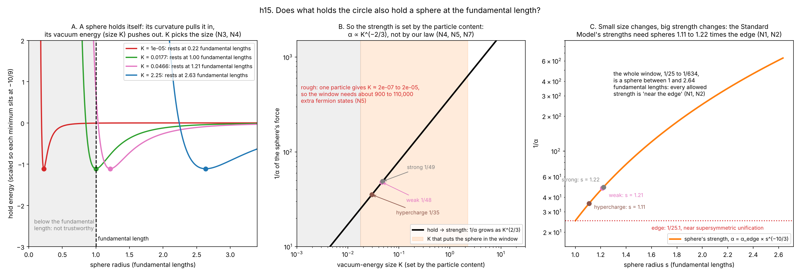
*h15. A: a sphere's hold, curvature against vacuum energy, for four sizes K of the vacuum energy; each rests where its dot is. B: the strength that follows, with 1/α growing as K^(2/3); the band is the K that lands in the window, and the dots are the Standard Model's strengths. C: inside the window, strength against sphere size in fundamental lengths: the whole window is a factor 2.64 in size.*

- **The window is narrow in size (N1, N2).** Measured in fundamental lengths, the sphere runs from 1 (strength 1/25.1) to 2.64 (1/634). Strength goes as size to the −10/3, so a 10% change in size moves it by 37%. The Standard Model's strengths at 5.2 × 10¹⁷ GeV need spheres 1.11 (hypercharge), 1.21 (weak) and 1.22 (strong) times the fundamental length.
- **A sphere holds itself (N3).** In the 4D frame its size feels its own curvature (pulling in, −2/ρ⁴) and its vacuum energy (pushing out, K/ρ⁹ when fermions outnumber bosons). Those two alone have a stable resting size, ρ⁵ = 9K/8. The circle has no curvature, which is why section 7 needed an extra 5D vacuum energy. The sphere's hold leaves a negative 4D vacuum energy, −(10/9)/ρ⁴, the same open problem as before.
- **K picks the size, and so the strength (N4).** The sphere rests at 2.19 × (9K/8)^(1/5) fundamental lengths, so its strength goes as K^(−2/3). It lands in the window for K between 0.018 and 2.3; the weak strength needs K = 0.047.
- **K is the particle content (N5, rough).** Each particle adds a little to K: about 2 × 10⁻⁷ to 2 × 10⁻⁵ by the flat-space image formula. Reaching the window takes about 900 to 110,000 more fermion than boson states, and the weak strength about 2,300 to 300,000. With a handful of particles the sphere would sit at a fifth of the fundamental length, outside what this can describe. Candelas and Weinberg (1984) found the same pattern: many matter fields are needed to make a held sphere bigger than the fundamental length.
- **The electric circle (N6).** It sits at 4.4 fundamental lengths (one circle), or 1.2 in units where 16πG₅ = 1. So in this picture every hidden size is an order-one multiple of the fundamental length, with no large hierarchy.

**What our framework adds (judged on its own merits).**
- **Known:** curvature and vacuum-energy holds for spheres, and the need for many fields (Candelas–Weinberg 1984); the Einstein-frame potential.
- **Ours:** the window measured in fundamental lengths (1 to 2.64), the Standard Model's strengths read as spheres 1.11 to 1.22 times the edge, and the chain from particle content to strength, α ∝ K^(−2/3), tied to the electric circle.
- **What it contributes:** the check settles lead 2 for now. A hold can put a sphere at the edge, but it can just as well put it anywhere in the window: the choice is made by the particle content, not by our law. So the edge coincidence of section 12 is not explained by the hold. **What would make it a lead:** something in our law that fixes the particle content on the hidden space (the number of fermion and boson states). Then K, the sphere's size and the strength would all follow, and the match to the Standard Model's strengths would be a real test.

### 14. Does our law pick one winding on the hidden sphere? (part O)

Brennan: "Whoa, please let me know what this would even look like in our system", then "Yes" to checking whether our law picks one winding. Section 13 left the sphere's size to the particle count. The most natural way for one whole number to decide it instead is a winding: the electric circle wraps the sphere n times, so that above each point of the sphere sits a copy of the circle, twisted as you go around. For n = 1 the hidden space is a squashed 3-sphere (the Hopf fibration); for n ≥ 2 it is a lens space S³/Zₙ; n = 0 is the plain product, which section 13 already covered.

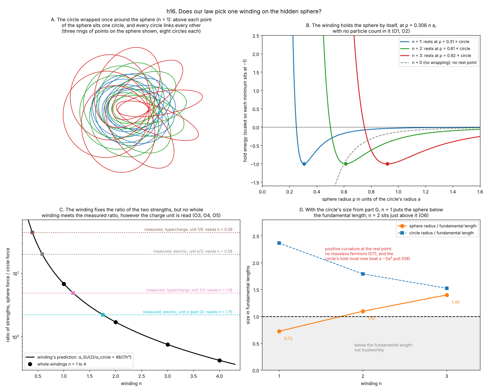
*h16. A: the circle wrapped once around the sphere, drawn in ordinary space: each loop sits above one point of the sphere, and every loop links every other. B: the winding's hold for n = 1, 2, 3; each rests at its dot, while with no winding (dashed) the sphere has no rest point of its own. C: the strength ratio the winding fixes, 48/(7n²), against the measured ratio read four ways; the squares show the n each reading needs, and none is a whole number. D: the sphere's and circle's sizes in fundamental lengths for n = 1 to 3, with the circle's size from part G.*

- **The wrapped sphere's curvature (O1).** Wrapping lowers it: R = 2/ρ² − a²n²/(8ρ⁴), where a is the circle's radius and the second term is the circle's own field wrapped on the sphere. With n = 1 and ρ = a/2 this is the round 3-sphere, R = 6/a², as it should be.
- **The winding holds the sphere (O2).** With the circle held, the 4D potential −2/(aρ⁴) + an²/(8ρ⁶) has one stable resting size, ρ = n a √(3/32) = 0.306 n a. The hold is classical, so the particle count drops out of the sphere's size relative to the circle. Roughly, the vacuum energy only matters if the count runs to hundreds or more: for n = 2 it is under 1% of the winding term at 10 states and 0.4% to 50% at 1,000 (O2b).
- **The sphere's arrows on the wrapped space (O3).** The sphere's three rotation arrows still generate symmetries once each picks up a push along the circle. Keeping their algebra fixes that push, and their average square length grows from 2ρ²/3 to 2ρ²/3 + a²n²/12. With the circle's own arrow the force group is SU(2) × U(1), the electroweak group's shape, as known for a squashed 3-sphere.
- **A ratio fixed by one whole number (O4).** At the resting size the arrows average 7a²n²/48, so the sphere force over the circle force is 48/(7n²): 6.86, 1.71, 0.76 and 0.43 for n = 1 to 4. No particle count and no size enter.
- **The Standard Model test (O5).** Which measured pair to compare depends on what charge one step around the circle carries. Read four simple ways at 5.2 × 10¹⁷ GeV (one loop): hypercharge with unit 1/6 needs n = 0.39; hypercharge with unit 1/2 needs 1.18; electric with unit e/3 needs 0.58; electric with unit e (part G's reading) needs 1.75. None is whole. The nearest whole windings miss the measured ratio by 23% (n = 2, unit e) and 39% (n = 1, unit 1/2), far more than one-loop running could move it. Once the SU(2) is there, the circle's force has to be hypercharge, not electromagnetism, so the hypercharge readings are the natural ones.
- **The fundamental length (O6).** With the circle's size from part G, n = 1 puts the sphere at 0.72 fundamental lengths, too small to trust; n = 2 puts it at 1.10 and n = 3 at 1.40.
- **No light matter (O7).** At the resting size the hidden space's curvature is still positive, R = 2/(3ρ²), so by Lichnerowicz's theorem it carries no massless fermions at all. The states the wrapping counts (|mn| at each circle level, by the index theorem) all sit at the copy scale. This is the known chirality problem for forces made only from the hidden space's shape (Witten 1983).
- **The circle's hold has more to do (O8).** With the sphere at rest the potential goes as −1/a⁵, pulling the circle smaller. Section 7's hold would now have to beat that pull; this check does not do that.

**What our framework adds (judged on its own merits).**
- **Known:** circle bundles over the sphere (Hopf), the squashed 3-sphere giving SU(2) × U(1) and its squashing relating the two strengths (the idea is noted in arXiv 1004.0212; its formula not checked here), spheres held by a wrapped field (Freund–Rubin 1980; Randjbar-Daemi, Salam, Strathdee 1983), the index theorem's count, Lichnerowicz's theorem and the chirality problem.
- **Ours:** using the electric circle itself as the wrapped field, so its hold needs no new ingredient; the resting size 0.306 n a; the count-free ratio 48/(7n²) at that point; and the test against the measured strengths with the four charge readings. I did not find 48/(7n²) written this way in a short search, but each ingredient is standard.
- **What it contributes:** a winding does take the particle count out of the sphere's size and gives a strength ratio fixed by one whole number, which is the kind of thing section 13 said would make lead 2 a lead. It fails the test: our law doesn't yet pick n, no whole n gives the measured ratio under any simple charge reading, and the wrapped space carries no light matter. One coincidence worth keeping in view: n = 2 is both the nearest miss under part G's reading and the winding that puts the sphere just above the fundamental length; at 23% off it is not a match. **What would make it a lead:** a rule in our law that picks n and the charge unit, with the ratio then coming out within a few percent of the measured one; and a second wrapped field (not the circle's own) to give chiral matter, whose strength our law would then also have to fix.

### 15. More than one dial on the wound sphere (part P)

Brennan: "Try more than one dial". Section 14 had one whole-number dial, the winding n. Here several circles wrap the sphere, each with its own winding n_i, and the circles can have any lengths and any angle between them (a torus of any shape). So the dials are: how many circles, the winding along each, the angle between them, and which charge one step around a circle carries.

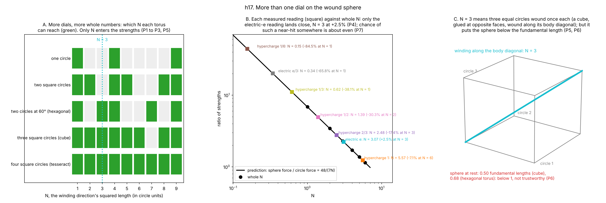
*h17. A: the whole numbers N that each kind of torus can reach; a square torus of four circles (a tesseract) reaches them all. B: the prediction 48/(7N) against the measured strength ratio read seven ways; the label gives the N each reading needs and how far the nearest whole N misses. C: N = 3 as three equal circles wound once each, along the body diagonal of a cube glued at opposite faces, and where that puts the sphere.*

- **Only one number enters (P1, P2).** With two circles of any lengths and angle, the hidden space's curvature is R = 2/ρ² − W/(8ρ⁴), and the sphere's lifted arrows average 2ρ²/3 + W/12, where W is the squared length of the winding direction in the torus. That is section 14's result with a²n² replaced by W, however many dials are turned.
- **The ratio (P3).** The sphere rests at ρ² = 3W/32, and the sphere force over any circle's force is 48/(7N), where N is the winding direction's squared length measured in that circle's units. Three equal circles each wound once act exactly like one circle along the cube's body diagonal, with N = 3.
- **The test (P4).** On square tori N is any whole number of at least 1 (four circles reach every one). Read seven simple ways at 5.2 × 10¹⁷ GeV, the measured ratio needs N = 0.15, 0.62, 1.39, 2.48 or 5.57 (hypercharge units 1/6, 1/3, 1/2, 2/3, 1) and 0.34 or 3.07 (electric units e/3, e). Every hypercharge reading misses the nearest whole N by 7% or more (closest: unit 1, N = 5.57 against 6). The electric-e reading misses N = 3 by 2.5%.
- **What N = 3 takes (P5).** Not one circle, and not two square circles (3 is not a sum of two squares). It takes three equal circles wound once each along a cube's body diagonal, or two equal circles at 60° (a hexagonal torus) wound along the long diagonal.
- **The fundamental length (P6).** With every circle at the electric circle's size (part G), N = 3 puts the sphere at 0.53 circle sizes, which is 0.50 fundamental lengths for the cube and 0.68 for the hexagonal torus. Below 1, nothing here can be trusted.
- **Chance (P7, rough).** With seven readings and every whole N available, a near-hit within 2.5% somewhere happens by chance about half the time.
- **Continuous dials (P8).** A dial that can take any value, like a circle's length, uses up the measurement: making the wound circle 1.18 times longer fits the unit-1/2 hypercharge reading exactly. Only whole-number dials make a test.

**What our framework adds (judged on its own merits).**
- **Known:** torus bundles over the sphere, sums of squares (Lagrange: four squares reach every whole number), the same Kaluza–Klein coupling rule as sections 12 to 14.
- **Ours:** that any number of wound circles enters only through N, so every multi-dial version gives 48/(7N); the scan of seven charge readings against whole N; the cube and hexagonal ways to N = 3 and where they put the sphere.
- **What it contributes:** more dials turn the single test of section 14 into a clean one: does the measured ratio need a whole N? For the natural readings (hypercharge, since SU(2) is present) it does not. The one near-hit, N = 3 for the electric reading at 2.5%, fails twice over: it puts the sphere at half the fundamental length, and it uses the reading that doesn't fit with SU(2). It is the kind of hit that turns up by chance about half the time. **What would make it a lead:** a reason in our law for the electric reading and for three equal circles (the cube), plus a hold that puts the sphere above the fundamental length with N = 3, and the 2.5% surviving two-loop running.

---

## Pass 2: what is known, and where experiments stand

| Empty cell or change | Known as | Where it stands |
|---|---|---|
| Screened, order off: massive new force | fifth force, Yukawa correction; dark photon, Z′ | Eöt-Wash 2020: a gravitational-strength Yukawa must have range < 38.6 µm, so carrier mass > 5.1 meV (C3 reproduces their 5.1 meV). Dark photons are searched over many decades of mass and mixing (Fabbrichesi, Gabrielli, Lanfranchi 2020). |
| Rungs, order off: copies of light or gravity | Kaluza–Klein tower, large extra dimensions (Arkani-Hamed, Dimopoulos, Dvali 1998) | Eöt-Wash 2020: largest extra dimension has radius < 30 µm, so lightest copy > 6.6 meV (C3b). α = 2n for a torus (Kehagias–Sfetsos 2000). |
| Rungs, order on | KK copies of gauge bosons | searched at colliders; not checked here |
| Unlimited reach, order on | hidden or "dark" non-abelian sectors | confinement unless many flavours (Gross–Wilczek, Politzer 1973) |
| Tube, order off | flux tubes in superconductors (Abrikosov) | exists in materials, not as a fundamental force |
| A dial that varies in space | promoting a constant to a field: Brans–Dicke (1961), dilaton, chameleon (Khoury–Weltman 2004) | MICROSCOPE 2022: equivalence principle holds to about 10⁻¹⁵ |
| Roundness p ≠ 2 | rotation (Lorentz) violation, Standard-Model Extension | tabulated by Kostelecký and Russell (updated yearly); tight bounds, not converted to p here |
| Rungs, order off, read as light itself (section 6) | Kaluza (1921), Klein (1926); the scalar: Jordan (1947), Thiry (1948), Brans–Dicke (1961) | the free scalar is ruled out by Cassini, γ − 1 = (2.1 ± 2.3) × 10⁻⁵ (Bertotti, Iess, Tortora 2003); a held circle gives a short-range force, Eöt-Wash range < 38.6 µm at gravity's strength |
| What holds the circle (section 7) | Casimir energy of the hidden circle: Appelquist and Chodos (1983); held spheres: Candelas and Weinberg (1984); circles held with extra terms: Ponton and Poppitz (2001) | the held-circle force is too short-range for any experiment; the leftover 4D vacuum energy is the cosmological constant problem |
| Strength from shape and material (section 8) | gauge couplings from hidden-space symmetries (Weinberg 1983, Witten 1981); couplings and circumferences computed together (Candelas and Weinberg 1984); running and dimensional transmutation (Gross–Wilczek, Politzer 1973); the near-miss of the three strengths (unification literature; string scale near 5 × 10¹⁷ GeV, Kaplunovsky 1988) | simple shapes don't match the measured strengths at one size |
| The new force up close (section 9) | the radion: Appelquist–Chodos (1983); extreme Kaluza–Klein black holes: Gibbons–Maeda (1988), Holzhey–Wilczek (1992); stable copies: Kolb–Slansky (1984); weak gravity pattern: Arkani-Hamed, Motl, Nicolis, Vafa (2007) | invisible: inflation's limit r < 0.036 (BICEP/Keck 2021) keeps the universe too cool to make copies; carrier far beyond colliders |
| The inverse and passing for gravity (section 10) | spin and sign of exchanged forces (QFT texts); the dark dimension: Montero, Vafa, Valenzuela (2022); stabilizing a large circle: Arkani-Hamed, Dimopoulos, March-Russell (1999) | a micron circle passes Eöt-Wash 2020 but needs a firm hold; equivalence principle holds to about 10⁻¹⁵ (MICROSCOPE 2022); light bending γ − 1 < 10⁻⁵ (Cassini) |
| The other unknown forces (section 11) | conformal window: Caswell (1974), Banks–Zaks (1982); unparticles: Georgi (2007); kinetic mixing and millicharges: Holdom (1986); flux tubes and strings: Nielsen–Olesen (1973) | Moon's perigee: Yukawa below about 3 × 10⁻¹¹ at 15 to 60 Earth radii (arXiv 1109.6249); KK gluons above about 3.3 TeV (CMS 2017); cosmic strings Gμ < 1.3 × 10⁻⁷ (Planck), ≲ 10⁻¹⁰ from pulsar timing with caveats (Kume–Hindmarsh 2024) |
| Chasing the leads (section 12) | Kaluza–Klein bulk gauge fields too weak with large dimensions, so the Standard Model sits on a brane (Arkani-Hamed, Dimopoulos, Dvali 1998); magnetic weak-gravity conjecture Λ ≲ gM_P (Arkani-Hamed, Motl, Nicolis, Vafa 2007); couplings from hidden-space symmetries (Weinberg 1983); held spheres (Candelas–Weinberg 1984); chiral obstacle and 7 hidden dimensions (Witten 1981); supersymmetric unification near 2 × 10¹⁶ GeV | CMS, 13 TeV, 137 fb⁻¹: no large extra dimensions below 10.7 TeV (2 dimensions) to 5.2 TeV (7) (arXiv 2107.13021); Eöt-Wash 2020: every extra dimension below 30 µm; dark dimension 0.1 to 10 µm still open (Montero, Vafa, Valenzuela) |
| A held sphere (section 13) | self-consistent dimensional reduction: Candelas–Weinberg (1984), many matter fields make the sphere larger than the Planck length; they used odd-dimensional spheres, where the one-loop vacuum energy is finite | no experiment reaches it; a 2-sphere's vacuum energy (even dimension) is not computed here |
| A wound sphere (section 14) | Hopf fibration; Kaluza–Klein on a squashed 3-sphere gives SU(2) × U(1), with the squashing relating the two strengths (noted in arXiv 1004.0212); spheres held by a wrapped field: Freund–Rubin (1980), Randjbar-Daemi, Salam, Strathdee (1983), with chiral couplings from an independent wrapped field; Lichnerowicz's theorem and the chirality problem (Witten 1983) | no experiment reaches it; the measured strength ratio at 5 × 10¹⁷ GeV fits no whole winding |
| Several wound circles (section 15) | torus bundles over the sphere; Lagrange's four-square theorem; the Kaluza–Klein coupling rule (Weinberg 1983) | no experiment reaches it; the measured ratio needs a whole N only under the electric reading (N = 3, 2.5% off) |
| Flux exponent 3/2 at weak fields | deep MOND (Bekenstein–Milgrom 1984, AQUAL); scale invariance (Milgrom 2009) | an active debate about galaxies; not settled |

**Known vs ours:**
- **Known:** every cell's physics, the coth sum (the image method), α = 2n, the deep-MOND law and its scale invariance, the flavour counts, all of section 6's numbers (Klein's relation, R ≈ 23 l_P, charge quantization, the 1/3 scalar, γ = 1/(n+1)), the Casimir hold and its Planck-short radion, the hidden-space coupling rule and the running.
- **Ours:**
  - the map itself, built from our readings, and the D_eff fingerprints in h2;
  - rungs = dimension dial (one more direction at short range);
  - EM's q = +1 circle placed in the rung class, so one reading gives both the rung spacing and the strength, α = 4G|Δ|;
  - our design rule (base dials are constant inputs) asks for a frozen circle, which is what Cassini requires. Plain Kaluza–Klein can't freeze it: the circle's size is pushed by the electric field itself (Jordan, Thiry). So whatever holds it is extra, and it would set the range;
  - the general scaling in section 7: with only the circle and gravity available, range = R²/(κ l_P), so a natural hold gives about 2000 Planck lengths and the lab needs a 10²⁷ tuning;
  - Brennan's "material or quality" mapped onto our dials: size = |Δ|, quality = the order dial plus a shape factor, material = the particle content;
  - deep MOND landing exactly on the flux-tube page's confinement border.

  I did not find the placements written this way in a short search, but the physics behind each is standard.

## What this does not do

- It does not derive the hold from our law. Section 7 uses a 5D vacuum energy as the second term; the law only says the circle should be constant. The range result depends only on the hold using no scale but the circle and gravity.
- It does not solve the leftover 4D vacuum energy (the cosmological constant problem).
- Section 8's running is one loop with the Standard Model's particles only; two loops or new particles move the meeting point.
- It does not make the electron a copy: copies have g = 1 and a mass near 10¹⁷ GeV.
- It does not derive Newton's G. Section 6 fixes α relative to G; G itself is still an input (newton-g page).
- It does not show the theory forbids any cell of the map. An empty cell is allowed, not required.
- It does not convert the roundness dial into a bound from the Lorentz-violation tables.
- Section 13's per-particle vacuum energy is a flat-space proxy. A 2-sphere is even-dimensional, where the one-loop vacuum energy picks up a scheme-dependent piece; its true size and even its sign are not computed here (Candelas and Weinberg worked with odd-dimensional spheres for this reason).
- Section 14 holds the circle fixed while the winding holds the sphere; whether section 7's hold can also beat the winding's −1/a⁵ pull is not checked. Its Standard Model comparison is one loop, and which charge one step around the circle carries is a choice the law doesn't yet make.
- Section 15 keeps every circle at the electric circle's size and checks two tori shapes for N = 3; it does not search other lattices or unequal sizes beyond showing that a continuous size fits anything. Its chance estimate is rough.
- The non-abelian generalization: section 12 checks the 2-sphere's shape factor (6), but not CP² or S³, and not a full Standard Model geometry.

## First-run failures, fixed by correcting the claim or the setup

- **A3:** I first tested the period of the field w for Δ < 0. The law's ruler x = −u′/(d u) blows up at the zeros of w, which come twice per period of w. The check now tests the zero spacing, 2π/√(−Δ), as the first page states.
- **B1:** sympy could not simplify coth against exponentials until it was rewritten in exponentials. The identity itself was never in doubt.
- **S5, S6:** my hand estimate put the weak–strong meeting at 5 × 10¹⁷ GeV, close to the circle's copy scale. The check says 9.7 × 10¹⁶ GeV, which turns a near-match into a miss (shape factor 340, not about 13). The claim was corrected to what the check found.
- **I4c, I6:** I first claimed a clean 4/3 plateau at the geometric mean of the circle and the range (it is 1.30 there; the window is only 85 circle-sizes wide), and a black-hole mass limit of 2 × 10⁻⁵ g (that was kilograms; it is 0.02 g). Both claims were corrected to what the checks found.
- **J4b (chat, before the check):** I told Brennan a 50 µm second circle would give a push of strength 1e-61. That ignored how a second circle dilutes gravity; J5 shows our law caps the second circle at 325 Planck lengths, so the weakest allowed push is 1/26,400. Section 10 states the corrected claim.
- **N4, N5:** I first took the unit conversion (16π)^(1/5) as 1.99; it is 2.19. That moved the K window from 0.029–3.7 to 0.018–2.3 and the particle counts down by about a third. The claims now say what the checks found.
- **M5:** I first wrote that one-loop supersymmetric running meets near 2 × 10¹⁶ GeV at about 1/25. One loop gives 10¹⁶ GeV and 1/26; the 2 × 10¹⁶ and 1/24 to 1/25 are two-loop values from the literature. The claim now says which is which.
- **L1:** my first script used the wrong power for the fundamental length (D − 3 instead of D − 2); the check against part J's cap caught it.
- **H2:** the first run compared mpmath numbers at a tolerance tighter than mpmath's working precision; the formula was right, the tolerance was fixed.
- **O3, O5:** O3 first asked sympy to solve for the arrows' push with a symbol declared positive, so it could not return the answer, 0; the arrows were right. O5 first claimed none of the needed windings was within 15% of a whole number, but 1.75 is within 15% of 2; the claim now says what decides it, how far the nearest whole winding misses the measured ratio (23% or more).
- **P1, P4, P6:** P1's curvature identity is true (it vanishes at random points to 10⁻¹⁶), but sympy couldn't simplify it, so the check now tests it at twelve random points. P4 first said every hypercharge reading misses by 10% or more; unit 1 misses by 7.1%, and the claim says so. P6 first used the wrong power for the fundamental length (D − 4 instead of D − 2) and printed 0.14; the correct value is 0.50.
- **Lean:** the SU(2) flavour statement first claimed b₀ < 0 at 11 flavours; it is exactly 0 there, so the statement now says that.

## Files

- `new_force_core.py`: shared inputs (circle size, the size carrier's range and mass, inflation's bound) and the atomic JSON writer, so no check reads another's output.
- `checks.py` → `checks_output.txt`, `results_A.json`: parts A (classes), B (rungs), C (screened), D (deep MOND), E (roundness), F (order on), P (polish).
- `strength_checks.py` → `strength_output.txt`, writing `results_G.json`: part G (strength from the closed direction).
- `hold_strength_checks.py` → `hold_strength_output.txt`, writing `results_HS.json`: parts H (what holds the circle) and S (strength from shape and material).
- `investigate_checks.py` → `investigate_output.txt`, writing `results_I.json`: part I (the new force up close).
- `repel_checks.py` → `repel_output.txt`, writing `results_J.json`: part J (the inverse, and passing for gravity). 
- `other_forces_checks.py` → `other_forces_output.txt`, writing `results_K.json`: part K (the other unknown forces).
- `leads_checks.py` → `leads_output.txt`, writing `results_LM.json`: parts L (lead 1, the cap) and M (lead 2, strength windows).
- `sphere_hold_checks.py` → `sphere_hold_output.txt`, writing `results_N.json`: part N (does the hold put a sphere at the fundamental length).
- `sphere_winding_checks.py` → `sphere_winding_output.txt`, writing `results_O.json`: part O (does our law pick one winding on the hidden sphere).
- `sphere_dials_checks.py` → `sphere_dials_output.txt`, writing `results_P.json`: part P (more than one dial on the wound sphere).
- `figures.py` → `figures/h1` to `h17`, after merging every `results_<part>.json` into `results.json`.
- `lean/NewForce.lean` (53 statements), `lean/check_statements.py`.

## Sources (pass 2, checked Nov 26)

- T. Kaluza, "Zum Unitätsproblem der Physik", Sitzungsber. Preuss. Akad. Wiss. (1921) 966.
- O. Klein, "Quantentheorie und fünfdimensionale Relativitätstheorie", Z. Phys. 37 (1926) 895; "The atomicity of electricity as a quantum theory law", Nature 118 (1926) 516.
- P. Jordan (1947); Y. Thiry, C. R. Acad. Sci. Paris 226 (1948) 216: the circle's size as a field, pushed by the electric field.
- C. Brans, R. H. Dicke, Phys. Rev. 124 (1961) 925.
- B. Bertotti, L. Iess, P. Tortora, "A test of general relativity using radio links with the Cassini spacecraft", Nature 425 (2003) 374: γ − 1 = (2.1 ± 2.3) × 10⁻⁵.
- A. Hosoya, K. Ishikawa, Y. Ohkuwa, K. Yamagishi (1984), g = 1 for Kaluza–Klein states, as cited in arXiv hep-th/9801072.
- B. Carter, Phys. Rev. 174 (1968) 1559: g = 2 for Kerr–Newman.
- E. Witten, "Search for a realistic Kaluza–Klein theory", Nucl. Phys. B 186 (1981) 412.
- T. Appelquist, A. Chodos, "Quantum Effects in Kaluza-Klein Theories", PRL 50 (1983) 141; "Quantum dynamics of Kaluza-Klein theories", PRD 28 (1983) 772: the circle's Casimir energy pulls it toward Planck size.
- P. Candelas, S. Weinberg, "Calculation of gauge couplings and compact circumferences from self-consistent dimensional reduction", Nucl. Phys. B 237 (1984) 397: held curved hidden spaces, couplings computed; many matter species make the sphere larger than the Planck length; odd-dimensional spheres give finite one-loop potentials C_N/ρ⁴ (abstract checked Nov 27).
- S. Weinberg, "Charges from extra dimensions", Phys. Lett. B 125 (1983) 265 (the Killing-vector coupling rule; cited from memory, not opened here).
- E. Ponton, E. Poppitz, "Casimir energy and radius stabilization in five and six dimensional orbifolds", JHEP 06 (2001) 019, arXiv hep-ph/0105021.
- V. Kaplunovsky, Nucl. Phys. B 307 (1988) 145: string unification scale near 5 × 10¹⁷ GeV.
- G. W. Gibbons, K. Maeda, Nucl. Phys. B 298 (1988) 741: charged black holes with a dilaton; a = √3 is the Kaluza–Klein case.
- C. Holzhey, F. Wilczek, "Black holes as elementary particles", Nucl. Phys. B 380 (1992) 447, arXiv hep-th/9202014: extreme dilaton holes behave like particles; for a > 1 their temperature is formally infinite.
- E. W. Kolb, R. Slansky, "Dimensional reduction in the early universe: Where have the massive particles gone?", Phys. Lett. B 135 (1984) 378: stable Kaluza–Klein modes ("pyrgons") can overclose the universe.
- N. Arkani-Hamed, L. Motl, A. Nicolis, C. Vafa, "The string landscape, black holes and gravity as the weakest force", JHEP 06 (2007) 060.
- BICEP/Keck Collaboration, PRL 127 (2021) 151301: r < 0.036.
- M. Montero, C. Vafa, I. Valenzuela, "The Dark Dimension and the Swampland", JHEP 02 (2023) 022, arXiv 2205.12293: one mesoscopic dimension of about a micron, tied to dark energy's size (abstract checked).
- W. E. Caswell, PRL 33 (1974) 244; T. Banks, A. Zaks, Nucl. Phys. B 196 (1982) 189: the infrared fixed point (cited from memory).
- H. Georgi, "Unparticle physics", PRL 98 (2007) 221601 (cited from memory).
- B. Holdom, "Two U(1)'s and epsilon charge shifts", Phys. Lett. B 166 (1986) 196 (cited from memory).
- H. B. Nielsen, P. Olesen, Nucl. Phys. B 61 (1973) 45; N. Manton, P. Sutcliffe, Topological Solitons (2004), for the self-dual normalization.
- Planck Collaboration, "Constraints on cosmic strings", A&A 571 (2014) A25: Gμ < 1.3 × 10⁻⁷ (Nambu–Goto), 3.0 × 10⁻⁷ (Abelian-Higgs) (as quoted in the search results).
- K. Kume, M. Hindmarsh, "Revised bounds on local cosmic strings from NANOGrav observations", arXiv 2404.02705 (2024).
- CMS Collaboration, arXiv 1704.03366: Kaluza–Klein gluon above 3.3 TeV (13 TeV).
- arXiv 1109.6249 (2011): Moon's perigee gives |α| ≲ 3 × 10⁻¹¹ for 15 to 60 Earth radii (abstract as quoted in the search results).
- N. Arkani-Hamed, S. Dimopoulos, J. March-Russell, "Stabilization of submillimeter dimensions: the new guise of the hierarchy problem", PRD 63 (2001) 064020, arXiv hep-th/9809124 (cited from memory, not opened here).

- J. G. Lee, E. G. Adelberger, T. S. Cook, S. M. Fleischer, B. R. Heckel, "New Test of the Gravitational 1/r² Law at Separations down to 52 µm", PRL 124, 101101 (2020), arXiv 2002.11761: λ < 38.6 µm; extra dimension radius < 30 µm; dilaton or heavy graviton > 5.1 meV.
- A. Kehagias, K. Sfetsos, "Deviations from the 1/r² Newton law due to extra dimensions", Phys. Lett. B 472 (2000) 39, arXiv hep-ph/9905417: α = 2n (torus), n + 1 (sphere).
- N. Arkani-Hamed, S. Dimopoulos, G. Dvali (1998), large extra dimensions.
- M. Fabbrichesi, E. Gabrielli, G. Lanfranchi, "The Dark Photon", arXiv 2005.01515 (2020).
- P. Touboul et al., MICROSCOPE final result, PRL 129, 121102 (2022); arXiv 2209.15488.
- V. A. Kostelecký, N. Russell, "Data Tables for Lorentz and CPT Violation", arXiv 0801.0287 (updated yearly).
- J. Bekenstein, M. Milgrom, AQUAL (1984); M. Milgrom, "The MOND limit from space-time scale invariance", ApJ 698 (2009) 1630, arXiv 0810.4065.
- J. Khoury, A. Weltman (2004).
- D. Gross, F. Wilczek; H. D. Politzer (1973), asymptotic freedom.
- CMS Collaboration, "Search for new particles in events with energetic jets and large missing transverse momentum in proton-proton collisions at √s = 13 TeV", arXiv 2107.13021: 137 fb⁻¹; M_D > 10.7 TeV (2 dimensions) to 5.2 TeV (7) (checked Nov 27).
- M. Montero, C. Vafa, I. Valenzuela, later work describing the dark dimension as 0.1 to 10 µm across (as quoted in search results, Nov 27).
- Supersymmetric unification near 2 × 10¹⁶ GeV with 1/α ≈ 24 to 25 at two loops (standard; cited from memory).
- S. Randjbar-Daemi, A. Salam, J. Strathdee, "Spontaneous compactification in six-dimensional Einstein-Maxwell theory", Nucl. Phys. B 214 (1983) 491: 4D spacetime times a 2-sphere held by a monopole; an SU(2) × U(1) theory with chiral couplings (INSPIRE record as quoted in search results, Nov 27).
- P. G. O. Freund, M. A. Rubin, Phys. Lett. B 97 (1980) 233: hidden spaces held by a wrapped field (cited from memory).
- A. Lichnerowicz (1963): positive scalar curvature allows no harmonic spinors (cited from memory).
- E. Witten, "Fermion quantum numbers in Kaluza-Klein theory" (Shelter Island II, 1983): no chiral fermions from hidden-space symmetries alone (cited from memory).
- arXiv 1004.0212: squashing a hidden 3-sphere relates the Weinberg–Salam strengths g and g′ (as quoted in search results, Nov 27; not opened).
