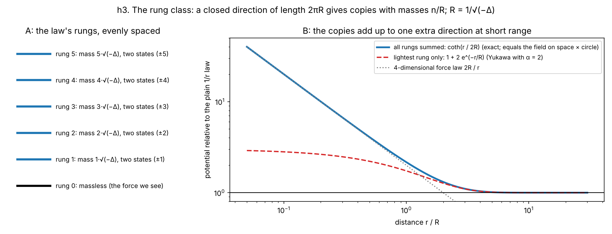
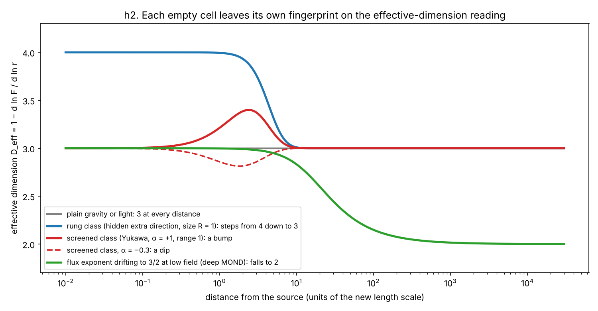

# DRAFT · Does the theory predict a force we don't know about?

*Nov 26, 2026. Follow-up to the force-reach and flux-tube-dial pages. Brennan: "So I'm trying to figure out if there is anything that might produce a new force we are unaware of", then "Not produce but predict".*

Checks: `checks.py` → `checks_output.txt`, **24 / 24 pass**, and `strength_checks.py` → `strength_output.txt`, **12 / 12 pass** (run `checks.py` first: it rewrites `results.json`, and `strength_checks.py` adds its G keys). Numpy, scipy, sympy, mpmath; a few seconds. Pictures: `figures.py` → `figures/h1` to `h6`. Lean: `lean/NewForce.lean`, 14 pure-algebra statements, every one checked true by `lean/check_statements.py`; all 14 are compiled in the shared library as `FusedAlgebra.Topics.NewForce` (core Lean, over any field of characteristic 0 or ordered field).

*Revised after Brennan's push-back: "Look harder please. The strength is something that could be derived at least in the special case from our work on electromagnetism", "I'm hoping it could generalize", and the reminder of the spinning black hole's frame dragging. The first version said "not yet". Section 6 is what looking harder gave.*

## The result in two sentences

**Yes, in the special case: if electromagnetism's phase circle is read as gravity's closed direction (our rung class, Δ < 0), its strength is fixed, α = 4G|Δ|, which with the measured α puts the circle at 23.4 Planck lengths, makes every charge a whole multiple of e, and predicts a new force on ordinary matter at exactly 1/3 of gravity's strength.** That new force is ruled out at long range by the Cassini light-bending test, so it must have a short range, and the theory doesn't set that range: the open question is what holds the circle's size fixed.

*h6. A: one extra circle splits into gravity, an electric force and a scalar force (the circle's size). Copies with the same circle charge feel no net force; ordinary matter feels gravity plus 1/3 more from the scalar. B: the electric strength falls as 1/R²; the measured α picks R = 23.4 Planck lengths. C: n circles give a scalar of strength n/(n+2); if it reached far, light bending would be γ = 1/(n+1), against Cassini's γ = 1.*

**Lead or not, on its own merits:** the physics is Kaluza–Klein (1921, 1926) and Jordan–Thiry–Brans–Dicke, so the derived numbers are known, not new. What is ours is where it sits: the same reading Δ that spaces the rungs sets the strength, and our design rule (base dials are constant inputs) asks for a frozen circle, which is exactly what Cassini demands. The prediction is only half finished: a real, testable number needs the mechanism that freezes the circle, because that mechanism sets the new force's range. That is the next question if Brennan wants to keep going. Not proposed as a Promising-leads entry until it gives a range.

The first version's map (h1) is still the context: it shows which kinds of new force our readings allow. Section 6 fills in the strength for one cell.

*h1. Rows: the reach class from the reading Δ = k² − 4d (first page), plus the tube (flux-tube page). Columns: the order dial, off (carriers don't carry the charge) or on (they do). Green: known forces. Orange: empty cells, each already a named hypothesis with experiments looking for it. Section 6 shows that the rung cell, order off, is where light itself can sit, and then its strength is set.*

---

## Pass 1: with our own tools (fundamental to derived)

### 1. One reading sorts every force into a reach class

- The law's linear form, with the drift taken out, is w″ = (Δ/4) w with Δ = k² − 4d (first page). The sign of Δ gives three classes (A1 to A3):
  - **Δ > 0:** the field dies off at rate √Δ/2. A massive carrier, reach 2/√Δ.
  - **Δ = 0:** no length scale. A massless carrier, unlimited reach.
  - **Δ < 0:** the law's ruler closes up every 2π/√(−Δ). A closed direction, with rungs at masses n√(−Δ).
- The flux-tube page added a fourth behaviour, the tube (D_eff = 1). The order dial adds a second axis: whether the carriers carry the charge themselves (non-abelian, like gluons and W bosons) or not (like light).
- That makes the 4 × 2 map in h1. Light sits at Δ = 0 with order off, the weak force at Δ > 0 with order on, and the strong force in the tube cell with order on. Gravity also has unlimited reach, but it is spin 2 and couples to itself, so it doesn't fit this two-column split.

### 2. The rung class is one more direction at short range

*h3. A: the law's rungs, evenly spaced; rung 0 is the massless force we see. B: if every rung couples equally, they add up to coth(r/2R), which is exactly the field of a point source in space × a circle. Inside R the force goes as one more dimension; far away it is plain 1/r with a small Yukawa tail.*

- If a force sits in the rung class, it comes with a ladder of heavier copies at masses n/R, two per rung (+n and −n), with R = 1/√(−Δ) (B5).
- With every rung coupled equally, the copies sum to **coth(r/2R)** times the plain 1/r potential (B1, Lean `tower_sum`). That equals, to 30 and 50 digits, the field of a point source on space × a circle of length 2πR, found by the method of images (B2, P1).
- So the effective dimension steps from **4 at short range down to 3 far away**, centred near r ≈ 4.1 R (B3, B3b). The law's rungs and the dimension dial from the first page are the same thing seen from two ends.
- Far away the copies look like one Yukawa term of strength **α = 2**, and a torus of d circles gives 2d (B4, `tower_leading_yukawa`). This matches Kehagias and Sfetsos (2000).

### 3. Each empty cell leaves its own fingerprint

*h2. The effective dimension D_eff = 1 − d ln F / d ln r of gravity or light with each kind of addition. A hidden direction is a step (4 → 3). A massive new force is a bump (or a dip if it repels). A drift in the flux exponent at weak fields is a drop to 2.*

- A **massive new force** (Δ > 0 cell, order off) adds α e^{−r/λ} to the potential. In the D_eff reading that is a bump at about 2λ that returns to 3 at both ends: up for α > 0, down for α < 0 (C1).
- The bump's position is set by the range for every α (C2). For a massive new force **the theory sets the range class and the shape, not α**; section 6 is the one cell where it does set the strength.
- The **rung cell** is a step from 4 to 3, not a bump (B3). So the two are told apart by shape, not just size.

### 4. Two dials that change a known force instead of adding one

These aren't new forces. They are the other ways our dials could show up in a force we already know.

*h4. A force built on a non-round distance (roundness dial p ≠ 2). A: pull at one distance in every direction. B: there is no 1st, 2nd or 3rd harmonic; the first change is four-lobed, and its size grows in step with p − 2.*

- **Roundness dial p ≠ 2:** the pull depends on direction. The first departure from round is four-lobed (cos 4θ), with nothing at the 1st, 2nd or 3rd harmonic (E1 to E3). This matches the shape-dial survey's finding that roundness departs from round with four lobes. (An ellipse would be a 2nd harmonic, but that is only a change of coordinates.)

*h5. A: orbital speed around a point mass when the flux exponent drifts to s = 3/2 at weak fields: the curve flattens, with v⁴ = G M a₀. B: s = 3/2 is the flux-tube page's 3D confinement border, D_eff = 2.*

- **Flux exponent drifting at weak fields:** if gravity's s drifted from 2 down to 3/2 where the pull is weak, gravity would look two-dimensional far out. Orbital speeds would flatten, with v⁴ = G M a₀ (D2, D4). That is exactly the deep-MOND law.
- In field language s = 3/2 is the exponent 3 (D1, `dual_exponent_mond`, `holder_pair`). The action |∇φ|³ d³x is unchanged by stretching space, and only exponent = dimension has that property (D3). It is also the flux-tube page's confinement border (D5).

### 5. The order-on, unlimited-reach cell mostly fills itself

- A massless non-abelian force normally doesn't stay long-range: it confines and moves to the tube cell, as the strong force does. It stays long-range only if it carries enough matter fields to lose asymptotic freedom: more than 16 flavours for SU(3), 10 for SU(2) (F1, Lean `su3_flavour_bound`, `su2_flavour_bound`).

### 6. The strength, derived: electromagnetism as gravity's closed direction (part G)

- **The setup.** The electromagnetism page found that EM's gauge phase lives on a circle, with q = +1 (closed). In our map a closed direction is the rung class, Δ < 0, with radius R = 1/√(−Δ). Part G takes that literally: the circle is a fifth direction of space-time, and gravity runs in all five. This is Kaluza's 1921 idea and Klein's 1926 reading of it.
- **How the split works (G0 to G2).** Linear gravity between two sources in D dimensions has weight T₁·T₂ − T₁T₂/(D − 2). Seen from 4D, one circle gives three pieces: the 4D tensor (gravity), a vector (the off-diagonal metric part along the circle) and a scalar (the circle's size). For the copies, which move along the circle, the vector is **4 times** gravity and the scalar **3 times** (Lean `vector_over_tensor`, `scalar_over_tensor`). Same circle charge: the pieces cancel to **zero** net force. Opposite: they add to **4** (`like_charges_cancel`, `opposite_charges_add`).
- **The electric strength (G3, G4).** The vector piece is the Coulomb force. Matching it gives **α = e²/4π = 4G/R²** (Klein's relation e = √(16πG)/R, ħ = c = 1). In our reading that is **α = 4G|Δ|**: the reading that spaces the rungs also sets the strength (`klein_strength`).
- **What the measured α gives (G5, G5b).** R = 2 l_P √137 = **23.4 Planck lengths = 3.8 × 10⁻³⁴ m**. The first charged copy weighs (√α/2) M_P = **5.2 × 10¹⁷ GeV**. Copy n carries charge n·e, so **charge comes in whole units**: this was Klein's explanation of why charge is quantized.
- **The new force (G6, G6b, G6c).** The circle's size is a field too, and ordinary matter feels it. With one circle its pull is **exactly 1/3 of gravity's** (`one_circle_third`). With n circles it is n/(n+2) (Brans–Dicke ω = −(n−1)/n). A scalar of strength a changes light bending to γ = (1 − a)/(1 + a) = 1/(n+1) (`gamma_from_strength`).
- **Why it must be short-range (G7, G7b).** One circle would give γ − 1 = −1/2 (`one_circle_gamma`). Cassini measured γ − 1 = (2.1 ± 2.3) × 10⁻⁵, about **21,740 standard errors** away. So the circle's size can't be free: something must hold it fixed, which gives the new force a mass and a short range. For a force of gravity's strength the lab limit is a range under 38.6 µm (Eöt-Wash 2020). Our law doesn't fix the range.

**How the spinning black hole fits.** Around a spinning hole, frame dragging is carried by the metric's off-diagonal time–angle part. Kaluza's electric field is the same kind of part, time–circle instead of time–angle: a charge drags the hidden circle direction the way a spinning mass drags space around it. So the frame-dragging work and the EM work meet in one place, the vector piece of h6 panel A. One difference matters: the spinning-river page found g = 2 for the charged spinning hole (Kerr–Newman, Carter 1968), but Kaluza–Klein copies have g = 1 (Hosoya et al. 1984). So the electron, with g ≈ 2, is not one of the copies. Its charge would have to come some other way.

**How far it generalizes.**
- **Each closed direction** sets its own strength the same way, α_i = 4G|Δ_i|, and each adds its own scalar. Several circles give several abelian forces and a stronger scalar, n/(n+2).
- **The order-on column** (not checked here, from the literature): a closed direction that is a sphere instead of a circle gives a non-abelian force, again with strength set by G and the sphere's size. Witten (1981) found that the full set SU(3) × SU(2) × U(1) needs at least 7 extra dimensions, and that this route can't give the weak force's left-handedness on its own. That is where the generalization stops working cleanly.
- **What is not generalized:** the ratio of strengths to gravity, 4 (vector) and 3 (scalar), is fixed by D = 5. In D = 4 + n it becomes n/(n+2) for the scalar, as in h6 panel C.

---

## Pass 2: what is known, and where experiments stand

| Empty cell or change | Known as | Where it stands |
|---|---|---|
| Screened, order off: massive new force | fifth force, Yukawa correction; dark photon, Z′ | Eöt-Wash 2020: a gravitational-strength Yukawa must have range < 38.6 µm, so carrier mass > 5.1 meV (C3 reproduces their 5.1 meV). Dark photons are searched over many decades of mass and mixing (Fabbrichesi, Gabrielli, Lanfranchi 2020). |
| Rungs, order off: copies of light or gravity | Kaluza–Klein tower, large extra dimensions (Arkani-Hamed, Dimopoulos, Dvali 1998) | Eöt-Wash 2020: largest extra dimension has radius < 30 µm, so lightest copy > 6.6 meV (C3b). α = 2n for a torus (Kehagias–Sfetsos 2000). |
| Rungs, order on | KK copies of gauge bosons | searched at colliders; not checked here |
| Unlimited reach, order on | hidden or "dark" non-abelian sectors | confinement unless many flavours (Gross–Wilczek, Politzer 1973) |
| Tube, order off | flux tubes in superconductors (Abrikosov) | exists in materials, not as a fundamental force |
| A dial that varies in space | promoting a constant to a field: Brans–Dicke (1961), dilaton, chameleon (Khoury–Weltman 2004) | MICROSCOPE 2022: equivalence principle holds to about 10⁻¹⁵ |
| Roundness p ≠ 2 | rotation (Lorentz) violation, Standard-Model Extension | tabulated by Kostelecký and Russell (updated yearly); tight bounds, not converted to p here |
| Rungs, order off, read as light itself (section 6) | Kaluza (1921), Klein (1926); the scalar: Jordan (1947), Thiry (1948), Brans–Dicke (1961) | the free scalar is ruled out by Cassini, γ − 1 = (2.1 ± 2.3) × 10⁻⁵ (Bertotti, Iess, Tortora 2003); a held circle gives a short-range force, Eöt-Wash range < 38.6 µm at gravity's strength |
| Flux exponent 3/2 at weak fields | deep MOND (Bekenstein–Milgrom 1984, AQUAL); scale invariance (Milgrom 2009) | an active debate about galaxies; not settled |

**Known vs ours:**
- **Known:** every cell's physics, the coth sum (the image method), α = 2n, the deep-MOND law and its scale invariance, the flavour counts, and all of section 6's numbers (Klein's relation, R ≈ 23 l_P, charge quantization, the 1/3 scalar, γ = 1/(n+1)).
- **Ours:**
  - the map itself, built from our readings, and the D_eff fingerprints in h2;
  - rungs = dimension dial (one more direction at short range);
  - EM's q = +1 circle placed in the rung class, so one reading gives both the rung spacing and the strength, α = 4G|Δ|;
  - our design rule (base dials are constant inputs) asks for a frozen circle, which is what Cassini requires. Plain Kaluza–Klein can't freeze it: the circle's size is pushed by the electric field itself (Jordan, Thiry). So whatever holds it is extra, and it would set the range;
  - deep MOND landing exactly on the flux-tube page's confinement border.

  I did not find the placements written this way in a short search, but the physics behind each is standard.

## What this does not do

- It does not set the new force's range. The strength (1/3 of gravity) is derived; the range needs a mechanism that holds the circle, and the law doesn't supply one. Without a range, the new force can't yet be tested at one place.
- It does not make the electron a copy: copies have g = 1 and a mass near 10¹⁷ GeV.
- It does not derive Newton's G. Section 6 fixes α relative to G; G itself is still an input (newton-g page).
- It does not show the theory forbids any cell of the map. An empty cell is allowed, not required.
- It does not convert the roundness dial into a bound from the Lorentz-violation tables.
- The non-abelian generalization (spheres instead of circles) is quoted from the literature, not checked here.

## First-run failures, fixed by correcting the claim or the setup

- **A3:** I first tested the period of the field w for Δ < 0. The law's ruler x = −u′/(d u) blows up at the zeros of w, which come twice per period of w. The check now tests the zero spacing, 2π/√(−Δ), as the first page states.
- **B1:** sympy could not simplify coth against exponentials until it was rewritten in exponentials. The identity itself was never in doubt.
- **Lean:** the SU(2) flavour statement first claimed b₀ < 0 at 11 flavours; it is exactly 0 there, so the statement now says that.

## Files

- `checks.py` → `checks_output.txt`, `results.json`: parts A (classes), B (rungs), C (screened), D (deep MOND), E (roundness), F (order on), P (polish).
- `strength_checks.py` → `strength_output.txt`, and G keys added to `results.json`: part G (strength from the closed direction). Run after `checks.py`.
- `figures.py` → `figures/h1` to `h6`.
- `lean/NewForce.lean` (14 statements), `lean/check_statements.py`.

## Sources (pass 2, checked Nov 26)

- T. Kaluza, "Zum Unitätsproblem der Physik", Sitzungsber. Preuss. Akad. Wiss. (1921) 966.
- O. Klein, "Quantentheorie und fünfdimensionale Relativitätstheorie", Z. Phys. 37 (1926) 895; "The atomicity of electricity as a quantum theory law", Nature 118 (1926) 516.
- P. Jordan (1947); Y. Thiry, C. R. Acad. Sci. Paris 226 (1948) 216: the circle's size as a field, pushed by the electric field.
- C. Brans, R. H. Dicke, Phys. Rev. 124 (1961) 925.
- B. Bertotti, L. Iess, P. Tortora, "A test of general relativity using radio links with the Cassini spacecraft", Nature 425 (2003) 374: γ − 1 = (2.1 ± 2.3) × 10⁻⁵.
- A. Hosoya, K. Ishikawa, Y. Ohkuwa, K. Yamagishi (1984), g = 1 for Kaluza–Klein states, as cited in arXiv hep-th/9801072.
- B. Carter, Phys. Rev. 174 (1968) 1559: g = 2 for Kerr–Newman.
- E. Witten, "Search for a realistic Kaluza–Klein theory", Nucl. Phys. B 186 (1981) 412.

- J. G. Lee, E. G. Adelberger, T. S. Cook, S. M. Fleischer, B. R. Heckel, "New Test of the Gravitational 1/r² Law at Separations down to 52 µm", PRL 124, 101101 (2020), arXiv 2002.11761: λ < 38.6 µm; extra dimension radius < 30 µm; dilaton or heavy graviton > 5.1 meV.
- A. Kehagias, K. Sfetsos, "Deviations from the 1/r² Newton law due to extra dimensions", Phys. Lett. B 472 (2000) 39, arXiv hep-ph/9905417: α = 2n (torus), n + 1 (sphere).
- N. Arkani-Hamed, S. Dimopoulos, G. Dvali (1998), large extra dimensions.
- M. Fabbrichesi, E. Gabrielli, G. Lanfranchi, "The Dark Photon", arXiv 2005.01515 (2020).
- P. Touboul et al., MICROSCOPE final result, PRL 129, 121102 (2022); arXiv 2209.15488.
- V. A. Kostelecký, N. Russell, "Data Tables for Lorentz and CPT Violation", arXiv 0801.0287 (updated yearly).
- J. Bekenstein, M. Milgrom, AQUAL (1984); M. Milgrom, "The MOND limit from space-time scale invariance", ApJ 698 (2009) 1630, arXiv 0810.4065.
- J. Khoury, A. Weltman (2004).
- D. Gross, F. Wilczek; H. D. Politzer (1973), asymptotic freedom.
