# DRAFT · Every force as curvature (and twist), spacetime included

*DRAFT, Nov 27 2026. Not versioned, not proved in Lean. Checks: `checks.py` → `checks_output.txt` (**61 / 61 pass**, about 8 s; numpy, scipy, sympy, mpmath), numbers in `results.json`. Pictures: `figures.py` → `figures/f1 … f11`. Colour key: **orange = known, blue = ours**.*

Brennan's asks (Nov 27, his words): "look at the fundamental forces and see how they are all derivable from quantum mechanics so we can use similar tools to derive gravity ... show how the fabric of the universe the curvature of space time can be built from our model and how all of the forces can be viewed as following the curvature of some geometry"; then "keep pushing until we are able to build them all in spacetime"; then "The idea that reality itself is twisted might be a good tack ... And might explain why the two models don't agree".

Builds on, and does not repeat: `curved-space/` (2D counting, radial plane), `twisted-boosts/` (Thomas twist, Gravity Probe B, double pulsar), `general-relativity/` route (b) (one t–r loop), `electromagnetism/` (abelian plaquettes), `yang-mills-gap/`, `force-reach/`, `why-i/` (chains are product integrals; k = −i/ħ), `dependency-map/`.

## Verdict first

1. **One recipe covers all four forces, and our law is that recipe written on matrices.** Put the law on square matrices: a ∘ₖ b = a + b + k·ab. Chain the link values round a small loop. What is left over, divided by the area, is the force's field: electromagnetism, weak, strong, and gravity's full curvature. **Known** (Weyl 1929; Yang–Mills 1954; Utiyama 1956; Kibble 1961; Wilson 1974 for loops of links). **Ours:** the exact loop identity below, and the reading that the law's cross term k·ab *is* each force's self-interaction.
2. **The k·ab term is the difference between light and the other forces.** Values that commute (light's phases) cancel it round a loop, so the field is linear, F = dA. Matrix values keep it as k[A, A]: the weak and strong forces' self-interaction, and gravity's ω∧ω. Its size for the strong force, C_A = 3, is measured: ALEPH 2.93 ± 0.60, OPAL 3.02 ± 0.55; a theory without the term predicts 0, ruled out at about 5σ.
3. **The 1 + 1D counting result lifts to 4D once we count loops instead of points.** All 20 curvature numbers of a black hole's spacetime come out of loops, and the mass shows directly (K = +2M/r³ in the t–r and θ–φ planes, −M/r³ in the other four). That also explains why the counting saw only free-fall energy: a volume count reads the Ricci part, and outside a mass Ricci is zero; the whole pull sits in the Weyl part, which only loops read.
4. **Tested against measurement:** Gravity Probe B from one 4D chain round the orbit, 6603.9 vs 6601.8 ± 18.3 mas/yr (+0.1σ); Aharonov–Bohm (Tonomura 1986) from the U(1) chain; the gluon self-charge from LEP.
5. **Twist.** One 5 × 5 chain (turn + shift) reads curvature *and* torsion together. The same spacetime can be carried entirely by curvature (GR) or entirely by twist (teleparallel gravity, Einstein 1928, Hayashi–Shirafuji 1979): loops come back turned or shifted, never both, and the two connections differ by a piece built from the twist alone. In the twisted picture gravity's field is T = de, linear like light's F = dA. **Does the twist explain why quantum and GR don't agree?** It sits exactly at one of the seams (spin-½ matter needs frames, and spin is what sources twist in Einstein–Cartan, Sciama 1962 and Kibble 1961), but on its own it does not remove the clash: Einstein–Cartan is still not renormalizable, and its twist is bounded today to about 10⁻³¹ GeV. Details in §6.

| Result | Judgement on its own merits |
|---|---|
| Law on matrices = the loop recipe for every force | **Worth following**, as the frame for the whole programme. It puts all four forces in one notation that is ours and exact. Not new physics by itself. |
| Loop identity a∘b∘ā∘b̄ = k[a,b](1+kā)(1+kb̄) | Ours as a formula, exact in any ring; the substance (a group commutator in a ring) is classical. Good Lean target. |
| Counting → loops lifts the 2D result to 4D, and explains the missing mass | **Worth following.** Closes the gap the curved-space page left open, with a reason (Ricci vs Weyl). |
| Gravity Probe B from one chain | Confirms the 4D tool works on real data; the same number as GR, so no new test of physics. |
| Curvature ↔ twist trade in one 5 × 5 chain | **Worth following** toward "build them all in spacetime": it makes gravity look like light (abelian field T = de), which is where a joint build is most natural. |
| Twist as the reason quantum and GR disagree | Partly. It is where spin meets geometry, but it doesn't cure non-renormalizability. A lead only if our law fixes the spin–twist coupling to a number different from Einstein–Cartan's (testable against the 10⁻³¹ GeV bounds). |

## What is textbook and what our law adds (for citing)

| Piece | Status | Who |
|---|---|---|
| A force's field is the curvature of a connection; a small loop's holonomy = field × area | **Textbook** | Weyl 1929 (U(1)); Yang–Mills 1954; Utiyama 1956; Kibble 1961 (gravity as a gauge theory of the Lorentz/Poincaré group); Kobayashi–Nomizu for the geometry |
| Loops of link variables on a lattice; the plaquette expands to F with its [A, A] term | **Textbook** | Wilson 1974 |
| Riemann curvature from the holonomy of small loops | **Textbook** | Levi-Civita 1917, Cartan 1920s; any GR text |
| Gluon self-coupling colour factor C_A = 3 for SU(3), measured at LEP | **Textbook / measured** | QCD; ALEPH, OPAL four-jet analyses |
| Torsion as the shift part of an affine loop; teleparallel gravity; Einstein–Cartan spin–torsion coupling | **Textbook** | Cartan 1922–23; Einstein 1928; Hayashi–Shirafuji 1979; Sciama 1962, Kibble 1961 |
| Gyroscope drift from the vorticity of static observers (gravitomagnetism) | **Textbook** | Lense–Thirring 1918; Rindler–Perlick 1990; Jantzen–Carini–Bini 1992 |
| Electromagnetism as curvature of a fifth direction; R₅ = R₄ − ¼F²; 5D free fall = Lorentz force | **Textbook** | Kaluza 1921; Klein 1926 |
| Non-abelian fields as curvature of a hidden group space (S³ for SU(2)); the [A, A] term comes from the hidden space's own non-commuting symmetries | **Textbook** | DeWitt 1964; Kerner 1968; Cho 1975 |
| No-go: the smallest hidden space for SU(3)×SU(2)×U(1) needs 11D in all, and plain Kaluza–Klein then gives no left-handed (chiral) matter | **Textbook** | Witten, Nucl. Phys. B 186, 412 (1981) |
| Chains of many short links = Volterra's product integral / Wilson line | Known; noted earlier in `why-i/` | Volterra 1887 |
| Writing every one of these in one notation, the circle operation a ∘ₖ b on matrices | **Ours** (a reading) | |
| The exact loop identity a∘b∘ā∘b̄ = k[a, b](1 + kā)(1 + kb̄) | **Ours as a formula**; its content (a group commutator in a ring) is classical | |
| Reading the law's cross term k·ab as the self-interaction: it cancels for light and is the [A, A], ω∧ω of the others | **Ours** (a reading of the textbook expansion, not new physics) | |
| Ricci vs Weyl as the reason the 2D counting result could not see the mass, and loops as the fix | **Ours** (diagnosis of our own earlier result, using textbook facts) | |
| Frame dragging read as the twist of the time leg, de⁰; geodetic and frame dragging both carried by twist in star-fixed frames | **Ours as a reading**; the formula is the textbook vorticity one | |

None of the checks here tests physics beyond GR and the Standard Model: every measured number is matched because the textbook theory matches it.

---

## 1. One recipe: chain the link values round a loop

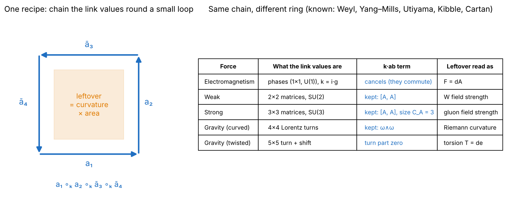

*f1. Left: four link values chained by ∘ₖ round a small square; what is left over is curvature × area. Right: the same chain on different rings gives each force. Known: the recipe (Weyl, Yang–Mills, Utiyama, Kibble, Cartan, Wilson). Ours: the k·ab column.*

- **The law on matrices** (checks A1–A3, for k = 1, −0.7 and 0.3i): the lift 1 + k·a turns ∘ₖ into the matrix product; it stays associative; the way back ā = −a(1 + ka)⁻¹ undoes a value. At k = 1 this is the circle operation of ring theory (Perlis 1942, Jacobson 1945), which lives in non-commuting rings to begin with.
- **Loop identity (exact, check A4, error 2e-16):**

  **a ∘ₖ b ∘ₖ ā ∘ₖ b̄ = k·[a, b]·(1 + kā)(1 + kb̄)**

  Values that commute leave nothing (A5); small values a = εA, b = εB leave ε²·k[A, B] (A6).
- **A chain of many short links is Volterra's product integral** (1887), the same object physicists call the path-ordered exponential or Wilson line. This was already noted on the `why-i/` page; here it is the transport of each force.

## 2. Light, weak and strong: the k·ab term is the self-interaction

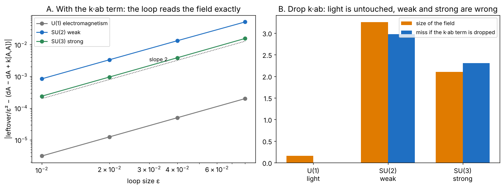

*f2. A: random smooth fields; the loop left over divided by ε² matches dA − dA + k[A, A] with error falling like ε² (two loop sizes). B: drop the k·ab part and the light field is still exact, but the weak and strong fields miss by an amount as big as the field itself.*

- Links are Wilson's, 1 + k·a = exp(k·ε·A) with **k = i·g** (an imaginary dial makes the links unitary, check B3; real k would be Weyl's 1918 scale gauge, which Einstein ruled out because clocks would remember their history).
- Checks B1–B2: U(1), SU(2), SU(3) all match to order ε² (errors 3e-6, 8e-4, 2e-4 at ε = 0.01). Leaving out k[A, A] misses by 2.97 (SU(2), field size 3.25) and 2.30 (SU(3), field size 2.10).
- One caution, found while checking: a loop starts at a corner, so on matrices it reads the field there turned by the corner's frame. That is an error of order ε, and two loop sizes remove it.

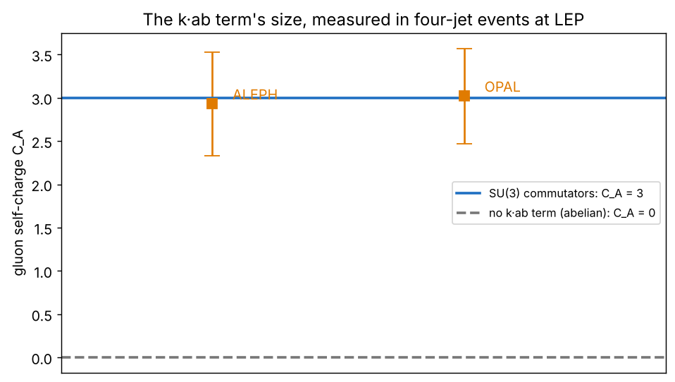

*f6. How strongly gluons pull on gluons is set by the commutators: C_A = 3 for SU(3) (check B4). Four-jet events at LEP measure it (ALEPH 2.93 ± 0.60, OPAL 3.02 ± 0.55, as summarised by Stenzel, hep-ex/0410064). Without the k·ab term it would be 0.*

## 3. Gravity: the same loop, on the Lorentz ring

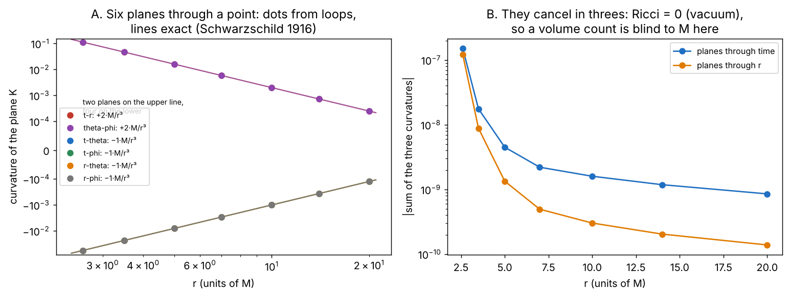

*f4. A: the curvature of each of the six planes through a point outside a black hole, read from loops (dots), against the exact values (lines). B: summing the three planes through time (or through r) gives zero to the accuracy of the loops: Ricci = 0.*

- Link value for a short step along x^μ: exp(−Γ_μ·d) − 1, where Γ_μ is the 4 × 4 matrix of Christoffel symbols; k = 1; later steps sit on the left.
- **All 96 numbers** (6 planes × 16 entries) of the Riemann tensor at r = 6M come out as minus the loop left over per area, one sign throughout (check C1, error 3e-7). Each loop's lift keeps the metric: it is a Lorentz transformation (C2). A loop in a plane that contains time returns a boost; a loop in space returns a turn (C3), as the GR page found for one plane.
- **The mass shows directly** (C4–C5, 2.6M ≤ r ≤ 20M): K(t–r) = K(θ–φ) = +2M/r³, the other four −M/r³ (sign convention: K = R_μνμν/(g_μμ g_νν), signature −+++).

## 4. Why the counting stopped at 1 + 1 dimensions, and how loops fix it

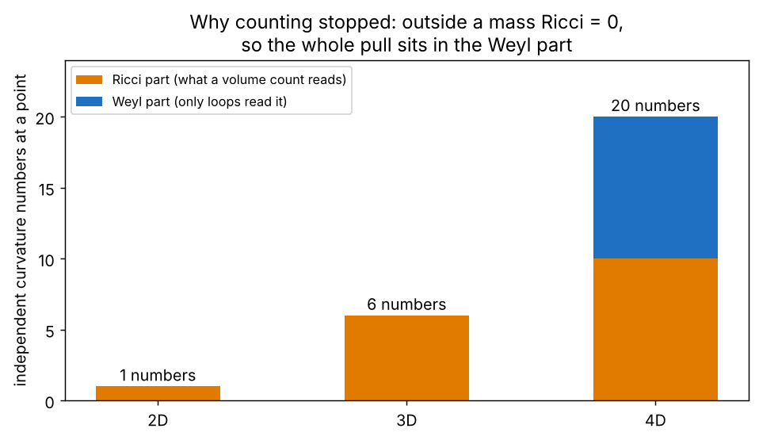

*f3. Independent curvature numbers at a point. A volume count reads the Ricci part (Gibbons–Solodukhin; Benincasa–Dowker). In 2D and 3D that is everything; in 4D it is 10 of 20. Outside a mass Ricci = 0, so the count sees nothing of M, which is what the radial-plane page found.*

- In 1 + 1D the Lorentz group has one boost, its values commute, and the law with numbers is the whole story (Bondi's k-factor: Doppler factors multiply). That is why the 2D counting worked exactly.
- In 4D the Lorentz group doesn't commute; curvature is a matrix-valued two-form, and the k·ab part (ω∧ω) carries it. The fix is to count loops, not points, with matrix values. This answers the curved-space page's open question with a reason: the missing mass is the Weyl part.

## 5. Tests against measurement

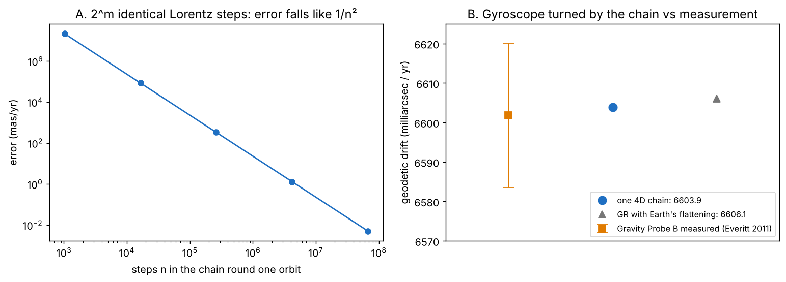

*f5. A: one chain round Gravity Probe B's orbit with 2^m identical Lorentz steps converges like 1/n². B: the gyroscope's drift, 6603.9 mas/yr, against the measured 6601.8 ± 18.3 (Everitt et al. 2011). GR with the Earth's flattening gives 6606.1.*

- Along a circular orbit every link value is the same, so the chain is one value composed with itself 2^m times (check D1 gives 2π(1 − √(1 − 3M/r)) per orbit exactly; D2 convergence). Unlike the twisted-boosts page, nothing is split into a velocity part and a space part: one 4 × 4 chain does it.

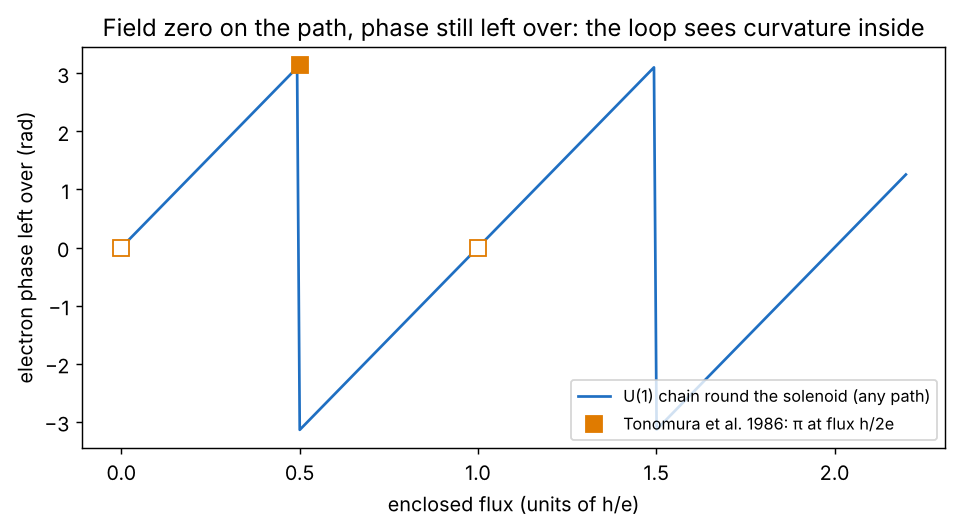

*f8. The U(1) chain round a solenoid gives phase q·Φ/ħ on any path that encloses it and nothing on one that doesn't (checks E1–E2), though the field is zero on the path. Electrons round one superconducting flux quantum h/2e get phase π, which Tonomura et al. (1986) observed.*

## 6. Twist: curvature and torsion from one chain

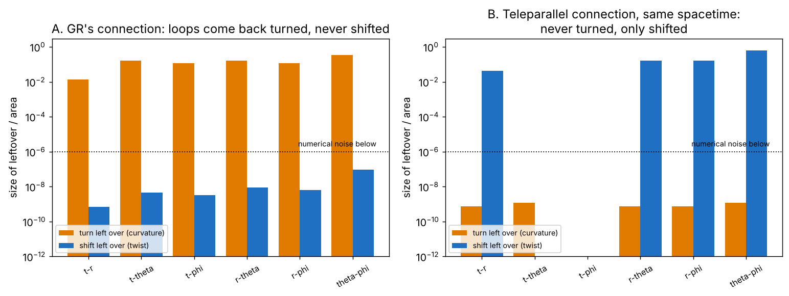

*f7. The same black-hole spacetime, two connections, one 5 × 5 chain (a turn block and a shift column). A: GR's connection: loops come back turned, never shifted. B: the teleparallel connection: never turned, only shifted. Bars below the dotted line are rounding noise.*

- **One chain, both readings (F1–F2).** Add a shift column to the 4 × 4 link (Cartan's affine connection, 1922–23). Round a loop the turn block gives −R and the shift column gives +T, the torsion. GR (Levi-Civita): T = 0. Teleparallel (Weitzenböck, from the static frames): R = 0, all twist.
- **The trade is exact (F4):** Weitzenböck = Levi-Civita + contorsion, with K_abc = (T_abc + T_bac + T_cab)/2 built from the twist alone. Same metric, same measurements: Gravity Probe B gives the same number either way.
- **Where the mass sits (F3):** T^t_rt = M/(r²(1 − 2M/r)): the acceleration needed to hover, divided by the redshift. In the twisted picture gravity is a force again, like the others (Aldrovandi and Pereira call it a gauge theory of translations).
- **Gravity's field becomes linear like light's (F6):** in frame components T^a = de^a, with no k·ab term, the way F = dA has none. The non-linearity moves into how frames turn coordinate indices, not into the field strength.
- **A caution (F5):** with round frames, flat space already has twist (T^θ_rθ = 1/r). Only part of the twist is physical; which part depends on the choice of frames (local Lorentz invariance). Any "twist carries the force" claim has to be stated frame-free.

### Does the twist explain why quantum and GR disagree?

- **What it gets right.** GR sets torsion to zero by hand. Spin-½ matter can't couple to the metric alone; it needs frames and the turn connection (Weyl 1929; Fock and Ivanenko 1929). Restore torsion and spin becomes its source (Einstein–Cartan: Sciama 1962, Kibble 1961; review Hehl et al., Rev. Mod. Phys. 48, 393, 1976). So twist is exactly where intrinsic spin, a quantum property, meets geometry. Our 5 × 5 chain shows turn and shift as one object.
- **What it doesn't do.** The main clash, that quantum GR is not renormalizable (Goroff and Sagnotti 1986), survives. In Einstein–Cartan the twist doesn't travel: it can be solved away, leaving a four-fermion contact force that is itself not renormalizable. And the twist is tiny where we can look: about 10⁻³¹ GeV is the bound on 19 of its 24 components (Kostelecký, Russell and Tasson, PRL 100, 111102, 2008).
- **So:** twist sits at one seam of the disagreement, not at its root. **What would make it a lead:** if our law fixed the spin–twist coupling to a value different from Einstein–Cartan's minimal one, that number could be tested against those bounds.

## 6b. Round 2: frame dragging is the twist of the time leg

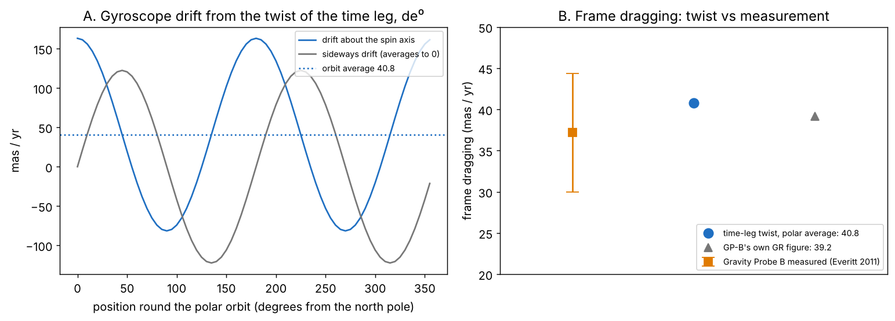

*f9. A: round Gravity Probe B's polar orbit, the drift of a gyroscope computed only from the twist of the static observers' time leg, T⁰ = de⁰. B: its orbit average, 40.8 mas/yr, against the measured 37.2 ± 7.2 (+0.5σ). Gravity Probe B's own GR figure, 39.2, includes the exact orbit and guide-star geometry.*

- Static observers carry a time leg e⁰ = g₀ᵢdxⁱ/√(−g₀₀) + …. Its twist T⁰ = de⁰ is zero for a mass that doesn't spin (check G4) and, for the spinning Earth, gives the gyroscope drift **Ω = −(c/2) × (twist of the time leg) = (G/c²r³)(3(J·n)n − J)**, the Lense–Thirring formula (check G1, error 6e-10).
- Averaged round the polar orbit: GJ/(2c²r³) = 40.8 mas/yr (G2), measured 37.2 ± 7.2 (G3).
- So on the frame-drag page's split (time part, push, twist), the twist part is literally the torsion of the time leg in teleparallel language. **Known** formula (gravitomagnetic field = vorticity of static observers); **ours** is the reading that ties it to the twist picture and to that page's τ.
- Caution, as in F5: this is the twist of a chosen set of frames (static, star-fixed). A different choice moves twist around; what the gyroscope measures does not change.

## 6c. Round 3: one chain for gravity and light together (Kaluza–Klein)

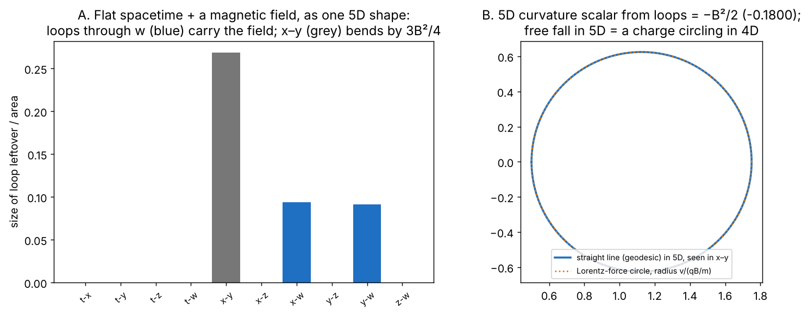

*f10. Flat spacetime with a uniform magnetic field B, written as one 5D shape (Kaluza 1921, Klein 1926; g_μ5 = κA_μ). A: loops of one 5 × 5 chain; the planes through the fifth direction w carry the field, and the x–y plane bends by 3B²/4. B: the 5D curvature scalar read from the loops is −B²/2, and a straight line in 5D is the Lorentz-force circle in 4D.*

- All 10 planes × 25 entries of the 5D curvature come out of loops (check H2, error 8e-8).
- Contracting the loop-measured curvature gives R₅ = −(κ²/4)F_μνF^μν = −B²/2 (H1 exact in sympy, H3 from loops). In KK this is why Einstein's action in 5D becomes Einstein's plus Maxwell's in 4D (known).
- A free fall in 5D with momentum p_w along the fifth direction is a charge with q/m = κp_w circling in the field (H4: closes after one cyclotron period, radius matches to 1e-3).
- **Status:** all textbook Kaluza–Klein; ours is that one chain of our law on a 5 × 5 ring carries both. Its known limits stand: the fifth direction must be tiny and its size (the dilaton) must be held fixed, and plain KK gives magnetic moment g = 1 (the frame-drag page noted the electron needs g ≈ 2). The weak and strong forces need a bigger hidden space (for SU(2), a 3-sphere), which is the next step.

## 6d. Round 4: the weak force's group from a hidden 3-sphere

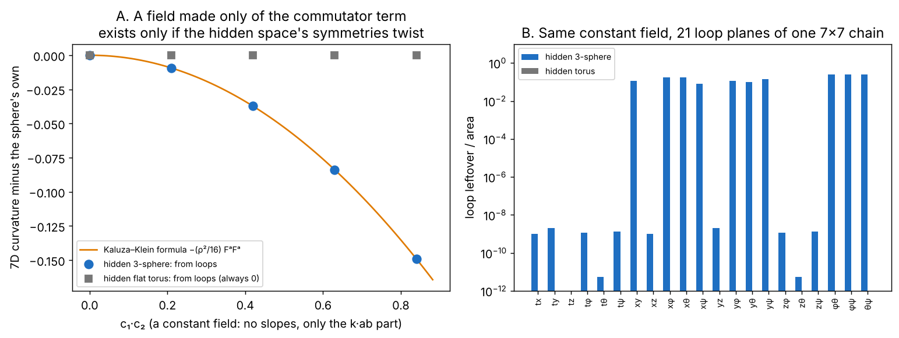

*f11. Flat 4D spacetime with a hidden round 3-sphere (the space of SU(2)) of radius ρ = 1.3, glued on with a constant SU(2) field whose two parts A¹ = c₁ dx, A² = c₂ dy do not commute. A: the extra 7D curvature read from loops of one 7 × 7 chain follows −(ρ²/8)(c₁c₂)² on the sphere (blue points on the orange formula) and is exactly zero when the same field is glued to a flat 3-torus (grey). B: all 21 loop planes.*

- A constant field with A¹ ∝ dx, A² ∝ dy has no derivative part at all: its whole field strength F³ = c₁c₂ is the commutator, the [A, A] term, which in our notation is the k·ab cross term (§2).
- On the 3-sphere that term shows up as 7D curvature, because the sphere's own symmetries do not commute ([R₁, R₂] = +R₃, check I2). The loop-measured scalar is 3.524418 against the formula 3.524418 (I3); a sweep over c₂ stays on the curve (I5).
- On a flat 3-torus, whose symmetries commute, the same field gives no curvature: every loop closes (I4, error 0). So in this picture the self-interaction of the weak force is the twist of the hidden space.
- **Status:** all textbook non-abelian Kaluza–Klein (DeWitt 1964, Kerner 1968, Cho 1975). Ours is that one chain of our law now carries gravity, light (§6c) and SU(2), and that the k·ab term has a geometric home. The known limits stand and get worse here: Witten (1981) showed the smallest hidden space for all three forces makes spacetime 11D in all, and that plain Kaluza–Klein then cannot give the left-handed matter the weak force acts on. Our law does not change that yet.

## 7. Next rounds toward "build them all in spacetime"

1. **One ring for everything.** Light (§6c) and SU(2) (§6d) are done. Next: SU(3) from a hidden space such as CP², checked with loops, with Witten's no-go stated up front. The open question for us is whether anything in the law's twist can supply left-handed matter, which plain Kaluza–Klein cannot.
2. **Dynamics from loops.** The field equations themselves: Wilson's action Σ(1 − Re tr U_loop) for the gauge forces, MacDowell–Mansouri's de Sitter version for gravity, and the teleparallel action built from T. In our terms: an action made from the k·ab part of each loop.
3. ~~Frame dragging as twist~~: done in §6b. Still open: whether a frame-free (local-Lorentz-invariant) part of the twist carries it.
4. **Lean:** the loop identity in any ring.

## Sources

Weyl, Sitzungsber. Preuss. Akad. (1918) and Z. Phys. 56, 330 (1929). Fock and Ivanenko (1929). Yang and Mills, Phys. Rev. 96, 191 (1954). Utiyama, Phys. Rev. 101, 1597 (1956). Kibble, J. Math. Phys. 2, 212 (1961). Sciama, in *Recent Developments in General Relativity* (1962). Cartan, Ann. Éc. Norm. 40 (1923). Einstein, Sitzungsber. Preuss. Akad. (1928). Hayashi and Shirafuji, Phys. Rev. D 19, 3524 (1979). Aldrovandi and Pereira, *Teleparallel Gravity* (2013). Hehl, von der Heyde, Kerlick and Nester, Rev. Mod. Phys. 48, 393 (1976). Wilson, Phys. Rev. D 10, 2445 (1974). Volterra (1887). Perlis (1942); Jacobson (1945). Goroff and Sagnotti, Nucl. Phys. B 266, 709 (1986). Kostelecký, Russell and Tasson, PRL 100, 111102 (2008), arXiv:0712.4393. Everitt et al., PRL 106, 221101 (2011). Tonomura et al., PRL 56, 792 (1986). ALEPH and OPAL colour factors as summarised in Stenzel, hep-ex/0410064. Gibbons and Solodukhin (2007); Benincasa and Dowker, arXiv:1001.2725. Lense and Thirring, Phys. Z. 19, 156 (1918). Jantzen, Carini and Bini, Ann. Phys. 215, 1 (1992). Kaluza, Sitzungsber. Preuss. Akad. (1921); Klein, Z. Phys. 37, 895 (1926). Rindler and Perlick, Gen. Rel. Grav. 22, 1067 (1990). DeWitt, in *Relativity, Groups and Topology* (1964). Kerner, Ann. Inst. H. Poincaré 9, 143 (1968). Cho, J. Math. Phys. 16, 2029 (1975). Witten, Nucl. Phys. B 186, 412 (1981).
