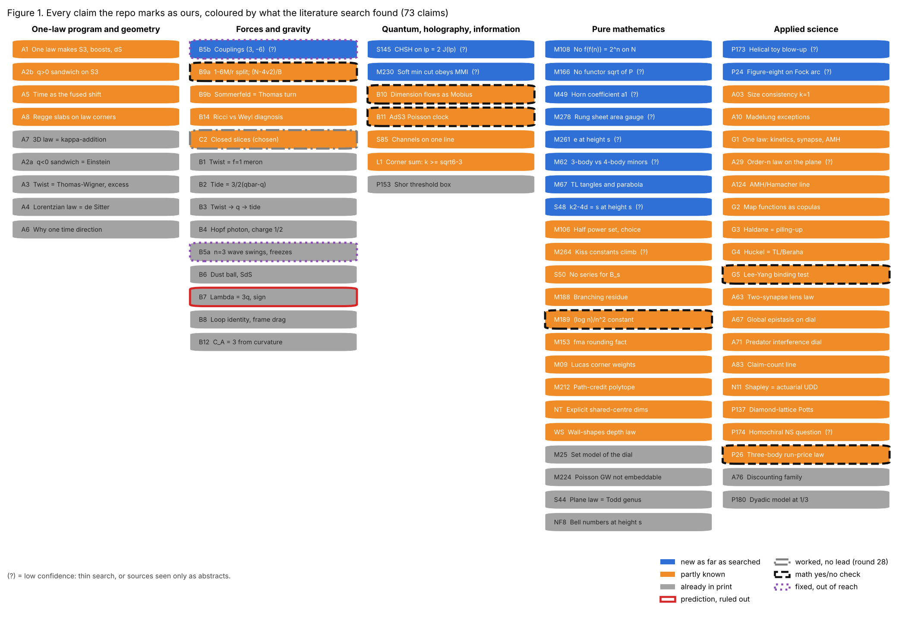
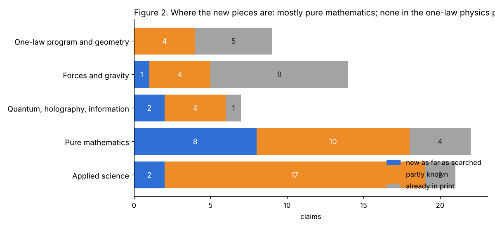
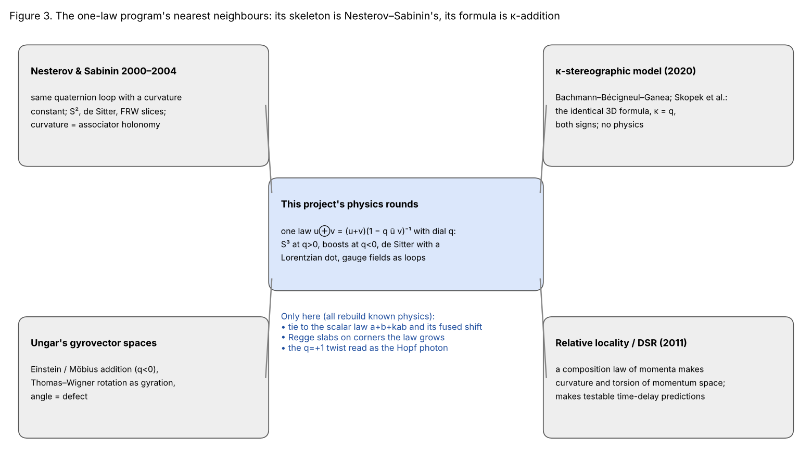

# DRAFT · Prior-art audit: what in Affine Composition Theory is actually new

*DRAFT, Nov 27 2026. Not versioned. Brennan's ask: "Run the prior-art check", after "I'm just hoping this is actually
novel" and "And not just straight math". Then: "Also looking for a prediction seems to be something that would fit with
that work", and, when the forces thread's round 27 took the gravity prediction hunt, "Please merge this work as well".
Checks: `checks.py` → `checks_output.txt` (**6 / 6 pass**, a few seconds; numpy, sympy). Claim list: `claims.py`.
Pictures: `figures.py` → `figures/`. Prediction list: `PREDICTION-CANDIDATES.md`. Search notes, with every query and
source: `raw/`. Colour key: **blue = new as far as this search shows, orange = partly known, grey = already in print**.*

## The answer first

1. **The one-law physics program is already in print at its core.**
   - Nesterov and Sabinin (2000 to 2004) built spacetime from the same kind of quaternion loop with a curvature
     constant. They covered spheres, de Sitter (from an indefinite norm) and Friedmann slices, and read curvature off
     the loop's associator as the holonomy of a triangle.
   - The 3D law the forces rounds use is, letter for letter, the "κ-addition" of the constant-curvature machine-learning
     papers (Bachmann, Bécigneul and Ganea 2020), with κ = q (check K1).
   - Ungar's gyrovector spaces already have the q < 0 side: Einstein addition, and the Thomas–Wigner turn as the law's
     twist.
2. **The physics rounds rebuild known physics, and two of their "ours" items are published.**
   - Round 25's tide, 3/2(q̄ − q_loc), is Sussman's 2013 formula (the tide is the gap between mean and local density)
     with the names changed (check K2).
   - Round 26's "swings once, then freezes" wave is the n = 3 mode of Abbassi, Khodagholizadeh and Abbassi (2013), who
     solve every n on closed de Sitter.
   - What is left as ours in physics is a few small exact computations: the couplings (3, −6), the 1 − 6M/r split, and
     Sommerfeld's advance per lap equalling the Thomas turn. Each is a line or two from published formulas.
3. **The new pieces are mathematics.** Of 73 claims checked, 13 are new as far as the search shows, 39 partly known and
   21 already in print (Figures 1 and 2). Eight of the 13 are pure mathematics. Most are small. Four look like real
   leads on their own merits (section 6).
4. **No prediction yet is both forced by the law alone and testable.** The one gravity number the law forces, read
   literally, is ruled out. The live question (is space closed?) needs a choice the law doesn't make, as round 28 confirms (section 7).

**So, honestly: is it novel, and more than straight math?** The rule is classical, and so is the program of building
geometry and spacetime from one composition law. What the project adds to physics so far is a careful, checked
re-derivation in one notation. That is useful for teaching and for organising, but it isn't new physics. The new
content is mathematical, and some of it is good. It is "straight math" in the sense that matters for Brennan's
question.

**Does this open a lead?** Yes, but not the one hoped for. The four math leads in section 6 are worth following on
their own. The physics program is not a lead toward new physics unless it finds a number the law forces that physics
leaves free, and the search so far has none.

*Figure 1. Every claim the repo marks as ours, one tile each, sorted within each area from new (blue) to in print
(grey). A coloured border marks a prediction candidate: red is ruled out, dash-dot grey is worked with no lead (C2, round 28), dashed black is a
yes/no a calculation settles, and dotted purple is fixed by the law but out of reach. "(?)" means low confidence: a thin
search, or sources seen only as abstracts.*

*Figure 2. The same claims counted by area. No claim in the one-law program is new, the forces area has one, and pure
mathematics has eight.*

## 1. What was checked, and how

- **The claims.** Every row the bridge survey marks "possibly new" (69 rows, 65 after repeats), every "what is ours" item
  in forces rounds 14 to 26 and the main forces page, the one-law program itself, and the newer pages the survey
  predates: new-ties, wall-shapes, the three-body word formula and the corner-sum threshold. Similar rows are merged,
  giving 73 claims.
- **The search.** Four independent passes ran side by side (program and geometry, forces and gravity, pure math,
  applied science), about 110 queries in all. Each used several wordings per claim plus searches naming the likely
  authors, and opened arXiv abstracts, papers and reference pages. Every query and every source opened is in `raw/`. I
  re-checked the two headline findings myself (Nesterov–Sabinin and Sussman).
- **The verdicts.** "In print" means a source was found that states it. "Partly known" means the pieces are published
  and the project adds a reading, a cross-link or a computation. "New as far as this search shows" means nothing was
  found after real searching. It is never a claim of priority.
- **Not re-searched.** The survey's 363 "known" rows and 256 "our reading of known pieces" rows. These are, by the pages'
  own verdicts, in print or partly known. Ten smaller possibly-new rows were not reached (P44, P46, P82, P159, M61, S12,
  S15, S26, S27, S108), and neither were the Navier–Stokes planes pages.

## 2. The one-law program

*Figure 3. The project's physics rounds and their four nearest neighbours. Nesterov and Sabinin have the skeleton: one
quaternion loop with a curvature constant, giving curved slices, de Sitter and curvature as holonomy. The κ-stereographic
papers have the identical formula. Ungar has the boost side. Relative locality builds curvature from a composition law
too, but on momentum space, and it is the only neighbour that makes testable predictions.*

| # | Claim | Verdict | Conf. | Source |
|---|---|---|---|---|
| A1 | One law with a curvature dial makes S³, flat space, boosts and de Sitter, then gauge fields as loops | **Partly known.** The core is in print | high | Nesterov & Sabinin, Comment. Math. Univ. Carolinae 41 (2000), hep-th/0003238; Phys. Rev. D 62, 081501(R) (2000), hep-th/0010159; hep-th/0406229 (FRW, 2004) |
| A7 | The 3D law u⊕v = [(1 − 2q u·v − q\|v\|²)u + (1 + q\|u\|²)v]/(1 − 2q u·v + q²\|u\|²\|v\|²) | **In print** | high | Bachmann, Bécigneul, Ganea, ICML 2020, arXiv:1911.05076, Eq. 2 (κ = q); Skopek et al., ICLR 2020, arXiv:1911.08411. Check K1 |
| A2a | At q < 0 the symmetric product √x·y·√x on positive matrices is Einstein addition | **In print** | high | S. Kim, J. Lie Theory 30 (2020) 445, Thms 3.3–3.4 |
| A2b | At q > 0 the law is √x·y·√x on unit quaternions | **Partly known.** Expected from symmetric-space (Bruck) loops; not found stated for S³ | med | Kinyon math/9910111; Lawson & Lim 2004 |
| A3 | The twist is the Thomas–Wigner turn; on the sphere its angle is the spherical excess | **In print** | high | Ungar, arXiv:1302.5678, Eq. 74; Nesterov & Sabinin 2000 |
| A4 | The law with a Lorentzian dot is a de Sitter symmetry; Λ = 3q | **In print** | high | Nesterov & Sabinin, PRD 62 (2000). Round 20 says "I haven't found it written in this form"; it should cite this |
| A5 | Time as the fused shift: de Sitter's cosh t as a forward run plus an inverse run | **Partly known.** A restatement of cosh = (eᵗ + e⁻ᵗ)/2, as round 15 says | high | de Sitter 1917 |
| A6 | Exactly one time direction | **In print** | high | Tegmark, CQG 14 (1997) L69; Dorling, Am. J. Phys. 38 (1970) 539 |
| A8 | Regge slabs on corners the law grows obey Einstein's equations with curvature q | **Partly known.** Regge universes on the 600-cell are published; sizing them by the law is added | med | Tsuda & Fujiwara, arXiv:2011.04120 |

**What appears in no neighbour:** the tie between the 3D law and the scalar law a + b + k·ab with its fused shift; Regge
slabs on corners the law grows; and the q = +1 twist read as the Hopf connection, the lowest photon. All three rebuild
known physics.

**One caution on conventions.** Nesterov and Sabinin write their loop with biquaternions and a K/4 scaling. Their form
matches the project's up to coordinate scaling and a conjugation convention, but the exact signs should be checked
against their PDF before anyone quotes them.

## 3. Forces and gravity

| # | Claim | Verdict | Conf. | Source |
|---|---|---|---|---|
| B1 | The law's twist is the f = 1 meron; the family ∇_X Y = f[X, Y]/2 with its vacua | **In print** | high | Cork, Kutluk, Lechtenfeld, Popov, arXiv:2104.02075, §6; Gibbons & Steif, hep-th/9311098; Ivanova, Lechtenfeld, Popov, PRL 119, 061601 (2017) |
| B2 | Tide = 3/2(q̄ − q_loc) | **In print.** Same formula, renamed | high | Sussman, CQG 2013, arXiv:1209.1962, Eqs. 40a/42a. Check K2 |
| B3 | Twist → q → tide | **In print.** Hamiltonian constraint plus B2 | high | Einstein–Yang–Mills initial data (Bartnik–McKinnon 1988; Sudarsky–Wald 1992) |
| B4 | Twist as the Hopf photon; charge ½ as a coupling; zero total charge on closed space | **In print** | high | Rañada 1989; Kumar & Lechtenfeld, arXiv:2002.01005; Berry 1984 |
| B5a | The n = 3 wave on de Sitter swings once, then freezes | **In print.** Exact for every n | high | Abbassi, Khodagholizadeh, Abbassi, EPJC 73:2592 (2013), arXiv:1207.0876. Check K4 |
| B5b | Couplings (3, −6) of the wave to the law's field | **New as far as found.** The mechanism is known from SU(2) inflation models | low | Maleknejad & Komatsu, arXiv:1808.09076 |
| B6 | Dust ball inside, Schwarzschild–de Sitter outside; the law gives Ricci, not Weyl | **In print** | high | Markovic & Shapiro, PRD 61, 084029 (2000) |
| B7 | Λ = 3q; only q > 0 closes space, so Λ > 0; ~202 halvings to today's Λ | **In print.** 202 ≈ log₂ 10⁶¹ restates Λ in Planck units | high | Time-symmetric constraint ³R = 2Λ (any GR text) |
| B8 | Loop identity a∘b∘ā∘b̄ = k[a, b](1 + kā)(1 + kb̄); frame dragging as twist | **In print** | med–high | Circle (adjoint) group commutator; Pereira, Vargas, Zhang, CQG 18, 833 (2001) |
| B9a | 1 − 6M/r = (1 − 2M/r)(1 − (2v)²); general rule T = (N − 4v²)/B | **Partly known.** ISCO at c/2 and the epicyclic formula are standard; the factorization is a rewrite. Check K3 | med | arXiv:2110.05764; Abramowicz & Kluźniak, gr-qc/0206063 |
| B9b | Sommerfeld's advance per lap equals the Thomas turn, both 2π(γ − 1) | **Partly known.** Implied by Biedenharn 1983; not found as an equality | med | Biedenharn, Found. Phys. 13, 13 (1983) |
| B12 | Gluon colour factor C_A = 3 from the hidden space's curvature | **In print** (the page's own verdict) | high | QCD; ALEPH, OPAL |
| B14 | Ricci vs Weyl as why the 2D count couldn't see the mass | **Partly known.** A diagnosis of the project's own result using textbook facts | med | page's own verdict |
| C2 | Space is closed if matter's rest slices are the law's 3-spheres | **Partly known.** A live cosmology question; the slicing is chosen | high | round 27 G3; round 28 S1–S3 (the law doesn't force the sign) |

**Check K3 found one loose statement.** The bridge survey (N2) says the 1 − 6M/r split holds "for any static round
spacetime". It doesn't: in Schwarzschild–de Sitter the innermost stable orbit's local speed is 0.4943, not ½. The
hypersphere page's own general rule, T = (N − 4v²)/B, is the correct form.

## 4. Quantum, holography and information

| # | Claim | Verdict | Conf. | Source |
|---|---|---|---|---|
| S145 | CHSH over ℓp state spaces = 2^(1 + max(1/p, 1 − 1/p)), which is 2 × the James constant of ℓp | **New as far as found** | low–med | Janotta et al., arXiv:1012.1215 (polygons only); Aubrun et al., arXiv:1809.10616 |
| M230 | A soft (log-sum-exp) min cut is a ferromagnetic Ising free energy and obeys monogamy of mutual information on every graph | **New as far as found.** GHS-inequality papers are the nearest neighbour and must be read first | low–med | Hayden et al., arXiv:1601.01694; Hayden–Headrick–Maloney |
| B10 | Dimension-flow curves of quantum gravity as two-wall Möbius curves; (Planck/de Sitter)² = GħΛ/c³ | **Partly known.** Velocity addition follows for any (A + Bsᵖ)/(1 + Csᵖ) profile | med | Calcagni, arXiv:1204.2550; Adler, arXiv:1110.3358 |
| B11 | AdS₃ cross-ratio as a Poisson clock; associahedron u-equations as linking probabilities | **Partly known.** Ingredients known; the probability reading is new as far as found | med | Czech et al., JHEP 10 (2015) 175; Arkani-Hamed, He, Lam, arXiv:1912.08707 |
| S85 | Quantum channels on one straight line k = −L/(L − 1) | **Partly known.** Composition rules standard; the line picture added | med | standard channel algebra |
| L1 | Corner sum ≥ 0 for every quantum state exactly when k ≥ √6 − 3 | **Partly known.** A corollary of the known three-party cone; the number √6 − 3 not found printed | med | Fadel & Hernández-Cuenca 2022; Pippenger |
| P153 | Shor-code threshold box 9.67% / 7.47% | **In print** (the method; 7.48% under depolarizing noise) | high | Rahn, Doherty, Mabuchi, PRA 66, 032304 (2002), Table I |

## 5. Pure mathematics and applied science

| # | Claim | Verdict | Conf. | Source |
|---|---|---|---|---|
| M108 | No non-decreasing f on ℕ with f(f(n)) = 2ⁿ | **New as found**, folklore level | med | puzzle literature only |
| M166 | No functor H on sets with H∘H ≅ power set | **New as found** | low–med | needs a direct MathOverflow search |
| M49 | Horn coefficient a1 ≈ 10.748807 + 63.246298i of eᶻ − 1 | **New as found** (the number); the Abel series is published | low–med | Trappmann & Kouznetsov, Math. Comp. 2012 |
| M278, M261, S48 | Rung sheet area gauge; e at height s; k² − 4d = s at height s | **New as found**; thin searches | low | nothing comparable found |
| M62 | No 3-body minor term in any triple doesn't force none in 4 | **New as found**; numerical only | low | Holtz–Sturmfels; Kenyon–Pemantle not read |
| M67 | Four-ended tangles never inside k² = 4d; six-ended can be | **New as stated**; a quick corollary of Temperley–Lieb structure | med | standard TL₂, TL₃ |
| M106 | Monotone half power set with choice | **Partly known.** Merimovich's gap-2 model gives it in one line | med | Merimovich, math/0005179 |
| M188 / M189 | Branching residue 1 − (2/3)κ and the (log n)/n² constant | **Partly known.** Residue is the classical 1 − b/a² (check K5); the order is printed as an error bound, the constant not found | med | arXiv:2305.11801, Eq. 1.3; Zolotarev 1957 and Jurayev 2020 not read in full |
| M264, S50, M153, M09, M212, wall-shapes | Kiss constants; no series for B_s; fma fact; Lucas corners; path-credit polytope; depth law | **Partly known** (folklore level for most) | low–med | `raw/C-puremath.md` |
| new-ties | Exact dimensions for explicit shared-centre parameters; the plane version | **Partly known.** The line formula is Bárány–Verma 2025; Kittle–Kogler prove exact overlaps on the line. The explicit families, collision tests and plane version not found | med | arXiv:2507.05835; arXiv:2610.10511 (preprint) |
| M25 | Set model of the dial (tagged Option) | **In print** | high | Spivak, arXiv:2202.00534, Eq. 8 (S = 1 credited to Garner) |
| M224 | Critical Poisson(1) Galton–Watson process is not embeddable in continuous time | **In print** | high | Karlin & McGregor, Trans. AMS 132 (1968) |
| S44 | The plane law is the two-parameter Todd-genus formal group law (check K6) | **In print** | high | Buchstaber & Panov, *Toric Topology*; arXiv:2610.37628 |
| NF8 | Bell numbers at height s | **In print** | high | OEIS A008826; Comtet 1974, p. 148 |
| P173, P24 | Helical toy blow-up at t* ~ ε^−1.8; figure-eight near a Fock arc | **New as found**; toy and curiosity | low | Sahoo–Alexakis–Biferale 2017 nearest |
| G2 | Genetic map functions as a copula family on 2r; Kosambi = Einstein sum | **Partly known.** The line is Felsenstein's 1979 family; the copula link not found | med | Felsenstein, Genetics 91, 769 (1979) |
| N11 | Shapley value of the dial game equals the actuarial UDD split at k = −1 | **Partly known.** Both formulas published; the identity not found | med | Owen 1972; Bowers et al. |
| G5 | Lee–Yang circle radius tells pairwise from concerted binding | **Partly known.** Zeros as a diagnostic are in Briggs 1985; the Lee–Yang radius test not found | med | Briggs 1985 (abstract only) |
| P26 | Three-body run-price period law, 0.28% | **Partly known.** Linear period–word laws are published; per-run prices not found | med | Šuvakov–Dmitrašinović 2015; Dmitrašinović et al., J. Phys. A 51, 315101 (2018) |
| A76, P180 | Discounting family; dyadic model breaks at 1/3 | **In print** | high | Cajueiro, Physica A 364 (2006); Cheskidov, Trans. AMS (2008) |
| 15 others | A03, A10, G1, A29, A124, G3, G4, A63, A67, A71, A83, P137, P174 and kin | **Partly known**: same formula in two fields, cross-link not found | med | `raw/D-applied.md` |

## 6. Leads worth following, on their own merits

1. **M230, soft min cuts obey monogamy.** If the proof holds, it is a clean theorem tying a standard statistical-
   mechanics tool to the holographic entropy cone. Read the GHS-inequality literature first, since that is where it
   would already be.
2. **S145, CHSH = 2 × the James constant.** If the pattern holds beyond ℓp, it is a general theorem about symmetric
   state spaces in generalized probabilistic theories.
3. **new-ties, explicit collision tests.** Bárány–Verma and Kittle–Kogler settle generic or conditional cases; naming
   the parameters that work, with proofs, fills a gap both leave open.
4. **M189, the (log n)/n² constant.** It is forced and checkable. Read Zolotarev 1957 and Jurayev 2020 before calling
   it new.
5. **Smaller, one-paragraph notes:** G2 (map functions as copulas), N11 (Shapley = UDD), G5 (a binding test).

None of these is physics. All of them would stand without the rest of the theory.

## 7. Predictions

Short version: **no candidate yet is both forced by the law alone and testable.**
- **Gravity** is worked in forces round 27 (`../round27/README.md`, "Verdict first", and the G6
  ledger in its `results.json`). Ten candidates: the law's one forced gravity number, read literally (Ω_k = −Ω_Λ), is
  ruled out. Closed slices, which data could decide, are chosen, not forced, and round 28 found no lead there for the law.
- **Across the rest of the theory**, `PREDICTION-CANDIDATES.md` lists 22 candidates with file and line. The two
  flagged physics items are worked in forces round 28 (`../round28/README.md`, "Verdict first"),
  with no lead: the law doesn't force the closed sign (C2, S1–S3), and its twist is curvature, not torsion, so it has
  no spin–twist coupling to compare with Einstein–Cartan's (C4, S4). C6, the dial as rolling dark energy, is round 29.

## 8. Corrections the repo should make

- Round 20: cite Nesterov & Sabinin, PRD 62, 081501(R) (2000) for the law with a Lorentzian norm giving de Sitter.
- Rounds 12 and 18: note that the closed form is κ-addition (Bachmann et al. 2020).
- Round 25: the tide formula is Sussman's (CQG 2013); move it from "ours" to "textbook".
- Round 26: the n = 3 wave is solved for every n by Abbassi et al. (2013).
- Bridge survey: relabel A76, P153, P180, M25, M224, S44 and NF8 as known, with the sources above; narrow N2's wording
  to Schwarzschild (check K3).

## 9. Checks

| Check | What it confirms | Result |
|---|---|---|
| K1 | The repo's 3D law equals κ-addition with κ = q, its quaternion form stays 3D, and q = −1 is Ungar's Möbius addition | pass, 500 random cases, ≤ 2e-14 |
| K2 | 3/2(q̄ − q_loc) with q = 8πGρ/3 equals the textbook tidal split 4πG(ρ̄ − ρ) | pass, symbolic |
| K3 | The Schwarzschild split is exact; in Schwarzschild–de Sitter the ISCO speed is 0.4943, not ½ | pass |
| K4 | Closed de Sitter spans π of conformal time | pass, symbolic |
| K5 | The branching residue 1 − (2/3)κ is the classical 1 − b/a² | pass, symbolic |
| K6 | The plane law is the two-parameter Todd formal group law | pass, symbolic |

## 10. Limits

- Many sources were read through a page-fetch tool that summarizes, or as abstracts only. Papers seen only as
  citations are marked in `raw/`, among them Biedenharn 1983, Briggs 1985, Felsenstein 1979, Zolotarev 1957 and
  Baker 1958.
- MathOverflow blocks the search tool, so M106 and M166 still need a direct search there.
- "New as far as found" for elementary statements (B5b, B9a, M67, M108) means little: they could sit in a textbook or
  thesis this search didn't reach.
- Who did what: the four search passes and this write-up are Claude's, Nov 27. No new theorem is claimed here.
  Copyrighted papers are cited, never copied.

## Files

- `README.md`: this page.
- `PREDICTION-CANDIDATES.md`: 22 prediction candidates across the theory, for round 27.
- `claims.py`: the 73 claims with status and confidence.
- `checks.py` → `checks_output.txt`: K1–K6.
- `figures.py` → `figures/fig1-claim-map.png`, `fig2-by-area.png`, `fig3-neighbours.png`.
- `raw/A-program.md`, `raw/B-forces.md`, `raw/C-puremath.md`, `raw/D-applied.md`: the four search passes, with queries
  and sources.
