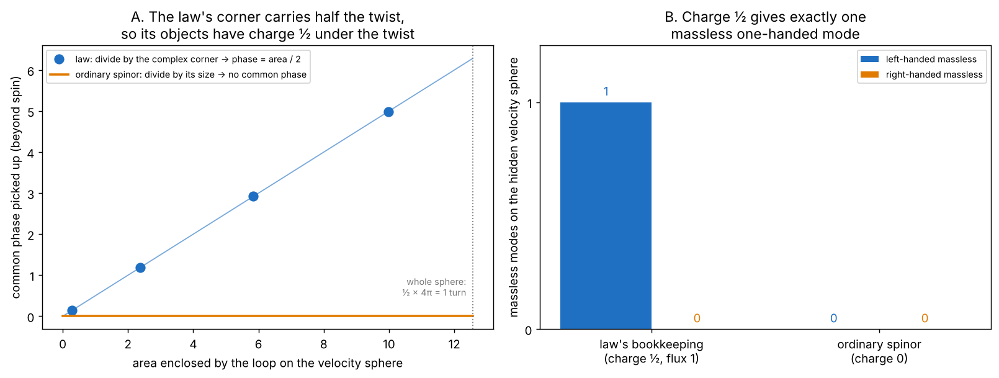

# Round 10: the law's own bookkeeping gives matter charge ½ under the twist

*DRAFT, Nov 27 2026. Not versioned, not proved in Lean. Follows rounds 1–9 (in the repo under `topics/forces-as-curvature/` and its subfolders `round5/` … `round9/`) and uses the twisted-boost law from `../../twisted-boosts/`. Checks: `checks.py` → `checks_output.txt` (**7 / 7 pass**, under 1 s; numpy and sympy), numbers in `results.json`. Picture: `figures.py` → `figures/f17`. Colour key: **blue = the law's bookkeeping, orange = ordinary spinor bookkeeping, grey = reference**.*

## Verdict first

Round 9 found that, on the closed velocity sphere (q = +1), the law's twist is 2 whole turns of flux, and that matter carrying an extra charge c under the twist gets 2c one-handed massless modes. It left open whether the law fixes c. This round asks whether the law's half-velocity structure sets c = ½.

1. **The law's corner carries exactly half the twist.** When two twisted boosts compose, B(u)B(v) = c · B(u⊕v) · diag(T, 1), where c = 1 − q ū v is the same complex "corner" that the law divides by in u⊕v = (u + v)/c. The twist is T = c̄/c, so the corner's phase is minus half the twist. Both are exact symbolic identities (U1, U2).
2. **So it matters how the corner is divided out.**
   - The law's own way divides by the complex corner c. It leaves diag(T, 1): the top component turns by the whole twist and the bottom by nothing (U3).
   - The ordinary spinor way divides only by the corner's size |c|. It leaves a pure turn diag(T^½, T^−½), which is spin alone (U3).
   - The difference between the two is a common phase T^½ on both components. That is a **charge ½ under the twist, on top of spin**.
3. **Round a closed loop, that common phase is half the enclosed area.** This holds for four loops, from a small cap to one covering most of the sphere (V1, V2). Over the whole closed sphere it adds up to ½ × 4π = 2π: exactly **1 whole turn, a consistent flux of 1** (V3).
4. **Flux 1 gives exactly one massless mode, of one hand.** Matter kept the law's way has one massless left-handed mode on the hidden sphere and no right-handed one. Matter kept the ordinary spinor way has none (W1). This is the charge-½ case of round 9.
5. **What this does and doesn't settle.**
   - It settles that the law has a natural bookkeeping that fixes the charge at ½, with no free choice of number. That is the law's own division by the complex corner, which is how ⊕ is defined.
   - It is a modelling choice the law suggests, not one it forces. Ordinary spinor bookkeeping is just as consistent and gives charge 0.
   - It still assumes a hidden 2-sphere at the q = +1 end of the dial.
   - One charge under one twist, giving one mode, is far from the Standard Model's pattern: two forces acting on left-handed matter, and three families.
   - Which hand comes out depends on orientation conventions: the sign of q × area, and which way round the chart is read.

*f17. A: the common phase picked up round a loop, beyond spin, against the area the loop encloses on the velocity sphere. With the law's bookkeeping (blue) it is exactly half the area, reaching 1 whole turn for the whole sphere. With ordinary spinor bookkeeping (orange) it is zero. B: massless modes on the hidden velocity sphere. The law's bookkeeping (charge ½, flux 1) gives one left-handed mode; ordinary spinors give none.*

## What the checks show

| Check | What | Result |
|---|---|---|
| U1 | twist T = c̄/c, so the corner's phase is −½ of the twist | exact (sympy) |
| U2 | B(u)B(v) = c · B(u⊕v) · diag(T, 1) | exact (sympy) |
| U3 | 500 random pairs: law's bookkeeping leaves diag(T, 1), det T; spinor bookkeeping leaves diag(T^½, T^−½), det 1 | 4.6e-16 and 1.2e-15 |
| V1 | round latitude loops (caps 0.3, 0.9, 1.5, 2.2 rad; 3,000 steps): law's top component turns by the enclosed area, bottom by nothing; spinor common phase 0 | areas 0.2806, 2.3775, 5.8387, 9.9808 matched |
| V2 | common phase = area / 2 | 0.1403, 1.1887, 2.9194, 4.9904 |
| V3 | whole closed sphere: ½ × 4π (arithmetic from V2's slope and round 9's total twist of 4π, not a new loop) | 1 turn |
| W1 | massless modes, law's bookkeeping vs spinor bookkeeping | L1 R0 vs L0 R0 |

How the loop is computed: each loop is a circle round the pole at a fixed angle from it on the unit sphere, written in the stereographic chart. Each step composes the current velocity's inverse with the next point using the law itself, z₂ = (−z₁)⊕z_{k+1}, and records the step's twist T. The twist is added up without wrapping, so a loop larger than half the sphere isn't cut down mod 2π. The enclosed area is added up from thin spherical triangles fanned out from the pole, using the sphere's geometry, not the law. The mode counts use round 7's Dirac operator on the 2-sphere with the flux from V3.

## What is textbook and what our law adds

| Piece | Status | Who |
|---|---|---|
| Twist of composed rotations = area on the velocity sphere | **Textbook** | Gauss–Bonnet; Thomas 1926 and Wigner 1939 for the boost version |
| Two-component coordinates on a 2-sphere (homogeneous coordinates on CP¹) carry the charge-1 line bundle O(1), which differs from plain spinors by charge ½ | **Textbook** | Hopf 1931; the spin^c structure on S² |
| Spinors with charge ½ extra under the sphere's own frame-turning have one massless one-handed mode | **Textbook** | Atiyah–Singer index theorem; Randjbar-Daemi, Salam and Strathdee 1983 |
| Using the hidden space's own frame-turning as the gauge field matter is charged under | **Textbook** in string theory | Candelas, Horowitz, Strominger and Witten 1985 ("standard embedding") |
| That the twisted-boost law's own division by the complex corner is that bookkeeping, so the law points to charge ½ and to exactly one one-handed mode | **Ours** (a reading) | |
| A picture where visible spacetime sits at q = −1 and the hidden sphere at q = +1 | **Ours, speculative**: an idea, not a result | |

## What this says about "reality is twisted"

Rounds 7–9 built a chain: twist alone moves masses in left–right pairs; on the closed end of the dial the twist is a whole-number flux; flux makes one-handed matter if matter has a charge under it. This round closes the last link in one specific way. The law divides by a complex corner, and that corner holds exactly half the twist. So anything carried the law's way picks up charge ½, and charge ½ on a flux-2 sphere is exactly one one-handed massless mode.

The honest limit is the word "carried the law's way". The mathematics says the law's bookkeeping and ordinary spinor bookkeeping are both consistent. The law suggests the first, because it is how ⊕ itself is built, but nothing yet forces matter to use it. That is the same kind of step as choosing spin^c over spin, which is textbook.

## Next rounds

1. **Lean:** the loop identity a∘b∘ā∘b̄ = k[a, b](1 + kā)(1 + kb̄) in any ring, and the corner identity T = c̄/c behind twist = q × area.
2. **Regge version:** Einstein's equations on a spacetime glued from flat pieces, with curvature read from loops round the hinges.
3. **Beyond one charge:** whether a larger hidden space at the q = +1 end gives more than one force acting on left-handed matter.

## Sources

Thomas, Nature 117, 514 (1926). Wigner, Ann. Math. 40, 149 (1939). Hopf, Math. Ann. 104, 637 (1931). Atiyah and Singer, Ann. Math. 87, 484 (1968). Randjbar-Daemi, Salam and Strathdee, Nucl. Phys. B 214, 491 (1983). Candelas, Horowitz, Strominger and Witten, Nucl. Phys. B 258, 46 (1985).
