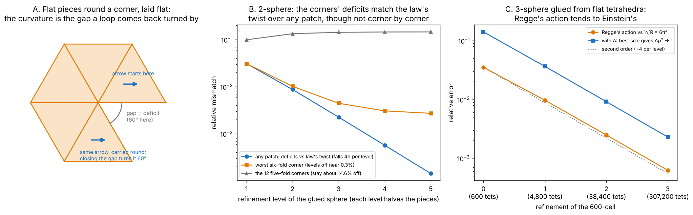

# Round 11: spacetime glued from flat pieces (Regge's method)

> **Names:** some words or symbols on this page (twist) also mean something else in standard math, physics or computing, or inside this project. [NAMING-COLLISIONS.md](../../../NAMING-COLLISIONS.md) says which meaning is in play.

*DRAFT, Nov 27 2026. Not versioned, not proved in Lean. Follows rounds 1–10 (in the repo under `topics/forces-as-curvature/` and its subfolders; round 10 is in `../round10/`) and uses the twisted-boost law from `../../twisted-boosts/`. Checks: `checks.py` → `checks_output.txt` (**9 / 9 pass**, about 5 s; numpy), numbers in `results.json`. Picture: `figures.py` → `figures/f18`. Colour key: **blue = the law, orange = glued flat pieces (Regge), grey = reference**.*

## Verdict first

Round 8 got Einstein's equations by varying the loop-read curvature of a smooth metric. This round does it Regge's way, with no smooth metric at all: space is glued from flat pieces, and all its curvature sits on the joints. Round 1's reading of curvature, "go round a loop and see how far you come back turned", is then all there is to curvature.

1. **On glued flat pieces, curvature is exactly what a loop comes back turned by.** On a sphere glued from flat triangles, carry an arrow round any corner across the pieces. It comes back turned by that corner's deficit angle, which is 2π minus the angles that meet there. This holds at all 642 corners to 2e-15 (X1).
2. **The law's twist carries the same curvature as the glued pieces.**
   - In total, the deficits add to 4π (Descartes), and so does the twisted-boost law's twist over the same triangles, at every refinement (X2).
   - Over any patch, the deficits inside match the law's twist over that patch. The mismatch falls 4 times each time the pieces are halved, down to 1.4e-4 (X3).
   - Corner by corner, they don't match. At the 12 five-fold corners the deficit stays about 14.6% off however fine the pieces get, and six-fold corners level off near 0.3% (X4). Curvature from glued pieces is right on average, not point by point. That is a known feature of Regge's method, not a failure of the law.
3. **Einstein's equations come out of the glued pieces.**
   - Regge's action is the sum over hinges of hinge size times deficit. On a 3-sphere glued from flat tetrahedra (the 600-cell, refined 3 times to 307,200 tetrahedra), it tends to Einstein's ½∫R = 6π². The error falls 4 times per halving, down to 0.06% (Y3).
   - Schläfli's identity holds for random reshapings (Y2). So varying the action gives just the deficits. Regge's equations, deficit = 0 on every edge in empty space, are Einstein's vacuum equations on glued pieces.
   - Flat space solves them: a 3-torus glued from 384 flat tetrahedra has zero deficit on every edge (Y5).
   - With a cosmological constant Λ, the glued 3-sphere's best size gives Λρ² → 1, which is what Einstein's equations give for a smooth 3-sphere (Y4).
4. **Limits.**
   - This is Euclidean 2D and 3D. Real spacetime is 4D and Lorentzian, where Regge's method also works (textbook) but isn't run here.
   - Y4 varies only the overall size, with the shape fixed. It does not solve Regge's equations for every edge.
   - 3D gravity has no gravitational waves, so this tests the curvature–action link, not the full dynamics.
   - Lean is deferred: there is no Lean toolchain in this environment, and an earlier attempt to install one here was refused.

*f18. A: five flat triangles round one corner of an icosahedron, laid flat. A 60° gap is left. An arrow carried across them never turns in the flat layout, and closing the gap turns it by 60°, so the gap is the curvature. B: on a sphere glued from flat triangles, the deficits match the law's twist over any patch (blue, falling 4 times per level). Corner by corner they don't: six-fold corners level off near 0.3% (orange) and the 12 five-fold corners stay near 14.6% (grey). C: on a 3-sphere glued from flat tetrahedra, Regge's action tends to Einstein's 6π² (orange), and with Λ the best size tends to Λρ² = 1 (blue), both at second order.*

## What the checks show

| Check | What | Result |
|---|---|---|
| X1 | arrow carried round each of 642 corners across the flat triangles comes back turned by the deficit | worst 1.9e-15 |
| X2 | deficits add to 4π; the law's twist over the same triangles adds to 4π (levels 1–5) | 4.000000000π both |
| X3 | over 20 caps of radius 0.5 rad, deficits vs the law's twist | 3.1e-2 → 1.4e-4, ÷4 per level |
| X4 | corner by corner: five-fold corners and worst six-fold corner | 14.57% and 0.27% at level 5 (not shrinking) |
| Y1 | 600-cell: every edge has 5 tetrahedra, deficit 2π − 5 arccos(1/3) | 0.1283882205 rad on all 720 edges |
| Y2 | Schläfli's identity: Σ L dδ = 0, so dS = Σ δ dL | −2e-9 and −5e-9 (scales 1.9 and 4.1) |
| Y3 | Regge's action Σ L δ vs ½∫R = 6π² = 59.21763 | 57.131, 58.643, 59.070, 59.181; error ratios 3.63, 3.91, 3.98 |
| Y4 | with Λ, best size: Λρ² | 1.14085, 1.03649, 1.00917, 1.00230 |
| Y5 | flat 3-torus (64 cubes × 6 tetrahedra): every deficit | worst 8.9e-16 |

How it's computed:
- **Sphere (X).** The sphere is an icosahedron refined by halving edges, with new corners pushed onto the sphere, at a random orientation.
- **Arrow (X1).** The arrow is carried across each shared edge by folding one triangle's plane onto the next about that edge.
- **Law's twist (X2–X4).** Each triangle's twist is round 9's: move one corner to rest with the law, then read the phase of (1 − q u v̄)/(1 − q ū v) at q = +1.
- **3-sphere (Y).** The 3-sphere is the 600-cell (120 unit quaternions). Each refinement cuts every tetrahedron into 8 and pushes new corners onto the sphere. Dihedral angles come from the corners' coordinates in each flat tetrahedron.
- **Λ size (Y4).** Lengths and volumes scale as ρ and ρ³ while deficits don't change. So S(ρ) = 2ρ Σ L δ − 2Λρ³ Σ vol, which is stationary at Λρ² = Σ L δ / (3 Σ vol). The smooth version is 12π²ρ − 4π²Λρ³, stationary at Λρ² = 1.

## What is textbook and what our law adds

| Piece | Status | Who |
|---|---|---|
| Curvature of glued flat pieces sits on the hinges as deficit angles, and is the turn of a loop round each hinge | **Textbook** | Regge 1961 |
| Deficits of a closed polyhedral sphere add to 4π | **Textbook** | Descartes; Gauss–Bonnet |
| Σ L dδ = 0, so varying Regge's action gives the deficits | **Textbook** | Schläfli 1858; Regge 1961 |
| Regge's action tends to ∫R; curvature converges on average but not point by point | **Textbook** | Cheeger, Müller and Schrader 1984 |
| That the twisted-boost law's twist over a patch carries the same curvature as the glued pieces' deficits | **Ours** (a reading; the numbers are Gauss–Bonnet) | |
| That round 1's single loop read covers both the smooth and the glued pictures of gravity | **Ours** (a reading) | |

## What this says about building spacetime

The question behind this work was whether the fabric of spacetime can be built from our model. Regge's method is the closest standard answer to "built from pieces". You glue flat blocks, the curvature lives entirely in how loops come back turned, and Einstein's equations are what the gluing has to satisfy. The law fits in at the level of loops. Its twist is the same turning, and over any patch it carries exactly the curvature the glued pieces carry.

What the law does not do yet is choose the pieces. Here the edge lengths come from a sphere we picked. A step toward building spacetime would be to let the law's own operations set the lengths, and then check that Regge's equations hold.

## Next rounds

1. **Pieces from the law:** set the edge lengths of glued blocks from the law's own composition and test Regge's equations on them.
2. **Lorentzian Regge in 4D:** run the same tests with real spacetime's signature, where the law sits at q = −1.
3. **Lean**, once a toolchain is available (for example on a machine that already has Lean, such as the one used for the project's mathlib builds): the loop identity a∘b∘ā∘b̄ = k[a, b](1 + kā)(1 + kb̄) in any ring, and the corner identity T = c̄/c.

## Sources

Regge, Nuovo Cimento 19, 558 (1961). Schläfli, Quart. J. Pure Appl. Math. 2, 269 (1858). Cheeger, Müller and Schrader, Commun. Math. Phys. 92, 405 (1984). Coxeter, *Regular Polytopes* (1973), for the 600-cell.
