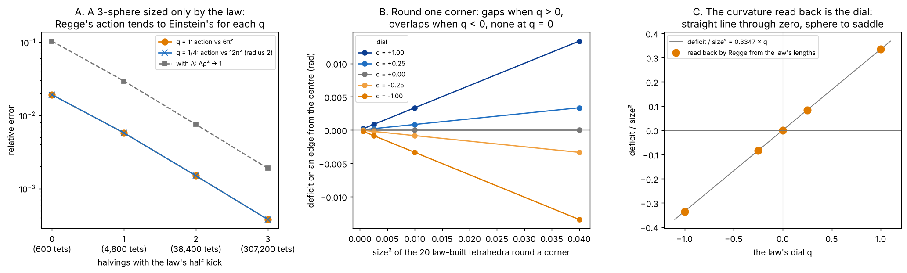

# Round 12: pieces sized by the law, curvature read back by Regge

*DRAFT, Nov 27 2026. Not versioned, not proved in Lean. Follows rounds 1–11 (rounds 1–9 in the repo under `topics/forces-as-curvature/` and its subfolders; rounds 10 and 11 in `../round10/` and `../round11/`) and uses the twisted-boost law from `../../twisted-boosts/`. Checks: `checks.py` → `checks_output.txt` (**9 / 9 pass**, about 13 s; numpy and sympy), numbers in `results.json`. Picture: `figures.py` → `figures/f19`. Colour key: **blue = the law, orange = Regge read-back, grey = reference**.*

> **Prior-art note (DRAFT, added Nov 27 from the [prior-art audit](../prior-art-audit/), section 8):** the closed form of the 3D law here is the κ-addition of the constant-curvature machine-learning papers, with κ = q (Bachmann, Bécigneul and Ganea, ICML 2020, arXiv:1911.05076, Eq. 2; audit check K1).

## Verdict first

Round 11 glued spacetime from flat pieces whose sizes came from a sphere we chose. This round lets the twisted-boost law size the pieces itself, and then reads the curvature back with Regge's method. The pieces are sized as follows:
- the edge lengths are the law's own distances;
- each new corner is the law's own "half kick";
- each tetrahedron's shape comes from its six lengths alone, with no space around it.

1. **The law works with 3D velocities, exactly.** Written with quaternions, u⊕v = (u + v)(1 − q ū v)⁻¹ keeps 3D velocities 3D. In closed form it is u⊕v = [(1 − 2q u·v − q|v|²) u + (1 + q|u|²) v] / (1 − 2q u·v + q²|u|²|v|²). At q = −1 that is exactly Ungar's Möbius addition (Z1, exact).
2. **The law carries its own ruler.**
   - The law's gap between two velocities, g = (−a)⊕b, gives a distance (2 arctan|g| at q = +1, 2 artanh|g| at q = −1). The law's own boosts keep that distance (Z2).
   - It is the true distance of the round 3-sphere at q = +1 and of hyperbolic 3-space at q = −1. This was checked against those spaces built without the law (Z3).
   - Half a kick, g/(1 + √(1 + q|g|²)), lands exactly halfway (Z4).
3. **Spacetime sized by the law obeys Einstein's equations.**
   - Glue a 3-sphere from up to 307,200 flat tetrahedra sized only by the law at q = +1. Regge's action tends to Einstein's ½∫R = 6π², ending 0.04% off at second order (Y1).
   - Turn the dial to q = ¼ with the same corners and it tends to 12π², a sphere of radius 2. So the law's q is the curvature (Y2).
   - With a cosmological constant, the best size gives Λρ² → 1 (Y3).
4. **The curvature read back is the dial, at both ends.** Build the 20 tetrahedra round one corner from the law's lengths.
   - At q = 0 they close up exactly (X1).
   - For q > 0 they leave a gap, as on a sphere. For q < 0 they overlap, as on a saddle.
   - The deficit is q × 0.3347 × size² at q = +1, +¼, −¼ and −1 alike (X2), a straight line through zero.
5. **Limits.**
   - The starting corners (the 600-cell's 120 points and how they join) are still given; only the sizes and the refinement come from the law.
   - The law's distance formula is the textbook distance in stereographic and Poincaré-ball coordinates; Z3 shows they agree.
   - q < 0 is tested only round one corner, not on a closed space.
   - Everything is Euclidean 3D. Real spacetime is 4D and Lorentzian.
   - The 0.3347 is measured, not derived. It is fixed by the shape of the icosahedral star.

*f19. A: a 3-sphere glued from pieces sized only by the law. Regge's action approaches Einstein's at q = 1 (orange) and at q = ¼ (blue, radius 2), with identical relative errors, and the size set by Λ approaches Λρ² = 1 (grey). B: round one corner, the deficit on the edges from the centre against size², for five settings of the dial: gaps for q > 0, overlaps for q < 0, none at q = 0. C: deficit / size² against q falls on one straight line through zero.*

## What the checks show

| Check | What | Result |
|---|---|---|
| Z1 | pure quaternions stay pure under the law; closed form; Ungar at q = −1 | exact (sympy) |
| Z2 | the law's boosts keep the law's distance, 500 triples | 9e-16 (q = +1), 8e-14 (q = −1) |
| Z3 | law's distance vs the true distance on the 3-sphere and in hyperbolic space | 8e-16 and 2e-14 |
| Z4 | half kick lands halfway | 7e-16 and 1e-14 |
| Y1 | q = 1: Regge's action vs 6π² = 59.21763 | 58.081, 58.876, 59.129, 59.195 (1.9% → 0.04%) |
| Y2 | q = ¼: action vs 12π² = 118.43525 | 116.163 → 118.390, same relative errors |
| Y3 | with Λ: Λρ² | 1.10380, 1.02955, 1.00754, 1.00189 |
| X1 | q = 0: deficit round the corner | 4e-16 |
| X2 | deficit / (q size²) at q = +1, +¼, −¼, −1 | 0.33467, 0.33468, 0.33469, 0.33470 |

How it's computed:
- **Starting corners.** The 600-cell's 120 corners are turned at random and put into the law's chart by stereographic projection, u = x/(1 + x₀). At q = ¼ they are scaled by 1/√q.
- **Refinement.** Each refinement cuts every tetrahedron into 8. The new corners are law midpoints, a ⊕ halfkick((−a)⊕b). The inner octahedron is cut on its shortest diagonal, measured with the law's distance.
- **Shapes and deficits.** Each tetrahedron is rebuilt in flat space from its six law lengths (Cayley–Menger, via the Gram matrix). The deficit on an edge is 2π minus the dihedral angles round it.
- **The corner star (X).** The centre is at rest. The 12 neighbours point to an icosahedron's corners at law distance ε (ε = 0.2, 0.1, 0.05 and 0.025). X2 uses the smallest ε.

## What is textbook and what our law adds

| Piece | Status | Who |
|---|---|---|
| Möbius addition of 3D velocities; at q = −1 it is relativistic velocity addition in the Poincaré ball | **Textbook** | Ahlfors 1981 and 1986 (Möbius maps by Clifford numbers); Ungar 2001 (gyrovector spaces) |
| Its distance is the hyperbolic or spherical distance | **Textbook** | Poincaré; Ungar |
| Regge's action and its continuum limit | **Textbook** | Regge 1961; Cheeger, Müller and Schrader 1984 |
| Constant curvature K gives deficits ∝ K × size² | **Textbook** | Regge 1961 |
| That the twisted-boost law, written once with quaternions, supplies every length and midpoint, so one dial q is both the law's setting and spacetime's curvature read back by Regge | **Ours** (a reading, checked numerically) | |
| That sphere-like (q > 0) and saddle-like (q < 0) spacetimes are the two ends of one law | **Ours**: the same picture as rounds 9–10, now in 3D | |

## What this says about building spacetime

This is the first round where the law does more than match curvature. It sets the sizes of the pieces, and Einstein's equations then hold for the spacetime glued from them, with the curvature equal to the law's own q. What is still given from outside is the starting set of corners and how they join. Letting the law choose those too, for example by growing the pieces outward from one corner with repeated kicks, is the open step.

## Next rounds

1. **Grow the pieces from the law:** start at rest and generate corners by repeated kicks, so the law chooses the corners as well as the sizes, then test Regge's equations.
2. **Lorentzian Regge in 4D:** real spacetime's signature, where the law sits at q = −1.
3. **Lean**, on a machine that has Lean: the loop identity, T = c̄/c, and Z1's closed form.

## Sources

Regge, Nuovo Cimento 19, 558 (1961). Ahlfors, *Möbius transformations in several dimensions* (Univ. of Minnesota lecture notes, 1981) and Complex Variables 5, 215 (1986). Ungar, *Beyond the Einstein Addition Law and its Gyroscopic Thomas Precession* (Kluwer, 2001). Cheeger, Müller and Schrader, Commun. Math. Phys. 92, 405 (1984).
