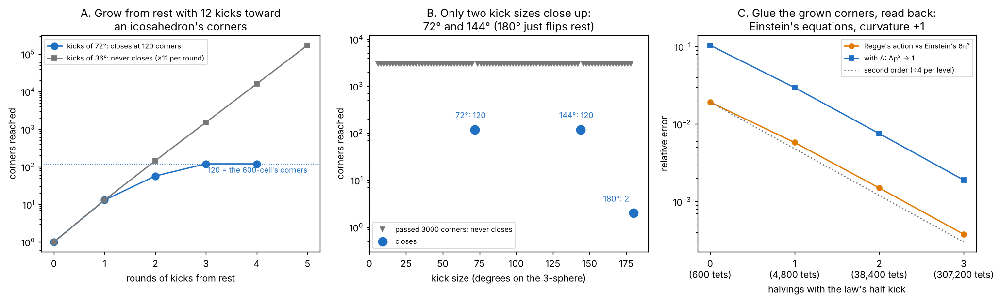

# Round 13: the law grows the corners too

> **Names:** some words or symbols on this page (⊕, twist) also mean something else in standard math, physics or computing, or inside this project. [NAMING-COLLISIONS.md](../../../NAMING-COLLISIONS.md) says which meaning is in play.

*DRAFT, Nov 27 2026. Not versioned, not proved in Lean. Follows rounds 1–12 (rounds 1–9 in the repo under `topics/forces-as-curvature/` and its subfolders; rounds 10–12 in `../round10/` … `../round12/`) and uses the twisted-boost law from `../../twisted-boosts/`. Checks: `checks.py` → `checks_output.txt` (**6 / 6 pass**, about 25 s; numpy), numbers in `results.json`. Picture: `figures.py` → `figures/f20`. Colour key: **blue = the law, orange = Regge read-back, grey = reference**.*

## Verdict first

Round 12 let the law size the glued pieces, but the starting corners were given. Here the corners come from the law too. Start at rest, apply the same 12 kicks from every point reached, keep what is new, and stop when nothing new appears. The only inputs are the 12 kick directions (an icosahedron's) and one kick size.

1. **A kick acts by half of itself on each side.** At q = +1 a law kick by a moves every point x of the 3-sphere to g x g, where g is halfway to a. That is "half a kick" once more (W1, to 4e-16).
2. **The law grows exactly the 600-cell's corners.** With kicks of 72°, the growth reaches 13, then 57, then 120 corners, and then stops: nothing new appears. Each of the 120 has 12 nearest neighbours exactly 36° away. Those are the 600-cell's corners, which rounds 11 and 12 had to supply by hand (W2).
3. **The kick size is not free.**
   - Of every kick size from 6° to 180° in 2° steps, only 72° and 144° close up, and both give the same 120 corners. 180° only swaps rest with its opposite point (W3).
   - Kicks the size of the nearest-neighbour step, 36°, never close. They multiply about 11 times per round and pass 170,000 points after 5 rounds (W4).
   - So the law picks the size: the kick must be twice the step, so that its half lands on a neighbour.
4. **The grown corners glue into spacetime that obeys Einstein's equations.**
   - Joined wherever the law's distance is smallest, the 120 grown corners give 720 edges and 600 flat tetrahedra, with 5 round every edge (W5).
   - Refined with the law's half kicks and read back with Regge, the action tends to Einstein's 6π², ending 0.04% off at second order, and Λρ² → 1 (W6).
   - Everything here, corners, sizes and refinement, now comes from the law. The one input is the choice of icosahedral directions.
5. **Limits.**
   - The 12 directions are an input. Other symmetric choices, such as a cube's or an octahedron's directions, would grow other closed shapes; they are not tested here.
   - Only the q = +1 end is done. At q = −1 the same growth makes an endless lattice in hyperbolic space. There, tetrahedra can't meet five round an edge, so the 600-cell has no hyperbolic twin.
   - The law's chart can't hold the point opposite rest, which is at infinity. The growth recognises a kick that lands there by the law's own denominator going to zero. Before gluing, one small law kick brings that point into view, at the law's own limit c⊕v → −c/|c|² as |v| → ∞.
   - Everything is Euclidean 3D.

*f20. A: corners reached after each round of kicks from rest. With 72° kicks (blue) the growth closes at the 600-cell's 120 corners after 3 rounds; with 36° kicks (grey) it multiplies about 11 times a round and never closes. B: for each kick size from 6° to 180°, the corners reached. Only 72° and 144° close (both 120), plus the trivial 180°; every other size passed 3000. C: glue the grown corners, refine with half kicks and read back: Regge's action approaches Einstein's 6π² (orange), and Λρ² approaches 1 (blue), both at second order.*

## What the checks show

| Check | What | Result |
|---|---|---|
| W1 | law kick by a = x ↦ g x g on the 3-sphere, g halfway to a; 500 random pairs | 4.4e-16 |
| W2 | 12 icosahedral kicks of 72° from rest, grown with the law in its own chart | 1, 13, 57, 120, 120; neighbours all at 36.000000° |
| W3 | kick sizes 6°–180° in 2° steps that close | 72° (120), 144° (same 120), 180° (2) |
| W4 | 36° kicks | 1, 13, 145, 1527, 16089, 170490 |
| W5 | glue at the smallest law distance | 720 edges, 600 tetrahedra, 5 per edge |
| W6 | Regge from law lengths with half-kick refinement | 58.081 → 59.195 vs 59.218 (0.04%); Λρ² 1.00189 |

How it's computed:
- **Growth (W2).** Each new point is k⊕p for every kick k and its reverse −k, done in the law's own chart. Points count as the same when they agree to 1e-7 on the sphere.
- **Cross-check (W2).** The same growth was rerun with the kick in its sphere form from W1, and gives the same 120 points.
- **Size scan (W3, W4).** These use the sphere form, which handles the far point without special care, with a cap of 3,000 points (W3) or 1,000,000 (W4).
- **Gluing (W5).** Lengths are law distances in the chart. Two opposite points, where the law's gap is infinite, have distance 2 arctan(∞) = π.
- **Read-back (W6).** Tetrahedra are rebuilt from their six lengths, as in round 12.

## What is textbook and what our law adds

| Piece | Status | Who |
|---|---|---|
| On the 3-sphere viewed as the group SU(2), the moves that slide along a geodesic through 1 are x ↦ g x g | **Textbook** | Cartan (symmetric spaces); Helgason 1978 |
| The finite groups in SU(2); the binary icosahedral group has 120 elements, the 600-cell's corners | **Textbook** | Klein 1884; Coxeter 1973 |
| A group generated by elements outside a finite subgroup is infinite (so the 36° kicks never close) | **Textbook** | |
| That the twisted-boost law's kicks, applied from rest, grow those 120 corners, and that closure forces a kick twice the step (its half on a neighbour) | **Ours** (a reading, checked numerically) | |
| That with corners, sizes and refinement all from the law, the glued spacetime satisfies Einstein's equations with curvature q | **Ours** (rounds 11–13 together) | |

## What this says about building spacetime

The question behind this work was whether the fabric of spacetime, its curvature, can be built from our model. After rounds 11–13, at the closed end of the dial the answer is yes, with one input left. From rest:
- the law's kicks grow the corners;
- its distance sizes the pieces;
- its half kick refines them;
- Regge's reading of the result is Einstein's equations, with curvature equal to the law's q.

The remaining input is the set of 12 icosahedral directions. The open step on the physical side is the open end of the dial, q = −1, where relativity lives and the lattice the law grows is endless.

## Next rounds

1. **The open end of the dial (q = −1):** grow a lattice in hyperbolic space with the law, glue it into a closed space (a quotient), and read back Einstein's equations with negative curvature.
2. **Other directions:** a cube's or an octahedron's kick directions, and whether they close (to the 24-cell or the 8-cell) and glue as well.
3. **Lean**, on a machine that has Lean: the loop identity, T = c̄/c, round 12's closed form, and W1's x ↦ g x g.

## Sources

Klein, *Vorlesungen über das Ikosaeder* (1884). Coxeter, *Regular Polytopes* (Dover, 1973). Helgason, *Differential Geometry, Lie Groups, and Symmetric Spaces* (Academic Press, 1978). Regge, Nuovo Cimento 19, 558 (1961).
