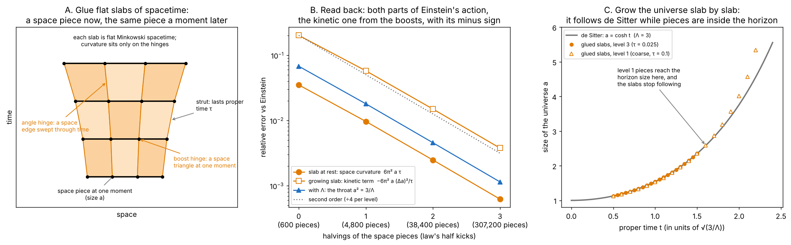

# Round 14: real 4D spacetime, with time inside the glued pieces

*DRAFT, Nov 27 2026. Not versioned, not proved in Lean. Follows rounds 1–13 (rounds 1–9 in the repo under `topics/forces-as-curvature/` and its subfolders; rounds 10–13 in `../round10/` … `../round13/`) and uses the twisted-boost law from `../../twisted-boosts/`. Checks: `checks.py` → `checks_output.txt` (**9 / 9 pass**, about 26 s; numpy, scipy), numbers in `results.json`. Picture: `figures.py` → `figures/f21`. Colour key: **blue = the law, orange = Regge read-back, grey = reference**.*

## Verdict first

Rounds 11–13 built *space* from glued flat pieces, with corners, sizes and refinement all from the law, and read Einstein's equations back. This round adds *time*. Each piece now lasts a while: a space piece at size a, the same piece a moment later at size a′, and the flat slab of Minkowski spacetime between them. Glued together, the slabs make a closed expanding universe built only from flat pieces of real 4D spacetime.

1. **Each slab is honest flat spacetime.** Its four struts each last the same proper time τ (length² = −τ² exactly). Its walls are flat. Its 4-volume, computed two independent ways, agrees to 2e-15 (L1).
2. **Curvature lives on two kinds of hinge, and Schläfli's identity says how they add.**
   - A space edge swept through time is a *timelike* hinge. Its deficit is an ordinary angle.
   - A space triangle at one moment is a *spacelike* hinge. Its deficit is a **boost**: the walls of the four slabs that meet there tilt by rapidities, not angles.
   - In every slab, (area × change of angle) summed over the timelike hinges equals (area × change of boost) summed over the spacelike ones, to 3e-9. This holds on 40 random lopsided slabs with every corner wiggled. With the other sign it misses by 100% (L2).
   - This fixes, with nothing fitted, how the two kinds of curvature combine in the action.
3. **Both parts of Einstein's action come back.**
   - A slab at rest gives (proper time) × (round 11's space curvature), tending to Einstein's 6π² a τ (M1).
   - A growing slab's boosts give the kinetic term −6π² a (Δa)²/τ, with Einstein's minus sign. It reaches 99.62% at level 3, at second order, and stays the same to 0.23% across growth rates (M2).
4. **Einstein's equations with a cosmological constant come out, and a de Sitter universe grows slab by slab.**
   - Varying the struts' proper time gives the Friedmann constraint. A slab at rest solves it at the throat a² = 3/Λ, tending to it at second order (1.0681 → 1.0012). This is the same number as round 11's Λρ² (N1).
   - Started at de Sitter's size at t = 0.5 and grown by the constraint alone to t = 1.5, the glued universe follows a = cosh(t√(Λ/3)). The worst gap falls 1.09% → 0.23% → 0.06% over levels 1–3 (N2).
   - The other Regge equations (vary each slice's size) were never used to grow it, yet they hold to 0.006% of a single term. What is left depends only on the time step (N3).
5. **Two honest limits found along the way.**
   - Started exactly at rest at the throat, the slabs still follow de Sitter, but only at first order in the step. The first step off the bounce comes out τ² where de Sitter has τ²/2 (N4).
   - The slabs follow de Sitter only while each piece is small compared with de Sitter's horizon, √(3/Λ). At level 1 the gap stays under 1% while pieces are under half the horizon. The constraint has no growing solution once pieces are about 2 horizons across (N5, figure panel C).

**Does this open a lead?** As a construction, yes: real 4D spacetime, built from flat pieces with time inside them, obeys Einstein's equations with Λ, and the space corners come from the law. But the new ingredient, time, is textbook Lorentzian Regge. The law did not supply it. The time direction and the Minkowski slabs are put in by hand. What does point somewhere is item 2: the curvature at a spacelike hinge is a set of **boosts** going round a loop. That is exactly the kind of object the twisted-boost law composes. Whether those boosts compose by our law, with its twist, is the next question (Next rounds, 1).

*f21. A: the universe drawn in one space direction and time. Each slab joins a space piece at one moment to the same piece a moment later, and is flat Minkowski spacetime. Curvature sits on hinges: an angle where a space edge is swept through time, a boost where a space triangle sits at one moment. B: read back from the glued slabs. The slab at rest gives Einstein's space-curvature term, the growing slab's boosts give the kinetic term with its minus sign, and with Λ the throat comes out at a² = 3/Λ. All reach Einstein at second order (÷4 per level). C: the universe grown slab by slab from t = 0.5. At level 3 (filled) it lies on de Sitter's cosh t. At level 1 (open, coarse) it follows until its pieces reach the horizon's size, then runs away.*

## What the checks show

| Check | What | Result |
|---|---|---|
| L1 | slab shape: struts, walls, 4-volume (4 simplices vs stacked-pieces formula) | struts −τ² exactly; walls flat; volume to 1.6e-15 |
| L2 | Schläfli in one slab: Σ A dθ (timelike) = Σ A dη (spacelike); 40 random slabs | 3.2e-9; other sign off by ≥ 100% |
| M1 | slab at rest vs 6π² a τ, levels 0–3 | 96.48%, 99.03%, 99.75%, 99.94%; = τ × round 11's sums |
| M2 | growing slab vs −6π² a (Δa)²/τ | 79.77%, 94.20%, 98.50%, 99.62% |
| N1 | throat of the Friedmann constraint (Λ = 3, continuum throat 1) | 1.06810, 1.01808, 1.00458, 1.00115 |
| N2 | grown from t = 0.5 to 1.5, worst gap from cosh t (τ = 0.05) | 1.094%, 0.227%, 0.060%; level 3 at τ = 0.1, 0.025: 0.294%, 0.056% |
| N3 | other Regge equations, not used to grow it | 0.0063–0.0068% at τ = 0.05 at every level; ÷8 per halving of τ |
| N4 | started exactly at the throat (level 3) | 5.10% (τ = 0.1), 2.59% (τ = 0.05): first order; first step 1.00 τ² |
| N5 | level 1 run until it breaks | under 1% while pieces < ½ horizon; no growing solution at 2.06 horizons |

How it's computed:
- **Corners and space pieces.** The corners are the 120 grown by the law's 72° kicks (round 13), glued at the smallest law distance and refined with the law's half kicks to 600, 4,800, 38,400 and 307,200 pieces. Each space piece is the flat tetrahedron spanned by its corners on the sphere of radius a (chords). Round 12 used the law's arc lengths instead; the two agree in the limit.
- **Slabs.** In Minkowski space R^{1,4}, the bottom corners are (0, a x) and the top corners (Δt, a′ x), with Δt² = τ² + (a′ − a)². Every angle and boost is computed from these corners alone: project onto the plane at right angles to the hinge, then take the angle (timelike hinge) or the rapidity of the wall against the slice's normal (spacelike hinge).
- **Action.** S = Σ (timelike hinges) A × (2π − Σ angles) + Σ (spacelike hinges) A × (Σ boosts) − Λ × (4-volume). The relative sign of the boost term is the one L2's Schläfli identity requires. Each slab carries its own wedges' share of the spacelike hinges at its two ends.
- **Grouping.** Pieces with the same shape give the same numbers, so they are grouped (1, 2, 9 and 54 shapes at levels 0–3). The grouped sum matches the full sum to 6e-17 (M1).
- **Growing (N2–N5).** With τ fixed, each next size a′ is the root of ∂S/∂τ = 0, found with Brent's method. Units have Λ = 3, so de Sitter's throat and horizon are both 1.

## What is textbook and what our law adds

| Piece | Status | Who |
|---|---|---|
| Curvature of glued flat pieces sits on hinges; the action Σ A δ | **Textbook** | Regge 1961 |
| Lorentzian Regge: boost deficits on spacelike hinges, angle deficits on timelike ones | **Textbook** | Sorkin 1975 |
| A closed Friedmann universe built from Regge slabs over a regular 3-sphere lattice | **Textbook** | Collins & Williams 1973 |
| Each slab's own share of the spacelike hinges at its ends as the boundary term | **Textbook** | Hartle & Sorkin 1981 |
| Schläfli's identity for Lorentzian polytopes | **Textbook** (checked here numerically) | |
| That the space corners, and their refinement, come from the law's kicks and half kicks | **Ours** (rounds 12–13) | |
| That the curvature at a spacelike hinge is a loop of boosts, the kind of object the twisted-boost law composes | **Ours** (an observation; not yet tested) | |

So this round reproduces known physics on our corners. It confirms that the space built in rounds 11–13 extends to real spacetime and obeys Einstein's equations with Λ. It does not yet show that the law produces time.

## Caveats

- **Only the symmetric universe.** Every slab is the same everywhere at a given moment, so this is a Friedmann universe and nothing else: no gravitational waves, no lumps, no matter besides Λ. Full 4D Regge, with every edge length free, is not done.
- **Time is put in by hand.** The Minkowski signature, the struts and the time direction are inputs, not consequences of the law.
- **The throat start is only first order** (N4). The fix would be smaller steps near the bounce; it was not done here.
- **Pieces must stay inside the horizon** (N5). This is a limit of the method: coarse pieces can't follow a universe whose horizon is smaller than they are.
- **Space pieces use chords**, not the law's arc lengths (see How it's computed).

## Next rounds

1. **Do the boosts round a spacelike hinge compose by the law?** Take the loop of boosts round one spacelike hinge and compare it with the twisted-boost law at q = −1, twist included. If they match, the law would be supplying time's curvature too, not only space's.
2. **Free edge lengths.** Let neighbouring slabs differ (a lump, or a wave) and check that Regge still tracks Einstein, starting with a small perturbation of the de Sitter run.
3. **The open end of the dial (q = −1) for space**, as listed in round 13.
4. **Lean**, on a machine that has Lean: the loop identity, T = c̄/c, round 12's closed form, round 13's x ↦ g x g.

## Sources

Regge, Nuovo Cimento 19, 558 (1961). Collins & Williams, Phys. Rev. D 7, 965 (1973). Sorkin, Phys. Rev. D 12, 385 (1975). Hartle & Sorkin, Gen. Rel. Grav. 13, 541 (1981).
