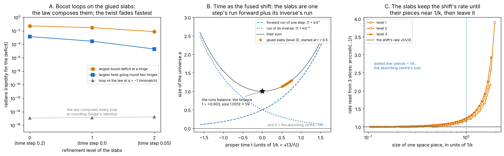

# Round 15: boost loops on the glued slabs, and time as the fused shift

*DRAFT, Nov 27 2026. Not versioned, not proved in Lean. Builds directly on round 14 (`../round14/`), whose slab machinery is reused unchanged, and on the twisted-boost law (`../../twisted-boosts/`) and the fused shift (`fused_shift` in `../../riemann/round8/lean/RiemannRound8.lean`). Checks: `checks.py` → `checks_output.txt` (**7 / 7 pass**, about 27 s; numpy, scipy), numbers in `results.json`. Picture: `figures.py` → `figures/f22`. Colour key: **blue = the law or the shift, orange = Regge read-back, grey = reference**.*

## Verdict first

Round 14 built real 4D spacetime from glued flat slabs, but time went in by hand. This round asks two things: whether the boost loops at round 14's hinges compose by our law, and whether time is the fused shift a ↦ 1 + k·a.

1. **The law composes every boost loop on the slabs exactly.**
   - Per hinge, the four slab walls that meet at a space triangle all boost in one plane. The law at q = −1 composes them into exactly the hinge's boost deficit, with no twist. This holds at all 9,600 hinges at level 1, to 1e-17 (T1).
   - Going round two hinges, or all four floor hinges of a space piece, gives a boost times a twist. Both are exactly the law composing the hinges' half velocities, to 2e-15 at every level (T2).
   - **This identity is known**: composing boosts gives a boost and a Thomas–Wigner rotation, and Ungar showed that Möbius addition (our law at q = −1) gives both. What is new here is only that it holds on Regge's real pieces. So the law already composes the curvature of real spacetime, at the boost hinges.
2. **The twist does nothing that time needs.**
   - It is second order in the deficits, ½ ε₁ ε₂ sin θ to within 1% (θ is the angle between the two hinges).
   - Under refinement the largest deficit falls 7× while the largest twist falls 69× (T3).
   - An expanding universe has no rotation for the twist to supply. So the boost loops do not give time.
3. **Read through the fused shift, the glued universe is one time step run forward plus its inverse run backward.**
   - The shift turns a ∘ₖ b = a + b + k a b into multiplication. So n steps of τ compose to a size ratio (1 + kτ)ⁿ. The step has an inverse, −τ/(1 + kτ). The centre −1/k means size zero, and it absorbs (S1, exact in fractions).
   - The slabs' sizes are F (1 + kτ)ⁿ + G (1 + kτ)⁻ⁿ to 5e-7. The rate is ln(1 + kτ)/τ = 1.0005 √(Λ/3) at level 3 (S2).
   - The runs were started at t = 0.5 and never saw the bounce. Yet the two runs balance at t = +0.003, at size 1.0012. That is the bounce, at the throat 1/k = √(3/Λ), and it converges with refinement (S2).
4. **The absorbing centre's size, 1/k, is de Sitter's length, and the slabs leave the shift when their pieces reach it.**
   - Size zero is never reached in finitely many steps. In a purely growing run, light's total reach (the horizon) is exactly 1/k + τ (S1).
   - The rate read from each three slices stays within about 1% of √(Λ/3) while pieces are under a quarter of 1/k. It drifts up as they grow. At every level the run ends, with no growing solution, once pieces reach 1.8 to 2 × 1/k, later in time for finer pieces (S3). Round 14's breakdown is the slabs leaving the shift.
5. **What the shift does not settle** (S4).
   - With k real, the forward and inverse runs give cosh: Lorentzian de Sitter. With k imaginary, the same two runs give cos: the Euclidean 4-sphere. So the Lorentzian sign is now the choice "k is real". It is still an input.
   - Any time step works. Only k sets the rate, and k itself is fixed by Λ (Λ = 3k²), not by the law.

**Does this open a lead?** Partly.
- **The fused shift is a clean, exact reading of time.** Growth, the bounce, de Sitter's length (the size of −1/k) and the horizon all fall out of one operation and its inverse.
- **But it reads; it doesn't derive.** "The sizes are a forward run plus an inverse run" is the same statement as "the sizes obey ä = (Λ/3) a", which is Einstein's equation for this universe. The shift doesn't fix Λ, the step or the signature.
- **What would make it a lead** is tying k to something the model already has. One thing points that way: at the bounce the space slices have curvature 1/a² = k², so the law's space dial q (rounds 11–13) equals k² there, and Λ = 3q = 3k². That is de Sitter geometry, not yet a derivation. But it is the bridge to test next: whether the law's own dial sets the shift's k.
- **The boost loops are not a lead.** The law composes them exactly, but that is Ungar's known identity, and the twist fades in the smooth limit.

*f22. A: on round 14's glued slabs, the largest boost deficit at a hinge (orange) and the largest twist from going round two hinges (blue), with the time step shrinking with the pieces. The twist is second order and fades fastest. The law at q = −1 composes every loop to rounding (grey). B: the level-3 slabs (orange), started at t = 0.5, are one time step's forward run (dashed) plus its inverse's run (dotted). Their sum (grey) balances at the bounce (star): t ≈ 0, size ≈ 1/k. Size 0 is the absorbing centre −1/k, never reached. C: the rate read from each three slices against the size of one space piece. It stays at the shift's √(Λ/3) while pieces are small, and leaves it as they near 1/k (dotted line), at every level.*

## What the checks show

| Check | What | Result |
|---|---|---|
| T1 | per hinge: four wall boosts composed by the law at q = −1, half velocities | matches tanh(ε/2) to 1.4e-17; twist 4e-16; 9,600 hinges |
| T2 | two hinges, and all four floor hinges of a piece: loop vs law (boost and twist) | 4e-16 to 2e-15 at levels 0–2 |
| T3 | largest deficit vs largest twist, time step shrinking with the pieces | deficit 5.4e-2, 2.9e-2, 7.7e-3; twist 1.4e-3, 2.9e-4, 2.0e-5 rad |
| S1 | the shift, exactly: ∘ₖ → ×, n steps → (1 + kτ)ⁿ, inverse, absorbing centre, horizon 1/k + τ | all exact, 200 random rationals |
| S2 | slabs (10 steps of 0.025 from t = 0.5) read as forward + inverse runs | level 3: rate 1.00050, bounce t = +0.0029, throat 1.00122 (static throat 1.00115) |
| S3 | rate vs piece size, levels 1–3 | within 1.04% while pieces < ¼ × 1/k; runs end at 1.76, 1.95, 1.79 × 1/k |
| S4 | forward + inverse runs, k = 1 and k = i, τ → 0 | cosh and cos, both to 6e-5 at τ = 1e-4 |

How it's computed:
- **Slabs.** These are round 14's, over the same law-grown corners. For T, three slices of de Sitter one step apart are used, at t = 0.5 − τ, 0.5 and 0.5 + τ, with τ = 0.2/2^level.
- **Hinge boosts (T).** A hinge's boost deficit is the sum of the four walls' tilts from round 14. In a slab above the slice, each floor hinge's boost points along the inward direction to that triangle in the piece's own frame.
- **The law (T).** Velocities enter as the law's half velocities, tanh(ε/2), as in round 10, and are composed with the closed form at q = −1. The twist is the law's gyration, gyr[a, b] c = ⊖(a⊕b) ⊕ (a ⊕ (b ⊕ c)), and is compared with the rotation part of the product of Lorentz boost matrices.
- **The shift reading (S2).** For three consecutive sizes, (a_{n+1} + a_{n−1}) / (2 a_n) is the same for every n exactly when the sizes are a forward run plus an inverse run. Its average gives the step factor 1 + kτ = e^{κτ}. A least-squares fit then gives F and G. The two runs balance where F (1 + kτ)ⁿ = G (1 + kτ)⁻ⁿ.
- **Units.** Λ = 3, so √(3/Λ) = 1/k = 1 in the smooth limit.

## What is textbook and what is ours

| Piece | Status | Who |
|---|---|---|
| Composing two boosts gives a boost and a Thomas–Wigner rotation | **Textbook** | Thomas 1926; Wigner 1939 |
| Möbius addition (our law at q = −1) and its gyration reproduce exactly that composition | **Known** | Ungar (gyrovector spaces), e.g. Ungar 2008 |
| That this holds on Regge's glued slabs, hinge by hinge and over pieces, and that the twist is second order there | **Checked here** (expected from the above) | |
| De Sitter: a = cosh(t √(Λ/3)), horizon √(3/Λ) | **Textbook** | de Sitter 1917 |
| The fused shift a ↦ 1 + k a and its absorbing centre | **Ours** (riemann/round8, in Lean) | |
| Reading de Sitter's growth as one shift step run forward plus its inverse run; the bounce as their balance; −1/k's size as de Sitter's length; the slabs leaving the shift at pieces ≈ 1/k | **Ours** (a reading, checked numerically) | |

## Caveats

- **The shift reading is exact but not a derivation.** It restates the de Sitter solution. Λ, the step and the signature still go in.
- **Only the symmetric universe,** as in round 14. A lumpy universe would not be a single shift run.
- **The rate's drift does not shrink with refinement at a given piece size.** Finer levels reach that size later, when growth is faster. So the drift is governed by the pieces against 1/k, not by refinement alone.
- **T uses de Sitter slices, not a solved run.** The holonomy identity does not need the field equations.

## Next rounds

1. **Does the law's dial set the shift's k?** At the bounce, the law's space curvature q equals k² (Λ = 3q). The test is to let the dial q set k and see whether anything beyond de Sitter comes out, for instance a universe with matter, where q and k would have to part ways.
2. **Electromagnetism as loops on the glued spacetime:** put U(1) on the same pieces and read Maxwell back. The first test is the photon's frequencies on the closed universe, ω = (n + 1)/a, which come in two hands. That is round 16.
3. **Lean**, on a machine that has Lean: the fused shift's run identities from S1 next to `fused_shift`, plus the earlier list.

## Sources

Thomas, Nature 117, 514 (1926). Wigner, Ann. Math. 40, 149 (1939). Ungar, *Analytic Hyperbolic Geometry and Albert Einstein's Special Theory of Relativity* (World Scientific, 2008). de Sitter, MNRAS 78, 3 (1917). Regge, Nuovo Cimento 19, 558 (1961). Collins & Williams, Phys. Rev. D 7, 965 (1973).
