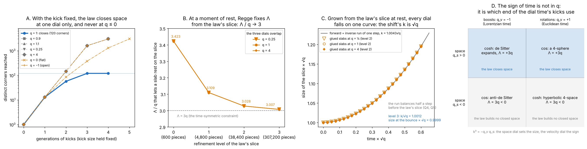

# Round 16: does the law's dial q set the fused shift's k?

> **Names:** some words or symbols on this page (fused, twist) also mean something else in standard math, physics or computing, or inside this project. [NAMING-COLLISIONS.md](../../../NAMING-COLLISIONS.md) says which meaning is in play.

*DRAFT, Nov 27 2026. Not versioned, not proved in Lean. Follows round 15 (`../round15/`), whose reading through the fused shift is reused unchanged, and rounds 12–14 (the law-sized and law-grown 3-sphere, and the glued slabs with time in them). Checks: `checks.py` → `checks_output.txt` (**7 / 7 pass**, about 37 s; numpy, scipy, sympy), numbers in `results.json`. Picture: `figures.py` → `figures/f23`. Colour key: **blue = the law, orange = Regge read-back, grey = reference**.*

Brennan's ask (Nov 27, his words): "Test whether q sets k". Round 15 found that, read through the fused shift a → 1 + k·a, the glued universe grows like de Sitter with Λ = 3k², and that at the bounce the space curvature is q = k². The question here is whether the law's curvature dial q actually fixes k, and with it Λ, de Sitter's length and the bounce size, rather than k being put in. It also asks whether q fixes the time step, and whether it fixes the sign of time. Electromagnetism as loops moves to round 17.

## Verdict first

1. **The dial is a scale (Q1).**
   - The law at dial q is exactly the law at q = 1 with every velocity multiplied by √q. This holds exactly in fractions.
   - So the corners the law grows at q are round 13's 600-cell shrunk by √q: a 3-sphere of radius 1/√q. Round 12 already read its curvature back as q.
2. **With the kick held fixed, only one dial closes space (Q2).**
   - Kicks of a fixed size close into the 600-cell's 120 corners only at the dial where √q × kick = tan 36°.
   - Slightly off that dial (q = 0.9 or 1.1), far off it (¼ or 4), flat (q = 0) or open (q = −1), the corners never close: over 3,000 corners by the fifth generation.
   - So q is not free relative to the kick: closure fixes it. At q ≤ 0 the law builds no closed space at all.
3. **At a moment of rest, Regge's constraint fixes Λ from the law's slice (Q3).**
   - A slab can rest on the law's slice for one value of Λ only, and Λ/q → 3 under refinement: 3.4225, 3.1095, 3.0275, 3.0069. The gap shrinks by 4 per level, and the value is the same at q = ¼, 1 and 4 to 2e-12.
   - This is the textbook constraint for a moment of time symmetry (space curvature 6/a² = 2Λ), here on pieces the law built. So **Λ = 3q, and k = √q**.
4. **Grown from that slice, the universe follows the shift with k = √q (Q4).**
   - The glued slabs are grown from rest on the law's slice, with that Λ, and read through the fused shift.
   - They are one step's forward run plus its inverse run, with k/√q = 1.0171, 1.0043 and 1.0012 at levels 1–3.
   - The two runs balance at size 1/√q (0.9999 × 1/√q at level 3), and the result is the same at every dial to 1e-7.
   - The balance point sits half a step before the slice. That is where the first step off rest is centred, and it is the one place round 14 saw a first-order effect (its check N4).
   - **So the dial sets the shift: de Sitter's length, the bounce size and the horizon are all 1/√q.**
5. **The time step is not tied to q, and nothing needs it to be (Q5).**
   - Steps from about a quarter down to a fourteenth of a space edge give the same k to 0.06%.
   - The step is a free choice that the growth rate doesn't depend on. It plays the role of the lapse, and nothing is left for the dial to fix there.
6. **The sign of time is not in q (Q6).**
   - At a moment of rest Λ = 3q in either signature. But the slices then grow as cosh or cos depending on the signature too: **k² = −q_v·q_s**.
   - Here q_s is the space dial, and q_v is the velocity dial: −1 for boosts (relativity's end) and +1 for rotations.
   - The space dial sets the size, and the velocity dial sets the sign.
   - Because the law closes space only at q_s > 0, Λ comes out positive. With relativity's boosts that gives an expanding de Sitter universe. With rotations it gives a 4-sphere.
   - Which end of the dial time's kicks use is still a choice. Round 15 already made that choice when it composed the boost loops at q = −1.
7. **What q does not settle: the number of pieces (Q7).**
   - In units of the law's own pieces, Λ is about 1 on the 600-cell (Λ·edge² = 1.31). It falls by about 4 with each halving of the edges: 0.46, 0.11, 0.025.
   - So q fixes k only relative to the pieces. The count of refinements is still an input.
   - If the pieces were Planck-sized, matching today's Λ (Λ·ℓ_P² ≈ 2.9e-122) would take about 202 halvings. That is the cosmological constant problem restated as a count of pieces, not solved.

**Does this open a lead?**
- **It sharpens one, modestly.** Two things are honestly ours:
  - Λ's sign comes out positive because the law closes space only at q > 0.
  - Λ's size, relative to the law's pieces, is set by closure.
- **The core relation Λ = 3q at a moment of rest is textbook.** It is the time-symmetric constraint, and the law adds only the slice it applies to.
- **No new number comes out.** Λ is traded for q, and q, measured in Planck units, for a count of pieces.
- **The sign of time stays a choice:** the velocity end of the dial.
- **The lead worth testing next:** whether something in the law fixes the number of refinements, for example a smallest kick it allows. That would be the first place a real value of Λ could come from. I don't have a reason yet to expect one.

*f23. A: corners reached by each generation of kicks, with the kick's size held fixed. Only q = 1 closes, at the 600-cell's 120 corners; q = 0.9, 1.1, ¼ and 4, flat q = 0 and open q = −1 run on past 3,000. B: the Λ/q at which a slab can rest on the law's slice, at four refinements, for q = ¼, 1 and 4 (the points overlap); it falls to 3. C: slabs grown from rest on the law's slice at q = ¼, 1 and 4, rescaled by √q; they fall on one curve, the fused shift's forward plus inverse run. D: the sign table k² = −q_v·q_s. The space dial's sign decides whether the law closes space; the velocity dial's sign decides whether the closed universe expands (cosh) or is a 4-sphere (cos).*

## What the checks show

| Check | What it tests | Result |
|---|---|---|
| Q1 (exact) | the law at q is the law at 1 with velocities × √q; the grown corners scale by 1/√q | 200 rational cases exact; corners at q = ¼ and 4 match to 0 |
| Q2 | with the kick fixed, which dials close space | only q = 1 (120 corners); 0.9, 1.1, ¼, 4, 0 and −1 pass 3,000 |
| Q3 | Λ for which a slab rests on the law's slice | Λ/q = 3.4225, 3.1095, 3.0275, 3.0069; same for all q to 2e-12 |
| Q4 | grow from rest and read through the shift | k/√q = 1.0171, 1.0043, 1.0012; size × √q = 0.9999; same for all q to 1e-7 |
| Q5 | does the time step matter | k the same to 0.06% for steps of 0.27, 0.13, 0.07 edge |
| Q6 (exact) | the sign of time | Λ = 3q_s at rest in both signatures; k² = −q_v·q_s |
| Q7 | Λ in units of the law's pieces | 1.307, 0.464, 0.106, 0.025; about 202 halvings to today's Λ at Planck size |

## How it's computed

- **Q1.** The law's 3D addition is checked in exact fractions at q = s² against the q = 1 law with both velocities scaled by s. Round 13's growth (each kick and its reverse, applied with the law to every point reached) is then rerun at q = ¼ and 4 with kicks tan 36°/√q, and the corners are compared with round 13's, scaled.
- **Q2.** The same growth with the kick held at tan 36° while q varies. A point counts as new if it is more than 1e-7 from every point so far on the sphere of radius 1/√q (or in the chart for q ≤ 0). The run stops at 3,000.
- **Q3.** Round 14's static slab (both ends the same size a = 1/√q, strut τ = 0.05·a) over the law's slice at each of four refinement levels. Varying the strut gives the constraint, which for a static slab holds where the timelike deficit term equals Λ × the 4-volume, so Λ* = tl/V.
- **Q4.** Round 14's slab-by-slab growth from rest, with Λ = Λ* of the same level and steps of 0.025/√q. Round 15's reading through the shift is applied from the third slice on. That reading uses the 3-term recurrence, a forward run (1 + kτ)ⁿ plus an inverse run, and a least-squares fit.
- **Q5.** The same at level 2 with three steps. Each run is read from the third slice on and also whole (mirrored to the past), and the balance point is given in steps.
- **Q6.** sympy: Friedmann's equations with a moment of rest at a = 1, for both signatures and both signs of space curvature. It solves for Λ, reads the shift's k² from a″ = k²a, and checks the cosh or cos solution.
- **Q7.** Λ* times the mean edge (chord) squared of the law's slice at each level. The observed Λ·ℓ_P² ≈ 2.9e-122 is approximate, from Λ ≈ 1.1e-52 m⁻² (Planck 2018) and ℓ_P = 1.616e-35 m.

## What is textbook and what is ours

| Item | Status | Source |
|---|---|---|
| Moment of time symmetry: space curvature = 2Λ, so Λ = 3/a² for a round 3-sphere | **Textbook** | Einstein's constraint equations; de Sitter 1917 |
| De Sitter with closed slices: a = cosh(kt)/k, k² = Λ/3; anti-de Sitter and the 4-sphere as the other signs | **Textbook** | de Sitter 1917; Hawking & Ellis 1973 |
| Regge's method, Lorentzian slabs | **Textbook method** | Regge 1961; Collins & Williams 1973 |
| The cosmological constant problem (Λ·ℓ_P² ≈ 10⁻¹²²) | **Textbook** | Weinberg 1989 |
| Velocity space hyperbolic for boosts, spherical for rotations | **Textbook** | Thomas 1926; Ungar 2008 |
| The law's dial as a scale; corners grown at any q | **Ours** (simple, exact) | Q1 |
| Fixed kicks close space at one dial only, never at q ≤ 0 | **Ours** (computed) | Q2 |
| Λ fixed from the law-built slice; the universe grown from it reads k = √q through the fused shift | **Ours** (the reading; the physics is textbook) | Q3, Q4 |
| k² = −q_v·q_s: the space dial sets the size, the velocity dial the sign | **Ours** (bookkeeping of two textbook facts) | Q6 |

## Caveats

- **Only the 600-cell closure was found.** Q2 tests icosahedral kicks at seven dials. Other kick sizes or directions may close into other shapes at other values of √q × kick; each would give its own Λ relative to its pieces.
- **The moment of rest is assumed.** The law's slice is taken as the bounce, with zero expansion. A slice taken mid-expansion would need a velocity as well, and q would then give a radius but not Λ by itself.
- **Vacuum only.** Λ is the only source. With matter, the rest constraint shares the curvature between Λ and the matter density.
- **The first step off rest.** Read whole, the run converges at first order in the step (2.3%, 1.1%, 0.5%). The k quoted in Q4 and Q5 is read after it. The balance point sits half a step before the slice at every step.
- **Euclidean slabs are not built.** Q6's Euclidean rows come from Friedmann's equations, not from Euclidean Regge pieces.
- **The sign of time is a choice.** It is the velocity end of the dial (q = −1), which round 15 used for the boost loops. Nothing here derives it.

## Next rounds

- **Round 17: electromagnetism as loops** (parked from this round). Maxwell's equations with Whitney forms on the law-grown 3-sphere.
  - First results at levels 0–2: the photon spectrum approaches (n + 1)² (4.04, 9.08, 16.14 at level 2) with 6, 16 and 30 modes. Each level splits into two hands, ±2.01 (3 + 3) and ±3.00 (8 + 8).
  - Round 10's charge-½ twist, placed on the 3-sphere as the Hopf field, is a lowest photon of one hand (overlap 1.0000). Its mirror image is the other hand.
- **Does anything in the law fix the number of refinements?** For example, a smallest kick. That is the only route seen here to an actual value of Λ.
- **Lean**, on a machine that has it.

## Sources

- W. de Sitter, "On the relativity of inertia" (1917).
- T. Regge, "General relativity without coordinates", Nuovo Cimento 19 (1961) 558.
- P. A. Collins and R. M. Williams, "Dynamics of the Friedmann universe using Regge calculus", Phys. Rev. D 7 (1973) 965.
- S. W. Hawking and G. F. R. Ellis, *The Large Scale Structure of Space-Time* (1973).
- S. Weinberg, "The cosmological constant problem", Rev. Mod. Phys. 61 (1989) 1.
- L. H. Thomas, Nature 117 (1926) 514; A. A. Ungar, *Analytic Hyperbolic Geometry and Albert Einstein's Special Theory of Relativity* (2008).
- Planck Collaboration, "Planck 2018 results. VI. Cosmological parameters" (2018), for Λ.
