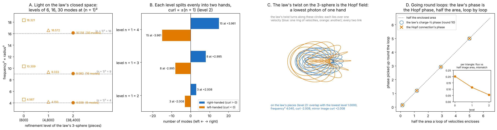

# Round 17: electromagnetism as loops on the law's own 3-sphere

*DRAFT, Nov 27 2026. Not versioned, not proved in Lean. Follows round 16 (`../round16/`) and builds on round 13's law-grown 3-sphere and round 10's charge-½ twist (`../round10/`), using the twisted-boost law (`../../twisted-boosts/`). Checks: `checks.py` → `checks_output.txt` (**6 / 6 pass**, about 4 minutes; numpy, scipy), numbers in `results.json`. Picture: `figures.py` → `figures/f24`. Colour key: **blue = the law, orange = loop read-back, grey = reference**.*

This is the electromagnetism step that rounds 15 and 16 deferred. It is part of Brennan's standing goal to "keep pushing until we are able to build them all in spacetime". Round 8 got Maxwell's equations by varying a loop action on a smooth background. Here light lives directly on the loops of the glued flat pieces the law grew, with no smooth background. It is a static closed space with no charges.

## Verdict first

1. **The loop bookkeeping is exact on the law's pieces (E1).**
   - The potential is a number on each edge, and a triangle's flux is the sum around its edges.
   - Going around a triangle after a gradient gives zero, and the flux out of each closed piece is zero, in integers. So a change of gauge leaves every loop's flux unchanged.
   - The glued space has the topology of the 3-sphere: one connected part, no loop that isn't a boundary (b₁ = 0), and Euler number 0. So light has no zero modes there.
2. **Light's spectrum on the closed space (E2).**
   - With Whitney's forms on the pieces, the lowest modes come in clusters of 6, 16 and 30, as on a smooth 3-sphere.
   - Their frequency² approaches (n + 1)² = 4, 9 and 16: at level 2 the values are 4.038, 9.082 and 16.138, all within 1%. The error falls by about 4 per refinement.
   - In a universe of radius a, light's frequencies are (n + 1)/a.
3. **Each level splits evenly into two hands (E3).** The handedness form (curl) gives 3 + 3 modes at ±2.008, 8 + 8 at ±2.995 and 15 + 15 at ±3.961. On the 3-sphere, light comes in both hands equally.
4. **The law's twist is the Hopf fibre (E4).**
   - At q = +1, the law's boosts divided by their size are exactly the unit 3-sphere, SU(2).
   - Composing two of them gives the boost to u ⊕ v times a turn along the fibre by half the twist. Projecting a boost to the velocity sphere gives its velocity, and the fibre turn doesn't move it.
   - Around a loop of velocities, the Hopf connection's phase equals round 10's charge-½ phase: half the enclosed area, to 1e-5 for four loops.
   - **So round 10's charge ½ is the Hopf bundle, with one unit of flux.**
5. **On the law's 3-sphere, that connection is a lowest photon of one hand (E5, E6).**
   - Placed on the pieces the law grew, the Hopf field lies entirely in the lowest level, with overlap 1.0000 and frequency² 4.040 at level 2.
   - It has one hand (curl −2.008, with the pieces oriented outward). Its mirror image has the other (+2.008).
   - Its flux through each triangle is half the area that triangle covers on the velocity sphere. The summed mismatch falls by about half with each refinement: 0.20, 0.11, 0.055.

**Does this open a lead?**
- **One modest one.** Rounds 9 and 10 had to assume a hidden 2-sphere for the twist to act on. Here that 2-sphere appears as the base of the Hopf map of the 3-sphere the law grows, and the law's twist becomes a photon on that 3-sphere. So the charge-½ twist and light are the same object seen from two sides.
- **The weak link is the identification of the two 3-spheres:**
  - one is the space the law grows from its 3D form (rounds 12–13);
  - the other is the group of its 2D boosts.
  - They are matched here by the standard ℝ⁴ = ℂ², not derived from the law.
- **The next test:** whether the law's own 3D composition on the 3-sphere matches the boost group's multiplication, up to the law's twist. If it does, the identification is forced and the lead firms up.
- **Everything else here is textbook:**
  - the spectrum and the two hands on the 3-sphere;
  - Whitney forms;
  - the Hopf field as a photon.
- **Light itself is not one-handed.** Only the law's own field picks a hand, and which hand depends on orientation, as round 10 already said.

*f24. A: light's lowest frequencies² on the law's 3-sphere at three refinements, against (n + 1)² = 4, 9, 16; at level 2 they come in 6, 16 and 30 modes. B: each level split by the handedness form at level 2: equal numbers of right-handed (blue) and left-handed (orange) modes at curl ±(n + 1). C: the Hopf circles (stereographic picture), along which the law's twist turns. Each circle lies over one velocity, and every two link. The numbers are for the Hopf field placed on the law's pieces. D: the phase picked up around four loops of velocities. Round 10's charge-½ phase from the law (blue circles) and the Hopf connection's phase (orange crosses) both equal half the enclosed area (grey). Inset: per triangle of the law's pieces, the mismatch between flux and half the image area, by level.*

## What the checks show

| Check | What it tests | Result |
|---|---|---|
| E1 (exact) | loop bookkeeping, gauge, topology | d1·d0 = d2·d1 = 0 in integers; b₀ = 1, b₁ = 0, Euler 0; gauge moves fluxes by 2e-15 |
| E2 | light's spectrum | clusters of 6, 16, 30 at 4.038, 9.082, 16.138 (level 2), error falling about 4× per level |
| E3 | two hands | 3 + 3 at ±2.008, 8 + 8 at ±2.995, 15 + 15 at ±3.961 |
| E4 | the law's twist as the Hopf fibre | 500 pairs to 1e-15; loop phases = half area = Hopf phase to 1e-5 |
| E5 | the Hopf field on the law's pieces | overlap 1.0000 with the lowest level; curl −2.008, mirror +2.008 |
| E6 | flux per triangle vs half the image area | mismatch 0.20, 0.11, 0.055 |

## How it's computed

- **Pieces.** Round 13's corners grown by the law at q = +1, refined twice with the law's half kicks (600, 4,800 and 38,400 pieces). They are placed on the unit 3-sphere in ℝ⁴ and oriented so that each piece's frame plus the outward direction is right-handed.
- **E1.**
  - Incidence matrices d0 (edges × corners), d1 (triangles × edges) and d2 (pieces × triangles), built from the integer orientation rules.
  - Ranks are taken densely at levels 0 and 1, giving b₀ and b₁.
  - The gauge test adds a random gradient to a random edge potential.
- **Whitney matrices.** In each flat piece's own 3D frame, the Whitney 1-forms λᵢ∇λⱼ − λⱼ∇λᵢ are integrated exactly. That gives the mass ∫W·W, the curl-curl ∫curl W·curl W and the helicity ∫W·curl W, assembled with the global edge signs.
- **E2.** The generalised eigenproblem K x = ω² M x, solved with shift-invert at 12.5. It picks out the 52 modes of the first three levels, ahead of the gradient null space.
- **E3.** The helicity form restricted to each level's modes, using their M-orthonormal basis, and diagonalised.
- **E4.** B̂(u) = [[1, u], [−ū, 1]]/√(1 + |u|²). Composition is checked against B̂(u ⊕ v)·diag(c̄/|c|, c/|c|) with c = 1 − ū v. The projection is g σ₃ g†.
  - The loops are round 10's four caps, each walked in 3,000 steps composed with the law.
  - The Hopf phase is Σ arg⟨ψₖ, ψₖ₊₁⟩ along the lifted spinors ψ = B̂(u)'s first column.
- **E5.** The Hopf 1-form A = x₁dx₂ − x₂dx₁ + x₃dx₄ − x₄dx₃ (the mirror flips the second pair) is integrated exactly along each edge, since A is linear along the straight edge. Then its Rayleigh quotients and its overlap with the lowest level's six modes are taken.
- **E6.** The flux d1·a through each triangle, against half the signed area of the triangle's image under the Hopf map (z₁, z₂) ↦ (2 z₁z̄₂, |z₁|² − |z₂|²).

## What is textbook and what is ours

| Item | Status | Source |
|---|---|---|
| Fields on loops (cochains), gauge invariance, Whitney forms | **Textbook** | Whitney 1957; Bossavit 1988; Arnold, Falk & Winther 2006 |
| Light's spectrum on the 3-sphere, (n + 1)² with 2n(n + 2) modes, curl ±(n + 1) | **Textbook** | Hodge Laplacian on spheres (e.g. Ikeda & Taniguchi 1978) |
| SU(2) → S² (Hopf map), its connection's phase = half the area | **Textbook** | Hopf 1931 |
| The Hopf field as a curl eigenfield: a photon with knotted, linked field lines | **Textbook** | Rañada 1989 |
| Light on the law-grown pieces | **Ours** (computed) | E1–E3 |
| The law's normalised q = +1 boosts as SU(2), with its twist as the fibre turn | **Ours** (a direct reading of the law; the group fact is textbook) | E4 |
| Round 10's charge-½ twist = the Hopf connection = a lowest photon of one hand on the law's 3-sphere | **Ours** (the identification) | E4–E6 |

## Caveats

- **Two 3-spheres matched by convention.** The law's space (its 3D form, rounds 12–13) and its 2D boost group are matched through ℝ⁴ = ℂ², not by the law. Testing that is the next step.
- **Light only, with no charges and no time.** These are the modes of light on a static closed space. Time dependence (frequency (n + 1)/a) is read off, not evolved on round 14's slabs. Charged matter is not coupled here.
- **The frequencies are slightly high at each level** (0.9% at level 2), because the flat pieces sit inside the sphere. They converge at second order.
- **Hands are conventions.** Which one is −2 depends on the orientation of the pieces and of ℂ². What is fixed is that the law's field and its mirror image have opposite hands.
- **Run time.** Level 2's eigensolve takes about 3 minutes, and the dense ranks for b₁ are taken only at levels 0 and 1.

## Next rounds

- **Does the law's 3D composition on the 3-sphere equal the boost group's multiplication, up to its twist?** If yes, the two 3-spheres are one, and the Hopf picture comes from the law itself.
- **Light on round 14's growing slabs:** evolve Maxwell's field in time on the glued spacetime and check that it redshifts as 1/a.
- **Does anything in the law fix the number of refinements** (round 16's open input for Λ)?
- **Lean**, on a machine that has it.

## Sources

- H. Whitney, *Geometric Integration Theory* (1957).
- A. Bossavit, "Whitney forms: a class of finite elements for three-dimensional computations in electromagnetism", IEE Proc. A 135 (1988) 493.
- D. N. Arnold, R. S. Falk and R. Winther, "Finite element exterior calculus", Acta Numerica 15 (2006) 1.
- A. Ikeda and Y. Taniguchi, "Spectra and eigenforms of the Laplacian on Sⁿ and Pⁿ(ℂ)", Osaka J. Math. 15 (1978) 515.
- H. Hopf, "Über die Abbildungen der dreidimensionalen Sphäre auf die Kugelfläche", Math. Ann. 104 (1931) 637.
- A. F. Rañada, "A topological theory of the electromagnetic field", Lett. Math. Phys. 18 (1989) 97.
