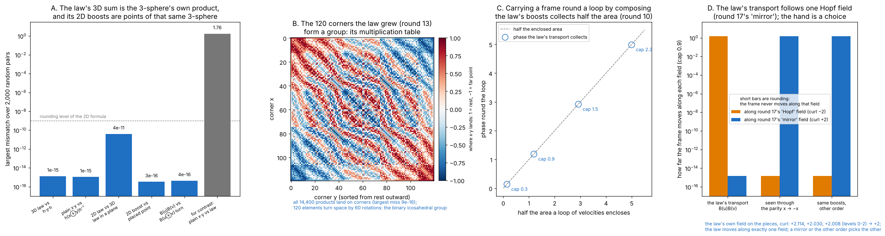

# Round 18: are the law's two 3-spheres one?

*DRAFT, Nov 27 2026. Not versioned, not proved in Lean. Follows round 17 (`../round17/`) and uses round 13's law-grown corners and round 10's charge-½ twist, with the twisted-boost law (`../../twisted-boosts/`). Checks: `checks.py` → `checks_output.txt` (**6 / 6 pass**, about 5 seconds; numpy, scipy), numbers in `results.json`. Picture: `figures.py` → `figures/f25`. Colour key: **blue = the law, orange = the mirror or the other order, grey = reference**.*

> **Prior-art note (DRAFT, added Nov 27 from the [prior-art audit](../prior-art-audit/), section 8):** the closed form of the 3D law used here is the κ-addition of the constant-curvature machine-learning papers, with κ = q (Bachmann, Bécigneul and Ganea, ICML 2020, arXiv:1911.05076, Eq. 2; audit check K1).

Round 17 found that the law's charge-½ twist is a lowest photon on the 3-sphere the law grows. It named its own weak link: two different 3-spheres were matched by the standard ℝ⁴ = ℂ², not by the law. One is the space the law grows from its 3D form (rounds 12–13). The other is the group of its 2D boosts (round 10). This round compares the law's own operations directly. It is part of Brennan's standing goal to "keep pushing until we are able to build them all in spacetime".

## Verdict first

1. **The space the law grows is the unit-quaternion group, and the law is its symmetric product (G1).**
   - At q = +1, place each point of the law's chart on the 3-sphere as round 13 did. Then x ⊕ y lands exactly at h·y·h, where h is the law's half kick of x and · is the quaternion product.
   - The plain product x·y is the same point turned by h (h (x ⊕ y) h⁻¹). The plain product differs from the law by up to 1.76, so the match is not trivial.
2. **The 2D law is the 3D law in a plane, and each 2D boost is a point of the grown space (G2).**
   - Each boost B̂(u) of round 10, divided by its size, is the point at its velocity's half kick.
   - Round 10's factorization B(u)B(v) = B(u ⊕ v) × (fibre turn) is then just the quaternion product, with the fibre turn a right turn about the plane's normal.
   - **So the two 3-spheres are one, and the match round 17 assumed is the law's own.**
3. **The 120 corners the law grew (round 13) are a group (G3).** All 14,400 products land on corners, and rest is the identity. Each corner's reverse kick is its inverse. It is the binary icosahedral group: 120 elements turning space by the 60 rotations of the icosahedron.
4. **The law's own transport picks one of the two Hopf fields (G4).**
   - Carry a frame round a loop of velocities by composing the law's boosts. The frame moves along one field only, and never along the other. The phase it collects is half the enclosed area, as in round 10.
   - The field it follows is the one round 17 called the **mirror** field.
5. **The law has no hand of its own (G5).**
   - The law is unchanged by reflections of space and by the parity x → −x.
   - On the 3-sphere, the parity is conjugation q → q̄. Conjugation reverses products, so it swaps the two fields. Seen through the parity, the law's transport follows the other field.
   - Composing the same boosts in the other order does the same.
   - So the photon's hand is set by the orientation together with the order of composition (round 10's B(u)B(v)), not by the law.
6. **On the law's pieces, the law's own field is a lowest photon (G6).** Frequency² tends to 4 and curl to **+2** (4.567, 4.157, 4.040 and +2.114, +2.030, +2.008 at levels 0–2), with the pieces oriented outward as in round 17.

**Correction to round 17.** Round 17's README calls the law's twist "the Hopf field, curl −2.008". With round 10's order of composition and round 17's orientation, the law's field is the one round 17 called the mirror field, curl +2.008. Round 17's other findings stand: the spectrum, the two hands, the half-area phase and the overlap of 1.0000 hold for either field. Round 17 is frozen, so the correction is recorded here.

**Does this open a lead?**
- **It firms up round 17's lead.** The charge-½ twist and light are the same object, and that no longer rests on a borrowed identification. The law grows a group, and its boosts are that group's points.
- **It points to a sharper next test.** At q = +1 the law's space is SU(2), and the law is its symmetric product √x·y·√x. The same construction on positive matrices gives the boosts of special relativity. So: is the law at q = −1 the symmetric product of the Lorentz group's boosts, in the same way? If it is, the law's two signs would be the two halves of one group, rotations and boosts. That is the spacetime step. This is a question, not a result.
- **What is textbook:** unit quaternions as SU(2) and the 3-sphere; the symmetric product as a gyrogroup; the 600-cell as the binary icosahedral group; left and right Hopf fibrations, swapped by conjugation.
- **What is ours:** that this law, at q = +1, is exactly that symmetric product under round 13's placement; that round 13's grown corners close into the group; and that round 10's transport is the right-multiplication Hopf connection.

*f25. A: the largest mismatch over 2,000 random pairs for each identity in G1 and G2 (blue), on a log scale. All sit at rounding (the 2D formula's 4e-11 is rounding near its denominator). For contrast, the plain product against the law (grey) differs by 1.76. B: the multiplication table of the 120 corners the law grew. Colour shows where x·y lands, from rest (red) to the far point (blue). Every product is a corner. C: the phase collected by carrying a frame round four loops of velocities with the law's boosts (blue circles), against half the enclosed area (grey). D: how far the frame moves along each of round 17's two fields, for the law's transport, for the same transport seen through the parity, and for the boosts composed in the other order. The law moves along exactly one field, and the mirror or the other order picks the other. Below: the law's own field on the pieces, curl tending to +2.*

## What the checks show

| Check | What it tests | Result |
|---|---|---|
| G1 (exact) | the 3D law as the symmetric quaternion product | h·y·h vs the law 1e-15; x·y vs h(x ⊕ y)h⁻¹ 1e-15; plain x·y vs the law 1.76 |
| G2 (exact) | the 2D law in a plane; boosts as points; the factorization as a product | 4e-11; 3e-16; 4e-16 |
| G3 (exact) | the grown corners as a group | 120 corners, closure 9e-16, inverses 5e-16, 60 rotations |
| G4 | the law's transport against the two fields | along the mirror field ≤ 1e-15; phase = half area to 1e-5, four loops |
| G5 | no hand of its own | law under parity and reflection 0; parity = conjugation 0; mirrored and reversed transports follow the other field |
| G6 | the law's field on the pieces | frequency² 4.040, curl +2.008 at level 2 |

## How it's computed

- **Placement.** to_s3(x) = (1 − |x|², 2x)/(1 + |x|²), round 13's inverse stereographic map, read as a unit quaternion (w, x, y, z). The half kick is h(x) = x/(1 + √(1 + |x|²)) at q = +1.
- **G1.** For 2,000 random pairs, compare to_s3(x ⊕ y) with h·to_s3(y)·h, where h = to_s3(half kick of x).
- **G2.** A complex velocity u goes into the chart as (0, Re u, Im u). Compare the 3D law with (u + v)/(1 − ū v). Compare the placed point with B̂(u) = [[1, u], [−ū, 1]]/√(1 + |u|²) written as a quaternion. Compare B̂(u)B̂(v) with B̂(u ⊕ v)·e^{iα}, α = −arg(1 − ū v).
- **G3.** Round 13's corners (icosahedron kicks at tan 36°, plus the far point) are multiplied pairwise. Each product is matched to the nearest corner, and the rotations q v q̄ are counted.
- **G4.** Round 10's four caps, each walked in 3,000 steps. The frame is updated g → g·B̂(step). The movement along each field is the sum of the field at each step's midpoint dotted with the step.
- **G5.** The parity and a reflection are applied to 2,000 random pairs. The transport is repeated through conjugation, and with the order B̂(step)·g.
- **G6.** The law's field x₁dx₂ − x₂dx₁ − (x₃dx₄ − x₄dx₃) is integrated along each edge of the pieces (levels 0–2). Its Rayleigh quotients are taken with round 17's Whitney matrices.

## What is textbook and what is ours

| Item | Status | Source |
|---|---|---|
| Unit quaternions = SU(2) = the 3-sphere | **Textbook** | Hamilton; any Lie groups text |
| √x·y·√x as a gyrogroup (Möbius and Einstein additions) | **Textbook** | Ungar's gyrogroup work; Lawson & Lim on symmetric sets (exact references to confirm) |
| The 600-cell's vertices as the binary icosahedral group | **Textbook** | Coxeter, *Regular Polytopes* |
| Left and right Hopf fibrations; conjugation swaps them | **Textbook** | Hopf 1931; standard |
| This law at q = +1 as that symmetric product under round 13's placement | **Ours** (computed) | G1, G2 |
| Round 13's grown corners close into the group | **Ours** (computed) | G3 |
| Round 10's transport as the right Hopf connection; the hand as a choice | **Ours** (computed) | G4, G5 |

## What is still open

- Whether the q = −1 law is the symmetric product of boosts in the Lorentz group (the next round).
- Light on round 14's expanding slabs, with its 1/a redshift.
- What fixes the number of refinements (round 16).
- Lean proofs, deferred to a machine that has Lean.
