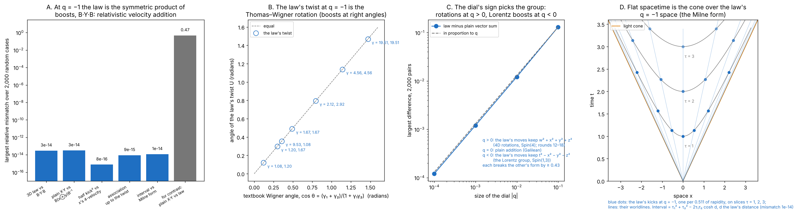

# Round 19: is the law at q = −1 the boosts of special relativity?

> **Names:** some words or symbols on this page (⊕, twist) also mean something else in standard math, physics or computing, or inside this project. [NAMING-COLLISIONS.md](../../../NAMING-COLLISIONS.md) says which meaning is in play.

*DRAFT, Nov 27 2026. Not versioned, not proved in Lean. Follows round 18 (`../round18/`), using the twisted-boost law (`../../twisted-boosts/`) and round 16's finding that the dial is a scale. Checks: `checks.py` → `checks_output.txt` (**6 / 6 pass**, under a second; numpy), numbers in `results.json`. Picture: `figures.py` → `figures/f26`. Colour key: **blue = the law, orange = textbook special relativity, grey = reference**.*

Round 18 found that at q = +1 the law is the 3-sphere's group product taken symmetrically, x ⊕ y = h·y·h. This round asks the same question at q = −1. Put the law's points on the velocity hyperboloid, write them as 2×2 positive Hermitian matrices (the 4-velocities of special relativity), and let the Lorentz group SL(2,ℂ) stand where SU(2) stood. It is part of Brennan's standing goal to "keep pushing until we are able to build them all in spacetime".

## Verdict first

1. **At q = −1 the law is the symmetric product of boosts (H1).** x ⊕ y lands exactly at B·Y·B, where B is the law's half kick of x. The plain product differs only by a turn. This is round 18's statement with the Lorentz group in place of the 3-sphere's group.
2. **The half kick is the pure boost to x (H2).** B is positive Hermitian with determinant 1, and its square is x's 4-velocity, so B carries rest to x. Then x ⊕ y is y seen after boosting by x: **relativistic velocity addition**. A chart radius r stands for the speed 2r/(1 + r²).
3. **The law's twist at q = −1 is the Thomas–Wigner rotation (H3).** B(x)B(y) = B(x ⊕ y)·U with U a rotation, and the same U is the turn by which the law fails to associate. For boosts at right angles its angle matches the textbook Wigner angle, cos θ = (γ₁ + γ₂)/(1 + γ₁γ₂), for seven pairs from γ = 1.08 to 19.5.
4. **The dial's sign picks the group (H4).**
   - At q = +1 the law's moves keep w² + x² + y² + z²: rotations of 4D Euclidean space, Spin(4).
   - At q = −1 they keep t² − x² − y² − z²: the Lorentz group, Spin(1,3). Neither keeps the other's form.
   - Any other q is one of these rescaled (round 16). As q → 0 the law becomes plain vector addition, the Galilean limit, with the difference shrinking in proportion to q.
5. **Flat spacetime is the cone over the law's q = −1 space (H5, H6).**
   - Scaling each 4-velocity by a proper time τ fills the future light cone.
   - The spacetime interval between events (τ₁, x) and (τ₂, y) is τ₁² + τ₂² − 2τ₁τ₂ cosh d, with d the law's own distance. This is the Milne form of flat spacetime.
   - The law's repeated kicks step by equal rapidities, so each slice of the cone carries the law's own lattice.

**Does this open a lead?**
- **No new lead.** Every statement here is textbook special relativity once the law is recognised: Einstein's velocity addition, boosts as positive matrices, the Wigner rotation and the Milne cone.
- **What it does is close a gap honestly.** One formula, read at its two signs, is the rotation group of the 3-sphere (rounds 12–18) and the Lorentz group of special relativity. This gives round 16's sign rule (k² = −q_v·q_s, with time's sign set by the velocity dial) its meaning: a negative velocity dial makes the law's velocities relativistic.
- **What it doesn't do.** It doesn't say why the velocity dial is negative. That sign is still an input, as round 16 found. The spacetime here is flat; the curvature came from rounds 12–16's glued pieces.
- **The natural next step** is to put the two signs together in one curved spacetime: de Sitter space has the 3-sphere's group in its space slices and the Lorentz group in each local frame. Can round 14's slabs be built from the law at both signs at once?

*f26. A: the largest relative mismatch over 2,000 random cases for each identity (blue), on a log scale, against the plain product compared with the law (grey, 0.47). B: the angle of the law's twist for seven pairs of boosts at right angles (blue circles), against the textbook Wigner angle (grey line). C: the law minus plain vector addition as the dial shrinks (blue), against a line in proportion to q (grey). The text gives the form each sign keeps. D: the future light cone (orange) with slices τ = 1, 2, 3 (grey hyperbolas). Blue dots are the law's kicks at q = −1, one per 0.511 of rapidity, placed on each slice; blue lines are their worldlines.*

## What the checks show

| Check | What it tests | Result |
|---|---|---|
| H1 (exact) | the law at q = −1 as B·Y·B | 3e-14 relative, 2,000 pairs; plain product vs the law 0.47 |
| H2 (exact) | the half kick as the pure boost | B² vs the 4-velocity 8e-16; speed = 2r/(1 + r²) to 4e-16 |
| H3 (exact) | the twist as the Wigner rotation | association up to U 9e-15; seven right-angle pairs vs Wigner's formula 5e-14 |
| H4 | the sign picks the group | Euclidean form kept to 7e-16 (q = +1), Minkowski to 1e-14 (q = −1); cross-breaking ≥ 0.43; slope 1.011 as q → 0 |
| H5 (exact) | the Milne cone | interval vs the Milne form 1e-14, 2,000 pairs of events |
| H6 (exact) | equal rapidity steps | 13 points, spread 2e-15 |

## How it's computed

- **Placement.** to_h3(x) = (1 + |x|², 2x)/(1 − |x|²), the inverse stereographic map onto the hyperboloid X₀² − |X|² = 1. A 4-vector is written as the Hermitian matrix X₀ + X·σ, whose determinant is the Minkowski form. The half kick at q = −1 is x/(1 + √(1 − |x|²)).
- **H1.** For 2,000 random pairs in the ball of radius 0.9, compare the matrix of x ⊕ y with B·Y·B, and X·Y with B (x ⊕ y) B⁻¹.
- **H2.** Check B Hermitian, det B = 1, B² = X and B·1·B† = X.
- **H3.** U = B(x ⊕ y)⁻¹B(x)B(y). Check that it is unitary, and that x ⊕ (y ⊕ z) = (x ⊕ y) ⊕ (U z U†) for 2,000 triples. The angle is 2 arccos(tr U/2).
- **H4.** For 50 random half kicks, build the 4×4 real matrix of y ↦ h·y·h (quaternions, q = +1) and of Y ↦ B·Y·B (matrices, q = −1), and test which quadratic form each keeps. The rescaling test uses q = −2, −0.5, 0.3 and 1.7.
- **H5.** Random proper times from 0.2 to 3. The interval is det(τ₂Y − τ₁X), and the law's distance is 2 artanh|(−x) ⊕ y|.

## What is textbook and what is ours

| Item | Status | Source |
|---|---|---|
| Einstein (Möbius) velocity addition as a gyrogroup; the symmetric product on positive matrices | **Textbook** | Ungar's gyrovector spaces |
| SL(2,ℂ) as the Lorentz group; 4-vectors as Hermitian matrices | **Textbook** | any relativity or group theory text |
| Thomas–Wigner rotation and its angle | **Textbook** | Thomas 1926; Wigner 1939 |
| The Milne form of flat spacetime | **Textbook** | Milne 1935 |
| S³ and H³ as compact and non-compact partners, Spin(4) and Spin(1,3) | **Textbook** | symmetric spaces (Helgason) |
| This law with one dial, read at both signs, as both groups under rounds 13 and 18's placements | **Ours** (computed, but a direct consequence of the textbook items) | H1, H4 |

## What is still open

- Why the velocity dial is negative (round 16's sign of time).
- de Sitter from the law at both signs at once (the next round).
- Light on round 14's expanding slabs, with its 1/a redshift.
- What fixes the number of refinements (round 16).
- Lean proofs, deferred to a machine that has Lean.
