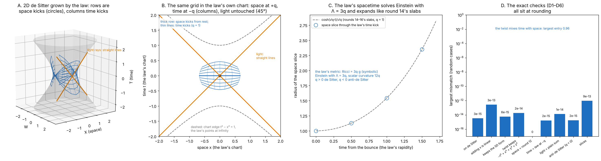

# Round 20: de Sitter spacetime from the law, with space and time in one law

*DRAFT, Nov 27 2026. Not versioned, not proved in Lean. Follows round 19 (`../round19/`) and joins it to rounds 14–16's slabs (`../round16/`), using the twisted-boost law (`../../twisted-boosts/`). Checks: `checks.py` → `checks_output.txt` (**6 / 6 pass**, about 5 seconds; numpy, sympy), numbers in `results.json`. Picture: `figures.py` → `figures/f27`. Colour key: **blue = the law, orange = light, grey = reference**.*

> **Prior-art note (DRAFT, added Nov 27 from the [prior-art audit](../prior-art-audit/), section 8):** the law with a Lorentzian norm giving de Sitter is in print: Nesterov and Sabinin, Phys. Rev. D 62, 081501(R) (2000), hep-th/0010159. Where this page says it hasn't been found written in this form, read it as known.

Rounds 18 and 19 found that the law's two signs are two groups: at q > 0 the 3-sphere's rotations, at q < 0 the Lorentz boosts. Round 16 needed two dials of opposite sign for space and for time (k² = −q_v·q_s). This round keeps the law exactly as it is, with one dial q, and changes only its dot product to the Lorentzian one, a·b = −a₀b₀ + a₁b₁ + a₂b₂ + a₃b₃, on 4D points (t, x, y, z). It is part of Brennan's standing goal to "keep pushing until we are able to build them all in spacetime".

## Verdict first

1. **The law becomes de Sitter space's own move (D1).** At q = +1 the law's points lie on 4D de Sitter space, W² − T² + X² + Y² + Z² = 1. Adding x is a linear map of the 5D space that keeps that form, has determinant 1 and carries rest to x: a de Sitter symmetry. This is round 18's statement with de Sitter in place of the 3-sphere.
2. **The law's twist is a Lorentz transformation of the local frame (D2).** The turn by which the law fails to associate keeps −t² + x² + y² + z², and it mixes time with space, so it includes boosts. Round 19's Lorentz group now sits in every local frame, as a twist of the same law.
3. **One dial, three behaviours (D3).**
   - **Along space** the law is round 12's 3D law at +q: the sphere.
   - **Along time** it is the law at −q: (a + b)/(1 + ab), rapidity addition, the Lorentz side of round 19.
   - **Along a light ray** it is plain addition, untouched by the dial.
   - **So round 16's two dials of opposite sign come from one dial and the Lorentzian dot product.**
4. **The law's spacetime solves Einstein's equations with Λ = 3q (D4, symbolic).** The law's own metric, ds² = 4 η(dx, dx)/(1 + q η(x, x))², has Ricci = 3q·g and scalar curvature 12q. That is Einstein's equations with no matter and Λ = 3q: de Sitter of radius 1/√q. **This is the same Λ = 3q that round 16 read from the glued slabs at a moment of rest.**
5. **The dial's sign picks the spacetime (D5).** q > 0 gives de Sitter (Λ > 0, an expanding universe) and q < 0 gives anti-de Sitter (Λ < 0). Any other q is one of these rescaled.
6. **The expansion of rounds 14–16 is the law's own (D6).** The law's time kick of rapidity τ from rest reaches the event (W, T) = (cosh τ, sinh τ). The space slice there is a 3-sphere of radius cosh τ, the cosh(kt)/k of round 14's slabs with k = √q.

**Does this open a lead?**
- **A modest one.** Rounds 12–19 had separate pieces: the 3-sphere (q > 0), the Lorentz boosts (q < 0), the slabs' expansion and Λ = 3q. Here they are one law on spacetime with one dial: space at +q, time at −q, light untouched, Λ = 3q, de Sitter's expansion. Round 16's rule that time's dial has the opposite sign to space's stops being a separate input.
- **What is still put in:** the Lorentzian dot product. So "why does time differ from space?" becomes "why is the law's dot product Lorentzian?". That is one geometric input in place of two dial signs, not an explanation.
- **What is textbook:** de Sitter and anti-de Sitter as pseudo-spheres, their conformally flat chart and its metric, Ricci = 3q·g, de Sitter's cosh slicing. The law with a Lorentzian dot is the formal continuation of Möbius addition. I haven't found it written in this form, but it follows from textbook facts, so treat it as expected rather than new.
- **What is ours:** using the same law, word for word, on spacetime; the reading of round 16's sign rule as the signature; the match of its Λ = 3q to round 16's slabs.
- **What is missing:** this is empty de Sitter. Matter and the forces of rounds 1–17 have not yet been placed in it.

*f27. A: 2D de Sitter (the grey hyperboloid) with a grid grown by the law. Rows are space kicks, which close into circles; columns are time kicks. The orange lines are light rays, which are straight lines on the hyperboloid. B: the same grid in the law's own chart. The thick row through rest is space kicks; the thin lines are time kicks. Light runs at 45° (orange). The dashed curves t² − x² = 1 are the chart's edge, the law's points at infinity. C: the radius of the space slice through the law's time kick of rapidity τ (blue circles), against cosh τ, round 14's slab size (grey). The text gives the symbolic Einstein result. D: the largest mismatch in each exact check, all at rounding; the twist's largest time-space entry is 0.96.*

## What the checks show

| Check | What it tests | Result |
|---|---|---|
| D1 (exact) | the law as a de Sitter symmetry | on de Sitter 3e-15; 30 random x: linear 3e-13, form kept 6e-15, det − 1 6e-15 |
| D2 (exact) | the twist as a Lorentz transformation | linear 7e-13, Minkowski form kept 2e-14, det − 1 7e-15; time-space entry up to 0.96 |
| D3 (exact) | space, time and light | space = round 12's law, exactly; time = (a + b)/(1 + ab) to 1e-15; light = plain addition to 2e-14 |
| D4 (exact, symbolic) | Einstein with Λ | Ricci − 3q·g = 0; Λ = 3q; scalar curvature 12q |
| D5 (exact) | the dial's sign | q = −1 lands on anti-de Sitter to 2e-15; rescaling 3e-16 |
| D6 (exact) | the slices | T = sinh τ and radius = cosh τ for τ = 0, 0.5, 1, 1.5, worst 9e-13 |

## How it's computed

- **The law.** Rounds 12–19's formula, unchanged, with the dot product η(a, b) = −a₀b₀ + a₁b₁ + a₂b₂ + a₃b₃.
- **Placement.** x ↦ (1 − q η(x, x), 2√q x)/(√q (1 + q η(x, x))) in 5D, the inverse stereographic map of rounds 13, 18 and 19. Random points are kept away from the chart's edge, where 1 ± η(x, x) vanishes.
- **D1.** For each of 30 random x, fit the 5D linear map that carries 400 placed points y to the placed x ⊕ y. Check the fit and that the map keeps the 5D form.
- **D2.** For 20 random pairs, undo x ⊕ y on the left of x ⊕ (y ⊕ z), fit the 4×4 map from z, and test which form it keeps.
- **D4.** sympy computes the Christoffel symbols, Ricci tensor and Einstein tensor of the law's metric symbolically, with q a free positive symbol. Separately, six steps of size 1e-6 confirm that the law's distance and the placement give that metric.
- **D6.** The time kick of rapidity τ sits at chart position tanh(τ/2). Its placement gives (W, T). 500 points of the slice T = sinh τ are mapped into the chart and back.

## What is textbook and what is ours

| Item | Status | Source |
|---|---|---|
| de Sitter and anti-de Sitter as pseudo-spheres; SO(1,4) symmetry; local Lorentz frames | **Textbook** | Hawking & Ellis 1973 |
| The conformally flat chart, metric 4η/(1 + qη)², Ricci = 3q·g, Λ = 3q | **Textbook** | standard |
| de Sitter's global slicing, radius cosh(kt)/k | **Textbook** | de Sitter 1917 |
| Möbius addition continued to an indefinite dot product | **Textbook** (in print, found by the prior-art audit; this round first marked it expected, not found written this way) | Nesterov & Sabinin, Phys. Rev. D 62, 081501(R) (2000) |
| The same law on spacetime giving space +q, time −q, light untouched | **Ours** (computed) | D3 |
| Round 16's sign rule as the signature; its Λ = 3q matched | **Ours** | D3, D4 |

## What is still open

- Why the law's dot product is Lorentzian (the one input left from round 16's sign rule).
- Matter and the forces of rounds 1–17 placed in the law's de Sitter space.
- Light on round 14's expanding slabs, with its 1/a redshift.
- What fixes the number of refinements (round 16).
- Lean proofs, deferred to a machine that has Lean.
