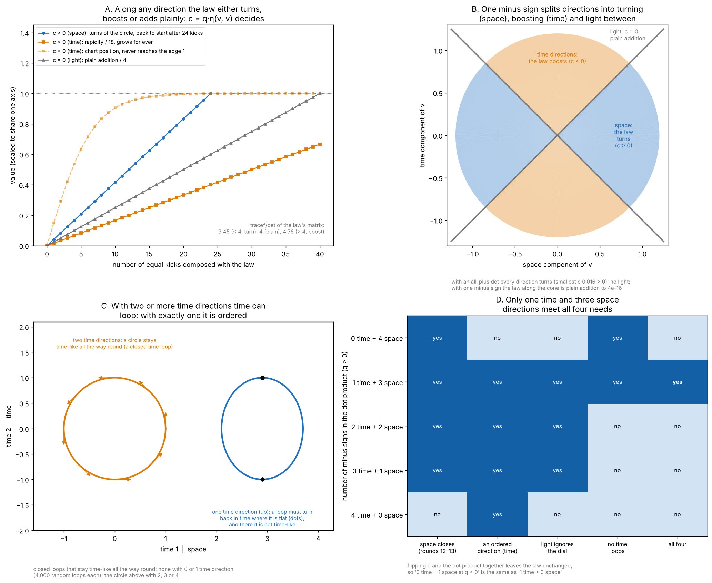

# Round 21: why Lorentzian?

*DRAFT, Nov 27 2026. Not versioned, not proved in Lean. Follows round 20 (`../round20/`), which built de Sitter spacetime from the law with one dial q and a dot product with one minus sign. Brennan chose this round: look for what in the law, if anything, makes time's sign differ from space's. Checks: `checks.py` → `checks_output.txt` (**5 / 5 pass**, about 1 second; numpy), numbers in `results.json`. Picture: `figures.py` → `figures/f28`. Colour key: **blue = space (the law turns), orange = time (the law boosts), grey = light and reference**.*

## Verdict first

**The law doesn't choose the minus sign by itself.** What it does is give the sign a meaning. Then four plain needs pick exactly one time direction and three space directions.

1. **The law has exactly two kinds of direction, plus the edge between them (W1).**
   - Along any direction v, the law is the 1D law with dial c = q·η(v, v). That is a Möbius map with matrix [[1, a], [−c a, 1]].
   - **If c > 0 it turns.** Repeated kicks go round and come back exactly (24 kicks of 15° return to the start, to 1e-16). This is the space that closes in rounds 12–13.
   - **If c < 0 it boosts.** Repeated kicks march one way for ever, in equal rapidity steps, and never reach the chart's edge. This direction is ordered, with a horizon.
   - **If c = 0 it is plain addition.**
   - Only the sign of c matters, and the law sees only q times the dot product. So "time" in the law means **a direction along which the law boosts instead of turning**.
2. **Light needs a minus sign (W2).** The law ignores the dial along v exactly when η(v, v) = 0. With an all-plus dot product, no direction escapes the dial. With one minus sign, a whole cone does, and along it the law is plain addition (to 4e-16). So a signal whose speed no dial changes exists only if the dot product has a minus sign.
3. **Time loops unless exactly one direction boosts (W3).**
   - With one boosting direction, any closed curve has to stop moving in time somewhere. There it isn't time-like, so time is ordered. None of 4,000 random closed loops stayed time-like.
   - With two or more, a circle in the time plane stays time-like all the way round: a closed time loop.
4. **Round 15's own reading of time needs the boosting kind (W4).** Round 15 read time as the fused shift: a forward run of the law plus its inverse run.
   - Along a boosting direction, the two runs share only their start, the bounce (no meetings in 400 steps).
   - Along a turning direction, they meet again every half turn (20 meetings). Time built that way would have no single bounce.
5. **Only one time and three space directions meet all four needs (W5):**
   - a space that closes (rounds 12–13);
   - an ordered direction (time);
   - light that ignores the dial;
   - no time loops.

   Flipping the dial's sign and the dot product's together leaves the law unchanged (exactly), so three minus signs with q < 0 is the same answer.

**Does this open a lead?**
- **No new lead, but it narrows the question.** "Why one minus sign?" becomes "why does exactly one direction boost while the rest turn?". The law's own vocabulary (turn, boost, plain) makes the four needs easy to state and check. The answer still rests on those needs.
- **What stays an input:** the needs themselves. Closed space comes from choosing q > 0 for space, as in rounds 12–13. Light is the demand for a dial-free signal. No time loops is the demand for an ordered time. None of these is derived from the law.
- **The one piece that is ours and ties back to the model:** round 15's fused-shift reading of time works only along a boosting direction (W4). So our own reading of time and the Lorentzian sign are consistent, and each needs the other.
- **What is textbook:**
  - the elliptic, parabolic and hyperbolic kinds of Möbius map;
  - null directions existing only for an indefinite form;
  - closed time-like curves with two or more times;
  - arguments that one time direction is needed for an ordered, predictable world (Dorling 1970; Tegmark 1997).

*f28. A: repeated equal kicks with the law along three kinds of direction, scaled to share one axis. Turning (blue) goes round and is back at the start after 24 kicks. Boosting (orange) grows in rapidity for ever, while its chart position creeps up to the edge 1 without reaching it. Plain (grey) adds evenly. B: with one minus sign, directions in a time-space plane split into those where the law boosts (orange, time), those where it turns (blue, space), and the light cone between (grey), where it adds plainly. C: with two time directions, a circle stays time-like all the way round (orange). With one, a closed loop must turn back in time where it runs flat (black dots), and there it isn't time-like (blue). D: for 0 to 4 minus signs (q > 0), which of the four needs are met. Only one time and three space meets all four.*

## What the checks show

| Check | What it tests | Result |
|---|---|---|
| W1 (exact) | the law's kinds of direction | 24 turning kicks return to 1e-16; 40 boosting kicks strictly increase, stay below 1, equal rapidity steps to 3e-12; trace²/det 3.45, 4, 4.76 |
| W2 (exact) | light needs a minus sign | the law along v = the 1D law with c = q·η(v, v) to 8e-13; all-plus smallest c 0.016 > 0; light cone plain to 4e-16 |
| W3 | time loops | explicit time-like circles for 2, 3 and 4 time directions; none among 4,000 random loops for 0 or 1 |
| W4 (exact) | the fused shift | runs meet 0 times (boosting) vs 20 times (turning) in 400 steps |
| W5 (exact) | the table | only 1 time + 3 space meets all four; the law is unchanged when both signs flip (0) |

## How it's computed

- **The law.** Rounds 12–20's formula, unchanged, with its dot product as a parameter.
- **W1.** The 1D law x ↦ (x + a)/(1 − c a x), iterated from 0 with c = +1 (a = tan 7.5°), c = −1 (rapidity step 0.3) and c = 0. The kind comes from trace²/det of [[1, a], [−c a, 1]], compared with 4.
- **W2.** For 5,000 random directions and both dot products, compare the law along v with the 1D law at c = q·η(v, v) (q = 0.5). Points near the far point, where both blow up, are left out.
- **W3.** For p minus signs, the circle in the first two coordinates is tested directly. 4,000 random closed loops (four Fourier modes) are tested for being time-like at every one of 400 points. For p = 1 the reason is general: the time coordinate of a closed loop has a turning point, and there the loop's velocity is purely spatial.
- **W4.** A forward run and an inverse run of 400 steps along each kind of direction, counting where they meet after the start.

## What is textbook and what is ours

| Item | Status | Source |
|---|---|---|
| Elliptic, parabolic and hyperbolic Möbius maps | **Textbook** | any complex analysis or hyperbolic geometry text |
| Null directions need an indefinite form | **Textbook** | linear algebra |
| Closed time-like curves with two or more times; one time for an ordered world | **Textbook** | Dorling 1970; Tegmark 1997 |
| "Time" = the law's boosting kind of direction; the four needs checked in the law's terms | **Ours** (a restatement) | W1, W2, W5 |
| Round 15's fused-shift time needs the boosting kind | **Ours** | W4 |

## What is still open

- What, if anything, would force exactly one boosting direction from inside the model, rather than from the four needs.
- Forces in the law's de Sitter spacetime, starting with light and its redshift (the other option for this round).
- What fixes the number of refinements (round 16).
- Lean proofs, deferred to a machine that has Lean.
