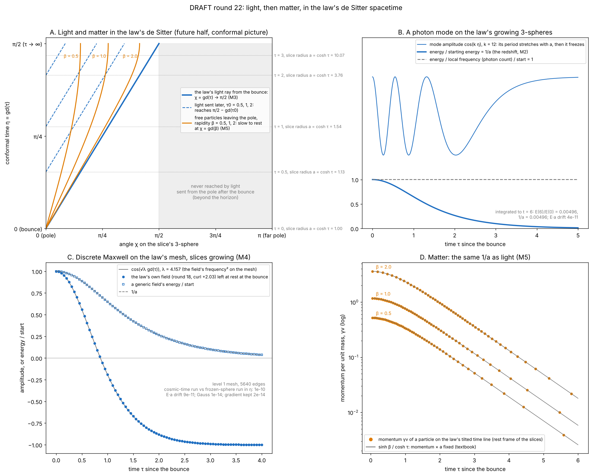

# Round 22: light, then matter, in the law's de Sitter spacetime

> **Names:** some words or symbols on this page (⊕, twist) also mean something else in standard math, physics or computing, or inside this project. [NAMING-COLLISIONS.md](../../../NAMING-COLLISIONS.md) says which meaning is in play.

*DRAFT, Nov 27 2026. Not versioned, not proved in Lean. Follows round 20 (`../round20/`), which built de Sitter spacetime from the law (one dial q, a dot product with one minus sign), and round 21 (`../round21/`), which asked why the sign is Lorentzian. This round is the other branch Brennan was offered: put the forces into the law's spacetime, light first. Checks: `checks.py` → `checks_output.txt` (**5 / 5 pass**, about 30 seconds; numpy, scipy, sympy), numbers in `results.json`. Picture: `figures.py` → `figures/f29`. Colour key: **blue = light, orange = matter, grey = reference**.*

## Verdict first

**Light and matter sit in the law's de Sitter exactly the textbook way. Nothing breaks, and nothing new appears.**

1. **Maxwell reads back unchanged (M1).**
   - In the law's own chart, Maxwell's equations on the curved spacetime are exactly the flat ones. The law's metric is 4η/(1 + qη)², and the factor cancels from the light equations in 4D for every q.
   - So any light wave moving along a light ray of the chart is a solution on the curved spacetime.
   - This is textbook (Maxwell's equations are conformally invariant in 4D, Bateman 1910). What is ours is only that the conformal factor is the law's.
2. **Light redshifts as 1/a (M2).**
   - On the law's slices, 3-spheres of radius a = cosh τ (round 20 D6), a photon mode of frequency k obeys d/dτ(a dA/dτ) + k²A/a = 0.
   - The solution is A = cos(k·gd(τ)), where gd(τ) = ∫dτ/a is the conformal time.
   - Its energy is exactly k²/(2a), which is the redshift. Its local frequency is k/a, so the photon count (energy ÷ frequency) never changes.
   - Light sent at the bounce has only k/4 cycles left in its whole future. Round 17's lowest photon (k = 2) has half a cycle.
   - Checked symbolically, and by direct integration out to a ≈ 200 for k = 2 to 40.
3. **The law's own light ray is light's path, and it shows the horizon (M3).**
   - Along a light direction the law is plain addition (round 20 D3). Its straight chart line from rest places at angle χ = gd(τ) on the slice at time τ.
   - So it reaches χ = π/2, a quarter of the way round the 3-sphere, and no further.
   - Light sent later, at τ0, is built by adding the ray to the law's time kick. It reaches π/2 − gd(τ0).
   - The far hemisphere is never reached. This is de Sitter's event horizon (textbook), here traced by the law's own sums.
4. **The law's mesh carries the same light (M4).**
   - On round 18's level 1 mesh (corners grown and cut by the law, 5,640 edges), discrete Maxwell with the slices growing is exactly the frozen 3-sphere's wave equation in conformal time.
   - So the discrete light inherits the redshift exactly. A generic field's energy × a holds to 9e-11, and its energy falls to 0.0366 = 1/a at a = 27.3.
   - The law's own field (round 18's "mirror" Hopf field, curl +2.03) left at rest at the bounce follows cos(√λ·gd(τ)), with λ = 4.157 (smooth value 4), to 2e-3. It isn't quite one mode on the mesh, which is why the match isn't closer.
   - A pure-gauge gradient never moves, and Gauss's law with no charge is kept to 1e-14.
5. **Matter: the law's tilted time lines are free particles (M5).**
   - A chart line through rest along a time-like direction, where the law boosts (round 21), places into a 2-plane through the 5D origin. So it is a de Sitter geodesic (textbook), and the law's sums along it are rapidity addition.
   - A particle leaving the pole at the bounce with rapidity β has momentum γv = sinh β / cosh τ (to 1e-11). Momentum × a stays fixed: the same 1/a as light.
   - It slows to rest with the expansion at angle gd(β). Light, the limit β → ∞, gives π/2, which is M3.

**Does this open a lead?**
- **No new lead.** Every result here is the textbook behaviour of light and free matter in de Sitter space:
  - conformal invariance;
  - the cosmological redshift;
  - the event horizon;
  - momentum falling as 1/a.
- **What it does settle:** the law's spacetime from round 20 isn't only a metric with the right curvature. Its own operations carry the physics directly.
  - The law's light-ray sums are light's paths.
  - The law's time-like sums are free particles.
  - The law's own field on the law's own mesh redshifts correctly.
  - Nothing conflicts with the textbook.
- **One small tie that is ours:**
  - The redshift factor is the slice radius cosh τ, which is the law's time kick read in 5D (round 20 D6).
  - The horizon angle π/2 is the law's light ray's whole reach.
  - Both are consequences of rounds 18–20 rather than new inputs.
- **What this round doesn't do:** it doesn't make light or matter from the law. The photon's equation is Maxwell's, put in by hand on the law's spacetime, as in round 17. Matter is free point particles with no forces between them. The forces' own sources (charge, mass) and gravity pulling back on the matter are still open.

*f29. A: the future half of the law's de Sitter, drawn with conformal time up and angle on the slice across. Light from the pole at the bounce (thick blue) reaches χ = π/2 as τ → ∞. Light sent later (dashed) reaches less far, and the grey half is never reached (the horizon). Free particles (orange) leave the pole and slow to rest at χ = gd(β). Dotted lines mark slices and their radius a = cosh τ. B: a photon mode (k = 12) on the growing 3-spheres: the wave's period stretches with a and then freezes, its energy falls as 1/a, and energy ÷ local frequency stays 1. C: discrete Maxwell on the law's mesh with the slices growing. The law's own field follows cos(√λ·gd(τ)), and a generic field's energy follows 1/a. D: the momentum of the law's free particles against sinh β / cosh τ.*

## What the checks show

| Check | What it tests | Result |
|---|---|---|
| M1 (exact, symbolic) | Maxwell on the law's spacetime = flat Maxwell in the chart | √−g g^ac g^bd = η^ac η^bd, all 256 entries, any q; a wave f(t − x) solves div F = 0 and dF = 0 |
| M2 (exact) | the mode equation, redshift and photon count | cos(k·gd τ) solves it (symbolic, and numeric 7e-15); E·a = k²/2 to 3e-14; integration to a = 202 matches to 4e-11 for k = 2, 3, 4, 12, 40; local half period = πa/k to 0.4% while short |
| M3 (exact) | the law's light ray and the horizon | χ = gd(τ) to 2e-16; reaches π/2; sent at τ0 = 0.5, 1, 2 reaches π/2 − gd(τ0) to 1e-6 |
| M4 | the same light on the law's mesh | cosmic-time run = frozen-sphere run in η to 1e-10; E·a drift 9e-11; law's field vs cos(√λ gd τ) 2e-3; gradient kept 2e-14; Gauss 1e-14 |
| M5 (exact) | free matter | in a plane through the 5D origin to 1e-16; speed at bounce = tanh β; γv·a = sinh β to 1e-11; final angle gd(β) |

## How it's computed

- **The law.** Rounds 12–21's formula, unchanged. Round 20's Lorentzian dot product and placement into 5D, (W, T, X, Y, Z) on W² − T² + X² + Y² + Z² = 1.
- **Slices.** Global time τ from T = sinh τ. The angle χ on that slice's 3-sphere is measured from the pole (1, 0, 0, 0).
- **M1.** sympy on the law's metric with coordinates (t, x, y, z) and symbolic q. Uses the wave A = f(t − x) dy with an arbitrary function f.
- **M2.** The action ∫ a Ȧ²/2 − k²A²/(2a) dτ for one mode of the curl-curl operator on the unit 3-sphere (eigenvalues k² = 4, 9, 16, …). Checked symbolically, then integrated directly from A = 1, Ȧ = 0 at the bounce, without using the closed form.
- **M3.** The chart line s(1, 1, 0, 0) placed for s up to 1e7. Later light comes from the law's sum p ⊕ s(1, 1, 0, 0), with p = (tanh(τ0/2), 0, 0, 0) the law's time kick of rapidity τ0.
- **M4.** Round 18's level 1 mesh and Whitney forms, code copied unchanged. Mass matrix M and curl-curl matrix K. In cosmic time: A' = M⁻¹P/a, P' = −KA/a. Two runs from the bounce: the law's field plus a random gradient at rest; and a random gradient-free field with a random gradient-free velocity, compared against the static run M A'' + K A = 0 in η = gd(τ).
- **M5.** The chart line u(cosh β, sinh β, 0, 0), u from 0 to 1 (τ → ∞), with exact derivatives in u. Speed relative to the slices is v = cosh τ · dχ/dτ.

## What is textbook and what is ours

| Item | Status | Source |
|---|---|---|
| Maxwell's equations conformally invariant in 4D | **Textbook** | Bateman 1910; Wald, *General Relativity* (1984), App. D |
| Redshift as 1/a; photon number kept; modes on S³ | **Textbook** | any cosmology text; Birrell & Davies (1982) |
| de Sitter's event horizon; conformal diagram | **Textbook** | Hawking & Ellis (1973); Gibbons & Hawking (1977) |
| Geodesics of de Sitter as plane sections; momentum × a fixed | **Textbook** | Hawking & Ellis (1973) |
| Discrete Maxwell with Whitney forms; 3+1 split | **Textbook** | Whitney 1957; Bossavit (1998) |
| The conformal factor, light rays and free particles are the law's own operations | **Ours** (from rounds 18–21) | M1, M3, M5 |
| The law's own field and mesh carry the redshift | **Ours** (a check, textbook in form) | M4 |

## What is still open

- Sources: charge on the law's mesh, and whether round 10's charge 1/2 makes a source of light rather than a field.
- Gravity pulling back: matter in the law's spacetime changes the law's curvature (the step from de Sitter to a universe with matter in it).
- The other forces (round 17's non-abelian twist) on the expanding slices.
- What fixes the number of refinements (round 16).
- Lean proofs, deferred to a machine that has Lean.
